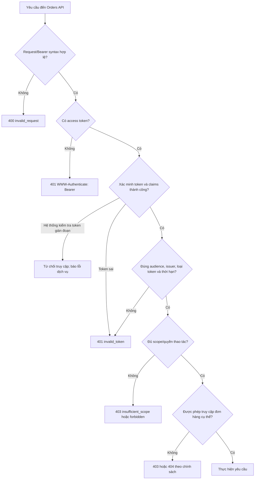

# Authentication failure và thông tin trả về

## Mục tiêu bài học

Trong hệ thống dùng **security token**, thất bại xác thực (*authentication failure*) không chỉ là “sai mật khẩu”. Yêu cầu có thể thiếu token, mang token hết hạn, token bị thu hồi, token dành cho API khác, sai chữ ký hoặc gửi nhầm **ID token** thay **access token**. API cũng có thể đã xác thực đúng nhưng vẫn phải từ chối vì người dùng **không có quyền** thao tác dữ liệu. Mỗi loại thất bại cần xử lý đúng, nhất quán và hạn chế tiết lộ thông tin.

Sau bài này, bạn có thể:

- Phân biệt **authentication failure** với **authorization failure**, lỗi request và sự cố máy chủ.
- Chọn HTTP status phù hợp: `400`, `401`, `403`, `404`, `429` và `5xx`.
- Hiểu ý nghĩa header `WWW-Authenticate` và các lỗi Bearer theo OAuth 2.0.
- Thiết kế thông báo hướng tới **client**, **người dùng cuối** và **log vận hành** mà vẫn bảo vệ dữ liệu nhạy cảm.
- Xử lý có chủ đích thất bại trong đăng nhập, JWT/opaque access token, refresh token, OAuth 2.0 và OIDC.
- Kiểm thử các tình huống lỗi để phát hiện nguy cơ rò rỉ tài khoản, token, quyền hoặc chi tiết nội bộ.

Bài thuộc chương **Authentication** trong module `SECURITY_TOKEN_SECURITY_FUNDAMENTALS`. Phạm vi xuyên suốt là vòng đời token, mô hình tin cậy, claims, scope, audience, lưu trữ, thu hồi và phòng chống đánh cắp/phát lại.

## 1. Xác thực thất bại xảy ra ở đâu?

Hãy xét một hệ thống gồm ứng dụng quản lý đơn hàng, authorization server và Orders API:

1. Người dùng nhập thông tin đăng nhập tại ứng dụng.
2. Authorization server xác thực người dùng hoặc client, xét chính sách rồi cấp token nếu hợp lệ.
3. Ứng dụng gửi **access token** tới Orders API.
4. Orders API xác minh token, kiểm tra `issuer`, `audience`, thời hạn, loại token, quyền và quyền trên đơn hàng cụ thể.
5. API trả dữ liệu hoặc thông tin lỗi.

Có nhiều loại lỗi khác nhau trên hành trình đó:

| Vị trí thất bại | Ví dụ | Bản chất | Thành phần thường quyết định |
| --- | --- | --- | --- |
| Đăng nhập | Sai mật khẩu, mã MFA không hợp lệ | Không chứng minh được danh tính | Identity provider / login service |
| Xác thực client | Client secret sai, không đủ bằng chứng client | Client không xác thực được | Authorization server |
| Token endpoint | Authorization code đã dùng, refresh token không còn hợp lệ | Không đủ điều kiện đổi/cấp token | Authorization server |
| API resource server | Thiếu hoặc sai access token; token hết hạn, sai audience | Không có thông tin xác thực API hợp lệ | API / authentication middleware |
| Phân quyền tại API | Token hợp lệ nhưng thiếu `orders:write` | Đã xác thực nhưng không được phép hành động | API / authorization policy |
| Kiểm tra dữ liệu | Nhân viên không được xem đơn hàng của tenant khác | Thiếu quyền trên đối tượng cụ thể | API / nghiệp vụ |
| Hạ tầng | Không kết nối được introspection server | Không xác định được trạng thái token do sự cố | API / dịch vụ phụ thuộc |

**Nguyên tắc:** thất bại xác thực không có nghĩa là mọi thứ đều phải trả cùng một HTTP status. Tầng nào xảy ra lỗi, giao thức nào đang được dùng và client được phép biết gì sẽ quyết định cách phản hồi.

## 2. Phân biệt authentication và authorization failure

**Authentication** trả lời: *“Ai đang yêu cầu hoặc yêu cầu này trình được bằng chứng hợp lệ không?”* Trong API Bearer, một access token phải được xác minh theo chính sách tin cậy.

**Authorization** trả lời: *“Chủ thể/client đã được xác thực có được thực hiện hành động này trên tài nguyên này không?”*

Ví dụ client gọi:

```http
PATCH /orders/42 HTTP/1.1
Host: orders-api.example.com
Authorization: Bearer <access_token>
Content-Type: application/json

{"status":"SHIPPED"}
```

Ba kết quả:

- Không có token, token hết hạn hoặc token sai audience → **chưa có bằng chứng xác thực API hợp lệ** → thường `401 Unauthorized`.
- Token hợp lệ nhưng chỉ có `orders:read` → **thiếu quyền ghi** → thường `403 Forbidden`.
- Token có `orders:write` nhưng chủ thể không được sửa đơn hàng `42` → **bị từ chối theo chính sách dữ liệu** → thường `403`; đôi khi `404` được sử dụng để không tiết lộ tài nguyên tồn tại.

Lưu ý tên chuẩn `401 Unauthorized` dễ gây hiểu nhầm: trong HTTP, mã này diễn đạt yêu cầu **thiếu thông tin xác thực hợp lệ** cho tài nguyên, dù tên chứa từ “Unauthorized”. `403 Forbidden` diễn đạt máy chủ hiểu yêu cầu nhưng từ chối thực hiện. Một `403` không nhất thiết luôn chứng minh danh tính đã được xác thực; ứng dụng vẫn cần đánh giá ngữ cảnh, song việc tách nguyên nhân “token không hợp lệ” và “không đủ quyền” là thực hành thiết kế quan trọng.

## 3. Chọn HTTP status cho đúng loại lỗi

| HTTP status | Tình huống điển hình | Thông tin thường trả |
| --- | --- | --- |
| `400 Bad Request` | Cú pháp/tham số request không hợp lệ, Bearer token truyền bằng nhiều cơ chế cùng lúc, yêu cầu OAuth sai định dạng | Mã lỗi ổn định và mô tả ngắn; không lặp dữ liệu nhạy cảm |
| `401 Unauthorized` | Thiếu access token, token hết hạn, sai chữ ký, token bị thu hồi hoặc không dành cho API | Thường kèm `WWW-Authenticate` theo HTTP authentication scheme |
| `403 Forbidden` | Xác thực hợp lệ nhưng thiếu scope, vai trò hoặc quyền truy cập tài nguyên | Thông báo không đủ quyền; có thể kèm `insufficient_scope` |
| `404 Not Found` | Không có tài nguyên hoặc cố ý che sự tồn tại của tài nguyên bị cấm | Thông báo chung, tránh xác nhận tồn tại |
| `429 Too Many Requests` | Quá giới hạn số lần đăng nhập, làm mới token hay gọi API | Thông tin giới hạn/tạm thử lại; `Retry-After` khi phù hợp |
| `500 Internal Server Error` | Lỗi chương trình hoặc cấu hình nội bộ | Thông báo chung, mã đối chiếu sự cố |
| `502` / `503` / `504` | Gateway/upstream lỗi hoặc phụ thuộc xác thực tạm không hoạt động | Lỗi dịch vụ tạm thời, gợi ý thử lại khi an toàn |

**Không đánh đồng token không hợp lệ với hạ tầng không sẵn sàng.** Ví dụ introspection endpoint đang gián đoạn không đủ bằng chứng để kết luận token đã hết hạn hay đã bị thu hồi. API phải từ chối truy cập khi không xác minh được (*fail closed*) đồng thời trả mã lỗi phù hợp với sự cố phụ thuộc theo chính sách; tránh trả `401 invalid_token` một cách sai lệch nếu nguyên nhân thực tế là `503`.

**Không mặc định `400` cho mọi lỗi:** lỗi yêu cầu đổi refresh token tại OAuth token endpoint có thể dùng `400 invalid_grant`, trong khi access token hết hạn khi gọi API thông thường dùng `401 invalid_token`. Cùng là “token hết hạn” trong ngôn ngữ đời thường, nhưng đây là **hai giao thức/tầng nhận khác nhau**.

## 4. Phản hồi Bearer token theo RFC 6750

Trong HTTP, một protected resource sử dụng Bearer access token thường phản hồi kèm **challenge** trong header `WWW-Authenticate`. Header mô tả cơ chế xác thực mà resource server chấp nhận và có thể cho client biết lỗi giao thức.

### 4.1. Thiếu token

```http
GET /orders/42 HTTP/1.1
Host: orders-api.example.com
```

Phản hồi ví dụ:

```http
HTTP/1.1 401 Unauthorized
WWW-Authenticate: Bearer realm="orders-api"
Cache-Control: no-store
Content-Type: application/json

{"error":"authentication_required","message":"Cần xác thực để truy cập tài nguyên."}
```

Theo hướng dẫn Bearer của RFC 6750, khi client **chưa gửi thông tin xác thực**, server nên tránh đưa thêm `error` hoặc mô tả lỗi chi tiết trong challenge; chỉ nêu scheme/realm khi cần. JSON body trên là mã lỗi ứng dụng, tách biệt với tên lỗi Bearer trên header.

### 4.2. Token sai, hết hạn hoặc bị thu hồi

```http
GET /orders/42 HTTP/1.1
Host: orders-api.example.com
Authorization: Bearer <expired_token>
```

Phản hồi ví dụ:

```http
HTTP/1.1 401 Unauthorized
WWW-Authenticate: Bearer realm="orders-api", error="invalid_token"
Cache-Control: no-store
Content-Type: application/json

{"error":"invalid_token","message":"Thông tin xác thực không hợp lệ hoặc đã hết hiệu lực."}
```

Trong RFC 6750, `invalid_token` bao gồm token hết hạn, bị thu hồi, hỏng hoặc không hợp lệ theo cách khác. Điều này **không yêu cầu** API tiết lộ cụ thể “sai chữ ký”, “không có user” hoặc “audience không khớp” cho client chưa đáng tin. Client có thể xử lý một nhóm lỗi `invalid_token` như yêu cầu lấy token mới nếu quy trình của client cho phép.

### 4.3. Token hợp lệ nhưng thiếu quyền

```http
PATCH /orders/42 HTTP/1.1
Host: orders-api.example.com
Authorization: Bearer <valid_read_only_token>
```

Phản hồi ví dụ:

```http
HTTP/1.1 403 Forbidden
WWW-Authenticate: Bearer realm="orders-api", error="insufficient_scope", scope="orders:write"
Cache-Control: no-store
Content-Type: application/json

{"error":"insufficient_scope","message":"Không đủ quyền thực hiện thao tác."}
```

`scope` trong challenge có thể giúp client biết phạm vi quyền cần thiết. **Chỉ đưa thông tin scope khi việc tiết lộ đó phù hợp với chính sách**; không dùng phản hồi quyền để tiết lộ vai trò nội bộ, dữ liệu tenant hoặc quy tắc nghiệp vụ nhạy cảm.

### 4.4. Yêu cầu trình Bearer token sai cú pháp

Client gửi token đồng thời qua nhiều cơ chế không được phép, lặp thông số xác thực hoặc có cú pháp Bearer request không đúng. RFC 6750 định nghĩa lỗi `invalid_request`, thường dùng `400 Bad Request` cho kiểu lỗi này.

```http
HTTP/1.1 400 Bad Request
WWW-Authenticate: Bearer realm="orders-api", error="invalid_request"
Cache-Control: no-store
Content-Type: application/json

{"error":"invalid_request","message":"Yêu cầu xác thực không hợp lệ."}
```

Đây là ví dụ, không phải yêu cầu bắt buộc mọi ứng dụng phải trả cùng một JSON body. Các thành phần proxy, framework và API gateway cần tuân thủ hợp đồng lỗi thống nhất.

### Bảng nhớ nhanh các lỗi Bearer

| `error` của Bearer | Ý nghĩa | Status thường dùng |
| --- | --- | --- |
| Không có `error` trong challenge | Chưa gửi bằng chứng xác thực hoặc không nên công bố chi tiết | `401` |
| `invalid_request` | Cấu trúc/trình bày yêu cầu xác thực không hợp lệ | `400` |
| `invalid_token` | Access token không hợp lệ, không còn hiệu lực hoặc không được chấp nhận | `401` |
| `insufficient_scope` | Access token không đủ phạm vi quyền cần thiết | `403` |

Tên lỗi trong `WWW-Authenticate` là **lỗi chuẩn Bearer**. Không tự nhét mã nội bộ như `signature_key_missing` hoặc `database_connection_lost` vào tham số `error` và gọi đó là mã lỗi chuẩn OAuth.

## 5. Thông tin trả về cho ai và ở mức nào?

Một hệ thống tốt tách **ba đối tượng nhận thông tin**:

| Đối tượng | Cần biết | Không nên nhận |
| --- | --- | --- |
| Người dùng cuối | Có thể thực hiện bước nào: đăng nhập lại, nhập lại mã MFA, liên hệ quản trị, thử lại sau | Chữ ký, thuật toán, định danh khóa, chi tiết claims, tài khoản có tồn tại hay không |
| Client/ứng dụng | HTTP status; mã lỗi ổn định; `WWW-Authenticate`/`scope` đúng giao thức; `requestId`; cách khôi phục hợp lệ | Stack trace, raw token, secret, trạng thái khóa/thu hồi riêng tư của người khác |
| Người vận hành có quyền | Loại lỗi nội bộ, thành phần lỗi, thời điểm, đối chiếu request, trạng thái rate limit/issuer/introspection | Token đầy đủ, mật khẩu, refresh token, OTP, client secret hoặc dữ liệu riêng tư không cần cho vận hành |

Chẳng hạn cùng một lần xác thực JWT thất bại:

- **Client nhận:** `401`, `error="invalid_token"`, `requestId`.
- **Người dùng thấy:** “Phiên truy cập đã hết hiệu lực. Vui lòng đăng nhập lại.” nếu ứng dụng chắc chắn đây là luồng khôi phục thích hợp.
- **Log nội bộ:** sự kiện `token_validation_failed`, `reason=audience_mismatch`, API đích, dấu thời gian, ID tương quan đã được kiểm soát truy cập.

Không cần công bố `reason=audience_mismatch` trong phản hồi mạng. Nhưng hệ thống quan sát phải đủ dữ kiện để điều tra việc cấu hình sai hoặc khai thác.

### 5.1. Tại sao thông báo quá chi tiết nguy hiểm?

Hãy so sánh hai phản hồi đăng nhập:

```text
Không nên:
  "Không tìm thấy email alice@example.com trong hệ thống."
  "Tài khoản này tồn tại nhưng mật khẩu sai."

Nên:
  "Email hoặc mật khẩu không đúng."
```

Hai phản hồi đầu có thể giúp kẻ tấn công **liệt kê tài khoản** (*user enumeration*). Nguy cơ không chỉ nằm ở văn bản: HTTP status, thời gian xử lý, cookie, độ dài body và đường dẫn chuyển hướng cũng có thể tiết lộ khác biệt.

Tương tự, một API trả thông báo “token bị thu hồi tại 15:03 vì admin khóa tài khoản user-123” có thể để lộ dữ liệu vận hành hoặc thông tin tài khoản; `invalid_token` chung thường đủ cho client.

### 5.2. Không trộn lỗi dành cho máy với nội dung hiển thị

Mã lỗi nên ổn định và có thể xử lý bằng chương trình, ví dụ `authentication_required`, `invalid_token`, `insufficient_scope`. Thông điệp hiển thị bằng tiếng Việt/tiếng Anh có thể được thay đổi theo ngôn ngữ, thiết bị và bối cảnh.

Không viết logic client phụ thuộc chuỗi mô tả tự nhiên như `"Token expired at ..."`. Dùng mã lỗi hoặc trạng thái đã được API cam kết.

## 6. Thất bại trong đăng nhập bằng mật khẩu và MFA

### 6.1. Sai tên đăng nhập hoặc mật khẩu

Đối với một login endpoint dùng JSON (không phải OAuth token endpoint chuẩn), thiết kế có thể định nghĩa mã lỗi ứng dụng `invalid_credentials`. Ví dụ sau dùng `400` theo hợp đồng riêng của endpoint:

```http
POST /login HTTP/1.1
Host: account.example.com
Content-Type: application/json

{"identifier":"user@example.com","password":"<password>"}
```

```http
HTTP/1.1 400 Bad Request
Cache-Control: no-store
Content-Type: application/json

{"error":"invalid_credentials","message":"Thông tin đăng nhập không chính xác."}
```

Đây là **API đăng nhập tùy biến**, không áp dụng nguyên xi cho endpoint `/token` của OAuth 2.0. Hợp đồng của API cũng có thể lựa chọn `401`, nhưng theo RFC 9110, khi tạo phản hồi `401` máy chủ **phải kèm ít nhất một challenge `WWW-Authenticate`** phù hợp với tài nguyên. Không nên tùy tiện gắn `Bearer` hoặc `Basic` vào một form đăng nhập JSON nếu endpoint không hỗ trợ cơ chế xác thực đó. Trong trình duyệt, cách hiển thị lỗi có thể khác với body dành cho API.

Lưu ý: mọi trường hợp “không tồn tại tài khoản” và “mật khẩu sai” nên có phản hồi bên ngoài **tương đồng phù hợp**, đồng thời áp dụng kiểm soát thời gian và giới hạn thử sai. Không vì sợ liệt kê tài khoản mà bỏ qua các thông báo hỗ trợ cần thiết ở những luồng đã xác minh danh tính.

### 6.2. MFA chưa hoàn tất hoặc mã xác minh sai

Hệ thống có thể cần thông báo “Cần xác minh bước tiếp theo” thay vì “Sai mật khẩu”. Tuy nhiên, chỉ đưa ra chi tiết bước MFA theo **trạng thái đăng nhập đã được thiết lập hợp lệ**, không dùng thông báo đó để tiết lộ rằng một email nào đó tồn tại.

Ví dụ body của luồng ứng dụng riêng sau khi đã qua bước xác thực thứ nhất:

```json
{
  "status": "additional_verification_required",
  "challenge": "totp",
  "challengeId": "opaque-one-time-reference"
}
```

`challengeId` phải là giá trị khó đoán, giới hạn thời gian, ràng buộc đúng luồng và không tự mang quyền đăng nhập. Lỗi mã OTP/MFA cần giới hạn số lần thử, chống phát lại, xử lý đồng hồ/độ trễ có kiểm soát, và không ghi mã vào log.

### 6.3. Khôi phục mật khẩu và kiểm tra tài khoản

Với yêu cầu “quên mật khẩu”, một phản hồi **giống nhau** dù email có tồn tại hay không thường thích hợp:

```http
HTTP/1.1 202 Accepted
Cache-Control: no-store
Content-Type: application/json

{"message":"Nếu tài khoản phù hợp tồn tại, chúng tôi sẽ gửi hướng dẫn khôi phục."}
```

Phản hồi này không có nghĩa email đã được gửi thành công hoặc tài khoản chắc chắn tồn tại. Bên trong cần tiếp tục kiểm soát tần suất gửi, lạm dụng biểu mẫu, vòng đời token khôi phục và sự kiện bảo mật.

### 6.4. Khóa tài khoản và giới hạn thử sai

Sau nhiều lần sai, có thể cần `429 Too Many Requests`, giới hạn theo IP/thiết bị/tài khoản, xác minh bổ sung hoặc cơ chế phòng thủ khác. Chọn biện pháp giảm brute force mà không tạo ra cách **khóa tài khoản hàng loạt** cho người dùng hợp lệ. Thông báo bên ngoài không nên lộ chính xác các ngưỡng chống gian lận nếu điều đó tạo lợi thế cho kẻ tấn công.

## 7. Lỗi xác thực access token: JWT và opaque token

### 7.1. Danh sách điều kiện cần xác minh

Khi API nhận access token, kết quả cuối cùng phụ thuộc vào **toàn bộ** kiểm tra phù hợp với profile đã cam kết:

1. Request có mang token theo vị trí và scheme được hỗ trợ không?
2. Token có đúng **loại** dành cho API không (access token, không phải ID/refresh token)?
3. Nếu JWT: cấu trúc, chữ ký, thuật toán được phép và khóa tin cậy có hợp lệ không?
4. Nếu opaque: introspection/tra cứu có cho biết token hoạt động và metadata đáng tin không?
5. `iss` có thuộc issuer được phép không?
6. `aud` có chứa chính xác audience của API không?
7. `exp`, `nbf` và các ràng buộc thời gian có hợp lệ không?
8. Token có bị thu hồi hoặc bị hạn chế theo chính sách không?
9. `scope`, vai trò/quyền và quyền trên đối tượng cụ thể có đáp ứng yêu cầu không?

Tập claims bắt buộc phụ thuộc loại token và profile. Với JWT access token theo RFC 9068, resource server cần kiểm tra profile tương ứng, đặc biệt issuer và audience. Không nên viết validator tùy tiện chỉ dựa vào việc payload có vài khóa JSON quen thuộc.

### 7.2. Ánh xạ nguyên nhân nội bộ sang thông báo công khai

| Nguyên nhân nội bộ | Phản hồi API thường phù hợp | Điều nên tránh tiết lộ |
| --- | --- | --- |
| Không có Bearer token | `401`, challenge Bearer không cần `error` | Không tiết lộ cấu hình máy chủ |
| JWT sai chữ ký/thuật toán không được phép | `401 invalid_token` | Không nêu `kid`, thuật toán được thử hoặc khóa |
| `iss` không được tin cậy | `401 invalid_token` | Không công bố danh sách issuer nội bộ |
| `aud` khác API hiện tại | `401 invalid_token` | Không cho client tự đổi audience qua request |
| `exp` đã qua hoặc `nbf` chưa tới | `401 invalid_token` | Không cần trả toàn bộ claims và thời gian chi tiết |
| Token bị thu hồi | `401 invalid_token` | Không để lộ lý do thu hồi hoặc thông tin người dùng |
| ID token/refresh token gửi vào API | `401 invalid_token` hoặc lỗi loại token chung theo profile | Không chấp nhận token chỉ vì nó là JWT có chữ ký |
| Token hợp lệ, thiếu `orders:write` | `403 insufficient_scope` nếu đúng loại thiếu scope | Không trả danh sách quyền nhạy cảm |
| Token hợp lệ, sai tenant/không có quyền trên đơn hàng | `403` hoặc `404` theo chính sách | Không xác nhận tồn tại dữ liệu của tenant khác |
| Introspection service không truy cập được | Từ chối truy cập; `503`/lỗi dịch vụ phù hợp | Không coi thất bại mạng là bằng chứng token đã sai |

Đặc biệt, **JWT có chữ ký hợp lệ không tự chứng minh API phải chấp nhận nó**. Chữ ký chỉ là một phần của mô hình tin cậy. Kiểm tra `aud`, `iss`, đúng loại token, thời hạn và chính sách phân quyền là độc lập.

### 7.3. Về sai lệch thời gian

Máy chủ có thể áp dụng **clock skew/leeway nhỏ và có giới hạn** khi xác minh `exp` hoặc `nbf` để chịu sai lệch đồng hồ thông thường. Không dùng leeway lớn để kéo dài tùy tiện thời gian token còn hiệu lực, và không gửi cho client thời gian “bí mật” mà validator chấp nhận như một cách vượt kiểm tra.

## 8. Lỗi khi cấp và làm mới token trong OAuth 2.0

Các lỗi tại **authorization server** tuân theo ngữ nghĩa khác với lỗi Bearer do resource server trả về.

### 8.1. Token endpoint

Trong OAuth 2.0, một số mã lỗi token endpoint phổ biến gồm:

| `error` ở token endpoint | Tình huống ví dụ | Ý nghĩa |
| --- | --- | --- |
| `invalid_request` | Thiếu tham số bắt buộc, cú pháp hoặc nhiều phương thức xác thực client trong một request | Yêu cầu không hợp lệ |
| `invalid_client` | Client không xác thực thành công | Bằng chứng của client không hợp lệ |
| `invalid_grant` | Authorization code sai/đã dùng/hết hạn; refresh token sai, bị thu hồi hoặc không còn hợp lệ | Grant không còn được phép dùng |
| `unauthorized_client` | Client không được phép sử dụng grant type này | Client thiếu quyền thực hiện luồng |
| `unsupported_grant_type` | Server không hỗ trợ grant type được yêu cầu | Luồng không được hỗ trợ |
| `invalid_scope` | Phạm vi quyền yêu cầu không hợp lệ, không biết hoặc vượt phạm vi cho phép | Scope được yêu cầu không chấp nhận |

Ví dụ refresh token không còn dùng được:

```http
POST /token HTTP/1.1
Host: auth.example.com
Content-Type: application/x-www-form-urlencoded

grant_type=refresh_token&refresh_token=<refresh_token>
```

```http
HTTP/1.1 400 Bad Request
Cache-Control: no-store
Pragma: no-cache
Content-Type: application/json

{"error":"invalid_grant"}
```

Không nên trả “refresh token bị đánh cắp, token ID 123 đã bị reuse lúc 14:35” cho client. Tín hiệu reuse có thể dẫn đến thu hồi họ refresh token hoặc phiên theo chính sách, với log kiểm soát phù hợp.

Lỗi `invalid_client` **có quy tắc status/challenge riêng**: nếu client đã thử xác thực bằng header `Authorization`, OAuth 2.0 yêu cầu phản hồi `401` và `WWW-Authenticate` phù hợp cơ chế xác thực đó. Những lỗi token endpoint khác trong RFC 6749 thường trả `400`. Không áp cùng một quy tắc “token hết hạn = 401” cho refresh-token grant tại endpoint này.

### 8.2. Authorization endpoint và OIDC

Authorization endpoint có các lỗi như `invalid_request`, `unauthorized_client`, `access_denied`, `unsupported_response_type`, `invalid_scope`, `server_error`, `temporarily_unavailable`. Trong OIDC, những ngữ cảnh như `prompt=none` còn có thể gặp `login_required` hoặc `interaction_required`.

**Chỉ chuyển hướng lỗi về `redirect_uri` sau khi kiểm chứng client và URI chuyển hướng phù hợp chính sách.** Nếu `client_id` hoặc `redirect_uri` không hợp lệ, không được tự động redirect tới URL do yêu cầu cung cấp: điều đó có thể tạo điểm chuyển hướng mở hoặc lộ thông tin.

Với redirect hợp lệ, client phải kiểm tra `state` liên quan đến luồng trước khi sử dụng kết quả để ngăn tấn công trộn phiên hoặc CSRF. Không nhúng access token, authorization code hoặc bí mật vào các thông báo lỗi, log hoặc đường dẫn không được bảo vệ.

### 8.3. Lỗi xác minh ID token ở OIDC client

ID token phục vụ **client OIDC** xác minh sự kiện đăng nhập; nó **không phải access token của API**. Nếu client gặp ID token sai audience (không chứa đúng client ID), sai issuer, chữ ký sai, hết hạn hoặc vi phạm yêu cầu nonce/profile, client phải từ chối kết quả đăng nhập theo giao thức. Không “sửa” ID token lỗi bằng cách bỏ qua `aud`, `nonce` hoặc chấp nhận token cho một client khác.

Một giao diện người dùng có thể hiển thị thông báo tổng quát “Không hoàn tất đăng nhập, vui lòng thử lại”. Lý do kỹ thuật chính xác được ghi trong log bảo mật có kiểm soát; không cần tiết lộ claims/token trong URL trang lỗi.

## 9. Session cookie, trình duyệt và API thuần JSON

Không phải mọi ứng dụng đều gửi Bearer token từ trình duyệt. Với kiến trúc **backend-for-frontend (BFF)**, token OAuth có thể được backend giữ kín; trình duyệt chỉ mang session cookie.

- **Trang HTML yêu cầu đăng nhập:** khi phiên hết hạn, hệ thống có thể chuyển hướng người dùng tới trang đăng nhập theo quy trình đã định nghĩa.
- **AJAX/REST API:** khi phiên không hợp lệ, nên trả `401` hoặc lỗi JSON thống nhất để ứng dụng biết cần xử lý; tránh trả `302` âm thầm khiến JavaScript nhận HTML đăng nhập rồi cố giải mã thành JSON.
- **CSRF:** yêu cầu có cookie phiên nhưng thiếu CSRF token hợp lệ có thể bị trả `403` theo chính sách. Đây không đồng nghĩa access token hết hạn.
- **Cookie hết hiệu lực:** có thể xóa cookie phía trình duyệt bằng `Set-Cookie` phù hợp, nhưng việc xóa cookie client không tự thu hồi mọi token khác nếu đã bị sao chép hoặc backend còn phiên khác.
- **API dùng cả cookie và Bearer:** cần quy tắc lựa chọn scheme rõ ràng; không chấp nhận hai cơ chế ngoài ý muốn rồi nhập nhằng quyền, và không để fallback sang scheme yếu hơn khi Bearer sai.

Cookie phiên nên có thuộc tính phù hợp như `Secure`, `HttpOnly`, `SameSite` và cơ chế chống CSRF khi cần. Khi phản hồi lỗi xác thực, tránh để thông tin riêng tư bị cache không chủ đích; dùng header cache phù hợp cho nội dung và chính sách endpoint.

## 10. Thiết kế một hợp đồng phản hồi lỗi nhất quán

Một API có thể chọn schema JSON đơn giản:

```json
{
  "error": "invalid_token",
  "message": "Thông tin xác thực không hợp lệ hoặc đã hết hiệu lực.",
  "requestId": "req_8b17f3a2"
}
```

Hoặc dùng chuẩn **Problem Details for HTTP APIs (RFC 9457)**:

```http
HTTP/1.1 401 Unauthorized
WWW-Authenticate: Bearer realm="orders-api", error="invalid_token"
Content-Type: application/problem+json
Cache-Control: no-store

{
  "type": "https://errors.example.com/auth/invalid-token",
  "title": "Thông tin xác thực không hợp lệ",
  "status": 401,
  "detail": "Vui lòng xác thực lại theo quy trình của ứng dụng.",
  "instance": "/problems/req_8b17f3a2"
}
```

Đây là hai **ví dụ về cách biểu diễn**. Ứng dụng nên chọn một hợp đồng cụ thể và nhất quán giữa các endpoint; không mặc định phải gửi cả `error` kiểu OAuth lẫn Problem Details trong body. Header `WWW-Authenticate` vẫn cần được xử lý đúng ở tầng HTTP khi dùng authentication scheme phù hợp.

Các trường cần cân nhắc:

| Trường | Cách dùng | Khuyến nghị bảo mật |
| --- | --- | --- |
| HTTP status | Phân biệt loại lỗi ở tầng giao thức | Không trả `200 OK` cho lỗi token tại protected API chỉ để tránh hiển thị thông báo |
| `error` hoặc `type` | Mã lỗi có ý nghĩa máy đọc, ổn định | Dùng tên công khai tối thiểu, không nội suy dữ liệu bí mật |
| `message` / `detail` | Hướng dẫn người dùng hoặc client | Diễn đạt rõ, tránh xác nhận tài khoản hoặc tài nguyên nhạy cảm |
| `requestId` / `instance` | Tra cứu sự kiện trong log được bảo vệ | ID khó đoán, không nhúng token, địa chỉ email, thông tin định danh cá nhân |
| `WWW-Authenticate` | Challenge và lỗi authentication scheme | Tuân thủ cú pháp/ý nghĩa RFC; không bịa error parameter |
| `Retry-After` | Gợi ý thời điểm thử lại cho giới hạn/sự cố | Chỉ đưa khi có cơ sở; client phải có giới hạn thử lại |

**Không đặt token trong query string** để làm bằng chứng xác thực rồi sao chép nguyên URL lỗi vào log. URL có thể đi vào lịch sử trình duyệt, proxy, hệ thống theo dõi và header `Referer`. Tránh hiển thị raw JWT payload, refresh token, `Authorization` header hay cookie trong response.

## 11. Khi thất bại: client nên làm gì?

Phía client cần dựa vào **status + mã lỗi + bối cảnh giao thức**, không xử lý mọi lỗi như lệnh đăng nhập lại.

| Phản hồi | Hướng xử lý thường phù hợp | Cần tránh |
| --- | --- | --- |
| `401` thiếu token | Bắt đầu quy trình xác thực hợp lệ nếu tài nguyên cần đăng nhập | Gửi mật khẩu tự động cho mọi API |
| `401 invalid_token` | Nếu có cơ chế hợp lệ, thử lấy token mới **có giới hạn**; nếu không, yêu cầu xác thực lại | Vòng lặp refresh → retry vô hạn |
| `403 insufficient_scope` | Xin cấp quyền thích hợp theo luồng được hỗ trợ hoặc thông báo thiếu quyền | Lặp lại cùng access token với cùng thao tác |
| `403` do chính sách dữ liệu | Thông báo không có quyền, xử lý UI theo chính sách | Tự sửa role, tenant, `sub` hoặc scope trong token |
| `400 invalid_grant` tại token endpoint | Dừng dùng refresh token/grant đó, quay về luồng xác thực phù hợp | Cố dùng lại refresh token bị thu hồi |
| `429` | Giảm tần suất, tôn trọng `Retry-After` nếu có | Bắn nhiều yêu cầu đồng thời hoặc chuyển tài khoản/IP để vượt hạn mức |
| `503` phụ thuộc xác thực | Thử lại có kiểm soát khi phục hồi; giữ nguyên nguyên tắc từ chối khi chưa xác minh được | Mở quyền tạm hoặc chấp nhận token chưa kiểm chứng |

### Một quy tắc retry thực dụng

Nếu API trả `401 invalid_token` và ứng dụng có cơ chế refresh:

1. Chỉ thực hiện làm mới token qua authorization server khi client đủ điều kiện.
2. Với một đợt nhiều request cùng thất bại, **điều phối một thao tác refresh** thay vì để mọi request tự refresh trùng nhau.
3. Nếu refresh thành công, thử lại yêu cầu phù hợp **một lần** với access token mới; với thao tác ghi có tác dụng phụ, cân nhắc tính idempotent và khả năng request trước đó đã được thực thi.
4. Nếu refresh thất bại bằng `invalid_grant`, dừng dùng credential đó và khởi tạo luồng xác thực lại theo chính sách.
5. Không thử lại vô hạn hoặc rò rỉ token cũ qua log, telemetry hay URL.

Client không thể tự “gia hạn” JWT bằng cách sửa `exp` hay thay `aud`. Mọi thay đổi làm chữ ký không hợp lệ; việc phát hành token mới phải do bên có thẩm quyền thực hiện.

## 12. Luồng xử lý mẫu tại resource server

Sơ đồ sau đặt **kiểm tra xác thực** trước **phân quyền**; cách bố trí middleware cụ thể có thể khác nhưng các điều kiện bảo vệ phải đạt trước khi API trả dữ liệu.



Pseudo-code để minh họa cách phân chia **kết quả nội bộ** và **thông báo ngoài**:

```text
function handleReadOrder(request, orderId):
    parsed = parseSupportedBearerRequest(request)

    if parsed.malformed:
        return http400(publicError("invalid_request"))

    if parsed.missing:
        return http401(
            challenge = 'Bearer realm="orders-api"',
            body = publicError("authentication_required")
        )

    validation = validateAccessToken(
        parsed.token,
        trustedIssuer,
        expectedAudience = ORDERS_API_AUDIENCE,
        expectedTokenType = "access_token"
    )

    if validation.dependencyUnavailable:
        audit("token_validation_unavailable", request.id)
        return http503(publicError("service_unavailable"))

    if not validation.valid:
        auditSanitized(validation.internalReason, request.id)
        return http401(
            challenge = 'Bearer realm="orders-api", error="invalid_token"',
            body = publicError("invalid_token")
        )

    identity = validation.identity
    if not hasScope(validation.scopes, "orders:read"):
        return http403(publicError("insufficient_scope"))

    if not mayReadOrder(identity, orderId):
        return http403(publicError("forbidden"))  # Hoặc 404 theo chính sách

    return http200(loadOrder(orderId))
```

Các hàm như `validateAccessToken` phải được triển khai bằng thư viện được kiểm chứng hoặc cơ chế introspection đáng tin, bao gồm giới hạn thuật toán, khóa tin cậy, kiểm tra claims và profile token. Pseudo-code **không** phải mã sẵn sàng đưa vào production.

## 13. Ghi log, quan sát và xử lý sự cố an toàn

Một hệ thống token an toàn phải vừa từ chối truy cập sai vừa giúp người vận hành hiểu điều gì đang diễn ra.

**Nên ghi lại có kiểm soát:**

- Thời điểm, `requestId`/trace ID, tên dịch vụ và endpoint (không kèm dữ liệu bí mật).
- Kết quả `authentication_failed`, `authorization_denied`, `rate_limited` hoặc `auth_dependency_unavailable`.
- Nhóm nguyên nhân nội bộ như `expired_token`, `invalid_signature`, `audience_mismatch`, `insufficient_scope` nếu phục vụ điều tra và được bảo vệ bằng quyền đọc phù hợp.
- Thống kê tổng hợp, ví dụ tỷ lệ `401` tăng sau xoay vòng khóa, tỷ lệ `invalid_grant` tăng bất thường hoặc tần suất refresh token reuse.
- Các tín hiệu hành vi đáng ngờ theo yêu cầu bảo mật và quy định riêng tư, có thời hạn lưu giữ thích hợp.

**Không ghi lại:**

- Toàn bộ `Authorization` header, raw access token, refresh token, ID token hoặc session cookie.
- Mật khẩu, OTP, client secret hoặc private key.
- Toàn bộ claims có dữ liệu cá nhân chỉ vì muốn “debug dễ hơn”.
- Token ở thông báo lỗi gửi tới hệ thống phân tích hoặc dịch vụ giám sát của bên thứ ba.

Nếu cần đối chiếu token giữa các bản ghi, hãy dùng **định danh đã được thiết kế để ghi log** hoặc dạng tham chiếu đã bảo vệ và đánh giá rủi ro va chạm/liên kết dữ liệu; không mặc định ghi raw `jti`, `sub` hay hash token trong mọi trường hợp.

Với các sự cố nhiều dịch vụ, cần theo dõi rõ **API nào từ chối token**, **issuer/audience theo cấu hình nào** và **lỗi là token thật sự sai hay dịch vụ xác minh bị lỗi**. Sự tách bạch này giúp tránh cấu hình “tạm bỏ qua xác thực” khi nguyên nhân chỉ là lỗi mạng hay đồng bộ khóa.

## 14. Bài tập tình huống: cùng một API, nhiều nguyên nhân bị từ chối

Orders API chấp nhận access token do `https://auth.example.com` phát hành, audience `https://orders-api.example.com` và yêu cầu `orders:read` cho `GET /orders/42`. Giả sử chính sách mặc định trả `403` khi đã xác thực nhưng không đủ quyền trên đối tượng.

| Yêu cầu | Kết quả dự kiến | Thông tin công khai |
| --- | --- | --- |
| Không gửi `Authorization` | `401` | `WWW-Authenticate: Bearer realm="orders-api"` |
| Gửi `Authorization: Bearer` không có token hợp lệ | `400` hoặc `401` tùy lỗi cú pháp và cơ chế xử lý; phải nhất quán với RFC | `invalid_request` nếu request malformed, `invalid_token` nếu credential không hợp lệ |
| Access token đã quá `exp` | `401` | `invalid_token` |
| Chữ ký JWT sai | `401` | `invalid_token`, không tiết lộ khóa/thuật toán |
| Token do issuer khác ký | `401` | `invalid_token` |
| Token có `aud` là Payments API | `401` | `invalid_token` |
| ID token OIDC thay access token | `401` | `invalid_token`/lỗi token chung |
| Opaque token bị thu hồi, introspection trả không hoạt động | `401` | `invalid_token` |
| Introspection không sẵn sàng | Từ chối truy cập; lỗi `5xx` phù hợp | Thông báo dịch vụ tạm gián đoạn |
| Access token đúng nhưng không có `orders:read` | `403` | `insufficient_scope` nếu áp dụng lỗi Bearer chuẩn |
| Token có scope nhưng user không được xem đơn số 42 | `403` hoặc `404` theo chính sách | Không tiết lộ dữ liệu tài nguyên |
| Client gửi quá nhiều request | `429` nếu rate limiter kích hoạt | Thông điệp thử lại có kiểm soát |
| Refresh token hết hạn tại `/token` | `400` | `invalid_grant` theo OAuth |
| Client authentication thất bại tại `/token` | `401` với challenge trong tình huống RFC 6749 yêu cầu | `invalid_client`, không tiết lộ client secret |

Khi xây dựng kiểm thử tự động, kiểm tra **status, header, cấu trúc body và không rò rỉ dữ liệu**. Cần thử cả các trường hợp đầu vào độc hại: JWT malformed, `alg` không được chấp nhận, token sai audience, nhiều `Authorization` headers, token trong query, header quá dài, và token giả ID/refresh. Với endpoint đăng nhập, kiểm tra rằng tài khoản tồn tại/không tồn tại không tạo tín hiệu có thể khai thác từ nội dung hoặc hành vi phản hồi.

## 15. Checklist thiết kế trước khi phát hành API

1. **Ranh giới:** Phân biệt rõ login/authorization server/token endpoint với resource server; áp dụng đúng quy tắc lỗi cho từng điểm.
2. **Xác thực:** Token phải được kiểm chứng đầy đủ theo loại, issuer, audience, chữ ký hoặc introspection, thời hạn và trạng thái cần thiết.
3. **Mã HTTP:** Dùng `401` cho thông tin xác thực API không hợp lệ; `403` khi không đủ quyền; `400` cho request sai; `429` cho hạn mức; `5xx` cho lỗi phụ thuộc/hạ tầng theo chính sách.
4. **Challenge:** Protected Bearer API trả `WWW-Authenticate` đúng giao thức; tránh công bố lỗi chi tiết không cần thiết khi thiếu token.
5. **Thông báo:** Tách mã máy đọc và thông điệp người dùng; không nêu tài khoản có tồn tại, bí mật, thuật toán, khóa hay toàn bộ claims.
6. **Làm mới:** Client xử lý refresh có giới hạn, ngừng khi `invalid_grant` và không lặp retry vô hạn.
7. **Chống lạm dụng:** Áp dụng rate limiting, giám sát, bảo vệ MFA, chống liệt kê tài khoản và token replay theo ngữ cảnh.
8. **Vận hành:** Ghi log tối thiểu, ẩn token và dữ liệu cá nhân, dùng correlation ID để tra cứu lỗi.
9. **Kiểm thử:** Xác minh status, header, lỗi JSON, trường hợp ranh giới và không rò rỉ dữ liệu cả ở gateway lẫn backend.
10. **Khả dụng an toàn:** Khi không xác minh được token vì hệ thống xác thực gián đoạn, vẫn từ chối truy cập; không tắt kiểm tra bảo mật.

**Ghi nhớ:** Authentication failure là điểm bắt đầu của quá trình **ra quyết định và giao tiếp lỗi an toàn**. Câu hỏi quan trọng không chỉ là *“Token có sai không?”* mà còn là *“Sai ở tầng nào, máy khách được phép biết gì, hành động phục hồi hợp lệ là gì, và hệ thống phải lưu dấu vết đến mức nào?”*. Trả lời đúng các câu hỏi đó giúp vận hành OAuth 2.0/OIDC và API nhiều dịch vụ mà không vô tình nới rộng quyền hoặc làm lộ thông tin khi lỗi xảy ra.

### Tài liệu chuẩn để tra cứu

- **RFC 9110 — HTTP Semantics:** ý nghĩa `400`, `401`, `403`, `404` và các status HTTP.
- **RFC 6750 — OAuth 2.0 Bearer Token Usage:** `WWW-Authenticate`, `invalid_request`, `invalid_token` và `insufficient_scope`.
- **RFC 6749 — The OAuth 2.0 Authorization Framework:** lỗi authorization endpoint/token endpoint như `invalid_grant`, `invalid_client`.
- **RFC 7662 — OAuth 2.0 Token Introspection:** kiểm tra token hoạt động và metadata có thẩm quyền.
- **RFC 7519 — JSON Web Token:** claims như `iss`, `aud`, `exp`, `nbf`.
- **RFC 9068 — JWT Profile for OAuth 2.0 Access Tokens:** đặc tính và validation cho JWT access token.
- **RFC 9457 — Problem Details for HTTP APIs:** khuôn dạng biểu diễn lỗi HTTP.
- **OpenID Connect Core:** xử lý ID token và lỗi xác thực ở client OIDC.
