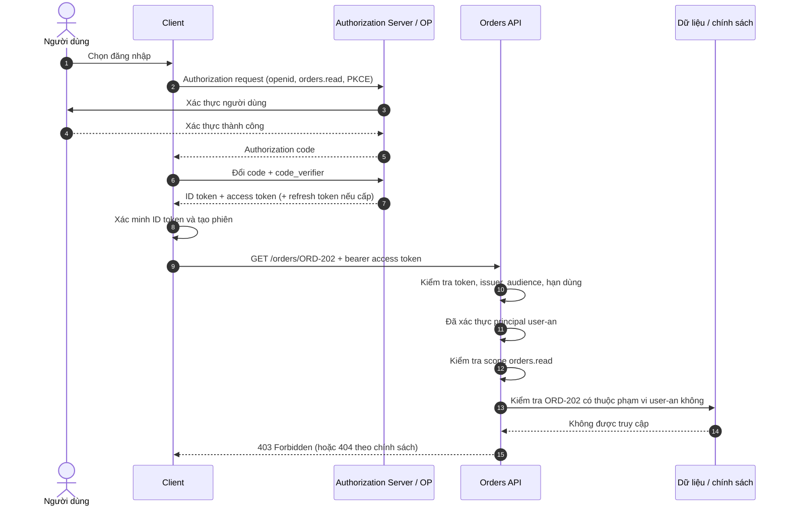
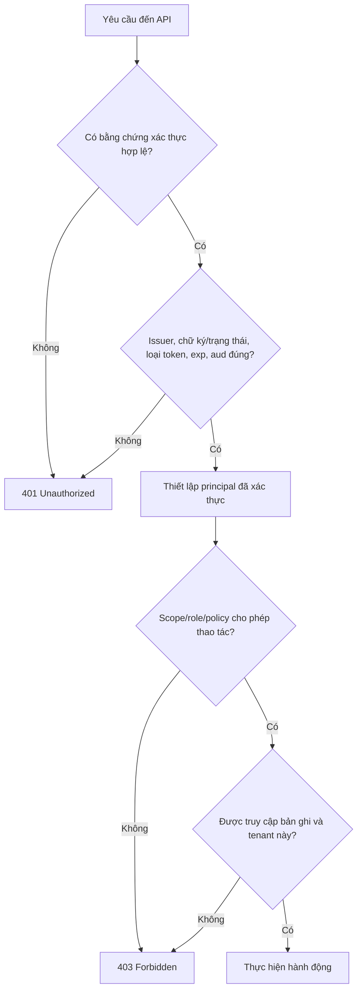

# Phân biệt authentication thành công với authorization được phép

Một người dùng đăng nhập thành công vào hệ thống quản lý đơn hàng. Người đó gọi `GET /orders/42`, gửi kèm một access token hợp lệ, nhưng API vẫn trả về `403 Forbidden`. Đây **không nhất thiết là lỗi đăng nhập**: hệ thống đã nhận diện được chủ thể đang gọi, song chủ thể ấy không được phép đọc đơn hàng số 42.

Bài học thuộc chương **Authentication** của module `SECURITY_TOKEN_SECURITY_FUNDAMENTALS`. Trong bảo mật token, OAuth 2.0 và OpenID Connect (OIDC), việc tách bạch **xác thực danh tính** (*authentication*) và **kiểm tra quyền truy cập** (*authorization*) là nền tảng để thiết kế đúng trust model, kiểm tra claims, scope, audience, vòng đời token và phòng chống việc dùng token bị đánh cắp hoặc phát lại.

## 1. Hai câu hỏi bảo mật khác nhau

**Authentication — xác thực:** *Ai đang thực hiện yêu cầu và bằng chứng nào khiến hệ thống tin vào nhận định đó?*

**Authorization — phân quyền/cho phép:** *Chủ thể đã được xác định có được thực hiện hành động này trên tài nguyên cụ thể, trong ngữ cảnh hiện tại hay không?*

| Khía cạnh | Authentication | Authorization |
|---|---|---|
| Mục tiêu | Xác định danh tính hoặc chủ thể gọi và độ tin cậy của bằng chứng. | Đưa ra quyết định cho phép/từ chối hành động trên tài nguyên. |
| Dữ liệu đầu vào thường gặp | Mật khẩu, passkey, MFA, phiên đăng nhập, chứng chỉ máy khách, token hợp lệ. | Subject, role, scope, chính sách, chủ sở hữu tài nguyên, tenant, trạng thái dữ liệu, ngữ cảnh. |
| Kết quả | Xác thực thành công/thất bại; xác lập một principal. | `permit` hoặc `deny` đối với **một yêu cầu cụ thể**. |
| Ví dụ | Xác minh access token do issuer đáng tin cậy cấp và còn hiệu lực. | Yêu cầu có scope `orders.read` và chỉ đọc đơn hàng mà chủ thể được phép truy cập. |
| Được thực hiện ở đâu? | Identity Provider, client xác minh ID token, API xác minh access token hoặc session. | API, service nghiệp vụ, policy engine, cơ chế kiểm soát truy cập tài nguyên. |

Một người có thể **được xác thực nhưng không được phân quyền**. Ngược lại, quyết định authorization có thể dành cho một danh tính máy hoặc một principal dịch vụ mà không cần bước đăng nhập tương tác của con người.

Điểm mấu chốt: kết quả authentication cho biết **có thể gắn một danh tính/principal đáng tin cậy với yêu cầu**; nó **không phải** giấy phép truy cập mọi endpoint và mọi bản ghi.

## 2. Tình huống xuyên suốt: đăng nhập được, xem đơn hàng chưa chắc được

Giả sử dịch vụ có hai người dùng:

- **An**, định danh `user-an`, sở hữu đơn hàng `ORD-101`.
- **Bình**, định danh `user-binh`, sở hữu đơn hàng `ORD-202`.

An đã đăng nhập bằng passkey, được cấp access token có audience `orders-api` và scope `orders.read`. Các quyết định có thể xảy ra:

| Yêu cầu của An | Authentication tại API | Authorization | Kết quả dự kiến |
|---|---|---|---|
| Đọc `ORD-101` | Token hợp lệ, principal là `user-an`. | Có `orders.read`; đơn hàng thuộc An. | Cho phép, ví dụ HTTP `200`. |
| Đọc `ORD-202` | Vẫn là token hợp lệ của `user-an`. | Có `orders.read` nhưng đơn hàng thuộc Bình. | Từ chối, thường HTTP `403` hoặc `404` theo chính sách tránh lộ dữ liệu. |
| Xóa `ORD-101` | Token hợp lệ. | Thiếu scope/quyền xóa, hoặc chính sách không cho xóa. | Từ chối, thường HTTP `403`. |
| Đọc `ORD-101` bằng token hết hạn | Không xác thực được bearer token. | Chưa đi đến quyết định quyền nghiệp vụ. | Thường HTTP `401`. |
| Gửi ID token thay access token | Không phải access token API chấp nhận. | Không được xem như có quyền gọi API. | Thường HTTP `401`. |

**Một lần đăng nhập thành công không quyết định tất cả các hàng trên.** Quyền có thể khác theo hành động, bản ghi, tenant, thời điểm hoặc trạng thái tài khoản.

## 3. Ba tầng thường bị trộn lẫn trong OAuth 2.0/OIDC

Trong hệ thống hiện đại, chữ “xác thực thành công” có thể chỉ những thời điểm khác nhau:

1. **Người dùng được xác thực tại OpenID Provider (OP)/Identity Provider (IdP).** OP kiểm tra bằng chứng như passkey, mật khẩu kèm MFA hoặc phiên còn hiệu lực và xác lập danh tính người dùng. OIDC bổ sung một lớp xác thực danh tính trên OAuth 2.0.
2. **Client xác minh kết quả xác thực OIDC.** Client nhận và kiểm tra **ID token**, chẳng hạn chữ ký, `iss`, `aud` chứa client ID, `exp`, `iat` và `nonce` nếu có yêu cầu sử dụng. Client có thể tạo phiên ứng dụng cho người dùng.
3. **Resource Server (API) xác thực access token của yêu cầu.** API kiểm tra token đúng nguồn, đúng audience, đúng loại, còn hiệu lực và có thể xác định principal liên quan. Sau đó API **mới đánh giá quyền** đối với endpoint và tài nguyên.

Ba bước có thể diễn ra ở thời điểm khác nhau. Người dùng đăng nhập lúc 09:00 không có nghĩa token được gửi lúc 10:00 vẫn còn hạn, và cũng không có nghĩa quyền của họ lúc 10:00 vẫn như lúc 09:00.

### Phân biệt ba loại token thường gặp

| Token | Mục đích | Ai nhận? | Có tự chứng minh quyền gọi API không? |
|---|---|---|---|
| **ID token** (OIDC) | Thông báo kết quả xác thực người dùng cho client. | Client/relying party có `client_id` phù hợp. | **Không.** Không dùng ID token như bearer access token cho API. |
| **Access token** (OAuth 2.0) | Cho phép client truy cập resource server trong phạm vi được cấp. | API/resource server là audience phù hợp. | **Chưa đủ để cho phép mọi hành động.** API còn xét scope và quyền trên tài nguyên. |
| **Refresh token** (OAuth 2.0) | Xin access token mới từ authorization server theo chính sách. | Authorization server/token endpoint. | **Không.** Không gửi refresh token đến API tài nguyên. |

**JWT hay opaque** là cách biểu diễn token, không phải định nghĩa của authentication/authorization. Access token có thể là JWT đã ký hoặc chuỗi opaque phải được kiểm tra qua introspection. Token hợp lệ cần được xác minh từ nguồn tin cậy; việc giải mã payload JWT không tương đương việc xác minh token.

## 4. Luồng xử lý: từ đăng nhập đến quyết định quyền

Ví dụ OIDC Authorization Code với PKCE cho ứng dụng gọi API đơn hàng:



Luồng trên cho thấy **OP đã xác thực người dùng thành công**, client tạo phiên thành công, resource server chấp nhận access token thành công, **nhưng yêu cầu cụ thể vẫn bị từ chối**. Mỗi bên giữ trách nhiệm riêng.

Trong OAuth 2.0 thuần túy, việc cấp access token không tự động có nghĩa “người dùng vừa đăng nhập” theo ngữ nghĩa OIDC. Ví dụ `client_credentials` dùng để xác thực/ủy quyền một **client dịch vụ**; `sub`, nếu có, không nhất thiết đại diện cho một người dùng. Với bearer token, API kiểm tra bằng chứng sở hữu token và tính hợp lệ của token; nó không được suy diễn rằng mọi yêu cầu đều chứng minh lại hành động đăng nhập trực tiếp của người dùng.

## 5. API cần kiểm tra những gì trước khi phân quyền?

Đối với access token kiểu JWT, resource server thường xử lý theo chuỗi quyết định sau:



Đây là cách khái quát luồng xử lý, không bắt buộc mọi framework hiện thực đúng từng nút hay trả cùng một mã cho mọi nhánh. Việc che giấu sự tồn tại của tài nguyên bằng `404` là một lựa chọn chính sách có thể phù hợp.

### Các claims và điều kiện có vai trò khác nhau

| Thông tin | Dùng để làm gì? | Không nên suy diễn gì? |
|---|---|---|
| `iss` | Kiểm tra token do issuer mà API chủ động tin cậy phát hành. | Một URL issuer bất kỳ trong token không tự trở thành đáng tin. |
| Chữ ký JWT / `active` qua introspection | Kiểm chứng nguồn và trạng thái token bằng cơ chế thích hợp. | Token được xác minh là được phép làm mọi việc. |
| `aud` | Xác định token được cấp cho API/resource server này. | Token dành cho API A cũng được API B chấp nhận. |
| `exp`, `nbf` | Xác định thời gian token có hiệu lực. | Hợp lệ về thời gian đồng nghĩa người dùng còn quyền nghiệp vụ. |
| `sub` | Nhận diện chủ thể theo ngữ nghĩa issuer/token profile. | `sub` luôn là người dùng, hoặc luôn là chủ sở hữu bản ghi. |
| `scope` / `scp` | Thể hiện phạm vi đã được cấp theo profile của AS. | Có `orders.read` là đọc được mọi đơn hàng. |
| `roles`, `groups`, `authorities` | Có thể hỗ trợ áp dụng RBAC nếu hệ thống đã thống nhất quy tắc và nguồn tin. | Mọi role đều chuẩn hóa hoặc phải được tin mà không có mapping. |
| `tenant_id` nếu có | Tham gia xác định phạm vi tenant theo mô hình triển khai. | Một claim tenant bất kỳ đủ để truy cập dữ liệu tenant khác. |

Ví dụ JWT access token minh họa:

```json
{
  "iss": "https://id.example.test",
  "sub": "user-an",
  "aud": "orders-api",
  "scope": "orders.read",
  "tenant_id": "tenant-vn",
  "iat": 1795410000,
  "exp": 1795410900
}
```

`iat` và `exp` trong ví dụ cách nhau 900 giây, tương ứng 15 phút. Claim `tenant_id` chỉ là quy ước giả định của hệ thống; **OIDC/OAuth 2.0 không mặc định chuẩn hóa tên claim tenant này**. API phải biết issuer và token profile nào được phép cung cấp claim đó, và kiểm tra quyền truy cập dữ liệu theo chính sách riêng.

Thứ tự quan trọng là **xác minh nguồn và tính hợp lệ của token trước khi tin claims**, rồi dùng claims như dữ liệu đầu vào cho chính sách phân quyền.

## 6. 401 Unauthorized và 403 Forbidden khác nhau thế nào?

Trong HTTP, tên `401 Unauthorized` dễ gây nhầm lẫn: nó thường biểu thị **thiếu hoặc không chấp nhận được thông tin xác thực**. `403 Forbidden` thường biểu thị **server hiểu yêu cầu nhưng từ chối cho phép**.

| Tình huống | Mã thường dùng | Vì sao? |
|---|---|---|
| Không có bearer token ở endpoint bắt buộc xác thực. | `401` | Chưa có thông tin xác thực hợp lệ. |
| Access token hết hạn, chữ ký sai, sai audience, sai loại hoặc issuer không được tin. | `401` | API không thể chấp nhận token cho yêu cầu. |
| Token hợp lệ, thiếu scope `orders.write`. | `403` | Principal được xác thực nhưng thiếu quyền cho hành động. |
| Token hợp lệ, có scope đọc nhưng bản ghi thuộc người khác. | `403` hoặc `404` | Chính sách ở cấp tài nguyên từ chối; `404` có thể dùng để tránh tiết lộ sự tồn tại của bản ghi. |
| Principal là service account hợp lệ nhưng chỉ được phép truy cập tenant khác. | `403` hoặc `404` | Danh tính máy được chấp nhận, quyền trên tài nguyên không đủ. |

Với OAuth 2.0 Bearer Token (RFC 6750), API thường dùng `WWW-Authenticate: Bearer` để thông báo về thiếu/không hợp lệ của token. Với token hợp lệ nhưng scope không đủ, lỗi `insufficient_scope` đi cùng HTTP `403` theo RFC 6750. Ví dụ minh họa:

```http
HTTP/1.1 401 Unauthorized
WWW-Authenticate: Bearer realm="orders-api", error="invalid_token"
```

```http
HTTP/1.1 403 Forbidden
WWW-Authenticate: Bearer realm="orders-api", error="insufficient_scope", scope="orders.write"
```

Đừng trả về chi tiết nhạy cảm như cấu trúc phân quyền nội bộ, khóa xác minh, toàn bộ claims hoặc chính token trong lỗi/log. Mã phản hồi phải phản ánh nguyên nhân phù hợp để client biết khi nào cần xác thực lại, khi nào cần xin cấp quyền bổ sung và khi nào chỉ nên dừng thao tác.

## 7. Authorization còn phụ thuộc vào hành động và đối tượng

Tại endpoint đọc đơn hàng, quyền thường có nhiều lớp:

1. **Quyền ở API:** access token có audience `orders-api` hay không.
2. **Quyền thao tác:** có `orders.read`, role phù hợp hoặc permission tương ứng hay không.
3. **Quyền trên đối tượng:** đơn hàng này có thuộc chủ thể, nhóm, dự án hoặc tenant mà chủ thể được phép truy cập hay không.
4. **Quy tắc ngữ cảnh:** bản ghi có bị khóa, yêu cầu có cần xác thực mạnh hơn, có giới hạn thời gian/thiết bị hay chính sách tuân thủ nào không.

Các cách mô hình hóa authorization thông dụng:

| Mô hình | Ví dụ | Điểm cần lưu ý |
|---|---|---|
| **RBAC** (Role-Based Access Control) | `ROLE_SUPPORT` được xem trạng thái đơn hàng. | Role có thể chỉ cho phép một loại tác vụ; không mặc định xem dữ liệu mọi khách hàng. |
| **Scope/permission** | `orders.read`, `orders.write`. | Scope biểu thị quyền đã cấp ở mức coarse-grained, thường không đại diện toàn bộ quyền trên từng bản ghi. |
| **ABAC** (Attribute-Based Access Control) | Cho phép nếu `order.ownerId == principal.sub` và trạng thái đơn cho phép. | Thuộc tính phải lấy từ nguồn đáng tin; kết quả phụ thuộc ngữ cảnh. |
| **ReBAC** (Relationship-Based Access Control) | Người quản lý được đọc đơn hàng của nhóm mình quản lý. | Quan hệ cần tra cứu/cập nhật, không thể suy hết từ một token tĩnh. |

Trong hệ thống đa tenant, đặc biệt nguy hiểm nếu API chỉ kiểm tra `orders.read` rồi truy vấn `findById(orderId)` mà không ràng buộc tenant/principal. Một mẫu an toàn là truy vấn **trong phạm vi đã được kiểm tra** như `findByIdAndTenantIdAndOwnerId(...)` hoặc sử dụng một policy engine được kiểm chứng. Việc nhận ra principal ở bước authentication chỉ là đầu vào cho truy vấn có giới hạn.

## 8. Ví dụ triển khai với Spring Security

Spring Security phân biệt đối tượng **`Authentication`** trong `SecurityContext` (principal và authorities đã xác lập) với các quyết định **authorization** khi truy cập route/method. Với Spring Security OAuth2 Resource Server, access token JWT thường được kiểm tra bằng `JwtDecoder` được cấu hình từ issuer tin cậy; mapping scope sang authority thường có dạng `SCOPE_orders.read`. Tên authority này là **quy ước của Spring Security**, không phải tên claim bắt buộc của OAuth 2.0.

Ví dụ ngắn sau dùng `@EnableMethodSecurity` và minh họa hai lớp quyền. Giả định ứng dụng đã **cấu hình resource server để kiểm tra issuer, chữ ký, thời hạn và audience**; cấu hình mặc định không nên được mặc nhiên coi là đã kiểm tra mọi audience theo nhu cầu API.

```java
@RestController
@RequestMapping("/orders")
public class OrderController {
    private final OrderService service;

    public OrderController(OrderService service) {
        this.service = service;
    }

    @GetMapping("/{id}")
    @PreAuthorize("hasAuthority('SCOPE_orders.read')")
    public OrderView getOrder(@PathVariable UUID id,
                              JwtAuthenticationToken authentication) {
        String subject = authentication.getToken().getSubject();
        return service.getOrderVisibleTo(id, subject);
    }
}
```

Trong service/repository, kiểm tra phạm vi sở hữu phải dựa trên dữ liệu thật của hệ thống, ví dụ:

```java
public OrderView getOrderVisibleTo(UUID id, String subject) {
    return orderRepository.findByIdAndOwnerSubject(id, subject)
        .map(orderMapper::toView)
        .orElseThrow(() -> new ResponseStatusException(HttpStatus.NOT_FOUND));
}
```

Đây là **đoạn mã minh họa**, giả định đã có `OrderView`, repository, mapper, bảo vệ endpoint và cấu hình method security phù hợp. Nếu ứng dụng đa tenant, truy vấn phải ràng buộc tenant được phép, không chỉ owner subject. `sub` từ issuer khác nhau có thể trùng nhau; trong hệ thống đa issuer, danh tính nên được ràng buộc với `iss` hoặc ánh xạ sang định danh người dùng nội bộ ổn định.

Ở ví dụ này:

- Spring Security có thể xác thực bearer token và tạo `JwtAuthenticationToken` nếu token hợp lệ.
- `@PreAuthorize` chặn yêu cầu thiếu quyền `orders.read` (**authorization mức thao tác**).
- `findByIdAndOwnerSubject` chỉ truy xuất đơn hàng có chủ sở hữu phù hợp (**authorization mức dữ liệu**).
- Có `JwtAuthenticationToken` **không** khiến `@PreAuthorize` hay kiểm tra bản ghi trở nên thừa.

Không nên chỉ kiểm tra `authentication.isAuthenticated()` rồi cho phép mọi endpoint. Cờ đó chỉ phản ánh trạng thái xác thực của principal trong ngữ cảnh framework.

## 9. Quyền và trạng thái xác thực thay đổi theo thời gian

Giả sử lúc 09:00 An đăng nhập, được cấp JWT access token sống 15 phút. Đến 09:05 quản trị viên thu hồi quyền đọc đơn hàng. Nếu API chỉ dựa vào scope **đã nhúng trong JWT** và không tra chính sách hiện hành, quyền cũ có thể vẫn được chấp nhận đến khi token hết hạn. Đây là bài toán **độ mới của authorization**, không phải chứng minh rằng authentication đã sai.

Các chiến lược phổ biến, cần chọn theo yêu cầu của hệ thống:

- **Access token sống ngắn:** hạn chế thời gian claims/quyền cũ tiếp tục được chấp nhận; không tạo khả năng thu hồi ngay tức thì.
- **Tra quyền nghiệp vụ hiện hành:** kiểm tra quyền sở hữu, trạng thái tài khoản, tenant hoặc chính sách bằng dữ liệu hiện tại tại thời điểm yêu cầu.
- **Opaque token/introspection:** resource server kiểm tra `active` và metadata từ AS; mức độ cập nhật phụ thuộc cache, độ trễ và khả năng AS.
- **Revocation/denylist/versioning:** có thể bổ sung lớp kiểm tra khi quyền phải bị thu hồi gấp; cần quy tắc đồng bộ và hiệu lực thực tế.
- **Refresh token rotation và thu hồi:** giúp quản lý cấp access token mới và phát hiện tái sử dụng token làm mới; thu hồi refresh token **không mặc định** làm mọi access token JWT đã phát hành lập tức vô hiệu.

Phiên đăng nhập của ứng dụng, ID token, access token và refresh token có thể có **vòng đời khác nhau**. Đăng xuất khỏi UI hoặc hết hạn ID token không tự động giải quyết toàn bộ quyền truy cập API đang tồn tại.

## 10. Xác thực mạnh hơn có tạo quyền cao hơn không?

Không tự động. **MFA**, passkey hoặc xác thực lại gần đây cải thiện mức độ tin cậy vào lần authentication; chúng không mặc định nâng một user thường thành quản trị viên. Ngược lại, một hành động nhạy cảm có thể yêu cầu **cả hai** điều kiện:

- Chủ thể **được phép** thực hiện hành động, ví dụ có `payments.approve` với hạn mức đủ lớn.
- Chủ thể vừa đạt mức **authentication assurance** phù hợp, chẳng hạn MFA gần đây hoặc bước *step-up authentication*.

Trong OIDC, các claims như `auth_time`, `amr` và `acr` có thể giúp client đánh giá thời điểm/phương thức/mức độ xác thực, **nếu** issuer cung cấp và hai bên thống nhất ngữ nghĩa. Không suy rằng `amr` hay `acr` luôn tồn tại, cũng không thay authorization bằng một claim xác thực mạnh. Với giao dịch rủi ro cao, có thể cần ràng buộc thao tác với dữ liệu giao dịch cụ thể theo chính sách riêng.

## 11. Rủi ro bảo mật khi đồng nhất xác thực và phân quyền

| Lỗi thiết kế | Hậu quả | Biện pháp phù hợp |
|---|---|---|
| **Broken Object Level Authorization (BOLA/IDOR):** chỉ kiểm tra người gọi đã đăng nhập. | Người dùng đổi ID trên URL để đọc/sửa tài nguyên của người khác. | Kiểm tra quyền trên từng bản ghi, lọc theo owner/tenant hoặc policy. |
| **Chỉ tin JWT có chữ ký đúng:** không kiểm tra audience/loại token. | Token dành cho client hay API khác có thể bị dùng sai mục đích. | Xác thực `iss`, `aud`, loại token, hạn dùng, thuật toán theo profile. |
| **Tin role/scope tùy ý trong token không xác minh:** đọc payload rồi quyết định quyền. | Token giả mạo có thể tự khai role quản trị. | Xác minh nguồn và tính toàn vẹn token trước khi đọc claims; ánh xạ quyền có kiểm soát. |
| **Không tách tenant:** query theo ID toàn cục sau authentication. | Rò rỉ dữ liệu xuyên tenant. | Ràng buộc tenant vào chính sách và truy vấn thực tế. |
| **Coi Bearer token là bằng chứng người dùng đang hiện diện:** token bị đánh cắp vẫn được sử dụng. | Phát lại yêu cầu dưới danh tính hợp lệ. | Bảo vệ token khi lưu/truyền; access token ngắn hạn, sender-constrained token như DPoP/mTLS khi phù hợp, giám sát bất thường. |
| **MFA đồng nghĩa admin:** cấp quyền quản trị vì người dùng vừa xác thực mạnh. | Leo thang quyền không được cấp. | Tách điều kiện assurance và authorization thành hai phép kiểm tra. |
| **Chỉ dựa vào scope cũ trong JWT:** bỏ qua thay đổi ACL tức thời. | Quyền đã thu hồi vẫn có thể được sử dụng. | Xét mức độ mới của quyền, truy vấn chính sách hiện hành hoặc cơ chế thu hồi thích hợp. |

**Phòng chống replay:** Một access token dạng Bearer là credential; ai sở hữu token còn hiệu lực có thể trình token nếu hệ thống không có ràng buộc người gửi. Việc API xác thực token thành công trong trường hợp này **không bảo đảm** chính chủ đang thao tác. HTTPS, bảo vệ khỏi XSS/đọc token trong log, hạn sống, chống phát lại và giới hạn quyền đều cần được xem xét theo mô hình đe dọa.

## 12. Bài tập tình huống

**Tình huống A — nhầm token:** Một mobile client nhận ID token sau OIDC login. Developer gửi ID token đến `orders-api`, thấy chữ ký vẫn xác minh được và cho truy cập. **Sai ở đâu?** ID token có audience là client, phục vụ xác nhận đăng nhập; API cần access token đúng issuer, audience và loại token, sau đó kiểm tra quyền.

**Tình huống B — scope hợp lệ, đối tượng sai:** `user-an` gửi access token còn hạn với `orders.read` để đọc `ORD-202` của `user-binh`. **Cần làm gì?** Xác thực có thể thành công; authorization phải từ chối do không sở hữu bản ghi và không có quan hệ/quyền ngoại lệ phù hợp.

**Tình huống C — quyền đổi sau khi cấp token:** Tại 09:00 nhân viên có role duyệt hoàn tiền, lúc 09:01 role bị thu hồi, JWT còn hạn đến 09:15. **Rủi ro là gì?** Nếu API chỉ dựa vào role cũ trong token, chính sách thu hồi có thể chậm hiệu lực; cần chiến lược cập nhật quyền phù hợp mức rủi ro.

**Tình huống D — service-to-service:** Dịch vụ `shipping-worker` lấy access token qua `client_credentials`, gọi `GET /orders/ORD-101`. **Đâu là danh tính?** Principal có thể là client dịch vụ, không phải người dùng An. API phải quyết định service account đó có quyền gọi endpoint và dữ liệu đơn hàng cụ thể hay không.

**Tự kiểm tra:**

1. Vì sao `isAuthenticated() == true` không đủ để trả về một đơn hàng bất kỳ?
2. Nếu người dùng đăng nhập qua MFA nhưng không có quyền xóa đơn hàng, hệ thống phải cho phép hay từ chối?
3. API nhận một ID token hợp lệ với audience là `orders-web`; tại sao API vẫn phải từ chối?
4. Token hợp lệ nhưng không có `orders.write` nên trả `401` hay `403` theo thông lệ Bearer? Còn token hết hạn?
5. Vì sao đổi quyền sau khi phát hành JWT có thể tạo ra khoảng thời gian cho phép quyền cũ?

## 13. Ghi nhớ

- **Authentication:** xác lập principal có thể tin cậy, bằng chứng và ngữ cảnh của lần xác thực; trong OAuth/OIDC, việc đăng nhập ở OP và API xác minh access token là **hai bước khác nhau**.
- **Authorization:** kiểm tra principal ấy có được thực hiện **hành động cụ thể trên tài nguyên cụ thể** theo chính sách hiện hành không.
- **Đăng nhập thành công, ID token hợp lệ hoặc access token có chữ ký đúng không tự động cấp quyền API.** Resource server phải kiểm tra access token đúng loại/audience và thực thi chính sách quyền.
- **Scope/role là một phần của authorization**, nhưng kiểm tra owner, tenant, quan hệ và trạng thái nghiệp vụ vẫn có thể cần thiết.
- **401 thường là vấn đề xác thực; 403 thường là vấn đề quyền.** Trong trường hợp cần che giấu tài nguyên không được phép xem, API có thể chọn `404` theo chính sách.
- **Authorization có yếu tố thời gian:** token cũ, quyền bị thu hồi, phiên còn sống và token bị phát lại là các điều kiện phải xử lý trong thiết kế vòng đời token.

### Tài liệu tham khảo

- [RFC 6749 — The OAuth 2.0 Authorization Framework](https://www.rfc-editor.org/rfc/rfc6749): các vai trò, access token và refresh token.
- [OpenID Connect Core 1.0](https://openid.net/specs/openid-connect-core-1_0.html): xác thực người dùng, ID token và claims xác thực.
- [RFC 6750 — The OAuth 2.0 Authorization Framework: Bearer Token Usage](https://www.rfc-editor.org/rfc/rfc6750): `invalid_token`, `insufficient_scope` và phản hồi HTTP.
- [RFC 9068 — JWT Profile for OAuth 2.0 Access Tokens](https://www.rfc-editor.org/rfc/rfc9068): xác minh JWT access token, audience và phân biệt loại token.
- [RFC 9700 — Best Current Practice for OAuth 2.0 Security](https://www.rfc-editor.org/rfc/rfc9700): vòng đời token, ràng buộc người gửi và phòng chống lạm dụng.
- [Spring Security Reference — Authorization](https://docs.spring.io/spring-security/reference/servlet/authorization/index.html) và [OAuth 2.0 Resource Server JWT](https://docs.spring.io/spring-security/reference/servlet/oauth2/resource-server/jwt.html): cơ chế phân quyền và xác minh access token trong ứng dụng Java.
