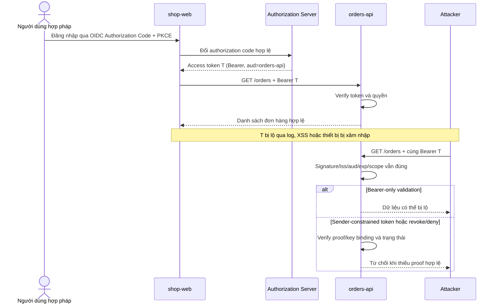
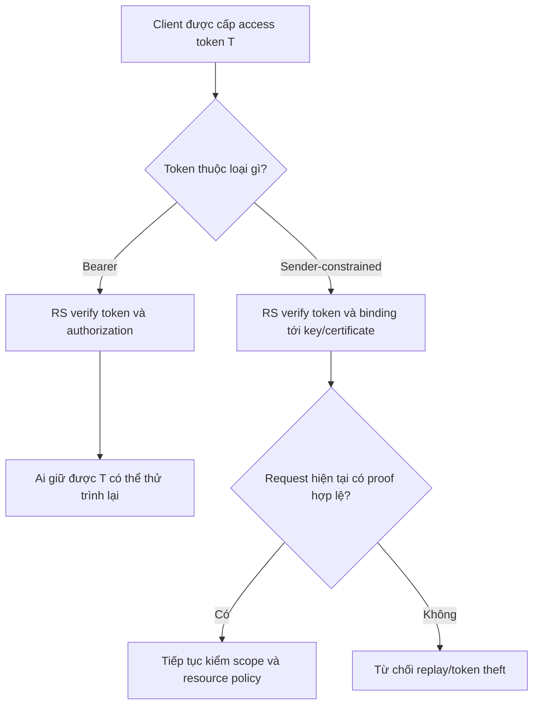
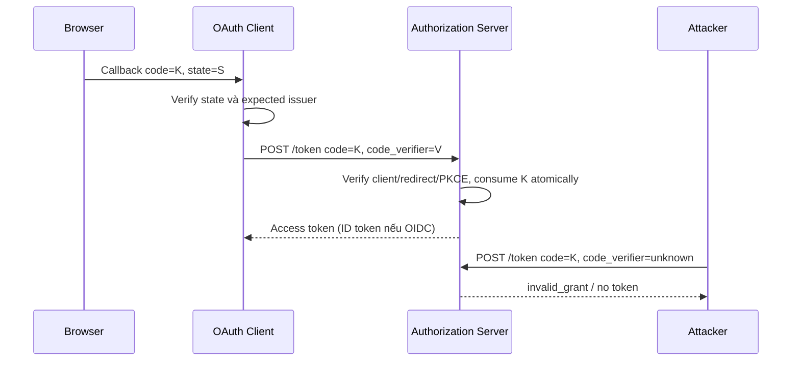

# Replay token là gì? Hiểu tấn công phát lại token trong OAuth 2.0/OIDC

Một API nhận access token hợp lệ, xác minh chữ ký JWT, `iss`, `aud`, `exp` và `scope` rồi cho phép đọc tài khoản. Vài phút sau, **một người khác gửi lại chính chuỗi access token đó**. Chữ ký vẫn đúng, token chưa hết hạn và scope vẫn đủ. Nếu đây là **bearer token**, resource server có thể không biết người đang gửi request lần thứ hai khác với client hợp pháp.

Đó là một tình huống điển hình của **token replay attack** (*tấn công phát lại token*): kẻ tấn công **sử dụng lại credential hoặc thông điệp xác thực/ủy quyền đã xuất hiện trước đó** để cố nhận quyền truy cập, thực hiện một hành động khác hoặc lặp một hành động mà chủ thể hợp pháp không chủ ý. Token không nhất thiết bị sửa; **chính việc dùng lại ở bối cảnh hoặc thời điểm không được phép** mới là vấn đề.

Trong chương **Replay protection** của module **SECURITY_TOKEN_SECURITY_FUNDAMENTALS**, chúng ta tìm hiểu replay trong mô hình tin cậy giữa **OAuth client, authorization server (AS)/OpenID Provider (OP), resource server (RS) và người dùng**. Bài kết nối replay với JWT/opaque token, access token/refresh token, claims, scope, audience, xác minh token, lưu trữ, thu hồi và các cơ chế chống token theft/replay.

> **Điểm cần nhớ:** «Replay token» **không phải một loại token chuẩn riêng** bên cạnh access token hay refresh token. Cụm từ này thường mô tả **hành vi phát lại một token đã được phát hành hoặc một proof/message đã được dùng**, nhằm đạt quyền trái phép. **Chữ ký hợp lệ và `exp` chưa hết hạn không tự ngăn bearer-token replay.**

## 1. Hiểu chính xác replay attack

### 1.1. Định nghĩa

**Replay attack** xảy ra khi một bên thu được hoặc ghi lại một giá trị/thông điệp có ý nghĩa bảo mật, rồi **trình lại** giá trị/thông điệp ấy để một hệ thống xử lý nó như một yêu cầu hợp lệ, bất chấp việc bên đó không có quyền hoặc thông điệp không được dùng thêm lần nữa.

Trong token security, đối tượng bị phát lại có thể là:

- **Access token:** bản sao được gửi đến RS để gọi API.
- **Refresh token:** token cũ hoặc bị đánh cắp được trình lại tại token endpoint để xin access token mới.
- **Authorization code:** code từ callback được dùng lần hai hoặc bị người khác đổi trước client hợp pháp.
- **ID token:** JWT xác thực cũ được đưa vào ngữ cảnh đăng nhập khác.
- **DPoP proof JWT:** proof đã ký cho HTTP request bị gửi lại nếu RS không kiểm `jti`/nonce/binding.
- **Session cookie:** session ID bị lấy cắp rồi được gửi lại như một phiên browser khác.
- **One-time token:** reset-password link, invitation, email verification code hoặc transaction token bị dùng hơn một lần.

**Một request được retry hợp lệ cũng có thể chứa cùng token**. Cần phân biệt *dùng lại access token như thiết kế* với *phát lại một thông điệp đáng lẽ one-time*. OAuth bearer access token thông thường được thiết kế để client hợp pháp sử dụng **nhiều request** cho đến khi hết hạn hoặc bị revoke. Vì vậy:

1. **Token replay bất hợp pháp** là khi attacker hoặc bên không được phép sử dụng bản sao token để có quyền.
2. **Protocol-message replay** là khi bên bất kỳ trình lại một thông điệp có yêu cầu **tính duy nhất/một lần**, như authorization code, DPoP proof `jti` hoặc refresh token đã rotate.
3. **Business-operation replay** là khi cùng thao tác nghiệp vụ như tạo payment bị thực thi nhiều lần; không phải cứ có OAuth token hợp lệ là API được phép tạo lại payment.

Không thể kết luận «cùng bearer token xuất hiện hai lần = tấn công»; điều đó còn phụ thuộc token type, grant semantics, sender binding và operation.

### 1.2. Replay khác token forgery, token theft và session hijacking

| Thuật ngữ | Hành vi | Ví dụ | Quan hệ với replay |
| --- | --- | --- | --- |
| **Token theft / exfiltration** | Lấy token từ nơi không được phép | Log chứa `Authorization: Bearer` bị lộ | Tạo điều kiện để attacker replay |
| **Token replay** | Trình lại credential/message đã có | Attacker dùng bearer token bị sao chép | Có thể không sửa bất kỳ byte nào |
| **Token forgery** | Tạo hoặc sửa token khiến validator tin sai | JWT ký bằng key giả, chèn `scope=admin` | Phòng chống chủ yếu bằng chữ ký/trust validation |
| **Session hijacking** | Chiếm quyền điều khiển session | Dùng session cookie bị lấy cắp | Thường có yếu tố replay session cookie |
| **Credential stuffing** | Thử username/password bị lộ | Login bằng password khác hệ thống | Không nhất thiết là token replay |
| **CSRF** | Ép browser hợp pháp gửi request ngoài ý người dùng | POST nhờ cookie tự đính kèm | Có thể tận dụng session hiện hữu nhưng không nhất thiết đánh cắp token |
| **Request duplication** | Gửi cùng hành động nhiều lần | Client retry `POST /payments` | Có thể hợp lệ về xác thực, cần idempotency |

**Tấn công phát lại không nhất thiết cần phá mật mã.** Một bearer token có chữ ký RS256 hợp lệ vẫn có thể bị lợi dụng nếu ai đó nắm được chuỗi token và RS chỉ kiểm các claims tĩnh.

### 1.3. Bối cảnh trust: ai tin ai?

| Vai trò | Điều nó biết và phải kiểm | Điều không được tự giả định |
| --- | --- | --- |
| **OAuth client** | Cách giữ/đính kèm token, binding tới user/device, thời hạn và logout | Token lưu trong memory là không thể bị lộ |
| **AS/OP** | Ai được phát token, client/grant, refresh rotation, revoke state, sender-constraining | Client hiện đang sử dụng token luôn là bên được cấp ban đầu |
| **RS/API** | Access token dành mình không, còn hạn, đủ scope, proof sender, quyền resource | Token có chữ ký đúng nghĩa là người gửi chính chủ |
| **Browser/user agent** | Cookie, redirect, local storage, request origin | Cookie/ID token tự chứng minh request do người dùng chủ động |
| **Gateway/service mesh** | TLS termination, token forwarding, identity context | `X-User-ID`/`X-Client-Cert` từ client là chứng cứ đáng tin |

Replay có thể xảy ra ở nhiều ranh giới: client → RS, client → AS token endpoint, browser → RP, OP → RP back-channel logout hoặc gateway → microservice. Mỗi chỗ cần kiểm **tính xác thực, tính mới, sự ràng buộc và quyền** thích hợp.

## 2. Ví dụ trực quan: access token bị đánh cắp và dùng lại

Giả sử `shop-web` được cấp bearer access token T dành cho `orders-api`, scope `orders:read`, hết hạn sau 10 phút.



**Lưu ý:** sơ đồ không nói rằng mọi RS đều cho attacker qua. Hành vi phụ thuộc thêm network restrictions, DPoP/mTLS, token binding, user/resource policy, introspection và phát hiện gian lận. Nhưng nếu chỉ dùng bearer token tĩnh và attacker có toàn bộ chuỗi, **RS không có cách cryptographic để phân biệt hai người trình cùng credential**.

### 2.1. Ví dụ JWT payload rút gọn

```json
{
  "iss": "https://auth.example.test",
  "sub": "user-123",
  "aud": "orders-api",
  "client_id": "shop-web",
  "scope": "orders:read",
  "iat": 1893456000,
  "exp": 1893456600,
  "jti": "at-9b4c18"
}
```

Đây **chỉ là payload minh họa**, không có JOSE header/chữ ký. Khi token T được phát lại mà không đổi, **chữ ký, `iss`, `aud`, `exp`, `scope` và `jti` đều giống hệt lần hợp lệ**.

- `iss` đúng cho biết **ai phát token**.
- `aud` đúng cho biết **token dành cho RS nào**.
- `exp` hợp lệ giới hạn **cửa sổ thời gian**.
- `scope` mô tả quyền AS cấp.
- `jti` là **định danh token**, hữu ích cho audit/revocation/deduplication nếu có **server-side state/policy**.

**Không có claim nào trong những claim này, chỉ bằng việc tồn tại trong JWT, chứng minh người đang trình token là client đã được cấp token.** Với bearer access token dùng nhiều request, **không được tự đánh dấu `jti` đã dùng ở request API đầu tiên rồi từ chối mọi request sau** — cách đó phá semantics của bearer access token thông thường.

### 2.2. Tại sao HTTPS vẫn chưa đủ?

HTTPS/TLS bảo vệ giao tiếp **trên đường truyền** và chống nghe lén/chỉnh sửa ở network khi triển khai đúng, nhưng token có thể lộ **ngoài** TLS channel:

- Trình duyệt bị XSS hoặc extension độc hại đọc token trong storage mà script truy cập được.
- Hệ thống log toàn bộ `Authorization` header hoặc HTTP request body.
- Reverse proxy/observability/APM gửi traces chứa bearer credential tới bên khác.
- Client thiết bị di động, desktop hoặc máy chủ bị malware/compromise.
- Token vô tình xuất hiện trong query string, referrer, browser history hoặc clipboard.
- Gateway gửi token sang một downstream service không đáng tin hoặc qua kênh nội bộ thiếu bảo vệ.

Vì thế cần **ngăn lộ token** kết hợp **giảm khả năng token bị phát lại sau khi lộ**, chứ không chỉ nói «đã có TLS».

## 3. Có những kiểu replay nào trong hệ thống token?

| Đối tượng bị phát lại | Bên nhận | Tình huống | Biện pháp trọng tâm |
| --- | --- | --- | --- |
| Bearer access token | RS/API | Attacker copy token còn hạn | TLS + storage + audience hẹp + TTL + revoke + sender constraint |
| JWT access token | RS | JWT ký đúng bị dùng bởi attacker | Không thể chặn chỉ bằng signature/`exp`; cần PoP/context |
| Opaque access token | RS → introspection AS | Attacker trình lại handle | Introspection/revoke giúp state, nhưng active bearer vẫn replay được |
| Refresh token | AS `/token` | Attacker trình refresh token bị lấy cắp | Rotation/reuse detection hoặc sender-constraining và revoke family |
| Authorization code | AS `/token` | Code bị đổi hai lần/đổi từ client khác | One-time code, client/redirect binding, PKCE và client auth |
| OIDC ID token | RP | ID token cũ đưa vào login flow khác | Verify `nonce` khi dùng, `iss`/`aud`/`exp`, transaction binding |
| DPoP proof JWT | RS/AS | Gửi lại cùng `jti` và proof | Verify proof/binding/`ath`/`htm`/`htu`, replay store, nonce |
| Client assertion JWT | AS token endpoint | Dùng lại JWT client auth | `aud`/`exp`/`jti`/clock/AS replay policy theo profile |
| Session cookie | RP | Session ID bị copy sang browser khác | Server-side revoke, idle/absolute timeout, secure cookie, risk checks |
| CSRF token | RP | Attacker dùng token không được bind session/action | Session binding, origin check, double-submit chuẩn, TTL theo policy |
| Password-reset token | Reset service | Link reset đã dùng bị dùng lại | One-time atomic consumption, short TTL, account/action binding |
| OIDC Logout Token | RP back-channel | Gửi lại logout event JWT | Verify issuer/audience/events/`iat`/`jti` và idempotent processing |
| Payment request | Business service | Retry POST làm tạo hai giao dịch | Idempotency key/transaction uniqueness; OAuth token validation vẫn cần |

**Token replay không phải một cơ chế duy nhất**, nên không có một «thuật toán chống replay» áp dụng y hệt cho access, refresh, proof, code, session và business transaction.

### 3.1. JWT và opaque token đều có thể bị phát lại

**JWT access token** mang claims/chữ ký nên RS có thể kiểm offline. Việc RS xác minh chữ ký tốt **không ngăn người khác sử dụng cùng JWT** nếu token là bearer.

**Opaque access token** không tự chứa claims RS đọc được; RS thường cần introspection theo RFC 7662. Nhưng khi AS trả `active=true` cho token còn hạn và RS không đòi proof sender, **chuỗi opaque bị đánh cắp vẫn có thể được attacker trình lại**.

**Đừng coi việc đổi định dạng JWT → opaque tự động khắc phục replay.** Opaque giúp quản trị state/revocation thuận tiện trong một số kiến trúc, nhưng **không tự gắn bearer token với thiết bị**.

### 3.2. Access token và refresh token có semantics khác

**Access token** thường được dùng **nhiều lần** tại RS trong khoảng hiệu lực; replay trái phép khó phát hiện chỉ từ token ID. **Refresh token** được trình tới AS để xin access token; một hệ thống dùng **refresh token rotation** có thể định nghĩa token cũ đã bị tiêu thụ và detect reuse khi nó xuất hiện lại.

Do đó:

```text
Access token T được client hợp pháp dùng GET /orders hai lần:
    Có thể bình thường.

Refresh token R1 đã rotate thành R2:
    R1 xuất hiện lại có thể báo hiệu reuse/replay.

DPoP proof P1 có jti=J1:
    P1 xuất hiện lại trong cửa sổ hợp lệ phải được xử lý
    theo replay detection tại AS/RS.
```

### 3.3. Token replay và request replay không đồng nghĩa

Hai request cùng token có thể là hai hành động khác nhau:

```http
GET /orders/42 HTTP/1.1
Host: api.example.test
Authorization: Bearer <access-token>
```

Nếu client gửi GET hợp lệ lần nữa với cùng access token, điều đó thường **không** vi phạm OAuth. Nhưng nếu attacker hoặc network retry gửi lại:

```http
POST /payments HTTP/1.1
Host: api.example.test
Authorization: Bearer <access-token>
Idempotency-Key: pay-req-123
Content-Type: application/json

{"orderId":"42","amount":250000,"currency":"VND"}
```

thì hệ thống cần cả **token security** và **business idempotency**. Token hợp lệ không tự làm một POST an toàn khi thực thi hai lần.

## 4. Cơ chế tấn công theo từng bước

### 4.1. Chuỗi tấn công mẫu

```text
1. AS phát token T cho client hợp lệ.
2. Client dùng T hoặc lưu T trong môi trường ứng dụng.
3. Attacker lấy được bản sao T qua điểm yếu bảo mật.
4. Attacker gửi request với T tới endpoint có liên quan.
5. RS nhận thấy T được ký đúng, còn hạn và có quyền.
6. Nếu không có sender constraint hoặc tín hiệu chính sách khác:
       RS không phân biệt được sender thật và sender lạ.
7. Attacker thực hiện thao tác trong giới hạn token/RS policy.
```

**Replay không yêu cầu attacker có private key của AS.** Chữ ký RSA/ECDSA bảo vệ tính toàn vẹn của token, không chứng minh possession của client khi token được thiết kế là bearer.

### 4.2. Các điều kiện làm tăng tác động

- Access token sống lâu, scope quá rộng, multi-audience.
- RS chấp nhận ID token hoặc access token của resource khác.
- Token bị lưu trong log, frontend storage không bảo vệ hoặc URL.
- Không có anomaly detection/issuer/client binding phù hợp.
- Refresh token không rotation/sender-constrained, còn hiệu lực nhiều tháng.
- RS không kiểm owner/tenant/object-level authorization.
- Token revocation cập nhật quá chậm vì cache introspection stale hoặc JWT offline TTL dài.
- Môi trường gateway/microservice chuyển tiếp raw bearer token quá nhiều hop.

Một token bị replay **không tự trao quyền vượt scope** nếu RS kiểm scope đúng. Nhưng nếu scope rộng, attacker có thể lạm dụng các quyền vốn được cấp trong token; đây là lý do **least privilege và audience hẹp** giảm blast radius.

### 4.3. Dấu hiệu cảnh báo, không phải bằng chứng tuyệt đối

Các tín hiệu có thể giúp điều tra:

- Cùng access token được sử dụng gần đồng thời từ hai khu vực/thiết bị bất thường.
- Refresh token đã tiêu thụ lại được trình sau rotation.
- DPoP proof `jti` xuất hiện lặp trong replay window.
- Một session ID xuất hiện từ browser fingerprint hoặc network context mâu thuẫn.
- Cùng payment idempotency key được dùng với payload khác.
- Tốc độ request vượt hành vi lịch sử hoặc token client type/profile.

**IP address, User-Agent và device fingerprint không phải cryptographic proof.** NAT, roaming mobile network, VPN và thay đổi browser có thể tạo false positive. Dùng chúng làm tín hiệu rủi ro và điều tra, không thay kiểm token/proof.

## 5. Nền tảng phòng chống: nhiều lớp bổ trợ

Không có một flag `replayProtected=true` đủ cho mọi token. Các lớp bảo vệ gồm:

| Biện pháp | Ngăn/giảm gì? | Không giải quyết được |
| --- | --- | --- |
| HTTPS/TLS và hạn chế token trong URL/log | Ngăn exfiltration trên đường truyền và telemetry | Malware/XSS/endpoint bị chiếm |
| Token ngắn hạn (`exp`) | Giới hạn thời gian attacker dùng token | Replay trong thời gian còn hạn |
| `iss` + signature/AS trust | Chặn token giả/sai issuer | Bản sao token hợp lệ |
| `aud` và scope nhỏ | Giới hạn API/thao tác có thể bị lạm dụng | Replay vào đúng audience và scope |
| Object-level authorization | Giới hạn quyền trên resource/tenant | Attacker dùng token để thao tác trong quyền user |
| Token revocation/introspection | Chặn token sau khi AS/RS biết bị thu hồi | Độ trễ cache/JWT offline, chưa phát hiện theft |
| Sender-constrained token (DPoP/mTLS) | Giảm hiệu lực bản sao bearer token không có key/cert | Kẻ chiếm luôn thiết bị/private key |
| One-time consumption | Chặn trình lại code/refresh cũ/one-time tokens | Không nên áp bừa cho bearer access token nhiều lần |
| `nonce`/`jti`/replay store | Chặn proof/message trùng trong ngữ cảnh xác định | Không tự chặn nếu không lưu/check state |
| PKCE và client authentication | Ràng buộc authorization code exchange với client/transaction | Không biến access token thành PoP token |
| Idempotency và transaction binding | Ngăn lặp side effect business | Không xác thực caller thay OAuth |
| Monitoring, revoke/containment | Phát hiện/giới hạn sự cố sau theft | Không thay preventive controls |

### 5.1. Kiểm `aud` và `scope` là cần nhưng chưa đủ

Access token `aud=orders-api, scope=orders:read` không hợp lệ khi gọi `payments-api` hoặc endpoint `orders:write`. Nhưng nếu attacker dùng chính token đó để đọc đơn hàng tại `orders-api`, **audience/scope vẫn pass**. Cần thêm chống lộ token, proof sender nếu hỗ trợ, TTL/revoke và authorization object.

### 5.2. `jti` không tự mang tính one-time

`jti` (JWT ID) có thể hỗ trợ định danh JWT. Nhưng:

```java
// SAI nếu đây là bearer access token nhiều request:
if (seenJti.contains(accessToken.jti())) {
    deny(); // từ chối cả các request hợp lệ tiếp theo
}
seenJti.add(accessToken.jti());
```

Đối với **DPoP proof** hoặc **one-time authorization code/token**, việc phát lại `jti` hoặc handle sau lần đầu có thể là lỗi. Đối với **bearer access token tái sử dụng được**, phải thiết kế replay-risk controls theo ngữ nghĩa riêng, không máy móc cấm token ID đã từng thấy.

### 5.3. Token binding không thay quyền nghiệp vụ

DPoP/mTLS bảo vệ việc **ai có thể trình token**, nhưng RS vẫn phải kiểm:

```text
Token đúng issuer/signature?
  AND đúng audience/resource?
  AND đúng token type/profile?
  AND còn thời hạn và chưa bị revoke theo policy?
  AND đúng sender proof/certificate?
  AND đủ scope?
  AND subject/tenant được thao tác trên object?
```

Token đúng sender nhưng không có scope hoặc sai tenant **vẫn bị từ chối**.

## 6. Sender-constrained access token: từ Bearer tới Proof of Possession

**Bearer token** có semantics «bên nào nắm được chuỗi token có thể trình nó» trong phạm vi quyền còn hiệu lực. **Sender-constrained token** bổ sung điều kiện rằng bên gửi request phải **chứng minh đang sở hữu khóa hoặc certificate** đã được AS ràng buộc với token.



Sender constraint **không biến token thành một lần sử dụng**. Một client hợp lệ vẫn có thể gọi API nhiều lần bằng một access token, nhưng **mỗi request phải thỏa mãn bằng chứng sở hữu khóa/cert** phù hợp.

### 6.1. Vì sao nó giảm tác động token theft?

Nếu attacker chỉ copy chuỗi T mà **không lấy được private key/certificate identity** đã bound:

```text
T có cnf.jkt = K1 thumbprint
Client sở hữu private key tương ứng K1

Attacker đánh cắp T nhưng không có private key K1:
    Không tạo được proof hợp lệ cho request mới.

Nếu attacker đồng thời chiếm private key K1:
    Có thể vẫn tạo proof hợp lệ -> cần revoke/containment.
```

Vì vậy sender constraint là **một lớp giảm replay sau khi token string bị lộ**, không là bảo đảm tuyệt đối khi cả thiết bị hoặc ứng dụng đã bị compromise.

### 6.2. Hai cơ chế chuẩn thường gặp

| Cơ chế | Proof bên gửi | Bên kiểm | Điều kiện triển khai |
| --- | --- | --- | --- |
| **DPoP (RFC 9449)** | JWT proof ký bằng khóa client cho HTTP request | AS ở token endpoint; RS ở API | Verify proof, `htm`, `htu`, `iat`, `jti`, `ath`, `cnf.jkt`, nonce nếu yêu cầu |
| **OAuth mTLS certificate-bound token (RFC 8705)** | TLS client certificate gắn với access token | AS/RS/gateway trusted boundary | Verify mTLS handshake và `cnf.x5t#S256`/certificate binding |

Không «bật DPoP» bằng cách thêm header tùy ý `X-DPoP-Enabled: true`. Phải có protocol, token binding và validator đúng profile tại AS/RS.

## 7. DPoP: proof theo từng HTTP request chống phát lại

**Demonstrating Proof of Possession (DPoP, RFC 9449)** cho phép một client dùng private key để ký proof JWT gắn với HTTP request. AS có thể cấp **DPoP-bound access token** và RS kiểm request hiện tại có proof khớp token không.

### 7.1. Request API có DPoP

```http
GET /orders/42 HTTP/1.1
Host: api.example.test
Authorization: DPoP <dpop-bound-access-token>
DPoP: <signed-dpop-proof-jwt>
```

Access token và proof là **hai giá trị khác nhau**. Header `Authorization: DPoP` là scheme của DPoP-bound access token theo profile; header `DPoP` chứa proof JWT. Không để client gửi một ID token hoặc refresh token thay access token vì nó trông giống JWT.

Ví dụ **JOSE header** của proof:

```json
{
  "typ": "dpop+jwt",
  "alg": "ES256",
  "jwk": {
    "kty": "EC",
    "crv": "P-256",
    "x": "<public-jwk-x>",
    "y": "<public-jwk-y>"
  }
}
```

Ví dụ **payload**:

```json
{
  "jti": "proof-4f349e14-78c6-4a60-bbcf-381cc6e60a0d",
  "htm": "GET",
  "htu": "https://api.example.test/orders/42",
  "iat": 1893456000,
  "ath": "<base64url-sha256-of-access-token>"
}
```

Tất cả giá trị là minh họa; proof thật phải có chữ ký bằng private key tương ứng public JWK. `jwk` trong header là **public key**, **không** chứa private key. `ath` là **base64url không padding của SHA-256(access-token value)** theo RFC 9449 cho request tới RS.

### 7.2. Các trường được kiểm

| Thành phần | Vì sao quan trọng? | Nếu không kiểm |
| --- | --- | --- |
| `typ=dpop+jwt` | Chặn nhầm proof với loại JWT khác | Cross-JWT confusion |
| `alg` và proof signature | Chứng minh bên gửi có private key | Attacker tự chế proof |
| `jwk` public key | Tính thumbprint để đối chiếu binding token | Chọn khóa attacker mà không so token |
| `jti` | Identifier unique của proof | Proof cũ có thể phát lại trong cửa sổ hợp lệ |
| `htm` | Ràng buộc HTTP method | Proof cho GET dùng để gọi POST |
| `htu` | Ràng buộc URI đích | Proof cho resource A dùng ở resource B |
| `iat` | Giới hạn độ mới proof | Proof cũ bị dùng nhiều giờ sau |
| `ath` | Ràng buộc proof với access token hiện tại | Proof hợp lệ bị gắn sang token khác |
| `nonce` nếu AS/RS yêu cầu | Chống pre-computation, tăng freshness | Proof precomputed/lạm dụng cửa sổ thời gian |
| Token `cnf.jkt` hoặc binding tương đương | Gắn access token với public key của proof | Attacker dùng **khóa của chính mình** để ký proof cho token bị đánh cắp |

Một lỗ hổng nguy hiểm là **verify DPoP JWT signature nhưng không so `jkt` với token binding**: attacker có thể ký proof bằng bất kỳ private key do mình tạo rồi trình kèm access token của người khác. **Signature chỉ chứng minh possession của khóa trong `jwk`; authorization server mới xác định khóa đó có gắn với access token hay không.**

### 7.3. Replay một DPoP proof đã ký

```text
P1:
  jti = J-123
  htm = POST
  htu = https://api.example.test/orders
  iat = t
  ath = HASH(T)

Client gửi P1 với token T -> request #1
Attacker chép nguyên P1 và T -> request #2
```

Nếu RS chỉ kiểm signature, `htm`, `htu`, `ath`, `iat` thì P1 vẫn có thể phù hợp ở request #2 trong cửa sổ thời gian. Vì vậy RS cần **replay detection** của `jti` trong replay window được áp dụng theo RFC/profile.

**Một proof DPoP là request-specific; access token DPoP-bound vẫn có thể được dùng nhiều lần với các proof hợp lệ khác nhau.** Không từ chối mọi request sau khi thấy access token `jti` lần đầu.

### 7.4. Nonce của DPoP

Khi AS/RS yêu cầu DPoP nonce, client nhận nonce qua challenge/header theo RFC 9449 và tạo proof mới có claim `nonce` tương ứng. Nonce có thể giúp server giới hạn tuổi proof và kiểm soát cách client tạo proof.

Nhưng **nonce không thay thế mọi replay-state check**. Hai request có thể cùng dùng một nonce hợp lệ trong khoảng thời gian được policy cho phép nếu server chưa ràng buộc tính duy nhất. Cần kết hợp `jti`, `iat`, ràng buộc proof và trạng thái replay tùy mô hình.

### 7.5. Đừng lấy URI từ header chưa đáng tin

RS sau reverse proxy có thể thấy nội bộ:

```text
http://orders-service:8080/orders/42
```

trong khi request bên ngoài là:

```text
https://api.example.test/orders/42
```

Verifier `htu` phải dùng **public HTTP target URI** đúng theo RFC 9449, có normalization/ràng buộc hợp lý tại **trusted proxy boundary**. Không xây URI từ `X-Forwarded-Host` hoặc `X-Forwarded-Proto` do Internet client tự khai, vì attacker có thể lợi dụng để lừa kiểm proof cho một đích khác.

DPoP `htu` theo RFC loại bỏ query và fragment trong bước so khớp URI. Do đó **không suy proof đã bind vào mọi query/body parameter**. Với thao tác thanh toán cần gắn số tiền/order ID, phải có **business transaction binding, authorization details, idempotency và kiểm quyền** riêng.

### 7.6. Replay store phân tán cho DPoP

RS nhiều pod cần lưu identifier proof đã nhận **đủ nhất quán**:

```text
Replay key (logic):
  (trusted issuer / token binding / jwk thumbprint / jti / verifier domain)

Value:
  first_seen_at
  expires_at
```

**Replay key cần tuân RFC/profile và topology**: không dùng `jti` một mình toàn hệ thống nếu có thể trùng giữa các sender/issuer, cũng không chia nhỏ key theo node để proof replay qua node khác. Một cách triển khai dùng `(jkt,jti)` trong phạm vi verifier/trust domain, có TTL bao phủ thời gian chấp nhận `iat` cộng clock skew phù hợp.

Yêu cầu kỹ thuật quan trọng:

- **Atomic put-if-absent/unique insert**: chỉ một request có cùng proof replay key được xử lý lần đầu.
- **Shared replay state** giữa tất cả pods/hops mà cùng proof có thể được gửi.
- **TTL đủ dài** cho cửa sổ accept proof + skew, nhưng không lưu mãi gây memory DoS.
- **Bounded memory/rate limit** để attacker không tạo vô số `jti` mới phá cache.
- **Fail closed theo policy** nếu endpoint có yêu cầu chống proof replay nghiêm ngặt nhưng replay store unavailable.
- Không lưu raw access token hay private key trong replay cache.

**Chỉ đọc rồi ghi**:

```java
// SAI: race giữa hai request đồng thời.
if (!cache.contains(replayKey)) {
    cache.put(replayKey, now);
    allowRequest();
}
```

là không đủ: hai threads có thể cùng đọc «chưa có». Cần một thao tác **nguyên tử** như Redis `SET key value NX EX <ttl>` hoặc unique constraint DB được commit đúng trước side effect.

### 7.7. Giới hạn của DPoP

DPoP giúp chống **token-only theft replay**, nhưng:

- Nếu attacker có quyền gọi API **từ bên trong client đang giữ private key**, attacker vẫn có thể tạo proof mới.
- Nếu private key bị xuất ra, attacker có thể ký proof mới.
- DPoP không mã hóa body hoặc chống một HTTP request hợp lệ bị tạo lại bởi chính sender.
- DPoP không thay idempotency cho payment/business operation.
- DPoP không làm scope sai thành scope đúng hoặc sửa authorization thiếu.
- Một gateway bảo mật sai hoặc replay cache chỉ ở một pod có thể phá anti-replay.

Vì vậy phải đi cùng **bảo vệ khóa, token storage, TTL, revocation, sender-bound verification và authorization nghiệp vụ**.

## 8. OAuth mTLS certificate-bound token: replay cần certificate

**RFC 8705** hỗ trợ OAuth mutual-TLS client authentication và certificate-bound access tokens. Trong mô hình certificate-bound, token có confirmation claim `cnf` chứa thumbprint SHA-256 của certificate theo profile, thường là `x5t#S256`.

Ví dụ payload rút gọn:

```json
{
  "iss": "https://auth.example.test",
  "aud": "payments-api",
  "scope": "payments:create",
  "exp": 1893456600,
  "cnf": {
    "x5t#S256": "<certificate-sha256-thumbprint>"
  }
}
```

**Chữ ký/issuer/audience vẫn phải được RS kiểm** nếu là JWT, hoặc metadata được nhận qua introspection đáng tin nếu opaque token. `cnf` không hợp lệ chỉ vì nó có mặt trong một JSON do caller gửi.

### 8.1. Request hợp lệ cần gì?

1. TLS handshake xác minh client certificate theo trust policy.
2. RS/gateway biết **certificate được xác thực** nào thuộc kết nối hiện tại.
3. RS so thumbprint của certificate đó với token `cnf.x5t#S256`.
4. RS tiếp tục kiểm `iss`, `aud`, `exp`, scope, revocation và quyền resource.

Nếu attacker chỉ có token T mà không có private key tương ứng certificate, attacker không chứng minh được possession tại mTLS boundary. Nếu attacker đánh cắp cả certificate private key, sender constraint cũng bị xâm phạm và cần rotate/revoke.

### 8.2. Gateway và header spoofing

**Sai:**

```http
GET /payments HTTP/1.1
Host: api.example.test
Authorization: Bearer <certificate-bound-token>
X-Client-Cert: <attacker-controlled-string>
```

Nếu RS tin `X-Client-Cert` từ Internet, attacker có thể tự khai certificate phù hợp mà không thực hiện mTLS handshake. Khi TLS được terminate ở gateway:

- Gateway phải thực sự verify certificate.
- Backend chỉ nhận certificate identity qua **kênh nội bộ xác thực**, không tin inbound header chưa lọc.
- Gateway cần xóa/ghi đè header caller khai, có cấu hình trust boundary rõ.
- Backend kiểm token binding theo trusted certificate context.

### 8.3. mTLS có ngăn request gửi lại bởi cùng client?

**Không nhất thiết.** mTLS chứng minh peer sở hữu private key trong phiên kết nối; client hợp pháp vẫn có thể gọi cùng API hai lần. Kẻ đã chiếm private key cũng có thể làm vậy. Muốn ngăn **duplicate payment**, cần idempotency/transaction controls; muốn ngăn **access token theft replay**, mTLS-bound token giúp hạn chế bản sao token-only.

## 9. Refresh token replay và rotation

Refresh token là credential nhạy cảm vì nó có thể cho client **phát sinh nhiều access token mới** mà không buộc người dùng đăng nhập lại. Việc refresh token bị sao chép có thể kéo dài tấn công vượt `exp` của access token hiện tại.

### 9.1. Refresh token rotation hoạt động thế nào?

Với **refresh token rotation**, mỗi lần refresh hợp lệ có thể:

1. Client gửi refresh token `R1` tới AS token endpoint.
2. AS kiểm `R1` còn active, đúng client/binding/grant và chưa được sử dụng.
3. AS **tiêu thụ/vô hiệu hóa `R1`** và phát access token mới cùng refresh token `R2` (theo policy).
4. Client lưu `R2` an toàn, không tiếp tục gửi `R1`.
5. Nếu sau đó có request dùng lại `R1`, AS nhận ra **reuse** và xử lý rủi ro theo policy, có thể revoke active refresh token family/grant.

```mermaid
sequenceDiagram
    participant C as Client hợp pháp
    participant AS as Authorization Server
    participant X as Attacker

    C->>AS: grant_type=refresh_token, R1
    AS->>AS: Kiểm R1 ACTIVE; atomically consume R1
    AS-->>C: access token A2 + refresh token R2
    Note over X: Attacker giữ bản sao R1 đã lấy trước đó
    X->>AS: grant_type=refresh_token, R1
    AS->>AS: R1 đã consumed -> reuse detected
    AS-->>X: invalid_grant (không phát token)
    AS->>AS: Có thể revoke family/grant và cảnh báo
    C->>AS: Refresh bằng R2
    AS-->>C: Có thể invalid_grant nếu family đã revoke
```

**AS không thể luôn biết ai là attacker chỉ từ reuse.** Bên trình token cũ có thể là attacker, client hợp pháp có race condition, hoặc client retry sau mất response. Nhưng replay/reuse là tín hiệu mạnh đòi hỏi **thu hồi/điều tra theo chính sách**.

### 9.2. Ví dụ refresh request

```http
POST /oauth2/token HTTP/1.1
Host: auth.example.test
Content-Type: application/x-www-form-urlencoded

grant_type=refresh_token&refresh_token=<R1>&client_id=mobile-public-client
```

Trong public client, `client_id` chỉ là identifier, **không phải client authentication secret**. AS cần sender-constraining, rotation hoặc cơ chế ràng buộc theo profile/policy bảo mật; **đừng nhúng static client secret vào mobile binary rồi nghĩ refresh token an toàn**.

### 9.3. Reuse detection và token family

Một mô hình dữ liệu logic:

```text
RefreshFamily {
  family_id,
  issuer,
  client_id,
  subject_or_service_principal,
  grant_id,
  sender_key_binding_if_any,
  absolute_expires_at,
  revoked_at
}

RefreshTokenRecord {
  token_id_or_hmac,
  family_id,
  generation,
  status: ACTIVE | CONSUMED | REVOKED | EXPIRED,
  issued_at,
  consumed_at,
  successor_token_id
}
```

Đây **không phải schema bắt buộc của RFC**. Mục tiêu:

- Mỗi family/generation có **một current usable refresh token** theo rotation policy.
- Consume và issue successor diễn ra **nguyên tử**.
- Nếu R1 consumed được trình lại, AS không phát R3 bằng một race path.
- Revoke family không bị một transaction cũ phục hồi bằng dữ liệu stale.
- Có audit/alert và thời hạn token family, không log raw refresh token.

### 9.4. Race từ cùng một client

Hai tab hoặc hai worker có thể đồng thời gọi refresh với R1:

```text
Worker A: R1 -> AS -> R2 (thành công)
Worker B: R1 -> AS -> reuse detected
```

Nếu AS revoke family sau reuse, **client hợp pháp cũng bị đăng xuất**. Đây có thể là phản ứng bảo mật đúng, nhưng ứng dụng nên tránh race:

- **Single-flight refresh** trên mỗi client/session/token family.
- Serialize refresh operations trong BFF/multi-instance.
- Ghi R2 bền vững và không dùng R1 sau khi refresh thành công.
- Với network timeout sau gửi R1, **không retry vô hạn bằng R1**; cần xử lý kết quả không chắc chắn theo hợp đồng AS.
- Nếu AS hỗ trợ retry/idempotency/grace cụ thể, phải áp đúng contract; **đừng tự coi R1 dùng lại là hợp lệ**.

### 9.5. Rotation không thay token storage

Refresh token nên được bảo vệ theo kiến trúc:

| Loại client | Vị trí/cách bảo vệ cần xét |
| --- | --- |
| BFF/server-side | Secrets store/DB encrypted, access control, token handles theo session, không lộ frontend |
| Native mobile | OS Keychain/Keystore và chống lưu log; xem xét thiết bị bị root/jailbreak |
| SPA public | Threat model XSS/JS-visible storage; BFF nếu có thể; rotation/sender constraint theo policy |
| Backend service | Không dùng user refresh token nếu chỉ cần `client_credentials`; bảo vệ client auth key |

Nếu attacker đọc được token mới `R2` và refresh liên tục, rotation **không tự giải quyết** nếu không có reuse/tín hiệu compromise hoặc sender constraint. **Rotation, expiry, revoke và anomaly detection bổ trợ nhau**.

### 9.6. Refresh reuse khác access-token replay

Một refresh token **đã tiêu thụ** được dùng lại tại AS là tình huống protocol cụ thể để phát hiện. Một access token **chưa hết hạn** được dùng nhiều request với cùng `jti` không tự là reuse sai. Đừng áp chính sách refresh token one-time cho access token ở RS, vì sẽ khiến client API thông thường thất bại.

## 10. Authorization code replay: code chỉ được đổi một lần

Trong **OAuth 2.0 Authorization Code Flow**, AS đưa browser qua một redirect chứa **authorization code ngắn hạn**. Client sau đó đổi code tại token endpoint. Code không phải access token; nó là credential tạm để xin token.

### 10.1. Ví dụ một callback

```http
GET /oidc/callback?code=<authorization-code>&state=<state-value> HTTP/1.1
Host: app.example.test
```

AS phải bảo vệ authorization code bằng:

- **Thời hạn ngắn** và **một lần sử dụng**; lần đổi sau không được phát thêm token.
- Binding với `client_id` và `redirect_uri` theo registration/protocol.
- **PKCE**: authorization request chứa `code_challenge` và token request có `code_verifier` đúng.
- **Client authentication** tại token endpoint cho confidential client khi registration yêu cầu.
- Authorization response state/issuer correlation tại client để chống login CSRF và mix-up.

### 10.2. Replay code sau khi đã đổi



**PKCE ngăn attacker chỉ có code K đổi được token nếu thiếu verifier V**, kể cả khi attacker lấy code **trước** client hợp pháp. One-time consumption ngăn code được đổi **lần nữa** sau khi đã thành công. Hai biện pháp giải quyết hai cửa sổ tấn công khác nhau.

### 10.3. PKCE không phải anti-replay cho mọi access token

PKCE bảo vệ **authorization code exchange**. Một access token đã phát sau khi đổi code vẫn là **bearer token** nếu AS không sender-constrain. Không nói «đã dùng PKCE nên access token bị đánh cắp không replay được».

### 10.4. Code đã dùng lại và phản ứng AS

Nếu authorization code bị trình lần thứ hai, AS phải **từ chối** và có thể revoke tokens đã phát từ code theo yêu cầu/chính sách OAuth. Không khôi phục code thành active chỉ vì client nhận timeout ở lần đầu.

Một tình huống vận hành quan trọng:

```text
t0 Client gửi K + V tới /token
t1 AS đã consume K, phát token
t2 Response bị mất do network timeout
t3 Client retry K + V
```

Ở `t3` AS có thể trả `invalid_grant` vì K đã tiêu thụ; **client không được bypass bằng cách xin đổi code lần nữa không cần verifier**. Nếu nhà cung cấp có giao thức retry idempotent riêng thì tuân đúng hợp đồng; không giả định mặc định.

## 11. OIDC ID token replay: `nonce` và correlation

**ID token** là JWT để RP xác minh một sự kiện authentication tại OP, không phải credential gọi API nghiệp vụ. Vì là JWT có chữ ký, ID token cũ vẫn có thể kiểm signature đúng cho đến `exp`. Nếu RP nhận ID token mà không gắn nó với Authentication Request hiện tại, attacker có thể thử **ID-token substitution/replay** hoặc session swapping.

### 11.1. `nonce` làm gì?

Trong OIDC, RP có thể gửi `nonce` trong Authentication Request, OP đưa giá trị đó vào ID token; RP kiểm đúng giá trị đã lưu cho transaction.

```text
Authentication request A:
    nonce = nA
ID token A:
    nonce = nA

Authentication request B:
    nonce = nB

Attacker đưa ID token A vào response/flow B:
    nA != nB -> reject
```

Trong **OIDC Authorization Code Flow**, `nonce` là tùy chọn theo OIDC Core, nhưng nếu đã gửi thì RP **phải kiểm** claim `nonce` tương ứng. Với những OIDC flow trả ID token qua authorization endpoint (implicit/hybrid theo profile), nonce là yêu cầu bắt buộc; ứng dụng mới nên ưu tiên **Authorization Code + PKCE**.

### 11.2. `state` khác `nonce`

| Giá trị | Được tạo ở đâu? | Kiểm tại đâu? | Vai trò |
| --- | --- | --- | --- |
| `state` | Client/RP | Authorization response callback | Liên kết callback với browser/session/authorization transaction, chống login CSRF |
| `nonce` | Client/RP | ID token sau xác minh | Liên kết ID token với Authentication Request, giảm replay/token injection |
| `code_verifier` | OAuth client | AS token endpoint | Ràng buộc code với client đã khởi tạo authorization |
| `jti` trong ID token | OP | RP theo profile/policy nếu cần | Token identifier, không thay nonce/transaction binding |
| `auth_time` | OP | RP khi cần freshness | Lần user active authentication; không là nonce |

**Không dùng `state` như bearer credential** hoặc bỏ nonce check vì ID token signature hợp lệ. Ngược lại, nonce đúng không thay việc kiểm `iss`, `aud`, `exp`, `azp` khi cần và chữ ký.

### 11.3. `iss`, `aud` và multi-OP mix-up

Một RP hỗ trợ nhiều OP phải biết expected issuer của transaction. Nếu attacker đưa ID token có `iss=op-B` trong flow khởi tạo với OP-A, RP phải từ chối dù token B được ký hợp lệ.

**Một token hợp lệ ở một trust domain không hợp lệ mặc định ở domain khác.** Không tải JWKS tùy ý từ URL trong JWT header hoặc từ `iss` chưa được xác minh chỉ để làm token pass.

### 11.4. ID token cũ không chứng minh authentication freshness

ID token `iat` mới có thể được OP phát dựa trên session SSO cũ; `iat` không đồng nghĩa user vừa xác thực lại. Khi nghiệp vụ cần step-up/re-authentication, dùng `max_age` và kiểm `auth_time`, `acr`/`amr` theo policy, không chỉ kiểm nonce và `iat`.

Replay protection và authentication assurance là **hai yêu cầu bổ sung**, không thay nhau.

## 12. One-time token, device code và session cookie

### 12.1. Password reset hoặc email verification token

Với token được thiết kế dùng một lần, backend nên:

1. Phát token có entropy cao, gắn **đúng account + action + expiry**.
2. Lưu token dưới dạng hash/HMAC khi có thể, không log raw value.
3. Xác minh token còn valid và thuộc đúng action/account.
4. **Atomic consume** trước khi commit hành động hoặc cùng transaction.
5. Lần trình lại token đã consumed phải bị từ chối, kể cả từ browser chính chủ.

```text
Token reset P:
    account=user-123
    action=RESET_PASSWORD
    exp=t+10m

P lần 1 + mật khẩu mới: consume -> success
P lần 2: consumed -> reject
```

Không dùng một token reset mật khẩu để xác minh email hoặc thay đổi MFA chỉ vì nó chứa `sub` đúng. **Action binding** là một phần chống token replay/cross-context confusion.

### 12.2. OAuth Device Authorization Grant

Trong RFC 8628, thiết bị sử dụng `device_code` để **poll token endpoint nhiều lần** trong khi người dùng đang xác nhận trên thiết bị khác. Đây là hành vi **hợp lệ** theo giao thức:

- `authorization_pending`: client chờ theo `interval` rồi poll tiếp.
- `slow_down`: client tăng interval tối thiểu thêm 5 giây mỗi lần và duy trì.
- `access_denied`/`expired_token`: client dừng.
- Sau khi authorization thành công và token được phát, **device code không được tái sử dụng để xin thêm token**.

Vì vậy **không đánh dấu device code «consumed» ngay ở poll đầu tiên khi nó còn pending**; sẽ phá Device Grant. Nhưng cũng không cho cùng device code phát nhiều token trái phép sau success.

`user_code` ngắn để người dùng nhập, không phải access token. AS phải chống brute force/code guessing và hiển thị đủ context để tránh người dùng bị lừa xác nhận **thiết bị do attacker khởi tạo**.

### 12.3. Session-cookie replay

Một browser session thường hoạt động bằng cookie:

```http
Cookie: __Host-rp-session=<opaque-session-id>
```

Nếu attacker lấy được session ID còn valid và gửi lại, RP có thể nhận request như của user. Bảo vệ cần:

- `Secure`, `HttpOnly`, `SameSite` hợp lý; hạn chế XSS/CSRF.
- Không log cookie, không đưa session ID vào URL.
- Session ID đủ entropy, rotate sau login/privilege elevation để chống fixation.
- Server-side idle/absolute expiry, logout/invalidation và session version nếu cần.
- Kiểm CSRF/Origin với state-changing requests; **SameSite không thay CSRF protection**.
- Risk detection có thể quan sát IP/UA/device context nhưng không coi chúng là proof mật mã.

**Session cookie replay khác DPoP proof replay**: cookie có thể được sử dụng lại hợp lệ trên nhiều requests trong session, nên không đánh dấu session ID một lần dùng rồi từ chối. Khi cần logout, server phải invalidate session state; chỉ xóa cookie ở browser không vô hiệu bản sao đã bị đánh cắp.

### 12.4. OIDC Back-Channel Logout Token

OP có thể gửi **signed Logout Token** tới RP để yêu cầu kết thúc session. RP cần kiểm `iss`, `aud`, `iat`, `jti`, đúng `events`, có `sub` hoặc `sid`, **không có `nonce`** theo Back-Channel Logout profile, chữ ký và replay protection.

Một logout event gửi lại có thể là **legitimate delivery retry** sau lỗi mạng; RP phải xử lý **idempotent**, không xóa tài khoản hoặc gây side effect ngoài phạm vi. Không dùng JWT ID token thông thường làm Logout Token chỉ vì nó có `sub` và signature đúng.

## 13. Java pseudocode: resource server xác minh DPoP-bound access token

Đoạn mã dưới là **pseudocode gần Java** để minh họa các bước và trust boundary. Các interface `AccessTokenValidator`, `SignedJwtParser`, `DpopReplayStore`, `TrustedRequestContext`, `Crypto` và `AuthorizationPolicy` là abstraction minh họa, **không phải các class Java/Spring Security có sẵn**. Trong production nên dùng thư viện/SDK tuân RFC 9449 và đã được kiểm thử.

```java
VerifiedPrincipal verifyDpopBoundRequest(
    HttpRequest request,
    TrustedRequestContext context
) {
    // 1. Xác định Access Token từ Authorization: DPoP.
    // Không coi JWT DPoP proof là access token.
    String rawToken = request.requireAuthorizationScheme("DPoP");

    // 2. Xác minh access token tại RS phù hợp:
    // JWT -> signature/iss/aud/typ/exp/scope/profile;
    // opaque -> introspection/active + trusted metadata.
    VerifiedAccessToken token = accessTokenValidator.validate(
        rawToken,
        context.expectedIssuer(),
        context.expectedResourceAudience()
    );
    if (!token.isDpopBound()) {
        throw unauthorized("token_not_dpop_bound");
    }

    // 3. Lấy và parse DPoP proof; reject duplicate/malformed headers.
    String rawProof = request.requireSingleHeader("DPoP");
    SignedJwt proof = joseParser.requireSignedJwt(rawProof);
    dpopProfile.requireTypeAndAllowedAsymmetricAlgorithm(
        proof.header(), "dpop+jwt"
    );
    PublicJwk senderKey = dpopProfile.requirePublicJwk(
        proof.header()
    );
    signatureVerifier.requireValid(proof, senderKey);

    // 4. Public JWK chỉ do proof tự khai: phải MATCH key bound
    // trong access token / introspection cnf.jkt.
    String actualJkt = jwkThumbprint.sha256Base64Url(senderKey);
    if (!constantTime.equals(
            actualJkt, token.confirmationJwkThumbprint())) {
        throw unauthorized("sender_key_mismatch");
    }

    // 5. Proof phải mô tả CHÍNH HTTP request hiện tại.
    dpopClaims.requireMethodEquals(
        proof.claims().htm(), request.method()
    );
    dpopClaims.requireUriEquals(
        proof.claims().htu(),
        context.trustedExternallyVisibleUriWithoutQueryOrFragment()
    );
    dpopClaims.requireRecentIssuedAt(
        proof.claims().iat(), clock.instant(),
        dpopPolicy.acceptedProofWindow(), dpopPolicy.clockTolerance()
    );
    dpopClaims.requireNonceIfConfigured(
        proof.claims().optionalNonce(), context.dpopNonceContext()
    );
    dpopClaims.requireAccessTokenHash(
        proof.claims().ath(), crypto.sha256Base64UrlAscii(rawToken)
    );

    // 6. Anti-replay phải nguyên tử trên TOÀN BỘ verifier domain.
    String jti = dpopClaims.requireNonEmptyJti(proof.claims());
    ReplayKey key = replayKeyFactory.forSenderAndProof(
        context.expectedIssuer(), actualJkt, jti
    );
    boolean firstUse = replayStore.putIfAbsentAtomically(
        key, clock.instant(), dpopPolicy.replayRecordTtl()
    );
    if (!firstUse) {
        throw unauthorized("dpop_proof_replayed");
    }

    // 7. Sau khi binding/proof đạt mới xét scope và resource.
    // Authorization nghiệp vụ cho object được kiểm ở handler.
    authorizationPolicy.requireScopesForRoute(
        token, request.routePolicy()
    );
    return VerifiedPrincipal.from(token);
}
```

### 13.1. Vì sao thứ tự này?

- **Bước 2:** token phải hợp lệ với **issuer và audience của RS** trước khi có ý nghĩa xét sender.
- **Bước 3:** proof signature hợp lệ chứng minh sở hữu private key tương ứng public JWK, nhưng public JWK là thứ proof tự công bố.
- **Bước 4:** so `jkt` với token `cnf.jkt` ngăn attacker **ký proof bằng khóa của chính mình** để dùng token bị đánh cắp.
- **Bước 5:** proof chỉ áp dụng cho **method/URI/token hiện tại**, thời gian chấp nhận hẹp và nonce nếu server yêu cầu.
- **Bước 6:** atomic replay record ngăn **cùng proof** được xử lý đồng thời tại hai pod. Không dùng `contains` rồi `put` tách biệt.
- **Bước 7:** token đúng sender nhưng thiếu scope/owner vẫn phải bị từ chối.

**Tính khả dụng của replay store:** nếu hệ thống yêu cầu proof one-time nghiêm ngặt nhưng Redis/DB replay store timeout, **không được silently skip step 6** rồi cho phép. Chính sách nên fail closed/dependency error và có HA cho replay store.

### 13.2. TTL replay store phải phù hợp cửa sổ thời gian proof

```text
acceptedProofAge = 60 giây (ví dụ)
allowedClockSkew = 10 giây (ví dụ)

Replay state phải bao phủ mọi thời điểm proof
có thể còn được server chấp nhận.
```

**Không có con số 60/10 giây bắt buộc chung**: cấu hình phải theo RFC 9449 và chính sách hệ thống. Nếu store entry hết hạn **trước** thời điểm verifier còn cho proof cũ pass, attacker có thể gửi lại proof sau khi entry bị evict nhưng `iat` vẫn còn trong cửa sổ chấp nhận.

Trong nhiều node:

```text
Node A và Node B cùng verify proof (jkt=K1, jti=J1)

Shared Redis:
    SET dpop:K1:J1 1 NX EX <ttl>

Node A -> OK (first use)
Node B -> NIL/duplicate (reject)
```

Lệnh Redis chỉ minh họa thao tác **atomic create-if-absent**; key thật cần namespace/encoding/HMAC phù hợp, rate limits, quota, HA và integrity protections. Không đưa raw bearer token vào Redis key.

### 13.3. Nếu request đầu thất bại sau khi `jti` đã consumed?

Ví dụ:

```text
t0 Client gửi POST /payments với token T và proof P1
t1 RS xác minh P1, record jti=J1 (one-time proof)
t2 Business database timeout, request không hoàn tất
t3 Client retry cùng JWT proof P1
```

Replay store phải **từ chối P1** ở `t3`. Client hợp pháp nên tạo **proof P2 có `jti` mới** cho lần HTTP retry, đồng thời dùng **cùng business idempotency key** để không tạo payment hai lần. Hai cơ chế giải quyết **hai replay domains khác nhau**:

- DPoP `jti`: proof của HTTP request không được lặp.
- Payment idempotency key: một business operation không được commit nhiều lần.

**Đừng xóa `jti` khỏi replay store khi API trả 500** để client được gửi lại P1; nếu attacker có bản sao P1, hành vi đó sẽ mở cửa replay.

## 14. Java pseudocode: AS phát hiện refresh-token reuse

Code minh họa **transactional refresh rotation**. AS thực tế cần kiểm client auth, sender binding, policy grant, absolute/idle expiry, rate limit và concurrency trong thư viện/framework chuẩn.

```java
RefreshResult rotateRefreshToken(
    RefreshTokenRequest request,
    TrustedClientIdentity client
) {
    // Không dùng raw refresh token làm DB primary key/log key.
    String lookup = tokenHashing.secureLookupHash(request.rawToken());

    RotationDecision decision =
        transactionManager.withSerializableTransaction(() -> {
        RefreshTokenRecord current = tokenRepository.findForUpdate(lookup)
            .orElseThrow(() -> invalidGrant());
        RefreshFamily family = familyRepository.findForUpdate(
            current.familyId()
        );

        clientBinding.requireMatches(current, family, client);
        refreshPolicy.requireGrantNotExpiredOrRevoked(family);
        refreshPolicy.requireSenderConstraintIfConfigured(
            request, current, family
        );

        if (current.status() == CONSUMED) {
            // Reuse một refresh token cũ sau rotation:
            // không phát access token/refresh token mới.
            familyRepository.revokeIfRequiredByPolicy(
                family.id(), "refresh_reuse_detected"
            );
            securityEvents.recordRefreshReuseWithoutRawToken(
                client.id(), family.id(), current.id()
            );
            // Trả về decision để transaction ghi revoke + audit COMMIT.
            // Sau commit mới phản hồi invalid_grant cho client.
            return RotationDecision.reused();
        }
        if (current.status() != ACTIVE) {
            return RotationDecision.rejected();
        }

        // Chỉ một transaction được tiêu thụ ACTIVE token.
        tokenRepository.markConsumed(current.id(), clock.instant());
        RefreshTokenValue successor = secureTokenGenerator.randomRefreshToken();
        tokenRepository.insertActiveSuccessor(
            family.id(),
            current.generation() + 1,
            tokenHashing.secureLookupHash(successor.value())
        );

        AccessTokenValue access = accessTokenIssuer.issueWithinGrant(
            family, client, request.requestedScope()
        );
        return RotationDecision.issued(access, successor);
    });
    if (!decision.isIssued()) {
        throw invalidGrant();
    }
    return decision.result();
}
```

**Mã giả không phải transaction recipe đầy đủ.** Một AS production cần:

- Không mất sự kiện revoke/reuse khi transaction rollback bởi exception. Ví dụ trả `RotationDecision.reused()` để **commit state/audit trước**, sau đó mới phát lỗi `invalid_grant`; implementation thực nên dùng transaction/outbox và error mapping phù hợp.
- Thao tác **check ACTIVE → consume → create successor** nguyên tử; không cho hai requests thấy ACTIVE rồi cùng cấp successor.
- Audit không chứa raw refresh token/access token.
- Cần sender/client binding thực tế, không tin client_id tự khai của public client như secret.
- Đảm bảo absolute/idle expiry, grant status, subject/client/resource/scope policy.
- Khi phát response bị mất, retry cùng token đã consumed là tình huống không chắc chắn; xử lý theo provider contract, không cho dùng token cũ vô hạn.
- Chỉ phát token với quyền **không vượt grant**, không tự thêm scope khi refresh.

### 14.1. Một race condition không có transaction

```text
AS Pod A: SELECT R1 status=ACTIVE
AS Pod B: SELECT R1 status=ACTIVE
AS Pod A: UPDATE R1=CONSUMED; ISSUE R2
AS Pod B: UPDATE R1=CONSUMED; ISSUE R3

Hậu quả:
    Hai refresh successors không được kiểm soát
```

Ngăn bằng transaction isolation/row locking/compare-and-swap hoặc cơ chế state machine nhất quán. Một retry cùng R1 **không được trở thành issuance độc lập** chỉ do request tới pod khác.

## 15. API idempotency: ngăn replay tác vụ nghiệp vụ

Với API thanh toán, **một client hợp pháp có thể cần retry** vì response bị mất. Nếu `POST /payments` tạo payment mới mỗi lần, không có tấn công token nào vẫn có thể xảy ra **double charge**.

### 15.1. Thiết kế idempotency key

```http
POST /payments HTTP/1.1
Host: api.example.test
Authorization: DPoP <access-token>
DPoP: <new-proof-for-this-request>
Idempotency-Key: 41e707af-c5d3-4d9d-aaf1-797d7289f220
Content-Type: application/json

{"orderId":"order-42","amount":250000,"currency":"VND"}
```

Server có thể quản lý uniqueness theo:

```text
(authenticatedSubjectOrClient,
 tenant,
 operationType,
 idempotencyKey)
```

và lưu **request fingerprint/canonical business fields** để phát hiện một key được dùng với payload khác. Lần retry hợp lệ với **cùng key + cùng payload** có thể nhận kết quả đã lưu hoặc trạng thái đang xử lý; **cùng key + payload khác** phải bị xử lý theo contract (thường conflict).

### 15.2. Vì sao chỉ thêm idempotency key không đủ?

- Attacker có bearer token hợp lệ có thể dùng **key mới** để tạo payment khác nếu RS không kiểm quyền/transaction intent.
- Nếu idempotency key không gắn subject/tenant, user A có thể ảnh hưởng hoặc đọc kết quả của user B.
- Nếu key được lưu **sau** side effect, hai requests đồng thời có thể cùng tạo payment.
- Nếu business payload không bound vào authorization details/transaction, attacker có thể thay số tiền hoặc người nhận.

**Authorization và idempotency là hai lớp độc lập**. Một request DPoP proof mới không tự biến payment thành giao dịch đã consent. Với giao dịch nhạy cảm, dùng authorization details/RAR, giới hạn amount/object, step-up authentication và commit kiểm quyền tại resource.

### 15.3. Replay vs retry có trách nhiệm

| Hiện tượng | Client gửi | Server nên làm |
| --- | --- | --- |
| Access token Bearer dùng 2 API reads | Cùng token, request khác | Bình thường nếu mọi request hợp lệ |
| DPoP proof bị gửi nguyên xi lần 2 | Cùng `jti` và chữ ký | Từ chối proof replay |
| Client retry DPoP request | Cùng access token, **proof mới**, business key cũ | Kiểm token/proof mới; áp idempotency |
| Refresh token đã rotate dùng lại | R1 cũ | Reuse detection, policy revoke family |
| Authorization code dùng lần 2 | Code K đã tiêu thụ | `invalid_grant`/reject |
| User gửi POST 2 lần với key mới | 2 business intents? | Xác minh semantics/authorization, không tự đoán |

## 16. Revocation, introspection và detection sau replay

Khi phát hiện token bị đánh cắp/phát lại, **thời gian chặn credential** là thành phần quan trọng. Có thể:

1. Revoke access token/refresh grant/token family tại AS theo capability.
2. Đánh dấu session RP bị invalid, rotate session ID và key/client credential nếu có compromise.
3. Với opaque access token, RS introspect và phải xử lý response `active=false`, có TTL cache đủ nhỏ.
4. Với JWT access token offline, dùng denylist `jti`/session or grant version/online authorization check nếu cần near-real-time revoke.
5. Phát event tới API/gateway nodes để clear cache và chặn token cùng token family.
6. Điều tra nguyên nhân exfiltration: log, telemetry, XSS, browser extension, malware, storage permissions.

### 16.1. Revocation gap

```text
09:00  AS cấp JWT T, exp=09:15
09:05  Phát hiện T bị dùng từ attacker, AS revoke grant
09:06  RS kiểm JWT offline, chỉ signature/exp/scope
```

Nếu RS không có denylist/online check, **T có thể còn được chấp nhận tới 09:15**. Token đã bị revoke phía AS không tự sửa payload/chữ ký JWT đang tồn tại.

Với opaque token, introspection có thể thấy inactive nhanh hơn, nhưng **positive cache TTL** tại RS cũng có thể tạo cửa sổ stale. Chọn TTL và invalidation dựa trên **revocation freshness SLA**, không chỉ performance.

### 16.2. Introspection timeout không được thành fail-open

Một thiết kế sai:

```java
// SAI: AS timeout -> cho token đi qua.
try {
    return introspection.active(token);
} catch (NetworkTimeout e) {
    return true;
}
```

Timeout nghĩa **không có kết luận đáng tin**; với API cần authorization, mặc định **fail closed**, trả dependency unavailable phù hợp thay vì cho qua token hoặc giả rằng token chắc chắn inactive.

Một cache **được xác minh active trước đó và vẫn trong TTL policy** có thể là evidence được phép dùng tùy rủi ro, nhưng không được gọi cache stale không giới hạn là «fallback chống replay».

### 16.3. Revoke access token hay refresh token?

| Đối tượng | Khi bị compromise/replay | Giới hạn |
| --- | --- | --- |
| Access token T | Revoke/denylist `jti` hoặc mark inactive, tùy token format | JWT offline có thể tồn tại đến exp nếu RS không check |
| Refresh token R | Revoke current token/family/grant, ngăn mint token mới | Access tokens đã phát có thể còn sống |
| RP session cookie S | Invalidate server session / version, xóa cookie | OP SSO session và token API khác có thể còn |
| DPoP/mTLS key | Rotate/revoke key binding, vô hiệu token gắn key theo policy | Key compromise có thể ảnh hưởng nhiều token |
| OP SSO session | OIDC RP-Initiated/Back-Channel Logout theo contract | Logout OP không tự thu hồi mọi access token |

**Một phản ứng tốt vừa chặn token hiện tại, vừa chặn khả năng cấp token mới, vừa sửa đường lộ credential.** Chỉ thêm rate limit sau khi refresh token đã bị lấy cắp sẽ không bảo đảm an toàn dài hạn.

## 17. Threat model theo từng trust boundary

Replay protection không nên được giao cho một middleware duy nhất rồi coi như xong. Cần hiểu nơi attacker có thể lấy credential, nơi verifier nhận nó và đâu là bằng chứng chống phát lại.

| Trust boundary | Thứ bị lộ hoặc phát lại | Kiểm soát ở phía phát | Kiểm soát ở phía nhận |
| --- | --- | --- | --- |
| Browser → RP/BFF | Session cookie, callback code | HttpOnly/Secure, state/PKCE, CSP/XSS controls | Session invalidation, state binding, one-time code |
| Client → RS | Access token Bearer | Secure storage, TLS, scope/audience hẹp, TTL | Crypto/introspection, PoP, authorization |
| Client → AS `/token` | Refresh token | Protected storage, single-flight rotation | Atomic consume, reuse detection, client/sender binding |
| Browser → AS `/authorize` | Authorization request/code | State/nonce/PKCE, trusted redirect URI | Registered client/redirect, one-time code, policy |
| OP → RP back-channel | Signed Logout Token | Event signing, correct recipient | Issuer/audience/events/iat/jti/replay store |
| Gateway → microservice | Forwarded token/identity | mTLS/service identity, header filtering | Trust-boundary enforcement, audience/RS identity |
| Webhook producer → consumer | Signed event và timestamp/ID | Signature/key/nonce, TLS | Signature verification, age limit, deduplication |
| RS → business database | Payment/order command | Request identity/idempotency key | Transaction uniqueness, object policy, audit |

### 17.1. Gateway không được tự tạo «đã xác thực» từ header bên ngoài

Ví dụ nguy hiểm:

```http
POST /admin/refund HTTP/1.1
Host: api.example.test
Authorization: Bearer <possibly-stolen-token>
X-Authenticated-User: admin
X-Granted-Scopes: payments:refund
```

Nếu backend tin hai header tự khai mà không kiểm token và nguồn header, attacker có thể **leo quyền ngoài replay**. Gateway phải xóa/ghi đè identity headers từ Internet, truyền verified principal theo kênh trusted và áp đúng issuer/audience/scope; service cuối vẫn kiểm quyền thao tác.

### 17.2. Token exchange không «lau sạch» token bị đánh cắp

Trong hệ thống microservices, một access token có thể được **token exchange (RFC 8693)** thành token audience khác nếu AS cho phép. Nếu token nguồn bị replay và AS không kiểm sender/subject/authorization, attacker có thể cố đổi sang token downstream.

Token exchange phải kiểm:

- Caller có quyền đổi token không?
- Source token active, issuer, audience/subject/actor context ra sao?
- Requested audience/resource/scope có nằm trong policy?
- Có token binding/actor delegation hoặc confirmation cần thiết không?
- Token mới có **expiry và quyền không vượt policy**?

Không tự coi token exchange là cơ chế chống replay; nó là **grant/capability** cần kiểm soát.

### 17.3. Replay của signed webhook cũng có ý nghĩa tương tự

Một webhook được ký HMAC có thể hợp lệ về chữ ký khi được nhận lần đầu và khi attacker gửi lại nguyên request. Nếu hệ thống dùng webhook để **cấp quyền, chuyển tiền hoặc kích hoạt workflow**, nên kiểm thêm timestamp/freshness và event ID/idempotent consumption.

Đây là ví dụ cho nguyên tắc tổng quát: **signature xác thực nguồn và integrity, không tự bảo đảm thông điệp mới/chưa dùng**.

## 18. Case study 1: bearer access token bị lộ qua observability

Một SaaS có:

```text
AS:             https://auth.example.test
Client:         reporting-web
RS:             reports-api
Access token:   JWT bearer
Audience:       reports-api
Scope:          reports:read
JWT lifetime:   15 phút (minh họa)
```

### 18.1. Trước khi xảy ra sự cố

Ứng dụng lưu access token ở backend và gọi API, nhưng một HTTP debug interceptor vô tình ghi:

```text
Authorization: Bearer eyJ...<redacted>...
```

vào log có nhiều người và hệ thống bên ngoài được truy cập. Attacker đọc được token trong lúc `exp` còn hạn.

### 18.2. Attacker phát lại token

Attacker gửi:

```http
GET /reports/quarterly HTTP/1.1
Host: reports.example.test
Authorization: Bearer <stolen-jwt-access-token>
```

RS kiểm `iss`, signature, `aud=reports-api`, `exp`, `scope=reports:read` và quyền trên report. Nếu user có quyền xem report, **token bị đánh cắp mang quyền đó trong thời hạn còn active**; nếu không có sender constraint, attacker có thể đọc report.

### 18.3. Các biện pháp giảm thiểu theo thứ tự ưu tiên

1. **Ngăn lộ:** redaction `Authorization`, kiểm logging/APM, hạn quyền xem logs, secret scanning và retention.
2. **Giới hạn tác động:** access token TTL hợp lý, audience chỉ `reports-api`, scope `reports:read`, resource authorization.
3. **Chặn phát lại token-only:** DPoP/mTLS-bound access tokens khi client/AS/RS cùng hỗ trợ.
4. **Containment:** revoke token/grant, invalidate cache/denylist `jti`, kiểm refresh family, thay credential/key nếu bị lộ.
5. **Detection:** phân tích request locations/volumes/sender proof failures, nhưng không dùng IP/UA như proof duy nhất.

### 18.4. Điều không được làm

Không tuyên bố «chữ ký RS256 đã kiểm nên không thể bị replay». Chữ ký đúng chỉ nói token được AS ký và chưa bị sửa; **attacker đang cố dùng nguyên token AS đã ký**.

## 19. Case study 2: refresh token reuse và tấn công kéo dài phiên

Một ứng dụng mobile dùng refresh token rotation:

```text
Device mobile M1: refresh R1
AS token family: F1
Access token TTL: 10 phút
Refresh family max age: theo policy của AS
```

### 19.1. Tình huống attacker lấy bản sao R1

```text
t0  Attacker lấy R1 từ thiết bị/log bị lộ
t1  Client hợp pháp dùng R1 -> AS phát R2
t2  Attacker dùng R1 -> AS thấy token đã consumed
t3  AS từ chối R1 và xử lý reuse theo security policy
```

Nếu AS revoke family F1, cả client hợp pháp cũng có thể phải đăng nhập lại. Điều đó không nhất thiết là bug: **AS không thể xác định chắc người nào đang cầm token cũ là attacker**, nên phương án an toàn có thể vô hiệu hóa family.

### 19.2. Nếu attacker dùng R1 trước client?

```text
t0  Attacker dùng R1 -> AS phát R2 cho attacker
t1  Client hợp pháp dùng R1 -> reuse detected
```

Ngay cả khi reuse detection xảy ra muộn, AS có cơ hội phát hiện compromise và revoke family. **Nhưng nếu attacker luôn chiếm được token mới R2 hoặc private key sender**, rotation không tự khóa được mọi tấn công. Cần bảo vệ endpoint, storage, sender binding, device integrity và response.

### 19.3. Nếu có hai request refresh hợp pháp chạy đồng thời

Đây có thể là false-positive reuse nếu client thiết kế concurrency sai. Cần single-flight trên mỗi family và atomic update tại AS. Không mở quyền cho mọi lần dùng lại R1 để chữa lỗi race, vì như thế bỏ mất ý nghĩa rotation.

### 19.4. User logout nhưng refresh request đang bay

```text
t0 Client gửi R1 để refresh
t1 User logout; local session revoked
t2 AS phát R2
t3 Client nhận response R2
```

Client/BFF phải kiểm **session version/epoch** trước khi lưu R2. Nếu session đã revoked, không đưa R2 vào active token store và gửi revoke theo policy. Không để response refresh đến muộn **hồi sinh phiên logout**.

## 20. Case study 3: replay proof và replay giao dịch thanh toán

Một backend thanh toán dùng DPoP-bound access token T:

```text
AS:       https://auth.example.test
RS:       payments-api
Scope:    payments:create
Audience: payments-api
Proof P1: jti=J1, htm=POST, htu=https://api.example.test/payments
Body:     orderId=order-42, amount=250000 VND
```

### 20.1. Attacker chỉ có access token T

Attacker không có private key bound, không tạo được proof có `jkt` phù hợp, vì vậy RS từ chối. Đây là lợi ích sender constraint.

### 20.2. Attacker có cả token T và bản sao proof P1

Nếu P1 đã được dùng, RS **atomic replay store** nhận ra `jti=J1` và từ chối proof replay. Nếu không có replay-state hoặc store chỉ tại một pod, attacker có thể phát lại P1 vào node khác trong cửa sổ `iat` hợp lệ.

### 20.3. Attacker có private key

Attacker có thể ký P2 với `jti=J2` mới, `htm`/`htu`/`ath` đúng. DPoP không ngăn hoàn toàn khi attacker chiếm cả sender key. RS/AS cần revoke token và binding key, kiểm anomaly, business policy, transaction confirmation khi phù hợp.

### 20.4. Client retry thanh toán hợp lệ

Client hợp pháp gửi P2 mới sau timeout, nhưng vẫn dùng **`Idempotency-Key` cũ** cho cùng order/payment intent. RS phải:

- Xác minh T/P2 cho request mới.
- Kiểm scope, issuer, audience, sender key.
- Kiểm chính xác order/user/tenant/amount.
- Chống tạo 2 payment cùng idempotency key bằng transaction atomic.

**DPoP `jti` ngăn proof replay, payment idempotency ngăn side-effect replay.** Không dùng DPoP thay cho business deduplication hoặc dùng payment key thay cho authentication.

## 21. Phát hiện và ứng phó sự cố replay trong production

### 21.1. Các tín hiệu nên theo dõi

| Metric/sự kiện | Mục đích | Cẩn trọng |
| --- | --- | --- |
| `refresh_token_reuse_detected_total` | Phát hiện R1 đã consumed được trình lại | Không log raw refresh token |
| `dpop_jti_replay_rejected_total` | Phát hiện proof trùng trong replay window | Không để attacker flood cache |
| `dpop_sender_binding_mismatch_total` | Token và public key/cert không khớp | Điều tra cấu hình sai vs compromise |
| `dpop_nonce_challenge_total` | Theo dõi yêu cầu nonce và retry | Nonce challenge không phải login failure |
| `authorization_code_reuse_total` | Phát hiện code đã dùng lại | Phân biệt network retry và theft |
| `session_reuse_after_revocation_total` | Request dùng session ID đã revoked | Hạn truy cập log session identifiers |
| `token_invalid_audience_total` | Token bị trình ở RS khác | Có thể là config sai hoặc attack |
| `access_token_revocation_lag_seconds` | Độ trễ từ revoke tới RS từ chối | Quan trọng với JWT offline/introspection cache |
| `replay_store_unavailable_total` | Anti-replay state storage lỗi | Không fail-open im lặng |
| `payment_idempotency_conflict_total` | Trùng key với payload khác | Không tiết lộ payment của user khác |
| `token_leak_prevention_alerts_total` | Log/telemetry chứa credential | Tăng detection coverage |

**Đo tín hiệu theo tỉ lệ và ngữ cảnh**, không kết luận user tấn công chỉ từ IP mới hoặc hai requests cùng bearer token. Bản thân việc phát hiện refresh reuse hoặc DPoP proof replay có giá trị kỹ thuật cao hơn token usage hợp lệ lặp lại.

### 21.2. Quy trình phản ứng tối thiểu

1. **Xác minh tín hiệu:** proof `jti` trùng thật, refresh token consumed, token đang được dùng ngoài context?
2. **Khoanh vùng:** issuer, client, audience, subject/service principal, token family, sender key và các RS có liên quan.
3. **Contain:** revoke tokens/families/session/key binding theo capability; chặn credential mới nếu cần.
4. **Điều tra nguồn rò:** browser XSS, dependency, logs, APM, gateway forwarding, mobile device, client secret/private key.
5. **Khôi phục:** user reauthentication/rotation, least privilege, audit business operations đã xảy ra.
6. **Ngăn tái diễn:** xác minh replay store atomic, TTL, sender binding, monitoring, load tests và SLA revoke.

Không công bố raw token hoặc session ID trong incident ticket/email không được bảo vệ. Dùng **internal event ID và credential fingerprint HMAC** với retention/hạn quyền thích hợp.

### 21.3. Hệ thống fail như thế nào khi replay store mất kết nối?

Đối với đường yêu cầu **bắt buộc chống proof replay**, nếu Redis/DB không xác minh được `jti` unique:

```text
Replay store timeout
    -> không có bằng chứng one-time
    -> FAIL CLOSED / dependency unavailable
    -> không thực thi hành động nhạy cảm
```

Không dùng local memory replay cache đơn lẻ làm fallback mà không đánh giá multi-node replay; attacker có thể gửi bản sao tới node khác. Nếu tổ chức có replicated state đủ tin cậy hoặc profile outage đặc biệt, phải có **security review và ranh giới rõ**, không bắt catch exception rồi allow.

## 22. Ma trận kiểm thử replay protection

Các ca dưới đây nhằm kiểm **positive behavior, negative behavior, concurrency, failure mode và vòng đời token**. Không chỉ test một hàm `isValidJwt()` rồi kết luận đã chống replay.

| Ca kiểm thử | Dữ liệu/tình huống | Kết quả mong đợi |
| --- | --- | --- |
| Bearer access token dùng GET hai lần | Client hợp pháp gửi cùng T, đủ quyền | **Cả hai có thể hợp lệ**, không one-time hóa access token |
| Bearer token lộ | Attacker dùng T còn hạn tại đúng RS | Threat test chứng minh cần sender constraint/containment |
| Bearer token hết hạn | `now >= exp` | RS từ chối |
| JWT giả chữ ký | Payload thay `scope=admin:*` | Signature validation từ chối |
| JWT issuer sai | Token từ OP/AS khác | RS từ chối |
| JWT audience sai | `aud=reports-api` ở payments-api | RS từ chối |
| JWT thiếu scope | `orders:read` dùng endpoint write | RS từ chối |
| JWT đúng scope nhưng sai owner | Token user A đọc order B | RS từ chối object authorization |
| JWT `jti` lặp trong API bình thường | Cùng token dùng nhiều GET | Không cấm ngẫu nhiên nếu semantics bearer |
| JWT access token bị dùng làm ID token | `aud=api` ở RP login | RP từ chối wrong type/aud |
| ID token dùng làm API bearer | `aud=client_id` ở RS | RS từ chối |
| Opaque token còn active | AS introspection `active=true` | RS kiểm thêm audience/scope/resource |
| Opaque token bị revoke | `active=false` | RS từ chối theo freshness policy |
| Introspection timeout | AS không trả kết luận | Fail closed/503 hoặc bằng chứng fresh theo policy |
| Introspection cache stale sau revoke | Positive entry quá TTL | Không mặc định cho qua |
| Token dùng ở gateway khác resource | `aud` không chứa RS đích | Không forward như bearer chung |
| DPoP proof hợp lệ | Signature/`jkt`/`htm`/`htu`/`iat`/`ath`/`jti` đúng | RS tiếp tục business auth |
| DPoP thiếu header | Token DPoP-bound không có proof | Từ chối |
| DPoP proof signature sai | JWT proof bị chỉnh sửa | Từ chối |
| DPoP `alg=none` | JWT không ký | Từ chối |
| DPoP `typ` sai | ID token giả làm proof | Từ chối |
| DPoP `jwk` chứa private fields | JWK không chỉ public | Parser/profile từ chối |
| DPoP sender key khác token `cnf.jkt` | Attacker ký bằng khóa riêng | Từ chối sender mismatch |
| DPoP `htm` sai | Proof GET dùng POST | Từ chối |
| DPoP `htu` sai | Proof cho endpoint A dùng B | Từ chối |
| DPoP `ath` sai | Proof của token T1 dùng T2 | Từ chối |
| DPoP `iat` quá cũ | Proof ngoài accepted window | Từ chối |
| DPoP `iat` tương lai bất thường | Clock-skew vượt policy | Từ chối |
| DPoP nonce thiếu | AS/RS đang yêu cầu nonce | Challenge/từ chối theo RFC 9449 |
| DPoP nonce sai | Proof cũ trong policy yêu cầu nonce | Từ chối |
| DPoP `jti` replay | Cùng proof gửi lần hai | Từ chối proof thứ hai |
| DPoP replay hai pods | Hai requests cùng `jti` đến A/B đồng thời | **Atomic shared store** chỉ nhận một |
| DPoP replay store unavailable | Redis/DB timeout | Fail closed theo security policy |
| DPoP cache TTL ngắn quá | Proof vẫn trong accepted `iat` window | Test phát hiện nguy cơ replay sau eviction |
| DPoP flood `jti` ngẫu nhiên | Attacker tạo hàng triệu keys | Quota/rate/capacity không cạn memory |
| Gateway `X-Forwarded-Host` giả | Client giả external URI | Trusted target validation, không tin header thô |
| mTLS-bound token đúng cert | `cnf.x5t#S256` match cert verified | Tiếp tục authorization |
| mTLS-bound token sai cert | Attacker chỉ có token T | Từ chối |
| Gateway `X-Client-Cert` giả | Client tự khai thumbprint | Không coi như mTLS proof |
| Cùng mTLS client gửi cùng business command hai lần | Peer hợp lệ | Idempotency/business check ngăn side effects kép |
| Refresh R1 được dùng lần đầu | Active, đúng client/grant | AS consume R1 và cấp R2 |
| Refresh R1 được dùng lần hai | R1 consumed | `invalid_grant`, reuse handling theo policy |
| Refresh R1 song song | Hai AS pods cùng nhận R1 | Chỉ một successor, atomic CAS/transaction |
| Refresh R1 sai client | Token thuộc client A, request client B | AS từ chối |
| Refresh binding sai sender key | Token R1 bị copy không có key | AS từ chối sender mismatch |
| Refresh token hết absolute expiry | Grant/token family hết hạn | AS từ chối |
| Refresh family revoked | Trình R2 từ family đã revoke | AS từ chối |
| Refresh scope escalation | R1 grant chỉ `read`, request `write` | Không cấp quyền ngoài grant |
| Refresh request timeout rồi retry | AS có thể đã consume R1 | Client không phát retry storm, xử lý theo contract |
| Authorization code K lần đầu | Code, client, redirect, PKCE đúng | Token endpoint cấp một lần |
| Authorization code K dùng lại | K consumed | AS từ chối, `invalid_grant` |
| Authorization code thiếu PKCE verifier | Public client yêu cầu PKCE | AS từ chối |
| Authorization code sai client | K cấp cho client A, client B đổi | AS từ chối |
| Authorization code sai redirect URI | Token request khác redirect binding | AS từ chối |
| OIDC `nonce` mismatch | ID token A ở transaction B | RP từ chối |
| OIDC `state` mismatch | Callback từ session khác | RP từ chối |
| OIDC wrong issuer | ID token OP-B vào flow OP-A | RP từ chối |
| Reset-password token P lần đầu | Đúng account/action, còn hạn | Atomic consume, cập nhật một lần |
| Reset-password P lần hai | P đã consumed | Từ chối |
| Reset token wrong action | Reset token dùng xác minh email | Từ chối |
| Device code đang pending | Poll đúng RFC 8628 | Được poll tiếp theo interval |
| Device code đã success | Poll lại sau khi phát token | Không cấp thêm token trái policy |
| Session cookie S sau logout | Session S đã server-revoked | RP từ chối |
| Session S bị replay từ máy khác | Cookie bị đánh cắp | Quan sát/áp session binding, revoke; không coi User-Agent là crypto proof |
| Back-channel Logout Token replay | Same signed JWT `jti` | Idempotent và replay protection |
| Payment request retry | Proof DPoP mới, idempotency key cũ, body cũ | Không double-charge |
| Payment key trùng nhưng body khác | Same key, amount khác | Từ chối conflict theo contract |
| Payment từ sai tenant | Valid token/proof nhưng object khác tenant | RS từ chối |
| Logging debug | Bật HTTP wire log | Không lộ raw bearer/refresh/DPoP private key |

### 22.1. Cách tổ chức test

**Unit tests** cần fake clock, deterministic scheduler, token issuer test và replay store fake có semantics atomic. **Integration tests** cần xác minh:

- JWT/DPoP proof được **ký thật bằng test keys**, không chỉ parse Base64URL.
- RS chạy nhiều instance dùng replay store chung và concurrency cao.
- Token AS/RS có issuer, audience và token type/profile thật.
- Refresh rotation chạy transaction thật, có race giữa hai requests.
- Redis/DB replay store timeout và failover.
- Reverse proxy có TLS termination, forwarding headers và trusted external URL.
- Network timeout ngay sau khi AS consume authorization code hoặc refresh token.
- Revocation propagation/cache TTL trong thời gian thực hoặc đồng hồ giả được kiểm soát.
- API payment/idempotency transaction có rollback, crash và retry.

**Mục tiêu:** chứng minh hệ thống không tạo quyền/side effect trái phép **khi token/proof bị phát lại**, nhưng cũng **không chặn nhầm những lần dùng access token hợp lệ vốn được phép tái sử dụng**.

## 23. Anti-pattern thường gặp

| Anti-pattern | Vì sao sai? | Cách làm đúng |
| --- | --- | --- |
| «JWT signature hợp lệ là không thể replay» | Signature không chứng minh sender bearer token | PoP/revoke/TTL/least privilege theo rủi ro |
| «Opaque token không replay được» | Opaque vẫn là credential nếu bearer | Introspection/binding/revoke/storage |
| «HTTPS giải quyết tất cả token theft» | Token có thể lộ tại endpoint/log/XSS | Secret hygiene và sender constraint |
| Đưa access token vào query | Log/referrer/history có thể lộ | Authorization header theo profile |
| Log `Authorization`/refresh token | Credential bị copy từ observability | Redact và bảo vệ log |
| Chỉ kiểm `iss`, bỏ `aud` | Token đúng AS nhưng sai RS | Audience binding tại RS |
| Không kiểm scope/object-level quyền | Replay có blast radius rộng | Least privilege và object auth |
| Đánh dấu access token `jti` dùng một lần | Phá access-token semantics | Chỉ one-time với đúng token/proof type |
| DPoP proof có chữ ký là đủ | Attacker ký bằng key của mình | So proof key `jkt` với token `cnf` |
| DPoP chỉ kiểm `iat` | Proof có thể replay trong time window | `jti` replay store và nonce khi cần |
| DPoP replay store chỉ ở mỗi pod | Attacker replay qua node khác | Shared atomic replay store |
| `contains` rồi `put` | TOCTOU race | Atomic put-if-absent/unique insert |
| Replay entry TTL quá ngắn | Attacker đợi key bị evict | TTL bao phủ acceptance window |
| Replay store outage -> allow | Bỏ lớp chống replay lúc dễ bị tấn công | Fail closed theo policy |
| Coi header `X-Client-Cert` là mTLS | Attacker tự khai certificate | Verified TLS peer/trusted gateway |
| Bỏ `ath` trong API DPoP | Proof có thể áp sai token | Ràng buộc proof với access token |
| Lấy `htu` từ forwarded host chưa tin | URI confusion/spoofing | Trusted public URL context |
| Refresh token không rotation/binding | Bản sao bị dùng để mint token dài hạn | Rotation/sender constrain theo BCP |
| Hai worker cùng refresh R1 | Reuse giả, revoke family | Client single-flight và AS atomic consume |
| Refresh R1 dùng lại sau timeout vô hạn | Vi phạm one-time semantics | Xử lý kết quả mơ hồ theo contract |
| Reuse detected nhưng vẫn phát R3 | Mở rộng attacker session | `invalid_grant` + incident policy |
| Revoke family bị rollback khi throw | Báo reuse nhưng family vẫn active | Commit state/outbox rồi trả lỗi |
| PKCE có nghĩa access token không replay | PKCE chỉ bind code exchange | Bảo vệ access token riêng |
| Bỏ `state` vì có `nonce` | Login CSRF/mix-up vẫn có thể xảy ra | Correlation theo transaction/session |
| Tin ID token cho API | Sai token type/audience | Access token validator riêng |
| Reset token kiểm `exp` nhưng không consume | Link dùng nhiều lần | Atomic one-time token consumption |
| Dùng raw session cookie làm log ID | Lộ bearer session | Opaque event ID hoặc keyed fingerprint |
| Xóa browser cookie mà không invalidate server | Attacker có bản sao vẫn dùng | Server-side revocation |
| DPoP proof hợp lệ thì payment được phép lặp | Proof không bind business idempotency | Payment key/transaction uniqueness |
| Coi mọi HTTP retry là attack | Client hợp pháp có timeout | Idempotent retry contract |
| Cache introspection quá lâu sau revoke | Revoked token còn được nhận | Freshness SLA/invalidation/short TTL |
| Fallback AS timeout -> active=true | Fail-open authorization | Fail closed/unavailable |
| Chặn theo IP/UA như bằng chứng duy nhất | NAT/VPN/mobile false positives | Cryptographic proof + risk signals |
| Token exchange sang mọi audience | Confused deputy/privilege expansion | AS delegation, audience/scope policy |

## 24. Checklist triển khai replay protection

1. **Semantics rõ:** access token được dùng nhiều request, refresh token có rotation, authorization code/one-time token phải consumed, DPoP proof có replay state — không dùng một rule cho mọi credential?
2. **Trust boundary:** AS, OP, client, RS, gateway và session store có issuer/client/resource binding cụ thể, không tin identity headers do caller tự khai?
3. **JWT/opaque:** RS xác minh token đúng type/profile, signature hoặc introspection, `iss`, `aud`, `exp`, `nbf`, scope, client/subject và resource policy?
4. **Token exposure:** TLS, log redaction, không URL tokens, CSP/XSS protections, secure storage và nguyên tắc least privilege?
5. **Sender constraint:** với token nhạy cảm, AS/RS có hỗ trợ DPoP/mTLS ràng buộc khóa/certificate theo policy?
6. **DPoP proof:** verify `typ`, `alg`, signature, public JWK, `jkt` binding, `htm`, `htu`, `iat`, `ath`, nonce và `jti`?
7. **Replay store:** atomic put-if-absent, shared multi-instance, TTL phù hợp `iat`/clock skew, capacity limit, fail-closed khi unavailable?
8. **Gateway:** có cách lấy externally visible URI đáng tin và verified mTLS peer; không tin `X-Forwarded-*`/`X-Client-Cert` từ Internet?
9. **Refresh lifecycle:** rotation hoặc sender-constraining theo profile, token family, atomic consume, reuse detection, revocation/alert và client single-flight?
10. **Grant scope:** refresh request không mở rộng scope; access token mới có audience và hạn theo AS policy?
11. **Authorization code:** one-time, short-lived, bind client/redirect/PKCE và confidential client auth; lỗi replay không bypass bằng retry vô hạn?
12. **OIDC login:** state/session/issuer correlation, nonce kiểm khi gửi, ID token issuer/audience/signature/expiry, step-up `auth_time` khi cần?
13. **Session security:** `HttpOnly`, `Secure`, `SameSite`, CSRF, server-side invalidation, idle/absolute timeout và chống fixation?
14. **One-time workflow:** password-reset/device-code/logout-token từng loại có state machine, expiry và consumption/replay rules đúng?
15. **Business side effects:** payment/idempotency key gắn subject/tenant/operation/payload, atomic deduplication và quyền resource/transaction?
16. **Revoke freshness:** JWT offline/opaque introspection cache có TTL và invalidation phù hợp thời gian cần chặn attacker sau compromise?
17. **Cross-service:** không chuyển bearer token/identity vô hạn qua nhiều hop; token exchange và audience binding có policy?
18. **Detection:** monitor DPoP `jti` replay, refresh reuse, wrong-audience access, session reuse after logout, mTLS key mismatch và token leaks?
19. **Incident response:** revoke token/family/key/session, xóa token khỏi logs/telemetry an toàn, điều tra nguồn lộ và tái xác thực nếu cần?
20. **Test concurrency:** hai DPoP requests cùng `jti` vào hai pod, hai refresh requests cùng R1, Redis outage, network timeout sau consume, JWT revoke gap?
21. **Test UX:** client có thể retry API hợp lệ với proof mới và business key cũ; không bị đăng xuất oan khi dùng bearer access token hai lần bình thường?

## Tổng kết

**Replay token là gì?** Trong bối cảnh OAuth 2.0/OIDC, đây thường là cách nói về **tấn công phát lại token**: kẻ tấn công **lấy và dùng lại một credential hoặc thông điệp đã được phát hành/đã dùng**, thay vì giả mạo chữ ký của AS. **Không có token type chuẩn tên là «replay token».**

**Điểm phân biệt mang tính quyết định** là **bearer access token bình thường được dùng nhiều lần hợp lệ**, nên `jti` lặp lại của chính access token không đủ chứng minh tấn công. Ngược lại, **authorization code, refresh token đã rotate, DPoP proof và các one-time tokens** có semantics rõ về tính duy nhất hoặc thời điểm sử dụng; phát lại chúng có thể bị phát hiện và từ chối bằng state/atomic consumption.

Để chống replay thực tế, cần kết hợp **TLS, token storage và log hygiene, token lifetime ngắn, `iss`/`aud`/`scope`/resource authorization, PKCE/nonce/state theo đúng flow, refresh rotation/reuse detection, sender-constrained access tokens (DPoP/mTLS), replay store nguyên tử, revoke/introspection freshness và business idempotency**. Không lớp đơn lẻ nào thay toàn bộ những lớp khác.

**Tài liệu tham khảo:** RFC 6749 (The OAuth 2.0 Authorization Framework); RFC 6750 (Bearer Token Usage); RFC 7636 (PKCE); RFC 9700 (Best Current Practice for OAuth 2.0 Security); RFC 9449 (DPoP); RFC 8705 (OAuth mTLS and Certificate-Bound Access Tokens); RFC 7662 (Token Introspection); RFC 7009 (Token Revocation); RFC 7519 (JSON Web Token); RFC 8725 (JWT Best Current Practices); RFC 9068 (JWT Access Token Profile); RFC 8628 (Device Authorization Grant); RFC 8693 (Token Exchange); RFC 8707 (Resource Indicators); RFC 9396 (Rich Authorization Requests); OpenID Connect Core 1.0 (nonce, Authentication Request và ID token validation); OpenID Connect Back-Channel Logout 1.0.


