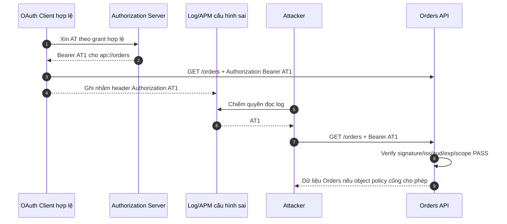
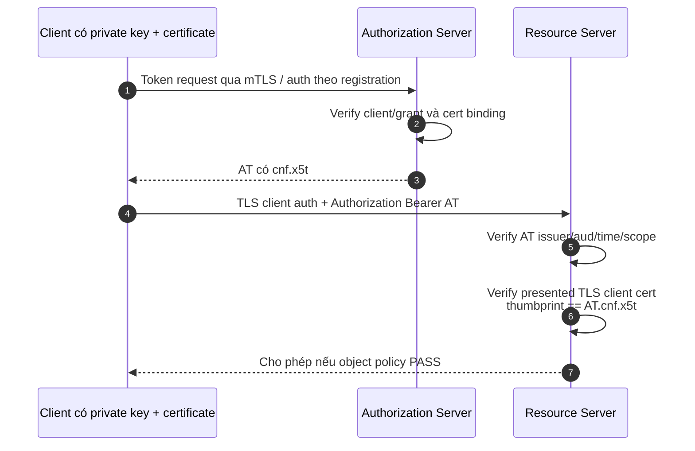
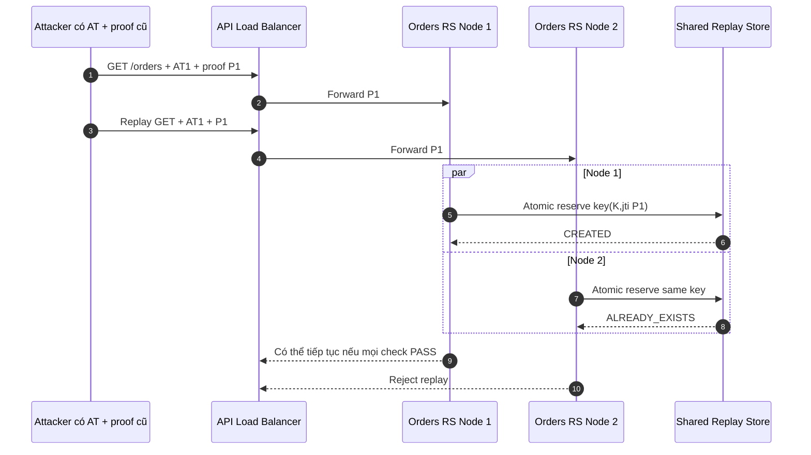

# Replay access token

## Mục tiêu học tập

Trong module **SECURITY_TOKEN_SECURITY_FUNDAMENTALS**, người học tìm hiểu mô hình tin cậy và vòng đời token bảo mật: phân biệt JWT với opaque token, access token với refresh token; xác thực, phân quyền OAuth 2.0/OIDC; phát hành, kiểm tra `iss`/`aud`/`scope`, lưu trữ, thu hồi và bảo vệ token trước hành vi đánh cắp hoặc phát lại. Chương **Replay protection** đi vào biện pháp ngăn **cùng một credential bị kẻ khác sử dụng lại**; bài **“Replay access token”** tập trung cụ thể vào việc **access token (AT) bị sao chép rồi trình lại ở Resource Server (RS)**.

Sau bài học, bạn có thể:

- Nhận diện đúng **access-token replay** và phân biệt với request retry hợp lệ, refresh-token reuse, authorization-code replay, CSRF và double-submit nghiệp vụ.
- Hiểu vì sao **Bearer access token** về bản chất là credential có thể được trình nhiều lần; JWT có chữ ký hợp lệ **không chứng minh người trình token là chủ sở hữu hợp pháp**.
- Phân tích các con đường rò AT qua JavaScript/XSS, log `Authorization`, APM, URL/query, browser extensions, proxy, backup, thiết bị bị chiếm quyền và token forwarding sai audience.
- Áp dụng defense in depth: **TLS, không đưa token vào URL, TTL ngắn, audience/resource binding, scope tối thiểu, lưu trữ phù hợp, revocation** và policy tại RS.
- Mô tả **DPoP (RFC 9449)**: access token được ràng buộc khóa `cnf.jkt`, proof có `htm`/`htu`/`iat`/`jti` và `ath` khi gửi tới RS; nonce/replay-cache khi cần.
- Phân biệt **mTLS certificate-bound access token (RFC 8705)** và DPoP, hiểu giới hạn của cả hai khi attacker điều khiển runtime hoặc lấy private key.
- Thiết kế **replay detection phân tán**: uniqueness scope của proof `jti`, cache atomic check-and-insert, TTL, clock skew, duplicate request, fail-closed và quan sát vận hành.
- Viết pseudocode Java/Spring, HTTP requests, sơ đồ Mermaid và bài kiểm thử cho Bearer, DPoP/mTLS-bound tokens, revocation, lỗi protocol và quyền truy cập theo object.

> **Điểm cốt lõi:** Một **Bearer AT** còn hiệu lực **được phép dùng nhiều lần** cho nhiều request hợp pháp. Vì vậy không thể ngăn kẻ khác phát lại **chỉ bằng JWT signature, `jti` hoặc `exp`**. Muốn chống sử dụng bởi người chỉ **sao chép chuỗi token**, cần **sender-constraining** (ví dụ DPoP/mTLS) hoặc thay đổi kiến trúc giảm khả năng token bị lộ; còn phát hiện reuse của **DPoP proof** đòi kiểm tra `jti`/thời gian/nonce trên RS.

## 1. Replay access token là gì?

**Access-token replay** xảy ra khi một bên có được token đã phát hành rồi **trình lại token đó để thực hiện request ngoài ý định cho phép của chủ thể/client**, thường là tại cùng RS hoặc một RS khác có kiểm tra token sai. Đặc trưng của replay là **credential đã tồn tại và có thể vẫn đúng về mật mã**; attacker không nhất thiết phải phá chữ ký, đoán secret hay tự phát hành token.

### 1.1. Ba tình huống không nên trộn lẫn

| Tình huống | Credential/request đang bị lặp | Mục tiêu kiểm soát |
| --- | --- | --- |
| **Bearer AT bị đánh cắp** | Attacker sao chép `AT1` rồi gọi API bằng `Authorization: Bearer AT1`. | Giảm rò AT, TTL/revocation, sender-constrain khi cần, audience/scope/RS authorization. |
| **DPoP proof replay** | Attacker gửi lại đúng **DPoP proof JWT** đã được dùng cho request/nonce/key cùng ngữ cảnh. | Kiểm tra chữ ký proof, `htm`/`htu`/`ath`/`iat`/nonce và uniqueness của proof `jti`. |
| **Replay business operation** | Client hợp lệ gửi hai lần `POST /payments` với hai proof mới nhưng cùng giao dịch. | **Idempotency key**, business transaction uniqueness và chống double charge; DPoP không tự giải quyết. |

Với **Bearer token**, một client có thể hợp pháp dùng cùng AT để gọi:

```http
GET /orders/101 HTTP/1.1
Host: orders.example.com
Authorization: Bearer <access-token>
```

và ngay sau đó:

```http
GET /orders/102 HTTP/1.1
Host: orders.example.com
Authorization: Bearer <same-access-token>
```

**Hai request hợp pháp này không phải tấn công replay** chỉ vì sử dụng cùng AT. Nếu RS tạo chính sách “mỗi JWT `jti` chỉ được dùng một lần”, mọi request API tiếp theo đều thất bại, phá semantics phổ biến của access token. Chống replay Bearer **khác** chống dùng lại một mã authorization một lần hoặc RT đã rotate.

### 1.2. Các bên và ranh giới tin cậy

| Thành phần | Trách nhiệm | Sai sót hay gặp |
| --- | --- | --- |
| **Authorization Server (AS)** | Xác thực/ủy quyền client, phát hành AT đúng resource/scope, TTL, `token_type` và sender binding nếu dùng. | Phát token bearer rộng audience, TTL dài, không gắn proof key hoặc không hỗ trợ revoke. |
| **OAuth Client** | Giữ token an toàn, chỉ gửi đến đúng RS/AS, bảo vệ key/secret và session. | Gửi AT qua query, log, third-party endpoint, lưu nơi JS dễ bị XSS đọc. |
| **Resource Server (RS)** | Xác thực đúng token type, issuer, audience, time, revocation, scope và policy từng tài nguyên; verify DPoP/mTLS khi token bị ràng buộc. | Chấp nhận DPoP-bound AT như Bearer, bỏ `ath`, không kiểm tra client/key binding. |
| **Resource Owner** | Người dùng cấp quyền OAuth delegated khi flow yêu cầu. | Tin yêu cầu cung cấp token cho website giả hoặc gửi screenshot token. |
| **Attacker** | Có thể lấy AT, proof hoặc thao túng client/browser/network tùy threat model. | Không nhất thiết kiểm soát AS hoặc private signing key. |

Trong OAuth, **client** và **resource owner** không nhất thiết là cùng chủ thể. Client credentials grant có AT đại diện workload, còn delegated user AT có user/actor context; cả hai đều có thể bị phát lại nếu là Bearer và rò credential.

## 2. Vì sao chữ ký JWT không ngăn replay?

JWT access token ký bằng JWS có thể có payload minh họa:

```json
{
  "iss": "https://identity.example.com",
  "sub": "user-42",
  "aud": "api://orders",
  "client_id": "portal-bff",
  "scope": "orders:read",
  "iat": 1800000000,
  "nbf": 1800000000,
  "exp": 1800000900,
  "jti": "at-7db2d28c"
}
```

Các timestamp là fixture minh họa. `jti` là **định danh token** (nếu AS phát hành), không phải một nonce ngẫu nhiên mới cho mỗi API request.

Một RS kiểm tra:

```text
signature PASS
iss == trusted AS
aud contains api://orders
nbf <= now < exp (clock skew policy)
scope includes orders:read

=> Token có thể được xem là hợp lệ về giao thức.
=> Chưa chứng minh request xuất phát từ client/người dùng chính chủ.
```

Với **Bearer token**, người giữ chuỗi token chính là người có thể trình credential. Nếu attacker lấy **đúng chuỗi AT** trong lúc token còn hạn, chữ ký `RS256`/`ES256` hoàn toàn có thể vẫn hợp lệ; attacker **không cần sửa payload** nên verifier không phát hiện tấn công từ chữ ký.

### 2.1. `exp` và `jti` giúp nhưng không đủ

- **`exp`:** giới hạn *cửa sổ thời gian* token bị lộ còn hữu dụng; không làm token chỉ được sử dụng một lần.
- **`nbf`:** không chấp nhận token trước thời điểm quy định; không chứng minh chủ thể gửi request.
- **`jti` của AT:** có thể dùng để revoke/denylist **một AT** và tương quan sự kiện; không mặc định có semantics one-time.
- **`iss`:** ràng buộc token với issuer tin cậy, chống issuer substitution; không gắn với chủ sở hữu khóa client.
- **`aud`:** ngăn token dành cho API A bị API B nhận nếu RS triển khai đúng; không ngăn attacker sử dụng token ở **chính API A**.
- **`scope`:** hạn chế mức truy cập của một token bị lộ; không chứng minh request là của chủ thể chính đáng.

### 2.2. Opaque AT cũng có vấn đề replay

Opaque token có thể được RS introspect qua RFC 7662:

```json
{
  "active": true,
  "iss": "https://identity.example.com",
  "client_id": "portal-bff",
  "sub": "user-42",
  "aud": "api://orders",
  "scope": "orders:read",
  "exp": 1800000900
}
```

Nếu **token vẫn active** và là Bearer, attacker có chuỗi opaque token vẫn có thể gọi Orders API. Introspection chỉ làm AS/RS quản lý trạng thái/claims dễ hơn; **không tự ràng buộc token với một client-held key**. Muốn giảm nguy cơ copy-and-replay cần sender-constrained AT hoặc kiểm soát kiến trúc tương đương.

## 3. Threat model: Attacker có gì?

Không phải mọi tấn công replay có cùng khả năng. Khi phân tích nên xác định attacker nắm **chỉ chuỗi AT**, **AT và DPoP proof cũ**, hay **toàn bộ private key/runtime**.

| Khả năng attacker | Bearer AT | DPoP/mTLS-bound AT | Kết luận |
| --- | --- | --- | --- |
| **Chỉ lấy được AT string** từ log/backup/browser storage. | Có thể replay trước expiry nếu RS không revoke. | Thường không đủ để tạo proof hợp lệ hoặc có client cert tương ứng. | Sender-constraining giúp giảm nguy cơ rò chuỗi. |
| Có AT và **một DPoP proof JWT đã sử dụng**. | Bearer không dùng proof. | Proof cũ cần bị từ chối nếu trùng `jti` trong replay window; request khác `htm`/`htu`/`ath` cũng không khớp. | Replay-cache và method/URL/token binding quan trọng. |
| Có AT + **private key DPoP** hoặc điều khiển JS/runtime có thể ký. | Có thể gọi API. | Có thể tạo proof mới như client, tùy chính sách khóa/thiết bị. | DPoP không thay sandbox/isolation và revocation. |
| Chiếm TLS client cert/private key mTLS. | Không liên quan tới Bearer. | Có thể chứng minh binding nếu còn được chấp nhận. | Bảo vệ private key, revoke cert/token theo policy. |
| Có code/verifier hoặc refresh token khác. | Có thể thử lấy AT mới tại AS nếu grant hợp lệ. | Sender constraints cho AT không thay PKCE/RT security. | Phải bảo vệ **toàn bộ token lifecycle**. |
| Có khả năng gọi API khi user session còn active qua XSS. | Có thể dùng session/AT. | Có thể dùng quyền ký/request của app nếu XSS điều khiển runtime. | Cần chống XSS, CSRF và business authorization. |

### 3.1. Một chuỗi tấn công minh họa



**Điểm mấu chốt:** AT1 có thể *hoàn toàn hợp lệ*. Nếu attacker sử dụng đúng quyền/subject được token đại diện, một RS chỉ kiểm tra token và scope có thể không phân biệt được nguồn request. **Object-level authorization** vẫn quan trọng, nhưng nếu AT vốn cho phép user-42 đọc orders của họ, nó không phân biệt người gửi thật với attacker mạo danh user-42 bằng credential.

### 3.2. Một số nguồn rò AT thực tế

1. URL query `?access_token=...`, redirect chain, browser history, referrer, CDN/proxy logs.
2. `Authorization` header, cookies hoặc HTTP bodies bị ghi trong APM/tracing/error reporting.
3. `localStorage`/`sessionStorage`/IndexedDB/JavaScript memory bị XSS hoặc extension độc hại truy cập.
4. Mobile/device backup, crash dump, debug console, support screenshot hoặc paste nhầm lên issue tracker.
5. Client gửi nhầm AT sang resource endpoint không được tin cậy hoặc forwarding cùng token qua nhiều APIs.
6. Reverse proxy/TLS termination và HTTP hops nội bộ không được bảo vệ đúng.
7. Refresh token bị lộ giúp mint **AT mới**, tạo tấn công liên tục sau khi AT cũ hết hạn.

Không dùng credential thật để minh họa hoặc kiểm thử trên log/chats. Khi có dấu hiệu rò AT phải **hạn chế chia sẻ bản sao, revoke theo policy và kiểm tra RS enforcement**, không chỉ xóa dòng log đang thấy.

## 4. Lớp phòng vệ nền tảng: giảm cơ hội replay Bearer

Trước khi dùng DPoP/mTLS, cần bảo đảm các lớp OAuth cơ bản được thực thi. Sender-constraining không thay việc cấu hình RS, HTTPS hay permissions đúng.

| Lớp kiểm soát | Tác dụng | Giới hạn |
| --- | --- | --- |
| **TLS end-to-end thích hợp** | Giảm interception trên đường truyền. | Không bảo vệ token đã nằm trong JS/log/runtime bị compromise. |
| **`Authorization: Bearer` header qua HTTPS** | Tránh đưa AT vào URL query/referrer/history. | Header vẫn có thể bị log nếu gateway/APM cấu hình sai. |
| **AT TTL ngắn, RT bảo vệ chặt** | Thu hẹp thời gian AT bị lộ còn dùng được. | Không ngăn replay trong thời gian còn hạn. |
| **Audience/resource restriction** | API khác từ chối AT không dành cho nó. | Không ngăn replay tại đúng audience. |
| **Scope tối thiểu và object-level policy** | Giảm dữ liệu/hành động attacker có thể thực hiện. | Không phân biệt attacker với client hợp lệ có cùng token. |
| **Opaque introspection/AT revocation** | Có thể chặn credential sau khi AS/RS biết nó bị lộ. | Cần nhận biết sự cố; cache có thể chậm invalidation. |
| **JWT denylist/grant/session state** | RS từ chối AT cũ trước `exp`. | Thêm state, cache, availability và consistency. |
| **BFF/server-side token vault** | Giảm raw RT/AT lộ qua browser JavaScript. | Không loại bỏ XSS session riding, CSRF hay compromise backend. |
| **DPoP/mTLS sender constraint** | Ràng buộc AT với khóa/chứng chỉ khi gọi RS. | Không ngăn attacker có private key hoặc điều khiển runtime. |

### 4.1. Bearer transport

```http
GET /orders/101 HTTP/1.1
Host: orders.example.com
Authorization: Bearer <access-token>
```

Tránh:

```text
https://orders.example.com/orders/101?access_token=<bearer-token>
```

Bearer trong URI query là rủi ro theo RFC 6750 và thường dễ rò hơn. Dù token không xuất hiện trong URL, vẫn phải lọc `Authorization`/`Cookie` khỏi logs/metrics/traces.

### 4.2. API bắt buộc kiểm tra issuer, audience và scope

Giả sử AT:

```text
iss   = https://identity.example.com
aud   = api://orders
scope = orders:read
exp   = ...
```

Orders API phải xác minh `iss`/`aud`/`exp`/token kind/signature hoặc introspection, còn Billing API phải từ chối AT đó nếu `aud` không chứa `api://billing`. **Chỉ chữ ký đúng không có nghĩa token được dùng ở mọi RS**.

Nhận AT **sai audience** là lỗi *token substitution/cross-resource replay*. Nhận AT **đúng audience nhưng từ attacker cầm Bearer string** là vấn đề *bearer token theft/replay*. Hai rủi ro bổ sung nhau.

### 4.3. Khi nào cần chặn AT trước hạn?

Nếu AT bị lộ, AS có thể revoke qua RFC 7009 nếu hỗ trợ AT revocation; RS cần **thấy được trạng thái** bằng introspection, denylist, grant version hoặc event invalidation. Với JWT được RS verify hoàn toàn offline, AS đánh dấu REVOKED **không thay đổi signature**, nên token có thể được dùng đến `exp` nếu RS không kiểm tra state.

**Thu hồi refresh token** chặn cấp AT mới nhưng **không mặc nhiên vô hiệu AT đã cấp**. Với sự cố nghiêm trọng, phải đánh giá cả **AT, RT family, grant, session và client/key compromise**.

## 5. Vì sao không dùng “mỗi access-token `jti` một lần”?

Giả sử AT1 có `jti=at-123` và được phát hành cho một phiên đọc Orders:

```text
GET /orders/101  dùng AT1 -> thành công.
GET /orders/102  dùng AT1 -> phải tiếp tục được phép nếu AT còn hợp lệ.
GET /orders/103  dùng AT1 -> phải tiếp tục được phép nếu còn quyền.
```

Nếu RS đánh dấu `at-123` “đã dùng” sau request đầu rồi từ chối mọi request sau, bạn đã **biến Bearer AT thành one-time ticket trái với semantics ứng dụng**. Điều này không phân biệt được attacker và client hợp lệ.

| Identifier | Bản chất | One-time theo giao thức? |
| --- | --- | --- |
| **Access token `jti`** | Nhận diện **token instance** để audit/revoke/denylist nếu profile cấp. | **Không**. AT có thể dùng nhiều request. |
| **DPoP proof `jti`** | Nhận diện **một proof JWT cụ thể**, giúp RS/AS từ chối dùng lại proof trong cửa sổ chấp nhận. | **Có mục đích chống replay proof**; cần cache hiệu lực theo issuer/key/context. |
| **Authorization code** | Credential đổi token ở AS, ràng buộc client/redirect/PKCE. | **Một lần**; code đã consumed phải bị từ chối. |
| **Refresh token đã rotate** | RT đời trước bị thay bằng đời mới. | RT đã rotated **không được dùng lại**; reuse có thể kích hoạt family revocation. |
| **HTTP idempotency key** | Định danh thao tác nghiệp vụ để retry POST an toàn. | Tùy contract API, không phải khóa mật mã của AT. |

**Đừng dùng cùng khái niệm “replay cache” cho cả AT `jti` và DPoP proof `jti`.** AT denylist ghi nhận token **bị thu hồi**; DPoP `jti` replay cache ghi nhận **proof đã được thấy** trong thời gian proof còn được chấp nhận. Hai store có scope, TTL và logic khác nhau.

## 6. DPoP là gì? Sender-constraining bằng khóa công khai

**RFC 9449 — OAuth 2.0 Demonstrating Proof of Possession (DPoP)** cho phép client chứng minh nó **nắm private key** tương ứng public key đã được gắn với access token. Client tạo **DPoP proof JWT** cho từng HTTP request quan trọng và gửi nó trong header `DPoP`; RS kiểm tra proof gắn đúng AT và request.

Với một AT bị ràng buộc DPoP, attacker chỉ lấy chuỗi token **không thể tự tạo proof hợp lệ** nếu không có private key/khả năng ký. Nếu attacker chỉ lấy **một proof JWT cũ**, replay cache `jti` và ràng buộc method/URL/token giúp từ chối việc dùng lại ở các request mới.

### 6.1. Ba đối tượng khác nhau

1. **DPoP private key**: client giữ kín; dùng ký proof JWT. Không bao giờ đưa vào `jwk` public header, access token, query hoặc logs.
2. **DPoP proof JWT**: JWT ngắn hạn, ký cho HTTP request cụ thể; có `jti`, `htm`, `htu`, `iat`, `ath` khi trình AT tại RS, và `nonce` khi server yêu cầu.
3. **DPoP-bound access token**: credential do AS phát hành, có binding `cnf.jkt` (hoặc introspection metadata tương đương) tới thumbprint của public key; RS phải kiểm tra proof public key khớp binding.

**DPoP proof không phải access token**. Nó là bằng chứng mật mã bổ sung. **Access token không phải DPoP proof**. Một RS bỏ kiểm tra `ath`/`cnf.jkt` có thể biến DPoP thành header trang trí.

### 6.2. DPoP token issuance và API call

```mermaid
sequenceDiagram
    autonumber
    participant C as OAuth Client giữ DPoP private key
    participant AS as Authorization Server
    participant RS as Orders Resource Server
    C->>C: Tạo asymmetric key pair K<br/>giữ private key kín
    C->>AS: POST /token + DPoP proof ký bằng K
    AS->>AS: Verify proof htm/htu/iat/jti/nonce<br/>và OAuth grant/client policy
    AS-->>C: access_token AT1, token_type DPoP<br/>AT binding cnf.jkt = thumbprint(K.public)
    C->>C: Tạo proof mới với htm=GET,<br/>htu=Orders URL, ath=hash(AT1), jti mới
    C->>RS: GET /orders<br/>Authorization: DPoP AT1<br/>DPoP: proof
    RS->>RS: Verify AT; cnf.jkt<br/>proof signature/htm/htu/ath/iat/jti/nonce
    RS-->>C: Orders nếu scope + object policy PASS
    C->>C: Request khác -> proof jti mới
```

Trong thực tế, token endpoint có thể yêu cầu client authentication (confidential client) và grant-specific security (PKCE, refresh-token binding, consent); **DPoP không thay thế các điều kiện đó**.

### 6.3. Vì sao gọi là *sender-constrained*?

AS không chỉ nói “token do tôi phát hành”. Nó còn gắn token với một key mà client phải **chứng minh nắm được khi trình token**. RS cần xác minh cả:

```text
Access token:
    trusted issuer
    right audience/resource
    exp/nbf and token kind
    scope and revocation policy
    cnf.jkt = JWK thumbprint(K.public)

DPoP proof:
    signature valid under K.public
    htm/htu match this HTTP request
    ath == hash(raw access token)
    iat within allowed time window
    jti not replayed in acceptance window
    nonce == server-issued nonce if required
    thumbprint(K.public) == token.cnf.jkt
```

Nếu thiếu một trong các ràng buộc quan trọng, attacker có thể lợi dụng proof/token từ ngữ cảnh khác hoặc giả mạo được phần sender constraint. RS **không được chấp nhận AT DPoP-bound trong Bearer mode** để “tương thích dễ dàng” mà phá mục tiêu chống replay.

## 7. DPoP proof: cấu trúc JWT và trình tự xác minh

DPoP proof là một **JWS**, có header `typ=dpop+jwt`, thuật toán ký asymmetric được cho phép, và **public JWK** để verifier biết public key dùng kiểm tra chữ ký. Giá trị trong các ví dụ là **placeholder, không phải JWT hợp lệ để gọi API**.

### 7.1. Header của proof

```json
{
  "typ": "dpop+jwt",
  "alg": "ES256",
  "jwk": {
    "kty": "EC",
    "crv": "P-256",
    "x": "<base64url-public-x-coordinate>",
    "y": "<base64url-public-y-coordinate>"
  }
}
```

**Chỉ nhúng public key.** `d` của private EC JWK, private RSA parameters hay private key PEM **không được xuất hiện** trong proof header, logs hoặc response. Verifier chỉ chấp nhận asymmetric algorithms/key parameters được policy cho phép, từ chối `none`/HMAC symmetric algorithms ở nơi yêu cầu DPoP.

**Lưu ý quan trọng:** Chữ ký proof chỉ cho biết **bên tạo proof nắm private key tương ứng JWK trong header**. Bất kỳ attacker nào cũng có thể tự tạo một key pair và ký proof của họ; **chưa có chứng cứ proof key đó được gắn với AT** cho đến khi RS kiểm tra thumbprint trùng `cnf.jkt` từ AT đã verify/introspect.

### 7.2. Payload của proof cho Resource Server

```json
{
  "jti": "proof-8f5d7c91-unique",
  "htm": "GET",
  "htu": "https://orders.example.com/orders/101",
  "iat": 1800000100,
  "ath": "<base64url-sha256-of-raw-access-token>",
  "nonce": "<resource-server-issued-nonce-if-required>"
}
```

| Claim | RS phải kiểm tra | Khi thiếu/sai có nguy cơ gì? |
| --- | --- | --- |
| **`jti`** | Identifier không bị dùng lại trong replay window cho proof signing key/context. | Proof đã quan sát có thể bị gửi lại tới cùng resource trong cửa sổ hợp lệ. |
| **`htm`** | HTTP method thực, ví dụ `GET`, `POST`. | Proof cho GET có thể bị lạm dụng ở POST nếu không ràng buộc. |
| **`htu`** | HTTP URI đích sau canonicalization theo DPoP, không chứa query/fragment. | Proof cho một endpoint/host có thể bị dùng ở endpoint khác. |
| **`iat`** | Timestamp phát hành proof đủ mới trong cửa sổ policy, hạn chế clock skew. | Proof cũ có thể được phát lại về sau nếu không có freshness. |
| **`ath`** | SHA-256 của **raw access token** trong request, Base64url không padding. | Proof hợp lệ với AT của người khác có thể bị tráo nếu không ràng buộc AT. |
| **`nonce`** khi server yêu cầu | Giá trị nonce hợp lệ do **AS/RS tương ứng** cấp. | Proof có thể thiếu tính liveness bổ sung hoặc bị từ chối nonce policy. |

Đối với **token endpoint**, DPoP proof phục vụ ràng buộc key khi **phát token** và cũng phải kiểm tra `htm`/`htu`/`iat`/`jti`/nonce nếu được yêu cầu. Claim **`ath` là ràng buộc access token của proof tại RS**; không được nhầm là client phải có AT trước khi gọi token endpoint lần đầu.

### 7.3. HTTP request có DPoP

```http
GET /orders/101 HTTP/1.1
Host: orders.example.com
Authorization: DPoP <dpop-bound-access-token>
DPoP: <signed-dpop-proof-jwt>
```

Phân biệt:

- `Authorization: DPoP ...`: token được trình với authentication scheme DPoP.
- `DPoP: ...`: **proof JWS** riêng gắn method/URI/token.
- JWT trong `DPoP` header có thể được tạo mới cho từng request; **AT thường không đổi giữa các request**, miễn còn hợp lệ.
- Một proof đã dùng **không được phát lại** chỉ vì client đang gọi cùng URI lần nữa. Client cần tạo proof mới với `jti` khác.

Nếu RS hỗ trợ cả Bearer và DPoP, policy phải phân biệt loại AT/binding. **Không downgrade** một AT có `cnf.jkt` thành Bearer chỉ vì thiếu proof hoặc proof xác minh thất bại.

### 7.4. Cách tính `ath`

`ath` là giá trị:

```text
ath = BASE64URL-ENCODE(
        SHA-256(ASCII(access_token_value))
      )
      không có padding
```

Ở đây `access_token_value` là **chuỗi credential được gửi cùng request**, **không** phải JWT payload đã giải mã, `jti` của AT, chữ ký JWT hay một user ID.

Java minh họa:

```java
import java.nio.charset.StandardCharsets;
import java.security.MessageDigest;
import java.util.Base64;

String calculateAth(String rawAccessToken) throws Exception {
    byte[] bytes = rawAccessToken.getBytes(StandardCharsets.US_ASCII);
    byte[] digest = MessageDigest.getInstance("SHA-256").digest(bytes);
    return Base64.getUrlEncoder().withoutPadding().encodeToString(digest);
}

// Test example: rsAth must equal "ath" claim in VERIFIED DPoP proof.
boolean sameAth = MessageDigest.isEqual(
    calculatedAth.getBytes(StandardCharsets.US_ASCII),
    verifiedProofAth.getBytes(StandardCharsets.US_ASCII)
);
```

**Không tin `ath` claim trước khi verify chữ ký proof.** Trong production, nên dùng **thư viện DPoP/JWT được kiểm chứng**, không tự lắp ráp JOSE vì các chi tiết key/algorithm/URI normalization dễ sai. Không đặt AT thật trong unit test logs.

### 7.5. JWK thumbprint và `cnf.jkt`

AS ràng buộc AT với public key thông qua **JWK thumbprint** được tính theo **RFC 7638**:

```json
{
  "iss": "https://identity.example.com",
  "aud": "api://orders",
  "scope": "orders:read",
  "exp": 1800000900,
  "cnf": {
    "jkt": "<rfc7638-jwk-thumbprint-of-proof-key>"
  }
}
```

Đây là payload AT minh họa; AT có thể là JWT hoặc opaque với trusted introspection metadata tương ứng. `jkt` không phải public/private key nguyên vẹn; nó là **thumbprint của public JWK** theo representation chuẩn.

RS phải:

1. Verify AT qua issuer/key/claims hoặc trusted introspection; kiểm tra `aud`/`exp`/token type.
2. Xác định `cnf.jkt` **đáng tin từ token** hoặc AS introspection result, **không** từ query/body/header tự khai.
3. Verify DPoP proof signature dựa trên public `jwk` được nhúng ở proof header.
4. Tính JWK thumbprint của public key đã verify và so sánh đúng `cnf.jkt`.
5. Kiểm tra `htm`, `htu`, `iat`, `ath`, `jti` và `nonce` khi chính sách yêu cầu.

Nếu attacker tạo proof bằng **khóa riêng của attacker**, chữ ký proof có thể hoàn toàn hợp lệ nhưng **`jkt` khác AT**, vì vậy RS **phải từ chối**.

### 7.6. `htu`: URL, query, fragment và proxy

`htu` được ràng buộc với HTTP URI đích theo quy tắc normalization của RFC 9449; **query và fragment không được đưa vào `htu`**. Ví dụ:

```text
HTTP request:
  GET https://orders.example.com/orders/101?view=summary

DPoP htm:
  GET

DPoP htu:
  https://orders.example.com/orders/101

Không dùng:
  https://orders.example.com/orders/101?view=summary
```

**Hệ quả:** proof không ràng buộc trực tiếp với **query parameters, request body hay business meaning**. Một request có thể có cùng `htm`/`htu` nhưng khác query/body; replay-cache và các biện pháp chống **replay operation nghiệp vụ** vẫn cần. Điều này đặc biệt quan trọng với POST, thanh toán hoặc chuyển quyền.

Khi ứng dụng chạy sau **reverse proxy/load balancer**:

- RS phải tái dựng **external HTTP target URI** đúng từ proxy chain tin cậy.
- Không dùng `X-Forwarded-Host`/`Forwarded` từ client không được xác thực để quyết định `htu`, tránh host/header spoofing.
- Có thể cần cấu hình scheme `https`, host, port và path rewrite theo gateway trusted metadata.
- Nếu path rewrite khiến RS kiểm tra URL nội bộ `http://service:8080` thay vì `https://orders.example.com`, DPoP proof hợp lệ của client sẽ bị từ chối hoặc mở đường workaround không an toàn.

**Không “sửa lỗi DPoP” bằng cách bỏ kiểm tra `htu` hoàn toàn.** Hãy sửa trust/canonicalization của proxy, thêm test redirect/port/path và các route thực tế.

### 7.7. `iat` và giới hạn thời gian

`iat` có thể được tạo ngay trước request. RS phải từ chối proof quá cũ hoặc quá xa trong tương lai ngoài **freshness window/clock skew policy**. Không chỉ kiểm tra chữ ký mà bỏ timestamp:

```text
Client time: 10:00:05
Proof iat:   10:00:05
RS time:     10:00:06 -> có thể PASS nếu các điều kiện khác PASS

Replay proof từ 09:00:00 tại 10:00:06
  -> phải bị từ chối khi quá thời gian cho phép.
```

Window dài giúp chịu được lệch clock/mạng chậm nhưng làm tăng **thời gian phải ghi nhớ `jti` để chống proof replay**. Window ngắn giảm rủi ro nhưng tăng false reject nếu đồng hồ lệch. Có thể dùng **server-issued nonce** để hỗ trợ freshness/liveness, đặc biệt khi khó tin đồng hồ client.

### 7.8. Nonce: khác với `jti`

**`jti`** do client sinh để định danh **proof cụ thể** và giúp nhận diện replay. **`nonce`** có thể được **AS/RS phát hành** để yêu cầu client phản hồi bằng proof mang nonce phù hợp. Chúng **không hoán đổi**.

- Một server-issued nonce có thể được **sử dụng trên nhiều proof khác nhau** trong thời hạn server cho phép; không mặc định `nonce` là single-use.
- Mỗi proof mới vẫn cần `jti` mới.
- AS và RS có thể dùng nonce riêng, **không giả định nonce của token endpoint được chấp nhận ở Orders API**.
- Nếu server yêu cầu nonce, client phải tạo **proof mới** có nonce hợp lệ; không thể chỉ sửa payload của proof đã ký.
- Không nhận nonce bất kỳ do client tự chọn như bằng chứng server challenge.

### 7.9. Lỗi khi server yêu cầu DPoP nonce

Một luồng có thể:

```http
HTTP/1.1 401 Unauthorized
WWW-Authenticate: DPoP error="use_dpop_nonce"
DPoP-Nonce: <resource-server-generated-nonce>
Cache-Control: no-store
```

Client phải tạo proof mới với `nonce` đó, `jti` mới và đúng `htm`/`htu`/`ath` rồi gửi lại request **theo chính sách retry của API**. Tại AS token endpoint, `use_dpop_nonce` có thể xuất hiện như OAuth error response kèm `DPoP-Nonce` theo RFC 9449.

**Đừng retry POST không idempotent một cách mù quáng** khi kết quả request trước không rõ. Với yêu cầu nonce chuẩn, server thường từ chối request cũ trước khi xử lý business operation, nhưng lỗi mạng/đường đi khác vẫn cần idempotency/correlation. Không biến nonce challenge thành cơ chế bypass `jti` replay detection.

## 8. DPoP `jti` replay cache: kiểm tra một lần ở quy mô phân tán

Mỗi proof JWT phải có `jti` đủ ngẫu nhiên/duy nhất trong ngữ cảnh của signing key. RS cần xác định **proof ID đã được chấp nhận/nhìn thấy hợp lệ trước đó chưa** để ngăn sử dụng lại proof trong thời gian proof còn có thể được chấp nhận.

### 8.1. Khóa replay cache

Một key nội bộ minh họa:

```text
proof_cache_key =
  HMAC(cache_secret,
    trusted_issuer + "|" + key_thumbprint + "|" + proof_jti)

value: accepted_at, proof_expiry_deadline, optional RS context
```

Lựa chọn key có thể khác theo kiến trúc và cách tách RS; invariant quan trọng là **cùng proof dưới cùng key/context không được được chấp nhận lại qua nhiều node xử lý cùng resource**. Không dùng `jti` không có namespace key/issuer rồi trộn mọi issuer/tenants; cũng không cho client tự chọn namespace để né check.

**`jti` replay cache khác `jti` AT denylist.** AT vẫn được dùng nhiều lần với **những proof khác nhau**; chỉ proof đã dùng mới bị từ chối.

### 8.2. Atomic check-and-insert là bắt buộc để chống race

Phản ví dụ:

```text
Node A: GET proof:jti = not found
Node B: GET proof:jti = not found
Node A: SET proof:jti = seen -> accept
Node B: SET proof:jti = seen -> accept

Kết quả: cùng proof được chấp nhận hai lần.
```

Cần operation **atomic test-and-insert** trên store chia sẻ phù hợp, ví dụ Redis `SET key value NX PX ttl`, database unique constraint hoặc dịch vụ chống replay có isolation tương đương:

```text
Node A: INSERT_IF_ABSENT(proof_key, expiry) -> CREATED -> tiếp tục.
Node B: INSERT_IF_ABSENT(proof_key, expiry) -> EXISTS  -> REJECT replay.
```

Không dùng `HashSet` static hoặc `ConcurrentHashMap` trong một JVM nếu nhiều RS instances/load balancer; các node khác sẽ không thấy proof đã dùng.

### 8.3. TTL replay cache phải bao phủ toàn bộ acceptance window

Nếu RS cho phép proof `iat` quá khứ tối đa 120 giây và clock skew tương ứng, entry “đã thấy” cần tồn tại ít nhất **cho tới khi proof đó không còn được chấp nhận tại bất kỳ node có liên quan**.

```text
proofAcceptedAt = now
proofIat        = verified iat
latestAllowedUse = proofIat + serverFreshnessWindow + permittedSkew

cacheTtl = max(latestAllowedUse - now, 0) + safetyMargin
```

Đây là công thức **minh họa**, không phải công thức bắt buộc RFC. Khi dùng server nonce có chính sách lifetime riêng, TTL/replay semantics phải phản ánh **thời hạn thực mà cùng proof còn có thể được validator chấp nhận**, không lấy TTL AT làm TTL replay cache.

**Không xóa proof `jti` quá sớm**: nếu proof vẫn còn trong freshness window sau khi cache entry bị evict, attacker có thể replay lại.

### 8.4. Khi nào ghi `jti` đã dùng?

Thứ tự an toàn:

1. Giới hạn header/proof size để tránh DoS, parse JOSE bằng thư viện an toàn.
2. Verify chữ ký, thuật toán, key parameters và loại proof.
3. Verify AT đã được phát hành cho resource/client và binding `cnf.jkt`, cùng `ath`.
4. Verify `htm`, `htu`, `iat`, `nonce` khi dùng.
5. **Atomic reserve `jti`** trong replay store trước khi cho request đi vào business logic.
6. Kiểm tra scope/object authorization theo policy trước khi cho phép thao tác.

Một proof có chữ ký sai không nên tùy tiện **poison replay-cache** bằng một `jti` attacker tự khai nhằm từ chối proof hợp lệ của client. Các nhánh rate limiting/traffic protection tách khỏi tính duy nhất `jti` của proof đã được xác minh.

**Trade-off:** nếu request có proof hợp lệ nhưng business authorization cuối cùng bị từ chối, hệ thống có thể đã tiêu thụ proof; client nên sinh proof mới khi retry. **Đừng rollback `jti` reservation sau request timeout** một cách tùy tiện vì có thể cho proof cũ được dùng lại. Quy tắc phải nhất quán giữa node và retry policy.

### 8.5. Khi replay store không khả dụng

Trong chế độ DPoP có yêu cầu replay detection nghiêm ngặt:

```text
ReplayState = SEEN    -> reject proof.
ReplayState = NEW     -> may proceed if all checks PASS.
ReplayState = UNKNOWN -> do not silently accept.
```

Nếu Redis/DB không thể trả kết quả atomic insert, **fail closed** với lỗi hạ tầng phù hợp hoặc cơ chế fallback đã được thiết kế rõ theo threat model. Không “tạm bỏ replay check” trong `catch (Exception) { return allow; }`.

Với event bus hoặc replicated store không có strong consistency, hai node có thể cùng chấp nhận proof trước khi replication xong. Điều này có thể trái SLO chống replay; cần kiểm soát consistency **ngay tại atomic reservation**, không chỉ eventual invalidation.

### 8.6. Key rotation, rate limits và tài nguyên cache

Attacker có thể gửi nhiều proof `jti` khác nhau có chữ ký hợp lệ nếu nắm key hoặc client runtime, gây tải replay store. Chống replay cache **không thay rate limiting/abuse detection**:

- Giới hạn số request theo client/key/resource/tenant với những tín hiệu đáng tin.
- Giới hạn kích thước JWT/JWK, thuật toán và freshness window.
- Đặt TTL/eviction policy không làm mất marker còn hiệu lực.
- Dùng key namespace từ **thumbprint đã verify**, không raw JWK/string user-supplied chưa kiểm tra.
- Quản lý thay đổi signing key và token binding: khi client tạo key mới, AT bound key cũ không tự chuyển sang key mới; phải xin token mới theo AS profile.

## 9. mTLS certificate-bound access token

**RFC 8705** mô tả client authentication bằng mutual TLS và certificate-bound access tokens. Khi AS phát hành token **ràng buộc với chứng chỉ client**, RS phải kiểm tra credential được trình qua kết nối mTLS có đúng chứng chỉ được gắn với AT hay không.

### 9.1. Thumbprint chứng chỉ trong token

Một JWT AT minh họa có:

```json
{
  "iss": "https://identity.example.com",
  "aud": "api://orders",
  "exp": 1800000900,
  "scope": "orders:read",
  "cnf": {
    "x5t#S256": "<base64url-sha256-of-client-leaf-certificate-der>"
  }
}
```

`x5t#S256` là thumbprint SHA-256 của certificate theo profile; không phải private key hay proof `jti`. Opaque token có thể mang binding metadata qua introspection phù hợp.

### 9.2. Luồng mTLS-bound AT



**mTLS certificate-bound token và mTLS client authentication là hai khái niệm liên quan nhưng không đồng nhất.** AS có thể dùng mTLS để xác thực client theo registration; token phải được **phát hành kèm binding** và RS phải kiểm tra binding ấy nếu mục tiêu là giảm token replay.

### 9.3. Reverse proxy/TLS termination

Nếu mTLS kết thúc ở API gateway, backend RS không trực tiếp thấy TLS client certificate. RS chỉ được tin certificate identity do **gateway đã xác thực** chuyển qua một kênh nội bộ được bảo vệ, với header signing/trust policy phù hợp và **loại bỏ mọi client-supplied forwarded-cert headers**.

Nếu attacker có thể tự gửi header `X-Client-Cert` rồi RS coi đó là chứng chỉ xác thực, **sender-constraining bị bypass**. Chỉ kiểm tra “có header chứa thumbprint đúng” không thay TLS client proof of private-key possession.

### 9.4. mTLS và DPoP khác nhau thế nào?

| Đặc điểm | DPoP | mTLS certificate-bound AT |
| --- | --- | --- |
| Bằng chứng sở hữu key | Signed JWT proof mỗi HTTP request. | TLS client certificate/private key possession ở kênh mTLS. |
| Binding token | `cnf.jkt` JWK thumbprint. | `cnf.x5t#S256` certificate thumbprint. |
| Request binding | `htm`/`htu`/`ath`/`iat`/`jti`/nonce trong proof. | Gắn token với cert qua TLS, không cần DPoP proof `jti`. |
| Replay-cache proof ID | Cần khi bảo vệ DPoP proof reuse. | Không có DPoP `jti` để lưu; TLS protocol và cert binding khác. |
| Browser/public-client ergonomics | Có thể dùng Web Crypto/JS hoặc native key; vẫn cần XSS threat model. | Yêu cầu quản trị client cert/mTLS, proxy/network support. |
| Nếu bị lộ AT string đơn lẻ | Attacker thiếu private key thường không dùng được. | Attacker thiếu client private key/cert channel thường không dùng được. |
| Nếu attacker điều khiển key/runtime | Có thể tạo proof mới. | Có thể trình cert phù hợp. |
| Có thay token revocation? | **Không**. | **Không**. |

**Không triển khai DPoP/mTLS theo kiểu “tài liệu nói đã bật” nhưng RS thực tế vẫn chấp nhận cùng token trong Bearer mode không ràng buộc.** Kiểm thử phải đo **server enforcement**, không chỉ kiểm tra token response có `cnf`.

## 10. Cross-resource replay, token forwarding và nhiều APIs

Access token bị sao chép không chỉ bị replay tại **cùng API** mà còn có thể bị mang sang **một API khác** nếu các Resource Servers cấu hình audience/scope/token-purpose sai.

### 10.1. Audience là ranh giới đầu tiên

Ví dụ:

```text
Orders API  => audience api://orders
Billing API => audience api://billing

AT1:
  iss   = https://identity.example.com
  aud   = api://orders
  scope = orders:read

Đúng:
  GET Orders + AT1 -> có thể được xử lý nếu đủ quyền.
  GET Billing + AT1 -> reject wrong audience.
```

Nếu Billing chỉ kiểm tra `iss`, signature và `exp` mà **không kiểm tra `aud`**, token của Orders có thể trở thành credential lạc chỗ. DPoP `htu` giúp ràng buộc proof với URL, nhưng **không thay audience validation**. Nếu attacker hoặc client có **DPoP signing key**, họ có thể tạo proof mới cho Billing và khai thác RS bỏ qua audience.

### 10.2. Tránh gửi cùng bearer AT qua nhiều hops

Một kiến trúc:

```text
Browser -> BFF -> Orders API -> Billing API
```

**Anti-pattern:** BFF gửi AT dành cho Orders tới Orders API, Orders lại forward **cùng token** sang Billing. Billing tin JWT do cùng AS phát hành dù `aud` dành cho Orders. Điều này tạo **token forwarding/substitution** và tăng số nơi có credential.

Thiết kế tốt hơn:

- Client xin AT với **resource indicator/audience phù hợp** từng RS khi AS hỗ trợ (RFC 8707).
- Với delegated API-to-API calls, cân nhắc **OAuth Token Exchange (RFC 8693)** nếu AS hỗ trợ, hạn chế audience/scope và subject/actor delegation đúng ngữ cảnh.
- RS kiểm tra token type, issuer, audience, scope, client/actor và owner/tenant/object policy.
- Không đưa raw AT vào request/log của downstream không được tin.

**Replay protection phải được áp tại mọi nơi token thực sự được chấp nhận.** Chỉ Orders kiểm tra DPoP trong khi Billing có fallback Bearer acceptance là một điểm bypass.

### 10.3. Nhiều RS instances cùng một endpoint

Load balancer phân phối hai request có **cùng DPoP proof** tới node A và B:



Nếu mỗi RS node dùng local memory riêng, **cả hai** có thể chấp nhận proof P1. Không dùng replicated cache eventually consistent khi yêu cầu uniqueness strict mà không có atomic reservation/strong consistency tại đúng key.

### 10.4. RS khác nhau có cần dùng chung replay store?

Nếu proof `htu` ràng buộc hostname/path của RS A, RS B có URL khác sẽ từ chối ngay ở `htu`. Nhưng nếu nhiều pods/gateways cùng xử lý **cùng external URI**, chúng **phải dùng cơ chế uniqueness chung** cho proof được chấp nhận tại URI đó. Với các aliases/routes/proxy rewrites, xác định chính xác phạm vi một proof có thể được chấp nhận; đừng dùng giả định “mỗi host một store” nếu hai host thực tế được cấu hình canonicalization thành cùng target.

## 11. Replay HTTP request nghiệp vụ: cần idempotency riêng

DPoP chứng minh sở hữu private key và làm giảm khả năng dùng lại **cùng proof**. Nó **không** chứng minh request business chưa từng được xử lý.

### 11.1. Hai proof hợp lệ, cùng giao dịch

```text
POST /payments
  Authorization: DPoP AT1
  DPoP proof P1 (jti=proof-1)
  body: pay 100 USD to merchant A

POST /payments
  Authorization: DPoP AT1
  DPoP proof P2 (jti=proof-2)
  body: pay 100 USD to merchant A

P1 và P2 có chữ ký/ath/htu/htm hợp lệ.
=> Cả hai có thể PASS token replay protection.
=> Nếu business không chống double-submit, có thể tạo hai giao dịch.
```

Giải pháp là **business idempotency**: request mang key riêng, được gắn với **principal/client/operation/payload** và lưu với transaction unique constraint, trả lại kết quả cũ hoặc lỗi phù hợp nếu retry.

```http
POST /payments HTTP/1.1
Host: payments.example.com
Authorization: DPoP <payments-access-token>
DPoP: <new-proof-for-this-request>
Idempotency-Key: payment-attempt-84bf
Content-Type: application/json

{"invoice_id":"inv-42","amount_minor":10000,"currency":"USD"}
```

**`Idempotency-Key` trong ví dụ là contract của API**, không phải một phần bắt buộc của DPoP/OAuth. API cần xử lý cùng key nhưng **body khác** theo policy, và đảm bảo unique insert + business commit nhất quán.

### 11.2. Vì sao không đưa body hash vào `ath`?

`ath` của DPoP **bắt buộc là hash của access token**, **không phải body HTTP request**. Thay nó bằng request-body hash sẽ phá giao thức. Nếu một ứng dụng cần bảo vệ integrity/anti-replay của business payload, có thể dùng idempotency keys, message signing hoặc protocol riêng được đánh giá kỹ; **không tự thay đổi semantics của DPoP `ath`**.

### 11.3. Retry chính đáng và proof mới

Khi mạng mất kết nối:

```text
Client gửi POST với proof P1.
RS đã reserve jti(P1), có thể đã xử lý business.
HTTP response bị mất.

Client retry với chính P1:
  RS reject vì proof jti trùng (đúng DPoP replay policy).

Client retry với proof P2 mới:
  DPoP có thể PASS.
  Business idempotency phải quyết định có tái thực hiện hay trả kết quả cũ.
```

**Không bỏ replay check chỉ để làm client retry “dễ hơn”.** Client tạo proof mới cho retry, business server dùng idempotency/correlation. Một HTTP GET an toàn cũng có thể tạo proof mới khi retry để không bị `jti` cache từ chối.

### 11.4. Attacker có private key vẫn là mối đe dọa

Nếu attacker đã chiếm client runtime hoặc private key DPoP, họ có thể tạo P2, P3... khác `jti` cho các request mới. **DPoP không ngăn attacker có key hợp lệ thực hiện request “mới”**. Phòng thủ thêm:

- Key isolation/hardware-backed keys nếu nền tảng hỗ trợ và threat model phù hợp.
- Bảo vệ JS runtime/XSS, phần mềm độc hại và permissions.
- Rate limiting/behavioral anomaly và step-up cho thao tác nhạy cảm.
- AT/RT revocation, rotate/re-enroll client key/session sau compromise.
- Business-level authorization/idempotency, transaction limits, audit.

## 12. Java pseudocode: Resource Server kiểm tra DPoP đúng thứ tự

Đây là **pseudocode phục vụ học thuật**, không phải cấu hình Spring Security/JOSE có thể copy-paste vào production. Nên sử dụng thư viện DPoP được kiểm chứng và không tự xây JWT crypto/URL canonicalization nếu không cần.

### 12.1. DPoP request verifier

```java
// PSEUDOCODE: classes/helpers được đặt tên để mô tả ranh giới bảo mật.
AuthorizationDecision verifyDpopRequest(
        HttpRequest request,
        Resource resource,
        Operation operation) {

    // Không chấp nhận nhiều credential mơ hồ.
    String rawAt = bearerResolver.requireSingleDpopAuthorization(request);
    String rawProof = requireSingleDpopHeader(request);
    enforceTokenAndProofSizeLimits(rawAt, rawProof);

    // verify AT trước: JWT trust policy hoặc trusted introspection.
    VerifiedAccessToken at = accessTokenVerifier.verify(rawAt);
    requireExpectedIssuer(at, "https://identity.example.com");
    requireExpectedAudience(at, "api://orders");
    requireAccessTokenKind(at);
    requireTokenTimeWindow(at);          // exp, nbf, time policy
    requireNotRevokedUnderPolicy(at);
    requireDpopSenderConstraint(at);     // cnf.jkt đáng tin

    // JOSE proof phải do key trong protected header ký,
    // dùng asymmetric alg đã allowlist, public JWK phù hợp.
    VerifiedDpopProof proof = dpopJoseVerifier.verify(rawProof);
    requireEqual(proof.typ(), "dpop+jwt");
    requireAllowedAsymmetricAlgorithm(proof.algorithm());
    requireNoPrivateJwkParameters(proof.publicJwk());

    String proofJkt = trustedRfc7638Thumbprint(proof.publicJwk());
    requireConstantTimeEqual(at.cnfJkt(), proofJkt);

    requireEqual(proof.htm(), request.method().toUpperCase());
    String externalTarget = trustedExternalUriCanonicalizer
        .withoutQueryAndFragment(request);
    requireEqual(proof.htu(), externalTarget);

    requireFreshIat(proof.iat(), trustedClock.instant(), dpopWindowPolicy);
    requireNonceIfRequired(
        proof.nonce(), expectedRsNoncePolicy, proofJkt, request);

    String expectedAth = sha256Base64UrlNoPadding(rawAt);
    requireConstantTimeEqual(proof.ath(), expectedAth);
    requireUnpredictableJtiSyntax(proof.jti());

    // Atomic reserve PHẢI xảy ra trước khi bắt đầu business operation.
    String replayKey = replayKeyDeriver.derive(
        at.issuer(), proofJkt, proof.jti());
    Duration ttl = replayWindowPolicy.remainingValidity(proof, request);
    boolean reserved = proofReplayStore.insertIfAbsent(replayKey, ttl);
    if (!reserved) {
        throw new ReplayedDpopProofException();
    }

    // Token sender validity không thay object-level authorization.
    requireScope(at.scopes(), operation.requiredScope());
    requireSubjectTenantObjectPermission(
        at.subject(), resource, operation);
    return AuthorizationDecision.allow();
}
```

**Giải thích:**

1. Request chỉ có **một AT theo scheme DPoP** và **một DPoP proof**; duplicate headers/ambiguous credential bị từ chối.
2. AT được verify theo **trusted issuer, audience, time, token purpose, revocation**.
3. Proof được verify chữ ký/JOSE và public JWK.
4. RS kiểm tra **public-key thumbprint bằng `cnf.jkt` của AT đã verify**.
5. RS kiểm tra **`htm`/`htu`/`iat`/`ath`/nonce** với request thực tế, không giá trị do client tự khai độc lập.
6. Atomic check-and-insert `jti` chống proof replay; failure to query store **không được biến thành allow**.
7. Scope và **owner/tenant/object-level authorization** vẫn kiểm tra sau đó.

**Về lỗi thứ tự:** Đoạn mã cố tình dùng `requireNotRevokedUnderPolicy` và `requireDpopSenderConstraint` trước proof cache, giảm nguy cơ outsider gửi proof lỗi để đầu độc cache. Một implementation có thể sắp xếp một số kiểm tra hiệu năng khác, nhưng phải giữ invariant **không cho business xử lý trước khi proof đã verify và `jti` được reserve nguyên tử**.

### 12.2. Atomic replay store interface

```java
// Pseudocode, KHÔNG phải Redis API thư viện cụ thể.
interface ProofReplayStore {
    // true: key được tạo lần đầu, false: key đã tồn tại.
    // Backend lỗi: THROW, không trả true mặc định.
    boolean insertIfAbsent(String replayKey, Duration ttl);
}

boolean insertIfAbsent(String key, Duration ttl) {
    if (ttl.isZero() || ttl.isNegative()) {
        throw new InvalidProofLifetimeException();
    }
    // Tương đương Redis SET key '1' NX PX ttlMillis:
    // phải là một atomic operation, không phải GET rồi SET.
    return trustedDistributedCache.atomicSetNxWithTtl(key, ttl);
}
```

**Không chuyển exception kết nối Redis/DB thành `true`.** Nếu không xác định được uniqueness, strict RS policy phải fail closed hoặc dùng fallback an toàn đã đánh giá. Không dùng local `HashSet` làm bằng chứng toàn cluster.

### 12.3. BFF sử dụng DPoP: ai sở hữu signing key?

Trong **BFF server-side**, BFF có thể giữ DPoP signing key/RT trong server-side token vault và ký proofs khi gọi RS; browser chỉ có session cookie.

```text
Browser:
  Cookie __Host-session (HttpOnly, Secure, SameSite)
      |
      v
BFF:
  Kiểm tra session + CSRF + authorization
  Token vault: AT bound to Key K
  Protected key store: private key K
  Tạo proof jti/htu/htm/iat/ath mới
      |
      v
Resource Server:
  Verify AT + proof + jti replay cache + object policy
```

**Ưu điểm:** JS XSS không đơn giản đọc được raw AT/RT/key nếu chúng được giữ phía server. **Giới hạn:** XSS có thể lợi dụng session hiện hành gửi request tới BFF; BFF vẫn cần CSRF, authorization, rate limiting và chống XSS. Nếu backend/key vault bị chiếm, DPoP không tự cứu được.

### 12.4. Client Java tạo proof đúng cách

Code sau **chỉ minh họa dữ liệu đầu vào cho một DPoP proof generator có sẵn**, không tự ký JWS:

```java
// PSEUDOCODE - dùng thư viện OAuth DPoP/JOSE hỗ trợ RFC 9449.
String accessToken = tokenVault.currentAccessToken();
PrivateKeyRef key = keyVault.forTokenBinding(accessToken);

DpopProof proof = trustedDpopLibrary.signProof(
    key,
    "GET",
    URI.create("https://orders.example.com/orders/101"),
    trustedClock.instant(),
    secureRandom.newUnpredictableIdentifier(), // jti khác từng proof
    sha256Base64UrlNoPadding(accessToken),      // ath
    nonceCache.currentRsNonceIfRequired()
);

HttpRequest request = HttpRequest.get(
    "https://orders.example.com/orders/101");
request.setHeader("Authorization", "DPoP " + accessToken);
request.setHeader("DPoP", proof.compactJws());
httpClient.sendOverTls(request);
```

Thư viện phải tạo đúng `typ`/public `jwk`, `htm`/`htu` canonicalization, ký với private key tương ứng AT binding. **Không xuất private key ra log** chỉ để tạo proof thủ công trong app. Khi server trả nonce challenge, client tạo proof **mới** với nonce mới, không tái sử dụng proof cũ.

### 12.5. Spring Security integration ở mức định hướng

Nếu ứng dụng Java dùng Spring Security Resource Server:

- Dùng **JWT decoder** hoặc **opaque token introspector** chuẩn để verify AT trước.
- DPoP validator/filter phải đọc **`Authorization: DPoP` cùng `DPoP` header**, không chỉ dùng BearerTokenAuthenticationFilter mặc định rồi bỏ binding.
- Thực hiện **proof JOSE validation + `cnf.jkt` + `ath`/`htm`/`htu`/`iat`/nonce + atomic replay cache** trước khi cho controller xử lý.
- Xử lý lỗi như **DPoP challenge/authentication failure**, không phản chiếu raw proof/AT.
- RS vẫn áp authorization theo scopes và owner/tenant/object qua method/service policy.
- Kiểm tra **phiên bản thư viện hỗ trợ RFC 9449 thực tế**; tên filters và DSL thay đổi giữa versions, không nên copy một method giả định vào production.

**Không coi việc parse `cnf.jkt` trong JWT là đã hỗ trợ DPoP.** Proof JWT và replay-cache phải được xác thực đầy đủ.

## 13. HTTP error handling: sai token, sai proof, nonce và hạ tầng

Protocol responses giúp client biết nên tạo proof mới, yêu cầu token mới, dừng request hoặc retry có kiểm soát. Không trộn lỗi access token, proof và business authorization.

### 13.1. AT không hợp lệ hoặc bị thu hồi

```http
HTTP/1.1 401 Unauthorized
WWW-Authenticate: DPoP error="invalid_token"
Cache-Control: no-store
Content-Type: application/json

{"error":"invalid_token"}
```

Ví dụ phản hồi Bearer token API có thể dùng `WWW-Authenticate: Bearer` thay vì DPoP; **scheme phải khớp cơ chế RS đang bảo vệ**. `invalid_token` có thể do AT hết hạn, revoked, audience/issuer sai hoặc không còn active, **không chứng minh chắc chắn replay**.

### 13.2. Proof không hợp lệ

Một DPoP proof có chữ ký sai, `htu` không khớp, `ath` sai, `jti` đã dùng hoặc `cnf.jkt` không khớp **phải bị từ chối trước business operation**. Ở token endpoint, RFC 9449 có lỗi như `invalid_dpop_proof`; ở Resource Server, cách trả OAuth challenge/status phụ thuộc yêu cầu RFC 9449 và profile áp dụng.

Client không được khắc phục bằng cách **bỏ header DPoP rồi gửi AT dưới Bearer**. Nếu key binding không hợp lệ, cần sửa registration/key/token issuance hoặc dừng request.

### 13.3. Nonce challenge và retry

Nếu RS yêu cầu nonce:

```http
HTTP/1.1 401 Unauthorized
WWW-Authenticate: DPoP error="use_dpop_nonce"
DPoP-Nonce: <server-nonce>
Cache-Control: no-store
```

Client tạo proof mới với `nonce` được yêu cầu, `jti` mới, thời gian mới và `ath` đúng AT; gửi lại request **nếu retry nghiệp vụ an toàn**. Với token endpoint, challenge có thể là HTTP 400 chứa `error=use_dpop_nonce` và `DPoP-Nonce` response header.

**Không dùng nonce từ website không phải AS/RS tin cậy** để điều hướng request mang AT hoặc suy thay thế issuer. Nonce là dữ liệu giao thức do server hợp lệ đưa ra, không phải lý do để client thay URL đích.

### 13.4. Đủ token nhưng thiếu quyền

```http
HTTP/1.1 403 Forbidden
WWW-Authenticate: DPoP error="insufficient_scope"
Content-Type: application/json

{"error":"insufficient_scope"}
```

Đây là **authorization failure**, khác với token/proof replay. AT có thể valid và proof đúng nhưng thao tác cần `orders:write` trong khi chỉ có `orders:read`. Nếu thiếu object/tenant permission, RS có thể trả 403/404 theo policy chống enumeration. **Thay proof `jti` mới không thể tạo thêm scope/quyền**.

### 13.5. Replay store/introspection không khả dụng

Nếu strict RS không thể kiểm tra uniqueness `jti` hoặc token revocation state vì backend lỗi, request cần **fail closed**, có thể trả lỗi hạ tầng như `503 Service Unavailable` với correlation ID an toàn; không tự coi proof “chưa từng dùng”.

```java
// PHẢN VÍ DỤ: không an toàn trong strict replay policy.
boolean firstUse(String proofKey) {
    try {
        return replayStore.insertIfAbsent(proofKey, cacheTtl);
    } catch (Exception unavailable) {
        return true; // FAIL OPEN: outage trở thành bỏ anti-replay.
    }
}
```

Client nên retry với backoff theo chính sách, **tạo proof mới**, xử lý idempotency của POST và không refresh token chỉ vì RS báo 503.

### 13.6. Bảng quyết định lỗi

| Tín hiệu | Lớp bị lỗi | Cách client/RS xử lý |
| --- | --- | --- |
| `401 invalid_token` | AT sai/hết hạn/revoked theo RS policy. | Dừng AT cũ; nếu grant/RT hợp lệ có thể refresh theo flow, không loop vô hạn. |
| Proof signature/`ath`/`htu`/`cnf.jkt` sai. | DPoP proof/token binding. | Từ chối, không downgrade Bearer; sửa key/token/request. |
| `jti` proof đã thấy. | Proof replay detection. | Từ chối proof cũ; client hợp lệ dùng proof mới cho request mới. |
| `use_dpop_nonce`. | Server yêu cầu nonce. | Lấy nonce từ server đúng, tạo proof mới; retry an toàn. |
| `403 insufficient_scope`. | Scope OAuth không đủ. | Cần quyền/grant mới nếu phù hợp, không giải quyết bằng proof. |
| `403/404` vì owner/tenant/object policy. | Business authorization. | Từ chối truy cập; không tiết lộ object bị cấm. |
| `503` replay/check backend unavailable. | Hạ tầng kiểm chứng. | Fail closed; retry/backoff, không cho request qua. |
| `400 invalid_grant` tại AS refresh. | RT/grant sai/hết hạn/revoked. | Chặn refresh flow cũ; đánh giá reauthorization. |

**Đừng trả lỗi “access token bị tấn công” chỉ vì một lần `jti` duplicate**: có thể là client retry dùng lại proof sau timeout. Audit phải lưu sự kiện trung tính và điều tra theo ngữ cảnh, không công bố PII/token trước khi có bằng chứng.

## 14. Phát hiện bất thường và audit replay

Với **Bearer AT**, nhìn thấy cùng token được dùng nhiều lần là **bình thường**. Vì vậy không thể xây detection rule kiểu “`jti` xuất hiện lần thứ hai = bị replay”. Cần nhiều tín hiệu, threat model và điều tra, đồng thời bảo vệ quyền riêng tư.

### 14.1. Tín hiệu có thể có ích

| Tín hiệu | Có thể gợi ý | Vì sao chưa đủ kết luận? |
| --- | --- | --- |
| Cùng Bearer AT được dùng từ địa lý/IP khác nhau quá nhanh. | AT bị copy sang host khác. | VPN, mobile network, NAT, proxy/CDN, IPv6 rotation có thể hợp pháp. |
| Cùng AT truy cập nhiều user agents/devices lạ. | Token đã bị chia sẻ hoặc đánh cắp. | User agent có thể giả mạo, BFF/gateway dùng cùng UA. |
| AT vừa bị revoke nhưng request còn xuất hiện. | Attacker còn bản sao hoặc client có cache/retry lỗi. | Hệ thống có thể còn stale revocation cache. |
| DPoP proof `jti` trùng với key trong replay window. | Proof bị gửi lại/replayed. | Client retry sau timeout có thể gửi lại cùng proof do lỗi implementation. |
| DPoP proof `cnf.jkt` khác AT. | Tráo proof/token hoặc client key bị mất đồng bộ. | Client vừa rotate key mà chưa xin AT mới. |
| Proof `htm`/`htu`/`ath` sai. | Token substitution, forwarding sai, traffic bị thao túng. | Reverse proxy canonicalization hoặc client bug cũng có thể gây false positive. |
| Proof `iat` quá cũ/quá mới. | Phát lại proof cũ hoặc clock tampering. | Clock drift/device offline cũng có thể xảy ra. |
| Nhiều `use_dpop_nonce` hoặc invalid nonce. | Client không tuân thủ server challenge hoặc attacker thử proof. | Retry/backoff/nonce cache lỗi có thể là nguyên nhân. |
| Bùng nổ `jti` khác nhau từ cùng client/key. | Attacker có signing capability hoặc automation abuse. | Batch workload hợp lệ cũng có thể tạo nhiều proof. |
| Wrong-audience AT gửi nhiều APIs. | Token forwarding sai hoặc cross-resource substitution. | Client integration bị cấu hình sai cũng thường xảy ra. |

**Không dùng IP/UA như ràng buộc mật mã thay DPoP/mTLS** khi yêu cầu proof of possession. Chúng là tín hiệu rủi ro có thể thay đổi và không được xem như danh tính đáng tin của client.

### 14.2. Event audit tối thiểu, không chứa credential

Ví dụ:

```json
{
  "event_type": "DPOP_PROOF_REPLAY_REJECTED",
  "event_id": "evt-8b4d",
  "correlation_id": "req-c31e",
  "issuer": "https://identity.example.com",
  "resource": "api://orders",
  "oauth_client_ref": "portal-bff",
  "proof_key_ref": "hmac-ref-key-8d",
  "proof_jti_ref": "hmac-ref-jti-13a",
  "token_ref": "hmac-ref-at-a21",
  "failure_class": "PROOF_JTI_ALREADY_SEEN",
  "occurred_at": "2027-02-10T10:01:02Z"
}
```

Schema là **minh họa riêng của hệ thống**, không phải một event bắt buộc của RFC 9449. Reference/token identifier phải được phân quyền, có TTL/retention và không dùng làm bearer credential. **Không ghi raw AT, raw DPoP proof, private key, cookie, refresh token, Authorization header hoặc mã phiên** vào audit.

### 14.3. Redaction trên đường đi

- **API Gateway / Reverse proxy:** tắt log `Authorization` và `DPoP` headers ở đường công khai; tránh dump full request.
- **APM/tracing:** lọc headers/body/query, không cho signed proof và bearer token xuất hiện trong span attributes.
- **Java HTTP client/server:** sanitizer cho exceptions, debug logger, HTTP wire logging và distributed tracing.
- **Browser/SPA:** không in AT, RT, private JWK, proof JWT vào console, analytics, crash reports, localStorage monitoring.
- **Message queue/replay store:** lưu HMAC reference/ID được kiểm soát, không gửi proof hoặc AT thô làm event.
- **Support/incident tools:** dùng correlation ID, safe references; không yêu cầu người dùng chụp ảnh token.

Ngay cả khi `DPoP` proof rất ngắn hạn, nó vẫn có thể được phát lại **trong cửa sổ hợp lệ**, nên **không coi proof JWT là dữ liệu vô hại để log công khai**.

### 14.4. Metrics/alert có ý nghĩa

```text
dpop_proof_verification_failures_total{reason="invalid_signature"}
dpop_proof_verification_failures_total{reason="ath_mismatch"}
dpop_proof_verification_failures_total{reason="htu_mismatch"}
dpop_proof_replay_rejections_total{resource="orders"}
dpop_nonce_challenges_total{resource="orders"}
proof_replay_store_unavailable_total
replay_cache_atomic_insert_latency_ms
access_token_revoked_use_attempts_total
wrong_audience_token_rejections_total
```

Đây là các **tên metric gợi ý**, không phải metrics bắt buộc từ RFC. Label nên có cardinality thấp; **không gắn raw `jti`, AT, subject, IP hoặc email** trực tiếp vào metric labels. Nếu cần phân tích một token/phiên, dùng audit event có access control và retention thay vì dashboard công khai.

### 14.5. Điều tra khi thấy proof replay

1. Xác định proof đã được xác minh hay chưa (không tin `jti` từ JWT có chữ ký sai).
2. Xem có request retry/timeout của client hợp lệ hay không.
3. Kiểm tra RS nodes, replay store atomicity, TTL, proxy rewriting và nonce policy.
4. Đánh giá rò AT/proof hoặc private key/runtime, phạm vi issuer/client/resource.
5. Nếu compromise có khả năng, revoke AT/RT family/grant/session theo policy; khởi tạo key/token mới nếu cần.
6. Audit an toàn, thông báo user/ops theo mức rủi ro; không công bố raw proof/token.

**Một lần duplicate `jti` không nhất thiết là kẻ tấn công đã truy cập dữ liệu thành công.** Nếu RS từ chối trước business operation, bằng chứng chỉ nói đã có **nỗ lực trình lại proof**; cần phân biệt detection và successful exploitation.

## 15. Case studies: replay AT trong những kiến trúc khác nhau

### 15.1. Bearer JWT bị lộ từ APM

**Bối cảnh:** một confidential Java BFF gửi AT1 tới Orders API. APM vô tình log `Authorization: Bearer AT1`, có `aud=api://orders` và `exp` còn 15 phút.

**Kịch bản:**

```text
T0  AS phát AT1 cho BFF.
T1  BFF gọi Orders API; APM ghi nhầm AT1.
T2  Attacker đọc được log và gọi Orders với AT1.
T3  Orders verify JWT signature/aud/exp PASS.
```

**Phân tích:** JWT `jti` không ngăn replay; RS không biết caller có quyền sở hữu AT1. Để giảm rủi ro:

- Redact logs, bảo vệ APM, TLS và token vault.
- Giới hạn `aud` và `scope`, AT TTL ngắn.
- Khi bị lộ, revoke AT tại AS **và bảo đảm RS enforcement** (denylist/introspection/grant state), không chỉ xóa log.
- Cân nhắc DPoP/mTLS cho client-to-RS calls, giữ private key/cert ngoài logs.
- Kiểm tra AT1 có bị dùng trước khi revoke và business object policy.

### 15.2. JWT hợp lệ được gửi sang Billing API

AT1 có `aud=api://orders` nhưng Billing API cùng tin issuer. Client hoặc attacker đem AT1 gọi `/billing/invoices`. Nếu Billing chỉ kiểm tra chữ ký/`exp` và **bỏ `aud`**, đó là **cross-resource token substitution**.

**Sửa:** Billing verify audience dành cho Billing và token type/scope; dùng resource-bound AT hoặc token exchange nếu AS hỗ trợ. DPoP proof cho Billing không được thay thế `aud` check.

### 15.3. Cùng DPoP proof gửi hai lần qua load balancer

Attacker có AT1 và copy proof P1 chưa hết freshness window, gửi cùng lúc tới hai Orders nodes:

```text
Node A: signature/ath/htu PASS; reserve (K, jti P1) -> success.
Node B: signature/ath/htu PASS; reserve same key -> already exists.

Node A có thể tiếp tục sau scope/object policy.
Node B phải reject replay trước business operation.
```

Nếu A/B dùng local cache riêng, cả hai có thể pass. Dùng shared atomic store/unique constraint và consistency phù hợp. **Không thể bảo đảm proof chống replay trên toàn cluster chỉ bằng kiểm tra `iat`**.

### 15.4. DPoP proof cũ nhưng `jti` mới do attacker có key

Attacker đã chiếm SPA runtime/DPoP signing key. Họ tạo proof mới P2 có `jti` khác, đúng `htu`/`ath` và chữ ký:

- **DPoP có thể xác minh thành công**, vì attacker nắm signing capability hợp lệ.
- Đây không phải reuse của P1; `jti` replay cache không giải quyết key compromise.
- Cần giảm blast radius bằng cách revoke AT/RT family, thay key/binding, khắc phục XSS/malware và đánh giá user sessions.

Không hứa rằng DPoP ngăn mọi cuộc tấn công XSS hoặc malware trên endpoint.

### 15.5. Proxy làm sai `htu`

Browser client tạo proof cho `https://orders.example.com/orders/101`. Gateway chuyển đến `http://orders-service:8080/api/v1/orders/101`. Backend dựng `htu` từ URI nội bộ và thấy mismatch.

**Không khắc phục bằng cách bỏ `htu` validation.** RS dùng trusted external target metadata, cấu hình ingress/forwarded headers, kiểm tra path rewrite/host/port bằng test; từ chối client-supplied spoofed forwarding headers.

### 15.6. Opaque AT với introspection cache stale

User báo AT bị lộ, AS đánh dấu token inactive. RS đang cache `active=true` trong 300 giây vẫn có thể chấp nhận AT cho tới khi cache expire nếu không có invalidation.

**Bài học:** opaque/introspection tăng khả năng quản lý revocation, **không tự bảo đảm chặn ngay** nếu RS dùng cache stale. Khi phát hiện compromise, phối hợp AS/RS cache invalidation, revocation SLO và incident response.

### 15.7. Giao dịch thanh toán bị gửi hai lần với proof mới

Client hợp lệ mất response cho POST thanh toán, gửi lại với proof DPoP mới. Cả hai proof đúng, nhưng API xử lý hai lần nếu không có idempotency.

**Cách giải quyết:** transaction ID/idempotency key, unique constraint, payload conflict detection và business policy. **DPoP chỉ chống một phần replay credential/proof**, không thay transaction-idempotency.

### 15.8. Refresh token bị lộ sau khi AT hết hạn

Attacker đã dùng AT1 tới `exp`, nhưng vẫn giữ RT1. Nếu AS cho refresh, họ xin AT2 rồi tiếp tục gọi Orders.

**Biện pháp:** RT rotation/sender constraint, reuse detection, token family/grant revocation khi có compromise; giảm khả năng lấy RT từ client; khi cần chặn ngay, xử lý AT đã phát hành và AT mới theo cả AS/RS policy. **Replay protection cho AT không được xem tách rời vòng đời RT.**

### 15.9. DPoP proof và nonce bị dùng sai giữa AS/RS

Client nhận nonce từ AS token endpoint, rồi mặc định đặt cùng nonce đó vào proof gửi Orders, trong khi Orders dùng nonce policy riêng:

- RS có thể trả `use_dpop_nonce` để yêu cầu nonce khác.
- Client phải lưu nonce theo **issuer/resource endpoint context**, không gộp tất cả thành một biến dùng chung.
- Vẫn tạo `jti` mới cho mỗi proof; nonce có thể được tái sử dụng nếu server policy cho phép.

Không mặc định **nonce luôn single-use** hoặc **mỗi request chỉ cần nonce mà không cần `jti`**.

### 15.10. Multi-tab SPA vô tình dùng chung proof

Hai tab cùng AT/key; SDK cache sẵn một DPoP proof rồi cả hai tab cùng gửi GET:

```text
Tab A -> proof P1, jti=J1 -> RS accepts.
Tab B -> same proof P1, jti=J1 -> RS rejects replay.
```

Đây là bug client. **Mỗi request phải tạo proof JWT mới**, không cache/reuse raw proof như một access token. Nếu key storage/crypto có đồng bộ giữa tabs, random `jti` phải có entropy/uniqueness tốt và `iat` đủ mới; không dùng counter reset về 0 sau reload.

## 16. Ma trận kiểm thử replay access token

Thiết lập fixture:

```text
Issuer:             https://identity.example.com
OAuth client:       portal-bff
Orders API:         https://orders.example.com / aud=api://orders
Billing API:        https://billing.example.com / aud=api://billing
Token AT1:          DPoP-bound, cnf.jkt = thumbprint(K1.public)
Token AT2:          Bearer, cùng issuer nhưng chỉ aud=api://orders
Token AT3:          Opaque; AS introspection active=true ban đầu
DPoP key K1:        Private key hợp lệ ở client
DPoP key K2:        Private key khác, do attacker tạo
DPoP proof P1:      jti=J1, htm=GET, htu=Orders /orders/101
DPoP replay store:  Shared atomic check-and-insert
```

Toàn bộ token/keys là **fixtures giả**, không dùng bearer token hay private key từ production. Mỗi case cần ghi **expected security property**, không chỉ status HTTP.

### 16.1. Bearer token: rò, audience, scope và expiry

| Tình huống | Kết quả mong đợi |
| --- | --- |
| Client hợp lệ dùng cùng Bearer AT2 để GET Orders lần một và hai. | Cả hai có thể PASS nếu token còn hợp lệ và object policy cho phép; **không** coi AT `jti` lặp là attack. |
| Attacker chỉ sao chép AT2 từ log, gọi đúng Orders trước `exp`. | RS chỉ verify Bearer khó phân biệt người trình; test phơi bày risk, kích hoạt mitigation/revoke strategy. |
| AT2 đã vượt `exp`. | RS từ chối `401 invalid_token` hoặc lỗi token tương ứng. |
| JWT AT2 có chữ ký sai hoặc `alg` không được phép. | RS từ chối, không tin claims chưa verify. |
| AT2 `iss` thuộc issuer lạ. | RS từ chối dù hình thức JWT tương tự token hợp lệ. |
| AT2 `aud=api://orders` được gửi sang Billing. | Billing từ chối sai audience; không cross-resource replay. |
| AT2 có `scope=orders:read` nhưng gọi PATCH cần `orders:write`. | RS từ chối `403 insufficient_scope` theo profile. |
| AT2 có đủ scope nhưng order thuộc tenant khác. | Từ chối object-level authorization, không dùng scope như quyền tuyệt đối. |
| Opaque AT3 AS introspection `active=false`. | RS từ chối, không dùng cache active cũ vượt policy. |
| JWT AT2 bị revoke tại AS, RS chỉ verify offline. | Test ghi nhận AT có thể còn dùng đến `exp`; không hứa immediate revoke nếu thiếu RS state check. |
| JWT AT2 bị revoke và RS kiểm tra denylist đúng. | RS từ chối token dù signature/expiry vẫn PASS. |
| RT bị revoke nhưng AT2 còn hạn. | Không tự suy AT2 bị chặn; xác minh rõ AS/RS policy. |
| Client đưa raw Bearer AT lên URL query/referrer. | Security test FAIL do rò credential dễ xảy ra; sửa transport/logging. |

### 16.2. DPoP: proof, binding và replay

| Tình huống | Kết quả mong đợi |
| --- | --- |
| AT1 + P1 đúng key K1, `htm`/`htu`/`ath`, `iat`/nonce, `jti` chưa thấy. | DPoP verify PASS, sau đó còn phải kiểm tra scope/object policy. |
| Gửi lại **chính P1** qua node khác trong freshness window. | Atomic replay cache từ chối `jti=J1` thứ hai. |
| Attacker chỉ có AT1, tạo proof bằng K2. | DPoP proof có thể ký đúng K2 nhưng **`cnf.jkt` mismatch**, RS từ chối. |
| Attacker có AT1 nhưng không có proof. | RS từ chối, không fallback Bearer. |
| AT1 ràng buộc K1 được gửi dưới `Authorization: Bearer`. | RS từ chối token scheme/downgrade, không bỏ sender constraint. |
| Proof có `typ` sai (ví dụ JWT thông thường). | Từ chối proof type. |
| Proof dùng `alg=none`/symmetric algorithm không phù hợp. | Từ chối JOSE algorithm, không chấp nhận key tự khai. |
| Proof `jwk` chứa private key fields. | Từ chối proof theo validation policy; không leak key. |
| Proof bị sửa payload sau khi ký. | Signature verification thất bại. |
| Proof ký bằng K1 nhưng `jwk` header của K2. | Signature verification/key mismatch, từ chối. |
| Proof cho GET dùng ở POST cùng `htu`. | Từ chối `htm` mismatch. |
| Proof cho Orders `/orders/101` dùng ở `/orders/102`. | Từ chối `htu` mismatch. |
| Proof `htu` có query/fragment không đúng DPoP normalization. | Từ chối/normalize theo profile; không bỏ URL binding. |
| Hai requests khác query cùng `htm`/`htu`, dùng **cùng P1**. | Proof `jti` reuse bị từ chối; query không nằm trong `htu`. |
| Hai requests khác body dùng proof mới P2/P3. | DPoP có thể PASS; business idempotency/authorization xử lý double-submit. |
| AT1 bị đổi thành AT khác nhưng dùng lại proof cũ có `ath` AT1. | Từ chối `ath` mismatch. |
| Proof `ath` là SHA-256 của JWT payload thay raw AT. | Từ chối `ath` mismatch. |
| Proof `iat` quá cũ hoặc quá xa tương lai. | Từ chối theo freshness/clock policy. |
| Proof thiếu `jti` hoặc `jti` không đạt validator. | Từ chối; không thể chống reuse proof đúng cách. |
| Proof `jti=J1` đến hai RS nodes cùng lúc. | Chỉ một atomic insert thành công; không double-accept. |
| Replay cache của hai node chỉ lưu local. | Security test FAIL với khả năng cùng proof được accept trên nhiều nodes. |
| Replay cache key chỉ theo `jti`, bỏ issuer/key namespace. | Test phát hiện collision/cross-client DoS hoặc sai scoping. |
| Cache marker bị xóa trước khi proof hết freshness window. | Test phát hiện proof có thể bị chấp nhận lại, cần kéo TTL. |
| Cache store timeout trong strict anti-replay mode. | Fail closed/lỗi hạ tầng, không tự accept proof. |
| Proof chữ ký sai với `jti=J1` được gửi trước proof thật. | Không poison replay cache của proof hợp lệ. |
| RS yêu cầu nonce nhưng proof không có hoặc nonce sai. | Trả nonce challenge theo profile, không xử lý business request. |
| Client nhận `use_dpop_nonce` rồi gửi proof mới có nonce, `jti` mới. | Có thể PASS nếu mọi check khác đúng và retry nghiệp vụ an toàn. |
| Client dùng AS nonce cho RS có nonce policy riêng. | Từ chối nonce, phải dùng nonce đúng endpoint. |
| Client dùng cùng nonce server-issued với hai proof `jti` khác nhau, nonce còn hạn và server cho phép. | Không tự coi trùng nonce là replay proof; kiểm tra `jti` riêng. |
| RS nhận hai header DPoP hoặc Authorization mơ hồ. | Từ chối request ambiguity/header smuggling theo policy. |
| Reverse proxy rewrite scheme/path và RS dựng sai external `htu`. | Test phát hiện mismatch; sửa trusted forwarding, không bypass `htu` check. |
| Client giả `X-Forwarded-Host` để thay external target. | RS bỏ header không được tin, chống spoof. |
| Key K1 rotate thành K3 nhưng AT1 vẫn bound K1. | Proof K3 bị từ chối cho AT1; phải xin AT mới bound K3. |
| DPoP key K1 bị đánh cắp, attacker tạo proof mới `jti=J2`. | DPoP có thể PASS; test cần chứng minh cần key/token revocation và endpoint security. |

### 16.3. mTLS, business idempotency và vận hành

| Tình huống | Kết quả mong đợi |
| --- | --- |
| mTLS AT `cnf.x5t#S256` khớp client leaf certificate đã được xác thực. | RS có thể chấp nhận sau token/authorization checks. |
| Chỉ có mTLS-bound AT string, không có private key/certificate. | Không thể hoàn tất client TLS authentication phù hợp, RS từ chối. |
| Token bound certificate A được trình trên kết nối mTLS cert B. | Từ chối thumbprint mismatch. |
| Attacker tự gửi `X-Client-Cert` nhưng không qua trusted gateway TLS. | Không được tin forwarded cert header. |
| Một AT bound mTLS được RS chấp nhận như Bearer không kiểm tra cert. | Security test FAIL vì sender constraint bị bỏ qua. |
| Hai POST thanh toán giống nhau, mỗi request dùng proof hợp lệ mới. | DPoP có thể PASS; business idempotency key bảo đảm không double-charge. |
| Cùng idempotency key nhưng payload khác. | API từ chối/xử lý theo contract, không tự ghi giao dịch mới. |
| POST mất response, retry với proof cũ. | DPoP proof replay bị từ chối; client cần proof mới và idempotency policy. |
| AS revoke AT1 nhưng RS cache revocation ACTIVE stale. | Test đo/giới hạn stale window, không claim immediate nếu chưa enforce. |
| RS chỉ xác minh ở API gateway, có route gRPC bypass. | Security test FAIL: backend trust boundary phải chặn bypass. |
| Raw AT/proof/private key xuất hiện trong logs/traces/metrics. | Security test FAIL; redaction và access control. |
| Revoke AT/RT family nhưng attacker đã có bản sao dữ liệu. | Token reuse bị chặn theo policy; không tuyên bố bản sao dữ liệu tự bị xóa. |

### 16.4. Controlled concurrency tests

Một bài test quan trọng là kiểm tra **hai node cùng lúc**:

```text
Setup:
  Valid AT1 bound K1
  Valid proof P1, jti=J1, iat still fresh
  Shared replay store initially empty

Thread A: Verify AT + P1, wait at barrier before atomic insert.
Thread B: Verify AT + P1, wait at same barrier.
Release both threads.

Expected:
  Exactly ONE insertIfAbsent(K1,J1) returns CREATED.
  Other returns EXISTS and request is rejected.
  Exactly ONE business operation may proceed to authorization.
```

Nếu backend dùng Redis, thử thêm:

```text
Case 1: Primary failover đúng lúc insert.
Case 2: Retry sau timeout không biết atomic insert đã commit chưa.
Case 3: Cache TTL vừa hết nhưng proof iat còn trong freshness window.
Case 4: RS node offline nhận replay qua local fallback.
Case 5: Event arrives out of order, revocation marker bị xóa nhầm.
```

Đối với **strict anti-replay**, nếu atomic insert đã commit nhưng client không nhận acknowledgement do network partition, response **không được giả định “chưa từng thấy” rồi cho tiếp**. Có thể fail closed và yêu cầu client tạo proof mới, kết hợp business idempotency.

### 16.5. Java test pseudocode

```java
// Pseudocode JUnit fixtures, KHÔNG phải class của SDK có sẵn.
@Test
void stolenDpopAccessTokenWithoutKeyIsRejected() {
    VerifiedAccessToken at = fixture.atBoundToKey(K1);
    DpopProof proof = fixture.validProofSignedBy(K2, at);
    assertDpopRejected(() -> rs.getOrders(at, proof));
}

@Test
void sameProofCannotBeAcceptedTwice() {
    DpopProof p1 = fixture.validProof(K1, AT1, "GET", ORDERS_URI, "J1");
    assertSuccess(rs.getOrders(AT1, p1));
    assertDpopReplayRejected(() -> rs.getOrders(AT1, p1));
}

@Test
void accessTokenReuseWithFreshProofIsAllowedByTokenLayer() {
    DpopProof p1 = fixture.validProof(K1, AT1, "GET", ORDERS_URI, "J1");
    DpopProof p2 = fixture.validProof(K1, AT1, "GET", ORDERS_URI, "J2");
    assertSuccess(rs.getOrders(AT1, p1));
    assertSuccess(rs.getOrders(AT1, p2));
}

@Test
void proofBoundToOtherAccessTokenIsRejected() {
    DpopProof p = fixture.validProof(K1, AT1, "GET", ORDERS_URI, "J3");
    assertDpopRejected(() -> rs.getOrders(AT_OTHER, p)); // ath mismatch
}

@Test
void replayStoreOutageDoesNotAcceptUnknownProof() {
    replayStore.simulateUnavailable();
    assertInfrastructureFailure(() ->
        rs.getOrders(AT1, fixture.freshValidProof(K1, AT1)));
}

@Test
void sameBusinessOperationWithNewProofDoesNotDoubleCharge() {
    String idemKey = "charge-84bf";
    assertChargeCreated(api.pay(AT1, fixture.proofWithFreshJti(), idemKey));
    assertSameChargeResult(api.pay(
        AT1, fixture.proofWithFreshJti(), idemKey));
    assertEquals(1, paymentStore.countForIdempotencyKey(idemKey));
}
```

**Ghi chú:** `rs.getOrders` và `api.pay` là test doubles. Test đầu không có key K1; test thứ ba chỉ khẳng định **token/DPoP layer** không chặn AT dùng nhiều lần, chứ không bảo đảm business authorization luôn PASS. Test cuối cần unique constraint/transaction ở payment store thực, không chỉ mock boolean.

## 17. Walkthrough end-to-end: DPoP-bound AT từ AS đến Orders API

Phần này nối các bước thành một luồng HTTP hoàn chỉnh về mặt khái niệm. JWT, OAuth codes và key đều là **placeholder**; không sao chép request mẫu để gọi dịch vụ thật.

### Bước 1 — Client tạo key pair và authorization transaction

Client tạo private/public key K1 đủ mạnh bằng CSPRNG/crypto API đã được kiểm chứng. Với user-facing OAuth/OIDC Code Flow:

```text
Authorization request:
  response_type=code
  scope=openid orders:read
  resource=api://orders (nếu AS hỗ trợ)
  state=<unpredictable>
  PKCE S256 code_challenge=<challenge>

Authorization response:
  redirect_uri?code=<one-time-code>&state=<original-state>
```

Client verify `state`/issuer binding và dùng **`code_verifier`** khi đổi code. DPoP **không thay thế PKCE**, redirect URI validation, client authentication (nếu confidential) hoặc user consent.

### Bước 2 — Gửi DPoP proof ở token endpoint

Client tạo proof **cho token endpoint** `https://identity.example.com/oauth2/token`:

```json
{
  "jti": "token-endpoint-proof-1",
  "htm": "POST",
  "htu": "https://identity.example.com/oauth2/token",
  "iat": 1800000000
}
```

Proof có header `typ=dpop+jwt`, asymmetric `alg` và public `jwk` của K1; JWS được **ký bằng private key K1**. Nếu AS yêu cầu nonce, proof còn mang `nonce` đúng nonce AS cấp. Client gửi:

```http
POST /oauth2/token HTTP/1.1
Host: identity.example.com
Content-Type: application/x-www-form-urlencoded
Authorization: Basic <registered-confidential-client-credentials>
DPoP: <signed-proof-for-token-endpoint>

grant_type=authorization_code&code=<one-time-code>&redirect_uri=https%3A%2F%2Fportal.example.com%2Fcallback&code_verifier=<pkce-verifier>
```

Với public client, **không** gửi shared secret không thể bảo vệ; dùng token request theo client registration. AS xác minh OAuth grant/client/PKCE **và** DPoP proof/nonce/replay policy.

### Bước 3 — AS phát hành AT ràng buộc K1

```http
HTTP/1.1 200 OK
Content-Type: application/json
Cache-Control: no-store
Pragma: no-cache

{
  "access_token": "<dpop-bound-access-token>",
  "token_type": "DPoP",
  "expires_in": 900,
  "scope": "orders:read"
}
```

AT có binding `cnf.jkt` tương ứng K1. **Đừng suy token tự là JWT** từ `token_type=DPoP`; AS có thể dùng JWT hoặc opaque access token. Trong opaque case, RS nhận thông tin sender binding từ trusted introspection metadata/profile thay vì tự parse chuỗi opaque.

Nếu AS hỗ trợ và cấp refresh token, nó phải tuân thủ RT security/binding/rotation theo client/profile; **không tự coi DPoP-bound AT nghĩa RT cũng đã được ràng buộc đúng** nếu chưa kiểm chứng AS behavior.

### Bước 4 — Client gọi Orders với proof mới

Proof mới P2:

```json
{
  "jti": "orders-proof-2",
  "htm": "GET",
  "htu": "https://orders.example.com/orders/101",
  "iat": 1800000010,
  "ath": "<base64url-sha256-of-raw-access-token>"
}
```

HTTP:

```http
GET /orders/101 HTTP/1.1
Host: orders.example.com
Authorization: DPoP <dpop-bound-access-token>
DPoP: <signed-proof-P2>
```

RS kiểm tra:

```text
1. AT trusted issuer, right audience, time/typ, scope, revocation.
2. AT cnf.jkt == thumbprint(proof K1.public).
3. Proof signature valid, typ/alg correct.
4. htm == GET, htu == normalized external Orders URI.
5. ath == hash(raw AT), iat fresh, nonce correct if required.
6. jti orders-proof-2 not seen: atomic reserve.
7. Owner/tenant/order 101 object authorization PASS.

=> API có thể trả order 101.
```

### Bước 5 — Attacker chỉ sao chép AT

Attacker có AT nhưng **không giữ K1 private key**; họ tự tạo proof bằng K2:

```text
AT.cnf.jkt = thumbprint(K1.public)
Proof.jwk  = K2.public
Proof.sig  = valid under K2.private

=> Proof signature có thể PASS.
=> Binding cnf.jkt != thumbprint(K2.public).
=> RS phải REJECT.
```

### Bước 6 — Attacker phát lại P2 nguyên xi

Nếu attacker lấy cả P2 ngay sau request:

```text
P2 jti = orders-proof-2
Same method/URL/token/iat

RS replay store:
  (issuer, thumbprint K1, orders-proof-2) already exists

=> REJECT duplicate proof.
```

Ngay cả khi replay store mất marker, **`iat` vẫn giới hạn freshness**, nhưng **không thể thay atomic replay cache** trong thời gian proof được chấp nhận. Nếu attacker lấy private key K1 thì họ có thể tạo **P3 với jti mới**, và cần revocation/endpoint protection bổ sung.

### Bước 7 — User/logout/security revoke AT

Khi bị mất thiết bị hoặc nghi key/token compromise:

```text
AS/Revocation Service: AT1 -> REVOKED
RS: kiểm tra token state qua denylist/introspection/grant/session policy
RT family: đánh giá revoke nếu attacker có thể mint AT mới
DPoP key: đánh giá rotate/re-enroll, mất private key thì xử lý compromise
```

**DPoP không thay revocation.** Sender constraint chỉ giảm nguy cơ kẻ **chỉ giữ credential string** sử dụng token; nếu client runtime bị chiếm thì key binding cũng có thể bị lợi dụng.

## 18. Câu hỏi tự kiểm tra

1. Replay access token khác gì với việc client hợp lệ gửi hai request sử dụng cùng Bearer AT?
2. Vì sao chữ ký JWT đúng không chứng minh HTTP request đến từ người giữ token hợp pháp?
3. `jti` của access token và `jti` của DPoP proof có cùng semantics one-time không?
4. `aud` đúng giúp ngăn loại replay nào, và không ngăn loại replay nào?
5. Vì sao opaque introspection `active=true` không tự chống được Bearer token theft?
6. DPoP proof và DPoP-bound access token là hai đối tượng khác nhau ở điểm nào?
7. DPoP proof header chứa public `jwk`; tại sao chữ ký proof hợp lệ **chưa đủ** để RS chấp nhận?
8. `cnf.jkt` ràng buộc token với gì? Nó lấy từ nguồn đáng tin nào?
9. `ath` phải được tính từ raw access token hay từ JWT payload?
10. `htm`/`htu` có kiểm tra query parameters và HTTP body không?
11. Nếu same DPoP proof `jti=J1` tới hai RS nodes đồng thời, cơ chế cache nào cần có?
12. Replay cache marker cần sống đến lúc nào để không cho proof cũ hồi sinh?
13. `nonce` và `jti` khác nhau thế nào? Nonce server-issued có luôn single-use không?
14. Tại sao dùng mỗi proof mới cho một POST không ngăn double-charge?
15. Attacker có AT và một proof cũ nhưng không có private key: DPoP giảm rủi ro thế nào?
16. Attacker có private key DPoP và AT: tại sao replay cache `jti` không giải quyết hết?
17. DPoP và mTLS certificate-bound token khác nhau ở cơ chế chứng minh key ownership nào?
18. RS đứng sau proxy phải kiểm tra `htu` như thế nào mà không tin client-supplied `X-Forwarded-Host`?
19. Khi replay store không khả dụng trong strict mode, vì sao fail-open nguy hiểm?
20. Khi RS nhận AT hợp lệ nhưng sai scope, tại sao tạo proof khác không khắc phục được?
21. Thu hồi refresh token có khiến JWT AT cũ bị RS offline từ chối ngay không?
22. Một `401 invalid_token` có chắc chắn nghĩa đã xảy ra replay không?
23. Vì sao không dùng raw `Authorization`/`DPoP` headers làm metric labels?
24. Nếu access token chỉ dành cho Orders API được gửi Billing, cả DPoP và audience validator phải làm gì?

**Gợi ý trả lời:**

1. Bearer AT có thể dùng nhiều request hợp lệ; replay là việc bên không được phép sử dụng lại credential để truy cập.
2. Chữ ký chứng minh issuer/integrity, không chứng minh người trình token là người được cấp.
3. Không. AT `jti` nhận diện token và thường không one-time; proof `jti` nhận diện proof để chống dùng lại.
4. Ngăn cross-resource/token substitution; không ngăn copy AT và dùng ở **đúng** resource.
5. Chỉ cho biết token active; ai giữ Bearer AT string vẫn có thể trình token khi còn active.
6. AT là credential mang quyền và key binding; proof JWT là bằng chứng signed per-request.
7. Attacker có thể tự tạo key/proof; RS phải so proof key thumbprint với `cnf.jkt` của AT đã verify.
8. JWK thumbprint của public key client đã ràng buộc khi AT được phát hành; lấy từ verified AT hoặc trusted introspection.
9. Raw access-token string, SHA-256 rồi Base64url không padding.
10. `htm` là HTTP method, `htu` là target URI theo normalization không có query/fragment; không tự bảo vệ body.
11. Atomic `insert-if-absent` trên replay store có tính nhất quán giữa các node.
12. Ít nhất đến khi proof không còn có thể được chấp nhận theo freshness/nonce/clock policy.
13. `nonce` do server cấp khi yêu cầu liveness, có thể được tái sử dụng trong chính sách; `jti` của từng proof phải khác.
14. Hai proof khác nhau có thể đều hợp lệ; cần business idempotency key/unique constraint.
15. Không có private key không tạo proof mới phù hợp; proof cũ bị method/URI/token binding và `jti`/time/nonce kiểm soát.
16. Attacker có thể ký proofs mới với `jti` khác; cần bảo vệ endpoint/private key, revoke token/session và phát hiện anomaly.
17. DPoP dùng signed request proof JWT; mTLS dùng client certificate/private key qua kênh TLS.
18. Dùng external URL reconstructed từ **trusted proxy configuration/metadata**; bỏ header forward do client tùy ý cung cấp.
19. Outage sẽ biến thành bypass chống proof replay, có thể chấp nhận proof cũ nhiều lần.
20. Proof không thay đổi scopes/grant của AT; RS phải từ chối `insufficient_scope`.
21. Không. JWT còn hợp lệ tới `exp` nếu RS không có revocation-aware state check.
22. Không. Có thể expired, revoked, issuer/audience sai hoặc token type sai.
23. Vì làm lộ credential/PII, tăng cardinality và retention rủi ro; dùng correlation/HMAC references bảo vệ.
24. Billing từ chối sai `aud`; DPoP `htu`/proof binding vẫn phải được kiểm tra nếu token/profile yêu cầu, không thay audience check.

## 19. Checklist triển khai chống Replay access token

### 19.1. OAuth/RS trust model

- [ ] Xác định **đúng threat model**: attacker chỉ có AT, có AT+proof cũ, có private key, hay điều khiển runtime/session.
- [ ] Phân biệt **Bearer AT reuse hợp lệ** với **proof replay**, **RT reuse** và **business operation retry**.
- [ ] RS verify `iss`, `aud`, token kind/`typ` theo profile, signature/introspection, `exp`/`nbf`, client/subject context và scopes.
- [ ] RS áp **owner/tenant/object-level authorization**; token hợp lệ không đồng nghĩa có quyền trên mọi object.
- [ ] AT được giới hạn resource/audience và scope tối thiểu; tránh forward một AT cho nhiều APIs.
- [ ] Cấu hình HTTPS phù hợp, không đưa raw AT vào URI query, referrer, analytics hoặc logs.
- [ ] AT TTL ngắn theo risk policy; đánh giá RT rotation/sender-constraining, client authentication/PKCE khi AS hỗ trợ.
- [ ] Revoke AT đúng scope khi nghi compromise, **đảm bảo RS thực thi trạng thái**, không chỉ AS ghi database.
- [ ] Không dùng AT `jti` như one-time nonce cho mỗi API request. Nếu cần per-proof uniqueness, dùng DPoP `jti`.

### 19.2. DPoP issuance tại Authorization Server

- [ ] AS nhận proof ở token endpoint, verify asymmetric JOSE signature, `typ=dpop+jwt`, public `jwk`, `htm`/`htu`/`iat`/`jti` và nonce policy.
- [ ] AS không nhận `alg=none`, symmetric algorithm hoặc private key parameters trong public JWK.
- [ ] AS kết hợp DPoP với **OAuth grant validation, client/redirect binding, PKCE và client authentication khi áp dụng**.
- [ ] AT được ràng buộc với **JWK thumbprint** theo `cnf.jkt`, token response `token_type=DPoP` theo profile.
- [ ] Không chỉ phát JWT có `cnf` mà bỏ yêu cầu RS kiểm tra proof/keys.
- [ ] Refresh token được bảo vệ phù hợp client profile; không suy DPoP-bound AT tự chứng minh RT đã rotation/sender-bound.
- [ ] AS xác định replay cache/nonce scope của chính token endpoint, xử lý nhiều AS nodes và lỗi hạ tầng theo policy.

### 19.3. DPoP enforcement tại Resource Server

- [ ] RS chỉ nhận sender-constrained AT dưới scheme phù hợp (`Authorization: DPoP`) với header `DPoP` hợp lệ; **không downgrade thành Bearer**.
- [ ] Giới hạn kích thước/độ phức tạp JWS/JWK, xử lý duplicate/malformed headers an toàn.
- [ ] Verify AT trước; kiểm tra `cnf.jkt` từ **trusted token data**, không tin token-binding do client tự khai.
- [ ] Verify DPoP proof signature và asymmetric `alg`/`typ`/public JWK; tính thumbprint theo **RFC 7638**.
- [ ] So proof JWK thumbprint với AT `cnf.jkt`, không chỉ so hai chuỗi chưa verify.
- [ ] Kiểm tra `htm` HTTP method và `htu` theo external target URI đúng RFC, loại query/fragment.
- [ ] Nếu dùng reverse proxy, chỉ nhận **trusted forwarded metadata**, không tin header forward do Internet client gửi.
- [ ] Kiểm tra proof `iat` trong freshness window/clock skew policy có giới hạn, ngăn proof cũ.
- [ ] Tính `ath` từ **raw AT** bằng SHA-256 Base64url không padding, so sánh an toàn với claim.
- [ ] Khi RS yêu cầu `nonce`, kiểm tra nonce đúng RS, có lifetime; không nhầm nonce với `jti`.
- [ ] **`jti` của proof phải không được dùng lại**, có entropy tốt, namespace theo proof key/issuer/context phù hợp.
- [ ] Atomic reserve `jti` **trước khi xử lý business**, không dùng `GET` rồi `SET` tách rời hoặc in-memory per-node.
- [ ] Replay cache entry sống đủ đến khi proof không còn được chấp nhận ở mọi node liên quan.
- [ ] Replay cache inaccessible/unknown trong strict mode **fail closed**, không tự accept.
- [ ] Client tạo proof mới cho mỗi API request, kể cả retry; không cache raw proof như Bearer token.

### 19.4. mTLS sender-constrained AT

- [ ] AS phát hành token với certificate binding `cnf.x5t#S256` khi profile hỗ trợ, không coi mTLS client auth tự là token binding.
- [ ] RS kiểm tra chứng chỉ client từ mTLS channel thực hoặc trusted gateway identity, so thumbprint với AT.
- [ ] Không tin `X-Client-Cert`/forwarded cert header do client không được xác thực tự gửi.
- [ ] Không cho mTLS-bound token hoạt động theo Bearer mode không kiểm tra cert.
- [ ] Khi chứng chỉ/private key bị lộ, có incident plan revoke tokens/cert/session, không chỉ đổi access token string.

### 19.5. Business correctness, retries và chống double-submit

- [ ] Phân biệt **DPoP proof replay** với **HTTP retry hợp lệ** sau timeout; client retry bằng proof mới.
- [ ] Với POST nhạy cảm, có **idempotency key** và business transaction uniqueness/payload conflict policy.
- [ ] Không dùng `ath` để hash HTTP body; `ath` có nghĩa cố định là hash của access token.
- [ ] Không loại bỏ `jti` replay check để retry POST dễ hơn; xử lý retry ở business layer.
- [ ] Với các thao tác rất nhạy cảm, cân nhắc revalidate authorization gần transaction commit và điều phối in-flight effects.
- [ ] Nếu attacker kiểm soát private key/runtime, cần rate limits, key rotation/revocation, endpoint security và business authorization bổ sung.

### 19.6. Audit, monitoring và kiểm thử

- [ ] Redact raw AT, RT, `Authorization`, `DPoP` proof, private JWK, client secret, session cookies trong tất cả proxy/APM/logs/queues.
- [ ] Audit bằng safe references/correlation ID, phân quyền truy cập và retention theo mức nhạy cảm.
- [ ] Giám sát duplicate proof `jti`, key/`ath`/`htu` mismatch, nonce challenges, clock drift, replay-store availability và cache TTL.
- [ ] Không gắn raw token/`jti`/PII vào metric labels; cảnh báo dựa nhiều tín hiệu, tránh kết luận tấn công từ một retry.
- [ ] Test AT Bearer dùng lặp hợp lệ; test AT bị copy đúng audience và JWT offline revocation limitation.
- [ ] Test cross-resource replay, wrong audience, wrong issuer, wrong token purpose, scope và object policy.
- [ ] Test DPoP bad signature, weak/none `alg`, private key in JWK, wrong `cnf.jkt`/`ath`/`htm`/`htu`/`iat`/nonce.
- [ ] Test replay same proof ở **nhiều RS nodes** với atomic reservation, cache expiry, concurrent race và failover.
- [ ] Test key rotation, proxy forwarding spoofing, RS nonce khác AS nonce, duplicate headers và token substitution.
- [ ] Test mTLS wrong cert, spoofed forwarded cert, không được downgrade scheme.
- [ ] Test POST retry với proof mới + business idempotency, mạng mất response và in-flight operation.
- [ ] Test revocation SLO/propagation, Redis/introspection unavailable, fail-closed và redaction.

## 20. Tài liệu nền tảng

- **RFC 6749 — The OAuth 2.0 Authorization Framework:** client, Authorization Server, Resource Server, access/refresh token và authorization grant.
- **RFC 6750 — OAuth 2.0 Bearer Token Usage:** Bearer semantics, transport bằng `Authorization` header, bảo vệ credential và lỗi `invalid_token`/`insufficient_scope`.
- **RFC 9449 — OAuth 2.0 Demonstrating Proof of Possession (DPoP):** DPoP proof JWT, `typ=dpop+jwt`, `htm`/`htu`/`iat`/`jti`, `ath`, `nonce`, `cnf.jkt`, issuance, RS validation và replay protection.
- **RFC 7638 — JSON Web Key (JWK) Thumbprint:** cách tính JWK thumbprint, nền tảng cho ràng buộc `cnf.jkt`.
- **RFC 8705 — OAuth 2.0 Mutual-TLS Client Authentication and Certificate-Bound Access Tokens:** mTLS client authentication và `cnf.x5t#S256` certificate-bound access token.
- **RFC 9700 — Best Current Practice for OAuth 2.0 Security:** audience/replay controls, sender-constraining, refresh token protection và OAuth threats.
- **RFC 7519 — JSON Web Token (JWT):** claims `iss`, `aud`, `exp`, `nbf`, `iat`, `jti`; `jti` access token không mặc định one-time.
- **RFC 9068 — JWT Profile for OAuth 2.0 Access Tokens:** access token JWT profile, validation requirements và phân biệt với OIDC ID Token.
- **RFC 7009 — OAuth 2.0 Token Revocation:** thu hồi token tại AS, tác động với AT/RT/grant theo policy, yêu cầu RS enforcement.
- **RFC 7662 — OAuth 2.0 Token Introspection:** xác minh opaque token `active`/metadata và hệ quả của introspection cache.
- **RFC 8707 — Resource Indicators for OAuth 2.0:** resource/audience restriction để giảm cross-resource token replay.
- **RFC 8693 — OAuth 2.0 Token Exchange:** token delegation/exchange giữa các APIs khi AS hỗ trợ.
- **RFC 7636 — Proof Key for Code Exchange (PKCE):** giảm authorization code interception, không thay DPoP.
- **OpenID Connect Core 1.0:** phân biệt OIDC ID Token dùng cho RP authentication với OAuth access token dùng gọi RS.
- **OWASP OAuth 2.0 Cheat Sheet / OWASP API Security Top 10:** token leakage, replay/threat modeling, least privilege, XSS và BOLA/object-level authorization.

**Ghi nhớ:** **Replay access token** là rủi ro kẻ khác **dùng lại credential đã bị sao chép**, không nhất thiết sửa hay giả JWT. **Bearer access token có thể được dùng nhiều lần hợp lệ**, nên chữ ký, `exp`, `aud`, `scope` và AT `jti` chỉ giới hạn/thẩm định token chứ **không chứng minh người gửi giữ private key hợp pháp**. **DPoP/mTLS sender-constrained AT** giúp giảm việc chỉ lấy chuỗi token rồi phát lại; với DPoP, RS cần verify **proof signature, key binding `cnf.jkt`, `htm`/`htu`/`ath`/`iat`/nonce và `jti` replay cache nguyên tử**. **Đừng nhầm proof replay với business double-submit**: vẫn cần idempotency và object-level authorization. Khi AT/RT hoặc key bị compromise, phải **revoke và bảo đảm RS thực thi trạng thái**, xử lý cache, scope, audience, TTL, logging và fail-closed trong toàn bộ vòng đời token.
