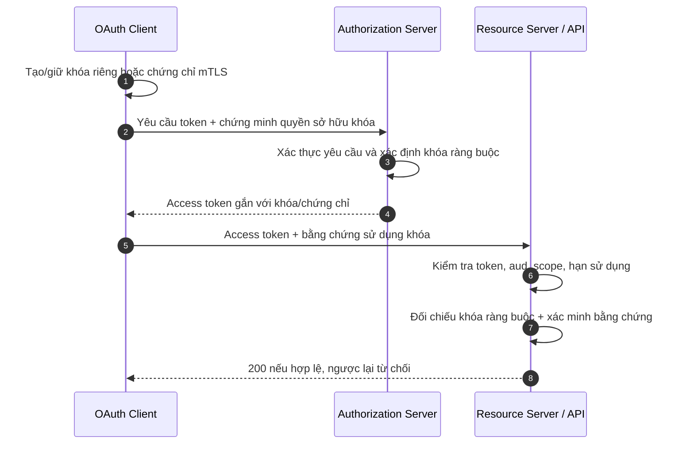
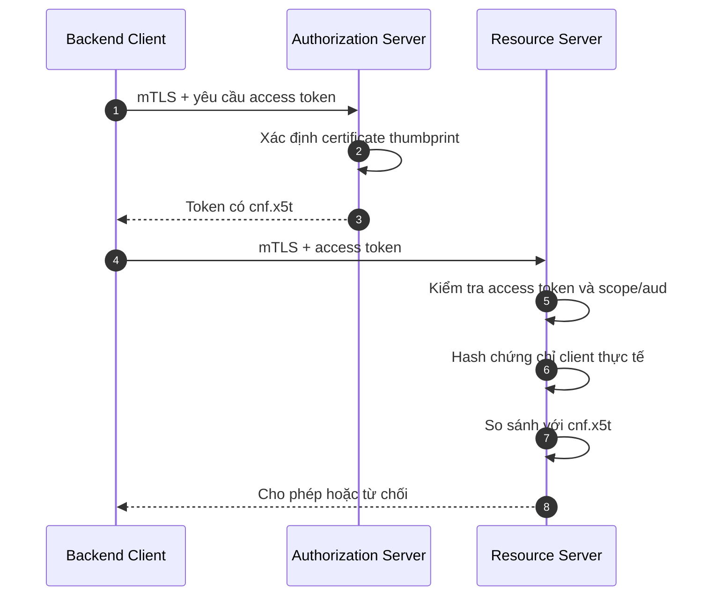

# Token binding: ràng buộc token với bên sở hữu khóa

## 1. Vì sao token hợp lệ vẫn có thể bị phát lại?

Trong hệ thống xác thực và phân quyền bằng OAuth 2.0/OIDC, ứng dụng nhận **access token** để gọi API và đôi khi nhận **refresh token** để xin access token mới. Token có thể là JWT tự chứa claims hoặc chuỗi **opaque** cần được Authorization Server (AS) kiểm tra qua introspection. Dù ở định dạng nào, một access token dạng **bearer** được dùng theo nguyên tắc *ai cầm token thì có thể trình token*: nếu bị đánh cắp, nó có thể được dùng ở thiết bị khác trong thời gian còn hiệu lực.

Ví dụ, hệ thống phát hành JWT với chữ ký hợp lệ, `iss`, `aud`, `exp` và `scope` đúng. Kẻ tấn công lấy được chuỗi JWT từ log hoặc một ứng dụng bị xâm nhập rồi gửi lại:

```http
GET /api/payments HTTP/1.1
Host: api.example.com
Authorization: Bearer eyJhbGciOi...
```

Resource Server (RS) xác minh JWT thành công, nhưng việc kiểm tra chữ ký và claims **chưa chứng minh rằng người gửi chính là bên được cấp token**. Vấn đề này gọi là nguy cơ *bearer token replay*.

**Token binding** theo nghĩa rộng là buộc token gắn với một bằng chứng mật mã mà bên dùng token phải chứng minh ở thời điểm gửi yêu cầu. Trong tài liệu OAuth hiện đại, cách gọi chính xác là **sender-constrained token** hoặc **proof-of-possession (PoP) token**. Nếu kẻ tấn công chỉ có chuỗi token nhưng **không có khóa riêng/chứng chỉ hợp lệ**, RS sẽ từ chối yêu cầu.

### Phân biệt thuật ngữ

- **Sender-constrained access token**: cách tiếp cận chung, có thể dùng mTLS hoặc DPoP để ràng buộc token với khóa/chứng chỉ của bên gửi.
- **TLS Token Binding Protocol** (RFC 8471 và RFC 8473): một bộ giao thức cụ thể được thiết kế để ràng buộc token/cookie với khóa trong phiên TLS. Đây là khái niệm lịch sử, không nên ngầm coi trình duyệt hiện đại nào cũng hỗ trợ hay đồng nhất với DPoP/mTLS.
- **Token binding theo phiên ứng dụng** như lưu session ID ở server, ràng buộc cookie với thuộc tính trình duyệt hoặc IP: có thể giảm rủi ro trong một số bối cảnh nhưng **không tự tạo bằng chứng sở hữu khóa mật mã**, và IP/User-Agent không phải danh tính đáng tin cậy.

Trọng tâm thực hành của bài này là **mTLS-bound access token** và **DPoP-bound access token**.

## 2. Tư duy nền: bearer và proof of possession

| Tiêu chí | Bearer access token | Sender-constrained access token |
| --- | --- | --- |
| Điều kiện sử dụng | Có token hợp lệ | Có token hợp lệ **và** chứng minh sở hữu khóa/chứng chỉ gắn với token |
| Nếu chỉ lộ chuỗi token | Có thể dùng từ nơi khác trước khi hết hạn/thu hồi | Không đủ để gọi API nếu thiếu bằng chứng hợp lệ |
| Kiểm tra tại RS | Chữ ký hoặc introspection, `iss`, `aud`, `exp`, quyền | Các kiểm tra bên trái **cộng thêm** kiểm tra PoP và khóa ràng buộc |
| Chống lại | Token giả, hết hạn, sai đối tượng theo các kiểm tra đã bật | Thêm tình huống token bị sao chép nhưng khóa riêng không bị lộ |
| Điều không bảo đảm | Token không bị đánh cắp | Thiết bị/khóa không bị chiếm, yêu cầu nghiệp vụ không bị phát lại, token không bao giờ bị lạm dụng |

Đây là hai lớp kiểm tra độc lập:

1. **Token validation** trả lời: token có được phát hành đúng, còn hiệu lực và được phép dùng ở API này không?
2. **Sender constraint** trả lời: bên gửi yêu cầu hiện tại có chứng minh được mình giữ khóa đã gắn với token không?

Một JWT đã ký chỉ chứng minh nội dung JWT được AS bảo đảm; nó **không** tự biến JWT thành PoP token. Ngược lại, token opaque vẫn có thể là PoP token nếu AS lưu thông tin khóa ràng buộc và cung cấp cho RS khi introspection.

## 3. Vòng đời ràng buộc token



Việc ràng buộc được thiết lập **lúc phát hành token**; RS phải thực thi nó **ở từng yêu cầu cần bảo vệ**. Nếu RS chỉ kiểm tra JWT/introspection mà bỏ qua bằng chứng PoP, cơ chế này mất tác dụng.

Tùy giao thức, ràng buộc có thể được biểu diễn bằng claim **`cnf`** (*confirmation*) trong JWT access token hoặc trường tương đương từ token introspection:

```json
{
  "iss": "https://auth.example.com",
  "aud": "https://api.example.com",
  "sub": "user-42",
  "exp": 1950000000,
  "scope": "payments:read",
  "cnf": {
    "jkt": "THUMBPRINT_CUA_KHOA_CONG_KHAI_DPOP"
  }
}
```

Giá trị `jkt` là **JWK Thumbprint** (RFC 7638), được tính từ các trường chuẩn hóa của JWK công khai bằng SHA-256 rồi mã hóa Base64URL. Đây **không phải** toàn bộ public key và cũng không phải hash của JSON tùy ý. Với mTLS, `cnf` thường chứa `"x5t#S256"`: SHA-256 thumbprint của chứng chỉ X.509 ở dạng DER. Các ví dụ trên chỉ minh họa cấu trúc; ứng dụng phải dùng giá trị do AS xác thực/cấp phát.

## 4. DPoP: chứng minh sở hữu khóa trên từng yêu cầu HTTP

**DPoP (Demonstrating Proof of Possession, RFC 9449)** phù hợp cho các OAuth client cần ràng buộc token bằng khóa bất đối xứng ở lớp ứng dụng. Client giữ **private key**; AS và RS kiểm tra một JWT ngắn hạn có chữ ký của khóa đó, gọi là **DPoP proof**. AS gắn access token với public key tương ứng (thường bằng `cnf.jkt`).

### 4.1. Các bước

1. Client tạo cặp khóa bất đối xứng phù hợp với thuật toán được AS hỗ trợ (chẳng hạn P-256/ES256), giữ private key an toàn.
2. Khi gọi token endpoint, client tạo DPoP proof cho HTTP method và URL của token endpoint; AS kiểm tra proof rồi ràng buộc token được phát hành với public key.
3. Khi gọi RS, client gửi `Authorization: DPoP <access_token>` **và** header `DPoP: <proof_JWT>` mới, được ký bởi private key đã ràng buộc.
4. RS kiểm tra access token, lấy khóa ràng buộc, xác minh proof và so sánh public key thực tế của proof với khóa được gắn trong token.
5. RS kiểm tra proof còn mới, đúng method/URI, chưa phát lại và gắn với đúng access token; khi đạt tất cả điều kiện mới cho phép truy cập.

Ví dụ yêu cầu API (chuỗi JWT và token được rút gọn):

```http
GET /v1/accounts/42?detail=brief HTTP/1.1
Host: api.example.com
Authorization: DPoP eyJhbGciOi...
DPoP: eyJ0eXAiOiJkcG9wK2p3dCIs...
```

Một DPoP proof JWT sau khi giải mã có dạng:

```json
{
  "header": {
    "typ": "dpop+jwt",
    "alg": "ES256",
    "jwk": {
      "kty": "EC",
      "crv": "P-256",
      "x": "PUBLIC_KEY_X",
      "y": "PUBLIC_KEY_Y"
    }
  },
  "payload": {
    "jti": "uuid-ngau-nhien-rieng-cho-proof",
    "htm": "GET",
    "htu": "https://api.example.com/v1/accounts/42",
    "iat": 1950000000,
    "ath": "BASE64URL_SHA256_CUA_ACCESS_TOKEN"
  }
}
```

Đây là biểu diễn để học; JWT thực tế phải có chữ ký hợp lệ. `jwk` trong header là **khóa công khai**, tuyệt đối không đưa thành phần private key vào header. `iat` chỉ là giá trị ví dụ, không phải thời điểm hiện tại.

| Thành phần | RS cần kiểm tra |
| --- | --- |
| `typ`, `alg`, `jwk`, chữ ký | Đúng kiểu `dpop+jwt`, thuật toán bất đối xứng được cho phép, khóa công khai hợp lệ, chữ ký đúng; không chấp nhận `none` hoặc thuật toán không phù hợp |
| `htm` | Đúng HTTP method của yêu cầu đang nhận |
| `htu` | Đúng URI đích theo quy tắc chuẩn hóa của DPoP; **không chứa query và fragment** trong `htu` |
| `iat` | Trong cửa sổ thời gian hợp lệ của server (có dung sai lệch đồng hồ hợp lý) |
| `jti` | Chưa được dùng với khóa tương ứng trong cửa sổ chống replay; thao tác ghi nhận cần nguyên tử |
| `ath` khi gọi RS | Bằng Base64URL(SHA-256(ASCII(access token thực tế trong yêu cầu))) |
| `nonce` khi server yêu cầu | Bằng DPoP nonce hợp lệ do AS/RS cấp; **khác** nonce của OIDC ID Token |
| Khóa của proof so với token | JWK Thumbprint của public key proof khớp `cnf.jkt` đã được AS bảo đảm |

**Điểm dễ nhầm:** `jti` ở đây là ID của *DPoP proof*, không phải `jti` của access token. Chỉ có `jti` trong token mà không có cơ chế kiểm tra trạng thái sử dụng thì chưa chống được replay.

### 4.2. Token endpoint, API endpoint và nonce

Ở token endpoint, proof thường chứa `htm=POST` và `htu` là URL token endpoint; proof này **không có `ath`** vì access token chưa tồn tại. Tại RS, proof phải có `ath` khớp với token được trình trong cùng yêu cầu.

AS hoặc RS có thể yêu cầu **DPoP nonce** do server cấp để tăng khả năng chống phát lại và kiểm soát freshness. Khi nhận thử thách `use_dpop_nonce`, client gửi yêu cầu mới với một DPoP proof mới, có claim `nonce` đúng như server quy định. Tránh lặp vô hạn nếu challenge hoặc nonce không hợp lệ.

Trong Authorization Code Flow, PKCE vẫn cần dùng. Nếu AS hỗ trợ `dpop_jkt` trong authorization request, client có thể ràng buộc authorization code với DPoP key ngay từ bước đầu; đây là lớp bảo vệ bổ sung, không phải cách bỏ qua `state`, PKCE hay đối chiếu issuer.

### 4.3. Chống phát lại bằng proof cache

RS có thể lưu dấu `(thumbprint khóa, jti)` với thời gian sống tương ứng cửa sổ kiểm tra `iat`/nonce. Điều quan trọng là **check-and-insert nguyên tử**, kể cả khi triển khai nhiều instance:

```text
NHẬN request:
  1. Xác minh access token: chữ ký/introspection, iss, aud, exp, scope...
  2. Xác minh DPoP proof: chữ ký, typ, alg, htm, htu, iat, ath, nonce...
  3. Tính JWK thumbprint; so sánh cnf.jkt của token
  4. ATOMIC SET-IF-ABSENT("dpop:" + jkt + ":" + jti, TTL):
       nếu khóa đã tồn tại -> từ chối proof phát lại
       nếu tạo thành công -> tiếp tục chính sách phân quyền
  5. Chỉ sau đó mới xử lý yêu cầu nghiệp vụ
```

TTL phải phù hợp với chính sách chấp nhận proof của hệ thống; không thể dùng một cache chỉ lưu tại một instance khi request có thể chuyển giữa nhiều instance, trừ khi có cơ chế nhất quán tương đương. Cần giới hạn dung lượng cache và không dùng toàn bộ JWT proof làm khóa log.

## 5. mTLS: ràng buộc token với chứng chỉ client

**OAuth 2.0 mTLS (RFC 8705)** sử dụng xác thực TLS hai chiều: server xuất trình chứng chỉ server như HTTPS thông thường, còn client xuất trình chứng chỉ X.509 và chứng minh sở hữu private key tương ứng trong quá trình bắt tay TLS.

Với **certificate-bound access token**, AS ghi nhận thumbprint chứng chỉ client khi cấp token. Khi client gọi RS qua mTLS, RS so sánh chứng chỉ client thực tế trên kết nối với thumbprint gắn trong token:

```json
{
  "iss": "https://auth.example.com",
  "aud": "https://billing-api.example.com",
  "exp": 1950000000,
  "cnf": {
    "x5t#S256": "BASE64URL_SHA256_CUA_CHUNG_CHI_DER"
  }
}
```

Một cách diễn đạt luồng kiểm tra:



**mTLS client authentication** và **certificate-bound access token** là hai khả năng có liên hệ nhưng không đồng nghĩa: một token chỉ thực sự bị ràng buộc khi AS ghi quan hệ chứng chỉ–token và RS kiểm tra quan hệ đó. Trên đường đi có API gateway hoặc TLS termination, RS phải nhận thông tin chứng chỉ từ thành phần hạ tầng **đáng tin cậy**; không tin header chứng chỉ do client bên ngoài tự gửi.

Các vấn đề vận hành mTLS gồm cấp phát/luân chuyển chứng chỉ, bảo vệ private key, hạn chứng chỉ, trust store, triển khai nhiều dịch vụ/instance và xử lý thu hồi chứng chỉ theo chính sách của tổ chức.

## 6. So sánh DPoP, mTLS và TLS Token Binding

| Góc nhìn | DPoP (RFC 9449) | mTLS-bound token (RFC 8705) | TLS Token Binding (RFC 8471/8473) |
| --- | --- | --- | --- |
| Bằng chứng sở hữu | JWT proof được ký ở lớp HTTP | Chứng minh sở hữu private key qua TLS client certificate | Khóa Token Binding và bằng chứng liên quan TLS |
| Ràng buộc trong token | Thường `cnf.jkt` | Thường `cnf["x5t#S256"]` | Cơ chế riêng của giao thức Token Binding |
| RS phải làm gì? | Xác minh proof từng request và khớp khóa với token | Xác nhận chứng chỉ client của kết nối và khớp thumbprint | Cần hạ tầng hỗ trợ giao thức Token Binding |
| Phù hợp | Web/mobile/native hoặc client có thể giữ khóa ký theo mô hình đe dọa | Backend-to-backend, dịch vụ trong hạ tầng quản trị chứng chỉ | Chủ yếu để hiểu lịch sử/khái niệm; cần xác minh hỗ trợ thực tế trước khi dùng |
| Thách thức | An toàn private key, chống XSS, proof cache, nonce, đồng bộ URL qua proxy | PKI, cấp phát/chuyển chứng chỉ, TLS termination, trust boundary | Phụ thuộc hỗ trợ ở TLS/browser/server, không phải lựa chọn OAuth phổ biến hiện tại |

**Chọn theo bối cảnh:**

- Dịch vụ backend có khả năng quản lý chứng chỉ và kênh TLS hai chiều: cân nhắc mTLS để tạo ràng buộc rõ ràng ở mức kết nối.
- OAuth public client cần proof ở lớp HTTP: cân nhắc DPoP, nhưng phải đánh giá cách giữ private key. Trình duyệt bị XSS vẫn có thể sử dụng khóa thông qua code đang chạy, ngay cả khi private key không xuất được.
- Hệ thống đã dùng bearer token: chuyển sang PoP cần **cả AS, client, RS** hỗ trợ; đổi duy nhất header `Authorization` không đủ.

## 7. Java: tính hash dùng trong token binding

Ví dụ JDK sau tính `ath` cho DPoP proof tại RS, hoặc `x5t#S256` cho mTLS. Hai công thức có **đầu vào khác nhau**, dù cùng dùng SHA-256 + Base64URL:

```java
import java.nio.charset.StandardCharsets;
import java.security.MessageDigest;
import java.security.NoSuchAlgorithmException;
import java.security.cert.CertificateEncodingException;
import java.security.cert.X509Certificate;
import java.util.Base64;

public final class TokenBindingHashes {
    private TokenBindingHashes() {}

    private static String sha256Base64Url(byte[] source) {
        try {
            byte[] digest = MessageDigest.getInstance("SHA-256").digest(source);
            return Base64.getUrlEncoder().withoutPadding().encodeToString(digest);
        } catch (NoSuchAlgorithmException e) {
            throw new IllegalStateException("SHA-256 is unavailable", e);
        }
    }

    // Giá trị ath: hash chính chuỗi access token được trình ở request API.
    public static String accessTokenHash(String accessToken) {
        return sha256Base64Url(accessToken.getBytes(StandardCharsets.US_ASCII));
    }

    // Giá trị x5t#S256: hash DER encoding của chứng chỉ client trên mTLS.
    public static String certificateThumbprint(X509Certificate clientCertificate)
            throws CertificateEncodingException {
        return sha256Base64Url(clientCertificate.getEncoded());
    }
}
```

**Không dùng hàm này để tự tạo `cnf.jkt` từ chuỗi JSON JWK**. RFC 7638 quy định tập trường và thứ tự chuẩn hóa riêng; hãy dùng thư viện JWT/JWK uy tín để tính thumbprint, xác minh chữ ký và tuân thủ thuật toán được cho phép.

Ví dụ thực tế triển khai xác minh DPoP ở API (giả mã Java, không phải thư viện có sẵn):

```java
VerifiedAccessToken token = tokenValidator.verifyOrIntrospect(
    authorizationHeader, expectedIssuer, expectedAudience);
checkScope(token.scopes(), "payments:read");

VerifiedDpopProof proof = dpopValidator.verifySignatureAndClaims(
    dpopHeader, request.getMethod(), canonicalDpopUri(request));

if (!proof.publicJwkThumbprint().equals(token.confirmationJkt())) {
    throw new SecurityException("Proof key does not match access token");
}
if (!TokenBindingHashes.accessTokenHash(token.rawValue()).equals(proof.ath())) {
    throw new SecurityException("DPoP ath mismatch");
}
if (!replayCache.insertIfAbsentAtomically(
        proof.publicJwkThumbprint(), proof.jti(), proof.validityTtl())) {
    throw new SecurityException("Replayed DPoP proof");
}
authorizeRequest(token.subject(), token.scopes(), request);
```

`verifySignatureAndClaims` ở ví dụ này **phải bao gồm** kiểm tra `typ`, thuật toán/khóa công khai, chữ ký, `htm`, `htu`, `iat`, DPoP nonce khi có yêu cầu và điều kiện hình thức tương ứng. Bước lấy token cũng phải áp dụng đúng scheme `Authorization: DPoP`, không vô tình chấp nhận `Bearer` cho token yêu cầu sender constraint. Với opaque token, cần lấy thông tin ràng buộc từ introspection được bảo vệ, không suy ra từ chuỗi opaque.

## 8. Các giới hạn và tương tác với lớp bảo mật khác

| Tình huống | Token binding giúp gì? | Vẫn cần làm gì? |
| --- | --- | --- |
| Kẻ tấn công chỉ lấy được bearer string/token copy | Token PoP yêu cầu bằng chứng từ khóa/chứng chỉ đã ràng buộc | Giới hạn tuổi thọ, bảo vệ token ở bộ nhớ/lưu trữ, không log token |
| Kẻ tấn công lấy được **cả token và private key** | Không thể phân biệt kẻ trộm đang có cùng bằng chứng mật mã | Bảo vệ khóa bằng keystore/HSM khi thích hợp, cô lập máy và phát hiện xâm nhập |
| XSS trên frontend gọi API qua client hợp lệ | Nếu script độc hại có thể điều khiển thao tác ký, DPoP không tự ngăn request đó | Chống XSS, CSP, giảm quyền của frontend, cân nhắc BFF |
| Access token sai audience hoặc scope | Không khắc phục các lỗi phân quyền | RS luôn kiểm tra `aud`, `iss`, `exp`, `scope`/permission và chính sách nghiệp vụ |
| Replay cùng một DPoP proof trong cửa sổ ngắn | `jti` cache và nonce hỗ trợ phát hiện | Cache nhất quán, TTL hợp lý, kiểm tra timestamp và nonce |
| Kẻ tấn công thay query/body của một request đã ký | `htu` không bao gồm query, DPoP không ký body; PoP không bảo đảm toàn vẹn toàn bộ ý định nghiệp vụ | TLS, kiểm tra input, authorization ở từng thao tác, idempotency key/chữ ký nghiệp vụ nếu cần |
| Refresh token bị đánh cắp | Có thể ràng buộc refresh token với khóa hoặc chứng chỉ tùy AS | Rotation/reuse detection hoặc sender constraint theo mô hình client, thu hồi khi bất thường |
| Token bị thu hồi | Token binding không tự biến token thành vô hiệu | Revocation, introspection/cache policy hoặc thời hạn ngắn tùy kiến trúc |

Token binding **không thay thế** HTTPS/TLS, PKCE, `state`, OIDC `nonce`, xác minh chữ ký/claims JWT, phân quyền, hay quản trị vòng đời refresh token. `state` và OIDC `nonce` ràng buộc **giao dịch đăng nhập**; DPoP/mTLS ràng buộc **bên sử dụng token**. Đây là các lớp kiểm soát bổ trợ.

Đặc biệt, cơ chế PoP không ngăn tự động việc thực thi **cùng một thao tác nghiệp vụ** nhiều lần từ client hợp lệ. Ví dụ, gửi hai lệnh chuyển tiền mới với hai DPoP proof hợp lệ vẫn có thể tạo hai giao dịch. API nhạy cảm cần kiểm tra idempotency key, transaction ID, quyền và trạng thái nghiệp vụ ở server.

## 9. Kiểm thử và vận hành

Các kịch bản kiểm thử cần có:

1. **Happy path:** AS cấp token có `cnf` đúng; RS chấp nhận token và bằng chứng khớp.
2. **Token copy:** token bị sao chép sang client dùng khóa/chứng chỉ khác phải bị từ chối.
3. **Proof replay:** gửi lại đúng DPoP proof với cùng `jti` trong cửa sổ chấp nhận phải bị từ chối dù token còn hạn.
4. **Tampering:** proof sai chữ ký, `alg` không cho phép, `htm`, `htu`, `ath`, nonce hoặc `iat` sai đều bị từ chối.
5. **Token validation:** JWT hoặc introspection sai `iss`, `aud`, hạn sử dụng, quyền, trạng thái thu hồi đều bị từ chối bất kể proof đúng.
6. **Multi-instance:** hai request đồng thời dùng cùng `jti` đến hai instance không được cùng vượt qua bộ chống replay.
7. **Gateway mTLS:** thử header giả chứa chứng chỉ nhưng không đi qua kết nối/trust boundary hợp lệ phải bị từ chối.
8. **Vòng đời khóa:** đổi khóa/chứng chỉ không tự làm token cũ hợp lệ với khóa mới; cần xin token mới hoặc làm quy trình rotation có kiểm soát.
9. **Refresh token:** token đã ràng buộc hoặc rotate phải tuân thủ chính sách ở token endpoint khi xin cấp lại access token.

Trong giám sát, ghi nhận loại lỗi như *invalid token*, *invalid proof*, *key mismatch*, *proof replay* và *scope denied* ở mức thông tin tối thiểu. Không log nguyên văn token, DPoP proof, private key, refresh token hay các bí mật định danh.

## 10. Ghi nhớ

- Access token JWT hay opaque đều có thể là **bearer** hoặc **sender-constrained**. Định dạng token không quyết định token binding.
- `cnf.jkt` thường gắn token với **khóa DPoP**; `cnf["x5t#S256"]` thường gắn token với **chứng chỉ client mTLS**.
- DPoP yêu cầu proof mới đúng phương thức/URI, đúng access token, đúng khóa, đúng thời gian và không bị phát lại. mTLS yêu cầu chứng chỉ client thực tế khớp với token.
- Phòng chống replay chỉ hiệu quả nếu **Authorization Server phát hành ràng buộc đúng, client giữ khóa an toàn và Resource Server kiểm tra ràng buộc trên từng yêu cầu**.
- Khi kẻ tấn công điều khiển client hoặc có cả private key, token binding không còn là rào cản đủ; cần bảo mật đầu cuối và kiểm soát nghiệp vụ.

**Tài liệu tiêu chuẩn để tra cứu:** OAuth 2.0 (RFC 6749); OAuth 2.0 Mutual-TLS Client Authentication and Certificate-Bound Access Tokens (RFC 8705); Demonstrating Proof of Possession at the Application Layer (DPoP, RFC 9449); JSON Web Key Thumbprint (RFC 7638); OAuth 2.0 Token Introspection (RFC 7662); JWT Profile for OAuth 2.0 Access Tokens (RFC 9068); OAuth 2.0 Security Best Current Practice (RFC 9700); The Token Binding Protocol Version 1.0 (RFC 8471); Token Binding over HTTP (RFC 8473).
