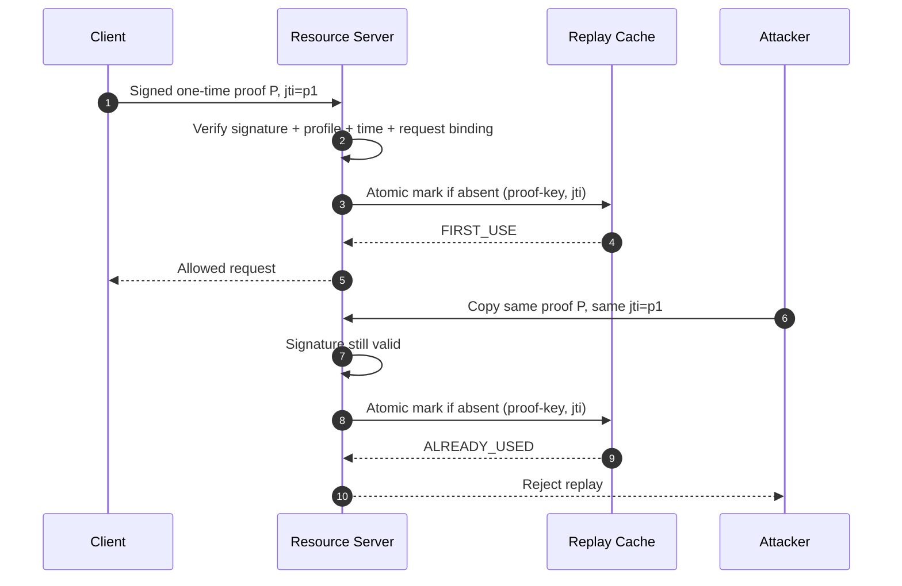
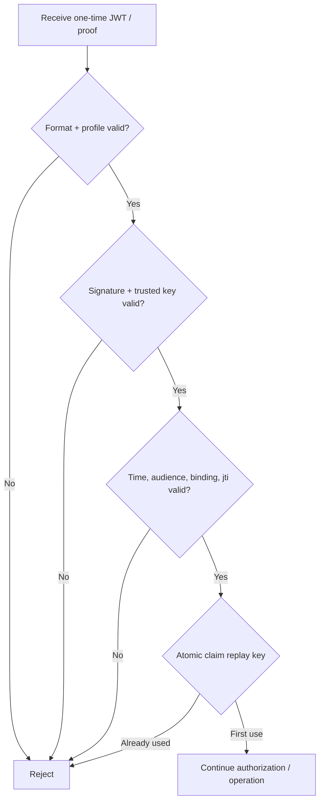

# JTI và replay cache

Một ứng dụng nhận **JWT access token** có chữ ký hợp lệ, `iss` đúng, `aud` khớp resource server, `scope` đủ quyền và `exp` chưa tới. Một kẻ tấn công chép nguyên token rồi gửi lại. Vì không thay đổi bytes, chữ ký JWS vẫn đúng. Nếu hệ thống chỉ xác minh chữ ký và thời hạn, request phát lại có thể vẫn được chấp nhận. Đây là vấn đề **replay attack**: dùng lại một thông điệp/credential từng hợp lệ ở thời điểm hoặc ngữ cảnh không được phép.

JWT có thể mang claim **`jti` (JWT ID)** — định danh duy nhất của token theo RFC 7519. Tuy nhiên **có `jti` không đồng nghĩa đã chống replay**. Để nhận diện việc một thông điệp được dùng lại, verifier cần một **replay cache** hoặc cơ chế state tương đương: ghi nhận ID đã dùng, kiểm tra tính mới và thực hiện đánh dấu tiêu thụ **nguyên tử**, trong một phạm vi và khoảng thời gian phù hợp.

Điểm then chốt là **phải biết loại token có được phép sử dụng lại hay không**. Một Bearer access token thông thường được dùng hợp lệ cho nhiều request, nên “lưu `jti` khi thấy lần đầu, từ chối mọi lần sau” sẽ làm hỏng API. Ngược lại, một **DPoP proof** hoặc **JWT client assertion** có chính sách one-time phải bị từ chối khi dùng lại trong cửa sổ hiệu lực, cho dù signature vẫn hợp lệ.

Bài thuộc chương **Replay protection** của module `SECURITY_TOKEN_SECURITY_FUNDAMENTALS`. Nội dung trình bày `jti`, mô hình replay cache, thời gian lưu, thiết kế phân tán, Java/Spring Security và Redis, phòng chống token theft/replay trong OAuth 2.0/OIDC; đồng thời phân biệt **JWT, opaque token, access token, refresh token, ID token**, issuer, audience, scope, claims, lưu trữ và thu hồi.

> **Nguyên tắc:** Replay cache chỉ có ý nghĩa khi gắn với **protocol/profile đã được xác minh**, **định danh phù hợp**, **khóa cache đủ phạm vi**, **TTL bao trùm cửa sổ chấp nhận** và **thao tác check-and-record nguyên tử**. Không coi riêng `jti` là xác thực, không thay signature/claims validation bằng cache và không áp chính sách one-time lên mọi Bearer access token.

## 1. Replay attack là gì trong token security?

**Replay** là việc sử dụng lại một token, proof hoặc assertion trước đó để khiến một bên nhận xử lý thêm lần nữa, dù protocol dự kiến thông điệp chỉ hợp lệ một lần, trong một giao dịch hoặc với một request cụ thể.

Ví dụ:

```text
T0  Client A tạo JWT proof P (jti=p-123).
T1  Client A gửi P tới API, request được xác minh và xử lý.
T2  Attacker sao chép P từ nơi không an toàn.
T3  Attacker gửi lại P chưa bị sửa.
T4  Chữ ký P vẫn đúng; nếu không có replay detection
    hoặc request binding, API có nguy cơ xử lý lại.
```

Nhưng **không phải mọi request thứ hai là replay bất hợp lệ**. Có những credential được cố ý tái sử dụng:

| Đối tượng | Có thể dùng lại hợp lệ? | Cách chống replay phù hợp |
|---|---|---|
| **Bearer access token** | **Có**, thường qua nhiều request đến lúc `exp`/revoke. | TLS, lưu trữ an toàn, TTL ngắn, `aud`/`scope`, revocation, sender constraints khi áp dụng. |
| **DPoP proof JWT** | **Không được phát lại cùng proof** trong cửa sổ hợp lệ. | Chữ ký proof, `htm`/`htu`/`iat`/`jti`, `ath`, `nonce` khi yêu cầu; replay cache keyed theo proof key + ID. |
| **JWT client assertion** | Tùy profile, thường phải ngăn assertion bị dùng lại. | Signature, `iss`/`sub`/`aud`/`exp`/`jti`, replay cache và client authentication policy. |
| **One-time authorization code** | **Không**. | AS consume code atomically, ràng buộc client/redirect/PKCE; không phụ thuộc JWT `jti`. |
| **Rotating refresh token** | Token cũ thường không được dùng tiếp sau rotation thành công. | Atomic rotation, token family/reuse detection, sender constraints khi có. |
| **OIDC nonce** | Giá trị được dùng để ràng buộc ID token với login transaction. | So khớp nonce theo transaction, chống login/ID-token replay đúng flow. |
| **One-time link/action token** | **Không** nếu được thiết kế sử dụng một lần. | Server-side consume state hoặc replay cache với key/TTL đúng ngữ cảnh. |
| **Opaque access token** | Thường có thể dùng lại như Bearer token. | Introspection/grant state, TTL/revocation/sender constraints; không giả định có JWT `jti`. |

Một API được thiết kế để GET nhiều lần với cùng access token **không thể đánh đồng “cùng token” với “attacker đang phát lại”** nếu không có bằng chứng bổ sung.

## 2. `jti` trong RFC 7519 nghĩa là gì?

`jti` viết tắt của **JWT ID** — registered claim chứa định danh cho một JWT cụ thể. RFC 7519 §4.1.7 yêu cầu giá trị phải được gán theo cách có **xác suất va chạm không đáng kể**, kể cả khi có nhiều issuer, nếu những issuer đó cùng tham gia hệ thống.

Ví dụ payload:

```json
{
  "iss": "https://id.example.test",
  "sub": "user-123",
  "aud": "orders-api",
  "iat": 1795410000,
  "exp": 1795410600,
  "scope": "orders.read",
  "jti": "9e44c75f-45cb-4e97-98e8-bb59ad623bdb"
}
```

Ý nghĩa:

- `jti` giúp **phân biệt các JWT**, ngay cả khi `sub`, `aud` và scope giống nhau.
- Nó có thể hỗ trợ **replay detection, audit correlation, per-token revocation**.
- Không phải mọi JWT bắt buộc có `jti`; mức yêu cầu phụ thuộc profile.
- `jti` **không tự bí mật** và **không phải chữ ký**, password hoặc proof sở hữu key.
- `jti` **không có tính one-time tự động**: phải có verifier state và rule cụ thể.
- Phải coi `jti` là **input chưa đáng tin trước khi token/proof được xác minh**.

Một string `jti="abc"` vẫn có thể hợp lệ về mặt kiểu dữ liệu, nhưng **không nên** dùng giá trị đoán được/va chạm cao khi cần định danh chống replay. Khuyến nghị sinh bằng CSPRNG với đủ entropy (ví dụ 128 bit ngẫu nhiên) hoặc UUID v4 tạo bằng nguồn ngẫu nhiên đủ mạnh.

## 3. Ví dụ phân biệt ID với khả năng dùng lại

Ba JWT cùng issuer:

```text
Access JWT A:
  jti = access-001
  aud = orders-api
  scope = orders.read
  Có thể dùng nhiều lần trong TTL theo OAuth Bearer policy.

DPoP proof P:
  jti = proof-001
  htm = GET
  htu = https://api.example.test/orders/123
  Tạo mới cho mỗi request; không được dùng lại P.

Client assertion C:
  jti = assertion-001
  aud = https://id.example.test/oauth2/token
  Dùng xác thực client tại AS theo policy;
  cùng assertion có thể phải bị chặn nếu phát lại.
```

**Cùng tên claim `jti`, nhưng vòng đời và nơi lưu cache khác nhau.** Không dùng một global cache chỉ theo raw `jti` của mọi token.

## 4. Signature validation không đồng nghĩa replay detection



Một signed token có thể bị replay **nguyên vẹn**. Không cần phá RSA, sửa payload hay đoán secret.

**Cache chỉ nhận diện hành vi lặp lại trong phạm vi đã lưu state.** Nó không chứng minh request đầu tiên đến từ chủ thể đáng tin nếu proof có thể bị đánh cắp **trước khi sử dụng**. Cần sender binding, TLS, xác minh issuer và các ràng buộc request, không đặt toàn bộ phòng vệ vào replay cache.

## 5. Threat model: kẻ tấn công lấy được gì?

| Tình huống | Năng lực attacker | Replay cache giúp đến đâu? |
|---|---|---|
| Copy một **Bearer access token** từ logs. | Gọi nhiều API bằng token thật. | Không thể chặn chỉ bằng one-time `jti` nếu token được phép dùng lại; cần revoke/sender constraint. |
| Copy **DPoP proof** đã dùng. | Gửi lại cùng proof. | Replay cache có thể từ chối nếu cùng phạm vi verifier. |
| Copy DPoP proof **trước lần dùng đầu** và access token. | Có thể chạy đua request. | Cache đảm bảo chỉ một bên thắng, **không đảm bảo người thắng là client thật**. |
| Lộ **DPoP private key**. | Tạo proof mới với `jti` khác. | Cache một mình không đủ; rotate/revoke token/keys. |
| Copy JWT client assertion. | Cố lấy token bằng assertion cũ. | Assertion replay cache có thể chặn lần thứ hai. |
| Lộ client private signing key. | Tạo assertion mới có jti mới. | Cache không thay key compromise response. |
| Copy refresh token cũ đã rotation. | Cố redeem token cũ. | Token-family reuse detector đúng chỗ, không chỉ cache JWT. |
| Tấn công song song nhiều RS nodes. | Hai request cùng `jti` cùng lúc. | Cần atomic shared cache/consensus, không dùng local map riêng. |
| Cache không khả dụng. | Cố khiến verifier bỏ check. | Cần fail-closed/failure mode rõ, tránh silent bypass. |
| Flood giá trị `jti` tùy ý. | Tiêu thụ RAM/cache operations. | Validate trước insert, quotas/limits/rate limiting. |

## 6. Đối tượng cần bảo vệ: token, proof, assertion hay operation?

Trước khi dùng replay cache, cần trả lời:

1. **Thông điệp nào có semantics “at most once”?** JWT client assertion, DPoP proof, one-time action?
2. **Issuer/creator được tin bằng gì?** JWS signature/MAC và trusted key source?
3. **Cửa sổ chấp nhận:** `exp`/`iat`/max proof age/nonce lifetime?
4. **Phạm vi duy nhất:** issuer, client ID, signing key thumbprint, token type, tenant/trust domain?
5. **Tác động của replay:** duplicate token issuance, duplicate payment, unauthorized login?
6. **Retry hợp lệ:** HTTP client có thể retry khi timeout; xử lý idempotency riêng thế nào?
7. **Nơi state sống:** AS, RP, gateway, RS hoặc Redis cluster?
8. **Mất cache thì fail thế nào?** Không cho phép kiểm tra xong cấp quyền mà không có replay record.

Một replay cache không biết thứ tự các bước protocol có thể làm **lỗi bảo mật** hoặc **lỗi chức năng**.

## 7. Khi nào `jti` phải được yêu cầu?

Không có luật “mọi JWT phải có `jti`”. Một số trường hợp:

| Profile | Quy tắc hợp lý |
|---|---|
| **General JWT (RFC 7519)** | `jti` là registered claim **tùy chọn**. |
| **JWT Bearer assertion (RFC 7523)** | `jti` có thể được profile dùng để hỗ trợ chống replay; nếu server yêu cầu one-time thì enforce presence/uniqueness. |
| **DPoP proof (RFC 9449)** | **Bắt buộc có `jti`**, là ID duy nhất cho proof. |
| **OIDC ID token** | Dùng `nonce` để bind authentication transaction khi yêu cầu; không mặc định bắt buộc `jti`. |
| **JWT access token (RFC 9068)** | Có thể có `jti` theo token profile; không dùng nó làm cơ chế one-time mọi API request. |
| **One-time custom JWT** | Bắt buộc `jti` nếu hợp đồng one-time dựa trên ID này. |

Nếu một one-time profile yêu cầu `jti` nhưng token thiếu, verifier phải **reject** chứ không dùng `sub`/`iat` hoặc token hash thiếu bảo đảm như một “jti dự phòng” tùy tiện.

## 8. Tạo `jti` như thế nào?

Mục tiêu là **xác suất va chạm rất thấp**. Hai lựa chọn thông dụng:

- **UUID v4** từ nguồn random an toàn.
- **128–256 bit ngẫu nhiên CSPRNG** rồi encode Base64URL không padding.

Ví dụ Java 17:

```java
import java.security.SecureRandom;
import java.util.Base64;

public final class JwtIdGenerator {
    private static final SecureRandom RNG = new SecureRandom();

    public static String newJwtId() {
        byte[] random = new byte[16]; // 128-bit random ID
        RNG.nextBytes(random);
        return Base64.getUrlEncoder()
            .withoutPadding()
            .encodeToString(random);
    }
}
```

Một ID 128 bit ngẫu nhiên cho không gian đủ lớn trong các hệ thống thông thường, với điều kiện CSPRNG hoạt động đúng và không có lỗi tạo/lặp seed. **Không dùng**:

- `System.currentTimeMillis()` hoặc epoch seconds làm jti duy nhất.
- `sub`/email/client ID làm jti.
- Counter local reset khi restart mà không có issuer/instance namespace.
- `Random` thông thường cho ID nhạy cảm.
- `jti` do caller cung cấp để issuer dùng lại mà không kiểm/kiểm soát uniqueness theo contract.

**JTI không cần là secret**, nhưng không nên chứa PII hoặc thông tin nội bộ nhạy cảm. Tránh in raw `jti`/token vào metrics có cardinality cao.

## 9. Replay cache lưu gì?

**Replay cache** là lưu trữ trạng thái ngắn hạn cho biết một định danh đã được **sử dụng thành công lần đầu** hay chưa, trong cửa sổ mà việc phát lại cần bị ngăn chặn.

Có hai cách nhìn:

| Hình thức | Ví dụ | Ý nghĩa |
|---|---|---|
| **Seen-set** | `SET key 1 NX EX ttl` | Chỉ cho request đầu tiên claim key. |
| **State record** | `(issuer, client, jti) → CONSUMED / PENDING / RESULT` | Kết hợp replay protection với xử lý giao dịch/idempotency đã thiết kế rõ. |

Với one-time proof, cần **check-and-insert nguyên tử**. Quy trình lỗi:

```text
if (!cache.exists(key)) {
    processRequest();
    cache.put(key);
}
```

Hai threads đều có thể thấy key chưa tồn tại, cùng chạy logic và **cùng được chấp nhận**. Với distributed service, race có thể đến từ hai pod khác nhau.

## 10. Dấu hiệu replay nên được kiểm sau hay trước signature?

**Không dùng `jti` chưa verified để quyết định authorization hoặc ghi state theo ý attacker**.

Đối với một one-time JWT assertion/proof, thứ tự an toàn:

1. Reject oversized/malformed token, parser-depth/algorithm ngoài policy.
2. Chọn trusted issuer/proof key theo cấu hình và JOSE rules.
3. **Verify signature** và critical-header/type.
4. Validate `iss`/`sub`/`aud`/`exp`/`iat`/`nbf` theo profile.
5. Với DPoP, validate `htm`, `htu`, `ath`, `nonce`/`cnf.jkt` khi áp dụng.
6. Validate `jti` bắt buộc, kiểu string, nonempty, length bound và uniqueness contract.
7. **Atomic reserve** replay key trong shared cache.
8. Nếu key đã tồn tại, reject replay; nếu thành công, chỉ sau đó mới thực hiện tác vụ được bảo vệ.
9. Enforce business authorization/idempotency và ghi audit không chứa raw credential.

Có thể check một **rate-limited cache** sơ bộ cho DoS mitigation, nhưng nó không được thay crypto verification và không được cho attacker ghi các ID chưa tin để ngăn request hợp lệ (*cache poisoning*).



**Cần xác định rõ semantics “tiêu thụ”:** với proof được dùng một lần, việc reserve thành công trước khi thực thi operation giúp chặn hai requests đồng thời. Nhưng nếu operation fail sau reserve, retry dùng **cùng proof** có thể bị từ chối. Điều đó không mặc nhiên là lỗi; client cần tạo proof mới hoặc dùng cơ chế idempotency riêng.

## 11. Replay cache key phải có namespace an toàn

**Không dùng raw `jti` làm khóa Redis duy nhất cho mọi protocol**. Cùng ID có thể được tạo ở các issuers/clients/keys khác nhau; attacker cũng có thể cố tình dùng các ID gây va chạm nếu một profile cho phép.

Cách xác định khóa theo loại:

| Protocol | Key scope đề xuất | Tại sao? |
|---|---|---|
| JWT client assertion | `issuer/AS + client_id + assertion_jti` | Một jti unique trong issuer–client–purpose; không lẫn các clients. |
| DPoP proof | `proof public-key thumbprint + proof_jti`, trong scope shared verifier/AS domain. | `jti` unique trong context của key, không cần cùng global ID giữa keys. |
| One-time action JWT | `token_issuer + token_type + action_id/jti` | Một token action không lẫn login/assertion. |
| Request nonce | `nonce issuer/transaction + nonce` | Nonce có hiệu lực trong flow và thời gian cụ thể. |
| Refresh family | `grant/family ID + token version/hash` | Reuse detection là trạng thái rotation, không phải generic JWT proof cache. |

Đối với một hệ thống có nhiều issuers, thêm **trusted issuer namespace**; với nhiều RS phải xác định **shared scope** rõ. Nếu proof có thể được gửi đến nhiều endpoints có cùng key context, đừng tùy tiện thêm `htu` vào replay key làm bản sao proof được chấp nhận ở endpoint khác; `htm`/`htu` phải được verify độc lập.

### Domain separation

Ví dụ input để tạo cache key có dạng:

```text
domain = dpop-proof-v1
trustedKeyThumbprint = BASE64URL_JWK_THUMBPRINT
jti = VERIFIED_PROOF_JTI

cacheKey = HMAC(cacheKeySecret,
    canonicalEncode(domain, trustedKeyThumbprint, jti))
```

Nên dùng **HMAC-SHA-256 với khóa audit/cache riêng** để tránh lộ raw jti/key context ra logs/Redis dashboards. Việc có HMAC không cứu được logic scope sai hoặc `jti` trùng; nó chỉ tạo **opaque bounded key** và domain separation.

## 12. Vì sao không chỉ `SHA-256(jti)`?

Một SHA-256 hash không có khóa có thể dùng làm digest nếu không cần confidentiality, nhưng:

- Nếu `jti` đoán được, hash cũng đoán được.
- Hash trên `jti` đơn lẻ không tách client/issuer/proof-key context.
- Cần encode các thành phần không mơ hồ để tránh `"ab|c"` và `"a|bc"` tạo cùng key text.
- Không dùng hash cache như **bằng chứng signature hợp lệ**.

**Khuyến nghị:** tạo các ID bằng CSPRNG, validate profile, dùng canonical encoding và HMAC namespace khi muốn không lộ identifier. Kiểm soát quyền đọc Redis vẫn là bắt buộc.

## 13. TTL của replay cache: phải sống đến hết cửa sổ chấp nhận

Giữ `jti` quá ngắn gây lỗ hổng: cùng proof/assertion được phát lại sau khi cache entry hết hạn nhưng **bản thân proof vẫn được verifier chấp nhận**. Giữ quá dài tăng memory, chi phí, xóa dữ liệu chậm và bề mặt DoS.

**Bất biến cần đảm bảo:**

```text
replayCacheEntryExpiry >=
    thời điểm muộn nhất mà verifier còn có thể chấp nhận
    cùng proof/assertion theo policy.
```

Với JWT assertion có `exp` bắt buộc và giới hạn max TTL:

```text
cacheTtlAtConsume >=
    max(0, exp + allowedClockSkew - verifierNow)
    + smallSafetyMargin
```

Nếu các verifiers có clock skew khác nhau, cần tính theo **worst-case acceptance window**. Tránh nhận `exp` quá xa tương lai chỉ vì cache có thể giữ lâu: enforce max assertion lifetime trước.

### Ví dụ

```text
Assertion iat = 10:00
Assertion exp = 10:05
Verifier now = 10:02
Allowed skew = 30s
Safety margin = 30s

Cache nên giữ jti ít nhất đến 10:06 theo policy,
tương đương TTL còn khoảng 4 phút từ 10:02.
```

Đây chỉ là công thức minh họa; nếu profile có nonce/freshness window ngắn hơn và luôn được thực thi, có thể dùng bound tương ứng. **Không dùng TTL=60 giây tùy tiện** khi assertion vẫn có thể được nhận sau 3 phút.

## 14. TTL cho DPoP proof khác JWT access token

DPoP proof có `iat` và có thể có server-supplied `nonce`; nó được kiểm theo **cửa sổ freshness ngắn** của verifier. Nó không dùng `exp` như một JWT access token thông thường.

Ví dụ policy minh họa:

```text
DPoP proof accepted if:
  signature verified
  typ = dpop+jwt
  htm/htu match current request
  ath matches associated access token when applicable
  iat not older than 5 minutes
  iat not farther than 30 seconds in the future
  nonce matches current server challenge if required

Replay cache entry:
  keep until latest acceptance deadline for this proof,
  including allowed skew and safety margin.
```

Nếu key được insert tại request đầu, TTL có thể dùng bound bảo thủ **max proof age + future skew + margin**, giúp tránh lỗ hổng ở các verifiers đồng hồ lệch; không phải TTL từ access token `exp`.

**Đừng dùng một TTL chung cho mọi protocol.** Assertion 5 phút, DPoP freshness 1–5 phút và access JWT 15 phút có những ngữ nghĩa khác nhau.

## 15. DPoP: các claims phải đi cùng `jti`

DPoP (RFC 9449) dùng một **JWT proof** có chữ ký bằng private key của client, chứa public JWK trong header; proof gắn với HTTP request.

Ví dụ payload:

```json
{
  "jti": "proof-9c6e2b21",
  "htm": "GET",
  "htu": "https://api.example.test/orders/123",
  "iat": 1795410000,
  "ath": "BASE64URL_SHA256_OF_ACCESS_TOKEN"
}
```

Protected header minh họa:

```json
{
  "typ": "dpop+jwt",
  "alg": "ES256",
  "jwk": {
    "kty": "EC",
    "crv": "P-256",
    "x": "PUBLIC_X_BASE64URL",
    "y": "PUBLIC_Y_BASE64URL"
  }
}
```

**Ví dụ không phải JWK hợp lệ để xác minh**, các toạ độ là placeholder.

Resource server cần kiểm:

- Signature proof bằng public JWK trong header, dùng algorithm cho phép (không symmetric/none).
- Public key thực sự có thumbprint khớp access token `cnf.jkt` theo trust của token.
- `htm` khớp HTTP method.
- `htu` khớp URI mục tiêu theo canonicalization của RFC 9449, loại query/fragment khi xây `htu` theo quy tắc.
- `iat` trong freshness window được server chấp nhận.
- `jti` chưa được dùng lại trong proof-key scope và window.
- `ath` khớp hash của access token đối với DPoP proof gửi cùng access token tới RS.
- `nonce` khớp server challenge nếu resource server/AS yêu cầu DPoP nonce.
- Access token vẫn có issuer/audience/exp/scope/authorization đúng.

**Một DPoP proof không phải là access token**. Proof có thể đúng nhưng access token đã revoke, sai `aud` hoặc thiếu scope ⇒ request vẫn bị từ chối.

## 16. DPoP replay key: vì sao phải gắn public key?

Giả sử hai clients hợp lệ có public keys C1 và C2 cùng chọn `jti=abc` (do vô tình hoặc từ một attacker). Nếu cache chỉ lưu `abc` toàn cục, client C2 sẽ bị đánh giá “replay” dù proof dùng key khác.

Gắn **JWK thumbprint** (RFC 7638) giải quyết key scoping:

```text
K1 = replay:dpop:<jkt(C1)>:<abc>
K2 = replay:dpop:<jkt(C2)>:<abc>

K1 khác K2 => không false collision do hai public keys khác.
```

Mặt khác, khi **cùng private key C1** ký hai DPoP proofs có cùng `jti=abc` trong cửa sổ, replay cache nên từ chối proof thứ hai dù `htm` hoặc `htu` có khác. Đừng scope cache theo URL đến mức **cùng proof ID dưới cùng key** có thể được dùng lại giữa endpoints. Nếu có nhiều verifier độc lập mà protocol yêu cầu global uniqueness, các verifier phải chia sẻ state/partition thống nhất.

## 17. JWT client assertion và one-time issuance

Với JWT Bearer Client Authentication/Assertion (RFC 7523 và OAuth/OIDC profiles), token endpoint có thể nhận signed assertion để xác thực confidential client.

Ví dụ payload:

```json
{
  "iss": "billing-worker",
  "sub": "billing-worker",
  "aud": "https://id.example.test/oauth2/token",
  "iat": 1795410000,
  "exp": 1795410300,
  "jti": "assertion-7f11a2"
}
```

AS cần kiểm:

1. Client đã đăng ký đúng phương thức JWT assertion và signing key.
2. Signature JWS hợp lệ với **trusted client public key**.
3. `iss`/`sub` liên kết với client ID theo profile.
4. `aud` hướng về token endpoint/issuer identifier đúng registration contract.
5. `exp`, `nbf`, `iat` và max assertion lifetime.
6. `jti` bắt buộc nếu policy yêu cầu one-time; cache key ràng client + AS scope + jti.
7. **Atomic claim** trước khi phát access token.
8. Grant/scope/client authorization độc lập với assertion signature.

Khi assertion bị replay, AS **không được cấp thêm access token chỉ vì signature và exp vẫn đúng** nếu profile yêu cầu one-time. Một client secret hoặc private key bị lộ có thể tạo assertion mới `jti` khác; replay cache không thay rotation/revoke credential bị compromise.

## 18. OIDC nonce và ID token: liên hệ nhưng không đồng nhất `jti`

Một OIDC RP có thể gửi `nonce` trong Authentication Request và phải kiểm nonce trong ID token theo các điều kiện của flow.

```text
RP tạo login transaction X:
  state = random_state_X
  nonce = random_nonce_X

OP phát ID token:
  iss/aud/exp/iat valid
  nonce = random_nonce_X

RP:
  verify signature + OIDC claims
  match nonce with transaction X
  mark/complete login transaction X
```

Nếu attacker gửi ID token từ **transaction Y** để hoàn thành X, mismatch nonce giúp chặn login replay/substitution.

**`nonce` là transaction binding**, không phải thay thế chung cho mọi DPoP `jti`. Có thể cần lưu trạng thái one-time đối với authorization response/login transaction, nhưng phải phân biệt nó với replay cache JWT assertions. Nếu flow không dùng nonce theo đúng profile, cần các bảo vệ khác như `state`, PKCE, issuer validation theo tiêu chuẩn.

## 19. Replay cache và token revocation: hai loại state

| Replay cache | Revocation/denylist |
|---|---|
| Trả lời **proof/assertion đã dùng chưa?** | Trả lời **token/grant còn hợp lệ không?** |
| Thường có TTL ngắn theo proof/assertion acceptance window. | TTL có thể tới expiry token/grant hoặc theo security policy. |
| Khi entry **có** → thường reject reuse. | Khi entry **có** → reject revoked token. |
| Thường dùng `jti` của **one-time credential**. | Có thể dùng `jti` của **access JWT** để chặn token bị lộ. |
| Entry mới có thể được tạo ở **lần dùng đầu**. | Entry được tạo khi token bị revoke hoặc compromise. |
| Không tự xác minh issuer/authorization. | Không tự xác minh signature/claims. |

Một JWT access token `jti=access-001` có thể được RS nhận qua **100 GET requests hợp lệ**. Nó không nên bị ghi vào một cache one-time ngay GET đầu tiên trừ khi **token profile thật sự quy định one-time**.

Ngược lại, nếu AS revoke `access-001`, RS có thể dùng denylist để reject **mọi request tiếp theo**, dù signature token vẫn đúng.

## 20. Vì sao cache không thể phát hiện mọi Bearer token theft?

Một Bearer access token được sử dụng nhiều lần theo thiết kế. Nếu attacker sử dụng cùng token:

- Signature hợp lệ.
- `jti` không đổi.
- TTL vẫn chưa hết.
- RS không có bằng chứng nào từ bản thân token phân biệt request của chủ hợp lệ và attacker.

Các cơ chế giảm thiểu gồm:

- TLS mọi hop và không ghi `Authorization` vào logs.
- Browser/mobile token storage an toàn, giảm lộ qua XSS, browser extensions, backup.
- Access token TTL ngắn, audience và scope tối thiểu.
- **Token revocation** / denylist / introspection và incident response.
- **Sender-constrained tokens**: DPoP hoặc mTLS token binding.
- Object/tenant authorization; rate limiting/anomaly detection.
- Refresh token rotation và reuse detection (giảm chiếm dụng phiên dài hạn).

**Replay cache cho DPoP proofs giúp hạn chế dùng lại một proof**, nhưng nếu private proof key bị lộ, attacker có thể tạo proof mới; cần rotate key và revoke bound tokens khi compromise.

## 21. Redis replay cache: vì sao phải dùng thao tác nguyên tử?

Trong một service chạy nhiều pods, ví dụ hai requests cùng DPoP `jti=p-123` vào hai pods:

```text
Pod A: GET replay:p-123 -> nil
Pod B: GET replay:p-123 -> nil
Pod A: SET replay:p-123 1
Pod B: SET replay:p-123 1
Pod A: ACCEPT
Pod B: ACCEPT   <-- replay đã lọt
```

Đây là lỗi **time-of-check to time-of-use (TOCTOU)**. Không được tách bước “check” và “mark” thành hai lệnh Redis riêng nếu bảo mật phụ thuộc vào tính duy nhất.

Redis hỗ trợ một lệnh:

```redis
SET replay:dpop:v1:<opaque-key> 1 NX EX 600
```

Ý nghĩa:

- `NX`: chỉ ghi nếu key **chưa tồn tại**.
- `EX 600`: đặt TTL **ngay trong cùng thao tác** (600 giây là minh họa).
- Kết quả thành công: request đầu tiên đã reserve key.
- Kết quả không ghi vì key đã tồn tại: xem là **replay**.
- Khi Redis timeout/exception và không biết kết quả: **không được mặc định chấp nhận**.

**Không dùng `SETNX` rồi `EXPIRE` tách nhau**. Nếu process crash giữa hai lệnh, entry có thể sống không hết hạn và gây DoS hoặc đòi cleanup thủ công.

### Khả năng đảm bảo

Redis single primary xử lý lệnh `SET NX EX` nguyên tử tại thời điểm thực thi trên primary. Nhưng **không mặc nhiên bảo đảm exactly-once qua failover hoặc replica bất đồng bộ**. Nếu trạng thái vừa ghi chưa được durable/replicate mà primary mất, một replay entry có thể mất. Phải đánh giá failover/durability và security SLA, nhất là với thao tác tài chính hoặc high-risk.

## 22. Thiết kế key và TTL cho proof cache production

Ví dụ thiết kế namespace:

```text
dpop:<HMAC-SHA256(
  "dpop-v1" + keyThumbprint + verifiedJti
)>

client-assertion:<HMAC-SHA256(
  "client-assertion-v1" + trustedIssuer + clientId + verifiedJti
)>
```

Để tránh encode ambiguity, sử dụng **length-prefix** hoặc **Base64URL trên từng thành phần rồi ghép bằng ký tự phân cách ngoài alphabet**; không ghép raw strings đơn giản.

### Key builder cần bảo đảm

- Đúng **domain separation**: DPoP vs assertion không dùng chung một namespace.
- Đúng **identity namespace**: trusted issuer/client hoặc proof public-key thumbprint.
- `jti` đã được xác minh bởi JWS và profile, có **độ dài bounded**.
- HMAC key thuộc **secret store riêng**, không dùng AS signing private key.
- Không chứa raw JWT/PII trong Redis key/logs.
- Các RS chung replay scope có **canonical encoding và cấu hình HMAC key giống nhau**.
- Một **version prefix** cho phép thay đổi serialization/cache design có kiểm soát.
- Cache TTL dựa trên **latest possible acceptance of proof**, không theo expiry access token một cách tùy tiện.

### Tránh TTL sai khi `iat` ở tương lai

Nếu proof có `iat` sát phía tương lai vẫn nằm trong permitted skew, khả năng proof bị chấp nhận có thể kéo dài hơn so với proof được phát lâu trước đó. Chọn TTL đủ **bao phủ future allowance + max proof age + margin** từ lần tiêu thụ đầu, hoặc tính deadline cụ thể theo policy. Không chỉ lấy `now - iat` rồi giả định mọi verifier đều cùng đồng hồ.

## 23. Java Spring Data Redis: atomic replay claim

Ví dụ dưới đây là **một thành phần cache có thể tích hợp vào Spring Boot 3/Spring Data Redis**. Nó chỉ nhận dữ liệu từ lớp đã **xác minh DPoP proof**, sau đó tạo một opaque replay key với HMAC-SHA-256 và dùng Redis `setIfAbsent` kèm TTL.

```java
import java.nio.charset.StandardCharsets;
import java.time.Duration;
import java.util.Base64;
import java.util.Objects;

import javax.crypto.Mac;
import javax.crypto.spec.SecretKeySpec;

import org.springframework.dao.DataAccessException;
import org.springframework.data.redis.core.StringRedisTemplate;

public final class RedisDpopReplayCache {

    private static final String DOMAIN = "dpop-proof-v1";
    private static final String REDIS_PREFIX = "replay:dpop:v1:";
    private static final Base64.Encoder B64 =
        Base64.getUrlEncoder().withoutPadding();

    private final StringRedisTemplate redis;
    private final byte[] cacheKeySecret;

    public RedisDpopReplayCache(
            StringRedisTemplate redis,
            byte[] cacheKeySecret) {

        this.redis = Objects.requireNonNull(redis, "redis");
        Objects.requireNonNull(cacheKeySecret, "cacheKeySecret");

        if (cacheKeySecret.length < 32) {
            throw new IllegalArgumentException(
                "Use a dedicated 256-bit or stronger HMAC key");
        }
        this.cacheKeySecret = cacheKeySecret.clone();
    }

    /**
     * Gọi CHỈ SAU KHI:
     * - DPoP signature, typ, alg, public key được verify;
     * - htm, htu, iat, ath, nonce (khi cần) hợp lệ;
     * - jkt khớp cnf.jkt của access token (nếu có);
     * - jti đã được kiểm kiểu/length/nonempty.
     *
     * ttl phải được server xác định đủ bao phủ acceptance window.
     * true = first use, false = replay.
     * Khi Redis lỗi: throw exception để caller fail closed.
     */
    public boolean reserve(
            String verifiedJwkThumbprint,
            String verifiedJti,
            Duration ttl) {

        requireBounded(verifiedJwkThumbprint, "jkt", 128);
        requireBounded(verifiedJti, "jti", 256);

        if (ttl == null || ttl.isNegative() || ttl.isZero()
                || ttl.compareTo(Duration.ofMinutes(15)) > 0) {
            throw new IllegalArgumentException("Invalid cache TTL");
        }

        String key = REDIS_PREFIX
            + hmacDigest(canonical(
                DOMAIN, verifiedJwkThumbprint, verifiedJti));

        final Boolean firstUse;
        try {
            // Redis SET key value NX PX/EX ttl: atomic.
            firstUse = redis.opsForValue()
                .setIfAbsent(key, "1", ttl);
        } catch (DataAccessException e) {
            // Không log raw proof, jti hoặc secret.
            throw new IllegalStateException(
                "Replay protection unavailable", e);
        }

        if (firstUse == null) {
            throw new IllegalStateException(
                "Replay protection result unknown");
        }

        return firstUse.booleanValue();
    }

    private static void requireBounded(
            String value, String name, int maxChars) {
        if (value == null || value.isBlank()
                || value.length() > maxChars) {
            throw new IllegalArgumentException(
                "Invalid verified " + name);
        }
    }

    private static String canonical(String... fields) {
        StringBuilder b = new StringBuilder();
        for (String field : fields) {
            if (b.length() > 0) {
                b.append('.');
            }
            b.append(B64.encodeToString(
                field.getBytes(StandardCharsets.UTF_8)));
        }
        return b.toString();
    }

    private String hmacDigest(String data) {
        try {
            Mac hmac = Mac.getInstance("HmacSHA256");
            hmac.init(new SecretKeySpec(
                cacheKeySecret, "HmacSHA256"));

            byte[] digest = hmac.doFinal(
                data.getBytes(StandardCharsets.UTF_8));
            return B64.encodeToString(digest);
        } catch (java.security.GeneralSecurityException e) {
            throw new IllegalStateException(
                "Replay key hashing unavailable", e);
        }
    }
}
```

### Giới hạn quan trọng của ví dụ

- **Đây chỉ là cache component**, **không** parse JWT, không verify DPoP signature hoặc token claims.
- `verifiedJwkThumbprint` phải là JWK thumbprint theo RFC 7638 được tính từ **public key đã xác minh**, không sao chép tùy tiện từ input text.
- `verifiedJti` chỉ được truyền sau khi verify proof profile và input length.
- `Duration.ofMinutes(15)` là **giới hạn demo do server đặt**, không phải RFC yêu cầu 15 phút. Nếu chính sách proof window ngắn hơn, chọn bound tương ứng.
- Secret HMAC sinh từ CSPRNG, lưu trong secret manager, phải nhất quán giữa verifiers chia sẻ replay domain. Cần rotation plan khi thay secret, vì đổi secret sẽ đổi cache keys.
- `false` có nghĩa cache key đã tồn tại, **không phải** chứng minh request đầu tiên đã thực hiện business transaction thành công.
- Redis failover/eviction/multi-region phải được xử lý riêng; ví dụ không tự giải quyết.
- Không cho caller tự đặt TTL. TTL phải do server policy quyết định, đủ để proof không được nhận lại sau entry expiry.
- Với data đã verify, xử lý `IllegalArgumentException` là configuration/input validation error, không báo raw details ra Internet.

## 24. Gắn replay cache vào DPoP verifier đúng chỗ

Pseudocode theo service pipeline:

```java
// Pseudocode: không phải API Spring Security/RFC class mặc định.

AuthenticatedAccessToken access =
    accessTokenValidator.validate(
        authorizationHeader,
        expectedIssuer,
        expectedAudience);

VerifiedDpopProof proof =
    dpopProofValidator.verify(
        dpopHeader,
        requestMethod,
        targetHtu,
        access.rawTokenHash(),
        expectedNonceIfRequired);

// Validator đã:
// - kiểm typ=dpop+jwt, allowed asymmetric alg, JWS signature
// - tính JWK thumbprint, match access.cnf.jkt
// - kiểm htm/htu/iat/ath/nonce
// - kiểm jti dạng string, bounded

Duration replayTtl =
    proofTimePolicy.ttlCoveringAcceptableWindow(proof);

boolean firstUse = redisDpopReplayCache.reserve(
    proof.jwkThumbprint(),
    proof.jti(),
    replayTtl);

if (!firstUse) {
    throw new InvalidDpopProofException("Replayed proof");
}

// Sau reserve, vẫn phải kiểm quyền nghiệp vụ.
authorization.enforceScopeTenantAndOwner(access, request);
return operation.execute(request);
```

### Thứ tự validation và side effects

**Chỉ reserve khi proof đã xác minh** để attacker không dùng `jti` bất kỳ gây cache poisoning. Với DPoP, nếu API authorization khác bị từ chối sau reserve, proof có thể vẫn bị tiêu thụ; đó là lựa chọn policy an toàn, không nên “xóa record để cho thử lại” một cách thiếu kiểm soát.

Nếu muốn tránh tiêu thụ proof khi route chắc chắn `403`, có thể tính trước **một số authorization checks thuần túy** nhưng **không được thực hiện business side effect trước atomic reserve**, và cần bảo đảm đường xử lý thất bại không mở race.

## 25. Kiểm thử atomics: 100 requests đồng thời cùng JTI

Test concept:

```text
Given:
  100 requests with SAME fully verified DPoP proof
  same JWK thumbprint and jti
  10 application pods
  shared Redis primary

When:
  all 100 call atomic SET NX with identical replay key

Expect:
  exactly one obtains first-use reservation,
  99 obtain already-used,
  ZERO request accepted on a cache error.
```

Đây là **at-most-one successful reservation trong một Redis consistency domain**, không phải đảm bảo exactly-once business operation.

Dùng nhiều Redis primaries độc lập không chia sẻ state có thể dẫn tới **hai first-use successes** cho cùng proof. Nếu kiến trúc dùng multi-region, phải điều phối state hoặc scope địa lý/tenant sao cho một replay domain có state nhất quán.

## 26. Nhiều region: eventual replication có đủ không?

Giả sử:

```text
Region A cache: no jti=p1
Region B cache: no jti=p1

Attacker gửi proof p1 đến cả A và B cùng lúc.
A ghi p1 tại cache A, B ghi p1 tại cache B.
Replication A <-> B đến sau 100ms.
Cả hai đều tưởng p1 là FIRST_USE.
```

Nếu yêu cầu ngăn replay **xuyên region**, một cơ chế eventually consistent ở mỗi region **không đủ**.

Các lựa chọn thiết kế, phụ thuộc độ nhạy nghiệp vụ:

1. **Authoritative replay store** chia sẻ và có atomic compare-and-set cho tất cả verifiers trong cùng scope.
2. **Deterministic routing/partitioning** theo thumbprint/key scope tới một owner region, cùng cơ chế failover không phá uniqueness.
3. **Strongly consistent distributed datastore** nếu bắt buộc global single-use.
4. Giới hạn **geographic acceptance boundary** rõ ràng, không tuyên bố global replay protection nếu không kiểm được.
5. **Idempotency/business transaction uniqueness** riêng đối với side effects, như unique operation ID trong database.

**Không quảng cáo “Redis cluster = global exactly-once”** chỉ vì Redis hỗ trợ `SET NX`. Atomic tại một primary không giải quyết hai primary bất đồng bộ hoặc failover mất record.

## 27. Khi Redis failover làm mất record

Một Redis instance nhận `SET key NX EX 600` và trả OK nhưng record chưa đến replica. Primary crash; replica lên primary mới mà không có key. Attacker replay proof, cache coi đó là lần đầu.

Đây là rủi ro **durability** riêng với kiểm tra nguyên tử.

- Đánh giá persistence/replication/failover mode.
- Với nghiệp vụ quan trọng, dùng state store phù hợp **consistency requirement**, không chỉ cache best-effort.
- Có thể bổ sung Redis `WAIT` hoặc cơ chế durability tùy hạ tầng, nhưng **không coi chúng tự động đem lại exactly-once qua mọi failure mode**.
- Monitor failovers và state loss.
- Khi không thể bảo đảm cache integrity cho high-risk one-time proofs, **fail closed** hoặc giảm chức năng theo incident policy.

Một hệ thống có thể chấp nhận một risk envelope cụ thể, nhưng **phải ghi rõ** chứ không nói “đã bảo vệ replay tuyệt đối”.

## 28. Cache eviction và memory pressure

Redis được cấu hình eviction policy như LRU có thể xóa entry còn TTL khi bộ nhớ đầy. Khi đó một proof đã dùng có thể lại xuất hiện như “chưa từng thấy”.

Nguyên tắc:

- Với replay cache quan trọng, cân nhắc **noeviction** hoặc thiết kế storage không tự loại record chưa hết acceptance window.
- Theo dõi memory, key count, TTL distribution và eviction.
- Giới hạn proof window, input size và rate.
- Khi cache đầy, **fail closed**, không trả “first-use” giả.
- Thiết lập quotas theo client/proof key nếu được, chống valid-proof flood.
- Tách replay namespace khỏi noncritical caches dễ eviction.

Không dùng một cache chung cấu hình “evict oldest để luôn cho ghi” rồi kỳ vọng nó giữ được bảo đảm an toàn replay.

## 29. Clock skew và TTL: ba đồng hồ khác nhau

Trong hệ thống có thể tồn tại:

1. **Issuer/client clock** — dùng tạo `iat`/`exp`.
2. **Verifier clock** — dùng quyết định proof còn fresh.
3. **Cache expiration clock** — dùng xóa replay entry.

Đừng giả định các đồng hồ hoàn toàn đồng bộ. Tính thời điểm chấp nhận muộn nhất từ **policy verifier** và chọn TTL đủ bảo thủ.

Ví dụ:

```text
Proof iat = 10:00:00
Server accepts proof until 10:05:30
First verification at 10:01:00
Cache record should survive until at least 10:05:30,
plus a bounded operational safety margin.

If cache record expires at 10:02:00:
  proof could replay at 10:03:00 and be accepted -> BAD.
```

Nếu nhiều verifiers cho phép skew khác nhau, hãy chuẩn hóa một **shared proof time policy**. Không lấy giờ đến từ caller làm hệ quy chiếu duy nhất. Dùng NTP/clock monitoring.

## 30. DPoP nonce và `jti`: hai bảo vệ bổ sung

DPoP server có thể yêu cầu **nonce** để ràng proof với challenge mà server phát hành. Client sau đó đưa nonce vào proof mới.

| Trường | Vai trò |
|---|---|
| `jti` | Nhận diện proof đã dùng; hỗ trợ chống dùng lại. |
| `iat` | Chứng minh freshness theo time window. |
| `nonce` | Ràng proof với server challenge/cửa sổ nonce theo profile. |
| `htm`/`htu` | Ràng proof với HTTP method và URI. |
| `ath` | Ràng proof với access token trên request tại RS. |
| `cnf.jkt` | Ràng access token với DPoP public key. |

**Không thay replay cache bằng nonce check nếu nonce có thể được dùng trong nhiều proofs/requests theo server policy.** Nonce và `jti` giúp chống các kiểu replay khác nhau.

Một attacker dùng lại **cùng `jti` + proof key** nhưng thay nonce trong proof mới phải bị đánh giá theo uniqueness policy. Tránh đưa nonce vào replay cache key khiến mỗi nonce tạo namespace mới cho **cùng jti** ngoài chủ đích.

## 31. Idempotency khác replay protection

Một request trả tiền có thể được gửi lại do client timeout. Cần phân biệt hai mục tiêu:

- **Proof replay protection:** cùng DPoP proof/JWT assertion không được dùng lại.
- **Idempotency:** cùng **business operation ID** có thể được retry mà không tạo giao dịch thứ hai.

Ví dụ:

```text
POST /payments
Idempotency-Key: pay-order-123
DPoP: proof jti=p1

First request:
  p1 reserved; payment processed; result saved.

Client timeout; retries same business operation:
  new valid DPoP proof jti=p2
  same Idempotency-Key pay-order-123
  server returns prior result; NO duplicate charge.
```

**Không dùng DPoP jti làm idempotency key**: mỗi request retry cần proof mới, nhưng business operation phải vẫn được deduplicate bằng operation ID riêng.

### Exactly-once effect không đến từ replay cache

Ngay cả khi proof chỉ được reserve một lần, process có thể crash sau khi trừ tiền nhưng trước khi trả response. Retry dùng proof mới có thể trừ thêm lần nữa nếu business layer không có **idempotency record/unique constraint/transactional boundary**.

Thiết kế quan trọng có thể dùng:

- Unique constraint trên `(merchant_id, operation_id)`.
- State machine `PENDING / COMMITTED / FAILED`.
- Transaction + outbox để đảm bảo event delivery/reconciliation.
- Client retries với **proof mới** và cùng idempotency key.
- Replay cache chỉ bảo vệ tính duy nhất của credential/proof theo protocol.

## 32. Có nên xóa replay entry khi operation thất bại?

Một thiết kế nguy hiểm:

```text
reserve(jti)
try:
    operation()
catch:
    delete(jti)      // "cho client thử lại"
```

Nếu xóa entry sau lỗi, attacker có thể replay lại proof, hoặc khai thác trạng thái lỗi/cạnh tranh để có hai requests được chấp nhận.

**Đối với một one-time proof, thông thường không xóa replay record vì business operation fail.** Tạo proof mới cho retry; dùng idempotency riêng để không thực thi operation nhiều lần. Trong trường hợp có domain-specific rollback semantics, phải thiết kế state transitions đồng bộ/transactional và chứng minh không có race, thay vì dùng `DEL` đơn giản.

### Lỗi network sau khi Redis nhận lệnh

Caller có thể timeout nhưng Redis đã ghi key. Khi caller retry:

- Redis trả “already used”.
- Caller không biết operation request trước có chạy hay chưa.
- Đây là lý do cần idempotency/business status nếu request có side effects.

**Không đoán “timeout nghĩa là lệnh chưa chạy”**. Đặc biệt không coi Redis exception là first-use.

## 33. DoS từ replay cache và cách giới hạn

Replay cache cũng là tài nguyên có thể bị lạm dụng:

- Valid client cố tạo hàng triệu proof IDs mỗi phút.
- Attacker gửi signed proofs hợp lệ nhưng nhắm vào endpoint từ chối authorization để chiếm memory.
- Random `kid`/invalid JWS gây CPU/crypto load trước cache.
- Extremely long `jti` hoặc arbitrary Unicode gây size/cardinality bùng nổ.
- Unknown-jti flood vào HMAC/Redis.
- DPoP proof far-future `iat` khiến TTL vô hạn nếu tính từ raw input.

Bảo vệ theo lớp:

1. **Request/body/header size limit** tại gateway.
2. **Cryptographic validation** trước khi tạo replay entry.
3. Giới hạn độ dài `jti`, key metadata và allowed algorithms.
4. Giới hạn **proof acceptance window** và TTL upper bound.
5. Rate limit theo client/issuer/key thumbprint/IP theo bối cảnh.
6. Quota/monitoring cho cache memory, key churn và failures.
7. Không log raw proofs/tokens hoặc unbounded `jti` trong metric labels.
8. Chặn **unauthenticated arbitrary key lookups** và SSRF `jku`.
9. Phân biệt invalid proof và valid-but-unauthorized request trong telemetry.
10. Fail closed khi replay state không còn đáng tin.

**Khối lượng proof hợp lệ có thể là DoS** — signature pass không có nghĩa request phải được chấp nhận mọi tần suất.

## 34. Vấn đề `jti` bị reuse giữa các issuers hoặc token classes

Giả sử:

```text
Issuer A: client=alpha, jti=123 (client assertion)
Issuer B: client=alpha, jti=123 (client assertion)
Client C: DPoP proof jti=123
```

Nếu Redis cache key là `replay:123`, các context bị trộn. Hậu quả:

- **False replay:** token hoàn toàn mới bị từ chối vì key của context khác đã chiếm.
- **DoS chủ đích:** attacker có thể chọn `jti` va chạm để gây lỗi cho người khác.
- **Policy bypass:** những đường xử lý khác nhau dùng chung entry/result gây nhầm lẫn.
- **Audit khó điều tra:** không xác định được replay thuộc issuer/credential nào.

Khóa đúng phải có **token type/domain separation** và **issuer/client hoặc key context**. Với DPoP, key thumbprint là định danh chủ yếu; với JWT client assertion, client registration/AS audience là nguồn trust quan trọng.

## 35. Logging và audit cho replay detection

Không log access token/JWT assertion/DPoP proof raw. Có thể ghi event có kiểm soát:

| Event | Dữ liệu nên giữ | Không giữ |
|---|---|---|
| `PROOF_REPLAY_BLOCKED` | Correlation ID, resource ID, normalized client/key-ref, time, reason. | Raw proof JWT, private key hoặc `Authorization` header. |
| `ASSERTION_REPLAY_BLOCKED` | AS issuer config, client reference, outcome. | JWT client assertion nguyên bản. |
| `REPLAY_CACHE_DOWN` | Cache cluster ID, failure class, time, request class. | Full Redis key hoặc secret HMAC. |
| `REPLAY_CACHE_EVICTION` | Eviction count, namespace, memory pressure. | Raw jti values/high-cardinality labels. |
| `JTI_INVALID` | Profile/type, field length category. | Unbounded attacker-supplied ID. |
| `DPoP_BINDING_FAILED` | Error code `htu/htm/ath/jkt`, endpoint category. | Full access token, DPoP public/private proof details. |
| `REPLAY_FIRST_USE` | Opaque key reference, server/region, policy version. | PII và full token bytes. |

Có thể dùng HMAC keyed digest để correlate mà không lưu raw jti. Giới hạn log retention, quyền truy cập, PII và high-cardinality labels.

**Không báo với client chính xác cache key, JTI đã gặp, TTL còn lại hoặc private trust source**. OAuth/DPoP error response phải đúng profile mà không tạo information oracle.

## 36. Tình huống refresh token reuse khác DPoP proof replay

Một public client dùng rotating refresh token R1 để nhận R2. Nếu sau đó R1 xuất hiện:

- AS phát hiện token cũ trong **refresh token family** bị reuse.
- Có thể revoke family/reauthentication theo risk policy.
- Reuse detection cần **atomic rotation state**, thường lưu trong AS token/grant database.
- Nếu provider có concurrency/retry leeway, cần định nghĩa chặt, không để nhiều uses bất định.
- JTI nếu refresh token là JWT **không thay thế** token-family state và grant binding.

**Không dùng một Redis seen-set chung cho tất cả refresh token requests** nếu không xử lý family version, invalidation, sender constraints và session semantics. Kẻ tấn công có refresh token hiện hành có thể đổi R1 thành R2 trước client thật, gây race: cần threat response, không chỉ TTL.

## 37. One-time authorization code và PKCE: mô hình tương tự nhưng không phải jti

Authorization code thường là **opaque one-time credential**, dùng ở token endpoint. AS phải tiêu thụ code nguyên tử và kiểm:

- Client ID binding.
- Redirect URI đã dùng trong authorization request, khi áp dụng.
- PKCE `code_verifier` so với stored `code_challenge`/method.
- Expiration của code.
- Chỉ cấp token **một lần** cho code.
- Không tái cấp với code đã consumed; xử lý replay theo RFC 6749 và server policy.

Về kỹ thuật, “atomic consume” tương tự replay cache. Nhưng **không cần chèn claim `jti`** vào authorization code hay dùng chung namespace với DPoP proofs. Code storage thường quản lý grant state và phải có giao dịch/atomic compare-and-set riêng.

## 38. Một access token có `jti` có thể dùng để revoke như thế nào?

Giả sử JWT access token `A` có:

```json
{
  "iss": "https://id.example.test",
  "aud": "orders-api",
  "sub": "user-123",
  "jti": "access-77",
  "exp": 1795410600,
  "scope": "orders.read"
}
```

Khi AS biết `A` bị lộ, có thể ghi denylist:

```text
deny:<trusted-issuer>:<access-jti> -> revoked
TTL ~= access_token_remaining_lifetime + bounded leeway
```

RS vẫn verify JWS signature và claims, sau đó kiểm denylist. Đây là **revocation cache**, không phải seen-set:

- **Không** ghi `access-77` vào denylist chỉ vì request hợp lệ đầu tiên.
- **Có** ghi khi token bị revoke/đánh dấu compromised.
- Mọi lần gọi tiếp theo bị chặn trong phạm vi RS enforcement.
- Nếu private signing key của issuer bị lộ, attacker có thể tạo token có jti mới; per-jti denylist **không đủ** để ngăn forgery. Cần emergency key trust removal.

## 39. Đừng để replay cache thay authentication và authorization

Một DPoP proof `P` chưa từng được dùng không tự đồng nghĩa caller được phép truy cập:

```text
Proof P:
  signature valid
  jti not seen
  htm/htu match
  iat fresh

Access token T:
  aud = inventory-api   <-- không phải orders-api
  scope = inventory.read

Result at Orders API:
  REJECT, dù P mới.
```

Cần kiểm cả:

1. Access token format/JWT hoặc opaque introspection.
2. Trusted issuer và expected audience.
3. Expiration, scope, client and subject authorization.
4. Token revocation/DPoP binding.
5. DPoP proof JWT, htm/htu/iat/ath/nonce.
6. Replay cache atomic check/mark.
7. Business object/tenant authorization.

**JTI là một lớp, không phải khóa vạn năng** cho OAuth.

## 40. Spring Security: vị trí của DPoP replay cache

Trong Spring Security 6.x, một cấu hình JWT Resource Server thông thường có thể xác minh **JWT access token** nhưng **không nên được coi là tự động thực thi đầy đủ DPoP protocol và replay cache** cho mọi ứng dụng/phiên bản.

Cấu hình cơ bản:

```yaml
spring:
  security:
    oauth2:
      resourceserver:
        jwt:
          issuer-uri: "https://id.example.test"
```

**Cấu hình này chưa đủ** để chứng minh DPoP replay protection. Một pipeline cần các chức năng đã được tích hợp đúng phiên bản:

```text
HTTP ingress
   |
   +--> Request size/rate constraints
   |
   +--> Access token validation (JWS or introspection)
   |      iss/aud/exp/type/scope/cnf
   |
   +--> DPoP proof validation
   |      JOSE signature with header jwk
   |      typ=dpop+jwt; allowed asymmetric alg
   |      htm/htu/iat/ath; nonce if required
   |      JWK thumbprint matches token cnf.jkt
   |
   +--> Atomic replay-cache reserve
   |      (proof key thumbprint, jti)
   |
   +--> Scope / client / tenant / object authorization
   |
   +--> Business operation + idempotency control
```

### Vị trí tích hợp

- Sử dụng **DPoP-aware resource server support** nếu phiên bản/framework thật sự hỗ trợ protocol và replay-state policy cần thiết, kiểm documentation và tests theo phiên bản.
- Nếu tự xây filter/validator, phải chèn vào authentication/security chain đúng thứ tự, **không bypass bearer authorization**.
- DPoP proof verification nên trả một kiểu dữ liệu **`VerifiedDpopProof`** chỉ được tạo sau signature/binding/time checks.
- Replay cache phải nhận type đó hoặc các fields đã verified; **không nhận raw JSON claim** từ controller.
- Validation errors nên trả lỗi OAuth/DPoP theo endpoint contract, **không rò token hoặc private key**.
- Khi cache không khả dụng, **fail closed** với endpoints phụ thuộc proof replay protection.

**Không tạo Spring `Authentication` chỉ vì Redis cho `SET NX` thành công.** Cache nói proof chưa thấy; authentication nói issuer/client/key có hợp lệ; authorization nói operation có được phép.

## 41. Tự tính `ath`: ràng DPoP proof với access token

Một DPoP proof được gửi cùng access token đến RS cần `ath` là **Base64URL của SHA-256 trên chính bytes token dạng ASCII** theo RFC 9449, không phải hash của decoded JWT claims.

Ví dụ Java:

```java
import java.nio.charset.StandardCharsets;
import java.security.MessageDigest;
import java.util.Base64;

public final class DpopAth {
    private DpopAth() {}

    public static String forAccessToken(String rawAccessToken)
            throws java.security.NoSuchAlgorithmException {

        if (rawAccessToken == null || rawAccessToken.isBlank()) {
            throw new IllegalArgumentException("Missing access token");
        }

        byte[] digest = MessageDigest.getInstance("SHA-256")
            .digest(rawAccessToken.getBytes(StandardCharsets.US_ASCII));

        return Base64.getUrlEncoder()
            .withoutPadding()
            .encodeToString(digest);
    }
}
```

Đây là phép tính **`ath`**, không phải xác minh DPoP signature. Verifier còn cần:

- Xác định access token gắn với proof ở cùng request.
- Kiểm `ath` đúng token được dùng, không phải token khác.
- So sánh hash theo cách không tạo timing side-channel không cần thiết (với giá trị public digest, tính nhất quán/chuẩn hóa vẫn quan trọng).
- Kiểm `cnf.jkt` của token với proof key thumbprint.
- Check `htm`, `htu` và freshness.
- Atomic replay check trên `jti`.

**Không ghi raw access token hoặc `ath` vào logs nếu nó trở thành identifier nhạy cảm trong hệ thống.**

## 42. Reverse proxy và `htu`: URL nào được ký?

Nếu API ở sau ingress/proxy:

```text
Client gọi: https://api.example.test/orders/123?expand=true
Proxy chuyển: http://orders.internal:8080/orders/123?expand=true
```

DPoP `htu` phải được xác minh theo **target URI mà client và RS thống nhất theo RFC 9449**, không đơn giản lấy `request.getRequestURL()` của backend nội bộ rồi so string thô.

Rủi ro:

- Backend tin `X-Forwarded-Host`/`X-Forwarded-Proto` từ Internet attacker.
- Proxy rewrite host/port/path không nhất quán.
- URI canonicalization sai khiến valid proof bị từ chối hoặc proof không ràng đúng endpoint.
- Query parameters bị hiểu nhầm là một phần hash URI của `htu` trong khi DPoP rules không tính query/fragment.
- Client/RS dùng chuẩn hóa khác về scheme/host/port khiến hai URL tưởng giống nhưng không khớp.

**Giải pháp:** cấu hình external origin/path routing ở trusted reverse proxy; chỉ tin forwarding headers từ proxy tin cậy; dùng DPoP `htu` normalization đúng RFC, kiểm method và không nới URL match bằng substring. Replay cache vẫn cần khóa theo **proof key + jti**, thay vì nghĩ `htu` tự chặn mọi trường hợp.

## 43. Thiết kế cache khi có key rotation

Một client có thể chuyển DPoP key C1 → C2; hai proofs có thể dùng cùng `jti` nhưng thuộc key khác.

```text
replay proof key scope C1:
    HMAC("dpop-v1", jkt(C1), jti)

replay proof key scope C2:
    HMAC("dpop-v1", jkt(C2), jti)
```

Điều kiện quan trọng:

1. Access token bound C1 **không** được dùng với proof ký C2.
2. Nếu C1 bị compromise, cache đã dùng **không đủ**; cần revoke bound tokens hoặc key binding trust.
3. Khi rotate HMAC secret dùng tạo Redis keys, thay secret giữa chừng có thể khiến **cùng proof tạo cache key khác** và lọt replay.
4. Dùng versioned HMAC secret handling hoặc dual-read strategy theo overlap policy để không quên entries còn hiệu lực.
5. Không xóa replay entries của C1 chỉ vì C2 active nếu proofs C1 còn được verifier chấp nhận theo policy.

### Ví dụ secret rotation thất bại

```text
10:00  Cache key for p1 = HMAC(H1, jkt, jti).
10:01  RS đổi cache HMAC secret thành H2.
10:02  p1 được gửi lại.
       New key = HMAC(H2, jkt, jti) -> key chưa tồn tại.
       => Replay có thể được coi là first use.
```

Cần thiết kế **cache-key rotation overlap** hoặc giữ H1 để lookup trong khoảng còn proof được chấp nhận, trong khi dùng H2 cho writes mới; tất cả nodes phải thực thi cùng chiến lược. Đây là **lifecycle riêng của replay-cache secret**, không phải AS JWT signing key.

## 44. Ma trận kiểm thử JTI và replay cache

Giả định thử nghiệm DPoP:

- Orders API chỉ nhận access token hợp lệ cho `aud=orders-api`, đúng `iss` và `scope`.
- DPoP proof JWT có `typ=dpop+jwt`, allowed asymmetric algorithm, public key C1.
- Access token có `cnf.jkt=jkt(C1)`.
- Proof phải khớp `htm`, `htu`, `ath`, `iat` và nonce khi required.
- Cùng proof key và `jti` là **one-time** trong acceptance window.
- Replay cache là authoritative shared state có atomic claim.
- Các tests JWT client assertion, refresh rotation, OIDC nonce, JWE và access JWT thuộc **profiles riêng**.

### 44.1. ID, chữ ký và phạm vi cache

| ID | Tình huống | Kết quả mong đợi |
|---|---|---|
| J01 | JWT assertion hợp lệ có jti CSPRNG mới. | Có thể được chấp nhận lần đầu theo profile. |
| J02 | JWT assertion hợp lệ được gửi lần thứ hai nguyên vẹn. | Reject nếu assertion one-time. |
| J03 | JWT assertion `jti` thiếu trong profile yêu cầu. | Reject. |
| J04 | JWT assertion `jti` sai kiểu object/number. | Reject, không stringify tùy tiện. |
| J05 | JWT assertion `jti` rỗng hoặc chỉ whitespace. | Reject theo policy one-time. |
| J06 | `jti` dài nhiều MB. | Reject trước key allocation/Redis operation. |
| J07 | `jti` trùng do issuer RNG lỗi. | Test phát hiện duplicate/replay, cảnh báo issuer. |
| J08 | JWT có chữ ký sai nhưng `jti` bằng proof hợp lệ của user khác. | Reject signature, không poison replay cache. |
| J09 | JWT `alg=none` có `jti` mới. | Reject algorithm, không cache first use. |
| J10 | JWT dùng key issuer khác, claim `iss` giả. | Reject issuer/key trust. |
| J11 | Hai clients khác nhau dùng jti giống nhau. | Không false replay nếu cache key đúng client namespace. |
| J12 | Hai issuers dùng cùng raw jti. | Không cross-issuer collision nếu profile namespaces đúng. |
| J13 | DPoP proof C1 và C2 cùng jti, key khác. | Có hai namespaces jkt độc lập. |
| J14 | Hai proofs C1 cùng jti nhưng htm khác. | Reject reuse trong same proof-key scope. |
| J15 | Hai proofs C1 cùng jti nhưng htu khác. | Reject reuse trong same proof-key scope. |
| J16 | DPoP proof đúng jti nhưng sai `typ`. | Reject profile. |
| J17 | DPoP proof dùng HS256/none. | Reject: yêu cầu public-key signature algorithm. |
| J18 | DPoP proof signature sai nhưng public JWK trông hợp lệ. | Reject. |
| J19 | JWK thumbprint tính sai do parser normalization. | Binding check phát hiện mismatch. |
| J20 | Proof jti hợp lệ nhưng access token `cnf.jkt` khác. | Reject sender binding. |

### 44.2. DPoP request binding và freshness

| ID | Tình huống | Kết quả mong đợi |
|---|---|---|
| J21 | Proof đúng GET + đúng external `htu` + `ath`. | Pass khi claims/scope hợp lệ và jti chưa thấy. |
| J22 | Dùng GET proof cho POST cùng URL. | Reject `htm` mismatch. |
| J23 | Proof dành `/orders/123` gọi `/orders/456`. | Reject `htu` mismatch. |
| J24 | Proof `htu` đúng path nhưng query khác, dùng lại cùng jti. | Replay cache reject; kiểm URI theo RFC. |
| J25 | Backend so `htu` với internal host sau proxy. | Integration test phát hiện mapping sai. |
| J26 | Attacker tự đặt `X-Forwarded-Host` từ Internet. | Không tin spoofed forwarded header. |
| J27 | Proof quá cũ ngoài freshness window. | Reject trước cache claim. |
| J28 | Proof có `iat` quá xa tương lai. | Reject. |
| J29 | Proof có jti mới nhưng `ath` của token khác. | Reject. |
| J30 | Access token expired, proof rất mới. | Reject access token. |
| J31 | Access token sai audience, proof đúng. | Reject `aud`. |
| J32 | Proof thiếu nonce khi server yêu cầu. | Reject/challenge theo DPoP profile. |
| J33 | Proof chứa nonce không khớp server challenge. | Reject/challenge. |
| J34 | Proof có nonce mới nhưng reuse jti cũ cùng key. | Reject duplicate jti theo policy. |
| J35 | Request dùng raw Bearer token thay DPoP scheme khi token sender-constrained. | Reject theo token presentation/binding policy. |
| J36 | Attacker dùng token copy nhưng không giữ DPoP private key. | Không tạo được valid fresh proof; RS reject. |
| J37 | Attacker copy proof sau khi legitimate request đã được accepted. | Replay cache reject. |
| J38 | Attacker copy proof trước first use, gửi race với client thật. | Chỉ một reservation; không đảm bảo người thắng là client thật. |
| J39 | DPoP private key bị lộ, attacker tạo jti mới. | Cache không cứu được; revoke/rotate bound token/key. |
| J40 | DPoP proof thiếu jti. | Reject. |

### 44.3. TTL, Redis atomics và consistency

| ID | Tình huống | Kết quả mong đợi |
|---|---|---|
| J41 | 100 requests cùng proof, một Redis primary. | Đúng một successful claim, các lần còn lại replay. |
| J42 | Code dùng GET rồi SET thay SET NX. | Concurrency test phát hiện double acceptance. |
| J43 | Code dùng SETNX rồi EXPIRE tách biệt, crash giữa hai lệnh. | Test phát hiện entry thiếu TTL. |
| J44 | `SET NX EX` nhận key chưa tồn tại. | Claim thành công và TTL được đặt atomically. |
| J45 | `SET NX EX` gặp key đã tồn tại. | Replay blocked. |
| J46 | Redis operation timeout, kết quả không rõ. | Fail closed; không coi first-use. |
| J47 | Redis không reachable. | Fail closed với protected endpoint. |
| J48 | Redis `setIfAbsent` trả null. | Không cho request đi tiếp. |
| J49 | Cache TTL hết trước khi proof acceptance window đóng. | Test security fail, replay có thể lọt. |
| J50 | Cache TTL bảo thủ đủ bao phủ latest acceptance. | Cùng proof vẫn bị reject đến khi không còn fresh. |
| J51 | Proof có `iat` sát future skew allowance. | TTL bao trùm acceptance dài nhất. |
| J52 | Hàng loạt far-future assertions cố ép TTL nhiều ngày. | Reject max lifetime/time policy. |
| J53 | Redis configured LRU evicts replay entry còn hiệu lực. | Test phát hiện mất bảo đảm; fail closed/reconfigure. |
| J54 | Redis primary failover làm mất unreplicated entry. | Durability test phát hiện replay window risk. |
| J55 | Hai regions có local caches async replicate. | Concurrency test phát hiện global double claim. |
| J56 | Replay store shared strongly consistent across regions. | At-most-one claim trong scope đã thiết kế. |
| J57 | Một pod dùng HMAC key H1, pod khác H2. | Test phát hiện cùng proof tạo hai Redis keys. |
| J58 | Cache HMAC key rotate giữa proof lifetime không dual-read. | Test phát hiện replay bypass do key name thay đổi. |
| J59 | Redis key chỉ chứa `jti`, không chứa namespace. | Test phát hiện cross-client false replay. |
| J60 | Redis value không có expiration do implementation bug. | TTL invariant test fail; resource leak. |

### 44.4. Authorization, revocation và idempotency

| ID | Tình huống | Kết quả mong đợi |
|---|---|---|
| J61 | JWT access token có jti và được dùng 10 GET requests. | **Không bị one-time reject** nếu Bearer semantics cho phép. |
| J62 | JWT access token bị revoked sau 5 GETs. | Denylist/status từ chối các request sau, dù chữ ký đúng. |
| J63 | Valid DPoP proof jti mới nhưng scope không đủ. | Deny route; proof có thể đã consumed theo policy. |
| J64 | Valid DPoP proof jti mới nhưng order tenant khác. | Deny object authorization. |
| J65 | Retry thanh toán dùng **new proof jti**, same idempotency key. | Không tạo duplicate charge. |
| J66 | Retry thanh toán dùng cùng proof jti đã reserve. | Reject proof replay, hướng dẫn tạo proof mới. |
| J67 | Proof reserved nhưng operation crash trước side effect. | Replay bị chặn; business retry dựa idempotency/new proof. |
| J68 | Business side effect xảy ra rồi network timeout. | Idempotency trả lại result, không charge lần hai. |
| J69 | Code tự `DEL replayKey` khi business exception. | Security test fail nếu mở đường replay/race. |
| J70 | One-time JWT client assertion được gửi hai lần đến AS. | Lần sau reject theo one-time profile. |
| J71 | Client signing private key bị lộ, attacker tạo jti mới. | Credential compromise handling, không cache-only. |
| J72 | Refresh R1 bị rotation rồi xuất hiện lại. | AS family reuse detection, không dùng generic DPoP cache. |
| J73 | Authorization code được redeem đồng thời hai requests. | AS atomic consume; đúng một success. |
| J74 | OIDC ID token nonce của login Y dùng hoàn thành login X. | RP reject nonce mismatch. |
| J75 | Opaque access token không có JWT jti. | RS dùng introspection/status, không giả định JWS. |
| J76 | JWT access token bị forge bằng issuer compromised private key với jti mới. | Per-jti denylist không đủ, cần remove key trust. |
| J77 | Token audience Payments dùng tại Orders với proof mới. | Orders reject audience. |
| J78 | Client có hai JWT assertions với jti giống nhau nhưng different claims. | One-time cache theo client+jti vẫn reject second. |
| J79 | Global “seen access jti” cache làm user GET lần hai bị 401. | Design test fail; sửa token semantics. |
| J80 | Proof jti bị hủy record sau 403 rồi dùng lại. | Test phát hiện unauthorized release/reuse. |

### 44.5. Khả dụng, abuse và telemetry

| ID | Tình huống | Kết quả mong đợi |
|---|---|---|
| J81 | Một client hợp lệ gửi 1 triệu fresh proofs. | Quota/rate/memory controls chặn abuse. |
| J82 | Attacker gửi 1 triệu JWT invalid jti random. | Signature/profile rejects trước cache inserts. |
| J83 | JTI chứa PII/email. | Data/privacy review cảnh báo, không lưu raw IDs. |
| J84 | Raw DPoP proof xuất hiện trong HTTP request logs. | Log redaction test fail. |
| J85 | Redis key chứa raw access token. | Security test fail; HMAC domain-separated key. |
| J86 | Metrics label là unbounded arbitrary jti. | Cardinality/security test fail. |
| J87 | Cache đang over-capacity nhưng service cho proof vào vì “best effort”. | Fail-closed/security test fail. |
| J88 | Unrecognized proof JWT `crit` extension. | Reject unsupported critical header. |
| J89 | Multi-tenant proof cache dùng shared state không phân scope. | Isolation test phát hiện collision/bypass. |
| J90 | Auth service vừa bị key compromise, cache vẫn có “jti chưa thấy”. | Không tin cache là proof danh tính; revoke/rotate key. |

### Gợi ý cấu trúc test suite

- **Protocol unit:** claim presence/type, proof header, JWK thumbprint, htm/htu/ath/iat/nonce.
- **Cryptographic:** signed real DPoP proofs với test EC keys, invalid signatures, key substitution, `cnf.jkt` mismatch.
- **Replay storage:** atomic Redis `SET NX`, expiry, unknown outcome, eviction, HMAC secret rotation.
- **Concurrency:** 100+ simultaneous requests và nhiều pods; khác biệt local map vs shared authoritative store.
- **Multi-region:** concurrent first use, async replication, partition/failover scenarios.
- **Authorization:** 401/403, scope, audience, tenant/object, revoked token.
- **Business idempotency:** retry sau timeout, crash after commit, DB unique operation key.
- **Credential lifecycle:** refresh family reuse, client assertion reuse, compromised DPoP key/AS signing key.
- **Security/operations:** raw token logs, metrics cardinality, Redis memory/rate exhaustion.

**Không chỉ dùng Spring Security Test với mock principal/`jwt()` để chứng minh replay protection**: cần gửi **DPoP proof có chữ ký thật** và test một store atomic chạy qua nhiều request/instances.

## 45. Runbook triển khai replay cache

### 45.1. Thiết kế trước khi triển khai

1. **Liệt kê token/proof profiles**: DPoP, JWT client assertion, one-time action, rotating refresh token, Bearer access token.
2. Đánh dấu **profiles nào yêu cầu one-time**, profile nào cố ý reusable.
3. Xác định **trust anchor và validation sequence** cho từng loại: proof signature, issuer, client, audience, method/URI, time, token binding.
4. Chọn **key namespace/canonicalization**: issuer/client+jti hoặc jkt+jti, có domain separation.
5. Định nghĩa **acceptance window**, bounded skew và TTL sao cho entry không hết trước proof.
6. Chọn **authoritative store** phù hợp consistency và risk; không giả định eventual cache replication ngăn global replay.
7. Bảo vệ key HMAC namespace trong secret manager, có kế hoạch đổi secret.
8. Định nghĩa khi **cache timeout/eviction/failover**; high-risk one-time proof phải fail closed.
9. Giải quyết **client retry/idempotency** độc lập, đặc biệt với POST payment, transfer, provisioning.
10. Đặt SLO, quotas, metrics và audit/redaction rules.

### 45.2. Trong pipeline xử lý

- [ ] Validate token/proof format và size trước.
- [ ] Verify algorithm/type/signature bằng đúng trusted key.
- [ ] Validate issuer/client/audience/exp/iat/nbf theo profile.
- [ ] Với DPoP, kiểm JWK/thumbprint, htm/htu, ath, nonce và token `cnf.jkt`.
- [ ] Reject thiếu/sai kiểu/không đạt length policy của `jti`.
- [ ] Tính replay key **từ các fields đã được xác minh** với domain separation.
- [ ] Dùng **atomic set-if-absent + TTL trong cùng thao tác**.
- [ ] Nếu đã có record, reject replay; không cấp token hoặc thực thi side effect.
- [ ] Nếu cache lỗi/không chắc kết quả, không mặc định first-use.
- [ ] Thực thi authorization và idempotency business layer.
- [ ] Redact raw token/proof/JTI trong logs.

### 45.3. Xác minh khi rollout

| Gate | Bằng chứng |
|---|---|
| `FIRST_USE` | Proof hợp lệ mới được chấp nhận đúng một lần. |
| `DUPLICATE` | Proof identical gửi lại trên cùng pod bị từ chối. |
| `CROSS_POD_DUPLICATE` | Cùng proof đến các pods khác nhau không được chấp nhận hai lần. |
| `CROSS_REGION_DUPLICATE` | Tất cả regions trong replay domain có at-most-one reservation theo kiến trúc. |
| `TTL_EXPIRED_AFTER_WINDOW` | Entry chỉ biến mất sau khi bản thân proof không còn được verifier chấp nhận. |
| `CACHE_DOWN` | Request cần replay guarantee bị từ chối/khóa theo runbook. |
| `KEY_ROTATION` | Thay HMAC key không quên các entries còn hợp lệ. |
| `NORMAL_BEARER_REUSE` | Access JWT thông thường vẫn dùng hợp lệ qua nhiều API calls. |
| `BUSINESS_RETRY` | Request retry với proof mới nhưng cùng operation ID không tạo side effect trùng. |

## 46. Runbook phát hiện sự cố replay

Một kịch bản có nhiều `invalid_dpop_proof`/duplicate jti không tự động chứng minh attacker đang tấn công; có thể là lỗi SDK **dùng lại proof**, shared cache bị lỗi, hoặc network retries gửi lại nguyên request.

### Phân loại trước khi hành động

| Dấu hiệu | Khả năng | Điều tra |
|---|---|---|
| Same jkt+jti xuất hiện nhiều lần rất nhanh. | Replay, duplicate retry, SDK reuse bug. | Correlation ID, time gap, network pattern, không lưu raw proof. |
| Một jkt phát hàng triệu jti mới. | Compromised client hoặc high-rate abuse. | Rate-limit/tenant/client audit. |
| Cache misses tăng sau Redis failover. | Mất replay state. | Primary/replica logs, consistency/durability policy. |
| Duplicate accepted chỉ khi request đi khác region. | Async replication/partition bypass. | Shared replay domain topology. |
| Duplicate accepted ngay sau HMAC secret rotation. | Cache key namespace split. | H1/H2 configuration, dual-read overlap. |
| Proof hợp lệ bị reject sau network timeout. | Proof lần đầu có thể đã reserve. | Hướng dẫn fresh proof và idempotency query. |
| `cnf.jkt` mismatch liên tục. | Client key rotation sai hoặc token theft. | Bound-token issuance/DPoP key ownership. |

### Khi phát hiện replay thực tế

1. Đánh dấu incident với issuer, affected client/RS và time window.
2. Xác định loại thông điệp: DPoP proof, client assertion, refresh token hay reusable Bearer token.
3. Kiểm cache integrity, consistency, eviction, TTL và atomic reservation coverage.
4. Chặn/giảm traffic bất thường và thực hiện revoke credentials/keys/grants nếu có bằng chứng compromise.
5. Kiểm business side effects: thanh toán, thay đổi quyền, phát hành tokens, account access.
6. Reconcile operation IDs nếu có khả năng duplicate processing.
7. Khắc phục race/replication/config; nâng regression tests.
8. Tổ chức rotation/reauthentication phù hợp, audit và đo trạng thái sau khắc phục.

**Nếu private key DPoP hoặc client assertion đã lộ, không chỉ xóa cache replay entries.** Attacker có thể tạo `jti` mới nên cần revoke/rotate bound tokens và signing credentials theo incident scope.

## 47. Tình huống học tập

### A. API chỉ chấp nhận token có `jti` lần đầu

Orders API sử dụng JWT access token có `jti=access-99`. Client gọi `GET /orders` hai lần bằng cùng token trong TTL. API lưu `access-99` vào seen-set lần đầu và trả 401 lần hai.

**Hỏi:** Có phải replay protection tốt?

> **Không.** Bearer access token thông thường có thể dùng lại hợp lệ. Áp one-time semantics lên access token làm hỏng OAuth usage. Cần phân biệt access-token revoke denylist với replay cache cho proof/assertion một lần.

### B. DPoP proof bị copy nguyên vẹn

Client gửi DPoP proof P1 có `jti=p1` và dùng access token T bound cùng key. Attacker copy P1 rồi phát lại cùng method/URI trong acceptance window.

**Hỏi:** Signature verify có chặn không?

> **Không**, P1 không đổi bytes. RS cần replay cache ghi `(jkt,p1)` nguyên tử. Lần gửi thứ hai phải bị từ chối.

### C. Client và attacker chạy đua proof P1

Attacker có bản sao P1 trước khi client dùng. Hai bên đồng thời gửi tới hai API pods.

**Hỏi:** Redis `SET NX` chứng minh request đầu tiên là chủ hợp lệ không?

> **Không.** Nó chỉ bảo đảm **một reservation** trong consistency domain. Attacker có thể thắng cuộc đua. Phải bảo vệ proof/token trước khi gửi, giới hạn request binding, dùng sender constraint và incident/revoke khi compromise.

### D. API dùng `GET` rồi `SET`

Hai pods đọc Redis đồng thời, cùng không thấy `jti`, cả hai thực thi chuyển tiền.

**Hỏi:** Cần sửa gì?

> Dùng **atomic set-if-absent + TTL** cho proof reservation. Nhưng muốn tránh chuyển tiền hai lần còn cần **business idempotency**, thường dựa vào operation ID và transactional unique constraint.

### E. Redis bị eviction

Redis LRU xóa replay entry P1 khi memory pressure. P1 vẫn còn trong freshness window.

**Hỏi:** Điều gì xảy ra?

> P1 có thể bị coi là first-use lần nữa. Replay-critical store phải ngăn eviction các records còn cần hoặc fail closed khi không giữ được bảo đảm.

### F. HMAC cache secret đổi lúc proof còn hạn

Pod A tạo key HMAC(H1, jkt, jti), pod B mới deploy dùng H2. P1 đi vào A rồi phát lại tới B.

**Hỏi:** Cache có nhận ra cùng proof không?

> Có nguy cơ không, vì Redis key khác. Cần coordinated HMAC key rotation, overlap/dual-read hoặc versioning bảo đảm các active replay records không mất hiệu lực.

### G. JWT client assertion ký đúng nhưng dùng lại

Billing client gửi client assertion C1 lấy access token; sau đó gửi lại nguyên C1 trong thời hạn exp.

**Hỏi:** AS có nên cấp token tiếp?

> Nếu contract yêu cầu one-time assertions, **không**. Cần cache `(trustedAS/clientId,jti)` và atomic consume. Verify signature + exp mà bỏ replay detection là chưa đủ.

### H. Refresh token R1 đã dùng nhưng xuất hiện lại

Client refresh R1 → R2. Một requester khác dùng lại R1.

**Hỏi:** Có thể giải quyết hoàn toàn bằng DPoP replay cache không?

> **Không.** Phải quản lý **refresh-token family và rotation state** tại AS, kiểm sender binding khi có và xử lý reuse theo security policy. JTI proof replay là một cơ chế khác.

### I. OIDC ID token nonce sai

RP nhận ID token signature hợp lệ, issuer/audience đúng nhưng `nonce` không khớp giao dịch đăng nhập hiện tại.

**Hỏi:** Signature đúng đã đủ chưa?

> **Chưa.** RP phải kiểm nonce theo Authentication Request khi được dùng. Đây là login transaction binding, không phải generic global `jti` cache.

### J. DPoP proof đúng nhưng access token audience sai

Proof P có signature hợp lệ, `iat` còn mới, `jti` chưa dùng và `ath` khớp T. Nhưng T có `aud=payments-api` trong khi request tới Orders API.

**Hỏi:** Có cấp quyền vì proof chưa replay không?

> **Không.** Replay detection chỉ là một điều kiện. Resource server vẫn phải kiểm issuer, audience, scope, expiration và tenant/object authorization của access token.

### K. Replay cache ở hai regions đồng bộ bất đồng bộ

Attacker gửi cùng DPoP proof P tới region A và B trong 50ms. Mỗi region có Redis primary riêng và replication sau 200ms.

**Hỏi:** Có thể cả hai đều pass không?

> Có. Atomic `SET NX` chỉ có hiệu lực trong từng primary consistency domain. Muốn ngăn replay xuyên region phải có authoritative/strongly consistent store, deterministic routing hoặc chấp nhận risk boundary được mô tả rõ.

### L. Retry thanh toán sau timeout

Client POST payment với `Idempotency-Key=pay-88` và DPoP jti=p1. Server thực hiện thành công nhưng client timeout; client retry cùng operation với proof mới p2.

**Hỏi:** Làm sao không trừ tiền hai lần?

> Replay cache chặn reuse proof p1; **idempotency ledger** kiểm cùng business key pay-88 và trả kết quả giao dịch trước đó. Không dùng p1/p2 thay business operation ID.

## 48. Câu hỏi tự đánh giá

1. JWT `jti` có tự động khiến access token thành one-time không?
2. Vì sao một Bearer access token được phép dùng nhiều lần?
3. Sự khác nhau giữa replay attack, token theft và token forgery là gì?
4. Các điều kiện nào phải kiểm **trước** khi ghi jti vào replay cache?
5. Vì sao raw jti đơn lẻ không đủ làm replay key trong hệ nhiều issuer?
6. Với DPoP, vì sao cần scope jti theo **JWK thumbprint**?
7. Vì sao không nên include `htu` vào cache key nếu muốn uniqueness per key across endpoints?
8. Cache entry TTL cần dài tới thời điểm nào?
9. Tại sao TTL 60 giây có thể nguy hiểm khi proof còn được chấp nhận 5 phút?
10. Redis `SET NX EX` giải quyết race nào so với `GET` rồi `SET`?
11. Redis primary failover ảnh hưởng at-most-once guarantee ra sao?
12. Redis LRU eviction có thể phá replay protection không?
13. Nhiều regions với async replication có ngăn global replay được không?
14. Redis timeout sau ghi record nhưng trước response tạo tình huống gì?
15. Tại sao cache HMAC secret rotation có thể tạo replay bypass?
16. DPoP `htm`, `htu`, `ath`, `iat`, `nonce` và `jti` bảo vệ các phần nào?
17. Vì sao DPoP proof mới chưa đủ nếu access token sai `aud`?
18. Khi DPoP private key bị lộ, một replay cache có còn đủ không?
19. JWT client assertion replay khác refresh-token reuse ở điểm nào?
20. OIDC nonce có cùng semantics với generic JWT jti không?
21. Replay cache khác token revoke denylist ở cách dùng entry thế nào?
22. Vì sao `jti` của access JWT có thể dùng revoke nhưng không nên đánh dấu consumed sau GET đầu tiên?
23. At-most-one proof reservation khác exactly-once business effect thế nào?
24. Retry payment nên dùng proof jti và idempotency key như thế nào?
25. Những integration tests nào chứng minh replay protection chạy **xuyên pods/regions**, thay vì chỉ kiểm một biến trong bộ nhớ?

## 49. Ghi nhớ

- **`jti` là JWT ID**, giúp phân biệt token/proof, **không tự chặn replay**.
- **Một Bearer access token thường có thể dùng lại hợp lệ**. Không áp one-time seen-set lên mọi access JWT chỉ vì có `jti`.
- **DPoP proof và JWT assertion có chính sách one-time** cần replay cache hoặc state tương đương, gắn với key/client/profile.
- **Verify cryptographic signature và protocol claims trước khi reserve replay state**, tránh cache poisoning bằng jti của attacker.
- **Replay key có namespace**: DPoP thường theo public-key thumbprint + jti; client assertion theo AS/client ID + jti.
- **Atomic check-and-record** là cốt lõi: Redis `SET key value NX EX/PX ttl`, không `GET` rồi `SET` hoặc `SETNX` rồi `EXPIRE` tách biệt.
- **TTL phải bao trùm toàn bộ khoảng proof còn có thể được chấp nhận** (clock skew/nonce/time policy), không chọn giá trị tùy tiện.
- **Cache eviction/failover và async replication có thể làm mất replay state**; cần bảo đảm consistency đúng phạm vi và fail closed khi không có state đáng tin.
- **DPoP jti không thay `htm`, `htu`, `iat`, `ath`, `nonce` hoặc `cnf.jkt`**. Access token vẫn cần issuer/audience/exp/scope/revocation.
- **Client-auth private key hoặc DPoP key bị lộ có thể tạo proofs mới với jti mới**; replay cache không thay khóa/credential rotation.
- **OIDC nonce, authorization code one-time consume, refresh-token family reuse và JWT `jti` replay cache là những cơ chế có scope khác nhau**.
- **Replay protection không phải idempotency**: retry nghiệp vụ cần operation ID/transactional state để tránh side effects trùng.
- **Không dùng raw token, proof hoặc private key trong Redis keys/logs**; giới hạn TTL, jti length, cache capacity và request rates.
- **Kiểm thử bằng chứng cứ end-to-end**, gồm JWT/DPoP signatures thật, atomic Redis, multiple pods và failure modes.

### Tài liệu chuẩn tham khảo

- [RFC 7519 — JSON Web Token (JWT)](https://www.rfc-editor.org/rfc/rfc7519): §4.1.7 `jti` và registered JWT claims.
- [RFC 9449 — OAuth 2.0 Demonstrating Proof of Possession (DPoP)](https://www.rfc-editor.org/rfc/rfc9449): DPoP proof `jti`, `htm`, `htu`, `iat`, `ath`, nonce và replay prevention.
- [RFC 7638 — JSON Web Key (JWK) Thumbprint](https://www.rfc-editor.org/rfc/rfc7638): JWK thumbprint dùng gắn proof key.
- [RFC 7523 — JWT Profile for OAuth 2.0 Client Authentication and Authorization Grants](https://www.rfc-editor.org/rfc/rfc7523): JWT assertions, claims/validation và replay-related `jti`.
- [RFC 9700 — OAuth 2.0 Security Best Current Practice](https://www.rfc-editor.org/rfc/rfc9700): token replay, refresh rotation/sender constraints và OAuth security.
- [RFC 6749 — OAuth 2.0 Authorization Framework](https://www.rfc-editor.org/rfc/rfc6749): authorization code one-time use, clients và token grants.
- [RFC 6750 — OAuth 2.0 Bearer Token Usage](https://www.rfc-editor.org/rfc/rfc6750): Bearer semantics và token leakage.
- [RFC 9068 — JWT Profile for OAuth 2.0 Access Tokens](https://www.rfc-editor.org/rfc/rfc9068): access JWT issuer/audience/claims/type validation.
- [RFC 7009 — OAuth 2.0 Token Revocation](https://www.rfc-editor.org/rfc/rfc7009) và [RFC 7662 — OAuth 2.0 Token Introspection](https://www.rfc-editor.org/rfc/rfc7662): revoked/active state khác replay cache.
- [RFC 7515 — JSON Web Signature](https://www.rfc-editor.org/rfc/rfc7515) và [RFC 8725 — JWT Best Current Practices](https://www.rfc-editor.org/rfc/rfc8725): verify signature, algorithm trust, cross-JWT confusion.
- [OpenID Connect Core 1.0](https://openid.net/specs/openid-connect-core-1_0.html): `nonce`, ID token validation và login transaction binding.
- [Redis — SET command](https://redis.io/docs/latest/commands/set/): atomic `NX`, `EX`/`PX` và key-value TTL.
- [Redis — EXPIRE command](https://redis.io/docs/latest/commands/expire/): key expiration semantics và TTL.
- [Spring Data Redis — Reference](https://docs.spring.io/spring-data/redis/reference/): `StringRedisTemplate`, `ValueOperations.setIfAbsent` và Redis integration.
- [Spring Security — OAuth 2.0 Resource Server JWT](https://docs.spring.io/spring-security/reference/servlet/oauth2/resource-server/jwt.html): JWT access-token verification/authorization; DPoP replay policy cần được tích hợp riêng theo stack.
