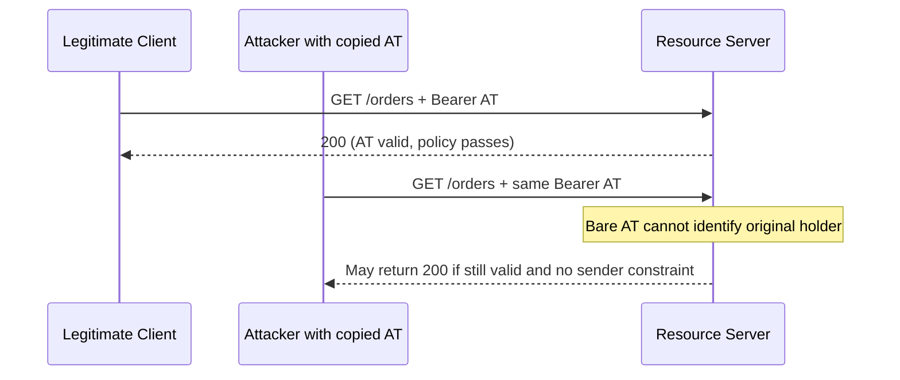
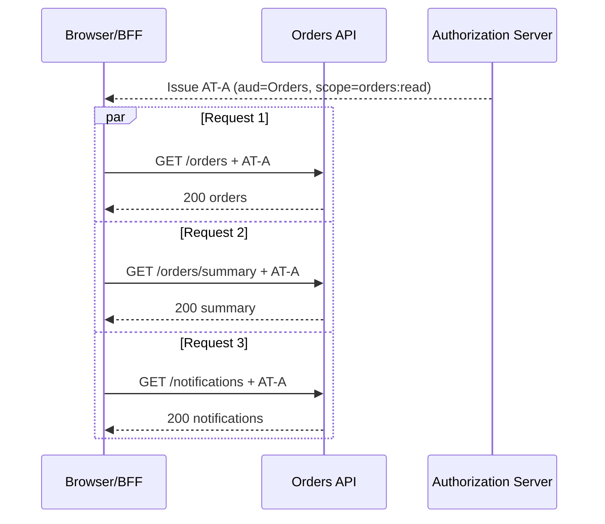
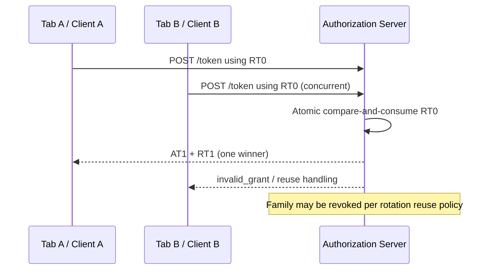
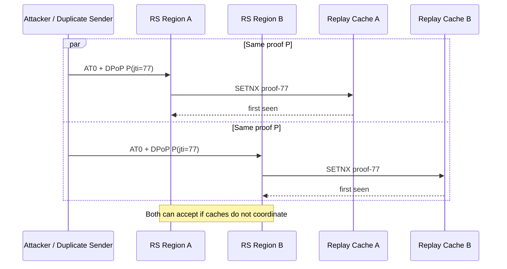

# Concurrent request với cùng token

## 1. Tình huống: ba request song song có phải là replay attack?

Một ứng dụng quản lý đơn hàng nhận access token (AT) từ authorization server. Khi trang dashboard tải, browser gửi đồng thời:

```http
GET /orders?limit=20 HTTP/1.1
Host: orders-api.example.com
Authorization: Bearer <AT-A>
```

```http
GET /orders/summary HTTP/1.1
Host: orders-api.example.com
Authorization: Bearer <AT-A>
```

```http
GET /orders/notifications HTTP/1.1
Host: orders-api.example.com
Authorization: Bearer <AT-A>
```

Cả ba request dùng **cùng access token**. Điều này **không tự động là tấn công phát lại**: trong mô hình OAuth 2.0 **bearer access token**, token thường có hiệu lực cho **nhiều request** tới đúng resource server trong thời hạn, audience, scope và các ràng buộc đã cấp. Client hợp lệ có thể gọi API song song qua HTTP/2 multiplexing, nhiều browser tabs, background polling hoặc mobile sync.

Nhưng nếu kẻ tấn công sao chép chính `<AT-A>` và gửi request của riêng họ, resource server (RS) có thể nhìn thấy **cùng một token vẫn hợp lệ**. Nếu chỉ dựa trên bearer token, RS **không thể khẳng định request đến từ đúng client gốc**.

Đổi tình huống: hai browser tabs gần như đồng thời gửi **cùng refresh token RT0** tới token endpoint trong một hệ thống dùng **refresh token rotation**:

```text
Tab 1: POST /token grant_type=refresh_token&refresh_token=RT0
Tab 2: POST /token grant_type=refresh_token&refresh_token=RT0
```

Lần refresh đầu thành công có thể **tiêu thụ RT0** và cấp RT1. Lần thứ hai trình RT0 sau đó sẽ là **reuse** theo quy tắc rotation, có thể kích hoạt thu hồi token family. Đây là vấn đề hoàn toàn khác với ba API request dùng AT hợp lệ ở trên.

Đổi tiếp: client dùng **DPoP-bound AT** và cố gửi ba request nhưng **dùng lại đúng một DPoP proof JWT**, có cùng `jti`. Khi resource server kiểm tra replay theo RFC 9449, một proof đã dùng không được chấp nhận lại như proof mới trong acceptance window.

> **Kết luận trung tâm:** “Cùng token” chưa cho biết replay attack có xảy ra hay không. Phải xác định **loại credential, hợp đồng sử dụng một lần hay nhiều lần, sender binding và đơn vị chống replay**: access token, refresh token, authorization code, DPoP proof hay business operation idempotency key.

Bài **“Concurrent request với cùng token”** thuộc chương **Replay protection** trong module `SECURITY_TOKEN_SECURITY_FUNDAMENTALS`, chuyên về mô hình tin cậy và vòng đời token bảo mật: JWT/opaque, access/refresh token, OAuth 2.0/OIDC, kiểm tra claims/scope/audience, lưu trữ, thu hồi và phòng chống đánh cắp hoặc phát lại.

## 2. Mục tiêu học tập

Sau bài này, bạn có thể:

1. Phân biệt **parallel legitimate requests**, **retry do lỗi mạng**, **duplicate delivery**, **credential replay** và **business double execution**.
2. Biết vì sao **bearer access token không mặc nhiên là single-use token**.
3. Giải thích giới hạn của `jti` trong JWT: token ID khác với proof-of-possession replay ID.
4. Thiết kế DPoP-bound AT dùng **cùng AT nhưng proof mới cho từng request**, kiểm tra `jti/htm/htu/iat/ath` và nonce khi cần.
5. Phân biệt DPoP với **mTLS-bound token** trong request concurrency.
6. Bảo đảm **refresh token rotation** chỉ có một lần tiêu thụ RT hiện hành thành công, kể cả ở nhiều authorization server nodes.
7. Xử lý false-positive reuse do **nhiều tabs, mất response, timeout/retry, multi-pod BFF** mà không mở lỗ hổng replay.
8. Thiết kế atomic replay cache cho DPoP, bảo vệ cache keys/TTL và xử lý cross-region consistency.
9. Phân biệt **authentication anti-replay** với **HTTP/API idempotency**, tránh xử lý thanh toán hai lần.
10. Xây test matrix bao gồm races, token theft, clock skew, nonce, revoked grants, failed caches và distributed outage.

## 3. Từ vựng: đừng gọi mọi request lặp là replay

| Hiện tượng | Ví dụ | Có nhất thiết là tấn công không? |
| --- | --- | --- |
| **Concurrent requests** | Ba GETs dùng cùng AT đang active | **Không**; có thể hoàn toàn bình thường |
| **Retry** | Mobile gửi lại request sau timeout | **Không**; nhưng có thể gây double action |
| **Duplicate delivery** | Proxy/queue gửi message hai lần | **Không**; hệ thống phải xử lý an toàn |
| **Bearer credential replay** | Attacker sao chép AT rồi trình lại | **Có thể là tấn công** |
| **DPoP proof replay** | Cùng proof `jti` dùng lại trong acceptance window | Phải bị cơ chế chống replay từ chối |
| **Refresh-token reuse** | RT0 đã consumed được gửi lại sau rotation | Có thể do attacker **hoặc lỗi concurrency/retry** |
| **Authorization code reuse** | Cùng authorization code đổi token lần thứ hai | Phải bị từ chối vì code có quy tắc single-use |
| **Business double execution** | Một ý định trả tiền bị thực thi hai lần | Lỗi nghiệp vụ/availability/correctness, cần idempotency |
| **Revoked token reuse** | Token đã revoke vẫn được client/attacker trình | Không được cấp quyền nếu revocation đã có hiệu lực theo policy |

### 3.1. Một key insight: ai được phép dùng lại cái gì?

- **Access token:** thường dùng nhiều lần cho nhiều API requests trong thời gian hiệu lực.
- **Refresh token với rotation:** mỗi phiên bản RT thường **chỉ đổi thành công một lần**.
- **Authorization code:** đổi token **một lần**.
- **DPoP proof JWT:** được thiết kế cho một HTTP request context; replay detection cần kiểm soát `jti` trong freshness window.
- **Idempotency key:** nhiều lần thử **cùng business operation** phải trả kết quả nhất quán theo hợp đồng, không có nghĩa token được xác thực chỉ một lần.

### 3.2. Token identity khác request identity

```text
Access token AT:
  identifies an authorization grant/resource permission boundary

DPoP proof P:
  demonstrates key possession for an HTTP request

HTTP request R:
  method, URI, headers, optional body, network attempt

Business command O:
  "Create payment 123" / "Submit order 42"
```

AT, P, R và O có **vòng đời khác nhau**. Nếu một thiết kế dùng `access_token.jti` làm replay key cho **mọi request**, nó sẽ vô tình chặn request thứ hai hợp lệ bằng cùng AT. Nếu dùng `DPoP.jti` làm idempotency key cho thanh toán, một retry dùng proof mới có thể thực thi thanh toán lần nữa.

## 4. Threat model: người gọi hợp lệ vs kẻ giữ bản sao token

Một bearer token là chuỗi bí mật mà người trình nó có thể dùng để truy cập API nếu còn hợp lệ.



**Cùng token không phải bằng chứng đủ để kết luận ai là attacker.** IP, User-Agent, geolocation và request timing có thể hỗ trợ risk analysis nhưng không phải cryptographic proof. Người dùng có thể đổi mạng 4G/Wi-Fi, dùng proxy doanh nghiệp hoặc gửi qua cùng NAT.

### 4.1. Replay có thể xảy ra ở đâu?

1. **Client → Resource Server:** AT bearer/DPoP proof bị sao chép.
2. **Client → Authorization Server:** RT/authorization code bị dùng lại.
3. **Browser/redirect → Client callback:** `state`, `nonce` hoặc authorization response bị phát lại theo tình huống/protocol.
4. **Gateway → Backend:** request đã được auth bị forward hai lần; backend phải có authorization/trust contract riêng.
5. **Business API:** cùng thao tác ghi dữ liệu được gửi lại sau timeout.
6. **Queue/async worker:** event/job được delivery ít nhất một lần (at-least-once), cần deduplication.

Các điểm này **không chia sẻ một replay protection algorithm duy nhất**.

### 4.2. Vì sao chỉ so sánh raw AT không đủ?

Nếu server thấy:

```text
AT-A used at 12:00:00
AT-A used at 12:00:00.005
AT-A used at 12:00:00.011
```

thì cả ba có thể là HTTP/2 requests hợp lệ. Quy tắc “AT chỉ được dùng một lần” sẽ phá browser navigation, polling, prefetch, GraphQL calls, parallel mobile sync và retry.

Một AS có thể **định nghĩa access token đặc biệt là one-time token**, nhưng đó phải là **profile/giao thức cụ thể**, không phải mặc định OAuth bearer token.

## 5. Bảng quyết định: cùng token trong hoàn cảnh nào?

| Credential/request | Concurrent use bình thường? | Chống replay trọng tâm |
| --- | --- | --- |
| Bearer AT gọi nhiều read API | **Có**, nếu audience/scope/expiry đúng | Bảo vệ token, TTL, sender-constraining nếu cần |
| JWT AT có `jti` | **Có**, `jti` không mặc định one-use | Revocation/trace theo token ID; PoP nếu cần |
| Opaque AT | **Có**, nếu AS/RS policy cho phép | Introspection và status, không tự chặn concurrency |
| DPoP-bound AT với **proof khác nhau** | **Có** | Check `ath/htm/htu/iat/nonce/jti` từng proof |
| DPoP-bound AT với **cùng proof** | **Không** trong replay detection window | Atomic replay cache keyed by proof identity |
| mTLS-bound AT trên nhiều parallel requests | **Có** nếu client cert binding đúng | mTLS certificate proof và AT claims, không one-use |
| RT rotation cùng RT0 được trình song song | **Chỉ một** consume thành công | Atomic single-use + family state/reuse policy |
| Authorization code đổi hai lần | **Chỉ một** exchange thành công | Atomic code consume + client/PKCE/redirect binding |
| OIDC nonce dùng lại giữa login transactions | **Không** cho binding một transaction | One-time/state transaction checks theo flow |
| POST tạo thanh toán được retry | Có thể gửi lại, **không được tạo hai giao dịch** | Business idempotency key + atomic DB |

## 6. Ba GET request với một bearer access token

Luồng hợp lệ:



Resource server kiểm tra **mỗi request**:

- Token có đúng **type/profile** là access token?
- Signature JWT hoặc opaque introspection/trust source hợp lệ?
- `iss` đúng issuer trusted?
- `aud` dành cho resource server này?
- `exp/nbf`/time hợp lệ?
- Route có scope/permission cần thiết?
- User/client/tenant có quyền với resource hiện hành?
- Token sender-constrained thì proof/certificate binding hợp lệ?
- Token/grant có bị revoke theo SLO/policy?

**Không cần và thường không nên khóa “một token chỉ có một request in-flight”**. Nếu endpoint yêu cầu chống double side effects, dùng idempotency/transaction constraints, không chặn khả năng auth multi-request.

### 6.1. JWT `jti` là định danh token, không là counter request

Một JWT AT có thể có:

```json
{
  "iss": "https://auth.example.com",
  "aud": "https://orders-api.example.com",
  "sub": "user-123",
  "scope": "orders:read",
  "jti": "at-7fa3",
  "iat": 1900000000,
  "exp": 1900000600
}
```

Nếu RS ghi cache:

```text
SETNX seen:access-token-jti:at-7fa3
  first request -> allow
  second request -> reject
```

thì RS đã **biến AT thành one-time credential ngoài hợp đồng**, phá legitimate concurrency.

`jti` của AT có thể hữu ích cho **denylist, correlation, audit có giới hạn**, nhưng cần xem claim optional/profile, uniqueness scope và privacy; không tự coi một `jti` dùng nhiều lần là replay.

### 6.2. Có thể phát hiện bearer token theft chỉ qua concurrency không?

Không chắc chắn. Cùng AT xuất hiện từ nhiều IP/địa điểm/thiết bị nhanh chóng có thể là anomaly, nhưng:

- Multi-region edge routing hoặc mobile network handoff là bình thường.
- Reverse proxy có thể làm mọi traffic trông đến từ một IP.
- Attacker có thể dùng cùng network/NAT với victim.
- Token được copy có thể dùng lâu sau khi request hợp lệ kết thúc.

Dùng risk signals để alert, step-up hoặc revoke khi phù hợp, **không dùng IP equality như sender proof**. Nếu cần chống replay cryptographically, dùng sender-constrained access tokens như DPoP/mTLS.

## 7. Sender-constrained access token: một token, nhiều proofs

**Sender-constrained token** ràng buộc quyền dùng AT với khả năng sở hữu key/certificate, nhằm giảm khả năng bản copy raw token được dùng từ nơi khác.

Hai cơ chế OAuth quan trọng:

1. **DPoP** (RFC 9449): mỗi HTTP request có DPoP proof JWT gắn vào method/URI/AT và public key.
2. **mTLS certificate-bound AT** (RFC 8705): AT bị ràng buộc với client certificate; RS cần xác minh certificate dùng trên TLS request khớp token binding.

Cả hai **không có quy tắc rằng access token tự trở thành one-use**. Chúng ràng buộc **bên gửi** với khóa/chứng chỉ.

### 7.1. Một AT, ba DPoP proofs khác nhau

```text
AT0: sender-constrained to key K

Request A: AT0 + proof P1 (jti=a1, htm=GET, htu=/orders)
Request B: AT0 + proof P2 (jti=a2, htm=GET, htu=/summary)
Request C: AT0 + proof P3 (jti=a3, htm=POST, htu=/search)

All three:
  AT0 may be identical.
  Proofs must each satisfy DPoP validation for their own requests.
  jti values should be unique for proofs from this key.
```

### 7.2. Cùng proof gửi lại là tình huống khác

```text
Request 1: AT0 + DPoP proof P1 (jti=a1)
Request 2: AT0 + exact same DPoP proof P1 (jti=a1)

RS with replay tracking:
  First valid proof P1 may pass.
  Second P1 must be rejected as reused proof in active window.
```

**Không nhầm:** `jti` của proof JWT là phần chống replay của **proof**; `jti` của access-token JWT là định danh **access token**. Chúng không phải cùng namespace hoặc semantics.

## 8. DPoP proof gắn với HTTP request như thế nào?

Ví dụ header của một DPoP proof JWT:

```json
{
  "typ": "dpop+jwt",
  "alg": "ES256",
  "jwk": {
    "kty": "EC",
    "crv": "P-256",
    "x": "<public-x>",
    "y": "<public-y>"
  }
}
```

Payload minh họa cho request tới resource server:

```json
{
  "jti": "proof-unique-random-001",
  "htm": "GET",
  "htu": "https://orders-api.example.com/orders/42",
  "iat": 1900000000,
  "ath": "<base64url-sha256-of-access-token>",
  "nonce": "<server-issued-nonce-if-required>"
}
```

**Đây là cấu trúc minh họa, không phải proof có chữ ký hợp lệ.** Thời gian `iat` và các giá trị phải phù hợp thời điểm thực tế. DPoP proof dùng thuật toán ký bất đối xứng theo RFC 9449/profile; `jwk` trong header cung cấp public key, không phải private key.

### 8.1. RS cần kiểm tra những gì?

Với DPoP tại protected resource, verifier cần kiểm tra:

1. Token được trình đúng DPoP authorization scheme/profile, ví dụ `Authorization: DPoP <AT>`, không nhầm bearer token khác loại.
2. JOSE header `typ=dpop+jwt`, signing algorithm được phép và là asymmetric, public `jwk` hợp lệ, không chứa private key fields.
3. Chữ ký proof hợp lệ theo public key đã khai.
4. `htm` khớp HTTP method thực của request.
5. `htu` khớp HTTP target URI được chuẩn hóa theo RFC 9449, **không lấy query/fragment** làm một phần so khớp theo quy tắc.
6. `iat` trong freshness window đã công bố; `nonce` được kiểm tra nếu RS đã yêu cầu.
7. `jti` được kiểm tra uniqueness/replay theo acceptance window và key context.
8. `ath` khớp **SHA-256 của đúng raw access token** được trình theo quy tắc Base64url.
9. Public key thumbprint của proof khớp sender binding trong AT, ví dụ `cnf.jkt` theo profile.
10. AT vẫn đúng issuer, audience, expiration, scope, revocation và business policy.

**Không được chỉ verify proof signature rồi bỏ `ath/htm/htu/cnf.jkt`**. Một proof đúng chữ ký nhưng cho endpoint khác không hợp lệ với request hiện tại.

### 8.2. `htu` phải dựa trên external target đáng tin

Khi RS chạy sau CDN/API gateway:

```text
Client sends:
  GET https://api.example.com/orders/42

Gateway forwards internally:
  GET http://orders-service:8080/orders/42
```

Middleware cần biết **target URI nào phải được dùng theo giao thức** và proxy trust configuration. Không tin header `X-Forwarded-Host`/`Forwarded` do người gọi Internet tự điền; gateway phải sanitize/overwrite, backend chỉ tin nguồn nội bộ được xác thực.

Nếu backend so `htu` với URL nội bộ không đúng kiến trúc, có thể false reject. Nếu tùy tiện tin header forwarded do attacker kiểm soát, có thể tạo bypass.

### 8.3. `ath` ngăn đổi token dưới cùng proof

Một proof được ký cho AT-A không được tái dùng với AT-B chỉ vì cùng HTTP method/URI. `ath` là digest của **AT được trình**, không phải subject/client ID hay JWS header.

```text
Proof P:
  ath = BASE64URL(SHA256(ASCII(access_token_A)))

Request:
  Authorization: DPoP access_token_B

RS:
  computed ath for B != proof.ath
  -> reject
```

**`ath` không thay access-token signature/introspection validation.** Nó gắn proof với chuỗi AT, còn AT validation quyết định quyền.

### 8.4. DPoP nonce và chống replay

AS hoặc RS có thể yêu cầu nonce để hạn chế thời gian một proof bị đánh cắp có thể được sử dụng và giúp quản lý freshness.

- Nonce phải do server tin cậy tạo theo profile, không phải giá trị client tự chế có tính an ninh tương đương.
- Khi server yêu cầu nonce, client cần gửi proof phù hợp với nonce đó.
- Nonce không cho phép bỏ kiểm tra `jti`/signature/`ath`.
- **Không coi một nonce dùng cho nhiều proofs là tự động replay** nếu protocol cho phép nonce đó được dùng nhiều lần. Đơn vị chống replay vẫn cần xét **proof identity/jti**.

### 8.5. DPoP proof không chứng minh quyền trên từng đối tượng

Giả sử proof hợp lệ, AT có `scope=orders:read`, client có thể truy cập Orders API. Điều đó **không chứng minh** subject được đọc order-42 thuộc tenant khác. Resource-level ACL/ABAC luôn phải kiểm tra riêng.

## 9. Atomic replay cache cho DPoP

Để từ chối cùng proof bị trình lại, RS hoặc một lớp xác minh đáng tin phải giữ **trạng thái proof đã thấy** trong freshness window.

### 9.1. Một key logic

```text
key = HMAC(
    server_cache_key,
    trusted_issuer_or_policy_context || "|" ||
    public_jwk_thumbprint || "|" ||
    proof_jti
)
```

Một số kiến trúc còn partition theo resource server/tenant/nonce context khi cần. Chọn key để **không nhầm proof của các key holders khác nhau**, không bị collision hoặc cross-issuer token confusion.

Không dùng:

```text
key = jti.substring(0, 6)
key = access_token.jti
key = user_id
key = IP_address
```

vì không có uniqueness/trust semantics thích hợp. HMAC cache key cũng giúp tránh đưa raw proof/token identifiers vào logs/Redis keyspace có thể quan sát.

### 9.2. Test-and-register phải **nguyên tử**

Sai:

```text
if not cache.contains(key):
    cache.put(key, seen)
    allow()
```

Hai RS workers có thể đều thấy `not contains` rồi cùng chấp nhận proof.

Đúng concept:

```text
atomic_insert_if_absent(key, TTL)
  -> inserted = true  => proof first-seen
  -> inserted = false => proof replay
```

Ví dụ Redis concept:

```redis
SET replay:<hmac_key> "1" NX EX 120
```

- Kết quả `OK` → cache key chưa tồn tại, được đăng ký lần đầu.
- Kết quả null/không thành công do key đã có → proof đã được thấy, từ chối.
- **Redis timeout/service failure** → **không mặc định allow**; xử lý fail closed cho endpoint yêu cầu replay protection.
- TTL **120 giây là ví dụ**, phải dựa trên proof acceptance window, clock skew và nonce/freshness policy.

### 9.3. TTL phải bao phủ toàn bộ cửa sổ được chấp nhận

Nếu RS chấp nhận `iat` trong khoảng một cửa sổ dài mà replay cache hết hạn sớm, attacker có thể đợi key hết TTL rồi trình lại proof vẫn nằm trong thời gian hợp lệ.

Một policy cần bảo đảm:

```text
Replay key retention
  >= maximum remaining accepted lifetime of a proof
     + any configured skew/processing margin
```

Không kết luận chỉ từ `iat + 60s` nếu RS chấp nhận proof cũ hơn nhiều vì clock skew. Phải tính **chính xác thời hạn chấp nhận** và cách cache TTL được thiết kế.

### 9.4. Scale-out và multi-region

Một cache `ConcurrentHashMap` trong JVM **chỉ chống replay trong một process**. Với 20 pods:

```text
Pod A sees jti=proof-1 -> allow
Pod B sees same jti=proof-1 -> allow
```

Nếu threat model yêu cầu chống replay trên mọi pods, cần **shared atomic store**, deterministic partition/routing hoặc hệ thống phối hợp có consistency guarantees phù hợp.

Cross-region replication eventual consistency có thể khiến cùng proof được chấp nhận ở hai regions gần như đồng thời. Cần xác định security SLO, key partition/region affinity, globally consistent store hoặc nonce/routing architecture để tránh lỗ hổng do race.

### 9.5. Đăng ký `jti` trước hay sau business authorization?

Một thiết kế thường:

1. Parse size/type giới hạn.
2. Kiểm tra cryptographic proof, method/URI/token hash/binding/time/nonce.
3. Thực hiện **atomic replay registration** trước khi thực thi tác vụ có side effects.
4. Validate AT claims/revocation/resource permission theo pipeline.
5. Execute business operation.

Có thể điều chỉnh thứ tự một số bước để giảm cache poisoning/DoS, nhưng **không bao giờ cho business side effect xảy ra trước replay gate bắt buộc**. Chỉ đánh dấu `jti` sau khi đã gửi response có thể mở cửa sổ concurrent replay.

Một proof đã đăng ký nhưng request sau đó bị reject (ví dụ scope thiếu) có thể không được retry nguyên proof; client cần tạo **proof mới**. Không nhất thiết phải “rollback” replay record.

## 10. Mạng trả lỗi/timeout: một retry DPoP nên làm gì?

Client gửi:

```text
Request R1:
  AT0 + proof P1(jti=101)
RS:
  accepts P1, handles request
Network:
  response lost
Client:
  retries
```

Nếu client retry **nguyên P1**, RS replay cache có thể từ chối. Điều đó là cơ chế anti-replay đang hoạt động, không chứng minh R1 trước đó thất bại.

Một retry mới nên tạo **proof P2 với `jti` mới**, ký bằng cùng key và gắn method/URI/AT của request mới. Nhưng:

- **Proof mới không xóa nguy cơ business side effect đã được thực thi ở R1**.
- Một POST thanh toán retry P2 có thể khiến tiền bị trừ lần hai nếu thiếu idempotency.
- Server phải kiểm soát **hai vấn đề độc lập**: DPoP proof uniqueness và business operation deduplication.

### 10.1. Retry có cần `iat` mới?

Nên tạo proof cho request/retry thực tế với thời gian/freshness hợp lệ, unique `jti`. Nếu RS yêu cầu nonce mới, dùng nonce phù hợp challenge. Không cố tạo jti từ timestamp millisecond hoặc reuse một UUID chung cho mọi parallel requests.

### 10.2. Retry sau HTTP 401/DPoP nonce challenge

Khi RS yêu cầu DPoP nonce:

1. Client đọc challenge theo profile (ví dụ DPoP-Nonce header/status).
2. Không bỏ AT/audience validation.
3. Sinh **proof mới** với nonce đã nhận, unique `jti` và đúng `htm/htu/ath`.
4. Retry bounded để tránh vô hạn loops.
5. Không log proof/token khi debug challenge.

### 10.3. Những request không an toàn để retry tự động

Các request như:

- `POST /payments`.
- `POST /orders`.
- `POST /refunds`.
- `POST /account/security/revoke-all`.

cần **business-level idempotency contract** nếu tự động retry sau timeout. HTTP method idempotency semantics và application operation design phải được xét riêng; **đổi DPoP jti không làm một POST trở thành idempotent**.

## 11. mTLS-bound AT và concurrency

Trong OAuth mTLS certificate-bound access tokens (RFC 8705), AT gắn với certificate thumbprint (ví dụ `cnf["x5t#S256"]` theo token profile). RS kiểm tra TLS client certificate khớp binding.

```text
AT0 bound to certificate C

Request 1:
  AT0 + TLS client certificate C -> valid sender binding

Request 2:
  AT0 + TLS client certificate C -> valid sender binding

Request 3:
  AT0 + TLS client certificate C -> valid sender binding
```

**Ba request song song vẫn có thể hợp lệ.** mTLS giúp chứng minh client sở hữu private key trên các TLS connections/sessions theo profile, nhưng không tự giới hạn AT thành một lần dùng.

### 11.1. TLS termination tại gateway

Nếu mTLS terminate tại API gateway, downstream chỉ nên tin certificate identity được gateway chuyển qua **kênh nội bộ đã được xác thực/bảo vệ**. Không chấp nhận header `X-Client-Cert` do caller Internet tự đặt như proof.

### 11.2. mTLS không thay API idempotency

Một client có certificate hợp lệ vẫn có thể gửi hai `POST /payments` đồng thời. RS có thể xác thực cả hai request; business system cần idempotency/unique constraints để không tạo hai payment intents cho cùng một logical operation.

## 12. Refresh token rotation: cùng RT ở hai requests

**Khác access token**, refresh token trong rotation thường là credential **single-use per generation**. Mỗi lần refresh thành công, RT cũ chuyển sang `CONSUMED` và AS phát RT kế nhiệm.



Thứ tự A/B trong sơ đồ chỉ minh họa; **không biết ai là legitimate/attacker chỉ từ việc request đến trước**.

### 12.1. Các bất biến quan trọng

1. Một RT hiện hành chỉ có **tối đa một refresh transaction thành công**.
2. Kết quả refresh thành công phải **atomic**: RT0 consumed và RT1 successor được lưu/cấp nhất quán.
3. Không có hai RT successors active trong family nếu profile dùng **single-current-token rotation**.
4. RT consumed không thể được dùng lại để mint AT/RT mới.
5. RT thuộc đúng **client/grant/family/sender binding**.
6. Khi family `REVOKED`, **không refresh thành công** dù RT row còn `ACTIVE`.
7. Concurrent refresh và revoke phải được sắp xếp theo authoritative family/grant state.
8. Response loss không được khiến AS cấp successor thứ hai tùy tiện.
9. Reuse detection phải được thiết kế có xét legitimate concurrency và threat model.
10. Private refresh token value không được log hoặc dùng làm public metric/cache key.

### 12.2. Một race phổ biến

Sai:

```text
Thread A reads RT0 ACTIVE.
Thread B reads RT0 ACTIVE.
Thread A creates RT1 ACTIVE.
Thread B creates RT2 ACTIVE.
Thread A marks RT0 CONSUMED.
Thread B marks RT0 CONSUMED.
=> Two successful refresh responses, two active successors.
```

Nếu AS cho phép trạng thái này ngoài profile, reuse detection có thể bị bypass và attacker có một nhánh RT hợp lệ.

Đúng là dùng **DB transaction/row lock/CAS** để chỉ một request được quyền consume RT0 và tạo successor.

### 12.3. Rotation reuse detection không được dựa vào IP

Nếu RT0 bị attacker dùng trước, legitimate tab gửi RT0 sau sẽ bị đánh dấu reuse. AS không thể chắc request nào là attacker. Phản ứng bảo thủ có thể là revoke token family, yêu cầu đăng nhập lại, ghi audit và cảnh báo.

Nếu cả hai requests đến từ cùng thiết bị nhưng do hai tabs, họ vẫn có thể bị family revoke. Vì thế ứng dụng nên **single-flight refresh**; server policy vẫn phải có anti-replay.

### 12.4. `invalid_grant` có thể mang nhiều ý nghĩa

Token endpoint thường trả:

```json
{"error":"invalid_grant"}
```

Lỗi có thể do RT expired, revoked, invalid, client mismatch, used/replayed, grant policy... **Không thể chỉ nhìn `invalid_grant` khẳng định hacker đánh cắp RT**.

Không leak thông tin như token owner, family chain hoặc xác nhận RT có tồn tại trong thông báo lỗi công khai.

## 13. Single-flight refresh ở browser/BFF

Một client có thể tránh tự gây duplicate refresh bằng **một promise/lock cho mỗi session/RT family**.

### 13.1. Pseudocode client

```text
function getAccessToken(session):
    if validAccessTokenCached(session):
        return cachedToken

    if refreshInProgress(session):
        return await sameRefreshPromise(session)

    promise = async:
        snapshot = session.version
        oldRT = loadCurrentRT(session)
        result = POST /token grant_type=refresh_token oldRT

        if session.version != snapshot or session.loggedOut:
            securelyDiscard(result)
            return LOGIN_REQUIRED

        atomicUpdateSessionTokens(
            expectedVersion = snapshot,
            accessToken = result.AT,
            refreshToken = result.RT1
        )
        return result.AT

    registerSingleFlight(session, promise)
    try:
        return await promise
    finally:
        clearSingleFlight(session, promise)
```

**Đây là giả mã**; trong SPA nhiều tabs hoặc BFF nhiều pods, một in-memory promise chỉ áp dụng **một runtime**. Cần lock/coordination đúng phạm vi, hoặc BFF token store có CAS.

### 13.2. Multi-tab SPA

Hai tabs cùng origin có thể:

- Chia sẻ session/cookie.
- Dùng RT hiện tại từ shared storage.
- Bắt đầu refresh gần cùng lúc.

Giải pháp có thể dùng:

- BFF/server-side refresh single-flight.
- Cross-tab coordination (Web Locks API nếu môi trường hỗ trợ, BroadcastChannel như tín hiệu, shared worker/service worker theo threat model).
- Token store với version/CAS.
- Retry/refresh failure flow biết `invalid_grant` và clear state.
- Không broadcast raw RT giữa các tabs nếu không có security design.
- Không tin cross-tab messages như nguồn cấp quyền; server quyết định.

### 13.3. Multi-pod backend

BFF chạy ở nhiều pods:

```text
Pod A and Pod B share session S / family F.
Both see AT expired.
Both attempt refresh with RT0.
```

Một lock trong JVM pod A **không khóa pod B**. Dùng transaction/lease/CAS trên shared session/token store với timeouts, failure handling và fencing token để đảm bảo **một refresh operation per family**.

Nếu chỉ dùng distributed lock có lease mà không có DB CAS, lease hết hạn giữa request có thể cho hai workers chạy. Cần **fencing/version check** tại nơi commit token state.

## 14. API idempotency: bảo vệ thao tác, không phải bản thân access token

Giả sử client gửi:

```http
POST /payments HTTP/1.1
Host: payments-api.example.com
Authorization: DPoP <AT0>
DPoP: <proof-with-jti-p1>
Idempotency-Key: payment-checkout-92
Content-Type: application/json

{"order_id":"order-42","amount":100000,"currency":"VND"}
```

Network timeout sau khi backend đã tạo payment. Client retry:

```http
POST /payments HTTP/1.1
Host: payments-api.example.com
Authorization: DPoP <AT0>
DPoP: <new-proof-with-jti-p2>
Idempotency-Key: payment-checkout-92
Content-Type: application/json

{"order_id":"order-42","amount":100000,"currency":"VND"}
```

- **AT0 giống nhau:** hợp lệ nếu token còn quyền và binding đúng.
- **DPoP proof khác:** P1 và P2 có unique `jti`, each bound to exact request context.
- **Idempotency-Key giống nhau:** cùng logical payment operation, backend phải xử lý không tạo thêm payment.

### 14.1. Idempotency key phải scope đúng

Một key logic:

```text
(identity or merchant/client account,
 API operation name/route,
 idempotency key,
 request-body fingerprint when applicable)
```

Không cho client A với key `payment-checkout-92` đọc kết quả nhạy cảm của client B chỉ vì key trùng.

### 14.2. Atomic business deduplication

Sai:

```text
if !payments.exists(idempotencyKey):
    chargeCard()
    savePayment(idempotencyKey)
```

Hai workers có thể đều thấy chưa tồn tại và **cùng charge**. Cần atomic claim/unique constraint/transaction và cơ chế downstream PSP idempotency.

Đúng concept:

```text
transaction:
   INSERT operation(tenant, client, key, body_hash, status=IN_PROGRESS)
     with UNIQUE(tenant, client, operation, key)
   if conflict:
      ensure body_hash matches original
      return existing result or 'still processing'
   else:
      execute or durably enqueue once
      persist final status/result
```

**Không thể đảm bảo exactly-once external side effect chỉ bằng DB local** nếu external payment provider không có idempotency/transaction contract. Cần outbox, stable operation ID và provider idempotency keys.

### 14.3. Idempotency không thay authentication

Một attacker có token giả hoặc thiếu quyền không được chạm tới cached payment result chỉ vì đoán trúng idempotency key.

Mỗi retry vẫn phải được **authenticate và authorize** đúng. Idempotency xử lý **sự trùng lặp hành vi nghiệp vụ**, còn token/DPoP validation xử lý **quyền trình credential**.

## 15. Nhìn tổng thể: ba bộ khóa khác nhau

```text
Bearer/JWT access token:
  may be reused for legitimate API calls
  require iss/aud/exp/scope/state and sender binding if configured

DPoP proof:
  per-request proof JWT
  require proof signature, htm/htu/ath/iat/nonce, unique jti
  replay cache key tied to proof key/thumbprint and policy

Business operation:
  idempotency key per client/tenant/command
  require request fingerprint + atomic result reuse
```

**Không dùng duy nhất một Redis SETNX cho cả ba mục đích.** Ranh giới trust, TTL, keyspace, tính duy nhất và phản ứng với duplicate đều khác nhau.

## 16. Authorization code, OIDC state/nonce và những giá trị single-use khác

Bên cạnh access/refresh tokens, một số credential trong OAuth/OIDC có **ngữ nghĩa sử dụng một lần**. Nếu không phân biệt, hệ thống có thể cho dùng lại sai hoặc từ chối nhầm.

### 16.1. Authorization code phải được đổi một lần

Authorization Code Grant (RFC 6749) phát code ngắn hạn để client đổi ở token endpoint. Code bị ràng buộc với client, redirect URI và thêm PKCE code verifier khi áp dụng.

```mermaid
sequenceDiagram
    participant C as OAuth Client
    participant AS as Authorization Server
    C->>AS: POST /token with code=C0, verifier=V
    AS->>AS: Atomically consume C0 after binding checks
    AS-->>C: AT (+ RT/ID Token per profile)
    C->>AS: POST /token with same code=C0
    AS-->>C: invalid_grant; reuse handling
```

Một AS có nhiều nodes phải bảo đảm **chỉ một code exchange thành công**, tương tự RT rotation. Nếu code được dùng lại, RFC 6749 khuyến nghị/đòi AS từ chối và có thể/ theo chuẩn phải cân nhắc thu hồi tokens đã phát từ code đó theo điều khoản áp dụng.

**Không nhầm authorization code với bearer AT**: AT có thể dùng nhiều API requests, code không phải credential multi-use.

### 16.2. OIDC `state` và `nonce`

Trong OIDC Authorization Code + PKCE:

- `state` giúp client gắn authorization response với login transaction và chống CSRF/session mix-up theo profile.
- `nonce` (khi sử dụng/yêu cầu) gắn ID token với authentication request.
- Code+state/nonce phải được kiểm tra trong **đúng giao dịch đăng nhập**, tránh một callback cũ tạo session mới trái ý muốn.
- Client cần transaction storage/correlation state, unique IDs, TTL, atomic consume khi flow yêu cầu.

**Không coi mỗi JWT access-token request cần nonce OIDC mới**. `nonce` trong ID token dùng cho authentication transaction, không phải HTTP request replay ID cho resource API.

### 16.3. One-time password và magic link

OTP/magic link có thể có quy tắc single-use và atomic consume tương tự authorization code; nhưng chúng thuộc authentication/recovery workflows, không tự quyết định semantics của access token. Không dùng một cache `seen token id` chung cho mọi loại credential.

## 17. Concurrency khi revoke token đang được sử dụng

Một người dùng logout hoặc admin revoke grant trong khi có các API requests in-flight:

```text
T0  AT0 active.
T1  Request A enters Orders API and verifies AT0.
T2  Admin revokes grant/RT family at AS.
T3  Request B enters Orders API with same AT0.
T4  Request A finishes database work.
```

Cần phân biệt:

- **Requests bắt đầu sau mốc revocation**: phải bị từ chối theo RS revocation policy/SLO.
- **Request đã được xác minh trước khi revoke**: có thể đang chạy; doanh nghiệp phải quyết định hủy/kiểm tra lại ở commit boundary, nhất là high-risk operations.
- **JWT offline:** vẫn có thể pass đến `exp` nếu RS không tra state.
- **Opaque AT introspection:** RS có thể nhận `active:false` sau revoke, nhưng positive cache có thể stale.

### 17.1. “Chặn token mới” khác “hủy transaction đã bắt đầu”

Một security requirement ví dụ:

```text
After revocation commit:
  - AS must not issue new AT from revoked RT family.
  - RS must reject newly authenticated API requests within 10 s.
  - Existing payment transactions must revalidate policy before commit.
```

Các mốc trên là **ví dụ**, không phải nghĩa vụ RFC. Hệ thống phải định nghĩa ngữ nghĩa in-flight operations, cancellation, rollback và side effects.

### 17.2. Cache token active không chứng minh business operation vẫn hợp lệ

RS có thể cache AT validation 15 giây và đồng thời user bị xóa khỏi tenant. Một API `POST /transfer` vẫn cần current ACL/risk/business authorization theo policy. JWS signature, DPoP proof hay token introspection không thay **authorization hiện hành**.

### 17.3. API long-lived connections

WebSocket/SSE/streaming sessions thường được authenticate lúc handshake. Nếu có remote revocation:

- Cân nhắc đóng kết nối/reauthorize theo security SLO.
- Kiểm tra permissions tại subscription/event delivery với dữ liệu nhạy cảm.
- Không coi cùng token lặp qua nhiều messages là DPoP proof replay nếu protocol không dùng DPoP cho từng message.
- Nếu gửi HTTP requests trong tunnel, phải xác định token/proof binding phù hợp application protocol.

## 18. Java 17: anti-replay gateway chỉ nhận proof đã xác minh

Ví dụ dưới đây mô tả lớp đăng ký `jti` đã được kiểm tra cryptographically. **Đây không phải bộ xác minh DPoP hoàn chỉnh**; phần verify signature, `htm/htu/iat/ath/cnf.jkt` phải được thực hiện bởi một thư viện/protocol validator đáng tin trước khi gọi.

### 18.1. Interface atomic replay store

```java
import java.time.Duration;
import java.time.Instant;

public interface AtomicReplayStore {
    /**
     * Atomically insert cache key only if absent.
     *
     * @return true  = first successful insertion (never seen)
     *         false = key already present (replay)
     * @throws RuntimeException when storage is unavailable
     *
     * TTL must cover the complete remaining proof acceptance window.
     */
    boolean registerOnce(String key, Duration ttl);
}

public record VerifiedDpopContext(
        String trustedIssuer,
        String publicJwkThumbprint,
        String proofJti,
        Instant acceptedUntil) {}
```

Đây là hai public top-level declarations để minh họa; cần đặt ở files riêng khi sử dụng trong Java thực tế.

### 18.2. ReplayGate dùng HMAC digest của proof identity

```java
import java.nio.ByteBuffer;
import java.nio.charset.StandardCharsets;
import java.security.GeneralSecurityException;
import java.time.Duration;
import java.time.Instant;
import java.util.Base64;
import javax.crypto.Mac;
import javax.crypto.spec.SecretKeySpec;

public final class DpopReplayGate {
    private final AtomicReplayStore store;
    private final byte[] cacheHmacKey;

    public DpopReplayGate(
            AtomicReplayStore store, byte[] cacheHmacKey) {
        if (cacheHmacKey == null || cacheHmacKey.length < 32) {
            throw new IllegalArgumentException("Cache HMAC key too short");
        }
        this.store = store;
        this.cacheHmacKey = cacheHmacKey.clone();
    }

    /**
     * Must be called ONLY AFTER full DPoP proof verification.
     * Register before executing the protected business operation.
     */
    public void requireFresh(VerifiedDpopContext proof) {
        Instant now = Instant.now();

        if (proof.acceptedUntil().isBefore(now)
                || proof.acceptedUntil().equals(now)) {
            throw new SecurityException("Expired proof acceptance");
        }

        if (proof.proofJti() == null || proof.proofJti().isBlank()
                || proof.proofJti().length() > 256) {
            throw new SecurityException("Invalid proof jti");
        }

        Duration ttl = Duration.between(now, proof.acceptedUntil());
        String key = "dpop-proof:" + replayDigest(
                proof.trustedIssuer(),
                proof.publicJwkThumbprint(),
                proof.proofJti());

        // Implementation MUST be shared atomic compare-and-register
        // across all enforcement nodes in the intended replay scope.
        // Cache/store failure MUST NOT mean "allow".
        if (!store.registerOnce(key, ttl)) {
            throw new SecurityException("DPoP proof replay");
        }
    }

    private String replayDigest(String issuer, String jkt, String jti) {
        try {
            // Length-prefix fields to avoid delimiter ambiguities.
            byte[] input = encodeLengthPrefixed(issuer, jkt, jti);
            Mac mac = Mac.getInstance("HmacSHA256");
            mac.init(new SecretKeySpec(cacheHmacKey, "HmacSHA256"));
            byte[] digest = mac.doFinal(input);
            return Base64.getUrlEncoder()
                    .withoutPadding()
                    .encodeToString(digest);
        } catch (GeneralSecurityException e) {
            // Do not log cache key secret or proof fields.
            throw new IllegalStateException("Replay key service error", e);
        }
    }

    private static byte[] encodeLengthPrefixed(String... fields) {
        int size = 0;
        byte[][] values = new byte[fields.length][];
        for (int i = 0; i < fields.length; i++) {
            if (fields[i] == null || fields[i].isBlank()) {
                throw new SecurityException("Missing verified proof field");
            }
            byte[] bytes = fields[i].getBytes(StandardCharsets.UTF_8);
            if (bytes.length > 1024) {
                throw new SecurityException("Oversized proof field");
            }
            values[i] = bytes;
            size += Integer.BYTES + bytes.length;
        }

        ByteBuffer output = ByteBuffer.allocate(size);
        for (byte[] bytes : values) {
            output.putInt(bytes.length);
            output.put(bytes);
        }
        return output.array();
    }
}
```

### 18.3. Giới hạn của ví dụ Java

1. `VerifiedDpopContext` phải đến từ một **verifier thật** đã xác minh DPoP signature, `typ/alg/jwk`, `htm/htu/ath/iat/nonce/cnf.jkt` và AT validation. **Không cho controller tự tạo context từ dữ liệu client**.
2. `acceptedUntil` phải do server tính từ iat/freshness/clock-skew/nonce profile, **không nhận nguyên timestamp do client tự khai**.
3. `AtomicReplayStore.registerOnce` phải là **atomic write-if-absent với TTL** trên đúng consistency scope. Code chưa có Redis/DB driver implementation.
4. Đoạn ví dụ dùng `Instant.now()`; production cần trusted clock, test clock skew và monotonic consistency khi appropriate.
5. TTL không được nhỏ hơn effective acceptance window; hệ thống cần tính các trường hợp proof iat ở tương lai trong skew allowance.
6. HMAC key phải được quản lý như secret, key version/rotation đồng bộ để không bỏ sót replay khi các nodes dùng HMAC cache key khác nhau.
7. Hai Java public top-level declarations ở snippet đầu phải đặt tệp tương ứng để compile.
8. `Base64`-encoded HMAC digest giúp index an toàn hơn raw `jti`, nhưng cache entries vẫn có thể tiết lộ traffic pattern; bảo vệ Redis/DB and metrics.
9. Không xử lý outage retry semantics; caller phải **fail closed** và map lỗi phù hợp thay vì expose stacktrace.
10. Không sử dụng `proofJti()` của access-token JWT; đây là **DPoP proof jti** đã verify.
11. Ví dụ không giới hạn tổng số proofs per client/user, nên production cần quotas/rate limits chống cache-filling DoS.
12. Không có circuit breaker/backpressure và capacity planning; cache TTL/rate limits cần thiết cho hàng triệu requests/giây.
13. Không thực hiện HTTP API idempotency; mọi business POST vẫn cần operation store riêng.

### 18.4. Atomic store bằng Redis (khái niệm)

```redis
SET dpop-proof:<keyed-hmac> "1" NX EX 120
```

Một adapter an toàn phải phân biệt:

```text
Redis OK:
  first seen -> proceed if all other checks pass

Redis nil (key already exists):
  replay -> reject

Redis timeout/connection error:
  validation dependency failed -> DO NOT allow unverified request
```

**Không giải quyết** bằng cách gọi `GET` rồi `SET` riêng, vì hai workers có thể cùng vượt qua.

### 18.5. Replay cache HMAC key rotation

Nếu region A dùng key H1, region B dùng H2, cùng proof có hai cache keys khác nhau; attacker có thể replay qua regions. Khi rotate HMAC key:

- Phải phối hợp key-version/dual-read hoặc chờ toàn bộ acceptance window của old key trước khi bỏ, theo thiết kế.
- Đảm bảo mọi enforcement points dùng cùng logical replay namespace/consistency.
- Không dùng raw jti làm cách “sửa tạm” nếu logs/tenants/collision chưa được thiết kế.
- Đo replay acceptance across regions trong integration tests.

## 19. SQL: single-use refresh token qua transaction

Một AS cần bảo vệ **đồng thời hai cập nhật**:

1. RT0 chuyển từ `ACTIVE` sang `CONSUMED`.
2. RT1 được ghi thành **successor active duy nhất của family**.

### 19.1. Schema tối thiểu minh họa

```sql
-- Schema khái niệm, chưa đầy đủ foreign keys/indexes/retention.
CREATE TABLE refresh_token_families (
    family_id         VARCHAR(128) PRIMARY KEY,
    issuer_id         VARCHAR(255) NOT NULL,
    client_id         VARCHAR(128) NOT NULL,
    grant_id          VARCHAR(128) NOT NULL,
    current_rt_id     VARCHAR(128),
    state             VARCHAR(24) NOT NULL,
    version           BIGINT NOT NULL
);

CREATE TABLE refresh_tokens (
    rt_id             VARCHAR(128) PRIMARY KEY,
    family_id         VARCHAR(128) NOT NULL,
    token_digest      VARBINARY(32) NOT NULL UNIQUE,
    state             VARCHAR(24) NOT NULL,
    generation        BIGINT NOT NULL,
    issued_at         TIMESTAMP NOT NULL,
    expires_at        TIMESTAMP NOT NULL,
    consumed_at       TIMESTAMP
);
```

RT nên có entropy cao và lưu **digest/HMAC**, không raw token plaintext khi không cần.

### 19.2. Transaction logic

```text
function rotateRefreshToken(rawRT, authenticatedClient, senderProof):
    digest = HMAC(serverLookupKey, rawRT)

    begin transaction
      // Find family reference; do not trust client-supplied family_id.
      rt = lookupTokenByDigest(digest)

      family = SELECT ... FROM refresh_token_families
               WHERE family_id = rt.family_id FOR UPDATE

      rt = SELECT ... FROM refresh_tokens
           WHERE rt_id = rt.rt_id FOR UPDATE

      require family.state == ACTIVE
      require rt.state == ACTIVE
      require rt.rt_id == family.current_rt_id
      require family.client_id == authenticatedClient
      require grant/issuer/expiry/tenant/sender binding valid

      UPDATE refresh_tokens
        SET state = CONSUMED, consumed_at = NOW()
        WHERE rt_id = oldId AND state = ACTIVE
      require rowsAffected == 1

      newRT = secureRandomHighEntropyToken()
      INSERT refresh_tokens(newRT_digest, family, generation+1, ACTIVE)
      UPDATE family.current_rt_id = newRT.id
      UPDATE family.version = family.version + 1

      persist audit metadata; perhaps durable issuance record
    commit

    return new AT + new RT only after successful commit
```

Tất cả nodes phải khóa/cas **cùng family authoritative state**. Dùng `FOR UPDATE` theo DB hỗ trợ; những DB khác có transaction/CAS semantics khác. Không dùng read replica eventual-consistent để quyết định có thể issue successor.

### 19.3. So sánh thứ tự commit

```text
A and B both present RT0.

A locks family first:
  A consumes RT0 and creates RT1; commits.
  B sees RT0 CONSUMED; must fail/reuse handling.

B locks first:
  B wins; A fails.

Both cannot succeed if invariants hold.
```

### 19.4. Revoke và rotate race

Nếu logout/revoke family chạy đồng thời:

```text
Refresh transaction:
  needs family state ACTIVE before issue.

Revoke transaction:
  marks family REVOKED with same lock/version/fence.

If refresh commits first:
  revocation must cover the successor already issued.

If revoke commits first:
  refresh must reject.

After revoke commit:
  no legitimate RT successor remains usable.
```

**Chỉ lock RT0 row mà không kiểm tra family/grant state có thể tạo successor sau revoke**, là lỗi nghiêm trọng.

### 19.5. Exactly-once token issuance và response loss

Giả sử AS đã commit `RT0→RT1` nhưng network response bị mất. Client không nhận RT1, chỉ còn RT0 consumed. Client retry RT0 và có thể kích hoạt reuse detection.

Không có giải pháp “retry RT0 bao nhiêu lần cũng được” mà vẫn giữ single-use semantics. Những lựa chọn được AS thiết kế riêng có thể bao gồm:

- BFF server-side token store quản lý refresh transaction và response recovery.
- Transaction outcome records với correlation/idempotency **bị ràng buộc caller/sender/session**, lifetime rất ngắn và không trả RT1 cho attacker giữ RT0.
- Bounded grace policy sau security analysis, có thể làm giảm reuse detection effectiveness.
- Client clear session và yêu cầu re-authorization nếu không thể phục hồi an toàn.

**Một response bị mất không chứng minh token bị đánh cắp**, nhưng cho dùng lại RT cũ tùy tiện là một lỗ hổng replay.

## 20. Java 17: single-flight refresh trong một JVM

Ví dụ chỉ nhằm **giảm hai refresh requests đồng thời trong một process**. Nó không thay AS-side single-use enforcement.

```java
import java.util.concurrent.Callable;
import java.util.concurrent.CompletableFuture;
import java.util.concurrent.CompletionException;
import java.util.concurrent.ConcurrentHashMap;

public final class LocalSingleFlightRefresh {
    public record TokenPair(
            String accessToken,
            String refreshToken) {}

    private final ConcurrentHashMap<String,
            CompletableFuture<TokenPair>> inFlight =
            new ConcurrentHashMap<>();

    public TokenPair execute(
            String sessionId, Callable<TokenPair> refreshOnce) {

        CompletableFuture<TokenPair> mine = new CompletableFuture<>();
        CompletableFuture<TokenPair> existing =
                inFlight.putIfAbsent(sessionId, mine);

        if (existing != null) {
            // Other caller is already refreshing same session.
            return existing.join();
        }

        try {
            // Caller must check cached AT/session version first.
            // This single-flight only coalesces OVERLAPPING attempts.
            TokenPair result = refreshOnce.call();
            mine.complete(result);
            return result;
        } catch (Exception ex) {
            mine.completeExceptionally(ex);
            throw new CompletionException(ex);
        } finally {
            inFlight.remove(sessionId, mine);
        }
    }
}
```

### 20.1. Phạm vi bảo đảm của snippet

- Hai threads **chồng nhau trong một JVM** thường chờ cùng result.
- Không bảo vệ hai JVM pods, browser tabs ở processes khác nhau hay AS nodes.
- Không ngăn caller sử dụng `RT0` cũ **sau** khi flight đã kết thúc, vì map entry đã bị xóa.
- Không cập nhật token vault; code gọi cần CAS session version và serialize refresh/clear logout state.
- Không chống attacker cầm bản sao RT0.
- Không xử lý outcome khi response thất lạc hoặc AS `invalid_grant`.
- Không bảo vệ raw RT khỏi logs/heap dumps.
- Không thay server-side rotation atomics.

### 20.2. Pattern BFF đầy đủ hơn

```text
BFF request:
  get verified server session
  if AT valid and enough lifetime:
      return AT

  lock refresh by session/family (shared store/fencing)
  re-read current session/version/RT
  if another worker already refreshed:
      return new cached AT
  if session revoked/logged out:
      return login_required

  perform refresh with current RT exactly once
  atomically persist AT/RT successor if expected version matches
  release lock
```

Một distributed lock lease **không đủ** nếu không có version/fencing check tại commit. Lease có thể hết hạn trước khi HTTP refresh kết thúc, khiến worker khác được lock mới.

## 21. Eventual consistency: hai regions cùng chấp nhận một proof

Một RS cluster có hai regions, mỗi nơi có replay cache cục bộ:



### 21.1. Vì sao replica sync chậm không đủ?

Nếu A và B đều cho phép proof trước khi kết quả SETNX replicate, việc đồng bộ eventual về sau chỉ cho biết **proof đã được dùng hai lần**, không chặn side effect đã xảy ra.

### 21.2. Các lựa chọn thiết kế

| Lựa chọn | Điểm mạnh | Rủi ro/đánh đổi |
| --- | --- | --- |
| Globally consistent atomic replay store | Chặn duplicates xuyên regions | Latency/availability, quorum/cost |
| Deterministic routing một key về một shard/region | Local atomic store cho cùng proof | Cần anti-bypass và sticky routing đáng tin |
| Server-issued nonce scoped theo region/endpoint | Có thể giới hạn proof/replay scope | Nonce protocol và cross-region failover phức tạp |
| Short proof acceptance window + telemetry | Giảm thời gian replay | **Không bảo đảm** chặn concurrent replay |
| Eventual replication + after-the-fact detection | Đơn giản/khả dụng hơn | Chỉ phát hiện, **không ngăn** duplicate acceptance |

Không gọi một eventual replay cache là “exactly once globally” nếu thực tế hai regions cùng có thể nhận.

### 21.3. Cơ chế nếu cache down

Nếu policy yêu cầu DPoP anti-replay chặt:

- Không đánh dấu request là authenticated chỉ vì Redis đang down.
- Trả lỗi service dependency phù hợp khi không thể thực hiện replay gate, không phơi secret.
- Circuit breaker, backpressure, capacity planning và multi-AZ availability.
- Nếu có fallback, phải là **một cơ chế chống replay khác có security guarantees rõ**, không phải `if cache_error then allow`.
- Cần phân biệt `duplicate proof` với `cache unavailable` trong telemetry để không gắn nhãn attacker sai.

## 22. Storage và bảo mật replay cache

### 22.1. Cache keys không chứa raw token

Không:

```text
SET replay:Bearer eyJhbGciOi... 1
SET replay:Authorization:DPoP <rawAT> 1
```

Keyspace và metrics/administrative consoles có thể bị đọc. Dùng keyed digest/HMAC của **proof identity và verified trust context**, TTL ngắn, tránh raw RT/AT/proof text.

### 22.2. Replay cache có thể là DoS target

Attacker có thể tạo hàng triệu proofs với unique `jti` hoặc invalid headers để cố lấp cache. Hệ thống nên:

1. Kiểm tra giới hạn request/token/proof bytes **trước** expensive work.
2. Verify signature/key binding/freshness **trước** đăng ký `jti`.
3. Rate limit theo client/key/resource khi phù hợp.
4. Giới hạn `jti` length và strict type/format.
5. Quotas/capacity planning, eviction policy và monitoring.
6. Không cho unauthenticated arbitrary data chiếm replay cache không giới hạn.
7. Chọn TTL theo acceptance window, không “lưu mãi mãi”.
8. Dùng anti-abuse controls bảo vệ cả RS lẫn AS.

### 22.3. Eviction trước TTL gây false accept

Nếu Redis eviction policy xóa replay key trước khi proof hết acceptance window, proof cũ có thể trở lại như “first-seen”. Do đó:

- Đảm bảo capacity/eviction settings phù hợp security SLO.
- Metrics cho evictions/memory pressure.
- Nếu không còn bảo đảm replay gate, fail closed hoặc chuyển sang cơ chế có bảo đảm tương đương.
- Không tối ưu bộ nhớ bằng cách rút TTL dưới freshness/skew window.

### 22.4. HMAC digest key rotation có thể đổi namespace

Khi HMAC cache key được xoay, proof key hash thay đổi. Phải thiết kế overlap/dual-read hoặc chờ cửa sổ replay cũ hết hạn để không cho cùng proof đăng ký lại dưới key mới. Mọi RS enforcement nodes phải có chính sách key version đồng bộ.

## 23. Giới hạn của tín hiệu IP, User-Agent và device fingerprint

Có thể dùng:

- Cùng AT từ hai địa điểm cách xa trong thời gian ngắn.
- Browser fingerprint khác thường.
- IP ASN thay đổi đột ngột.
- Nhiều request concurrency vượt baseline.
- Refresh-token reuse events.

Những tín hiệu đó **chỉ hỗ trợ risk engine**, không chứng minh sở hữu/không sở hữu token. Một user hợp lệ có thể:

- Chuyển Wi-Fi sang 4G.
- Dùng VPN doanh nghiệp.
- Thực hiện API calls từ web BFF và mobile.
- Có request được route qua CDN edges khác nhau.
- Refresh/retry sau network hiccup.

**Không tự revoke mọi phiên vì một burst API concurrency bình thường.** Khi risk cao, có thể step-up, revoke affected token family, throttle hoặc alert theo policy. Cần false-positive/availability monitoring.

## 24. Token theft và sender-constraining: giảm nhưng không triệt tiêu replay

### 24.1. Bearer AT bị lộ

Nếu AT bị sao chép, attacker có thể trình nguyên token nếu nó còn hợp lệ ở đúng audience. Các biện pháp:

- TLS và certificate/hostname verification.
- Secure storage/BFF, tránh XSS.
- Short AT TTL, limited scope/audience.
- Logging redaction.
- Introspection/revocation khi cần.
- DPoP hoặc mTLS sender constraint khi phù hợp.

### 24.2. DPoP-bound AT bị lộ nhưng private key không bị lộ

Attacker giữ raw AT nhưng không giữ DPoP private key **không thể tạo proof hợp lệ mới** cho request khác. Nếu họ cũng sao chép **một proof đã phát**, họ có thể thử race/replay proof đó; freshness/replay cache/nonce làm giảm khả năng thành công.

### 24.3. Host đã bị chiếm quyền

Nếu attacker chiếm application process hoặc máy giữ DPoP key, họ có thể yêu cầu ký proofs mới. DPoP **không tự phòng được active endpoint compromise**. Cần key isolation/attestation khi có, endpoint hardening, incident response và revoke.

### 24.4. mTLS client key bị lộ

Nếu attacker giữ được private key/certificate tương ứng và AT, họ có thể giả sender, nên cần certificate/key revocation, AS grant/AT revoke và telemetry phù hợp.

### 24.5. Cũng không ngăn tất cả request duplication

Ngay cả DPoP proof được ký hợp lệ, **client hợp lệ** có thể chủ động gửi hai business commands khác nhau hoặc retry cùng command với proofs mới. Cần authorization và business idempotency.

## 25. Anti-patterns qua ba lớp kiểm soát

| Sai lầm | Hậu quả | Thiết kế đúng |
| --- | --- | --- |
| Một AT chỉ được dùng một request | Chặn legitimate parallel API calls | AT multi-use theo OAuth profile |
| Dùng access-token `jti` làm per-request replay key | False replay/DoS | Dùng DPoP proof `jti` khi profile DPoP |
| Coi burst 3 GETs là token theft | False positives | Threat model + PoP/risk signals |
| Coi cùng AT từ hai IP là bằng chứng hacker | Dễ phán đoán sai | IP chỉ là risk signal |
| Chỉ verify JWT signature và bỏ audience | Cross-resource replay | Validate `iss/aud/exp/type/scope` |
| Chỉ kiểm tra AT `exp` mà bỏ revoke SLO | Revoked token còn dùng | State/introspection/denylist |
| Chỉ verify DPoP signature | Proof từ URI/token khác vẫn pass | Check `htm/htu/ath/iat/cnf/nonce` |
| Reuse cùng DPoP `jti` ở mỗi request | Legitimate requests bị chặn | Proof mới unique jti mỗi request |
| Dùng `iat` làm DPoP replay ID | Hai proofs cùng giây collision | Unique high-entropy `jti` |
| Dùng nonce server làm replay key một lần | Các proofs nonce hợp lệ bị chặn | Track proof jti, nonce theo profile |
| Không kiểm tra `ath` | Proof có thể gắn sai AT | Hash exact presented AT |
| Tin forwarded host từ Internet để so `htu` | URI trust bypass | Trusted gateway/proxy config |
| Dùng `GET then SET` cho proof cache | Concurrent proofs đều pass | Atomic set-if-absent |
| Replay cache chỉ tồn tại trong một pod | Cross-pod replay | Shared/global consistency |
| Eventual cache nhưng hứa chống replay toàn cầu | Cross-region double acceptance | Defined consistency/routing |
| Replay cache TTL quá ngắn | Proof được dùng lại sau expiry cache | TTL bao phủ acceptance window |
| Eviction trước proof expiry | False first-seen | Capacity planning/fail closed |
| Redis timeout thì allow | Replay gate bypass | Fail closed/dependency error |
| Cache key là raw AT/JTI secret | Lộ credentials/identifiers | HMAC digest + isolation |
| Đăng ký `jti` trước verify trên mọi invalid proof | Cache-filling DoS | Validate then atomic register |
| Proof không được giới hạn size/depth | Parsing/crypto DoS | Input limits |
| RT0 được refresh song song hai lần | Hai successor active | Family lock/CAS/atomic consume |
| Chỉ check RT row, bỏ family revoked | Refresh sau logout | Check authoritative family/grant |
| RT consumed được retry vô hạn | Replay detection bypass | Bounded handling/re-auth |
| `invalid_grant` luôn coi là attacker | False alarm/UX degradation | Incident signals + race monitoring |
| Single-flight trong pod được coi là đủ toàn hệ | Cross-pod races | Shared session version/fence |
| Lock lease hết hạn mà không có fencing | Hai refresh operations commit | CAS/version check |
| Response RT1 mất rồi tự cấp RT2 từ RT0 | Break one-use | Safe recovery contract/re-auth |
| Dùng DPoP `jti` làm payment idempotency key | Proof mới gây double charge | Business idempotency key riêng |
| Idempotency key trùng giữa tenants | Cross-tenant result leak | Scope by authenticated identity |
| Check idempotency then insert ngoài transaction | Double execution | Unique constraint/atomic claim |
| GET API idempotent nên không cần token validation | Auth bypass | Validate every request |
| DPoP-bound AT không kiểm tra proof khi cache hit | Sender proof bypass | Proof per request |
| mTLS certificate từ untrusted header | Spoofed sender binding | Trusted TLS boundary |
| Replay detection lỗi nhưng trả "token invalid" | Sai diagnosis | Distinguish infra vs credential errors |
| Ghi raw AT/RT/proof trong traces | Token/key leakage | Redact/token-safe telemetry |

## 26. Telemetry và điều tra khi thấy cùng token nhiều lần

### 26.1. Ghi gì để điều tra?

Một audit event tối thiểu có thể chứa:

```json
{
  "event": "dpop_proof_replay_rejected",
  "issuer_ref": "corporate-as",
  "resource": "orders-api",
  "client_ref": "orders-web",
  "proof_key_ref": "keyed-digest-of-jwk-thumbprint",
  "proof_ref": "keyed-digest-of-proof-jti",
  "decision": "reject",
  "reason": "jti_already_registered",
  "request_id": "req-b4a2",
  "region": "region-a",
  "occurred_at": "2026-11-23T03:00:00Z"
}
```

Dữ liệu minh họa, không phải schema chuẩn. **Không lưu** raw AT/RT, nguyên DPoP proof JWT, DPoP private key, cookies, client secrets, OAuth Authorization header hay thông tin cá nhân không cần.

### 26.2. Đừng gọi mọi duplicate request là attacker

Một security dashboard có thể phân biệt:

```text
auth.bearer_at.concurrent_requests
auth.dpop.proof_replay_rejected
auth.dpop.proof_validation_error
auth.dpop.replay_cache_unavailable
auth.refresh.rotation_success
auth.refresh.reuse_detected
auth.refresh.concurrent_attempt_suspected
auth.refresh.invalid_grant
business.idempotency.duplicate_request
business.idempotency.payload_conflict
security.revocation.revoke_to_deny_latency
```

Các nhóm metric trên có nghĩa khác nhau. Cùng AT xuất hiện hàng nghìn lần trên API là **traffic pattern**, không tự chứng minh token stolen. Ngược lại, DPoP replay rejected là **vi phạm proof uniqueness policy**, nhưng vẫn có thể do client retry bug.

### 26.3. Những phép đo quan trọng

1. Tỷ lệ rejected DPoP proofs do duplicate `jti`.
2. Tỷ lệ DPoP proof errors theo `ath/htu/htm/iat/nonce/key binding` (không log raw values).
3. Replay cache insert latency, availability, evictions, TTL/key memory.
4. Duplicate proof acceptance across pods/regions (mục tiêu bằng 0 trong scope chống replay).
5. Tỷ lệ RT consumed reuse do refresh races ở cùng client session.
6. Tỷ lệ refresh rotation success/failure/response-loss.
7. Tỷ lệ family revoke sau reuse detection và false-positive investigation.
8. Tỷ lệ BFF single-flight coalesced requests.
9. Idempotency duplicate hits, key conflicts và operations in progress.
10. External payment provider duplicate side effects.
11. AT acceptance sau revocation và revoke-to-deny SLO.
12. Throughput/latency overhead của JOSE validation và replay store.
13. Tỷ lệ outage dẫn tới fail-closed responses vs unexpected allow.
14. Mức memory/cache key churn do unique `jti` flood.
15. User experience regressions do proof nonce challenge loops/clock skew.

Metric labels nên có cardinality thấp, không dùng raw token, proof JWT, session ID hay per-token jti làm labels trực tiếp.

### 26.4. “Phát hiện” khác “ngăn”

Một log cho biết `jti` đã xuất hiện hai lần **sau khi** cả hai request đã được cho qua không đạt mục tiêu **prevention**. Muốn chặn, replay registration phải là **atomic security gate trước side effect** với consistency scope xác định.

## 27. Vận hành: failures và user-facing status

Một client hoặc RS có thể gặp các kết quả:

| Kết quả | Ý nghĩa | Xử lý |
| --- | --- | --- |
| AT còn active, 3 requests hợp lệ | Concurrency thông thường | Cho phép theo route/resource policy |
| DPoP proof trùng `jti` | Proof replay trong acceptance window | Từ chối proof, telemetry và bounded retry với proof mới nếu client-side retry hợp lệ |
| DPoP `htm/htu/ath` sai | Proof không khớp request/token | Từ chối, sửa client/proxy |
| DPoP nonce required | RS/AS yêu cầu freshness nonce | Client sinh proof mới với nonce, retry có giới hạn |
| Replay cache không sẵn sàng | Không kiểm tra được uniqueness | Fail closed cho protected endpoint, service dependency error |
| RT `invalid_grant` | RT không usable; có thể expired/used/revoked/client mismatch | Clear current token state, require re-authorization theo policy |
| RT reuse detected | Một RT đã consumed được trình lại | AS áp family revocation/risk policy; không khẳng định danh tính attacker |
| Business duplicate cùng key/body | Retry cùng logical operation | Trả cached result hoặc in-progress theo contract |
| Business duplicate cùng key/khác body | Key misuse/conflict | Reject conflict, không sửa operation đã bắt đầu |
| AS/RS revoke đang propagate | Existing AT có thể stale ở cache | Enforce revocation SLO và mô tả trạng thái phù hợp |

### 27.1. Mapping 401/403/503 trong resource server

- **AT không hợp lệ/hết hạn/sai audience hoặc DPoP proof không hợp lệ**: thường từ chối authentication với `401` theo Bearer/DPoP profile.
- **Token hợp lệ nhưng không đủ scope/quyền**: thường `403` hoặc error theo API profile.
- **Replay store/AS dependency không sẵn sàng**: từ chối truy cập; có thể trả `503` thay vì giả nói token chắc chắn sai, tùy security middleware/error policy.
- **Business idempotency conflict**: trạng thái ứng dụng như `409 Conflict` nếu contract phù hợp, không đồng nhất với token authentication error.
- **Refresh `invalid_grant`**: lỗi từ token endpoint, không phải response 401 của resource API.

**Cần tuân RFC/protocol cụ thể** và không phơi thông tin token/key/family trong error body.

### 27.2. Retry sau mạng lỗi

```text
GET API with bearer AT:
  may retry under HTTP semantics if policy permits; AT reused.

GET API with DPoP-bound AT:
  re-create valid proof (fresh jti) for retry; AT can stay same.

POST payment with DPoP-bound AT:
  re-create proof AND reuse business Idempotency-Key.

Refresh token rotation request:
  response-loss ambiguous; DO NOT blindly retry consumed RT
  without an AS-specific safe recovery protocol.

Token revocation request RFC 7009:
  valid duplicate requests are designed to be idempotent by response;
  bounded retry may be suitable.
```

## 28. Case study A: dashboard gửi 20 GETs bằng cùng JWT AT

**Bối cảnh:** Sau khi login, dashboard gửi 20 GETs tới Orders API qua HTTP/2. JWT AT có `jti=at-001`.

**Thiết kế lỗi:**

```text
onEveryApiRequest:
    SETNX seen-access-token-jti:at-001
    if key already exists:
       deny as replay attack
```

Kết quả: request đầu thành công, 19 requests còn lại nhận lỗi authentication. Người dùng tưởng session bị lộ dù họ chỉ tải dashboard.

**Nguyên nhân:** Nhầm **JWT access-token identifier** với **one-time proof identifier**.

**Thiết kế đúng:**

1. AT được xác minh signature/issuer/audience/expiration/scope theo mỗi request.
2. Không áp “single-use” cho AT nếu profile không yêu cầu.
3. DPoP/mTLS sender binding nếu resource cần chống bearer replay.
4. Nếu dùng DPoP, tạo **proof mới cho mỗi HTTP request**.
5. Kiểm tra ACL và rate limits độc lập với replay proof.
6. Dùng `jti` AT cho revocation/correlation theo security policy, không cho chống duplicate request nói chung.

**Bài học:** **Một token hợp lệ có thể phục vụ nhiều request**, trong khi mỗi PoP proof có freshness/replay policy riêng.

## 29. Case study B: hai tabs cùng refresh và vô tình logout người dùng

**Bối cảnh:** Browser mở hai tabs; AT hết hạn. Cả hai đọc RT0 từ storage.

```text
T0 Tab A starts POST /token RT0
T1 Tab B starts POST /token RT0
T2 AS handles A: RT0 consumed -> RT1 active
T3 AS handles B: RT0 reused -> invalid_grant
T4 AS revokes RT family per reuse policy
T5 Tab A stores RT1 but cannot refresh again
```

Người dùng liên tục bị yêu cầu login lại, security alerts tăng và team tưởng có token theft.

**Sửa ở client:**

- Single-flight refresh theo session.
- Đồng bộ state across tabs/pods an toàn.
- Không ghi RT cũ từ stale tab đè RT successor.
- Dừng refresh khi logout/epoch thay đổi.
- Không retry RT0 sau khi AS đã consume nếu response thất lạc.

**Sửa ở AS:**

- Atomic consume chỉ cho **một winner**.
- Giữ consumed RT metadata để phát hiện reuse.
- Không nhầm hai successful rotations thành hành vi hợp lệ.
- Reuse-response policy cân nhắc false-positive vs replay security.
- Theo dõi client version/refresh races mà không log raw RT.

**Bài học:** Một race hợp lệ về mặt người dùng vẫn **vi phạm single-use RT semantics**. Phải sửa client concurrency, không bỏ AS replay defense.

## 30. Case study C: cùng DPoP proof được chấp nhận ở hai regions

**Bối cảnh:** Client có DPoP-bound AT và một proof P1. Attacker lấy được bản sao HTTP request, gửi P1 vào region B đồng thời client gửi vào region A.

```text
Region A cache: jti=P1 not found -> accept.
Region B cache: jti=P1 not found -> accept.
Later: caches replicate P1.
```

**Nguyên nhân:** Hai cache chỉ nhất quán cuối cùng. Mỗi region thấy “first-use” của chính nó; detection sau đó không ngăn được side effect đã xảy ra.

**Sửa:**

1. Chọn globally consistent replay store hoặc key-affinity routing không bypass được.
2. Hoặc triển khai nonce protocol với region-scope và failover semantics được chứng minh.
3. Giới hạn proof acceptance window và tính TTL chính xác.
4. Nếu store không reachable, fail closed theo policy.
5. Kiểm thử đồng thời trực tiếp trên hai regions với **cùng signed proof bytes**.
6. Không coi detection logs sau replication là prevention.

**Bài học:** “Atomic trong một cache” chưa đủ nếu trust boundary là **nhiều regions**.

## 31. Case study D: payment bị trừ hai lần dù DPoP hoạt động đúng

**Bối cảnh:** Client gửi `POST /payments` với AT0 + DPoP proof P1. Server hoàn tất thanh toán nhưng response bị mất. Client retry với **proof P2 mới** (đúng RFC 9449).

Nếu backend không có idempotency:

```text
P1 unique -> authenticated -> charge 100,000 VND.
P2 unique -> authenticated -> charge 100,000 VND again.
```

**Lỗi không nằm ở DPoP.** Hai proofs đúng đã xác minh hai HTTP attempts; business logic chưa nhận ra chúng thuộc **một checkout intention**.

**Sửa:**

1. Client tạo idempotency key ổn định cho checkout operation.
2. Retry dùng **cùng idempotency key và cùng request fingerprint**, nhưng **DPoP proof mới**.
3. Server scope key theo authenticated merchant/user/client và operation.
4. DB claim operation bằng unique constraint/transaction.
5. External PSP cũng nhận stable idempotency/operation reference.
6. Khi retry, trả existing result hoặc pending, không tạo charge mới.
7. Vẫn xác thực/authorize mỗi request trước khi truy cập result.

**Bài học:** **Authentication replay protection và business idempotency là hai lớp độc lập**.

## 32. Case study E: RT revoke trong lúc refresh và API request đang chạy

**Bối cảnh:** User báo mất máy. AS revoke RT family F; client/attacker còn AT JWT được cấp trước đó.

```text
T0: Attacker sends AT0 to Orders API.
T1: User revokes family F at AS.
T2: Concurrent refresh tries RT0.
T3: Orders API begins another request with AT0.
```

**Thiết kế lỗi:** Token endpoint chỉ xem RT row `ACTIVE` trên replica stale và phát RT1 sau revoke. RS chỉ verify JWT offline nên tiếp tục chấp nhận AT0 dài tới `exp` mà không có security SLO.

**Sửa:**

- Token endpoint kiểm tra **authoritative family/grant state**, refresh vs revoke transactional.
- Revoke family chặn successor trong tất cả AS nodes.
- RS dùng AT TTL/introspection/denylist/state validation đáp ứng revoke-to-deny SLO.
- High-risk operations kiểm tra current user/tenant permissions ngay trước commit.
- Không quy kết hai AT requests đồng thời là replay chỉ vì AT0 giống nhau.

**Bài học:** Revocation consistency, refresh single-use và AT acceptance là **ba quyết định khác nhau**.

## 33. Ma trận kiểm thử: Concurrent request với cùng token

Giả định:

- Authorization server đáng tin `https://auth.example.com`.
- Orders resource server có audience `https://orders-api.example.com`.
- OAuth client `orders-web` nhận access/refresh tokens theo profile.
- AS hỗ trợ refresh token rotation; RT family quản lý server-side.
- RS hỗ trợ Bearer AT hoặc DPoP-bound AT theo cấu hình; không tự bật cùng lúc mọi token type.
- DPoP proof verification theo RFC 9449, replay cache có atomic insert và TTL.
- Payment API có operation-level idempotency key + atomic storage.
- Một số ca giả định cluster nhiều pods/regions để kiểm tra consistency.
- **Không dùng tokens/keys thật trong test logs.**

### 33.1. Legitimate access token concurrency và trust boundary

| # | Kịch bản | Kết quả mong đợi |
| --- | --- | --- |
| 1 | Ba GETs song song dùng cùng Bearer AT | Tất cả có thể qua authentication khi AT/permissions hợp lệ |
| 2 | Hai browser tabs dùng cùng AT hợp lệ | Không reject chỉ vì cùng token |
| 3 | HTTP/2 multiplex 100 requests cùng AT | Validation/authorization từng request, không AT one-use |
| 4 | HTTP retry GET sau timeout dùng lại AT | Được xem theo AT/HTTP policy, không tự coi replay attack |
| 5 | JWT AT có cùng `jti` qua nhiều requests | Không reject dựa duy nhất AT jti |
| 6 | Opaque AT được introspect active:true rồi dùng nhiều lần | Được phép theo scope/audience/current policy |
| 7 | AT chữ ký đúng nhưng `iss` sai | RS từ chối |
| 8 | AT đúng `iss` nhưng `aud` dành API khác | RS từ chối |
| 9 | AT đã hết `exp` | RS từ chối |
| 10 | AT còn hạn nhưng grant bị revoke | RS từ chối theo revocation SLO |
| 11 | AT scope đủ, user không được đọc order 42 | RS từ chối resource authorization |
| 12 | AT là ID token của OIDC client | RS từ chối token-type confusion |
| 13 | RT trình làm Bearer AT tại Orders API | RS từ chối |
| 14 | AT từ hai IP gần nhau cùng lúc | Không kết luận theft chỉ từ IP |
| 15 | AT từ hai regions với cùng user khi mobile đổi mạng | Không tự revoke tất cả sessions |
| 16 | Attacker sở hữu bản sao Bearer AT và token chưa revoke | Test nhận ra replay risk, có PoP/TTL policy thích hợp |
| 17 | AT có `jti` null/missing nhưng profile không bắt buộc | RS tuân profile; không bịa jti |
| 18 | Authorization header chứa hai tokens mâu thuẫn | RS từ chối ambiguous credential |
| 19 | AT cực lớn hoặc malformed | RS chặn theo input limits |
| 20 | Khi AT validation cache hit | Vẫn kiểm tra per-request policies/sender proof khi cần |

### 33.2. DPoP proof validation và uniqueness

| # | Kịch bản | Kết quả mong đợi |
| --- | --- | --- |
| 21 | Cùng AT, ba DPoP proofs unique `jti` cho ba routes | Có thể được chấp nhận nếu từng proof hợp lệ |
| 22 | Cùng AT, gửi lại y nguyên DPoP proof P1 | RS từ chối proof replay |
| 23 | Cùng P1 gửi đồng thời tới hai worker cùng store | Chỉ một atomic registration thành công |
| 24 | DPoP signature sai | Từ chối trước replay registration |
| 25 | DPoP `typ` không phải `dpop+jwt` | Từ chối theo profile |
| 26 | DPoP `alg` không được phép/không asymmetric | Từ chối |
| 27 | DPoP public `jwk` không hợp lệ hoặc chứa private params | Từ chối |
| 28 | DPoP thumbprint khác `cnf.jkt` của AT | Từ chối |
| 29 | DPoP `htm=GET` nhưng request là POST | Từ chối |
| 30 | DPoP `htu` khác external request target | Từ chối |
| 31 | DPoP `htu` chứa query khác nhưng target URI so theo RFC | So khớp đúng normalization/query rules |
| 32 | DPoP `ath` được tính từ AT-A nhưng client trình AT-B | Từ chối |
| 33 | DPoP `ath` đúng AT nhưng AT sai audience | Từ chối AT |
| 34 | DPoP `iat` quá cũ | Từ chối freshness |
| 35 | DPoP `iat` ở tương lai quá skew policy | Từ chối |
| 36 | DPoP thiếu `jti` | Từ chối |
| 37 | DPoP `jti` rỗng, quá dài hoặc không đúng type | Từ chối |
| 38 | DPoP proof có nonce đúng khi RS yêu cầu | Có thể qua nonce check, vẫn phải unique jti |
| 39 | DPoP thiếu/sai nonce sau challenge | Từ chối/challenge theo profile |
| 40 | Hai proofs khác `jti` dùng cùng nonce còn hợp lệ | Không reject chỉ vì nonce giống nhau nếu protocol cho phép |
| 41 | Hai proofs có cùng `jti` nhưng khác key thumbprint | Replay key scope đúng; không vô tình chặn proof của key khác |
| 42 | Proof P1 của client A dùng lại tại RS không đúng audience | AT/audience/htu checks từ chối |
| 43 | Reverse proxy chuyển host/path nội bộ | Htu mapping dùng trusted forwarding context |
| 44 | Caller giả mạo `X-Forwarded-Host` | Không bypass htu validation |
| 45 | Cùng AT nhưng DPoP proof mới sau network timeout | Proof mới qua replay gate nếu claim/binding đúng |

### 33.3. Replay cache, TTL và phân tán

| # | Kịch bản | Kết quả mong đợi |
| --- | --- | --- |
| 46 | Cache SETNX/insert-if-absent lần đầu | Register thành công |
| 47 | Cache register cùng proof lần thứ hai | Reject duplicate |
| 48 | Check-then-set không atomic ở hai threads | Test phát hiện double acceptance; không được dùng |
| 49 | Cache chỉ `ConcurrentHashMap` trong pod A | Test cross-pod cho thấy thiếu global scope |
| 50 | Hai regions dùng riêng cache eventual-consistent | Security test phát hiện simultaneous replay risk |
| 51 | Globally consistent replay store chịu concurrent inserts | Chỉ một winner trong intended scope |
| 52 | Same proof qua gateway failover sang region khác | Vẫn chặn theo security contract |
| 53 | TTL ngắn hơn proof acceptance window | Test thất bại; fix TTL |
| 54 | Cache eviction sớm vì memory pressure | Không chấp nhận proof đã seen khi vẫn còn valid |
| 55 | Cache service timeout | Fail closed, không allow |
| 56 | Cache trả transport error khác duplicate | Không nhầm replay với infrastructure failure |
| 57 | Key digest lấy raw bearer token làm Redis key | Security review thất bại |
| 58 | Cache key chỉ dùng 6 ký tự đầu `jti` | Collision test thất bại |
| 59 | Cache key ràng buộc JWK thumbprint và policy context | Không cross-key false collision |
| 60 | HMAC key rotate lệch giữa pods trong proof lifetime | Không tạo namespace bypass |
| 61 | Cache insert được thực hiện trước verify và bị flood | Test phát hiện cache-filling DoS |
| 62 | Cache rate limit/size constraints được áp | Giới hạn abuse và tài nguyên |
| 63 | Request bị reject sau khi proof jti đã registered | Retry phải tạo proof mới, không rollback tùy ý |
| 64 | JTI tồn tại trong cache quá thời hạn hợp lệ | Memory/retention policy xử lý đúng |
| 65 | Replay cache chứa PII trong metric label | Privacy test thất bại |

### 33.4. Refresh token rotation, reuse và revoked families

| # | Kịch bản | Kết quả mong đợi |
| --- | --- | --- |
| 66 | RT0 refresh lần đầu | AT1/RT1 cấp, RT0 CONSUMED |
| 67 | RT0 refresh lần hai tuần tự | `invalid_grant`/reuse handling |
| 68 | Hai refresh RT0 song song trong cùng AS node | Tối đa một thành công |
| 69 | Hai refresh RT0 song song ở hai AS nodes | Tối đa một thành công |
| 70 | Two winners cùng cấp RT1/RT2 | Test thất bại; cần atomic family lock/CAS |
| 71 | RT0 consumed được trình từ attacker | Reuse detection/risk response theo policy |
| 72 | RT0 consumed được trình do tab B stale | Từ chối; telemetry phân biệt false-positive potential |
| 73 | Client single-flight gộp hai overlapping refresh calls | Chỉ một token request được gửi từ client runtime |
| 74 | Single-flight chỉ trong một BFF pod | Cross-pod CAS/lock vẫn cần |
| 75 | Distributed lock lease hết hạn giữa refresh | Fencing/version ngăn stale worker commit |
| 76 | AS response chứa RT1 bị mất sau commit | Client không blindly retry RT0 vô hạn |
| 77 | RT0 token-value bị log vào metrics | Security failure |
| 78 | RT1 active nhưng family bị revoked | AS chặn refresh |
| 79 | Refresh commit trước revoke | Revoke chặn successor RT1 |
| 80 | Revoke commit trước refresh | Refresh bị từ chối |
| 81 | Client gửi RT thuộc client ID khác | AS từ chối client/grant binding |
| 82 | Sender-bound RT thiếu DPoP/mTLS proof | AS từ chối theo profile |
| 83 | Refresh family hết absolute/idle lifetime | AS từ chối dù RT row còn ACTIVE |
| 84 | RT consumed metadata bị xóa quá sớm | Test phát hiện reuse/family mapping thiếu |
| 85 | AS trả `invalid_grant` nhưng client hiển thị “bị hack” chắc chắn | Test UX/telemetry sai; cần ngôn ngữ trung tính |
| 86 | User logout khi token refresh in-flight | Không khôi phục session, AS family state quyết định |
| 87 | Retry RT cũ được AS cấp successor thứ hai không kiểm soát | Test thất bại |
| 88 | RT family bị revoke do high-confidence compromise | Không RT successor nào còn active |
| 89 | Refresh success với token purpose sai (ID/AT thay RT) | AS từ chối |
| 90 | JWT RT signature đúng nhưng family revoked | AS từ chối, không chỉ dựa `exp` |

### 33.5. Business idempotency, OAuth flow và vận hành

| # | Kịch bản | Kết quả mong đợi |
| --- | --- | --- |
| 91 | Retry POST payment với AT cũ + proof mới + cùng idempotency key | Chỉ một payment logical operation |
| 92 | Retry POST với cùng key và cùng body | Cached result hoặc pending đúng contract |
| 93 | Retry POST cùng key nhưng body khác | Reject conflict |
| 94 | Hai POST đồng thời cùng idempotency key | Atomic unique claim, một side effect |
| 95 | Hai tenants dùng idempotency key giống nhau | Không đọc kết quả/cross-tenant leakage |
| 96 | Payment provider nhận duplicate retry khi local response mất | PSP idempotency/fencing ngăn duplicate charge |
| 97 | API sử dụng DPoP jti làm idempotency key | Test phát hiện double execution với fresh proof |
| 98 | API dùng AT jti làm idempotency key | Test phát hiện operations bị gộp sai |
| 99 | Authorization code C0 đổi hai lần | Một lần thành công; lần hai từ chối |
| 100 | Hai AS nodes đồng thời đổi authorization code C0 | Một atomic consume thành công |
| 101 | OIDC login callback dùng lại state cũ | RP không tạo authentication transaction mới |
| 102 | OIDC ID token nonce sai | RP từ chối |
| 103 | OIDC nonce được nhầm thành DPoP jti | Test phát hiện protocol confusion |
| 104 | mTLS-bound AT gửi 3 requests với đúng certificate | Concurrent requests có thể hợp lệ |
| 105 | mTLS-bound AT dùng certificate khác | RS từ chối binding |
| 106 | Gateway nhận forged certificate header | RS không tin untrusted forwarded identity |
| 107 | WebSocket còn mở sau revoke | Close/reauthorize theo security SLO |
| 108 | JWT AT còn hạn sau family revoke, RS chỉ verify offline | Test đo revoke-to-deny gap |
| 109 | DPoP proof replay bị reject nhưng server trả raw proof trong error | Privacy/security test fail |
| 110 | Redis outage được cấu hình fail-open trên high-risk API | Security test thất bại |

### 33.6. Bài kiểm thử end-to-end được khuyến nghị

```text
Phase 1: Access-token concurrency
  Issue AT0 for Orders.
  Send 20 GETs concurrently with same AT0.
  Expect all individually valid requests can pass.

Phase 2: DPoP proof replay
  Bind AT1 to key K.
  Send requests with AT1 + proofs P1/P2/P3 (unique jti).
  Expect legitimate concurrency may pass.
  Replay exactly P1 across pods/regions simultaneously.
  Expect at most one acceptance within required replay scope.

Phase 3: Refresh-token rotation
  Issue RT0 to Client C.
  Submit RT0 concurrently from two workers.
  Expect exactly one consume/rotation success.
  Verify family/reuse policy and no second active successor.

Phase 4: Business idempotency
  Submit a payment with stable Idempotency-Key and DPoP P4.
  Lose response, retry with new DPoP P5, same operation key.
  Expect one logical payment and consistent result.

Phase 5: Revocation and outages
  Revoke RT family/grant.
  Confirm refresh denied, AT acceptance within revoke SLO.
  Simulate replay-cache outage; ensure fail closed.
```

Chạy dưới HTTP/2, nhiều browser tabs, nhiều AS/RS nodes, load balancer failover, region replication lag và chaos/network timeouts. Chỉ unit test một `HashMap` không đủ để chứng minh distributed anti-replay.

## 34. Checklist production

1. **Token purpose:** AT, RT, code, DPoP proof và idempotency key có semantics riêng?
2. **Normal concurrency:** Có hỗ trợ nhiều API requests với cùng AT đúng profile?
3. **Trust:** JWT signature/opaque introspection, issuer, audience, expiration, scope và type được kiểm tra?
4. **Resource policy:** Tenant/row-level ACL và current permissions được kiểm tra cho từng request?
5. **No one-use AT:** Không dùng access-token `jti` để chặn legitimate multi-request?
6. **Sender proof:** AT có DPoP/mTLS binding nếu threat model cần chống raw-token replay?
7. **DPoP JOSE:** `typ=dpop+jwt`, asymmetric algorithm/public JWK signature đúng?
8. **DPoP request binding:** `htm/htu/ath` so với method/URI/raw AT thực?
9. **Key binding:** DPoP proof key thumbprint khớp `cnf.jkt`?
10. **Time:** `iat` freshness và nonce challenge theo RFC 9449/profile?
11. **Unique jti:** DPoP proof có `jti` unique; không dùng timestamp đơn lẻ?
12. **Atomic replay:** Test-and-register per proof dùng atomic write-if-absent?
13. **Cache scope:** Chống replay theo đúng key/issuer/resource context, không trộn tenants?
14. **Cross-node:** Tất cả pods/regions cùng consistency guarantee hoặc routing có kiểm soát?
15. **TTL:** Replay entry giữ đủ acceptance window và skew/processing margin?
16. **Eviction:** Capacity/quota bảo đảm không xóa keys quá sớm?
17. **Fail closed:** Cache/AS errors không tự chuyển thành allow?
18. **DoS:** Proof/token length, JSON nesting, signing workload và cache insertion bị giới hạn?
19. **Raw tokens:** Không ghi AT/RT/proof/cert/private key vào logs/metrics/traces?
20. **Refresh single-use:** RT rotation chỉ cho một consume thành công?
21. **Family state:** AS kiểm tra RT, family, grant, client và sender binding trước issuance?
22. **Atomic commit:** RT0 consumed + RT1 successor là một transaction/CAS đáng tin?
23. **Revocation race:** Không cấp RT successor sau family revoke commit?
24. **Client single-flight:** SPA/BFF tránh hai tabs/pods tự refresh trùng?
25. **Recovery:** Có chiến lược khi refresh response bị mất, không retry RT cũ vô hạn?
26. **Risk policy:** Reuse detection không suy diễn mọi lỗi concurrency là attacker?
27. **Code single-use:** Authorization code atomic consume, PKCE/redirect/client checks?
28. **OIDC transaction:** `state/nonce` ràng buộc login request/response?
29. **Idempotency:** POST/payment retries có operation idempotency key riêng với DPoP jti?
30. **Unique storage:** Idempotency record có unique constraint/atomic claim và payload fingerprint?
31. **Scope:** Idempotency key gắn authenticated tenant/client/action?
32. **Downstream:** Provider/queue cũng có idempotency/transaction contract?
33. **Long-running:** WebSocket/SSE/jobs xử lý revoke/reauthorization?
34. **SLO:** Đo AT revoke-to-deny, cache freshness và replay rejection per region?
35. **Client errors:** Phân biệt token invalid, replay, cache outage và business conflict?
36. **Tests:** Matrix 110 cases được chọn/chạy theo profile trên nhiều nodes/regions?

## 35. Tổng kết

**Concurrent request với cùng token không đồng nghĩa replay attack.** Với OAuth 2.0 bearer access token, nhiều HTTP API requests song song thường là **hành vi được phép**. Một JWT `jti` chỉ là token identifier theo profile; không tự buộc token phải dùng một lần.

Cách bảo vệ phụ thuộc credential:

- **Access token multi-use:** verify issuer/audience/expiry/scope/type và quyền nghiệp vụ cho **mỗi request**; sender-constrain nếu cần giảm rủi ro bearer theft.
- **DPoP-bound access token:** có thể dùng **cùng AT** trên nhiều requests, nhưng mỗi request cần **proof phù hợp và `jti` riêng**. Replay cache phải **atomic**, có TTL bao phủ acceptance window, consistency đúng phạm vi và fail-closed khi không thể kiểm tra.
- **mTLS-bound access token:** nhiều requests dùng cùng AT với đúng client certificate có thể hợp lệ; mTLS không làm API operation tự idempotent.
- **Refresh token rotation:** mỗi RT generation được **consume thành công tối đa một lần**, được bảo vệ bằng AS-side transaction/family lock/CAS. Concurrency/retry mất response có thể gây reuse detection và phải được xử lý theo risk policy, không mở bypass.
- **Authorization code và OIDC transaction:** có một lần trao đổi hoặc transaction binding theo giao thức, không dùng như AT đa lần.
- **Business operation:** retry thanh toán có DPoP proof mới vẫn có thể trừ tiền hai lần nếu thiếu **idempotency key, atomic deduplication và downstream coordination**.

Một hệ thống vững chắc không “đánh dấu token đã thấy rồi chặn hết”. Nó **phân biệt đúng đơn vị tin cậy** — token, proof, phiên refresh, authorization transaction và business command — rồi áp **validation, atomicity, revocation, caching, authorization và observability** phù hợp. Đó là cách chống phát lại mà vẫn bảo đảm các yêu cầu song song hợp lệ không bị phá vỡ.

## Tài liệu chuẩn để tìm hiểu thêm

- **RFC 6749 — The OAuth 2.0 Authorization Framework:** bearer access/refresh token usage, token endpoint, authorization code single-use và `invalid_grant`.
- **RFC 6750 — OAuth 2.0 Bearer Token Usage:** protected resource requests, bearer-token theft/replay và error handling.
- **RFC 9700 — Best Current Practice for OAuth 2.0 Security:** refresh-token rotation, sender-constraining và replay protection.
- **RFC 9449 — OAuth 2.0 Demonstrating Proof of Possession (DPoP):** proof JWT `jti/htm/htu/iat/ath/nonce`, key binding và replay detection.
- **RFC 8705 — OAuth 2.0 Mutual-TLS Client Authentication and Certificate-Bound Access Tokens:** certificate binding và client authentication.
- **RFC 7519 — JSON Web Token (JWT):** `jti/iss/aud/iat/exp` và claims validation.
- **RFC 8725 — JSON Web Token Best Current Practices:** algorithm/key/token type confusion và validation BCP.
- **RFC 7638 — JSON Web Key (JWK) Thumbprint:** cách xác định public JWK thumbprint dùng trong sender binding.
- **RFC 7636 — Proof Key for Code Exchange (PKCE):** authorization code binding với code verifier/challenge.
- **RFC 7662 — OAuth 2.0 Token Introspection:** resource-server token active status và cache/revocation.
- **RFC 7009 — OAuth 2.0 Token Revocation:** token/grant revocation và idempotent handling.
- **RFC 9068 — JWT Profile for OAuth 2.0 Access Tokens:** JWT AT format/audience/type-specific validation.
- **OpenID Connect Core 1.0:** authorization transaction, `state/nonce`, ID token validation và cross-token separation.
- **RFC 9110 — HTTP Semantics:** safe/idempotent methods và retries, khác business operation idempotency.
- **OWASP OAuth2 Cheat Sheet / REST Security Cheat Sheet / API Security Top 10:** access-token validation, sender binding, replay/authorization risks.
