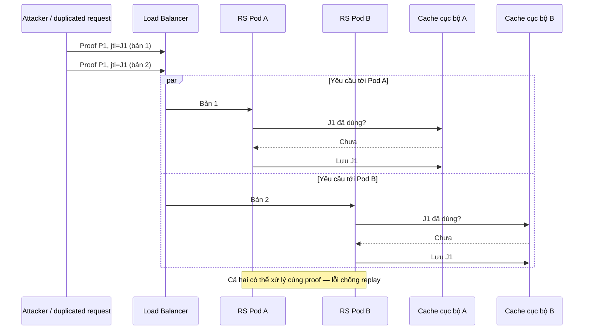
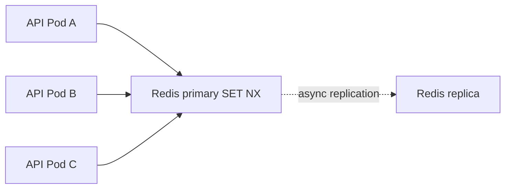
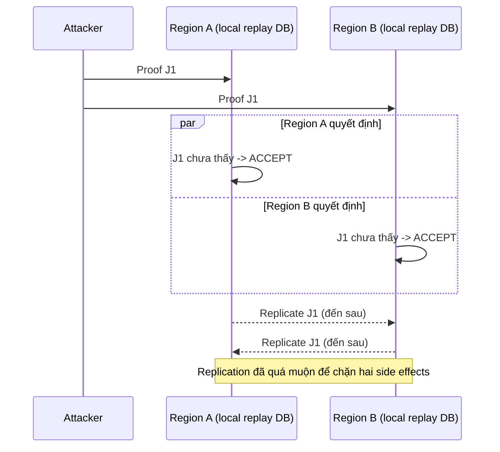
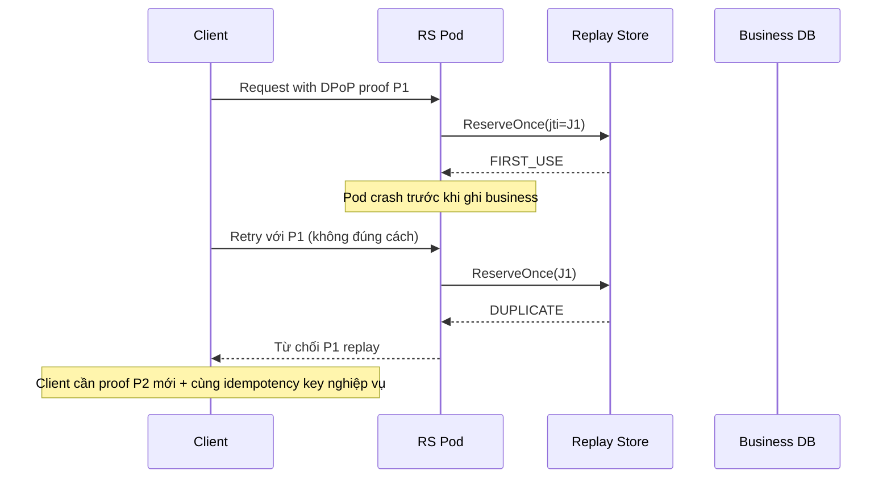
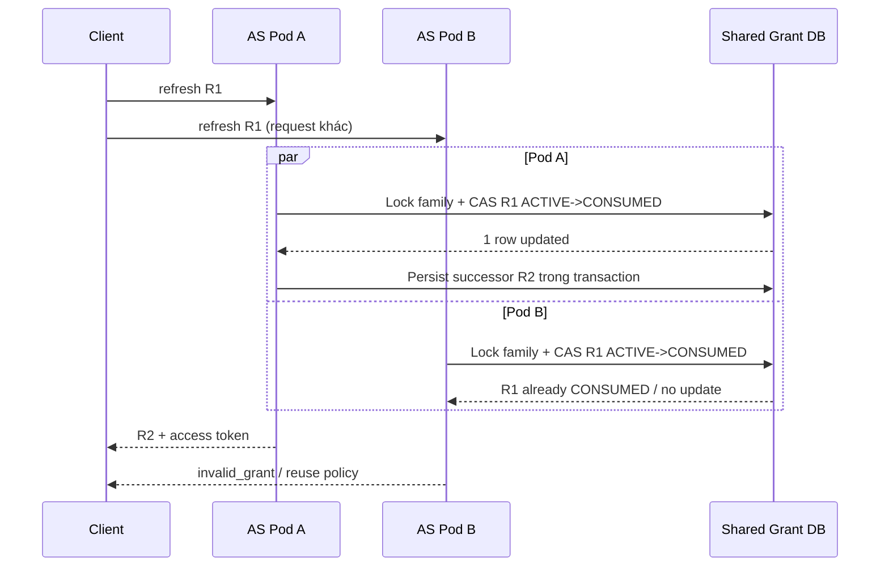
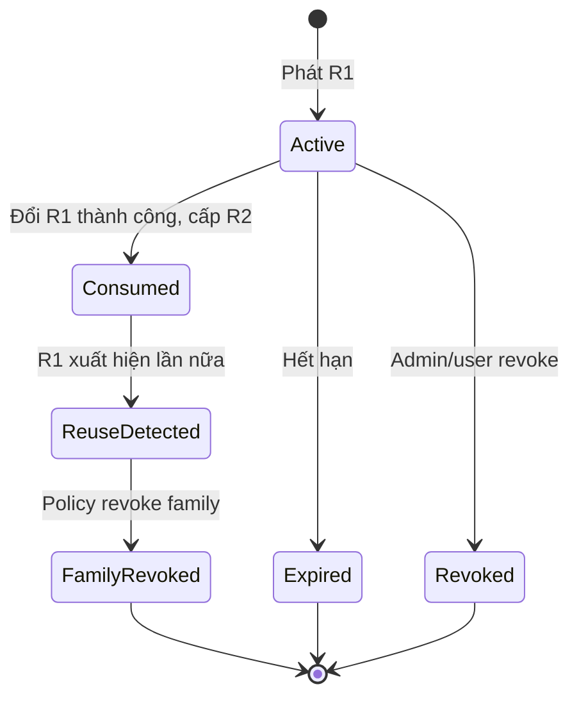
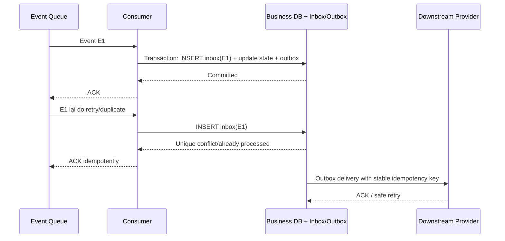

# Trade-off giữa replay protection và phân tán

Một hệ thống xác thực chạy trên một máy có thể chống phát lại (*replay*) bằng một cấu trúc dữ liệu đơn giản: khi nhận một proof có `jti=J1`, kiểm xem J1 đã được thấy chưa; nếu chưa thì đánh dấu «đã thấy», sau đó xử lý request. Nhưng khi API được mở rộng thành 30 pod ở hai vùng địa lý, hai bản sao của cùng proof có thể tới **hai máy khác nhau cùng một thời điểm**. Mỗi máy đều chưa thấy J1 trong bộ nhớ cục bộ và đều cho phép request.

Vấn đề không phải **chữ ký của token sai**. Chữ ký có thể hoàn toàn hợp lệ. Vấn đề là hệ thống cần ra một quyết định **«giá trị này đã được dùng chưa?»** theo cách đủ nhất quán giữa các máy, trong khi phải đáp ứng độ trễ, tính sẵn sàng và sự cố mạng.

**Replay protection trong hệ thống phân tán** vì thế là một bài toán thiết kế giao thức **và** điều phối trạng thái: bảo đảm tính duy nhất, cửa sổ thời gian, ràng buộc request, tính nhất quán, độ bền, khả năng chịu tải và cơ chế fail-closed. Đổi lấy khả năng chống phát lại mạnh hơn, hệ thống thường phải trả thêm **network round trip, shared storage, coordination, tài nguyên và chi phí vận hành**.

Bài thuộc chương **Replay protection** của module **SECURITY_TOKEN_SECURITY_FUNDAMENTALS**. Module này tập trung vào mô hình tin cậy và vòng đời token, phân biệt JWT/opaque token, access token/refresh token trong OAuth 2.0/OIDC; đồng thời làm rõ phát hành, xác minh claims, scope, audience, lưu trữ, thu hồi và phòng chống token bị đánh cắp hoặc phát lại.

> **Nguyên tắc điều hướng:** replay protection phải có **định nghĩa «điều gì chỉ được dùng một lần»**, **phạm vi mà điều kiện đó phải đúng** và **thời gian cần nhớ**. Nếu chưa xác định ba yếu tố này, chọn Redis, Kafka hay SQL trước chỉ tạo một kho trạng thái có vẻ an toàn mà chưa chắc chống được tấn công.

## 1. Replay là gì và tại sao «phân tán» làm nó khó hơn?

### 1.1. Replay không đồng nghĩa mọi lần dùng lại access token đều sai

Replay attack là việc bên không được phép **trình lại một credential hoặc thông điệp bảo mật đã tồn tại** để thử đạt quyền, tái diễn giao dịch hoặc vượt một quy tắc sử dụng một lần. Tuy nhiên:

- **Bearer access token** thường được client hợp pháp dùng **nhiều lần** đến khi hết hạn/revoke. Cùng token xuất hiện trong hai yêu cầu GET không tự chứng minh tấn công.
- **DPoP proof JWT** được tạo **cho từng HTTP request**; phát lại nguyên proof cùng `jti` trong cửa sổ chấp nhận là điều RS phải phát hiện và xử lý theo RFC 9449.
- **Refresh token rotation** làm token cũ bị tiêu thụ khi phát token kế nhiệm; trình lại token cũ là tín hiệu reuse cần AS xử lý.
- **Authorization code** là credential ngắn hạn chỉ được đổi token một lần.
- **One-time link/token** như reset-password phải được tiêu thụ nguyên tử.
- **Payment/command** cần idempotency riêng: client retry hợp lệ không được tạo hai giao dịch.

**Không biến JWT access token `jti` thành khóa «one-time» toàn hệ thống** nếu access token được thiết kế tái sử dụng. Quy tắc đó sẽ làm request hợp pháp thứ hai bị từ chối.

### 1.2. Khi chỉ có một instance

Một verifier có thể dùng bộ nhớ trong process:

```text
Request proof (sender K, jti J1)
       |
       v
  Local used-set
       |
       +-- absent -> insert J1 -> xử lý
       |
       +-- present -> reject replay
```

Đây chỉ là giải pháp **một process, một đời sống process**. Nếu restart hoặc load-balancer chuyển request sang node khác, trạng thái local biến mất hoặc không đồng bộ. Hơn nữa, nếu thao tác «check rồi insert» là hai bước không nguyên tử, **hai threads ngay trên cùng một node** cũng có thể cùng pass.

### 1.3. Khi có nhiều pod, nhiều vùng



Vấn đề cần giải không phải «mỗi máy có cache chưa?» mà là **liệu hai request cạnh tranh cùng định danh có thể cùng đi qua điểm quyết định trong hệ thống hay không**.

### 1.4. Hai lớp tính duy nhất

Một yêu cầu chống replay thường có **hai hoặc nhiều lớp**:

| Lớp | Đối tượng cần duy nhất | Ví dụ | Nơi thường thực thi |
| --- | --- | --- | --- |
| **Protocol proof uniqueness** | DPoP proof `jti` trong replay window | Cùng proof JWT không được xử lý hai lần | RS/AS và replay store |
| **One-time credential consumption** | Authorization code, refresh token đã rotate | Code K không cấp hai token; R1 không tạo hai successors | AS transactional state |
| **Business operation uniqueness** | Payment command theo request key/intent | Không tạo hai payment cho một ý định thanh toán | Business DB/ledger |
| **Event processing uniqueness** | Event ID hoặc command ID | Một webhook không kích hoạt hai lần side effect | Consumer inbox/dedup store |
| **Session revocation monotonicity** | Session ID sau logout | Phiên revoked không hồi sinh ở node khác | Shared session store/version |

**Chỉ có replay cache tại gateway** không tự bảo đảm business command được thực thi một lần. **Chỉ có unique constraint trong payment DB** không thay kiểm DPoP signature, nonce, audience và sender binding.

## 2. Mô hình tin cậy và các loại token liên quan

Trong OAuth 2.0/OIDC, bên cấp và bên kiểm token có các trách nhiệm khác nhau:

| Thành phần | Trách nhiệm bảo mật chính | Trạng thái chống replay có thể giữ |
| --- | --- | --- |
| **Authorization Server (AS)** | Phát token/grant, client authentication, code exchange, refresh rotation, revoke | Authorization codes đã dùng, refresh family, DPoP proof `jti` ở token endpoint |
| **OpenID Provider (OP)** | Authentication, OIDC ID token và session | Nonce/authorization transaction theo profile, logout event state |
| **OAuth client / RP / BFF** | Giữ credential, bảo vệ callback, PKCE/state/nonce, không dùng lại token cũ | Authorization transaction, refresh single-flight, login/session state |
| **Resource Server (RS)** | Verify token đúng issuer/audience/type/expiry/scope và quyền resource | DPoP `jti` replay store, revocation state/caches, business idempotency |
| **Gateway / service mesh** | TLS/mTLS termination, auth propagation qua trusted boundary | Admission/replay store nếu gateway là verifier chính thức |
| **Database/event system** | Bảo đảm atomic state change và durability | Unique IDs, transactional inbox/outbox, token family state |

### 2.1. JWT vs opaque trong bối cảnh phân tán

**JWT access token** có thể được RS kiểm signature và claims **offline**. Ưu điểm là không cần round trip hỏi AS cho mỗi request, nhưng:

- JWT **không chứa trạng thái «đã từng trình ở RS nào»** trừ khi verifier có state ngoài token.
- JWT đã phát không tự thay `exp` hoặc chuyển `active=false` khi bị revoke.
- Các RS ở nhiều vùng cần phân phối denylist/epoch hoặc làm online check nếu business đòi near-real-time revocation.

**Opaque access token** cần một nguồn tin cậy như **RFC 7662 introspection** để lấy trạng thái/metadata. Ưu điểm là AS có thể kiểm soát revoke/active state tập trung, nhưng:

- Introspection tăng network latency và dependency.
- Cache `active=true` giảm tải nhưng có cửa sổ **stale sau revocation**.
- Một opaque bearer token **vẫn có thể bị attacker dùng lại** nếu còn active và không sender-constrained.

**Thay JWT bằng opaque không tự sửa replay**; thay opaque bằng JWT cũng không tự giải quyết consistency vì token đã phát có thể trở thành state stale ở RS.

### 2.2. Scope, audience và sender binding làm giảm blast radius, không thay uniqueness

```text
JWT/opaque access token đã được xác minh
    AND issuer đúng?
    AND audience đúng RS?
    AND token type/profile đúng?
    AND exp/nbf/lifetime đúng?
    AND scope đúng operation?
    AND sender proof/cert đúng nếu token bound?
    AND subject/tenant/owner có quyền resource?
    AND proof one-time/replay window check thành công nếu cần?
    AND business operation uniqueness bảo đảm nếu có side effect?
```

**`aud` giới hạn nơi token được chấp nhận**, `scope` giới hạn kiểu quyền, `exp` giảm thời gian tấn công, còn DPoP/mTLS giảm khả năng sử dụng token chỉ bị copy dưới dạng chuỗi. Nhưng **không claim nào làm một transaction DB hay DPoP proof tự «chỉ một lần» trên nhiều pod**.

### 2.3. Tách ba «jti» khác nhau

| Định danh | Nó định danh gì? | Nên được đánh dấu one-time? |
| --- | --- | --- |
| JWT **access token** `jti` | Token đã được AS phát | **Không** nếu token được dùng nhiều request; dùng cho audit/denylist |
| **DPoP proof** `jti` | Một proof JWT theo request | **Có** trong phạm vi/cửa sổ replay của verifier |
| **Logout Token** `jti` | Một security event từ OP | Dùng **deduplication/idempotency** khi nhận lại event |

Lẫn ba thứ này là anti-pattern. Một cache `seenJti` chung cho mọi JWT có thể vừa tạo false-positive khiến access token dùng lần hai bị từ chối, vừa tạo false-negative nếu JTI trùng giữa hai không gian định danh.

## 3. Các chiều đánh đổi cần đo thay vì chỉ nói «nhanh hay an toàn»

Một cơ chế replay protection phân tán thường phải đáp ứng đồng thời những mục tiêu:

| Mục tiêu | Cần bảo đảm | Đổi lấy |
| --- | --- | --- |
| **Safety** | Không có hai request với cùng one-time proof/credential cùng được chấp thuận | Atomic coordination, consistency |
| **Availability** | Request hợp pháp vẫn được xử lý khi node/store lỗi | Redundancy, degraded-mode policy, chi phí |
| **Latency** | Kiểm replay nằm trong API deadline | Locality, caching, index và network hop |
| **Revocation freshness** | Credential revoked bị chặn trong SLA | Online check/invalidation, giảm cache TTL |
| **Scalability** | Xử lý nhiều token/proof IDs mà không hết RAM/IOPS | Sharding/partitioning, quota, TTL |
| **Correctness under retry** | Client hợp pháp retry không bị tính hai side effects | Idempotency, transaction state machine |
| **Durability** | Node restart/failover không làm quên proof còn trong window | Persistent/replicated state |
| **Privacy/operations** | Không rò token, giảm correlation và log nhạy cảm | Keyed fingerprints, retention, RBAC |

### 3.1. Safety vs availability khi mạng bị phân vùng

Giả sử hai vùng A và B mất liên lạc:

```text
Region A                        Region B
  RS-A                             RS-B
  Store-A   <--- PARTITION --->    Store-B

Cùng proof P1 tới A và B.
```

Nếu cả hai vùng **tự quyết** «chưa thấy P1» rồi cùng chấp thuận, safety bị phá. Nếu policy yêu cầu **toàn hệ thống chỉ một request được xử lý**, cần một nguồn quyết định có consistency đủ mạnh hoặc không cho vùng không có khả năng phối hợp tự chấp thuận.

Đây là một ứng dụng thực tế của đánh đổi consistency/availability **khi xảy ra network partition**:

- **Ưu tiên consistency/safety:** vùng không thể lấy quyết định atomic từ authority sẽ **từ chối hoặc trả lỗi dependency**.
- **Ưu tiên availability:** vùng có thể tạm chấp thuận từ local state nhưng **có rủi ro trùng**; không phù hợp nếu yêu cầu bảo mật là one-time nghiêm ngặt.

**Không được diễn giải CAP đơn giản thành «cứ có Redis là CP»**. Kết quả phụ thuộc topology, chế độ replication, quorum, failover, semantics lệnh và điều kiện lỗi. Một hệ thống vẫn có thể dùng cache local tăng tốc **các yêu cầu không cần bảo đảm one-time**, nhưng không được quảng cáo đó là globally replay-safe.

### 3.2. Latency vs consistency

Một kiểm tra replay bằng local memory rất nhanh nhưng không nhìn thấy state ở node khác. Một kiểm tra qua DB leader/consensus hoặc transactional unique index tốn thêm round trip/IO, đổi lại có **linearization point** mà hai yêu cầu cạnh tranh không thể cùng vượt.

### 3.3. Clock freshness vs memory

Chấp nhận proof quá cũ quá lâu làm tăng replay window; **giảm** cửa sổ chấp nhận giúp giảm dung lượng phải nhớ `jti`. Nhưng cửa sổ quá nhỏ có thể làm request hợp pháp từ thiết bị lệch đồng hồ bị từ chối. Cần hiệu chỉnh đồng hồ, đo network delay và tránh cho attacker điều khiển `iat`/`nonce` theo cách nới thời gian bất hạn.

### 3.4. Security vs user experience khi legitimate retry

Một client gửi proof P1, verifier đã reserve `jti` nhưng request trả `503` vì DB nghiệp vụ bị lỗi. Retry với **cùng P1** phải bị coi là proof replay; client nên tạo **P2 mới**. Tuy nhiên cả P1 và P2 có thể mang **cùng payment intent và idempotency key** để server không double charge.

Vì thế, một retry an toàn cần **proof mới ở tầng bảo mật** nhưng **business identity cũ ở tầng idempotency**.

## 4. Định nghĩa replay key: sai key thì shared database vẫn không an toàn

Một ví dụ key logic cho **DPoP proof**:

```text
ReplayKey = HMAC(
    replayKeySecret,
    unambiguousEncode(
        verifierTrustDomain,
        acceptedIssuerOrAuthorizationContext,
        senderJwkThumbprint,
        proofJti
    )
)
```

**Đây là model triển khai minh họa**, không phải chuỗi key có format bắt buộc của RFC 9449. Điểm quan trọng là key phải phân biệt ngữ cảnh đủ để ngăn nhầm giữa client/sender/issuer/trust domains, **đồng thời tất cả verifier nơi cùng proof có thể xuất hiện phải dùng cùng namespace để deduplicate**.

### 4.1. Chọn phạm vi dedup

Nếu cùng proof có thể tới **Pod A và Pod B** của một RS, cả hai phải dùng **cùng replay namespace và state nhất quán**. Nếu hai API resources độc lập dùng route/proof scope khác, cần đánh giá có cần replay store chung hay không, dựa trên `htu`/`htm` và API gateway verifier thực tế.

### 4.2. Đừng làm key quá rộng

```text
key = jti
```

có thể gây va chạm không cần thiết giữa issuer/sender độc lập và khiến attacker tạo false positive từ `jti` biết trước của người khác. DPoP `jti` được client tạo duy nhất theo yêu cầu protocol, nhưng **uniqueness scope cần xác định rõ**; không dùng global namespace không có policy và quota cho mọi user/tenant.

### 4.3. Đừng làm key quá hẹp

```text
key = (podId, jkt, jti)
```

khiến cùng proof tới hai pod được xem là hai key khác nhau và cùng pass. Tương tự, nếu key chứa **request ID mới do gateway cấp cho từng lần chuyển tiếp**, attacker gửi lại proof sẽ nhận một key khác và vượt dedup.

### 4.4. Bảo vệ cache key

Replay entry chỉ cần lưu keyed fingerprint, thời gian nhận và TTL. Không cần lưu raw access token, DPoP proof JWT, refresh token hoặc user PII vào key/log. Nếu dùng HMAC:

- Secret key được giữ ở nơi quản trị khóa tin cậy; rotate có kế hoạch cho cửa sổ replay.
- Dùng encoding không mơ hồ (length-prefix/canonical serialization), không nối plain strings rồi gây collision cấu trúc.
- Không đưa key/fingerprint ra public response.
- Retention và audit tuân thủ chính sách dữ liệu.

**Hash token trần không thay thế bảo vệ credential** trong mọi môi trường; với token entropy yếu hoặc log công khai, fingerprint có thể trở thành correlation oracle.

## 5. Atomicity: «check rồi ghi» phải là một quyết định duy nhất

Đây là race condition tối thiểu:

```text
Pod A                         Pod B
if (!exists(J1))              if (!exists(J1))
       TRUE                         TRUE
insert(J1)                    insert(J1)
process request               process request
```

**Hai lần đọc và ghi riêng rẽ không bảo đảm one-time**, kể cả khi tất cả pods dùng một Redis/DB chung.

### 5.1. Điểm tuyến tính hóa (*linearization point*)

Hệ thống cần một thao tác mà, đối với cùng replay key K, **chỉ một request có thể thắng**:

```text
Result = ReserveOnce(K, expiry)

FIRST_USE     -> quyền tiến sang bước xác minh/xử lý tiếp
DUPLICATE     -> từ chối proof/credential bị dùng lại
UNAVAILABLE   -> chưa xác minh uniqueness, quyết định fail-closed
```

Ví dụ primitive:

- Redis `SET key value NX PX <ttl-ms>` **trên một primary có semantics atomic**.
- SQL `INSERT` vào bảng có **UNIQUE** constraint, dựa vào kết quả transaction commit.
- Transactional conditional update `status=ACTIVE -> CONSUMED` cho authorization code/refresh token.
- Một consensus-backed KV có atomic compare-and-swap phù hợp.

**Đây là điều kiện cần nhưng chưa phải điều kiện đủ cho bảo đảm toàn hệ thống:** replication/failover có thể làm **mất một write đã ack** hoặc tạo hai authorities trong partition nếu topology/policy yếu.

### 5.2. Redis ví dụ: lệnh nguyên tử không đồng nghĩa durable multi-region

```text
SET replay:<fingerprint> 1 NX PX 90000
```

Nếu trả `OK`, key chưa tồn tại tại primary lúc lệnh chạy. Nếu trả nil, key đã tồn tại. Nếu **timeout/connection reset sau khi gửi lệnh**, client không biết lệnh đã ghi hay chưa.

Đặc biệt, một Redis primary có thể ACK write rồi crash trước khi replica nhận state. Failover lên replica thiếu key có thể khiến cùng proof được chấp nhận lần thứ hai. **Replication bất đồng bộ không tự bảo đảm at-most-once qua failover**.

Redis `WAIT` có thể tăng mức bảo đảm replicated acknowledgments nhưng **không biến mọi topology thành một transaction/consensus system tuyệt đối durable**. Muốn tuyên bố «không mất replay state sau bất kỳ failover nào», phải chọn/kiểm kiến trúc và failure model tương ứng.

### 5.3. SQL unique constraint ví dụ

```sql
CREATE TABLE proof_replay_seen (
    verifier_namespace VARCHAR(120) NOT NULL,
    proof_key_hash BYTEA NOT NULL,
    first_seen_at TIMESTAMPTZ NOT NULL,
    expires_at TIMESTAMPTZ NOT NULL,
    PRIMARY KEY (verifier_namespace, proof_key_hash)
);

-- Pseudocode PostgreSQL: một lần insert thắng.
INSERT INTO proof_replay_seen (
    verifier_namespace, proof_key_hash, first_seen_at, expires_at
) VALUES (
    :namespace, :proof_key_hash, now(), :expires_at
)
ON CONFLICT DO NOTHING;
```

Ứng dụng phải kiểm **số hàng đã insert sau commit**: 1 = first use, 0 = duplicate, SQL error/timeouts = indeterminate. Nếu key đã hết hạn nhưng row chưa cleanup, có thể từ chối proof hợp lệ mới với cùng key; do đó TTL/expiry và chiến lược cleanup cần định nghĩa rõ. Tuy nhiên với `jti` được sinh đủ entropy, trùng ngẫu nhiên hợp lệ phải cực hiếm.

**Không xử lý nghiệp vụ trước khi reservation đã commit đủ bền**; nếu transaction rollback sau side effect thì proof có thể được dùng lại.

### 5.4. Compare-and-swap cho refresh rotation

Đối với refresh token R1:

```text
status(R1): ACTIVE -> CONSUMED
```

Chỉ một transaction được chuyển `ACTIVE` sang `CONSUMED`, đồng thời sinh successor R2 theo grant/family policy. Một request khác phải thấy trạng thái **đã consumed**, không được tạo successor khác.

Ví dụ điều kiện transaction:

```sql
UPDATE refresh_token
   SET status = 'CONSUMED',
       consumed_at = now()
 WHERE token_id_hash = :token_hash
   AND status = 'ACTIVE';

-- Bắt buộc row_count == 1 trước khi phát successor,
-- cùng transaction với lưu successor/grant update.
```

Một câu lệnh UPDATE atomic trên một DB leader vẫn có thể cần **serializable/row lock/CAS** cho ràng buộc token family, grant revoke state và generation. Không tách «consume R1» khỏi «insert R2» rồi để crash tạo trạng thái không rõ.

## 6. Các kiểu thiết kế phân tán và khả năng chống replay

### 6.1. Bộ nhớ local trên từng node

```text
RS-A -> local set A
RS-B -> local set B
RS-C -> local set C
```

**Ưu điểm:** latency thấp, không thêm dependency ngoài request. **Nhược điểm:** replay qua node khác, restart quên trạng thái, autoscaling làm trạng thái phân mảnh. Sticky session có thể giảm một số tình huống request đi khác node, nhưng **không phải ranh giới bảo mật đáng tin**:

- Load balancer có thể đổi node khi scale/failover.
- Attacker có thể chủ động gửi nhiều connection/route.
- Một client đi qua gateway khác có thể rơi vào node mới.
- Nếu replay xảy ra ở cả AS và RS thì node-sticky của RS không đủ.

**Chỉ dùng local cache làm bảo đảm duy nhất nếu yêu cầu one-time thực sự được giới hạn tại một verifier cô lập và điều kiện đó được chứng minh.** Với API public multi-node, thường không thỏa.

### 6.2. Shared Redis primary



Tất cả pods dùng cùng atomic `SET NX` có thể bảo đảm **không hai request cùng được cấp FIRST_USE tại primary đang hoạt động**, với cùng key. Tuy nhiên:

1. Một sự cố primary trước replication có thể làm **mất record đã ACK**.
2. Replica failover với state thiếu có thể **mở lại replay window**.
3. Nếu timeout sau lệnh ghi, caller không biết reservation đã tồn tại; không được mặc nhiên coi mình thắng.
4. Key eviction do memory pressure có thể làm mất history trước TTL đã hứa.
5. Nếu kiến trúc multi-region dùng **hai Redis primaries độc lập** rồi async replicate, hai vùng có thể đồng thời nhận FIRST_USE.

**Kết luận:** Redis phù hợp khi failure model và cửa sổ rủi ro được chấp nhận; «SET NX» không tự là chứng minh end-to-end at-most-once qua mọi split-brain/failover.

### 6.3. SQL transactional unique index

Một relational DB có unique constraint và transaction commit bền có thể cung cấp điểm quyết định chặt hơn, nhất là khi **business side effect cũng ở cùng database/transaction**.

**Ưu điểm:** consistency rõ, hỗ trợ transaction, audit, dễ kết hợp revoke state hoặc payment uniqueness. **Nhược điểm:** thêm IO/latency, contention/index growth, cleanup và load cao nếu mọi request DPoP đều ghi row.

Nếu API có hàng nghìn requests/giây, viết mọi proof `jti` vào cùng bảng durable có thể thành điểm nghẽn. Hệ thống nên tách:

- **Short-lived proof replay store**: dung lượng lớn nhưng TTL ngắn; phương án bảo đảm phù hợp.
- **Longer-lived business idempotency/financial ledger**: độ bền và audit cao, transaction chặt, retention dài.
- **Refresh family/authorization code state**: AS-owned, transactional, semantics one-time riêng.

**Không nên chọn một kho duy nhất cho mọi trường hợp chỉ vì thống nhất công nghệ.**

### 6.4. Consensus-backed KV

Một distributed KV sử dụng quorum/consensus đúng cấu hình có thể bảo đảm compare-and-swap theo một key dù một số node hỏng. Điểm đổi lấy:

- Cross-region quorum có **latency lớn hơn** local memory.
- Khi network partition mất quorum, một số vùng **không thể ghi**, thường phải fail closed.
- Dung lượng/throughput, leader hot spots và chi phí vận hành tăng.

**Bảo đảm phụ thuộc mode thực tế** (linearizable read/write, durability, quorum configuration), không chỉ vì tên hệ thống có từ «distributed».

### 6.5. Active-active multi-region với eventual replication



**Eventual consistency phát hiện trùng sau khi đã xảy ra không đồng nghĩa ngăn replay trước khi xử lý.** Nó có thể hữu ích cho anomaly detection/compensation, nhưng không bảo đảm exactly-once authorization.

### 6.6. Home-region / owner-shard routing

Một phương án giảm cross-region coordination:

1. Tính owner shard/region từ **sender thumbprint/subject/family ID** bằng stable hash được cấu hình.
2. Mọi request cần `ReserveOnce(K)` được **route tới đúng authority** cho key K.
3. Authority áp atomic state/transaction.
4. Các API pods ở region khác hỏi authority hoặc proxy request trước khi xử lý.

Ưu điểm: **một nơi quyết định**, latency có thể tối ưu nếu client gần home region, dễ phân shard. Nhược điểm: request từ region xa phải gọi cross-region, home region outage làm phạm vi key đó mất availability, re-sharding/failover đòi **fencing/epoch** để tránh hai owners cùng chấp thuận.

**Đừng tạo hai home owners đang active khi failover chưa hoàn tất**. Một region mới chỉ nhận quyền ghi khi có leader epoch/fencing bảo đảm region cũ không còn quyền quyết định.

### 6.7. Ma trận lựa chọn kiến trúc

| Kiến trúc | Độ trễ thường thấy | Consistency trong phạm vi key | Lỗi đáng quan tâm | Phù hợp |
| --- | --- | --- | --- | --- |
| Local in-memory set | Rất thấp | Một process, nếu atomic local | Restart, cross-node replay | Dev/test hoặc trust domain thật sự một node |
| Sticky session + local set | Thấp | Không bảo đảm cross-node | Migration/failover/attacker routing | Tối ưu UX, **không làm lớp bảo vệ duy nhất** |
| Redis `SET NX` một primary | Thấp đến vừa | Atomic trên primary | Async replication mất write, eviction | API scale lớn với risk model kiểm soát |
| SQL unique index | Vừa đến cao | Chặt theo transaction/DB authority | IO hot spots, cleanup, failover DB | Authorization code, refresh, business uniqueness |
| Consensus KV/quorum | Vừa đến cao | Có thể linearizable theo config | Quorum unavailable, cross-region RTT | One-time safety nghiêm ngặt multi-node |
| Active-active eventual replication | Thấp từng vùng | Chỉ eventual | Double acceptance trong partition | Analytics/detection, không dùng làm one-time guard duy nhất |
| Owner/home shard | Tùy client region | Chặt theo authority + fencing | Owner failover/routing skew | Quy mô lớn, yêu cầu route nhất quán |

**Không có phương án «tốt nhất» độc lập workload.** Phải nêu rõ proof acceptance window, yêu cầu safety, latency SLO, khu vực triển khai và phạm vi chấp nhận downtime.

## 7. Đánh đổi TTL, clock skew, retention và dung lượng

Một proof DPoP có claim `iat`, `jti`; verifier chỉ nên chấp nhận proof theo khoảng thời gian/cửa sổ mà RFC 9449 và policy quy định. Replay store phải nhớ proof **đủ lâu để một bản sao vẫn có thể được chấp nhận về thời gian**.

### 7.1. Công thức thiết kế định tính

```text
ProofAcceptable(p, now) =
    signature and binding valid
    AND htm/htu/ath valid
    AND iat within configured acceptance window
    AND nonce accepted if required

StoreRetention(K) >= timeUntilNoVerifierCouldAcceptSameProof(K)
```

Nếu replay entry bị xóa **sớm hơn** cửa sổ accept, một attacker có thể giữ proof P1, đợi key bị evict nhưng `iat` vẫn trong khoảng hợp lệ, sau đó trình lại P1.

### 7.2. Ví dụ TTL sai

```text
DPoP accepted proof age:  120 giây (ví dụ)
Replay store TTL:          30 giây (ví dụ)

t0   P1 được chấp nhận, jti=J1 lưu đến t0+30s
t45  Key J1 đã biến mất
t45  Proof P1 vẫn đủ mới theo policy 120s
     -> P1 có thể được nhận lần thứ hai!
```

**Số liệu chỉ để minh họa.** TTL đúng phụ thuộc cách verifier giới hạn `iat` cũ/mới, đồng hồ lệch, nonce validity, policy hệ thống và việc entry TTL bắt đầu từ thời điểm nào.

### 7.3. Đồng hồ phân tán

Hai RS nodes có đồng hồ lệch:

```text
Pod A now = 12:00:00
Pod B now = 12:00:20
DPoP proof iat = 11:59:30
```

Nếu cửa sổ/clock skew mỗi node cấu hình khác, Pod A có thể nhận trong khi Pod B từ chối, hoặc ngược lại. Nghiêm trọng hơn, một node cho phép `iat` tương lai quá xa làm kéo dài quãng thời gian proof có thể được phát lại.

Biện pháp:

- Đồng bộ đồng hồ máy chủ, monitor clock drift, xác định max clock skew.
- Dùng **wall clock đáng tin** để kiểm `iat`/`exp`, tránh để user control server time.
- Dùng **monotonic time** cho đo timeout/budget trong process; không dùng nó thay Unix timestamp claim.
- Tính replay-store retention bao phủ **toàn bộ acceptance range** của các verifier có thể nhận cùng proof.
- Không cố «chữa» đồng hồ lệch bằng cách nới cửa sổ chấp nhận vô hạn.

### 7.4. Kích thước store và tốc độ

Một mô hình sizing đơn giản:

```text
EstimatedEntries ≈ AcceptedUniqueProofsPerSecond
                 × ReplayRecordRetentionSeconds

EstimatedMemory ≈ EstimatedEntries
                × (key bytes + metadata bytes + store overhead)
```

Ví dụ, mỗi proof request hợp lệ cần một entry; tăng TTL gấp đôi có xu hướng tăng số entry đang lưu nếu lưu lượng ổn định. Nhưng còn những yếu tố:

- Burst rate, retry storms và attacker flood proof với `jti` ngẫu nhiên.
- Memory overhead của Redis index/hash/bucket.
- Replication, snapshots và failover recovery.
- Lock contention/DB indexes/cleanup overhead.
- Số tenant, issuer và resource domains.

Đây là **ước lượng để capacity plan**, không thay load test thực tế. Nhiều hệ thống cần quota theo sender/client/issuer và rate-limit **trước** các thao tác replay-store tốn kém khi có thể.

### 7.5. Eviction không được phá bảo đảm an toàn một cách im lặng

Nếu memory cache bắt đầu LRU evict key `jti` **trước TTL**, verifier có thể quên proof vẫn còn trong replay window. Nếu yêu cầu security nghiêm ngặt:

- Có budget capacity và alert sớm.
- Dùng no-eviction/deny-on-capacity policy cho replay keys quan trọng hoặc một storage khác có bảo đảm phù hợp.
- Khi store đầy, **fail closed/degrade có chủ đích**, không âm thầm cho request qua.
- Kiểm retention thực tế dưới tải, không chỉ giá trị TTL cấu hình.

### 7.6. Có nên dùng Bloom filter/Cuckoo filter?

Các cấu trúc dữ liệu xác suất có thể giảm memory/cost, nhưng semantics:

- **False positive** có thể làm proof mới bị coi là đã dùng, từ chối request hợp pháp.
- Tùy cấu trúc/cách triển khai, khả năng xóa, TTL và consistency phân tán khác nhau.
- Nếu chỉ dùng filter để trả «not seen» thì cần chứng minh **không false negative** trong failure model đã chọn; filter bị mất state hoặc shard sai vẫn có thể tạo false negative thực tế.

Một cách dùng an toàn là **filter như tầng tối ưu**: có thể loại nhanh các trường hợp chắc chắn chưa thấy theo model, còn trường hợp «có thể đã thấy» hỏi authoritative store; hoặc filter được dùng theo chính sách đã chấp nhận false positive rõ ràng. **Không cho một filter local thay thế atomic global uniqueness chỉ vì tiết kiệm RAM**.

## 8. Network partitions, crash, retry và trạng thái «không biết đã ghi hay chưa»

### 8.1. Ba kết quả của `ReserveOnce`

```text
FIRST_USE:
    store xác nhận reservation duy nhất đã commit đủ theo policy

DUPLICATE:
    store xác nhận key này đã được reserve/consumed

UNKNOWN:
    timeout, connection reset, leader changed,
    failover đang diễn ra hoặc write result mơ hồ
```

**UNKNOWN không phải FIRST_USE**. Một request có thể đã ghi replay key rồi mất response. Nếu retry lệnh tại cùng authoritative store và thấy DUPLICATE, server không được kết luận chắc «chính request này từng thắng, cho phép business» nếu thiếu một **idempotency/operation identity được ràng buộc và kiểm trạng thái giao dịch**.

### 8.2. Crash sau reservation nhưng trước business action



Đây là trade-off an toàn:

- **Reserve trước business:** không dùng proof cũ hai lần, nhưng request đầu có thể thất bại và client phải tạo proof mới.
- **Business trước reserve:** có nguy cơ thực hiện action rồi crash trước ghi replay, cho phép phát lại gây side effect thứ hai.

Vì vậy, **không xóa replay reservation chỉ vì HTTP handler trả 500**. Cần retry contract và idempotency ở business layer.

### 8.3. Exactly-once không chỉ có một ý nghĩa

Nên phân biệt:

1. **At-most-one proof acceptance:** một DPoP proof `jti` chỉ được chấp thuận một lần trong replay domain.
2. **At-most-one token issuance:** một authorization code/refresh rotation chỉ phát successor hợp lệ theo state machine.
3. **Exactly-once business effect:** một payment/command không tạo side effect trùng.

Một distributed queue thường giao event **at least once**, còn DB unique constraint/inbox/outbox cho phép consumer xử lý **idempotently**. Không cam kết «exactly-once end to end» chỉ vì Kafka hoặc queue có tùy chọn transaction — external HTTP calls, payment providers, email sending và DB khác vẫn có failure boundary riêng.

### 8.4. Fencing và stale leader

Khi owner shard thay đổi, hai nodes có thể cùng tin mình là leader nếu thiếu fencing. Dùng **monotonic leader epoch/fencing token** được kiểm tại authoritative state/side-effect sink:

```text
Leader A epoch=41
Failover -> Leader B epoch=42

A cố ghi với epoch=41
Authoritative store từ chối stale epoch
B được phép ghi với epoch=42
```

**Chỉ chạy leader election không đủ** nếu leader cũ vẫn có thể thực hiện side effects sau khi bị mất lease. Business DB/sink cần có cách kiểm fencing khi yêu cầu consistency nghiêm ngặt.

### 8.5. Multi-region availability phải được tuyên bố theo failure model

Một thiết kế có thể đảm bảo at-most-once khi một pod chết nhưng **không** khi cả region mất mạng; hoặc bảo đảm khi một vùng lỗi nhưng không khi hai vùng cùng partition/leader split. Hãy ghi rõ trong ADR:

- Failures được giả định (process crash, network partition, AZ loss, region isolation).
- Consistency được bảo đảm ở key/domain nào.
- Recovery time và data-loss bounds sau failover.
- Loại endpoint **không được chấp nhận** khi không có authoritative replay decision.

Không quảng cáo «anti-replay distributed 100%» khi mới kiểm thử happy path.

## 9. DPoP trong hệ thống RS phân tán: chữ ký tốt vẫn cần anti-replay state

**DPoP (RFC 9449)** là cơ chế sender-constrained access token dựa trên proof JWT, thường dùng ở AS token endpoint và RS. Client giữ private key, ký proof mới theo HTTP request. Token chứa hoặc gắn với confirmation/thumbprint của public key đó, ví dụ `cnf.jkt`.

### 9.1. HTTP request minh họa

```http
POST /payments HTTP/1.1
Host: api.example.test
Authorization: DPoP <dpop-bound-access-token>
DPoP: <signed-dpop-proof>
Idempotency-Key: order-42-pay-once
Content-Type: application/json

{"orderId":"order-42","amount":250000,"currency":"VND"}
```

Đây là cấu trúc minh họa. Access token, proof, idempotency key là **ba giá trị với vai trò khác nhau**. Không gửi raw token vào URL/log hoặc dùng business idempotency key làm `jti` proof.

Một DPoP proof payload có thể chứa:

```json
{
  "jti": "proof-5d83f98e",
  "htm": "POST",
  "htu": "https://api.example.test/payments",
  "iat": 1893456000,
  "ath": "<base64url-sha256-access-token>",
  "nonce": "<server-nonce-if-requested>"
}
```

Đây không phải token thật được ký. Khi request mang access token đến RS, phải kiểm `ath` đúng SHA-256 token theo RFC 9449. `htu` so HTTP URI target theo quy tắc DPoP, **không tự ràng buộc request body hay query**; thanh toán phải có transaction-level checks riêng.

### 9.2. Những kiểm tra không thể bỏ

| Kiểm tra | Mục tiêu |
| --- | --- |
| JOSE `typ=dpop+jwt`, thuật toán bất đối xứng được phép và chữ ký proof | Chỉ chấp nhận proof hợp lệ đúng loại |
| Public JWK và access token confirmation `cnf.jkt` | Không chấp nhận key do attacker tự tạo cho token bị đánh cắp |
| `htm` và `htu` | Proof thuộc đúng method/URI đích |
| `iat` và nonce nếu được yêu cầu | Giới hạn thời gian/pre-computation, chống proof cũ |
| `ath` tại RS | Proof gắn đúng access token đang trình |
| `jti` uniqueness tại verifier | Phát hiện nguyên proof bị phát lại |
| Access token `iss`, `aud`, `typ`/profile, `exp`, `scope` | Token đúng issuer/RS/lifetime/quyền |
| Owner/tenant/object policy | Người có token/proof vẫn phải có quyền tài nguyên |

Đối với token opaque, RS có thể lấy confirmation metadata qua introspection đáng tin. DPoP proof **không thay** kiểm token active theo policy, audience/scope hoặc revocation state.

### 9.3. DPoP nonce: giảm thời gian proof có giá trị, không tự biến nó thành one-time

Server có thể yêu cầu DPoP nonce để client không tạo trước hàng loạt proof có `iat` tùy ý. Tuy nhiên:

- Nonce còn sống có thể được nhiều proof dùng trong thời gian cho phép nếu server thiết kế như vậy.
- Nếu server không kiểm `jti`, **cùng proof vẫn có thể bị gửi lại** khi nonce còn hợp lệ.
- Nếu nonce được thiết kế **single-use**, việc tiêu thụ nonce cần **atomic shared state** giống vấn đề replay key.
- Nonce tự khai từ client không phải sự chứng thực của server.

**Nonce hay timestamp chỉ giới hạn cửa sổ tấn công; tính duy nhất trong cửa sổ vẫn cần cơ chế phù hợp với RFC/profile.**

### 9.4. URI qua reverse proxy phải đáng tin

```text
Public request:
    https://api.example.test/payments

Backend request:
    http://payments-pod:8080/payments
```

Verifier cần biết **URI bên ngoài thực mà client ký**, không xây `htu` từ `X-Forwarded-Host` do Internet caller có thể giả. Gateway phải xóa/ghi đè forwarded headers không được tin, truyền context đáng tin xuống RS. Nếu RS kiểm ở gateway và backend chỉ dùng verified principal, cần thiết kế đường truy cập nội bộ không cho attacker bypass gateway hoặc giả headers.

### 9.5. mTLS-bound token giải bài toán khác

Với **RFC 8705**, AS có thể cấp access token bound với TLS client certificate, ví dụ `cnf.x5t#S256`. RS hoặc gateway đã tin xác minh certificate thực trong mTLS handshake và so token binding.

**Ưu điểm:** bản sao token đơn thuần thường không đủ để trình lại nếu attacker không có private key của certificate. **Nhược điểm:** bảo vệ token *string theft* chứ **không cấm client hợp pháp gửi cùng transaction hai lần**; nếu certificate key cũng bị chiếm thì attacker vẫn có thể tạo requests.

DPoP `jti` giúp chống replay **cùng proof**; mTLS chứng minh sở hữu certificate tại connection. Cả hai vẫn cần authorization và business idempotency.

## 10. Java pseudocode: verifier RS phân tán, không fail-open

Các API bên dưới là **pseudocode mô tả trách nhiệm**, không phải Spring Security classes có sẵn. Production cần thư viện OAuth/JOSE/DPoP đã kiểm thử, HTTP request normalization chính xác, trusted issuer/JWKS metadata và xử lý exceptions theo framework.

### 10.1. Kết quả replay store phải là ba trạng thái

```java
enum ReservationOutcome {
    FIRST_USE,
    DUPLICATE,
    UNAVAILABLE
}

interface DistributedReplayStore {
    ReservationOutcome reserveOnce(
        ReplayNamespace namespace,
        KeyedFingerprint key,
        Instant notBeforeSafeToDelete,
        Deadline deadline
    );
}
```

Không có giá trị `ALLOW_BY_DEFAULT`. `UNAVAILABLE` nghĩa là **chưa có kết luận đủ tin về one-time**, không phải `FIRST_USE`.

### 10.2. Bộ kiểm tra DPoP theo request

```java
VerifiedPrincipal verifyDpopApiRequest(
    HttpRequest request,
    TrustedRouteContext trustedContext,
    Deadline deadline
) {
    // Trusted context do router/issuer registration quyết định.
    String rawAccessToken =
        request.requireAuthorizationScheme("DPoP");

    // JWT: verify signature/issuer/audience/typ/exp/claims.
    // Opaque: introspection active + metadata đủ cho RS policy.
    VerifiedAccessToken token = accessTokenVerifier.verify(
        rawAccessToken,
        trustedContext.expectedIssuer(),
        trustedContext.requiredAudience()
    );
    token.requireDpopBound();

    String rawProof = request.requireSingleHeader("DPoP");
    SignedJwt proof = strictJose.parseSignedJwt(rawProof);
    dpopProfile.requireAllowedTypeAndAlgorithm(proof.header());

    PublicJwk publicKey = dpopProfile.requirePublicJwk(
        proof.header()
    );
    signatureVerifier.requireValid(proof, publicKey);

    String proofJkt = jwkThumbprint.sha256Base64Url(publicKey);
    crypto.requireConstantTimeEqual(
        proofJkt, token.confirmationJwkThumbprint()
    );

    DpopClaims c = dpopClaims.parseStrictly(proof.claims());
    dpopClaims.requireMethod(c, request.method());
    dpopClaims.requireUri(
        c, trustedContext.externallyVisibleTargetWithoutQueryAndFragment()
    );
    dpopClaims.requireProofIssuedAtWithinPolicy(
        c, clock.instant(), trustedContext.acceptanceWindow()
    );
    dpopClaims.requireServerNonceIfConfigured(
        c, trustedContext.noncePolicy()
    );
    dpopClaims.requireAccessTokenHash(
        c, crypto.sha256Base64UrlAscii(rawAccessToken)
    );

    KeyedFingerprint replayKey = replayKeyService.fingerprint(
        trustedContext.replayNamespace(),
        trustedContext.expectedIssuer(),
        proofJkt,
        c.jti()
    );

    // Lệnh reserve phải atomic ở authoritative store.
    ReservationOutcome outcome = replayStore.reserveOnce(
        trustedContext.replayNamespace(),
        replayKey,
        replayWindow.retentionDeadline(c, trustedContext),
        deadline
    );

    switch (outcome) {
        case FIRST_USE:
            break;
        case DUPLICATE:
            throw invalidDpopProof("proof_replay_detected");
        case UNAVAILABLE:
            throw dependencyUnavailable("replay_state_unavailable");
    }

    // Việc proof là first-use không thay các kiểm tra quyền.
    tokenPolicy.requireScope(token, request.requiredScope());
    senderPolicy.requireTokenActiveAccordingToPolicy(token);
    return VerifiedPrincipal.from(token);
}
```

**Quan trọng:**

1. `replayWindow.retentionDeadline` phải bao trùm **toàn bộ khoảng proof có thể được verifier chấp nhận**, kể cả clock tolerance; không nhận TTL tùy ý từ client.
2. Replay store có thể **đã ghi key nhưng trả timeout**. Server không suy đó là FIRST_USE; trả UNAVAILABLE/fail closed.
3. Một proof đã reserve có thể bị từ chối ở bước scope/authorization sau; **không gỡ reservation** để tái dùng proof.
4. Có thể tối ưu thứ tự để kiểm scope/token trước khi reserve, miễn không thực hiện side effect và vẫn bảo đảm mỗi proof được consumed theo policy.
5. Tránh chấp nhận attacker-supplied `jku`/`x5u`/issuer URL để tải key hoặc introspection vào host tùy ý.
6. **Không log** raw access token, DPoP proof, public JWK fingerprint dưới dạng public tracking ID nếu không có privacy policy.

### 10.3. Backend nghiệp vụ vẫn cần idempotency

```java
PaymentResult createPayment(
    VerifiedPrincipal principal,
    PaymentCommand command,
    String idempotencyKey
) {
    resourcePolicy.requireUserCanPay(
        principal.subject(), principal.tenant(), command.orderId()
    );

    // Business dedup key không phải DPoP proof jti.
    PaymentKey key = PaymentKey.of(
        principal.subject(),
        principal.tenant(),
        "create-payment",
        idempotencyKey
    );

    return paymentTx.executeIdempotently(
        key,
        fingerprintCanonicalPayload(command),
        () -> paymentLedger.createExactlyOnceWithinItsTransaction(command)
    );
}
```

Nếu payment provider bên ngoài chỉ cung cấp at-least-once HTTP API, **business `exactly once` phải được diễn giải theo idempotency keys/transaction state của cả hệ thống**, không tự tin chỉ vì local ledger có unique constraint.

### 10.4. Giao diện fail closed và response API

Khi replay store unavailable, trả lỗi dependency phù hợp, ví dụ `503 Service Unavailable`, **không thực thi business effect**. Khi proof thực sự trùng, từ chối theo DPoP/Bearer error semantics của endpoint. **Không trả toàn bộ `jti`, key hoặc trạng thái nội bộ** cho caller, để tránh rò correlation.

```http
HTTP/1.1 503 Service Unavailable
Content-Type: application/problem+json
Cache-Control: no-store
Retry-After: 2

{
  "type": "https://api.example.test/problems/authorization-dependency",
  "title": "Security verification temporarily unavailable",
  "status": 503
}
```

`Retry-After: 2` là ví dụ, không phải giá trị chuẩn. Client cần retry **với proof mới**, **giữ business idempotency key cũ**, và backoff/cap attempts.

## 11. Refresh token rotation trên nhiều AS pods

**Refresh token rotation** là bài toán trạng thái bền hơn DPoP replay window. AS phát `R2` khi tiêu thụ `R1`; nếu `R1` được trình lại, AS phát hiện reuse và có thể revoke toàn bộ token family theo policy.

### 11.1. Không để mỗi AS instance giữ token family riêng



Nếu A và B dùng hai grant DB eventual-consistency độc lập, cả hai có thể phát successors. **Một AS cluster phải có authority đủ nhất quán cho một token family**, hoặc không xử lý refresh khi mất authority.

### 11.2. State machine



**Không có cách từ một request reuse duy nhất biết chắc requester nào là attacker.** Trình lại R1 có thể do attacker, do client retry sau timeout hoặc hai workers cùng refresh sai concurrency. Phản ứng của AS cần theo security policy; không vì UX mà cho R1 tiếp tục được dùng vô hạn.

### 11.3. Java pseudocode: transaction và quyết định reuse

```java
RefreshOutcome refreshWithRotation(
    String rawRefreshToken,
    AuthenticatedClient client,
    SenderProof optionalSenderProof
) {
    String tokenHash = secureTokenLookup.hash(rawRefreshToken);

    RefreshDecision decision = db.serializableTransaction(() -> {
        RefreshTokenRow current =
            refreshTokens.findForUpdate(tokenHash).orElse(null);
        if (current == null) return RefreshDecision.invalid();

        RefreshFamily family =
            refreshFamilies.findForUpdate(current.familyId());

        clientBinding.requireMatchingClient(client, current, family);
        senderBinding.requireProofIfConfigured(
            optionalSenderProof, current, family
        );
        grantPolicy.requireNotRevokedAndNotExpired(family);

        if (current.status() == CONSUMED) {
            family.markCompromisedAndRevokeAccordingToPolicy();
            auditOutbox.appendReuseEvent(family.id(), current.tokenId());
            // Return a decision instead of throwing in the transaction;
            // keep security state updates committed before invalid_grant.
            return RefreshDecision.reuseDetected();
        }
        if (current.status() != ACTIVE) {
            return RefreshDecision.invalid();
        }

        current.markConsumed();
        RefreshValue r2 = secureTokens.randomRefreshToken();
        refreshTokens.insertSuccessor(
            family.id(), current.generation() + 1,
            secureTokenLookup.hash(r2)
        );
        AccessTokenValue access =
            accessTokenIssuer.issueWithinGrant(family, client);
        return RefreshDecision.issued(access, r2);
    });

    if (!decision.issued()) throw invalidGrant();
    return decision.tokenResponse();
}
```

Đây là **pseudocode**, không thể copy trực tiếp để tự triển khai OAuth AS an toàn. Hệ thống thật cần:

- Client authentication cho confidential client; public client ID không phải secret.
- Binding sender/client/grant/subject và quyền scope; không mở scope khi refresh.
- Absolute/idle expiry, revocation, reuse detection, token family lineage.
- Token hash/HMAC lookup và encryption/storage không lộ refresh token.
- Tất cả updates cần commit đúng; không **throw exception khiến transaction rollback cả state revoke**.
- Token response và transaction durability phải có failure semantics rõ; không hứa exactly-once delivery cho HTTP response.
- Nếu refresh token family vừa bị revoke ở transaction khác, transaction phát R2 không được dùng snapshot stale để hồi sinh grant.

### 11.4. Trade-off của client single-flight và AS strict rotation

Với một BFF nhiều pod, **client cũng phải serialize refresh** cho một token family:

```text
RP Pod A sees access token expiring -> refresh R1
RP Pod B sees access token expiring -> refresh R1
```

Nếu AS thực thi strict one-time, một request sẽ thất bại/reuse. **Giải pháp tốt nhất** là single-flight refresh trên shared session state, lock/lease đủ an toàn và **CAS trước khi lưu token kế nhiệm**. Không «chữa» bằng cách mở rộng cửa sổ reuse vô hạn tại AS.

Nếu AS cấp grace/idempotent retry theo provider-specific policy, client có thể dùng theo contract; đó không phải bảo đảm mặc định của RFC 6749/9700.

### 11.5. Logout và refresh race

```text
t0  Refresh R1 bắt đầu
t1  User logout -> session/grant revoked
t2  Response R2 về BFF
```

BFF phải đối chiếu session version/epoch **sau khi nhận response, trước khi lưu R2**; AS phải kiểm grant state ngay tại issuance. Không cho một refresh response đến muộn tạo lại session đã logout hoặc resurrect refresh family.

## 12. Authorization code, OIDC nonce và one-time callback khi client chạy nhiều pod

### 12.1. Authorization code do AS tiêu thụ

Code K của Authorization Code Flow phải:

- Có TTL ngắn, dùng một lần.
- Gắn `client_id`, `redirect_uri` và PKCE `code_challenge`.
- Được token endpoint đổi bằng `code_verifier` đúng, cùng client authentication khi cần.
- Có state một lần dùng để không cấp hai token thành công từ cùng K.

Trong AS cluster, consumed status của K cần được **chia sẻ và atomic**. Nếu chỉ Pod A biết K đã dùng thì attacker có thể thử K ở Pod B. Một DB transactional/conditional consume trên K phù hợp hơn local cache.

### 12.2. OIDC `state` và `nonce` là correlation khác nhau

`state` ràng buộc authorization response với browser/RP transaction, chống login CSRF và mix-up. `nonce` ràng buộc ID token với Authentication Request nếu được gửi; RP cần so `nonce` trong ID token đã xác minh với transaction.

Trong RP nhiều pod:

- Transaction store phải được chia sẻ hoặc có cơ chế state độc lập đủ an toàn.
- `state`/`nonce`/PKCE verifier phải có TTL, one-time consumption và session binding.
- Callback đến Pod B dù request bắt đầu ở Pod A vẫn phải được xác minh đúng.
- Không đọc ID token cũ từ browser rồi «nhận lại» chỉ vì signature valid.
- Không nhầm `nonce` OIDC với DPoP nonce; chúng là các giao thức, vai trò và trust boundaries khác nhau.

### 12.3. Callback timeout sau consume

Nếu RP consume `state`/authorization transaction rồi gọi AS token endpoint và gặp timeout, retry callback nguyên xi có thể bị từ chối bởi chính RP (state đã dùng), đồng thời code K có thể đã consumed tại AS. Đây là hành vi **ưu tiên chống replay**, không phải bằng chứng client implementation sai. Cần flow khởi tạo authorization mới hoặc recovery contract cụ thể, tránh tự phục hồi callback cũ như active.

### 12.4. Device Authorization Grant không phải token one-time ở mọi bước

Trong **RFC 8628**, client **được poll bằng `device_code` nhiều lần khi authorization vẫn pending**, tuân `interval` và `slow_down`. Nếu đánh dấu device code consumed ở poll đầu, hệ thống phá flow. Nhưng **sau khi token đã được cấp thành công**, cùng device code không được mint thêm token trái policy.

**Mỗi credential có state machine riêng**. Không lấy rule «DPoP proof `jti` one-time» áp thẳng cho device_code pending, bearer access token hay session cookie.

## 13. Sự khác nhau giữa replay protection, token revocation và business idempotency

Ba yêu cầu này thường xuất hiện trong cùng một API nhưng giải quyết các câu hỏi khác nhau:

| Lớp | Câu hỏi | Trạng thái/thao tác | Rủi ro khi nhầm |
| --- | --- | --- | --- |
| **Replay protection** | Proof/code/token one-time này đã dùng chưa? | Atomic `ReserveOnce`/consume | Hai yêu cầu cùng được coi first-use |
| **Token validation/revocation** | Credential hiện còn active, đúng RS/issuer/scope không? | JWT verify/introspection/denylist/grant state | Nhận token đã revoke hoặc sai audience |
| **Business idempotency** | Ý định thanh toán/lệnh nghiệp vụ này đã được commit chưa? | Unique idempotency key + transaction ledger | Double-charge/double-order |

Một access token còn active **không chứng minh DPoP proof chưa bị dùng**. Một proof DPoP mới **không chứng minh payment chưa được tạo**. Một idempotency key đúng **không xác thực caller**.

### 13.1. Lớp business cần unique key riêng

```http
POST /payments HTTP/1.1
Host: api.example.test
Authorization: DPoP <bound-access-token>
DPoP: <new-dpop-proof-P2>
Idempotency-Key: pay-order-42-attempt-1
Content-Type: application/json

{"orderId":"order-42","amount":250000,"currency":"VND"}
```

Client retry hợp lệ sau HTTP timeout:

```text
Access token T:      vẫn có thể dùng
DPoP proof:          phải tạo P3 mới, jti mới
Payment intent/key:  giữ nguyên "pay-order-42-attempt-1"
Business payload:    giữ nguyên về ngữ nghĩa
```

RS vẫn kiểm token/proof/owner/tenant/amount mỗi request. Business service dùng một key kiểu:

```text
BusinessKey = (
    authenticatedSubjectOrServicePrincipal,
    tenantId,
    operationType,
    idempotencyKey
)
```

và lưu **payload fingerprint** để phát hiện cùng key nhưng body/số tiền/người nhận khác. Một key do client tự đặt nhưng không ràng buộc subject/tenant có thể gây collision/IDOR hoặc làm user A đọc response của user B.

### 13.2. Transaction atomic với ledger

```sql
CREATE TABLE payment_intent (
    payment_id UUID PRIMARY KEY,
    tenant_id TEXT NOT NULL,
    actor_id TEXT NOT NULL,
    idempotency_key TEXT NOT NULL,
    payload_digest BYTEA NOT NULL,
    status TEXT NOT NULL,
    created_at TIMESTAMPTZ NOT NULL,
    UNIQUE (tenant_id, actor_id, idempotency_key)
);
```

**Cần xác minh quyền trước khi để user đọc response của một idempotency key đã tồn tại.** Dựa trên unique constraint cùng transaction, hệ thống có thể chỉ tạo một payment intent cho key, nhưng một payment provider bên ngoài vẫn cần **provider idempotency token hoặc outbox/reconciliation**.

### 13.3. Mô hình inbox/outbox cho sự kiện phát lại

Một event consumer có thể nhận cùng `event_id` nhiều lần từ queue. Để tránh xử lý trùng:

1. Transaction đọc/insert `event_id` vào durable inbox theo unique key.
2. Áp dụng business state change trong cùng transaction nếu có thể.
3. Ghi outbox event/side-effect intent cùng transaction.
4. Worker gửi tới downstream với idempotency key ổn định; nhận ACK và đánh dấu delivered.
5. Retry là bình thường; consumer downstream cũng cần dedup nếu delivery at least once.



**Không gọi việc queue chỉ giao ít nhất một lần là «exactly-once processing» nếu downstream side effect có thể được thực thi hai lần.** Exactly-once business outcome phải được thiết kế và kiểm thử trên toàn bộ các ranh giới cần thiết.

## 14. Chọn policy fail-closed, degraded mode và độ sẵn sàng

### 14.1. Mặc định: fail closed tại điểm quyết định bảo mật

Đối với một API yêu cầu DPoP proof uniqueness, khi authoritative replay store không sẵn sàng thì verifier **không thể xác nhận proof này là lần đầu**. Quy tắc an toàn:

```text
ReplayStoreOutcome = UNAVAILABLE
    -> Không thực thi endpoint protected
    -> Trả dependency error/503 theo API contract
    -> Alert, throttle/backoff, không cập nhật "seen" giả
```

**Đừng bắt exception rồi return `true`.** Fail-open khiến outage của replay store trở thành thời điểm attacker có thể gửi lại proof.

### 14.2. Có phải mọi request đều phải ngừng?

**Không.** Phân loại workload:

| Loại tác vụ | Replay guarantee cần thiết | Hành vi khi không có store/quorum |
| --- | --- | --- |
| Public status/documentation không cần token | Không áp token proof | Tiếp tục phục vụ phần public độc lập |
| Đọc dữ liệu công khai | Không cần private authorization | Có thể tiếp tục không dùng protected session |
| Đọc hồ sơ cá nhân | Cần token/sender validation và policy freshness | Mặc định fail closed; cache có proof đủ tin theo thiết kế |
| Chỉnh sửa hồ sơ | Phải bảo vệ resource và chống duplicate nguy hiểm | Fail closed hoặc queue lệnh chưa commit theo contract |
| Thanh toán/hoàn tiền | One-time/transaction authorization và idempotency | Fail closed; không tạo side effect |
| Cấp quyền/admin/rotate key | Safety ưu tiên | Fail closed, cần authoritative authorization |
| Event analytics không có side effect tài chính | Dedup có thể eventual nếu business chấp nhận | Có thể quarantine/reconcile, không gọi là strict anti-replay |

**Không dùng HTTP method làm thước đo duy nhất.** Một `GET` tải dữ liệu y tế/tài chính nhạy cảm có thể nguy hiểm hơn một `POST` thay tùy chọn giao diện.

### 14.3. Degraded mode nên **giảm chức năng**, không «bỏ xác thực»

Ví dụ một dashboard có phần public và private:

- Khi replay verifier/AS unreachable, server có thể trả phần **public** không liên quan token.
- Không được trả dữ liệu private từ cache của user khác hoặc cho qua bearer không verify.
- Các thao tác thay đổi business state phải bị khóa/queue theo contract.
- Trạng thái dịch vụ phải được báo rõ là **authorization dependency degraded**, không giả `invalid_token`.

### 14.4. Ngoại lệ «availability-first» cần công bố rủi ro

Một sản phẩm có thể chấp nhận xử lý event analytics ít nhạy cảm theo **eventual deduplication** trong lúc partition, rồi chạy reconciliation để bỏ duplicates. Đó là **quyết định nghiệp vụ** chấp nhận duplicates, không phải bằng chứng hệ thống chống replay hoàn chỉnh.

Nếu exception cho một đường API private có yêu cầu replay protection, cần security risk owner phê duyệt rõ:

- Loại request nào được nhận trong degraded mode và những quyền nào bị cắt bỏ?
- Bằng chứng bảo mật nào vẫn phải kiểm đầy đủ?
- Tối đa bao lâu, bao nhiêu request, mức tổn thất chấp nhận?
- Cơ chế phát hiện/rollback/compensation sau sự cố?
- Chuyển về fail-closed khi vượt giới hạn?

**Không dùng «rủi ro thấp» làm lý do mặc định accept token chưa được xác minh**. Giảm bảo đảm one-time chỉ có thể chấp nhận khi policy riêng thực sự cho phép và không mâu thuẫn giao thức/đòi hỏi bảo mật của endpoint.

### 14.5. Bảng quyết định khi có sự cố

| Trạng thái | Từ store/AS biết gì? | Có thể xử lý protected action? |
| --- | --- | --- |
| `FIRST_USE` sau commit đủ tin | Proof mới theo replay policy | Chỉ sau khi đủ token/sender/authorization/business checks |
| `DUPLICATE` đã xác minh | Proof/one-time token đã dùng | Không xử lý lần nữa |
| `UNAVAILABLE` | Không rõ key đã ghi hay chưa | **Không** đối với strict one-time API |
| `ACTIVE` từ token introspection | Token còn active theo AS/metadata | Chưa đủ: DPoP proof và resource auth riêng |
| `INACTIVE` | AS xác nhận token không active | Từ chối |
| `JWT local valid` | Signature/claims đúng, revocation state chưa chắc | Chỉ theo policy offline chấp nhận; không tự chứng minh proof one-time |

## 15. Latency budget, circuit breaker và bảo vệ replay store khỏi DoS

### 15.1. Latency budget minh họa

Một API có deadline 500 ms có thể cần chia budget:

```text
API overall request deadline:          500 ms
JWT/DPoP signature+claims validation:  15 ms  (ví dụ)
Replay store reservation budget:       80 ms  (ví dụ)
Business DB/transaction budget:       300 ms  (ví dụ)
Serialization/transport reserve:      105 ms  (ví dụ)
```

**Các con số chỉ minh họa**, không phải giá trị RFC hoặc SLO đề xuất cho mọi hệ thống. Cần đo histogram p50/p95/p99, latency cross-region, retry costs và clock skew.

**Overall deadline luôn thắng retry**. Nếu replay store timeout sau 70 ms, không được tự chạy ba retry mỗi lần 80 ms rồi để API vượt 500 ms. Timeout cần bao phủ connection pool, DNS/connect/TLS/read và toàn bộ operation.

### 15.2. Không retry mù quáng một atomic reservation mơ hồ

Nếu `ReserveOnce(J1)` timeout, lần đầu có thể đã ghi. Retry có thể trả DUPLICATE; đừng diễn giải DUPLICATE là «chắc lần trước chính mình đã thắng, nên tiếp tục» khi request có thể đã bị attacker hoặc worker khác gửi.

Để phục hồi đúng, cần một **durable operation identity/transaction state** khác đủ tin và xác minh được binding; trong nhiều trường hợp đơn giản, RS trả UNAVAILABLE và client gửi **proof mới với business idempotency key cũ**.

### 15.3. Circuit breaker với security dependency

Khi replay store hoặc introspection endpoint outage:

- Circuit breaker OPEN giúp tránh flood/queue vô hạn.
- Response nhanh hơn nhưng phải **fail closed** cho protected action.
- Half-open probes có giới hạn và jitter, không tạo thundering herd khi phục hồi.
- **Không** coi `DUPLICATE` hoặc `active=false` là lỗi hạ tầng làm mở circuit: attacker có thể gửi nhiều token/proofs rác để gây denial-of-service.

### 15.4. Bulkhead và quota

Giới hạn:

- In-flight replay-store calls.
- Connection-pool acquisition timeout.
- Queue length và pending futures.
- Proof parser/body size, JOSE header size, allowed algorithms.
- Rate per client/sender/tenant và untrusted source phù hợp policy.
- Số replay entries được giữ theo time window.

Không cho attacker tạo hàng triệu proof với `jti` ngẫu nhiên chỉ để làm đầy Redis và kích hoạt eviction của keys hợp lệ. Ở gateway, một số cheap checks (token format, content length, rate limits) nên chạy trước expensive crypto/store lookup, **nhưng** đừng đánh đồng early reject với đủ chứng cứ cho accept.

### 15.5. Auth dependency không nên là single point of failure không kiểm soát

Một store có leader primary vẫn có thể thiết kế HA, replicated durability và backup, nhưng **failover policy quan trọng hơn số replica**:

1. Khi primary chết, replay state đã ACK có được recover không?
2. Replica vừa được promote có nguy cơ stale không?
3. Có hai leaders nhận writes trong network split không?
4. Có thể cô lập một vùng/endpoint để giữ safety không?
5. Các pods có nhận config/leader epoch mới một cách đủ nhất quán không?

**HA đúng** là duy trì đúng security semantics trong các lỗi được giả định, không chỉ giữ TCP port luôn mở.

## 16. Ba case study về đánh đổi trong hệ thống thật

### 16.1. Case A: DPoP ở hai vùng active-active

Kiến trúc:

```text
Client:         finance-web
AS:             https://login.example.test
RS:             payments-api
Regions:        asia-east, eu-west
Access token:   DPoP-bound, audience payments-api
Replay key:     (issuer, jkt, proof jti) trong RS verifier domain
```

**Thiết kế ban đầu:** mỗi vùng có Redis local, async replicate mỗi vài giây. Client hợp lệ gửi proof P1 đến châu Á; attacker có bản sao P1 gửi cùng lúc đến châu Âu. Cả hai vùng đọc cache local «chưa có J1», cùng cho phép request.

**Sai lầm:** cho rằng «active-active + Redis replication = globally one-time». Sự đồng bộ đến **sau** quyết định không thể ngăn hai hành động đã xảy ra.

**Thiết kế sửa:** chọn authoritative replay decision theo sender shard hoặc một quorum/consensus store có semantics phù hợp; vùng không tới được authority **không xử lý protected POST**. Đồng thời, payment ledger có unique idempotency key/transaction intent như lớp thứ hai.

**Đánh đổi:** một số request cross-region tăng latency; khi authority unavailable, availability của protected payments giảm. Đổi lại một proof P1 không được chấp nhận ở cả hai vùng trong failure model đã cam kết.

### 16.2. Case B: refresh token family trong AS cluster

```text
AS Pod A và B cùng phục vụ /token
Client BFF có refresh R1
Request R1 #1 và #2 cùng đến vì hai workers tự refresh
```

Nếu mỗi AS pod đọc trạng thái R1 từ một replica lag:

```text
A sees R1=ACTIVE -> issues R2
B sees R1=ACTIVE -> issues R3
```

Hai successors cùng tồn tại là lỗi atomicity nghiêm trọng. **Sửa:** route family tới authority nhất quán, lock/CAS/transaction consume + issue, client single-flight refresh. Khi AS thấy R1 consumed rồi lại xuất hiện, xử lý reuse/rủi ro theo policy.

**Đánh đổi:** DB lock/contention và false-positive reuse khi client retry sau mất response; phải có retry guidance, session recovery và monitoring. **Không nên bỏ rotation để tránh làm user đăng nhập lại** nếu rủi ro bị đánh cắp refresh token đáng kể.

### 16.3. Case C: payment retry sau DPoP `jti` đã tiêu thụ

```text
t0 Client gửi P1, jti=J1, payment key=K1
t1 RS reserve J1 -> FIRST_USE
t2 Business DB xử lý xong nhưng response mạng bị mất
t3 Client không biết payment đã tạo chưa
```

**Client retry đúng:** tạo proof P2 (`jti=J2`), giữ business key K1 và cùng payload/identity. RS verify token/proof P2, hỏi business idempotency ledger: K1 đã có result, trả result cũ hoặc trạng thái đang xử lý theo contract.

**Client retry sai:** gửi lại P1 vì «nội dung HTTP giống nhau»; RS phải coi đây là proof replay và từ chối. **Server retry sai:** xóa J1 khỏi replay store khi HTTP 500, làm attacker có thể dùng bản sao P1 trong replay window.

**Đánh đổi:** client phải hiểu hai identity domains (proof vs business operation). Sự phức tạp này là chi phí để vừa chống replay proof vừa hỗ trợ retry nghiệp vụ an toàn.

## 17. Kiểm thử fault injection: phải tấn công đúng failure model

Một test đơn giản `reserveOnce(J1)` lần đầu trả true, lần hai false **không chứng minh hệ thống chống replay trong môi trường phân tán**. Phải kiểm cạnh tranh, crash, network partition, eviction, clock drift và business retry.

### 17.1. Ma trận kiểm thử giao thức và token

| Ca kiểm thử | Tình huống | Kết quả mong đợi |
| --- | --- | --- |
| Access token dùng nhiều GET | Client hợp lệ dùng cùng bearer T hai lần | Cả hai có thể được phép; không one-time hóa `jti` của access token |
| JWT signature sai | Payload bị sửa | RS từ chối |
| JWT issuer sai | Token AS-B gửi tới RS trust AS-A | RS từ chối |
| JWT audience sai | Token `orders-api` tới `payments-api` | RS từ chối |
| JWT hết `exp` | Clock sau expiry | RS từ chối, dù replay cache còn key |
| JWT đúng nhưng thiếu scope | `payments:read` gọi `payments:create` | RS từ chối |
| JWT đúng scope nhưng sai tenant | Token user A gọi object tenant B | Business authorization từ chối |
| Opaque token inactive | AS `active=false` | RS từ chối |
| Opaque introspection timeout | AS không phản hồi | Fail closed hoặc policy evidence fresh, không accept-all |
| ID token làm API access token | `aud=client_id` đem tới RS | Token type/audience validation từ chối |
| DPoP proof hợp lệ | Signature/binding/method/URI/hash/iat/jti đúng | FIRST_USE, rồi kiểm business auth |
| DPoP proof chữ ký sai | JWT bị thay bytes | Từ chối |
| DPoP sender key sai | Token `cnf.jkt=K1`, proof key K2 | Từ chối dù K2 ký hợp lệ |
| DPoP `htm` sai | Proof GET gửi POST | Từ chối |
| DPoP `htu` sai | Proof endpoint khác | Từ chối |
| DPoP `ath` sai | Proof của token T1 kèm T2 | Từ chối |
| DPoP `iat` quá cũ | Ngoài acceptance window | Từ chối |
| DPoP nonce thiếu | Server yêu cầu nonce | Challenge/từ chối theo profile |
| DPoP nonce sai | Proof dùng nonce không được chấp nhận | Từ chối |
| DPoP `jti` trùng | Cùng proof P1 gửi lần hai | Chỉ lần first-use có thể đi tiếp |
| DPoP access token `jti` giống qua requests | Token T hợp lệ kèm P1/P2 riêng | Không coi access token T là one-time |
| DPoP trusted external URI | Gateway TLS termination | Verifier dùng trusted public URI, không nhận forged headers |
| mTLS token cert mismatch | Chỉ đánh cắp token, không có private key cert | RS từ chối |
| Gateway cert header giả | Client tự gửi `X-Client-Cert` | Backend không coi là mTLS proof |
| Refresh R1 lần đầu | R1 ACTIVE, client/binding đúng | Consume R1, phát R2 một lần |
| Refresh R1 dùng lại | R1 CONSUMED | Reuse policy, không phát successor mới |
| Refresh R1 sai client | Credential thuộc client A, caller B | AS từ chối |
| Refresh scope escalation | R1 chỉ grant read, xin write | Không mở rộng grant |
| Authorization code K dùng lần hai | Code đã consumed | Token endpoint từ chối `invalid_grant` |
| Authorization code PKCE sai | Verifier không match challenge | AS từ chối |
| OIDC callback `state` sai | Flow bắt đầu session khác | RP từ chối |
| OIDC ID token `nonce` sai | ID token cũ đưa vào flow mới | RP từ chối khi nonce được yêu cầu |
| Device code đang pending | Poll hợp lệ theo RFC 8628 | Cho tiếp tục polling, không consume quá sớm |
| Device code sau success | Poll lại sau khi phát token | Không phát thêm token trái policy |

### 17.2. Ma trận kiểm thử consistency và race

| Ca | Tình huống | Kết quả mong đợi |
| --- | --- | --- |
| Hai threads trên một pod | Cùng `jti=J1` đồng thời | Chỉ một `FIRST_USE`, atomic |
| Hai pods cùng Redis primary | Cùng J1 | Chỉ một `SET NX` thành công |
| `contains` rồi `put` | Inject scheduling giữa hai bước | Test phát hiện race, không dùng implementation này |
| Hai regions eventual replication | Cùng J1 gửi đồng thời | Phải chứng minh hiện trạng có thể double-accept; không khai «globally protected» |
| Network partition mất quorum | RS không reserve được | `UNAVAILABLE`/fail closed cho strict protected API |
| Redis primary crash sau ACK | Replica chưa có J1 | Fault test phát hiện khả năng replay sau failover |
| Redis timeout sau write | Client không nhận ACK | Không coi timeout là first-use |
| Leader failover hai owners | Region cũ và mới cùng active | Fencing/epoch chặn stale owner |
| Node restart | Replay key vẫn còn trong window | Durable/shared store không quên |
| Pod autoscale | Proof replay tới pod mới | Key namespace không phụ thuộc pod ID |
| Store bị eviction sớm | J1 bị xóa trước cửa sổ `iat` hết | Test phát hiện replay bug; fail closed trên overload |
| Replay key TTL quá ngắn | J1 hết record nhưng proof còn valid | Không nhận lại P1 |
| Clock drift giữa pods | Một pod lệch 20 giây | Acceptance window và TTL consistent theo policy |
| `jti` collision khác sender | Cùng text JTI, JWK khác | Key scope đúng, không sai false-positive |
| Key kèm request ID | Cùng proof trên hai requests khác ID | Test bắt false-negative trong dedup |
| Replay store connection pool đầy | Nhiều requests đồng thời | Bounded wait/unavailable, không bypass |
| Circuit breaker OPEN | Store outage | Protected request fail closed nhanh |
| Circuit do duplicate flood | Attacker gửi P1 lặp nhiều lần | Không coi duplicate như dependency error |
| Quota theo sender/tenant | Nhiều `jti` ngẫu nhiên | Không làm cạn shared store |
| Encryption/HMAC key rotation | Store còn replay keys chưa hết TTL | Không làm quên keys trước hết replay window |
| Namespace config thay giữa pods | Pod A/B dùng version khác | Test phát hiện cross-version duplicate acceptance |
| Shared replay store dùng sai tenant | Cross-tenant request | Không reuse/chiếm key sai trust domain |

### 17.3. Ma trận kiểm thử business and recovery

| Ca | Tình huống | Kết quả mong đợi |
| --- | --- | --- |
| Proof P1 reserve xong, handler crash | J1 đã recorded | Retry nguyên P1 bị từ chối; client dùng proof mới |
| Proof P1 reserve rồi DB rollback | Không có payment mới | Không gỡ J1 để cho P1 replay |
| Payment retry với proof mới P2 | Giữ idempotency K1 | Trả kết quả K1, không double-charge |
| Payment key cũ nhưng payload khác | Same K1, amount thay | Conflict/từ chối, không dùng response người khác |
| Payment key same nhưng tenant khác | K1 trùng ở tenant khác | Khóa namespace, authorization đúng |
| Payment provider timeout sau nhận request | Unknown business result | Reconciliation/provider idempotency, không tạo blindly |
| Queue giao E1 hai lần | At-least-once delivery | Inbox/outbox idempotent |
| Crash sau business commit trước ACK queue | E1 được gửi lại | Không lặp side effect |
| Hai AS pods refresh R1 | Hai refresh requests đồng thời | Chỉ một successor hợp lệ |
| AS revoke family do reuse nhưng transaction rollback | Throw exception sớm | Test phát hiện bug; commit revoke/outbox trước error |
| Client refresh response đến sau logout | Session version đã revoke | Không lưu R2 vào session active |
| Redis/DNS/TLS outage | Authentication dependency unavailable | Không tự đổi sang HTTP/host khác hoặc accept-all |
| Health probe khi AS outage | RS vẫn phục vụ public route | Không tự restart toàn cluster do lỗi phụ thuộc |
| Metrics privacy | Bật debug/traces | Không log access/refresh token, private key/proof raw |

### 17.4. Cách chạy kiểm thử có ý nghĩa

**Unit tests** nên dùng fake clock, deterministic concurrency scheduler, fake store có atomic semantics và fault injection ở mức từng bước. **Integration tests** cần:

- Nhiều pod thực sự chạy song song, không chỉ gọi hai lần tuần tự.
- AS test signer/JOSE verifier thực; JWT key/algorithm/token type được kiểm.
- Redis primary/replica failover hoặc SQL leader failover theo topology sản xuất.
- Các network faults: packet delay/loss, TCP reset sau write, DNS/TLS timeout, partition liên vùng.
- Kill process tại **điểm sau reservation, trước business commit**, và sau commit trước HTTP response.
- Đo **zero double-accept** trong phạm vi bảo đảm đã cam kết, không chỉ tỉ lệ lỗi trung bình.
- Đo **false-positive** từ drift/eviction/collision và tác động tới user hợp pháp.

Không cần có tất cả các bài kiểm thử trong mỗi unit test; nhưng trước khi tuyên bố strict replay protection ở production, cần chứng minh hệ thống chịu được các failure modes đã nêu trong threat model.

## 18. Observability, alerting và chi phí vận hành

### 18.1. Những metric cần có

| Metric | Ý nghĩa | Cảnh báo |
| --- | --- | --- |
| `proof_replay_reserve_total{result}` | FIRST_USE/DUPLICATE/UNAVAILABLE | Duplicate spike, unavailable > SLO |
| `proof_replay_store_latency_seconds` | p50/p95/p99 reservation | Store bị chậm, cross-region path |
| `proof_replay_store_pool_wait_seconds` | Chờ connection slot | Saturation/bulkhead |
| `proof_replay_cache_entry_count` | Số keys theo shard/namespace | Dung lượng tăng bất thường |
| `proof_replay_evicted_before_expiry_total` | Keys bị eviction sớm | **Security incident** nếu strict window |
| `proof_replay_clock_skew_rejection_total` | Proof từ chối vì `iat`/nonce | Device/network drift hoặc abuse |
| `proof_replay_failover_recovery_lag_seconds` | State recovery sau failover | Rủi ro mất replay history |
| `proof_replay_partition_unavailable_total` | Request bị từ chối khi thiếu quorum | Availability vs safety impact |
| `refresh_token_reuse_detected_total` | Token đã consumed xuất hiện lại | Compromise hoặc client race |
| `authorization_code_reuse_total` | Code dùng lại | Code theft, duplicate callback, network ambiguity |
| `idempotency_conflict_total` | Cùng key nhưng payload khác | Logic/abuse |
| `business_duplicate_side_effect_total` | Giao dịch ngoài dự kiến | Ưu tiên điều tra cao |
| `token_revoke_propagation_lag_seconds` | Từ revoke đến RS từ chối | Freshness SLA không đạt |

**Không log** raw bearer token, refresh token, DPoP proof/private key, client secret hoặc full authorization headers. Nếu cần tương quan, dùng request trace ID và keyed fingerprints trong log được phân quyền, có retention.

### 18.2. Alert theo security semantics, không chỉ HTTP uptime

Một Redis cluster có uptime 99,99% vẫn có thể **mất replay entries sau failover**. Do đó cần kiểm:

- Sau promotion, recovery marker/epoch và state continuity có đáng tin không?
- Có proof nào được chấp nhận hai lần trong fault injection không?
- Có outage khiến endpoint fail-open không?
- Có key nào bị evict trước replay acceptance window hết không?
- Có refresh family nào phát hai successors dưới concurrent requests không?

**«Service healthy» không chứng minh «anti-replay invariant được giữ».**

### 18.3. Runbook khi replay store lỗi

1. Chuyển protected endpoints sang **fail closed/degraded-public** theo policy đã chốt; không tự tắt replay check.
2. Xác định lỗi thuộc DNS/network, primary failover, thiếu quorum, capacity, eviction hay clock drift.
3. Ngăn retry storm bằng circuit breaker, rate limiting, backoff và bulkhead.
4. Kiểm state continuity sau failover, leader epoch và khả năng lost acknowledgments.
5. Nếu không chứng minh được historical replay state, cân nhắc **tạm ngừng** các endpoint yêu cầu strict one-time cho tới khi proof window cũ hết hoặc có cơ chế authoritative recovery.
6. Đo business impact và potential duplicate acceptance trong khoảng outage; dùng transaction/audit để điều tra.
7. Chỉ bật lại protected traffic khi replay invariant/failure mode đã được khôi phục, có approval và ghi biên bản.

### 18.4. Runbook khi phát hiện refresh-token reuse

1. Kiểm current family state, không công bố raw token.
2. Revoke token family/grant theo policy và tránh transaction rollback.
3. Kiểm access tokens đã phát và revocation freshness tại RS; denylist/online check nếu cần.
4. Phân biệt client concurrency bug với token theft bằng audit/client telemetry, nhưng **đừng tự cho token cũ tiếp tục dùng**.
5. Buộc reauthentication/key rotation nếu compromise được xác nhận hoặc policy quy định.
6. Sửa đường lộ token (logs, XSS, storage, malware) và client single-flight refresh.

## 19. Anti-pattern trong thiết kế replay protection phân tán

| Anti-pattern | Vì sao nguy hiểm? | Thiết kế phù hợp |
| --- | --- | --- |
| Cache `seenJti` trong từng pod | Replay qua pod khác | Shared authoritative state theo verifier domain |
| Sticky sessions làm lớp bảo vệ duy nhất | Failover/route thay đổi | Atomic decision không phụ thuộc LB affinity |
| `contains` rồi `put` | TOCTOU race ngay cả trong một pod | Atomic reserve/conditional insert |
| Redis `SET NX` = strict durable mọi failover | Async replication có thể mất ACKed write | Kiểm failure model, durability/quorum |
| Hai Redis primaries async replicate | Có thể double-accept trong partition | Một authority/key, fencing hoặc strict quorum |
| Timeout store -> accept proof | Fail-open trong outage | UNAVAILABLE, fail closed |
| Timeout store -> mark duplicate chắc chắn | Suy trạng thái chưa biết | Phân biệt unknown và duplicate |
| Retry `ReserveOnce` rồi coi duplicate là own success | Có thể do request khác đã thắng | Business operation identity/flow recovery đúng |
| Redis eviction sớm vẫn accept | Quên proof còn valid | Capacity/TTL/no-eviction policy |
| TTL nhỏ hơn `iat` acceptance window | Replay sau entry expiry | Retention bao phủ mọi verifier |
| Nới clock skew vô hạn | Proof cũ còn valid lâu | Sync clock và acceptance window hữu hạn |
| Key theo pod ID | Mỗi node xem là proof mới | Shared verifier namespace |
| Key theo request ID mới | Replay cùng proof có key khác | Key từ proof/sender/trust domain ổn định |
| Key chỉ global `jti` không phân context | False-positive/correlation | Namespace đúng issuer/sender/resource context |
| Dùng access token `jti` như proof one-time | Chặn API request hợp lệ thứ hai | Phân biệt JWT access `jti` và DPoP proof `jti` |
| DPoP chữ ký đúng là đủ | Attacker có thể ký bằng key tự tạo | So `cnf.jkt` và token/`ath` |
| Bỏ `htm`/`htu`/`ath` | Proof bị dùng sai method/target/token | Full DPoP validation |
| Tin `X-Forwarded-Host` từ Internet | URI spoofing | Trusted proxy normalization |
| Tin `X-Client-Cert` caller tự khai | mTLS spoofing | Verified TLS peer/trusted propagation |
| Đổi JWT thành opaque là xong replay | Opaque bearer vẫn bị copy | Sender constraint/revoke/storage |
| JWT offline nên revoke tức thì | Token cũ còn `exp` | Denylist/online check/TTL theo SLA |
| Refresh family state per AS pod | Hai successors được phát | Transactional consume/issue trên authority |
| Reuse detect rồi throw rollback DB revoke | Family vẫn active | Commit security state/outbox trước lỗi |
| BFF nhiều pod cùng refresh R1 | Reuse giả/rotation race | Shared single-flight, CAS session generation |
| Authorization code chỉ lưu local | Code dùng lại qua AS node khác | Atomic one-time consume |
| One-time rule áp cho device_code pending | Phá polling RFC 8628 | State machine theo flow |
| DPoP `jti` = payment idempotency | Một proof/retry thay đổi semantics | Proof mới, business key cố định |
| Side effect trước replay reservation | Crash tạo double effect | Security admission trước business |
| Xóa replay key khi handler 500 | Proof cũ có thể replay | Giữ key, retry với proof mới |
| Queue «exactly once» thay DB uniqueness | External side effects vẫn có thể lặp | Transactional inbox/outbox/idempotency |
| Multi-region eventual dedup = prevention | Chỉ phát hiện sau accept | Strict authority hoặc chấp nhận rủi ro rõ |
| Chạy circuit theo duplicate count | Attacker gây outage bằng replay spam | Circuit theo dependency failure thực |
| Log raw token/proof để debug | Rò credential/PII | Redaction, keyed fingerprint có kiểm soát |

## 20. Checklist quyết định kiến trúc và production

1. **Semantics:** đã xác định token/proof/command nào được dùng nhiều lần, cái nào one-time, ai tiêu thụ và khi nào?
2. **Domain:** replay key có đúng issuer/RS/sender/`jti` namespace, không kèm pod ID/request ID ngẫu nhiên?
3. **Atomicity:** mọi lần cạnh tranh cùng key có một linearization point/unique reservation đủ tin?
4. **Durability:** đã kiểm failover/replication có thể mất ACKed write không, và điều đó tác động tới replay invariant thế nào?
5. **Network partition:** vùng không có quorum/authority có fail closed cho protected operations không?
6. **Ownership/fencing:** nếu có home shard, có cách chặn stale leader sau failover?
7. **TTL:** replay record tồn tại lâu hơn **toàn bộ thời gian proof có thể được chấp nhận**, kể cả clock skew?
8. **Capacity:** rate/burst/quota và eviction không làm key bị xóa sớm?
9. **Timeouts:** reserve có overall deadline, phân biệt FIRST_USE/DUPLICATE/UNAVAILABLE, không retry storm?
10. **Client retry:** proof mới cho request mới, business idempotency key giữ nguyên khi cùng intent?
11. **DPoP:** proof `typ`/signature/JWK/`jkt`/`htm`/`htu`/`iat`/`ath`/nonce/`jti` được kiểm đúng RFC 9449?
12. **mTLS:** token `cnf` so với certificate đã xác minh, không tin client-supplied cert header?
13. **Access token:** JWT/opaque `iss`/`aud`/`exp`/`scope`/type được kiểm; không biến access token `jti` thành one-time?
14. **Revocation:** JWT offline và opaque introspection caches có revoke freshness SLA, không tự hứa revoked ngay?
15. **Refresh token:** AS có rotation/sender constraint, family state, atomic consume, reuse detection và không hồi sinh grant qua race?
16. **Authorization code/OIDC:** one-time code, PKCE/client binding, `state`/`nonce`/issuer transaction correlation qua các pod?
17. **Business:** unique idempotency key theo subject/tenant/action, payload binding, transactional ledger/inbox/outbox?
18. **Degraded mode:** service public có thể hoạt động riêng; private/payment/admin fail closed khi thiếu security evidence?
19. **Observability:** duplicate/unavailable, p99 reserve, eviction, clock skew, failover loss và business duplicates được đo?
20. **Privacy:** raw tokens/refresh secrets/JWK private keys không đi vào cache key/log/traces/event payload?
21. **Fault testing:** đã ép hai pods/regions, partition, primary crash sau ACK, clock drift, store full, DB rollback và lost response?
22. **SLO/ADR:** đã ghi rõ ranh giới safety, latency, availability, RTO/RPO, revoke lag và người chấp nhận ngoại lệ chưa?

## 21. Mẫu Architecture Decision Record (ADR) cho replay protection

Một ADR ngắn gọn nên trả lời đúng các câu hỏi sau, thay vì chỉ ghi «Dùng Redis chống replay»:

```yaml
decision: "DPoP proof replay protection for payments-api"
credential_semantics: "DPoP proof is one-use; access token is reusable"
verifier_domain: "all payments-api instances in both regions"
replay_identity: "trusted issuer + sender jkt + proof jti"
acceptance_window: "bounded by DPoP policy and measured clock skew"
authoritative_store: "single-owner/quorum-backed atomic reservation"
failure_policy:
  duplicate: "reject proof"
  unavailable: "fail closed; no payment side effect"
  stale_or_evicted_state: "do not silently accept; investigate/recover"
retry_contract: "new DPoP proof, same business idempotency key"
revocation_dependency: "access-token validation separately enforced"
observability:
  - "duplicate and unavailable counters"
  - "p99 reserve latency"
  - "eviction and failover state continuity alerts"
tests:
  - "same proof concurrent across two regions"
  - "leader failover after write acknowledgement"
  - "timeout after reservation but before business commit"
```

Đây là **YAML ví dụ cho bài học**, không phải cấu hình có sẵn của một thư viện/framework. Giá trị `authoritative_store` và bảo đảm thật phải được kiểm bằng kiến trúc hiện hữu; không thể tự thiết lập «quorum-backed» chỉ bằng một string.

## Tổng kết

**Trade-off giữa replay protection và phân tán** xuất hiện khi bảo đảm «một proof/code/refresh generation chỉ được chấp nhận đúng phạm vi» phải đúng trên **nhiều node, nhiều vùng, qua crash, retry và network partition**. Chữ ký JWT, DPoP sender binding, TLS, `exp`/`aud`/`scope` đều quan trọng nhưng không tự tạo ra **atomic shared knowledge** rằng một one-time credential đã được sử dụng.

Ba lựa chọn luôn phải được đặt cạnh nhau:

1. **Safety/consistency:** một authority, atomic reservation, fencing, durability và fail closed khi không xác định được tính duy nhất.
2. **Availability/latency:** shared coordination và replication có chi phí; active-active eventual state có thể cho cả hai vùng chấp thuận cùng proof trong partition.
3. **User/business correctness:** proof đã dùng không được gửi lại, nhưng một business intent có thể retry an toàn với **proof mới và idempotency key cũ**.

**Đừng đồng nhất các lớp:** DPoP proof `jti` có replay state; access token `jti` của bearer token thường không one-time; refresh token rotation cần consume/family state tại AS; authorization code cần atomic exchange; business payment cần transactional idempotency. Phân biệt rõ semantics, ranh giới tin cậy và failure model là cách thiết kế hệ thống vừa chống replay đúng nghĩa, vừa có mức sẵn sàng và độ trễ được kiểm soát.

**Tài liệu tham khảo:** RFC 9449 (OAuth 2.0 Demonstrating Proof of Possession — DPoP); RFC 8705 (OAuth 2.0 Mutual-TLS Client Authentication and Certificate-Bound Access Tokens); RFC 9700 (Best Current Practice for OAuth 2.0 Security); RFC 6749 (OAuth 2.0 Authorization Framework); RFC 7636 (PKCE); RFC 6750 (Bearer Token Usage); RFC 7662 (Token Introspection); RFC 7009 (Token Revocation); RFC 7519 (JWT); RFC 8725 (JWT Best Current Practices); RFC 9068 (JWT Profile for OAuth 2.0 Access Tokens); RFC 8628 (Device Authorization Grant); RFC 8693 (Token Exchange); OpenID Connect Core 1.0 (Authentication Request, state và nonce).


