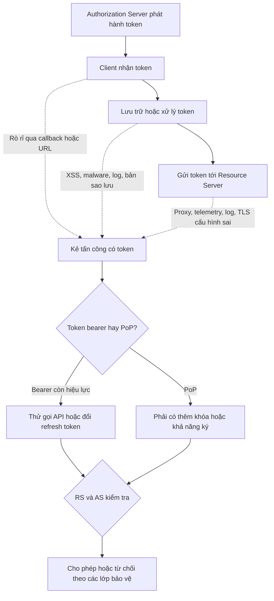
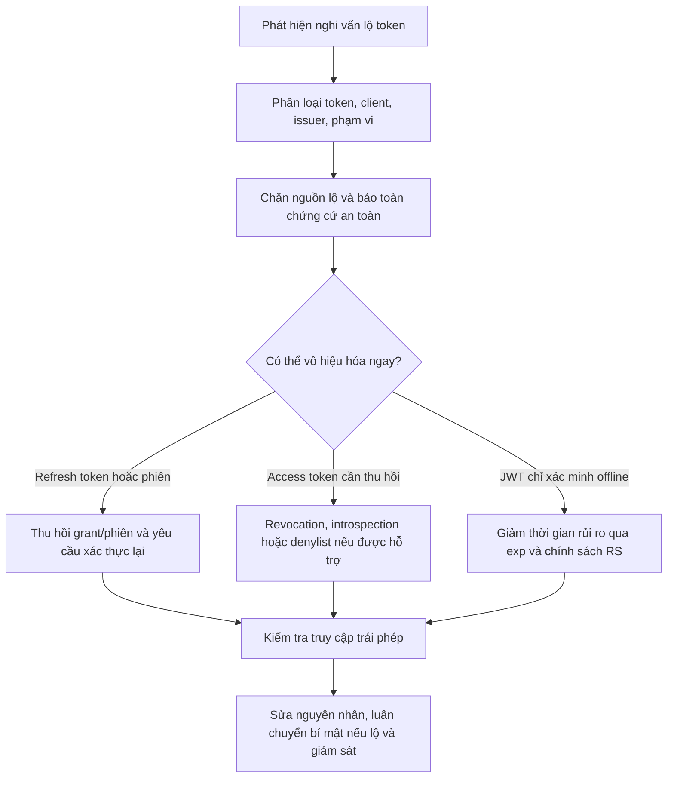

# Token theft: đánh cắp token và cách giới hạn hậu quả

## 1. Bối cảnh và mục tiêu bảo vệ

Trong mô hình **token security** của OAuth 2.0/OpenID Connect (OIDC), Authorization Server (AS) phát hành token, client giữ hoặc chuyển tiếp token, còn Resource Server (RS) kiểm tra token trước khi cho truy cập tài nguyên. Việc token được phát hành hợp lệ **không có nghĩa token luôn nằm trong tay đúng chủ thể**. Nếu kẻ tấn công lấy được một token có thể sử dụng, họ có thể mạo danh quyền hạn đã được cấp trong thời gian token còn hiệu lực.

**Token theft** là việc một bên không được phép chiếm đoạt giá trị token hoặc dữ liệu đủ để sử dụng token. **Token replay** là việc sử dụng lại token/bằng chứng ở một yêu cầu khác; đánh cắp token là một con đường dẫn đến replay, nhưng không phải mọi replay đều bắt nguồn từ việc đánh cắp.

Ví dụ: ứng dụng quản trị cấp access token mang scope `orders:read`. Do cấu hình ghi log sai, header `Authorization` bị đưa vào hệ thống log tập trung. Một người có quyền đọc log nhưng không được quyền xem đơn hàng lấy chuỗi token rồi gọi API trước khi token hết hạn. Chữ ký JWT vẫn hợp lệ; vấn đề nằm ở **quyền kiểm soát bí mật đã bị mất**.

Mục tiêu của bài:

- Nhận diện tài sản cần bảo vệ: access token, refresh token, ID Token, authorization code, session cookie và khóa ràng buộc token.
- Hiểu đường rò rỉ trong browser, ứng dụng mobile, backend, hạ tầng và OAuth/OIDC.
- Phân biệt bảo vệ bí mật token với kiểm tra `iss`, `aud`, `exp`, `scope` và quyền ứng dụng.
- Thiết kế kiểm soát nhiều lớp nhằm **giảm khả năng đánh cắp**, **giảm khả năng sử dụng lại** và **giảm thiệt hại sau sự cố**.
- Biết cách phát hiện, thu hồi và xử lý token bị lộ mà không làm rò rỉ thêm dữ liệu qua hệ thống giám sát.

## 2. Token nào bị đánh cắp thì điều gì xảy ra?

| Tài sản | Vai trò | Hệ quả nếu lộ | Lưu ý |
| --- | --- | --- | --- |
| **Access token bearer** (JWT hoặc opaque) | Gọi API theo audience và quyền được cấp | Kẻ có token có thể trình token tới RS phù hợp đến khi hết hạn/thu hồi | JWT không mặc nhiên an toàn hơn opaque trước theft; chữ ký không chứng minh danh tính người đang cầm token |
| **Refresh token** | Xin access token mới từ AS | Có thể kéo dài truy cập vượt tuổi thọ của một access token | Cần rotation/reuse detection hoặc sender constraint phù hợp; tùy chính sách AS |
| **ID Token** (OIDC) | Thông báo kết quả xác thực cho client/RP | Lộ dữ liệu định danh, có thể bị lạm dụng nếu hệ thống sai cách chấp nhận ID Token | **Không** dùng ID Token thay access token để gọi API; xác thực `iss`, `aud`, chữ ký, thời hạn và `nonce` khi áp dụng |
| **Authorization code** | Đổi lấy token qua token endpoint | Có nguy cơ bị chặn rồi đổi token nếu client/AS triển khai yếu | Authorization Code Flow với **PKCE S256**, redirect URI chính xác, code ngắn hạn và dùng một lần |
| **Session cookie** | Đại diện phiên đăng nhập ứng dụng | Có thể dẫn tới chiếm phiên dù access token được giữ ở backend | `HttpOnly`, `Secure`, `SameSite` và CSRF protection; cookie vẫn là tài sản nhạy cảm |
| **DPoP/mTLS private key** | Chứng minh bên gửi có quyền dùng sender-constrained token | Nếu lộ **cùng** token, kẻ tấn công có thể vượt qua ràng buộc khóa | Quản trị khóa và môi trường ký là một phần của bảo vệ token |

Có hai chiều cần đánh giá độc lập:

1. **Định dạng:** JWT chứa claims đã ký, còn opaque token là tham chiếu cần AS/RS giải quyết qua cơ chế phù hợp như introspection. Cả hai có thể là bearer.
2. **Cách sử dụng:** bearer token dựa trên việc có token; sender-constrained token đòi hỏi thêm bằng chứng sở hữu khóa, chẳng hạn DPoP hoặc mTLS.

Với JWT, RS có thể xác thực cục bộ nên việc thu hồi tức thời cần thiết kế thêm như token lifetime ngắn, denylist hoặc kiểm tra trạng thái ở nơi thích hợp. Với opaque token, RS thường có cơ hội hỏi AS về trạng thái token, nhưng **cache introspection** có thể làm chậm hiệu lực thu hồi. Không nên mặc định một loại token luôn thu hồi ngay lập tức.

## 3. Mô hình đường đi của token theft



Một cuộc tấn công thành công thường cần ba điều kiện: **token bị lộ**, **token còn khả năng sử dụng** và **RS/AS chấp nhận yêu cầu từ bên gửi**. Vì vậy phòng thủ phải đặt ở nhiều bước chứ không chỉ tại nơi phát hành.

### 3.1. Nguồn rò rỉ thường gặp

| Bề mặt | Ví dụ rủi ro | Hướng phòng vệ |
| --- | --- | --- |
| JavaScript phía browser | XSS, script bên thứ ba đọc `localStorage`/`sessionStorage` hoặc biến JavaScript | Chống XSS, giảm script bên thứ ba; cân nhắc BFF giữ token ở server |
| Lưu trữ trên thiết bị | Bản sao lưu, ứng dụng độc hại, môi trường bị root/jailbreak, file cấu hình chứa token | Kho lưu trữ bí mật của hệ điều hành, giới hạn backup, chính sách thiết bị |
| URL và chuyển hướng | Token đặt trong query string, history, log, analytics, header `Referer` | Không đưa token vào URL; dùng Authorization Code + PKCE và callback đã đăng ký chính xác |
| Log/telemetry | Ghi `Authorization`, cookie, token response, stack trace hoặc request dump | Redact trước khi ghi; không gửi token tới APM/analytics |
| Backend và hệ thống build | Secrets trong mã nguồn, biến môi trường bị in ra, artifact CI, core dump, file tạm | Secret manager, giới hạn quyền, secret scanning, tắt log nhạy cảm |
| Mạng/gateway | TLS cấu hình sai, proxy chèn header, trace lưu token, đầu mối TLS termination thiếu kiểm soát | TLS đúng cấu hình, tin cậy gateway theo ranh giới rõ ràng, scrub headers |
| OAuth/OIDC flow | Redirect URI quá rộng, open redirect, thiếu PKCE hoặc trộn phản hồi đăng nhập | Exact redirect URI matching, PKCE S256, `state`, OIDC `nonce` và issuer binding |
| Phishing/social engineering | Trang giả yêu cầu người dùng gửi token, mã đăng nhập hoặc cấp quyền quá mức | Không hiển thị token cho người dùng cuối; quản lý consent và nhận diện ứng dụng |

Lưu ý: kẻ tấn công điều khiển máy hoặc tiến trình client có thể gọi API bằng chính phiên hợp lệ, ngay cả khi token không thể xuất khỏi kho bí mật. Vì vậy "không đọc được token" không đồng nghĩa "không thể lạm dụng quyền".

## 4. Token theft trong ứng dụng web

### 4.1. XSS và nơi lưu token

Một Single-Page Application (SPA) có thể giữ token trong bộ nhớ, `localStorage` hoặc `sessionStorage`. Những vị trí này có đặc điểm khác nhau về vòng đời, nhưng JavaScript chạy cùng origin do XSS có thể truy cập nhiều loại dữ liệu hoặc trực tiếp thực hiện yêu cầu thay người dùng. Giữ token **chỉ trong memory** giúp giảm một số rủi ro lưu trữ kéo dài, nhưng **không tự chống XSS**.

Không nên kết luận rằng:

- "Đưa token vào `localStorage` là an toàn vì chỉ cùng origin mới truy cập được." XSS chạy cùng origin nên có thể đọc.
- "Dùng `HttpOnly` cookie là xong mọi vấn đề." Cookie có thể được gửi tự động trong yêu cầu giả mạo nếu thiếu CSRF protection; script độc hại vẫn có thể yêu cầu ứng dụng thực hiện hành động trong phiên.
- "Dùng DPoP trong browser thì XSS vô hại." XSS có thể điều khiển client sử dụng khóa ký hoặc thao tác API khi script đang hoạt động, dù private key được bảo vệ khỏi trích xuất.

**Ưu tiên thực hành** cho ứng dụng web có backend: cân nhắc mô hình **Backend For Frontend (BFF)**. Backend giữ OAuth access/refresh token trong kho phía server; browser chỉ nhận cookie phiên ứng dụng với thuộc tính bảo vệ phù hợp. BFF gọi RS thay browser theo phân quyền ứng dụng.

```mermaid
sequenceDiagram
    participant U as Browser
    participant B as Backend For Frontend
    participant A as Authorization Server
    participant R as Resource Server
    U->>B: Mở ứng dụng
    B->>A: Authorization Code Flow + PKCE
    A-->>B: Access token và refresh token
    B->>B: Lưu token tại server, tạo session
    B-->>U: Set-Cookie phiên HttpOnly; Secure; SameSite
    U->>B: Yêu cầu ứng dụng kèm session cookie
    B->>B: Xác thực phiên và CSRF, kiểm tra quyền
    B->>R: Authorization header chứa access token
    R-->>B: Kết quả theo aud/scope/quyền
    B-->>U: Trả dữ liệu cần thiết
```

Ví dụ cấu hình **cookie phiên**, không phải đưa raw OAuth token vào cookie, trong Spring Web:

```java
import java.time.Duration;
import org.springframework.http.HttpHeaders;
import org.springframework.http.ResponseCookie;
import jakarta.servlet.http.HttpServletResponse;

// sessionId là định danh phiên ngẫu nhiên do server tạo,
// đã gắn với bản ghi phiên phía server; không phải OAuth token.
ResponseCookie sessionCookie = ResponseCookie.from("__Host-session", sessionId)
    .httpOnly(true)
    .secure(true)
    .sameSite("Lax")
    .path("/")
    .maxAge(Duration.ofMinutes(30))
    .build();

response.addHeader(HttpHeaders.SET_COOKIE, sessionCookie.toString());
```

Tiền tố `__Host-` yêu cầu `Secure`, `Path=/` và **không có `Domain`**. `SameSite=Lax` có thể phù hợp với một số callback OIDC chuyển hướng GET; flow có callback cross-site POST hoặc kiến trúc domain khác có thể cần chính sách cookie khác. Phải phân tích luồng thực tế, tránh cấu hình `SameSite=None` tùy tiện, và luôn bổ sung CSRF token/kiểm tra Origin cho thao tác thay đổi dữ liệu khi phù hợp.

Cookie ID phải khó đoán, session phải được đổi ID sau khi đăng nhập/đổi mức quyền; backend cần có cơ chế hết hạn, xóa phiên và bảo vệ token ở server. `HttpOnly` chỉ ngăn JavaScript đọc trực tiếp cookie, không ngăn mọi hình thức chiếm phiên.

### 4.2. XSS: kiểm soát gốc rễ

- Encode đầu ra theo ngữ cảnh HTML/attribute/URL/JavaScript; dùng template engine/framework có cơ chế escaping mặc định đúng chỗ.
- Tránh DOM injection như đưa dữ liệu người dùng vào `innerHTML` không qua sanitization đáng tin cậy.
- Thiết lập Content Security Policy (CSP) phù hợp, hạn chế inline script và nguồn script; CSP là lớp bổ sung, không thay thế kiểm tra input/output.
- Quản lý dependency và script bên thứ ba; giới hạn bề mặt frontend chạm đến token.
- Thực hiện phân quyền tại backend; UI ẩn nút không phải cơ chế kiểm soát truy cập.

## 5. Token theft trong mobile, desktop và backend

### 5.1. Mobile/native client

Ứng dụng native nên dùng **Authorization Code Flow + PKCE**, trình duyệt hệ thống/cơ chế đăng nhập được khuyến nghị và kho bảo vệ bí mật như iOS Keychain hoặc Android Keystore (tùy thiết kế ứng dụng và API). Không nhúng client secret dùng chung vào ứng dụng phân phối công khai: dữ liệu đó có thể bị trích xuất. Tránh ghi token vào log, clipboard, screenshot debug và bản sao lưu không mã hóa.

PKCE giảm nguy cơ authorization code bị đánh cắp rồi đổi token ở một nơi khác; PKCE **không** tự bảo vệ access token sau khi client đã nhận.

### 5.2. Backend và dịch vụ nội bộ

Ở server, token có thể rò rỉ qua request/response logging, crash dump, cấu hình sai quyền, kho secret, CI/CD hoặc metadata endpoint bị khai thác gián tiếp. Những kiểm soát cần thiết gồm:

1. Chỉ cấp token với `aud` phù hợp API đích, scope tối thiểu và thời hạn vừa đủ.
2. Chỉ gửi token cho endpoint được cấu hình tin cậy; tránh forward nguyên header `Authorization` sang dịch vụ ngoài hoặc qua redirect không kiểm soát.
3. Tách môi trường dev/staging/prod, tách tài khoản dịch vụ và khóa; bảo vệ secret bằng secret manager hoặc cơ chế quản lý khóa được phê duyệt.
4. Loại bỏ header nhạy cảm, query chứa secret và token response khỏi log, trace, analytics và cảnh báo.
5. Giới hạn quyền đọc log, artifact và dashboard; quản lý thời hạn lưu giữ.
6. Với service-to-service, cân nhắc **mTLS-bound token** hoặc DPoP nếu AS, client và RS đều triển khai được kiểm tra sender constraint.

### 5.3. HTTPS và ranh giới reverse proxy

TLS bảo vệ token khi truyền qua mạng, nhưng token có thể tiếp tục tồn tại ở nơi TLS termination như load balancer/API gateway. Cần xác định **ai được tin**, nơi log header, cách truyền thông tin danh tính tới backend và có cho phép client trực tiếp giả mạo header nội bộ hay không.

Không đặt token trong URL, kể cả khi dùng HTTPS: URL dễ được lưu vào history, log, analytics hoặc bị chia sẻ. Với URL fragment, trình duyệt thường không gửi fragment trong HTTP request, nhưng script phía trang vẫn có thể đọc được và fragment có thể xuất hiện trong các bề mặt phía client; do đó không xem fragment là kho chứa token an toàn. Với ứng dụng mới, tránh OAuth Implicit Flow khi Authorization Code + PKCE khả thi.

## 6. Tại sao OAuth/OIDC cần các lớp phòng vệ riêng?

| Cơ chế | Bảo vệ ở đâu? | Không giải quyết toàn bộ điều gì? |
| --- | --- | --- |
| **PKCE S256** | Gắn việc đổi authorization code với bên đã tạo code verifier | Không chống đánh cắp access token hoặc refresh token sau khi cấp |
| **`state`** | Gắn authorization response với đúng giao dịch/phiên client; giảm login CSRF | Không chặn bearer access token bị sao chép |
| **OIDC `nonce`** | Gắn ID Token với yêu cầu xác thực đã khởi tạo | Không phải cơ chế chống phát lại access token tại API |
| **JWT signature/opaque introspection** | Xác thực tính hợp lệ và trạng thái token theo thiết kế | Không chứng minh người đang cầm bearer token là chủ thể được cấp |
| **`aud` và `scope`** | Giới hạn API và quyền mà token có thể dùng | Không ngăn kẻ trộm dùng đúng API/quyền còn được phép |
| **Access token ngắn hạn** | Thu hẹp thời gian kẻ tấn công có thể dùng token | Không ngăn lạm dụng trong khoảng thời gian đó |
| **Refresh token rotation** | Phát hiện tái sử dụng refresh token đã thay thế và xử lý token family theo chính sách | Không ngăn tuyệt đối kẻ tấn công dùng token trước client hợp lệ |
| **DPoP/mTLS sender constraint** | Đòi hỏi bằng chứng sở hữu khóa/chứng chỉ gắn với token | Không chống kẻ tấn công chiếm chính thiết bị hoặc lấy được cả khóa |
| **Revocation/introspection/denylist** | Hỗ trợ vô hiệu hóa token/phiên khi sự cố được phát hiện | Phụ thuộc đường kiểm tra, thời hạn cache và chính sách RS |

Với mỗi luồng đăng nhập, RS và AS phải kiểm tra các thông tin cần thiết như:

- **`iss`:** token đến từ issuer được tin cậy.
- **`aud`:** token dành cho đúng API/client mà nó được dùng, theo loại token và profile giao thức.
- **`exp`/`nbf`/`iat`:** thời gian hợp lệ theo quy tắc từng loại token.
- **`scope`/permission và người dùng/ngữ cảnh:** chỉ thực hiện hành động được phép.
- **Signature hoặc introspection:** token được bảo đảm bởi AS và còn hợp lệ theo phương án xác minh.
- **PoP confirmation** (`cnf.jkt`, `cnf["x5t#S256"]`...) nếu token bị ràng buộc bên gửi.

Không sử dụng ID Token tại Resource Server như access token. Các claim trong ID Token phản ánh xác thực của user với client OIDC, không tự cấp quyền gọi API.

## 7. Phát hiện token theft: quan sát gì và không ghi gì?

Token theft không phải lúc nào cũng có dấu hiệu rõ ràng: một token bị sao chép và dùng từ cùng hạ tầng mạng có thể trông giống request bình thường. Hệ thống cần kết hợp nhiều tín hiệu:

- Refresh token đã rotate bị trình lại: **reuse detection** là dấu hiệu quan trọng, có thể yêu cầu thu hồi token family theo chính sách AS.
- DPoP proof có `jti` được dùng lại trong cửa sổ cho phép, chứng minh proof bị replay hoặc client có lỗi.
- Token xuất hiện từ vị trí, thiết bị, fingerprint hoặc mẫu lưu lượng bất thường; đánh giá theo rủi ro, tránh xem một yếu tố như IP là bằng chứng tuyệt đối.
- Cùng token xuất hiện ở nhiều nơi/đối tượng không phù hợp với thiết kế; thất bại xác minh `aud`, PoP key mismatch, nhiều lần đổi token bất thường.
- Cảnh báo từ log scanning, hệ thống DLP hoặc phát hiện secret được đưa vào mã nguồn/artifact.

**Không log token nguyên văn để phục vụ phát hiện.** Một record kiểm toán tối thiểu có thể chứa thời gian, correlation ID, issuer, client ID, nhóm quyền, API, loại lỗi, trạng thái xử lý và ID phiên/tài khoản đã được giảm thiểu lộ lọt. Khi bắt buộc tương quan token giữa sự kiện, cân nhắc **HMAC fingerprint có khóa bảo vệ riêng** hoặc định danh không nhạy cảm từ hệ thống phát hành; không ghi chuỗi token hay private key vào log.

Ví dụ log **không an toàn**:

```text
WARN request denied authorization="Bearer eyJhbGciOi..." 
ERROR token endpoint refresh_token="secret-refresh-value"
```

Ví dụ log **tốt hơn**:

```text
WARN auth_failure request_id=ca52f actor=service-A
     reason=invalid_audience issuer=auth-prod resource=orders-api
WARN suspected_token_reuse request_id=ca530 client_id=web-app
     action=refresh_family_revoked
```

Ngay cả giá trị fingerprint, địa chỉ IP, user-agent và định danh người dùng cũng cần áp dụng chính sách quyền truy cập và thời hạn lưu giữ phù hợp.

## 8. Ứng phó sự cố khi nghi token đã bị lộ



Trình tự xử lý tham khảo:

1. **Xác định chính xác tài sản:** access token/refresh token/ID Token/session cookie/khóa riêng, issuer, client, audience, scopes, lúc phát hành và hạn dùng. Không dán giá trị token vào ticket/chat để phân tích.
2. **Khoanh vùng rò rỉ:** log nào, proxy nào, repo nào, thiết bị nào, quyền ai có thể xem; bảo toàn bằng chứng nhưng giới hạn quyền truy cập và tránh tạo thêm bản sao bí mật.
3. **Ngăn sử dụng tiếp:** vô hiệu hóa phiên và refresh token/grant liên quan; dùng cơ chế revocation của AS khi hỗ trợ; với access token, xác minh RS có check denylist/introspection hoặc phải đợi hết hạn. Việc gọi revocation thành công không bảo đảm JWT đang được RS xác minh offline sẽ bị từ chối ngay.
4. **Nếu lộ private key/chứng chỉ dùng cho sender constraint:** luân chuyển khóa/chứng chỉ và cấp lại token ràng buộc. Đánh giá chứng chỉ/khóa cũ còn được chấp nhận ở đâu.
5. **Điều tra phạm vi truy cập:** dựa trên audit events, API calls, quyền thật sự đã thực hiện và dữ liệu bị tác động; kiểm tra các hành động nghiệp vụ nhạy cảm.
6. **Khắc phục nguyên nhân:** loại log thừa, vá XSS, thu hồi secret, sửa callback/redirect, khóa quyền đọc, cập nhật chính sách lưu trữ; rà soát token khác cùng điều kiện rò rỉ.
7. **Khôi phục có kiểm soát:** yêu cầu xác thực lại khi phù hợp, thông báo theo chính sách bảo mật và pháp lý của tổ chức, theo dõi tín hiệu tái diễn.

**Không mặc định xoay khóa ký JWT của AS là bước đầu tiên để thu hồi một access token đơn lẻ.** Đổi khóa ký có thể ảnh hưởng mọi token hợp lệ sử dụng khóa đó; lựa chọn phải dựa trên loại sự cố, khả năng từ chối token tại RS và kế hoạch luân chuyển khóa của hệ thống.

### 8.1. Phân tích ví dụ thực tế

Giả sử hệ thống có access token JWT thời hạn 10 phút và refresh token có rotation. Một access token bị ghi vào log trong 30 giây:

- Nếu đó là **bearer access token**, kẻ đọc log có thể gọi API cho đến khi token hết hạn, trừ khi RS có kiểm tra chặn bổ sung. Access token ngắn hạn giảm khoảng thời gian lạm dụng nhưng không loại bỏ rủi ro.
- Nếu token được **DPoP-bound** và khóa riêng không lộ, chỉ sao chép JWT chưa đủ để gọi RS nếu RS kiểm tra PoP đúng chuẩn. Trường hợp endpoint bỏ qua PoP vẫn tạo lỗ hổng.
- Nếu **refresh token cũng bị lộ**, ảnh hưởng có thể dài hơn. Refresh token rotation có thể phát hiện việc token cũ bị tái sử dụng, nhưng không đảm bảo ngăn mọi lần sử dụng trái phép trước khi phát hiện.
- Nếu access token chỉ có `aud=orders-api` và `scope=orders:read`, kẻ tấn công vẫn có thể đọc dữ liệu trong phạm vi đó, nhưng không được tự động gọi `billing-api` hoặc xóa đơn hàng nếu RS kiểm tra audience và quyền đúng.

Bài học của ví dụ là cần đánh giá **xác suất lộ**, **khả năng replay** và **blast radius** đồng thời.

## 9. Checklist thiết kế, vận hành và kiểm thử

| Lĩnh vực | Điều cần xác nhận | Kiểm thử tiêu biểu |
| --- | --- | --- |
| Phát hành | Dùng Authorization Code + PKCE; redirect URI chính xác; scopes/audience tối thiểu | Callback code bị chặn không thể đổi nếu không có verifier |
| Browser | Token không xuất hiện trong URL, log, analytics; cân nhắc BFF và cookie phiên an toàn | Script không thể đọc `HttpOnly` cookie; CSRF request bị chặn |
| Mobile | Token trong secure storage thích hợp; không có secret tĩnh chia sẻ trong binary | Debug/log/backup không vô tình chứa refresh token |
| Backend | Token chỉ đi tới API đích; logs và traces loại bỏ header nhạy cảm | Log request/response không có `Authorization`/`Set-Cookie`/token response |
| Resource Server | Kiểm tra chữ ký hoặc introspection, `iss`, `aud`, `exp` và quyền | Token đúng chữ ký nhưng sai audience/scope bị từ chối |
| Replay protection | Bật DPoP/mTLS nếu yêu cầu và được hỗ trợ | Token copy sang khóa khác bị từ chối; DPoP proof replay bị chặn |
| Refresh token | Rotation/reuse detection hoặc sender constraint phù hợp | Refresh token đã rotate bị dùng lại gây cảnh báo/phản ứng đúng chính sách |
| Thu hồi | Có cơ chế chấm dứt session/grant, biết giới hạn với JWT offline | Token bị vô hiệu hóa bị RS từ chối đúng thời gian kỳ vọng |
| Giám sát | Ghi tín hiệu đủ dùng mà không lưu bí mật | Tìm kiếm trong log không phát hiện access/refresh token nguyên văn |
| Quy trình sự cố | Xác định owner, mức ảnh hưởng, phương án chặn và thời gian phản ứng | Diễn tập sự cố token xuất hiện trong hệ thống log |

### Câu hỏi tự kiểm tra

1. Vì sao một access token JWT có chữ ký hợp lệ vẫn có thể bị kẻ tấn công sử dụng?
2. Vì sao bảo vệ access token chưa đủ nếu refresh token cũng bị lộ?
3. Khác biệt giữa `HttpOnly` cookie và `localStorage` về khả năng đọc bởi JavaScript là gì? Vì sao cần kiểm soát CSRF khi dùng cookie?
4. Khi RS dùng JWT offline, tại sao gửi lệnh thu hồi ở AS chưa chắc lập tức chặn mọi yêu cầu API?
5. Sử dụng DPoP hoặc mTLS giúp ích gì nếu chỉ token bị sao chép? Ranh giới bảo vệ ở đâu khi cả private key cũng bị lộ?
6. Những trường log nào cần loại bỏ để chính công cụ giám sát không trở thành điểm phát tán token?

## 10. Tổng kết

- **Token theft** là mất quyền kiểm soát token/bí mật có thể sử dụng; **token replay** là hành vi sử dụng lại token hoặc bằng chứng trong yêu cầu khác.
- JWT và opaque token đều có nguy cơ bị đánh cắp; giá trị **bearer** nào cũng phải được xem là bí mật.
- **Access token** cần audience, scope và thời hạn phù hợp; **refresh token** cần lưu trữ an toàn, rotation/reuse detection hoặc sender constraint; **ID Token** không dùng để cấp quyền API.
- Bảo vệ từ đầu nguồn: Authorization Code + PKCE, callback đúng, chống XSS, BFF khi phù hợp, quản lý khóa và bí mật, TLS, tránh token trong URL/log.
- Bảo vệ sau khi lộ: kiểm tra token ở RS, sender constraint DPoP/mTLS, hạn dùng ngắn, phát hiện bất thường và khả năng thu hồi phù hợp kiến trúc.
- Cơ chế ký JWT bảo vệ **tính toàn vẹn và tính xác thực nguồn phát hành**, còn bảo vệ token khỏi bị dùng trộm đòi hỏi thêm kiểm soát nơi lưu, nơi truyền, khóa PoP và vòng đời phiên.

**Tài liệu tiêu chuẩn để đối chiếu:** OAuth 2.0 (RFC 6749); OAuth 2.0 Security Best Current Practice (RFC 9700); PKCE (RFC 7636); OAuth 2.0 Token Revocation (RFC 7009); OAuth 2.0 Token Introspection (RFC 7662); JWT Profile for OAuth 2.0 Access Tokens (RFC 9068); DPoP (RFC 9449); OAuth 2.0 mTLS (RFC 8705); OpenID Connect Core 1.0.
