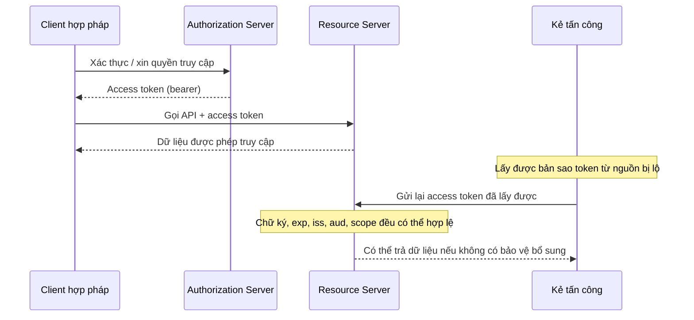
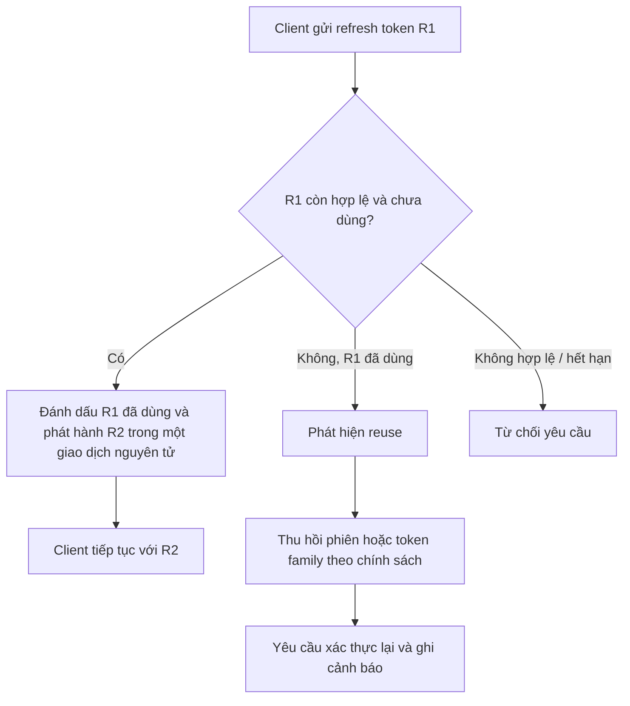

# Replay — Tấn công phát lại token

## 1. Replay là gì?

**Replay attack (tấn công phát lại)** xảy ra khi kẻ tấn công lấy được một token, mã ủy quyền hoặc bằng chứng xác thực từng hợp lệ, rồi **gửi lại** nó để được hệ thống chấp nhận như một yêu cầu mới. Kẻ tấn công không nhất thiết phải giải mã, sửa nội dung hay giả mạo chữ ký token. Chỉ cần tái sử dụng đúng thông tin đã bị lộ là có thể đủ để truy cập tài nguyên hoặc thực hiện hành động ngoài ý muốn.

Trong mô hình OAuth 2.0/OpenID Connect (OIDC), cần phân biệt các bên:

| Thành phần | Vai trò trong mô hình tin cậy |
| --- | --- |
| **Authorization Server (AS)/OpenID Provider (OP)** | Xác thực chủ thể, cấp authorization code, access token, refresh token và có thể cấp ID token. |
| **Client** | Ứng dụng nhận token và dùng access token khi gọi API; cần bảo vệ thông tin đăng nhập và token được giao. |
| **Resource Server (RS)** | API kiểm tra token, `issuer`, `audience`, thời hạn, quyền và các ràng buộc khác trước khi cho truy cập. |
| **Kẻ tấn công** | Có thể lấy token hoặc bằng chứng xác thực từ log, bộ nhớ, trình duyệt, thiết bị bị xâm nhập hay một thành phần trung gian. |

Điểm cốt lõi: **một token còn hiệu lực không chứng minh người đang trình token là chủ thể được cấp token**. Đặc biệt, *bearer token* hoạt động theo nguyên tắc «ai nắm token thì có thể dùng token», trừ khi hệ thống triển khai thêm ràng buộc với người gửi.

> **Phân biệt cần nhớ:** Gửi nhiều yêu cầu API với **cùng một access token** là hành vi bình thường của OAuth. Replay attack là việc một bên không được phép dùng lại thông tin xác thực đã lấy được. Vì thế, không thể chống replay bằng cách mặc định cho rằng mọi lần sử dụng lại access token đều đáng ngờ.

## 2. Một cuộc tấn công phát lại diễn ra như thế nào?

Giả sử hệ thống cấp access token dạng JWT với `exp` còn năm phút. Client hợp pháp gọi `GET /api/orders` thành công. Nếu access token vô tình xuất hiện trong log hoặc bị lấy khỏi thiết bị, người khác có thể gửi yêu cầu mới với đúng token đó trong khoảng thời gian nó còn hiệu lực.



Ví dụ minh họa về token **hợp lệ về cú pháp và claims**, nhưng chưa có gì chứng minh người gửi là client ban đầu:

```json
{
  "iss": "https://auth.example.test",
  "sub": "user-123",
  "aud": "orders-api",
  "scope": "orders:read",
  "iat": 1795400000,
  "exp": 1795400300,
  "jti": "token-id-abc"
}
```

Đây chỉ là **payload minh họa**, không phải JWT hoàn chỉnh hoặc token có thể dùng thực tế. Một API đã xác minh chữ ký, `iss`, `aud`, `exp` và `scope` vẫn có thể chấp nhận bản sao của token. Claim `jti` tạo định danh riêng cho token; **bản thân `jti` không cấm token bị phát lại**.

## 3. Replay có thể xuất hiện ở nhiều thời điểm trong vòng đời token

| Đối tượng bị phát lại | Kịch bản điển hình | Hậu quả tiềm tàng | Điểm kiểm soát chính |
| --- | --- | --- | --- |
| **Bearer access token** (JWT hoặc opaque) | Bản sao token được gửi lại tới API trong lúc token còn hiệu lực. | Đọc dữ liệu, gọi API hoặc thực hiện thao tác trong phạm vi quyền token. | Bảo vệ token khi lưu/truyền, TTL ngắn, giới hạn `aud`/`scope`, sender-constrained token nếu cần. |
| **Refresh token** | Token dài hạn bị đánh cắp và dùng để xin access token mới. | Duy trì quyền truy cập sau khi access token ban đầu hết hạn. | Refresh token rotation kèm phát hiện dùng lại, hoặc ràng buộc token với người gửi. |
| **Authorization code** | Mã được trao đổi lại với token endpoint sau lần dùng trước. | Nguy cơ đổi mã thành token nếu mã chưa được tiêu thụ hoặc không ràng buộc đúng client. | Code ngắn hạn, chỉ dùng một lần, gắn `client_id`/`redirect_uri` và PKCE. |
| **DPoP proof** | Kẻ tấn công gửi lại một proof JWT đã ký cho yêu cầu HTTP trước. | Qua mặt lớp chứng minh sở hữu khóa nếu server không phát hiện proof trùng. | Xác minh `htm`, `htu`, `iat`/nonce, `ath`, chữ ký và theo dõi `jti` trong cửa sổ chấp nhận. |
| **ID token/đáp ứng đăng nhập OIDC** | Đáp ứng xác thực cũ được đưa vào một phiên đăng nhập mới. | Nhầm lẫn phiên hoặc chấp nhận kết quả xác thực không thuộc giao dịch hiện tại. | Xác minh `iss`, `aud`, thời hạn và `nonce`/`state` gắn với giao dịch khi áp dụng. |

**JWT và opaque token đều có thể bị replay.** JWT cho RS khả năng xác thực chữ ký và claims tại chỗ; opaque token thường cần tra cứu hoặc introspection. Cả hai cách xác minh đều chỉ trả lời «token có được chấp nhận không?», chưa nhất thiết trả lời «người gửi có đúng là bên được cấp token không?».

### Replay khác với ba hiện tượng dễ nhầm

- **Token forgery:** Tự tạo token giả, thay claims hoặc giả chữ ký; replay có thể dùng nguyên token thật, không cần sửa.
- **Token expiration/revocation:** `exp` và thu hồi làm giảm cửa sổ sử dụng, nhưng bản sao token còn hiệu lực vẫn có thể bị phát lại trước thời điểm đó.
- **Yêu cầu nghiệp vụ bị gửi lặp:** Người dùng hoặc client có thể vô tình gửi hai lệnh thanh toán hợp lệ. Chống thực thi nghiệp vụ trùng bằng *idempotency key* hoặc ràng buộc giao dịch; đây là bài toán khác với xác thực ai sở hữu token.

## 4. Điều gì làm cho các kiểm tra JWT thông thường chưa đủ?

Resource Server **vẫn phải** xác minh chữ ký và thuật toán được cho phép, `iss`, `aud`, `exp`, `nbf` (nếu có), phạm vi quyền và các điều kiện chuyên biệt. Những kiểm tra đó ngăn token sai nguồn, sai đối tượng, quá hạn hoặc thiếu quyền, đồng thời thu hẹp tác hại nếu token bị lộ.

Tuy nhiên:

1. **Chữ ký số xác thực tính toàn vẹn và nguồn phát hành**, không ràng buộc token với người cầm nó.
2. **`exp` giới hạn thời gian**, không ngăn dùng lại trong khoảng thời gian hợp lệ.
3. **`jti` chỉ là mã định danh**. Muốn phát hiện phát lại một thông điệp chỉ dùng một lần, phía server phải lưu trạng thái hoặc dùng một cơ chế chống phát lại tương đương. Nếu cấm mọi `jti` access token xuất hiện lần hai, các yêu cầu API hợp pháp dùng chung access token sẽ hỏng.
4. **`aud` và `scope` giới hạn nơi và việc được phép làm**, không chứng minh ai đang thực hiện yêu cầu.
5. **Introspection của opaque token** có thể hỗ trợ thu hồi ngay hơn tùy kiến trúc, nhưng phản hồi `active: true` không chứng minh token chưa bị sao chép.

Vì vậy, kiểm tra tính hợp lệ của token và chống replay là **hai lớp bảo vệ bổ sung nhau**.

## 5. Bảo vệ theo từng lớp

### 5.1. Giảm khả năng token bị đánh cắp

- Dùng **HTTPS/TLS** trên mọi đường truyền mang token; bảo vệ cả các kết nối nội bộ nơi token được chuyển tiếp.
- Không đặt access token/refresh token trong query string, URL, log, thông báo lỗi, công cụ phân tích hoặc dữ liệu theo dõi phân tán. Khi cần quan sát, ghi mã định danh đã được làm mờ hoặc băm có kiểm soát.
- Ưu tiên cơ chế lưu trữ phù hợp môi trường: mobile dùng kho khóa an toàn; server giữ bí mật ở backend; ứng dụng web cân nhắc mô hình backend-for-frontend hoặc cookie `HttpOnly`, `Secure`, `SameSite` phù hợp và **bảo vệ CSRF** nếu xác thực qua cookie.
- Hạn chế vòng đời và quyền: access token ngắn hạn, `aud` cụ thể cho API, `scope` tối thiểu và thu hồi khi phát hiện rủi ro.

**Giới hạn:** TLS bảo vệ dữ liệu trên đường truyền nhưng không giải quyết token bị lộ từ log, XSS, extension độc hại hoặc máy khách đã bị chiếm quyền. TTL ngắn làm giảm khoảng thời gian bị lợi dụng, không loại bỏ replay.

### 5.2. Ràng buộc token với bên gửi (sender-constrained tokens)

Với bearer token, API kiểm tra token mà không yêu cầu bằng chứng người gửi sở hữu một khóa riêng. Với **sender-constrained token**, token được gắn với một chứng chỉ hoặc khóa mật mã, và mỗi lần gọi phải chứng minh bên gửi sở hữu khóa tương ứng.

**DPoP (Demonstrating Proof of Possession, RFC 9449):** Client ký một DPoP proof JWT bằng khóa riêng. API đối chiếu khóa công khai trong proof với thông tin ràng buộc của access token, thông thường là `cnf.jkt`; đồng thời kiểm tra:

- Chữ ký và cấu trúc của DPoP proof, thuật toán được chấp nhận.
- `htm` = phương thức HTTP và `htu` = URI đích theo quy tắc chuẩn hóa của DPoP.
- `iat` nằm trong khoảng thời gian chấp nhận, hoặc nonce do server yêu cầu còn hợp lệ.
- `ath` khớp với giá trị băm của access token được gửi cùng yêu cầu.
- `jti` của proof **chưa xuất hiện** trong khoảng chống phát lại mà RS quản lý.

Nếu kẻ tấn công chỉ sao chép access token nhưng **không có khóa riêng**, họ không tạo được proof hợp lệ cho yêu cầu mới. Nếu sao chép cả proof cũ, cơ chế kiểm tra `jti` chống phát lại có thể loại bỏ bản sao đó. Tuy vậy, DPoP không còn bảo đảm khi **cả token lẫn khóa riêng đều bị chiếm**, và DPoP không tự bảo vệ nội dung body của từng request.

**mTLS-bound access token (RFC 8705):** Token được liên kết với chứng chỉ client. Resource Server phải xác nhận chứng chỉ của kết nối TLS khớp với ràng buộc trong token (thường là `cnf.x5t#S256`). Bản sao access token đơn lẻ không đủ để gọi API. Cơ chế này phù hợp với môi trường service-to-service hoặc client có thể quản lý chứng chỉ.

> **Lựa chọn thực tế:** DPoP thường hợp với public client hỗ trợ khóa và proof ở tầng ứng dụng; mTLS phù hợp hơn khi hạ tầng kiểm soát được chứng chỉ. Cả hai cần được triển khai đồng bộ ở Authorization Server, client và Resource Server.

### 5.3. Rotation và phát hiện refresh token bị dùng lại

**Refresh token rotation** cấp refresh token mới mỗi lần đổi token thành công, đồng thời vô hiệu hóa token cũ. Khi một refresh token đã tiêu thụ xuất hiện lần nữa, server coi đó là **tín hiệu reuse** và có thể thu hồi cả *token family* hoặc phiên liên quan, yêu cầu đăng nhập lại và ghi nhận sự kiện bảo mật.



Quy trình phải **nguyên tử** để hai request song song không thể cùng đổi thành công từ một refresh token cũ. Backend thường lưu **hash của refresh token**, trạng thái sử dụng, hạn dùng và định danh token family; không lưu hoặc xuất token thô ra log. Với public client, hướng dẫn an toàn OAuth 2.0 khuyến nghị dùng sender-constrained refresh token **hoặc** rotation để phát hiện replay.

Lưu ý hoạt động: timeout mạng và retry có thể khiến client hợp pháp vô tình gửi lại token vừa được đổi. Cần thiết kế luồng xử lý retry, giao dịch và cơ chế cảnh báo để không bỏ qua reuse thực sự, đồng thời tránh khóa phiên hàng loạt vì lỗi mạng.

### 5.4. Các hiện vật chỉ dùng một lần và chống phát lại đáp ứng đăng nhập

- **Authorization code** phải có hạn dùng ngắn, được đánh dấu đã tiêu thụ ngay trong lần trao đổi thành công; kiểm tra client, redirect URI và PKCE (`code_verifier` so với `code_challenge`). Việc đánh dấu «đã dùng» phải an toàn khi có hai yêu cầu đồng thời.
- **OAuth `state`** liên kết phản hồi authorization với yêu cầu khởi tạo và hỗ trợ phòng chống CSRF/response injection; xác minh giá trị với phiên đang chờ, không chấp nhận tùy ý một giá trị cũ.
- **OIDC `nonce`** liên kết ID token với yêu cầu xác thực tương ứng trong các luồng áp dụng; ngoài ra phải kiểm tra `iss`, `aud`, thời hạn và những claims bắt buộc theo luồng OIDC đang dùng. ID token dùng cho xác thực tại client, **không thay access token để gọi API**.
- **Giao dịch thay đổi trạng thái** như thanh toán cần idempotency key, ràng buộc với tài khoản/yêu cầu và lưu kết quả xử lý. Đây là lớp chống thực thi lại giao dịch, kể cả khi request được gửi bởi client hợp lệ.

## 6. Minh họa kiểm soát phát lại DPoP ở Resource Server

Đoạn mã giả sau tập trung vào **lớp replay**, giả sử trước đó đã xác minh đầy đủ chữ ký, key binding và claims của access token và DPoP proof. Một triển khai thực tế phải dùng thư viện chuẩn, không tự viết parser hoặc hàm xác minh chữ ký mật mã.

```text
function authorizeDpopRequest(request, accessToken, proofJwt):
    verifyAccessTokenSignatureIssuerAudienceExpiryAndScopes(accessToken)
    proof = verifyDpopSignatureAndRequiredClaims(proofJwt)
    require proof.htm == request.method
    require normalizeHtu(proof.htu) == normalizeRequestTarget(request)
    require proof.ath == base64url(sha256(rawAccessToken(accessToken)))
    require proof.publicKeyThumbprint == accessToken.cnf.jkt
    require timestampOrServerNonceIsValid(proof, request)

    key = "dpop:seen:" + resourceServerId + ":" + proof.publicKeyThumbprint + ":" + proof.jti
    firstSeen = replayStore.setIfAbsent(key, "1", ttl = proofAcceptanceWindow)
    require firstSeen  // Nếu đã thấy proof này: từ chối phát lại

    return allowRequest()
```

**Yêu cầu triển khai:**

1. `setIfAbsent` và đặt TTL phải là **một thao tác nguyên tử** (ví dụ Redis `SET key value NX EX seconds`), không tách thành `GET` rồi `SET` vì có race condition.
2. Cửa sổ TTL phải phù hợp độ lệch đồng hồ và khoảng proof/nonce được chấp nhận. Nhiều instance API phải chia sẻ trạng thái chống replay hoặc có cơ chế tương đương; cache chỉ nằm trong bộ nhớ từng instance sẽ bỏ lọt replay giữa các instance.
3. Khóa chống replay phải được phân vùng phù hợp phạm vi xác minh và khóa người gửi; tránh xung đột giữa những client không liên quan. Bảo vệ cache khỏi bị lạm dụng bằng giới hạn cửa sổ thời gian và tài nguyên.
4. Các bước đối chiếu `htu`, `htm`, `ath`, `cnf.jkt`, `iat`/nonce và chữ ký đều cần thiết; **chỉ** lưu `jti` mà không xác minh những điều kiện đó không tạo thành triển khai DPoP an toàn.

**Không áp dụng trực tiếp mẫu trên cho mọi bearer access token.** Access token thường được dùng hợp pháp trên nhiều yêu cầu; cấm sử dụng lại `jti` của access token sẽ biến token thành chỉ dùng một lần và phá vỡ phần lớn các client OAuth thông thường. Trạng thái chống replay theo từng request phù hợp hơn với **DPoP proof**, authorization code, refresh token đã rotate hoặc giao dịch có đặc tính một lần.

## 7. Nhận diện và xử lý sự cố

Những dấu hiệu đáng điều tra gồm: refresh token **đã tiêu thụ** được dùng lại, DPoP `jti` trùng trong cửa sổ hợp lệ, cùng một phiên xuất hiện truy cập bất thường, hoặc request có bằng chứng khóa/URI/phương thức không khớp. Địa chỉ IP hay user-agent thay đổi **không đủ một mình** để kết luận replay, vì mạng di động, proxy và thiết bị hợp lệ có thể thay đổi.

Khi phát hiện sự kiện:

1. Từ chối yêu cầu có proof/mã/refresh token không hợp lệ và giữ log bảo mật đã làm sạch dữ liệu nhạy cảm.
2. Với refresh token reuse, áp dụng chính sách vô hiệu hóa token family/phiên; với token bị lộ, thu hồi các token liên quan khi hệ thống hỗ trợ.
3. Yêu cầu xác thực lại hoặc tăng mức xác thực nếu thích hợp; điều tra nguồn lộ như log, XSS, thiết bị hoặc dịch vụ bị xâm nhập.
4. Theo dõi số lần reuse, số phiên bị ảnh hưởng, tỷ lệ false positive từ retry và độ trễ thu hồi token.

Không ghi access token, refresh token, proof JWT hoặc khóa bí mật nguyên văn vào log/trace khi xử lý sự cố.

## 8. Tình huống tự kiểm tra

**Tình huống A — JWT chưa hết hạn:** Một JWT có chữ ký hợp lệ, `aud` và `scope` chính xác. Kẻ tấn công sao chép nó rồi gọi API trong thời hạn hiệu lực. **Kết luận:** Kiểm tra chữ ký và claims là bắt buộc nhưng chưa ngăn được bearer replay; cân nhắc ràng buộc người gửi và giảm khả năng lộ token.

**Tình huống B — Cùng DPoP proof gửi hai lần:** Yêu cầu đầu tiên có proof hợp lệ đã được nhận. Một yêu cầu khác lặp lại nguyên proof đó. **Kết luận:** Resource Server phải từ chối proof trùng `jti` trong cửa sổ kiểm tra; nếu chỉ so chữ ký và thời hạn thì còn lỗ hổng.

**Tình huống C — Dùng lại refresh token R1:** Server đã đổi R1 thành R2, sau đó nhận lại R1. **Kết luận:** Đây là tín hiệu reuse phải được phát hiện, xử lý theo chính sách token family và điều tra; hai yêu cầu đồng thời không được cùng vượt qua khâu rotate.

**Tình huống D — Người dùng bấm thanh toán hai lần:** Cả hai yêu cầu đều dùng token hợp pháp, proof (nếu có) đều mới và hợp lệ. **Kết luận:** Đây là vấn đề thực thi nghiệp vụ trùng; phải dùng cơ chế idempotency hoặc ràng buộc giao dịch, không thể chỉ dựa vào cơ chế chống token replay.

### Checklist trước khi đưa hệ thống vào vận hành

- [ ] RS xác minh đúng chữ ký/thuật toán, `iss`, `aud`, thời hạn và quyền của access token.
- [ ] Token nhạy cảm không xuất hiện trong URL, log, trace hoặc nơi lưu trữ thiếu kiểm soát.
- [ ] Có chính sách TTL, scope, audience và thu hồi phù hợp với mức rủi ro.
- [ ] Với sender-constrained token, RS kiểm tra đúng ràng buộc khóa/chứng chỉ và bằng chứng theo từng yêu cầu.
- [ ] DPoP proof có kiểm tra phát lại `jti` với thao tác nguyên tử và trạng thái dùng chung khi mở rộng nhiều instance.
- [ ] Refresh token rotation tiêu thụ token cũ nguyên tử và nhận diện reuse.
- [ ] Authorization code chỉ dùng một lần; `state`, PKCE và OIDC `nonce` được kiểm tra đúng luồng.
- [ ] API thay đổi trạng thái quan trọng có biện pháp ngăn thực thi trùng ở tầng nghiệp vụ.
- [ ] Có kịch bản kiểm thử replay, cạnh tranh đồng thời, retry và phản ứng khi nghi bị lộ token.

**Ghi nhớ:** Replay không đòi hỏi token giả. Một token thật, ký đúng và chưa hết hạn vẫn có thể trở thành phương tiện tấn công khi rơi vào tay người khác. Phòng chống hiệu quả cần phối hợp **bảo vệ token, kiểm tra claims, giới hạn đặc quyền, ràng buộc người gửi, kiểm soát hiện vật chỉ dùng một lần và cơ chế phát hiện dùng lại** phù hợp với từng loại token.

*Chuẩn tham khảo để học sâu hơn:* RFC 6750 (OAuth 2.0 Bearer Token Usage), RFC 8705 (OAuth 2.0 mTLS), RFC 9449 (OAuth 2.0 DPoP), RFC 9700 (Best Current Practice về bảo mật OAuth 2.0) và OpenID Connect Core 1.0.
