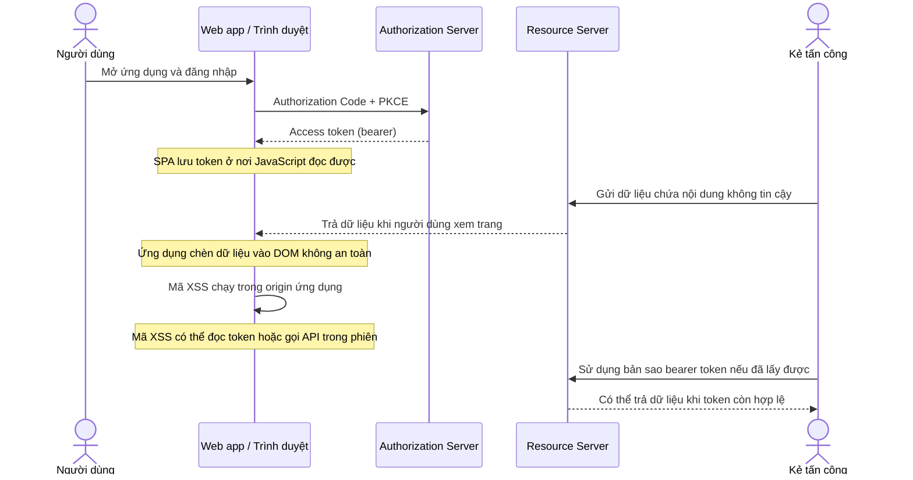
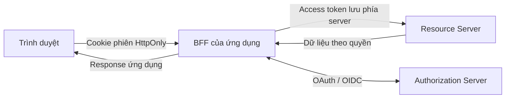

# XSS đánh cắp token

## 1. Vì sao XSS nguy hiểm đối với hệ thống dùng token?

**Cross-Site Scripting (XSS)** là lỗ hổng cho phép dữ liệu do kẻ tấn công kiểm soát được trình duyệt diễn giải thành **JavaScript hoặc mã hoạt động khác** trong ngữ cảnh bảo mật của một website hợp pháp. Khi mã độc chạy trong *origin* của ứng dụng, trình duyệt có thể trao cho nó nhiều quyền giống mã JavaScript do chính ứng dụng phát hành: đọc phần dữ liệu mà JavaScript của origin đó được phép đọc, gửi yêu cầu đến API, thao tác giao diện và quan sát một số phản hồi.

Trong mô hình **token security fundamentals**, đây là một mối đe dọa lớn vì access token và refresh token thường là thông tin xác thực có giá trị:

- **Access token** thể hiện quyền gọi Resource Server (API), thường có giới hạn bởi thời gian sống, `audience` và `scope`.
- **Refresh token** cho phép client xin access token mới; nếu bị chiếm, hậu quả có thể kéo dài hơn thời hạn của một access token.
- **ID token** là bằng chứng xác thực dành cho client trong OpenID Connect (OIDC); nó không phải access token và không nên được API chấp nhận như một access token.
- **JWT hay opaque token** chỉ khác cách biểu diễn và kiểm tra token. Cả hai đều có thể bị lạm dụng nếu kẻ tấn công lấy được một **bearer token** vẫn còn hiệu lực.

**Vấn đề cốt lõi:** Chữ ký JWT hợp lệ, `iss`, `aud`, `exp` và `scope` đúng không chứng minh *người đang cầm token* là người được cấp token. Một bản sao bearer token bị lấy qua XSS có thể được phát lại đến API trong khoảng thời gian hợp lệ. Khi ứng dụng không để JavaScript đọc token, XSS vẫn có thể **thực hiện thao tác thay người dùng ngay trên phiên đang mở**. Hai nguy cơ này cần được phân biệt khi thiết kế phòng thủ.

> **Phạm vi bài học:** Xem XSS như điểm xâm nhập vào client trong hệ sinh thái xác thực, phân quyền và OAuth 2.0/OIDC; đánh giá đường đi của token từ Authorization Server đến client, Resource Server và nơi lưu trữ, sau đó chọn biện pháp phòng ngừa và ứng phó tương ứng.

## 2. Mô hình tin cậy và các điểm XSS có thể lợi dụng

| Thành phần | Dữ liệu/bí mật đang giữ | Ranh giới cần bảo vệ |
| --- | --- | --- |
| **Authorization Server (AS)** / OpenID Provider | Phát hành authorization code, access token, refresh token, ID token tùy luồng | Chỉ cấp token cho client và luồng hợp lệ; bảo vệ token endpoint, code và phiên đăng nhập |
| **Ứng dụng web (OAuth client)** | Trạng thái đăng nhập, có thể giữ token trong trình duyệt hoặc phiên backend | Không để dữ liệu không tin cậy biến thành mã; giảm lượng credential có mặt trong JavaScript |
| **Resource Server (API)** | Nhận access token và quyết định quyền truy cập | Kiểm tra token, `iss`, `aud`, hạn dùng, `scope`, ràng buộc người gửi nếu áp dụng |
| **Trình duyệt** | Cookie, Web Storage, bộ nhớ JavaScript, request/response | Các cơ chế cùng origin, `HttpOnly`, CSP hỗ trợ cô lập nhưng không tự sửa được lỗi XSS |
| **Nguồn dữ liệu không tin cậy** | Bình luận, tên hiển thị, kết quả API, tham số URL, nội dung bên thứ ba | Phải xử lý đúng *ngữ cảnh đầu ra* trước khi đưa vào HTML, DOM, URL hoặc script |

Giả sử một SPA đăng nhập qua OAuth Authorization Code + PKCE, nhận access token và lưu token trong `localStorage`. Ứng dụng hiển thị một bình luận từ máy chủ bằng `innerHTML` mà không làm sạch. Nếu bình luận chứa nội dung có thể thực thi, trình duyệt có thể chạy mã đó cùng origin của SPA; mã này có khả năng truy cập vùng lưu trữ của origin và từ đó có thể lấy bản sao token.



**Lưu ý về sơ đồ:** Bước gửi dữ liệu độc hại đến API chỉ là một nguồn XSS dạng lưu trữ; XSS phản chiếu hoặc DOM-based XSS có thể khởi phát từ đường dẫn, tham số URL hay dữ liệu khác. Việc lấy được token ra ngoài còn phụ thuộc nơi lưu, chính sách mạng, CSP và các biện pháp khác. Ngay cả khi không xuất được token ra ngoài, mã XSS có thể gây hại trong phiên hiện tại.

## 3. Ba dạng XSS thường gặp

| Dạng | Nguyên nhân | Ví dụ trong ứng dụng có đăng nhập |
| --- | --- | --- |
| **Stored XSS** (lưu trữ) | Dữ liệu độc hại được lưu rồi hiển thị cho người khác mà không escape/sanitize đúng cách | Nội dung bài đăng, bình luận, tên sản phẩm, hồ sơ được đưa trực tiếp vào HTML |
| **Reflected XSS** (phản chiếu) | Dữ liệu từ request xuất hiện ngay trong response dưới dạng nội dung có thể thực thi | Trang báo lỗi hoặc trang tìm kiếm ghép tham số URL vào HTML |
| **DOM-based XSS** | JavaScript phía client lấy dữ liệu không tin cậy và đưa vào một DOM sink nguy hiểm | Đọc `location.hash` / `searchParams` rồi gán vào `innerHTML` |

Cả ba đều có thể dẫn đến chiếm quyền trong phiên người dùng. Điểm chung không phải chỗ dữ liệu được lưu, mà là **dữ liệu chưa được tin cậy đi đến một vị trí có khả năng thực thi**.

Các *sink* cần đặc biệt chú ý: `innerHTML`, `outerHTML`, `insertAdjacentHTML`, `document.write`, `eval`, `new Function`, chuỗi được đưa vào handler sự kiện, thư viện template không escape, và HTML được biên dịch động. Ngoài HTML text, **ngữ cảnh thuộc tính HTML, URL, CSS và JavaScript đòi hỏi quy tắc xử lý riêng**. Escape kiểu HTML thông thường không thể được dùng tùy tiện cho mọi ngữ cảnh.

## 4. Token bị lộ như thế nào? Vai trò của từng nơi lưu trữ

| Cách lưu credential | JavaScript cùng origin có thể đọc trực tiếp? | Tác động khi xảy ra XSS | Ghi chú thiết kế |
| --- | --- | --- | --- |
| `localStorage` | **Có** | XSS có thể lấy token; dữ liệu tồn tại sau khi đóng tab cho tới khi bị xóa hoặc bị chính sách trình duyệt dọn dẹp | Tiện cho SPA nhưng tăng rủi ro khi chứa bearer token |
| `sessionStorage` | **Có**, trong ngữ cảnh tab/phiên tương ứng | XSS chạy trong cùng tab có thể lấy token; phạm vi lưu hẹp hơn `localStorage` | Không phải biện pháp chống XSS |
| **Biến JavaScript/bộ nhớ SPA** | Tùy cách triển khai; không mặc nhiên có API đọc một biến đóng kín | XSS vẫn có thể gửi API, quan sát request/response hoặc tác động đến luồng ứng dụng | Giảm thời gian lưu lâu dài, nhưng không tạo vùng tin cậy tách biệt với mã độc cùng trang |
| `IndexedDB` và kho dữ liệu web cho JavaScript | Thường **có**, nếu script có quyền trong origin phù hợp | Dữ liệu chứa token có thể bị truy xuất | Không coi đây là kho bí mật trước XSS |
| Cookie **không** có `HttpOnly` | **Có** đối với cookie không bị hạn chế bởi đường dẫn/phạm vi phù hợp | Có thể bị đọc bằng API cookie của trình duyệt | Tránh đặt token nhạy cảm trong cookie JavaScript đọc được nếu không thật sự cần |
| Cookie có **`HttpOnly`** | **Không** qua `document.cookie` / API JavaScript thông thường | XSS không trực tiếp đọc giá trị cookie nhưng có thể gửi request trong phiên để thao tác thay người dùng | Kết hợp `Secure`, `SameSite`, bảo vệ CSRF, xác thực thao tác nhạy cảm và vá XSS |
| **Backend-for-Frontend (BFF)** giữ token ở server | **Không**, nếu backend không trả token ra JavaScript | XSS có thể thực hiện request qua phiên trình duyệt, nhưng không thể trực tiếp trích xuất access/refresh token chỉ có trên server | Giảm khả năng đánh cắp bearer token để dùng ngoài trình duyệt; vẫn phải chống XSS |

### 4.1. Tại sao `HttpOnly` là lớp phòng vệ nhưng chưa đủ?

Header cookie phiên có thể được cấu hình theo nguyên tắc:

```http
Set-Cookie: __Host-session=<opaque-session-id>; Path=/; Secure; HttpOnly; SameSite=Lax
```

Đây là ví dụ **cấu hình**, không phải giá trị phiên thật. Prefix `__Host-` yêu cầu cookie có `Secure`, `Path=/` và không có thuộc tính `Domain`, giúp giảm một số nguy cơ liên quan phạm vi cookie; `HttpOnly` ngăn JavaScript đọc giá trị. `SameSite` góp phần giảm một số tình huống CSRF từ website khác.

Nhưng nếu website có XSS, đoạn mã độc chạy **ngay trong origin hợp pháp**. Khi nó gọi endpoint cùng origin, trình duyệt có thể tự đính kèm cookie phiên theo chính sách áp dụng. Vì vậy:

- `HttpOnly` **giảm khả năng sao chép credential** ra ngoài để dùng độc lập.
- `HttpOnly` **không ngăn hành động trong phiên đang mở**, như đọc dữ liệu qua API hoặc kích hoạt thao tác mà người dùng có quyền.
- `SameSite` và cơ chế CSRF không thay thế sửa XSS; mã chạy cùng origin thường có thể truy cập các thông tin phiên mà ứng dụng JavaScript hợp pháp cũng dùng.
- Nếu backend có endpoint cấp access token cho JavaScript từ một cookie refresh token `HttpOnly`, XSS có thể gọi endpoint đó và **đọc access token trong response**. Vì thế cần xét **toàn bộ đường đi của token**, không chỉ nơi cất refresh token.

### 4.2. Access token và refresh token bị ảnh hưởng khác nhau

Khi **access token** bị sao chép, kẻ tấn công có thể sử dụng nó đến khi hết hạn hoặc bị thu hồi. TTL ngắn và `audience`/`scope` tối thiểu giúp giảm cửa sổ và phạm vi lạm dụng; chúng không ngăn lần sử dụng trái phép đầu tiên.

Khi **refresh token** bị lộ, kẻ tấn công có thể cố duy trì quyền truy cập bằng cách xin access token mới. **Refresh token rotation**, phát hiện sử dụng lại (*reuse detection*), ràng buộc token với bên gửi và vô hiệu hóa token family giúp giảm tác hại và hỗ trợ phát hiện. Tuy nhiên, rotation không chặn ngay việc kẻ tấn công có bản sao dùng token trước client hợp pháp; cần xử lý tranh chấp và sự kiện reuse ở server.

Nếu token là **JWT**, chữ ký và các claims không mã hóa nội dung payload, cũng không tự ngăn trích xuất token. Nếu token là **opaque**, kẻ tấn công không cần hiểu chuỗi token; chỉ cần API chấp nhận bản sao bearer token là đủ.

## 5. Ví dụ thực tế: từ DOM sink không an toàn đến sửa mã

Giả sử trang hỗ trợ tìm kiếm hiển thị cụm từ người dùng nhập. Đoạn mã này **không an toàn** khi đưa nội dung điều khiển từ URL thành HTML:

```javascript
const params = new URLSearchParams(window.location.search);
const keyword = params.get("q") ?? "";

// SAI: keyword từ URL bị diễn giải là HTML.
document.querySelector("#search-label").innerHTML = keyword;
```

Nguy cơ không nằm ở riêng `URLSearchParams`; đó là thao tác gán dữ liệu không tin cậy vào **HTML sink**. Cách đúng nếu chỉ cần hiển thị văn bản:

```javascript
const params = new URLSearchParams(window.location.search);
const keyword = params.get("q") ?? "";

// ĐÚNG: hiển thị như văn bản; trình duyệt không diễn giải thành HTML.
document.querySelector("#search-label").textContent = keyword;
```

Tương tự, với framework như React, cách biểu diễn thông thường `<span>{keyword}</span>` sẽ escape text; đưa dữ liệu không tin cậy vào `dangerouslySetInnerHTML` lại mở ra nguy cơ. Template engine và framework khác cũng có các API an toàn hoặc nguy hiểm tương đương.

Nếu tính năng **thật sự cần rich text** (ví dụ phần bình luận có một số thẻ HTML được phép), hãy dùng bộ sanitize HTML được duy trì, chẳng hạn DOMPurify, với allowlist phù hợp:

```javascript
import DOMPurify from "dompurify";

const userHtml = receiveUntrustedRichText();
const safeHtml = DOMPurify.sanitize(userHtml, {
  ALLOWED_TAGS: ["b", "strong", "i", "em", "p", "br", "ul", "li"],
  ALLOWED_ATTR: [],
});

document.querySelector("#comment").innerHTML = safeHtml;
```

Đoạn mã minh họa giả định `receiveUntrustedRichText()` là hàm có sẵn của ứng dụng, và DOMPurify được cài/cập nhật đúng phiên bản. Với rich text phức tạp hơn (liên kết, hình ảnh, thuộc tính tùy biến), phải xem xét riêng từng thẻ/thuộc tính, chính sách URL, cấu hình sanitizer và tương tác với các thư viện khác. **Không tự viết sanitizer HTML bằng regex**.

## 6. Thiết kế kiến trúc giảm khả năng token bị đánh cắp

### 6.1. SPA tự giữ token trong trình duyệt

Trong mô hình SPA trực tiếp nhận và gửi access token đến Resource Server, nếu token nằm trong `localStorage` hoặc nơi JavaScript truy cập được, XSS có thể sao chép nó. Di chuyển token sang `sessionStorage` hoặc bộ nhớ tạm có thể cải thiện **thời gian tồn tại** hoặc giảm một số bề mặt tiếp xúc, nhưng không phải giải pháp triệt để cho XSS.

Client trình duyệt là **public client**, không thể giữ một `client_secret` mật thật sự bí mật trong mã JavaScript. OAuth **Authorization Code + PKCE** là cơ chế cần thiết để hạn chế đánh cắp authorization code trong các luồng phù hợp, nhưng **PKCE không ngăn JavaScript độc hại chạy trong ứng dụng sau khi đăng nhập**.

### 6.2. Backend-for-Frontend (BFF) giữ token ở backend

Một lựa chọn thường phù hợp với ứng dụng web có backend là để BFF đảm nhiệm OAuth flow và giữ access/refresh token ở server, đồng thời cấp cho trình duyệt **cookie phiên `HttpOnly`**:



Trong thiết kế này:

1. Trình duyệt chỉ giữ định danh phiên dạng cookie; JavaScript không được cấp access token/refresh token.
2. BFF giữ token phía server, xác định người dùng từ phiên, kiểm tra quyền và chuyển tiếp yêu cầu API.
3. API vẫn kiểm tra access token đúng `issuer`, `audience`, thời hạn và `scope`.
4. Các thao tác thay đổi dữ liệu phải có bảo vệ CSRF, phân quyền ở server, hạn chế tốc độ và xác thực lại khi cần.

**Giới hạn cần hiểu:** XSS trên trang vẫn có thể gửi request đến BFF bằng cookie phiên mà trình duyệt đính kèm. BFF làm giảm việc **đánh cắp token để tái sử dụng từ bên ngoài**, nhưng không thể thay thế phòng chống XSS hay phân quyền ở tầng API.

### 6.3. Sender-constrained token: DPoP và mTLS

**DPoP (RFC 9449)** liên kết access token với một khóa mật mã. Client phải gửi proof được ký cho request, còn API kiểm tra ràng buộc khóa, `htm`, `htu`, `ath`, thời gian/nonce và `jti` chống replay. Nếu kẻ tấn công chỉ sao chép token nhưng **không có khả năng dùng khóa**, token đó khó được dùng từ thiết bị khác.

Tuy nhiên, khi XSS đang chạy **trên chính client**, mã độc có thể lợi dụng chức năng ký hoặc gửi request của ứng dụng ngay cả khi khóa riêng được đánh dấu **non-extractable**. Do đó DPoP có thể hạn chế việc mang token đi tái sử dụng, chứ không bảo đảm chống mọi hành vi XSS trong một phiên đang hoạt động. **mTLS-bound token (RFC 8705)** cũng yêu cầu chứng chỉ phía client và phù hợp hơn với một số hệ thống server-to-server; không giải quyết bản thân việc mã độc chạy trong giao diện trình duyệt.

## 7. Phòng thủ nhiều lớp đối với XSS

### 7.1. Ngăn dữ liệu không tin cậy trở thành mã thực thi

- **Output encoding theo ngữ cảnh**: Mặc định hiển thị như text; phân biệt rõ ngữ cảnh HTML text, thuộc tính, JavaScript, URL và CSS. Tránh ghép chuỗi dữ liệu người dùng vào mã JavaScript.
- **Dùng API DOM an toàn**: Ưu tiên `textContent`, `createElement`, `append` và các binding có escape mặc định; rà soát `innerHTML`, `outerHTML`, `insertAdjacentHTML` và các escape hatch của framework.
- **Sanitize nếu cần render HTML**: Dùng thư viện bảo trì tốt và allowlist hạn chế, đồng thời kiểm soát URL, phần tử embed và thuộc tính sự kiện. Validate đầu vào hỗ trợ chất lượng dữ liệu, nhưng **không thay output encoding**.
- **Kiểm soát nội dung bên thứ ba**: Thư viện, widget, tag quản trị, nội dung quảng cáo hoặc mã nhúng cùng origin cũng có thể tiếp cận môi trường chạy của ứng dụng. Giảm script không cần thiết, cập nhật phụ thuộc và rà soát đường truyền dữ liệu.

### 7.2. Chính sách trình duyệt giúp giảm thiệt hại

**Content Security Policy (CSP)** có thể hạn chế các nguồn script được phép chạy, chặn nhiều dạng inline script và giới hạn một số đường truyền dữ liệu ra ngoài. Một CSP nghiêm ngặt thường dùng nonce hoặc hash hợp lệ cho script, hạn chế `script-src`, đặt `object-src 'none'`, `base-uri 'none'` và cấu hình `connect-src` theo nhu cầu thực tế. Nonce phải khó đoán và khác nhau giữa các response phù hợp; tránh dựa vào `'unsafe-inline'` như một cơ chế bảo vệ.

**Trusted Types**, trên trình duyệt hỗ trợ, buộc các thao tác tới một số DOM sink nguy hiểm sử dụng kiểu dữ liệu tin cậy qua policy được kiểm soát (ví dụ cấu hình CSP `require-trusted-types-for 'script'`). Đây là lớp bảo vệ bổ sung cho code review và việc sử dụng DOM API an toàn. Cần triển khai theo năng lực hỗ trợ của trình duyệt và kiểm tra tương thích thư viện.

Các lớp khác hỗ trợ phòng thủ gồm `HttpOnly`/`Secure`/`SameSite` cho cookie, HTTPS, cấu hình CORS đúng, kiểm soát quyền upload/nội dung và hạn chế thành phần có quyền thực thi script. **CORS không ngăn XSS cùng origin gọi API hợp lệ**; CSP cũng không làm cho việc sử dụng `innerHTML` với dữ liệu chưa được xử lý trở nên an toàn tuyệt đối.

### 7.3. Giảm quyền và thời gian sống của token

- Cấp access token có `aud` đúng Resource Server, `scope` tối thiểu và thời hạn ngắn phù hợp.
- Xác minh chữ ký/thuật toán cho phép, `iss`, `aud`, `exp`, `nbf` (nếu có), `scope` và ràng buộc khóa ở Resource Server.
- Giữ refresh token ở nơi an toàn nhất kiến trúc cho phép; dùng rotation/reuse detection hoặc sender-constrained refresh token phù hợp với loại client và chính sách OAuth hiện hành.
- Hỗ trợ thu hồi token/phiên, vô hiệu hóa refresh token family khi phát hiện xâm nhập và yêu cầu đăng nhập lại nếu cần.
- Không đưa bearer token vào URL, log, công cụ analytics, báo lỗi, `Referer` hay trace có thể được truy cập bởi nhiều thành phần.

**Không có một biện pháp riêng lẻ nào bảo đảm an toàn khi trang đã có XSS.** Cần phối hợp sửa nguồn XSS, giảm khả năng lấy token và giảm tác hại của các thao tác trái phép.

## 8. Phát hiện và ứng phó khi nghi token bị lấy qua XSS

Một cuộc tấn công có thể chỉ xảy ra trong vài giây, trước khi access token hết hạn. Hệ thống cần có phương án thu hồi và điều tra từ trước.

| Tín hiệu | Cách diễn giải thận trọng |
| --- | --- |
| CSP report hoặc lỗi Trusted Types từ trang đang đăng nhập | Có thể chỉ ra điểm chèn nội dung nguy hiểm; cũng có thể là lỗi tương thích hoặc false positive |
| Dòng gọi API tăng đột biến, truy cập ngoài hành vi sử dụng thường thấy | Đáng điều tra; không kết luận chắc chắn XSS chỉ từ IP hoặc user-agent lạ |
| Refresh token đã rotate được dùng lại | Tín hiệu reuse mạnh, cần kiểm tra khả năng bị đánh cắp hoặc retry/race của client |
| Truy cập API với token hợp lệ từ bối cảnh bất thường | Có thể là replay; đối chiếu thời gian phát hành, `aud`, client và các dữ liệu giám sát |
| Xuất hiện dữ liệu HTML/script bất thường trong trường nhập hoặc kho nội dung | Dấu hiệu nguồn XSS cần khắc phục và kiểm tra khả năng đã được hiển thị cho người dùng |

**Quy trình phản ứng đề xuất:**

1. **Khoanh vùng**: xác định trang, thành phần, nguồn dữ liệu và khoảng thời gian có khả năng thực thi XSS; tạm chặn nội dung hoặc tuyến khai thác khi cần.
2. **Sửa nguyên nhân**: sửa DOM sink/output encoding, sanitize nếu bắt buộc render HTML, vá thư viện liên quan và điều chỉnh CSP/Trusted Types.
3. **Giới hạn quyền truy cập đang bị đe dọa**: vô hiệu hóa phiên, thu hồi refresh token hoặc token family và thu hồi access token khi hệ thống hỗ trợ; áp dụng thời hạn sống ngắn nếu access token JWT không thể thu hồi tức thời.
4. **Điều tra và thông báo**: xác định nhóm phiên có thể đã xem nội dung độc hại, xem xét hành động API đã diễn ra; yêu cầu xác thực lại và thông báo theo quy trình sự cố phù hợp.
5. **Kiểm thử hồi quy và theo dõi**: kiểm tra lại nguồn dữ liệu dẫn tới XSS, hành vi gọi API, độ trễ thu hồi và các cảnh báo sau khắc phục.

Log phục vụ điều tra nên chứa request ID, sự kiện phiên, loại token hoặc mã định danh đã được xử lý an toàn; **không ghi giá trị access token, refresh token hoặc cookie phiên nguyên văn**. Việc đổi khóa ký JWT của toàn hệ thống không phải bước mặc định cho mọi XSS: chỉ thực hiện khi có bằng chứng hoặc rủi ro liên quan đến khóa ký và đánh giá tác động hệ thống.

## 9. Tình huống áp dụng

**Tình huống A — SPA lưu access token ở `localStorage`:** Một comment chứa dữ liệu chưa sanitize được render bằng `innerHTML`. Sau khi mã XSS chạy, token trong storage có nguy cơ bị đọc và dùng lại ngoài trình duyệt. **Giải pháp:** sửa lỗ hổng render, xem lại thiết kế lưu token, giới hạn `aud`/`scope`/TTL và chuẩn bị thu hồi khi nghi bị lộ.

**Tình huống B — Dùng cookie phiên `HttpOnly`:** Mã XSS không đọc được cookie nhưng vẫn gọi endpoint `/api/profile` trong phiên đang mở. **Giải pháp:** giữ `HttpOnly` vì nó giảm trích xuất credential, đồng thời sửa XSS, kiểm tra phân quyền server và tăng bảo vệ cho thao tác nhạy cảm. Chỉ chuyển sang cookie không đủ để xử lý XSS.

**Tình huống C — Refresh token nằm trong cookie `HttpOnly`, access token được trả về JavaScript:** Mã XSS gọi API làm mới phiên và nhận access token từ response. **Giải pháp:** rà soát đường đi thực tế của token; cân nhắc BFF giữ cả access và refresh token ở backend và chỉ cấp cookie phiên cho trình duyệt.

**Tình huống D — SPA dùng DPoP với private key không xuất được:** XSS không thể lấy trực tiếp khóa riêng nhưng vẫn có thể điều khiển ứng dụng ký/gửi yêu cầu khi người dùng đang mở trang. **Giải pháp:** hiểu đúng giới hạn của sender-constrained token, sửa XSS và thực thi kiểm tra quyền/hoạt động bất thường ở API.

### Checklist thiết kế và kiểm thử

- [ ] Mọi dữ liệu do người dùng hoặc bên thứ ba cung cấp đều được xử lý theo ngữ cảnh đầu ra.
- [ ] Không đưa dữ liệu không tin cậy thẳng vào HTML/JavaScript sink; chỗ buộc render HTML có sanitizer đã được kiểm thử.
- [ ] Có kiểm thử stored, reflected và DOM-based XSS cho những luồng đăng nhập và nội dung quan trọng.
- [ ] CSP có chính sách giới hạn script; Trusted Types được áp dụng khi nền tảng hỗ trợ và phù hợp.
- [ ] Biết chính xác access token, refresh token, ID token được tạo, truyền, lưu và hủy ở đâu.
- [ ] Đã đánh giá rủi ro khi JavaScript có thể đọc token ở Web Storage, IndexedDB hoặc biến trong bộ nhớ.
- [ ] Cookie phiên nhạy cảm có `HttpOnly`, `Secure`, `SameSite` phù hợp; các endpoint dùng cookie có bảo vệ CSRF.
- [ ] Resource Server kiểm tra đúng issuer, audience, thời hạn, quyền và sender constraint nếu có.
- [ ] Có cơ chế thu hồi token/phiên, xử lý refresh token reuse và phản ứng khi người dùng bị tác động bởi XSS.
- [ ] Log/trace không chứa bí mật token; cảnh báo XSS và hành vi token bất thường được theo dõi.

## 10. Ghi nhớ

XSS phá vỡ giả định rằng mã chạy trong ứng dụng web luôn do nhà phát triển kiểm soát. Khi token nằm ở nơi JavaScript đọc được, XSS có thể biến lỗ hổng hiển thị dữ liệu thành **đánh cắp bearer token** và **replay**. Nếu credential được giữ trong cookie `HttpOnly` hoặc backend, rủi ro lấy bản sao token có thể giảm, nhưng mã XSS vẫn có thể **lạm dụng phiên đang hoạt động**.

Để bảo vệ vòng đời token từ OAuth 2.0/OIDC đến API, hãy kết hợp **ngăn XSS tại nguồn, hạn chế token trong JavaScript, kiểm soát lưu trữ/thu hồi, giới hạn phạm vi quyền, sender-constrained token khi cần và giám sát phản ứng sự cố**. PKCE, `HttpOnly`, CSP hay DPoP đều hữu ích trong đúng vai trò của chúng; không biện pháp nào thay thế việc loại bỏ XSS.

### Tài liệu tham khảo

- [OWASP Cross Site Scripting Prevention Cheat Sheet](https://cheatsheetseries.owasp.org/cheatsheets/Cross_Site_Scripting_Prevention_Cheat_Sheet.html) — output encoding, HTML sanitization, safe sinks.
- [OWASP HTML5 Security Cheat Sheet](https://cheatsheetseries.owasp.org/cheatsheets/HTML5_Security_Cheat_Sheet.html) — rủi ro Web Storage và bảo mật web app.
- [RFC 9700 — Best Current Practice for OAuth 2.0 Security](https://www.rfc-editor.org/rfc/rfc9700) — hướng dẫn bảo mật OAuth, refresh token và sender-constrained token.
- [RFC 9449 — OAuth 2.0 Demonstrating Proof of Possession (DPoP)](https://www.rfc-editor.org/rfc/rfc9449) và [RFC 8705 — OAuth 2.0 Mutual-TLS Client Authentication and Certificate-Bound Access Tokens](https://www.rfc-editor.org/rfc/rfc8705).
