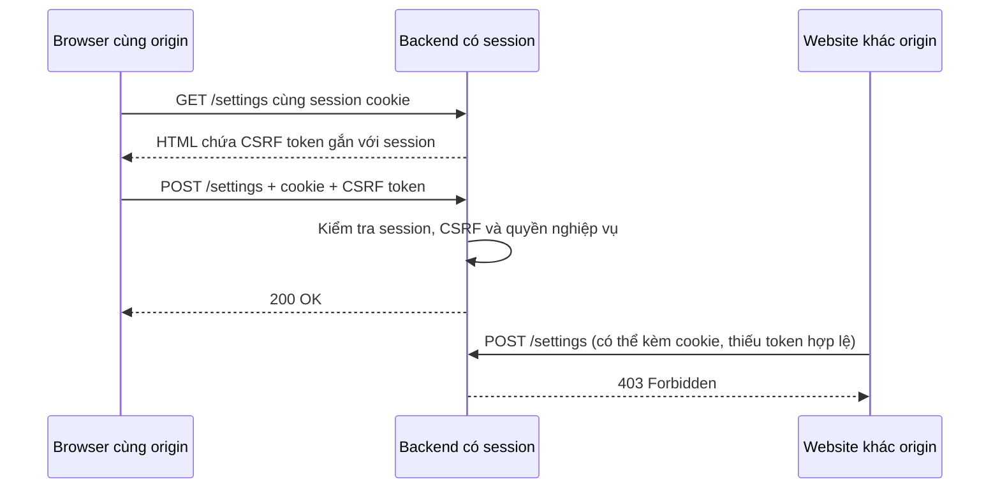

# Cookie-based token và CSRF trong bảo mật trình duyệt

## 1. Bài toán: cookie tự đi theo yêu cầu HTTP

Trong OAuth 2.0/OpenID Connect (OIDC), **Authorization Server** phát hành access token và có thể phát hành refresh token; **Resource Server** (API) kiểm tra token để quyết định truy cập. Trình duyệt lại có một cơ chế riêng: **cookie** được lưu theo phạm vi host/domain, path và chính sách trình duyệt, rồi tự động gửi trong những yêu cầu phù hợp.

Sự khác biệt này tạo ra một rủi ro quan trọng:

- Với header `Authorization: Bearer <token>` do mã ứng dụng chủ động thêm, trình duyệt thường không tự gắn bearer token vào một form từ website khác.
- Với token hoặc session ID đặt trong **cookie xác thực**, trình duyệt có thể tự gửi cookie khi người dùng bị dẫn tới một URL phù hợp, ngay cả khi yêu cầu bắt đầu từ một trang khác (phụ thuộc `SameSite` và các chính sách cookie).
- Nếu server thấy cookie hợp lệ và thực hiện ngay hành động thay đổi dữ liệu, kẻ tấn công có thể gây ra **Cross-Site Request Forgery (CSRF)** dù không đọc được cookie.

**CSRF** là việc kẻ tấn công khiến trình duyệt của người dùng đang có phiên đăng nhập gửi một yêu cầu trái ý người dùng tới ứng dụng tin cậy. CSRF chủ yếu khai thác **quyền xác thực được gắn tự động với request**, không đòi hỏi kẻ tấn công biết giá trị token.

Ví dụ: người dùng đăng nhập ở `https://bank.example`. Một website khác khiến browser gửi lệnh đổi email đến `https://bank.example/account/email`. Nếu browser gửi cookie phiên và backend không có CSRF protection, thao tác có thể thành công trong quyền của người dùng.

**Mục tiêu bài học:** hiểu các cách dùng cookie trong hệ thống token security; thiết kế `HttpOnly`, `Secure`, `SameSite` và phạm vi cookie; ngăn CSRF bằng token/chính sách nguồn gốc; phối hợp OAuth `state`/OIDC `nonce`, PKCE, lưu trữ token, refresh token rotation và kiểm tra `scope`/`aud`.

## 2. Cookie-based token là gì?

Cụm từ **cookie-based token** thường được dùng không thống nhất. Cần phân biệt ba kiến trúc:

| Kiến trúc | Cookie chứa gì? | Ai giữ OAuth token? | Lợi ích | Rủi ro chính |
| --- | --- | --- | --- | --- |
| **Server-side session/BFF** | Session ID ngẫu nhiên, thường `HttpOnly` | Backend/BFF giữ access và refresh token | Giới hạn token OAuth đi tới browser; dễ quản lý phiên | CSRF trên cookie phiên; XSS vẫn có thể ra lệnh trong phiên; cần bảo vệ session store |
| **JWT/access token trong cookie** | Access token có thể là JWT hoặc opaque token | Trình duyệt giữ cookie; server đọc token từ request | Có thể giảm công việc quản lý session tùy thiết kế | Token tự gửi tới domain/path phù hợp, CSRF; token bị lộ qua cookie/log; thu hồi JWT offline cần thiết kế |
| **Bearer token trong JavaScript** | Cookie có thể không chứa credential API | JS giữ access token (ví dụ memory) và tự đặt `Authorization` | Không tự động đính bearer vào cross-site form | XSS có thể đọc/lạm dụng token; mọi endpoint vẫn phải bảo vệ theo mô hình đe dọa |

**Session ID cũng là một loại bearer credential.** Nếu người khác có session ID hợp lệ và server không có ràng buộc bổ sung, họ có thể chiếm phiên. Tuy nhiên session ID **khác** OAuth access token và **khác** CSRF token.

Một BFF (Backend For Frontend) thường là lựa chọn phù hợp cho web app có backend: browser nhận một cookie phiên; BFF giữ OAuth token ở server, thực hiện kiểm tra phiên/CSRF/quyền rồi gọi API thay browser.

```mermaid
sequenceDiagram
    autonumber
    participant U as Browser
    participant B as BFF / Web Backend
    participant A as Authorization Server / OP
    participant R as Resource Server
    U->>B: Bắt đầu đăng nhập
    B->>A: Authorization Code + PKCE, state, nonce (OIDC)
    A-->>B: Callback chứa code và state qua browser
    B->>A: Đổi code lấy token từ token endpoint
    A-->>B: Access token, có thể refresh token/ID Token
    B->>B: Xác minh token, lưu token phía server
    B-->>U: Set-Cookie session ID HttpOnly; Secure; SameSite
    U->>B: POST /orders kèm cookie + CSRF token
    B->>B: Xác minh session, CSRF, phân quyền nghiệp vụ
    B->>R: Gửi access token cho API phù hợp aud/scope
    R-->>B: Kết quả
    B-->>U: Phản hồi ứng dụng
```

Điểm phân tách quan trọng: **CSRF token** chứng minh một yêu cầu thay đổi trạng thái đến từ luồng tương tác được ứng dụng cho phép; **OAuth access token** cấp quyền gọi API; **ID Token** phản ánh kết quả xác thực với client OIDC; **refresh token** dùng để xin token mới. Không dùng một giá trị thay thế cho giá trị khác.

## 3. CSRF xảy ra như thế nào?

Giả sử ứng dụng có endpoint đổi email:

```http
POST /account/email HTTP/1.1
Host: bank.example
Cookie: __Host-session=valid-session-id
Content-Type: application/x-www-form-urlencoded

email=new@example.com
```

Một trang độc hại ở origin khác có thể chứa biểu mẫu:

```html
<!-- Ví dụ minh họa yêu cầu giả mạo trên website do attacker kiểm soát. -->
<form action="https://bank.example/account/email" method="POST">
  <input type="hidden" name="email" value="attacker@example.net">
  <button type="submit">Xem ưu đãi</button>
</form>
```

Nếu người dùng kích hoạt biểu mẫu và browser **được phép gửi** cookie phiên đến `bank.example`, server có thể nhận một yêu cầu mang danh tính hợp lệ. Kẻ tấn công không nhất thiết đọc được phản hồi: **chỉ cần side effect được thực hiện là đủ gây hại**.

Tuy nhiên cần xét chính sách cookie thực tế. Cookie có `SameSite=Lax` hoặc `Strict` thường không được gửi trên cross-site POST thông thường; cookie `SameSite=None; Secure` có thể được gửi (còn phụ thuộc chính sách third-party cookie của browser). Vì vậy ví dụ chỉ thành công nếu điều kiện gửi credential thỏa mãn **và** server thiếu cơ chế chống CSRF phù hợp.

### Vì sao CORS không đủ?

**CORS** quyết định khi nào mã JavaScript ở origin khác được phép đọc phản hồi cross-origin và, trong nhiều trường hợp, liệu request có vượt qua **preflight**. HTML form thông thường có thể gửi một số loại cross-origin request mà không cần CORS preflight. CORS không phải bộ kiểm soát quyền nghiệp vụ của server.

Không nên kết luận “API không bật CORS thì không có CSRF”. Server phải bảo vệ những request có thể thay đổi trạng thái **ngay cả khi kẻ tấn công không đọc được kết quả**.

### Vì sao `HttpOnly` không đủ?

`HttpOnly` không cho JavaScript đọc cookie bằng `document.cookie`, nhưng không cấm browser gửi cookie khi yêu cầu phù hợp. Nó giảm khả năng trích xuất trực tiếp token qua XSS; nó **không** chứng minh yêu cầu là thao tác tự nguyện của người dùng.

## 4. Hiểu đúng thuộc tính của cookie

Ví dụ phản hồi tạo cookie phiên:

```http
HTTP/1.1 200 OK
Set-Cookie: __Host-session=opaque-random-session-id; Path=/; Secure; HttpOnly; SameSite=Lax; Max-Age=1800
Cache-Control: no-store
```

| Thuộc tính | Vai trò | Giới hạn cần nhớ |
| --- | --- | --- |
| `Secure` | Chỉ gửi cookie qua kết nối an toàn theo quy tắc trình duyệt | Không tự ngăn XSS, CSRF hoặc lộ cookie ở server; triển khai production bằng HTTPS |
| `HttpOnly` | Ngăn JavaScript thông thường đọc/sửa cookie qua API như `document.cookie` | Browser vẫn tự đính cookie vào request; XSS vẫn có thể ra lệnh trong phiên |
| `SameSite=Strict` | Hạn chế gửi cookie trong ngữ cảnh cross-site nghiêm ngặt | Có thể làm gián đoạn luồng điều hướng từ AS/OP hoặc đường dẫn bên ngoài về ứng dụng |
| `SameSite=Lax` | Thường cho phép cookie trên điều hướng cross-site cấp cao dùng phương thức an toàn như GET, hạn chế cross-site POST | Không ngăn tấn công **same-site từ subdomain khác**; các GET có side effect vẫn nguy hiểm |
| `SameSite=None; Secure` | Cho phép gửi trong ngữ cảnh cross-site khi browser hỗ trợ/chính sách cho phép | Tăng bề mặt CSRF, thường cần anti-CSRF token và Origin check; third-party cookie có thể bị chặn |
| `Domain` không khai báo | Tạo **host-only cookie**, chỉ cho host tạo cookie | Không làm Path thành ranh giới bảo mật; vẫn phải kiểm soát subdomain và host |
| `Domain=example.com` | Có thể chia sẻ cookie với các host/subdomain phù hợp | Mở rộng phạm vi nhận cookie, tăng rủi ro cookie tossing/nhầm lẫn subdomain |
| `Path=/` | Phạm vi đường dẫn mà browser gắn cookie | `Path` là quy tắc gửi cookie, **không phải cách cô lập bảo mật** giữa các ứng dụng cùng origin |
| `Max-Age`/`Expires` | Giới hạn thời gian browser lưu cookie | Không thay thế thời gian hết hạn session phía server hoặc `exp` của access token |
| `__Host-` prefix | Với browser hỗ trợ, yêu cầu `Secure`, `Path=/` và **không có `Domain`** | Làm rõ chủ sở hữu host; không ngăn tự động CSRF |

**Site khác origin.** Trong chính sách SameSite hiện đại, “site” thường dựa trên scheme và registrable domain. Ví dụ `https://app.example.com` và `https://evil.example.com` khác **origin** nhưng vẫn có thể cùng **site**. Nếu attacker kiểm soát một subdomain, `SameSite=Strict`/`Lax` không tự bảo vệ ứng dụng khỏi mọi yêu cầu xuất phát từ subdomain đó. Kiểm tra **Origin chính xác** và CSRF token vẫn cần thiết.

Không dựa vào “trình duyệt mặc định là Lax” khi thuộc tính `SameSite` bị bỏ trống: một số browser có ngoại lệ tương thích, chẳng hạn khoảng thời gian ngắn sau khi cookie mới được đặt. Hãy đặt thuộc tính có chủ đích và kiểm thử những browser sản phẩm hỗ trợ.

Trong OAuth callback:

- Authorization Code Flow dùng callback điều hướng **GET** top-level thường tương thích với cookie phiên `SameSite=Lax`.
- Nếu sử dụng OIDC `response_mode=form_post`, callback là cross-site **POST**; cookie `Lax` có thể không được gửi, làm mất khả năng tìm giao dịch `state` theo session. Cần thiết kế luồng tương thích và biện pháp chống CSRF chính xác, thay vì vô hiệu bảo vệ toàn ứng dụng.
- `SameSite=Strict` có thể không phù hợp với mọi đường đi OAuth, email link hoặc điều hướng từ nguồn ngoài.

## 5. Chiến lược chống CSRF cốt lõi

### 5.1. Synchronizer token pattern (khuyến nghị khi có phiên phía server)

Server tạo giá trị CSRF **ngẫu nhiên, không thể đoán** và liên kết với phiên đăng nhập. Giao diện hợp lệ nhận giá trị đó qua nội dung HTML hoặc một endpoint cùng origin được bảo vệ, rồi gửi lại trong form field hoặc request header cho những thao tác cần bảo vệ. Server đối chiếu token nhận được với token đang ràng buộc phiên.



Vì attacker ở website khác thường không thể đọc nội dung same-origin được bảo vệ để lấy CSRF token, yêu cầu giả mạo thiếu bằng chứng cần thiết. Bảo vệ này phụ thuộc **same-origin policy, chính sách CORS an toàn và việc chống XSS**: nếu attacker có XSS trong ứng dụng, họ có thể đọc CSRF token hoặc tạo yêu cầu hợp lệ.

Yêu cầu triển khai:

1. Sinh token bằng **CSPRNG**; không dùng timestamp, ID tăng dần, email hoặc một chuỗi đoán được.
2. Gắn token với **đúng phiên/ngữ cảnh xác thực**; thay đổi hoặc cấp lại theo chính sách khi phiên đăng nhập đổi và không chấp nhận token của phiên khác.
3. Bắt buộc trên **mọi endpoint thay đổi trạng thái** dùng cookie auth, bao gồm POST/PUT/PATCH/DELETE, thao tác đổi mật khẩu, thêm phương thức thanh toán, logout và cả endpoint GET bị thiết kế sai tạo side effect (cần sửa endpoint GET).
4. Đọc token từ **form field hoặc custom header**, không coi việc token tồn tại trong cookie tự gửi là đủ.
5. Thiếu/sai/hết hạn token ⇒ **403 hoặc lỗi bảo mật tương đương**, không thực hiện thao tác.
6. Không ghi CSRF token vào URL/log; tránh trang chứa token bị cache công khai.

CSRF token **không phải access token**, không cần đem gửi tới Resource Server như credential. Nó xác thực tính hợp lệ của yêu cầu tại ranh giới browser → web backend/BFF.

### 5.2. Double-submit cookie pattern

Với kiến trúc không lưu server session dành cho CSRF, ứng dụng có thể tạo một giá trị token đọc được bởi frontend, frontend gửi lại giá trị đó ở **header riêng**, và server kiểm tra. Tuy nhiên bản “naive double-submit” chỉ so khớp hai giá trị do client cung cấp có thể bị khai thác khi attacker có khả năng đặt/ghi đè cookie ở domain liên quan.

Hướng vững hơn là **signed double-submit token ràng buộc với phiên** (session-bound, dùng HMAC với khóa server). Server xác minh chữ ký và rằng token thuộc đúng phiên hiện tại; khóa ký không bao giờ đưa tới browser. Không tái sử dụng JWT signing key hay OAuth bearer token làm CSRF token mà không có thiết kế, phân tách khóa và phạm vi rõ ràng.

### 5.3. Kiểm tra Origin, Referer và Fetch Metadata

Áp dụng các lớp bổ sung:

- Với request thay đổi trạng thái, nếu có header `Origin` thì xác minh **origin chính xác** thuộc danh sách được phép (scheme, hostname và port). Không chỉ so sánh suffix hoặc chuỗi con.
- Nếu `Origin` vắng mặt và cần fallback, dùng `Referer` theo chính sách rõ ràng; cân nhắc quyền riêng tư, proxy và các trường hợp thiếu header. Không tự động chấp nhận mọi request thiếu cả hai.
- Header `Sec-Fetch-Site` giúp nhận diện nguồn `cross-site`, `same-site`, `same-origin` hoặc `none`. Có thể từ chối các yêu cầu `cross-site` có side effect ngoài luồng đã cho phép. Header này chỉ là lớp bảo vệ bổ sung và có thể thiếu ở một số client.
- Không cho phép mọi origin qua CORS có credential. Nếu hỗ trợ nhiều frontend, đối chiếu với **allowlist origin rõ ràng** theo từng môi trường.

Các kiểm tra header có ngoại lệ theo sản phẩm (ví dụ callback OAuth) cần thiết kế rõ ràng; không tắt toàn bộ CSRF vì một endpoint cần xử lý khác.

### 5.4. SameSite và custom header là lớp bổ sung

`SameSite` giúp browser hạn chế gửi credential trong nhiều bối cảnh, còn yêu cầu custom header cho request JSON có thể gây preflight khi cross-origin. **Không chỉ dựa vào hai cơ chế này**: browser có khác biệt; ứng dụng có thể vô tình nhận `text/plain`, form POST, method override, endpoint GET thay đổi trạng thái hoặc subdomain cùng site.

Một cơ chế tốt thường kết hợp **CSRF token ràng buộc phiên + Origin/Fetch Metadata hợp lý + SameSite + CORS giới hạn**.

## 6. Ví dụ Java/Spring Security với session cookie và CSRF

### 6.1. Cấu hình SecurityFilterChain

Ví dụ Spring Security 6+ cho ứng dụng web có OAuth2 Login. Bộ lọc CSRF được **giữ bật** theo mặc định; cần kiểm tra cấu hình thực tế vì mỗi ứng dụng có endpoint và session policy khác nhau.

```java
import org.springframework.context.annotation.Bean;
import org.springframework.context.annotation.Configuration;
import org.springframework.security.config.Customizer;
import org.springframework.security.config.annotation.web.builders.HttpSecurity;
import org.springframework.security.web.SecurityFilterChain;

@Configuration
public class SecurityConfig {
    @Bean
    SecurityFilterChain securityFilterChain(HttpSecurity http) throws Exception {
        http
            .authorizeHttpRequests(auth -> auth
                .requestMatchers("/assets/**", "/error").permitAll()
                .anyRequest().authenticated())
            .oauth2Login(Customizer.withDefaults())
            .csrf(Customizer.withDefaults()); // Giữ CSRF cho request thay đổi trạng thái

        return http.build();
    }
}
```

Spring Security có CSRF protection tích hợp cho web session. Trong hệ thống thực tế cần cấu hình authorization request repository, session fixation protection, cookie policy và xử lý logout phù hợp; code trên minh họa cách **không vô hiệu CSRF**.

### 6.2. Form được tạo bởi server

Với template engine hỗ trợ Spring Security, một form thay đổi dữ liệu nên gửi trường CSRF do framework tạo ra. Ví dụ Thymeleaf:

```html
<form th:action="@{/profile/email}" method="post">
  <label>Email mới
    <input type="email" name="email" required>
  </label>
  <input type="hidden"
         th:name="${_csrf.parameterName}"
         th:value="${_csrf.token}">
  <button type="submit">Lưu</button>
</form>
```

Trong một số cấu hình, Thymeleaf/Spring tự chèn trường CSRF vào form; cần chọn **một** cách tích hợp đúng để không tạo field trùng. Server vẫn phải kiểm tra CSRF trước khi thực hiện thay đổi và phân quyền theo phiên.

### 6.3. Fetch API gửi CSRF header

Với ứng dụng render trang cùng origin, server có thể đưa CSRF token vào meta element được bảo vệ bởi same-origin policy:

```html
<meta name="_csrf" th:content="${_csrf.token}">
<meta name="_csrf_header" th:content="${_csrf.headerName}">
<script>
async function updateEmail(newEmail) {
  const token = document.querySelector('meta[name="_csrf"]').content;
  const headerName = document.querySelector('meta[name="_csrf_header"]').content;

  const response = await fetch('/api/profile/email', {
    method: 'POST',
    credentials: 'same-origin',
    headers: {
      'Content-Type': 'application/json',
      [headerName]: token
    },
    body: JSON.stringify({ email: newEmail })
  });

  if (!response.ok) throw new Error('Yêu cầu bị từ chối');
}
</script>
```

Khi token được đưa vào DOM, **XSS có thể đọc nó**. CSRF token nhằm ngăn website khác gửi request giả mạo; nó không thay thế phòng chống XSS. Với SPA và các phiên bản Spring Security có bảo vệ token theo cơ chế XOR/deferred, cần dùng cách lấy và luân chuyển CSRF token đúng với integration của framework, nhất là sau login/logout; không tự vô hiệu hóa CSRF để “sửa lỗi 403”.

### 6.4. Session cookie

Ví dụ xây header Set-Cookie bằng API Spring cho một **session ID ngẫu nhiên do server quản lý**, không phải raw OAuth access token:

```java
import java.time.Duration;
import org.springframework.http.HttpHeaders;
import org.springframework.http.ResponseCookie;
import jakarta.servlet.http.HttpServletResponse;

public void setAppSessionCookie(
        HttpServletResponse response, String serverSessionId) {

    ResponseCookie cookie = ResponseCookie.from("__Host-session", serverSessionId)
        .httpOnly(true)
        .secure(true)
        .sameSite("Lax")
        .path("/")
        .maxAge(Duration.ofMinutes(30))
        .build();

    response.addHeader(HttpHeaders.SET_COOKIE, cookie.toString());
}
```

Đây là ví dụ tạo cookie, **không thay thế** quản lý phiên hoàn chỉnh. Trong ứng dụng Spring Session hoặc servlet container, hãy cấu hình cookie bằng cơ chế của container/framework để tránh hai nguồn phát hành session song song. Thời gian session ở server phải được quản lý độc lập với `Max-Age` của browser.

## 7. OAuth/OIDC: CSRF ứng dụng và login CSRF khác nhau

OAuth/OIDC có các cơ chế riêng để bảo vệ luồng chuyển hướng xác thực:

| Cơ chế | Giải quyết câu hỏi nào? | Không thay thế điều gì? |
| --- | --- | --- |
| OAuth `state` | Callback authorization này có thuộc giao dịch và phiên browser đã khởi tạo không? | CSRF token cho các thao tác POST thay đổi dữ liệu trong ứng dụng |
| OIDC `nonce` | ID Token này có được cấp cho đúng yêu cầu xác thực đã khởi tạo không? | `state` và kiểm tra CSRF của form/API |
| PKCE `code_verifier` | Bên đổi authorization code có giữ bí mật đã cam kết bằng `code_challenge` không? | CSRF token cho cookie auth, bảo vệ refresh token |
| `iss` / `aud` / `exp` / `scope` | Token có đúng issuer, đối tượng, thời gian và quyền không? | Chứng minh request cookie là thao tác chủ động của người dùng |
| Cookie session + CSRF token | Request thay đổi trạng thái có đúng phiên và bằng chứng chống CSRF không? | Xác thực token OAuth, kiểm tra issuer và phân quyền |

**Login CSRF** có thể khiến nạn nhân bị đăng nhập vào tài khoản mà kẻ tấn công đã chọn hoặc hoàn thành sai giao dịch. Client cần tạo `state` ngẫu nhiên, gắn với giao dịch/session và **consume một lần**; nếu không khớp, từ chối callback trước khi đổi code.

Một số lưu ý:

- Với callback `GET /login/oauth2/code/...`, thông thường áp dụng kiểm tra `state` và ràng buộc issuer của OAuth client. Endpoint GET này có đặc điểm khác với POST thay đổi dữ liệu của ứng dụng.
- Với OIDC `response_mode=form_post`, callback có thể là cross-site POST. Nếu CSRF filter không thể nhận token form thông thường, chỉ cấu hình xử lý/ngoại lệ cho **đúng callback đã đăng ký** và đảm bảo kiểm tra `state` đầy đủ. Tránh `csrf.disable()` toàn cục.
- Với login/logout dùng session cookie, phải tính đến `SameSite` trong từng bước chuyển hướng; cấu hình cookie sai có thể khiến không tìm thấy session chứa giao dịch `state`.
- Sau khi xác thực, xoay session ID để giảm **session fixation**; xóa các giao dịch OAuth đã dùng, không đặt `code`, access token hoặc refresh token vào URL quay về.

## 8. Refresh token và cookie: rủi ro riêng

**Refresh token** thường sống lâu hơn access token, vì vậy nguy cơ bị lộ có thể kéo dài quyền truy cập. Đặt refresh token trong cookie `HttpOnly` có thể giảm khả năng JavaScript đọc trực tiếp, nhưng browser vẫn có thể **tự gửi cookie** tới endpoint refresh phù hợp.

Nếu frontend gọi `POST /auth/refresh` dựa trên refresh cookie, cần xem đó là một endpoint nhạy cảm:

1. Bắt buộc chính sách CSRF thích hợp, Origin check và CORS allowlist nếu gọi cross-origin.
2. Sử dụng refresh token rotation và **reuse detection** theo khả năng AS, hoặc refresh token sender-constrained khi phù hợp.
3. Giới hạn phạm vi cookie; không vô tình gửi refresh token tới mọi đường dẫn API. Nếu kiến trúc cho phép, BFF giữ refresh token hoàn toàn phía server.
4. Không log `Cookie`, `Set-Cookie`, refresh token hoặc token response.
5. Khi logout, thu hồi session phía server và token/grant phù hợp; xóa cookie ở browser bằng cùng đặc điểm phạm vi cần thiết.
6. Không dựa vào access token `exp` để suy ra thời hạn bảo vệ refresh token: đó là hai vòng đời khác nhau.

**Quan hệ với replay:** nếu refresh token bearer bị chiếm đoạt, kẻ tấn công có thể xin access token mới. Rotation/reuse detection giúp phát hiện một số trường hợp, nhưng không đảm bảo ngăn mọi lần sử dụng trước khi phát hiện. Sender-constrained token (DPoP/mTLS) có thể yêu cầu bằng chứng khóa; nếu máy client và khóa cũng bị chiếm, vẫn có thể bị lạm dụng.

## 9. Cross-origin SPA, CORS và cookie

Một frontend ở `https://app.example.com` gọi API tại `https://api.example.com` là **cross-origin**, mặc dù hai hostname có thể là **same-site**. Nếu xác thực bằng cookie, cần xem xét `credentials` của fetch/XHR, phạm vi cookie và chính sách CORS.

Ví dụ frontend chủ động gửi cookie với request cross-origin:

```javascript
await fetch('https://api.example.com/profile', {
  method: 'POST',
  credentials: 'include',
  headers: {
    'Content-Type': 'application/json',
    'X-CSRF-Token': csrfTokenFromApprovedFlow
  },
  body: JSON.stringify({ displayName: 'Tên mới' })
});
```

Điều kiện để luồng này hoạt động **và an toàn**:

- API cho phép đúng origin `https://app.example.com` và dùng `Access-Control-Allow-Credentials: true` khi cần; không kết hợp credentialed response với wildcard `Access-Control-Allow-Origin: *`.
- Cookie được đặt cho host/domain/path và SameSite phù hợp; nếu cross-site thực sự, `SameSite=None; Secure` có thể cần nhưng một số browser giới hạn third-party cookie.
- Server xác thực **CSRF token ràng buộc đúng phiên**, kiểm tra Origin/Fetch Metadata theo chính sách và phân quyền thao tác.
- Frontend chỉ lấy CSRF token từ nguồn đáng tin cậy. Không giả định token có thể đọc từ `HttpOnly` session cookie.
- Nếu có các subdomain kém tin cậy, origin cụ thể mới là ranh giới hữu ích hơn khái niệm same-site.

**Preflight không phải authentication.** Một request cross-origin có custom header có thể được preflight, nhưng server vẫn phải kiểm tra quyền/CSRF tại request thực tế, và không nhận các kiểu form content-type khác như đường vòng cho cùng endpoint nhạy cảm.

## 10. Token theft, XSS và CSRF: ba rủi ro liên quan nhưng khác nhau

| Tình huống | Điều attacker cần | Vai trò của bảo vệ |
| --- | --- | --- |
| **CSRF** | Nạn nhân có phiên/cookie tự đính vào request; attacker điều khiển hành động browser | CSRF token + Origin/Fetch Metadata + SameSite; backend phân quyền |
| **XSS** | Chạy script độc hại ngay trong origin ứng dụng | Escaping/sanitization, CSP, dependency hygiene, giảm quyền frontend; CSRF token có thể bị đọc/điều khiển |
| **Token theft** | Chiếm được token/session ID/khóa để sử dụng lại | Lưu trữ an toàn, TLS, không log token, hạn sống ngắn, revocation, DPoP/mTLS nếu phù hợp |
| **Session fixation** | Buộc victim dùng session ID do attacker đã chọn hoặc biết | Xoay session ID sau login/nâng quyền; chống nhận ID không hợp lệ |
| **Login CSRF** | Ghép phản hồi OAuth sai giao dịch vào browser victim | `state` gắn phiên/issuer, PKCE, OIDC `nonce` khi áp dụng |
| **Replay sau khi token bị lộ** | Có bearer token còn hạn hoặc đồng thời có khóa PoP | Xác minh `aud`/`scope`/thời hạn, sender constraint, refresh rotation và thu hồi |

Ngay cả khi session cookie đặt `HttpOnly; Secure; SameSite=Strict`, **XSS có thể gửi fetch tới endpoint cùng origin bằng phiên hiện có**. Do đó không hứa rằng một thuộc tính cookie sẽ vô hiệu hoàn toàn XSS hoặc kẻ tấn công có quyền điều khiển máy client.

## 11. Ví dụ phân tích kiến trúc

### Tình huống A: Web BFF có session cookie

Ứng dụng quản trị dùng OAuth2 Login, BFF lưu access token trong server store, browser có cookie `__Host-session`. Người dùng bấm “thêm thành viên” qua `POST /teams/123/members`.

**Thiết kế cần có:**

- BFF xác thực session và CSRF token của form/API, kiểm tra quyền của người dùng trên team 123, sau đó mới gọi Resource Server với access token phù hợp.
- RS kiểm tra `iss`, `aud`, `exp` và `scope`/permission; không dùng ID Token thay access token.
- Không đưa access token, refresh token hoặc session ID vào HTML, URL hoặc log.
- Session hết hạn/đăng xuất được vô hiệu ở backend; refresh token được bảo quản/thu hồi theo chính sách AS.

Nếu attacker tạo form POST ở site khác, yêu cầu thiếu CSRF token hợp lệ phải bị chặn, dù browser có gửi cookie.

### Tình huống B: Access JWT nằm trực tiếp trong cookie

Backend đọc cookie `access` chứa JWT và dùng nó làm credential API.

Một request làm thay đổi đơn hàng có thể gửi JWT tự động trong `Cookie`, nên vẫn cần CSRF protection theo hành vi cookie. Bên cạnh đó, backend phải xác minh chữ ký (hoặc dùng cơ chế token validation đúng profile), `iss`, `aud`, thời hạn, scope và quyền trên đơn hàng. `SameSite` chỉ bổ trợ, không thay toàn bộ CSRF.

Nếu JWT bị lộ, chữ ký hợp lệ không chứng minh người trình JWT là chủ thể ban đầu. Với JWT xác minh offline, việc revocation tức thời có thể cần denylist, rút ngắn tuổi thọ token hoặc một cơ chế kiểm tra trạng thái bổ sung.

### Tình huống C: SPA sử dụng bearer trong memory

SPA giữ access token trong memory và thêm `Authorization: Bearer ...` bằng JavaScript. Một form cross-site thường không tự thêm header bearer đó, nên **rủi ro CSRF trực tiếp trên API nhận riêng header bearer** có thể thấp hơn. Nhưng XSS tại origin SPA có thể đọc token hoặc gửi request có bearer, và các endpoint còn dùng cookie (login session, refresh, logout, account management) vẫn cần bảo vệ tương ứng.

Lựa chọn kiến trúc phải dựa trên bề mặt tấn công thực tế, không kết luận “SPA memory luôn an toàn hơn BFF” hoặc ngược lại.

## 12. Kiểm thử thực tế

| Kiểm thử | Kỳ vọng |
| --- | --- |
| POST thay đổi dữ liệu không có CSRF token | 403, không tạo side effect |
| POST có token của phiên khác hoặc token giả | 403, không tạo side effect |
| POST hợp lệ có session + CSRF + đủ quyền | Thành công |
| Cookie từ browser khác nhưng CSRF token cũ | Bị từ chối |
| Cross-site form POST từ origin không được phép | Bị từ chối hoặc không mang cookie theo chính sách; backend vẫn bảo vệ |
| Request từ subdomain cùng site nhưng **khác origin** không đáng tin | Bị từ chối nếu không có CSRF và chính sách nguồn gốc hợp lệ |
| GET `/delete?id=123` hoặc GET có side effect | Không được tồn tại; đổi sang thao tác có CSRF |
| Logout, reset quyền, refresh token qua cookie | Yêu cầu bảo vệ phù hợp; không chấp nhận request giả |
| Callback OAuth sai/missing/reused `state` | Từ chối trước khi đổi code/tạo session |
| OIDC callback `form_post` với cookie policy thực tế | Hoạt động đúng, vẫn kiểm tra state/issuer/nonce theo flow |
| CORS với origin lạ gửi credential | Không cấp quyền đọc response; không chấp nhận mutation trái chính sách |
| Cookie `Secure`, `HttpOnly`, `SameSite`, `Path`, `Domain` | Đúng chính sách; `__Host-` không khai báo Domain |
| CSRF token hoặc raw OAuth token trong log/URL | Không xuất hiện |
| Session ID trước và sau login | Được đổi để chống session fixation |
| Expire/logout/refresh token reuse | Session và token/grant bị xử lý đúng chính sách |

Có thể dùng integration test của Spring Security với `spring-security-test` để kiểm tra các endpoint có/không có CSRF. Ví dụ minh họa:

```java
import static org.springframework.security.test.web.servlet.request.SecurityMockMvcRequestPostProcessors.csrf;
import static org.springframework.test.web.servlet.request.MockMvcRequestBuilders.post;
import static org.springframework.test.web.servlet.result.MockMvcResultMatchers.status;

// Trường hợp thiếu CSRF: giả sử đã có authenticated session.
mockMvc.perform(post("/api/profile/email")
        .with(authenticatedUser())
        .param("email", "new@example.com"))
    .andExpect(status().isForbidden());

// Trường hợp có CSRF: còn cần kiểm tra permission và dữ liệu được đổi đúng.
mockMvc.perform(post("/api/profile/email")
        .with(authenticatedUser())
        .with(csrf())
        .param("email", "new@example.com"))
    .andExpect(status().isOk());
```

`authenticatedUser()` ở đây là **test helper giả định** dùng để cung cấp người dùng đã xác thực; không phải API mặc định của Spring Security. Trong dự án thực, dùng `user("alice")`/`oidcLogin()` hoặc helper xác thực tương ứng và xác minh kết quả nghiệp vụ. Không viết test chỉ phản chiếu cấu hình; hãy xác nhận request giả bị từ chối **và không có thay đổi dữ liệu**.

## 13. Lỗi triển khai thường gặp

1. **Tắt CSRF toàn cục** vì một OAuth callback POST hoặc một API test trả 403. Cần xem đúng endpoint, request type và cơ chế state/CSRF.
2. **Đặt access token trong cookie rồi xem nó như header bearer được gửi chủ động.** Cookie được browser tự gắn theo chính sách, nên cần threat model CSRF.
3. **Tin rằng `HttpOnly` chống CSRF.** Thuộc tính này chỉ giảm khả năng JS trực tiếp đọc cookie.
4. **Tin rằng `SameSite=Strict` ngăn mọi yêu cầu không đáng tin.** Cùng site khác origin vẫn là đường tấn công, và site policy không thay thế authorization.
5. **Dùng CSRF token cố định toàn hệ thống**, hoặc lấy CSRF token từ cùng cookie do attacker có thể thay thế rồi chỉ so hai giá trị.
6. **Cho phép `Access-Control-Allow-Origin: *` và credentials**, hoặc phản chiếu Origin tùy ý mà không có allowlist.
7. **Đọc JSON nhưng vẫn chấp nhận fallback form-urlencoded/text/plain** cho cùng lệnh nhạy cảm mà không kiểm tra CSRF.
8. **Chỉ chặn POST** nhưng để GET có side effect, hoặc cho method override mà quên kiểm tra sau khi chuyển method.
9. **Lấy `state` OAuth làm CSRF token dùng cho mọi request ứng dụng.** Hai giá trị có phạm vi và vòng đời khác nhau.
10. **Tin rằng CSRF token bảo vệ khỏi XSS.** Script trong origin có thể lấy token hoặc trực tiếp điều khiển yêu cầu.
11. **Không kiểm tra `aud`/`scope` ở Resource Server**, cho rằng cookie session đã xác thực là đủ phân quyền API.
12. **Ghi toàn bộ Cookie/Set-Cookie/Authorization vào log** hoặc đẩy token vào analytics, history hay URL.

## 14. Ghi nhớ và tài liệu tham khảo

- **Cookie-based authentication** là một cách trình duyệt gửi credential; cookie có thể chứa session ID hoặc token. Rủi ro CSRF đến từ việc browser có thể **tự động** đính credential.
- **`HttpOnly` bảo vệ khỏi đọc cookie qua JavaScript thông thường; `Secure` bảo vệ việc truyền qua kết nối không an toàn; `SameSite` giảm một số request cross-site; `__Host-` giúp giới hạn phạm vi cookie.** Mỗi cơ chế có giới hạn riêng.
- **CSRF token gắn phiên**, kiểm tra Origin/Fetch Metadata và chính sách CORS chặt chẽ là các lớp bảo vệ cho yêu cầu thay đổi trạng thái. Mọi hành động nhạy cảm vẫn phải được kiểm tra authorization.
- **OAuth `state` ngăn ghép sai callback/login CSRF; OIDC `nonce` ràng buộc ID Token; PKCE bảo vệ việc đổi authorization code.** Chúng không thay CSRF token cho các form/API dùng cookie.
- **Access token (JWT/opaque)** dùng cho API, **ID Token** dùng cho client OIDC, **refresh token** dùng để xin token mới. BFF có thể giữ các token này ở server và chỉ cấp cookie phiên cho browser.
- Logout, thu hồi session, refresh rotation/reuse detection, quản trị khóa và chống token theft/replay vẫn cần được thiết kế song song với chống CSRF.

**Tham khảo:** HTTP State Management Mechanism (RFC 6265 và các bản cập nhật cookie hiện hành); OAuth 2.0 (RFC 6749); OAuth 2.0 Security Best Current Practice (RFC 9700); PKCE (RFC 7636); OAuth 2.0 Token Revocation (RFC 7009); OpenID Connect Core 1.0; OWASP Cross-Site Request Forgery Prevention Cheat Sheet; OWASP Session Management Cheat Sheet; tài liệu Spring Security về CSRF Protection và OAuth2 Login.

