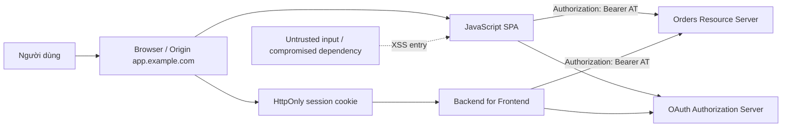
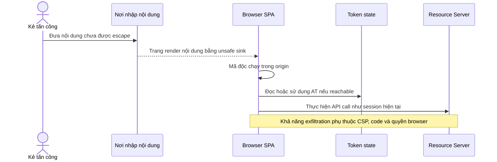
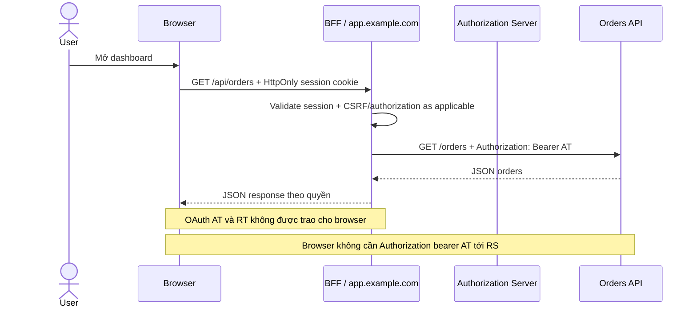

# Authorization header và XSS

## 1. Bài toán: token nằm trong header nhưng JavaScript vẫn có thể bị chiếm

Một ứng dụng quản lý đơn hàng sử dụng OAuth 2.0 Authorization Code + PKCE. Sau khi đăng nhập, frontend gửi request:

```http
GET /v1/orders HTTP/1.1
Host: orders-api.example.com
Authorization: Bearer <access_token>
Accept: application/json
```

Nhóm phát triển nghĩ: “Access token nằm trong header `Authorization`, không nằm trong URL nên XSS sẽ không lấy được.” Nhận định này **không chính xác**. Nếu JavaScript của trang lấy token từ `localStorage`, `sessionStorage`, biến trong bộ nhớ hoặc một API trả token, thì mã độc chạy **trong cùng origin** có thể tiếp cận token hoặc lạm dụng luồng gọi API tùy kiến trúc.

Ngay cả trong mô hình **Backend for Frontend (BFF)**, nơi access token được giữ **chỉ ở backend** và browser gửi một cookie `HttpOnly`, XSS vẫn có thể dùng phiên browser đang hoạt động để gọi các endpoint được cho phép và đọc các response mà script same-origin có quyền đọc. BFF giảm đáng kể bề mặt **đánh cắp raw OAuth token qua JavaScript**, nhưng **không tự biến một ứng dụng có XSS thành an toàn**.

### 1.1. Hai tình huống cần phân biệt

**Tình huống A — SPA trực tiếp giữ access token:**

```text
Browser SPA
   | JavaScript đọc access token từ memory/storage
   | fetch(..., Authorization: Bearer <AT>)
   v
Resource Server

Nếu XSS chạy trong origin:
   có thể lấy token nếu token reachable,
   hoặc gọi API với token thông qua mã đang chạy.
```

**Tình huống B — BFF giữ access token server-side:**

```text
Browser
   | Cookie: __Host-session=<opaque_session_id> (HttpOnly)
   v
BFF
   | Authorization: Bearer <AT> (chỉ backend giữ)
   v
Resource Server

Nếu XSS chạy trong origin:
   thường không đọc raw HttpOnly cookie bằng document.cookie,
   nhưng vẫn có thể gửi yêu cầu dùng cookie và lạm dụng
   các API mà session hiện tại được phép.
```

> **Nguyên tắc cốt lõi:** Đặt access token vào `Authorization` header bảo vệ cách **trình bày credential**, không tự bảo vệ nó khỏi mã JavaScript độc hại đang chạy trong origin. Cần kết hợp **phòng chống XSS, kiến trúc lưu token, giới hạn scope/audience, vòng đời token, authorization phía server và giám sát**.

Bài **“Authorization header và XSS”** thuộc chương **Browser security** của module `SECURITY_TOKEN_SECURITY_FUNDAMENTALS`. Phạm vi liên hệ mô hình tin cậy và vòng đời security token, JWT/opaque token, access/refresh token, OAuth 2.0/OIDC, phát hành và xác minh claims/scope/audience, lưu trữ, thu hồi và chống token theft/replay.

## 2. Mục tiêu học tập

Sau khi học, bạn có thể:

1. Giải thích **HTTP `Authorization` header** mang credential ra sao và vì sao nó không phải “kho lưu trữ bí mật”.
2. Phân biệt **browser origin, JavaScript execution context, cookie, frontend storage, BFF token vault** và resource server.
3. Mô tả hai tác động XSS: **token exfiltration** và **authenticated action abuse**.
4. Hiểu rủi ro của `localStorage`, `sessionStorage`, biến bộ nhớ, Web Worker và Service Worker đối với token trong browser.
5. Giải thích **BFF + `HttpOnly` session cookie** giảm lộ raw OAuth token thế nào và giới hạn của giải pháp.
6. Phân biệt **XSS, CSRF, CORS, Same-Origin Policy và CSP**; không nhầm kiểm soát này thay kiểm soát khác.
7. Viết JavaScript `fetch` gửi bearer token theo đúng mục đích trong SPA và tránh gửi token tới origin không đáng tin.
8. Nhận biết sink nguy hiểm như `innerHTML`, `insertAdjacentHTML`, DOM-based XSS và cách dùng `textContent`, auto-escaping, sanitization.
9. Thiết kế CSP, Trusted Types, kiểm soát third-party scripts và code review chống XSS ở các ranh giới nhạy cảm.
10. Đánh giá token type/audience/scope, JWT/opaque, refresh-token rotation và DPoP trong trường hợp XSS.
11. Thiết kế logout/revocation/incident response sau khi token hoặc session bị lạm dụng.
12. Xây ma trận kiểm thử từ nhập liệu, browser/network cho tới OAuth/RS authorization và logging.

## 3. Bản đồ khái niệm: bốn lớp bảo vệ độc lập

| Lớp | Câu hỏi bảo mật | Ví dụ kiểm soát |
| --- | --- | --- |
| **Browser code integrity** | JavaScript đang chạy có đáng tin và không bị XSS? | Contextual escaping, safe DOM APIs, CSP, Trusted Types |
| **Credential confidentiality** | Script có thể đọc/copy raw token hay session handle? | BFF token vault, `HttpOnly` cookies, hạn chế storage |
| **Token trust/usage** | Token được phát bởi ai, dùng ở đâu, có còn hiệu lực? | `iss/aud/exp/type/scope`, signature/introspection, DPoP/mTLS, revocation |
| **Business authorization** | Caller được thực hiện thao tác cụ thể trên object này? | Resource ACL/ABAC, tenant check, step-up, limits, audit |

Bảo vệ một lớp không thay thế lớp khác. Ví dụ:

- JWS signature hợp lệ **không** chặn XSS đọc raw bearer token.
- JWE encrypt payload **không** chặn attacker replay nguyên bearer token.
- Cookie `HttpOnly` **không** ngăn XSS gọi API cùng origin.
- CSP tốt **không** miễn kiểm tra `aud`, `scope` hoặc quyền sở hữu order.
- DPoP ràng buộc token với key **không** ngăn mã độc đang chạy trong origin yêu cầu ký/gửi request khi nó có khả năng sử dụng key.

### 3.1. Những actor và trust boundaries



Sơ đồ thể hiện **hai kiến trúc thay thế**, không nên suy ra cùng một browser phải chạy đồng thời SPA cầm AT và BFF cầm AT. AS cấp token theo đúng OAuth flow; callback, PKCE, client authentication và token storage cần được thiết kế riêng.

## 4. `Authorization` header là gì?

Trong HTTP, `Authorization` là header mang credential cho một request tới một target theo authentication scheme đã định. Với OAuth 2.0 bearer token, cách dùng chuẩn thường là:

```http
Authorization: Bearer eyJhbGciOi...
```

Client trình **access token** đến **đúng resource server**. Resource server phải xác minh token trước khi cấp quyền.

Một request có thể có:

```http
GET /v1/orders/42 HTTP/1.1
Host: api.example.com
Authorization: Bearer <AT_FOR_ORDERS_API>
Accept: application/json
```

### 4.1. Header không mã hóa token

- Header `Authorization` **không tự encrypt** giá trị.
- HTTPS/TLS bảo vệ request khi truyền qua các kết nối được xác thực và mã hóa đúng.
- Sau khi TLS kết thúc ở gateway, token có thể tồn tại trong memory, internal request, tracing và logging.
- Nếu token là JWS JWT, phần claims thường có thể **Base64url decode** mà không cần khóa.
- Nếu token là JWE, ciphertext che payload nhưng **toàn bộ token vẫn là credential có thể bị replay** nếu bearer.
- Nếu token là opaque, token value không tiết lộ claims trực tiếp nhưng **vẫn là secret cần bảo vệ**.

**Vị trí trong header không thay security properties của token.**

### 4.2. `Authorization` không phải `Cookie`

| Đặc điểm | `Authorization: Bearer` do JS đặt | `Cookie: session=...` theo browser |
| --- | --- | --- |
| Ai thêm vào request? | Thường ứng dụng/client code | Browser tự gửi theo cookie scope và request credentials policy |
| JS có thể đọc raw credential? | Nếu token do JS quản lý/accessible | `HttpOnly` cấm `document.cookie` đọc cookie đó |
| Rủi ro XSS đọc raw token | Cao nếu token JS-reachable | Thường giảm với `HttpOnly` nhưng không ngăn session riding |
| Rủi ro CSRF cổ điển | Thấp hơn khi JS phải tự cung cấp bearer value; còn điều kiện khác | Có, vì cookie là ambient credential khi được browser gửi |
| CORS ảnh hưởng thế nào? | Cross-origin `Authorization` thường gây preflight | Credentialed CORS/cookie policies có quy tắc riêng |
| Server có cần validate? | Luôn cần | Luôn cần |

Không có cột nào nghĩa “header luôn tốt hơn cookie” hoặc ngược lại. **Ranh giới script, nơi lưu token, yêu cầu CSRF, độ phức tạp và quyền server** là các yếu tố cần cân nhắc.

### 4.3. Browser tự động gửi gì?

Nếu ứng dụng chạy:

```js
await fetch("/api/orders", { method: "GET" });
```

browser có thể gửi cookies thích hợp theo `fetch` credentials mode, cookie attributes và site context. Browser **không tự tạo** OAuth bearer `Authorization` từ access token nằm trong localStorage. Code ứng dụng phải chỉ định bearer header, hoặc BFF tự thêm access token khi gọi RS ở backend.

Điều này lý giải vì sao **CSRF và XSS khác nhau**: CSRF tận dụng credential mà browser gửi tự động; XSS chạy script trong origin và có thể **chủ động đặt header** hoặc gọi API như app.

## 5. XSS là gì trong ngữ cảnh token?

**Cross-Site Scripting (XSS)** xảy ra khi dữ liệu không đáng tin bị diễn giải thành script/HTML có khả năng thực thi trong context của ứng dụng web.

Các biến thể phổ biến:

1. **Stored XSS:** payload nguy hiểm được lưu trên server (ví dụ mô tả đơn hàng/bình luận) rồi được hiển thị cho người khác.
2. **Reflected XSS:** dữ liệu từ URL/request được phản hồi ngay trong HTML/JS context theo cách gây thực thi.
3. **DOM-based XSS:** JavaScript client đọc dữ liệu từ location/hash/postMessage/DOM rồi đưa vào một sink có khả năng thực thi.
4. **Supply-chain/client script compromise:** dependency hoặc script bên thứ ba bị chiếm, chạy trong context trang, có thể gây tác động tương tự đối với token/phiên.

### 5.1. Source và sink

```text
Untrusted source
  ├─ user profile displayName
  ├─ query string / location.hash
  ├─ API response containing user-generated content
  ├─ postMessage from other origin
  └─ external widget / third-party script
              |
              v
Dangerous sink
  ├─ element.innerHTML
  ├─ insertAdjacentHTML(...)
  ├─ document.write(...)
  ├─ eval / new Function
  ├─ unsafe script URL / event handler construction
  └─ HTML template escaping bypass
              |
              v
Unexpected JavaScript execution within app origin
```

**Không phải mọi dữ liệu untrusted đều gây XSS**; lỗi xuất hiện khi dữ liệu được đưa vào context có thể thực thi mà không áp đúng quy tắc xử lý.

### 5.2. Origin quyết định khả năng đọc dữ liệu

Browser **Same-Origin Policy** thường coi origin gồm **scheme, host và port**. Ví dụ:

```text
https://app.example.com      -> origin A
https://api.example.com      -> origin B
https://app.example.com:8443 -> origin C
http://app.example.com       -> origin D
```

Một script độc hại chạy **trong origin A** có thể được browser đối xử như code của ứng dụng A. Nó có thể đọc phần lớn DOM, storage và gọi same-origin APIs mà không phải vượt SOP; tùy token exposure nó cũng có thể dùng token để gọi cross-origin API đã cho phép app origin.

**CORS không bảo vệ khỏi XSS chạy ngay trong origin được tin cậy.**

### 5.3. Tác động lên security token

Một kịch bản khái niệm:



Nếu attacker có thể lấy **raw bearer token**, họ có thể thử dùng nó **ngoài browser** cho đến khi hết hạn/thu hồi, tùy audience, sender binding và các chính sách khác. Nếu không lấy được raw token, script vẫn có thể **lạm dụng phiên trực tiếp** để đọc dữ liệu hoặc thực hiện hành động khi đang chạy.

## 6. Hai con đường tấn công XSS: trộm token và lạm dụng phiên

### 6.1. Token exfiltration

Điều kiện thường gặp:

- Token nằm trong `localStorage`/`sessionStorage`/IndexedDB.
- Token nằm trong biến/global store JS mà mã độc có thể đọc hoặc tương tác.
- App có endpoint trả access token cho browser.
- Token xuất hiện trong DOM, error message, console hoặc client-side telemetry.
- Mã độc có thể intercept/monkey-patch các API của ứng dụng để quan sát `fetch`/headers hoặc lấy token trong quá trình sử dụng.

Sau khi có raw bearer AT, attacker có thể dùng nó từ máy của họ nếu token còn active và RS không yêu cầu sender proof.

### 6.2. Authenticated action abuse

Ngay cả khi token nằm hoàn toàn ở BFF:

```text
XSS script in app.example.com
  -> fetch("/api/orders/42", { credentials: "same-origin" })
  -> browser includes HttpOnly session cookie
  -> BFF authenticates session and calls RS with server-held AT
  -> response becomes readable to same-origin script
```

Cookie `HttpOnly` vẫn hoạt động đúng: script **không đọc được cookie value** qua `document.cookie`. Nhưng nó không ngăn script **gửi request sử dụng cookie** hoặc đọc response được phép.

Điều này dẫn tới nguyên tắc rất quan trọng:

> **HttpOnly giảm credential theft, không loại bỏ XSS-driven operations.**

Cần chống XSS ở nguồn, kiểm soát endpoint side effects, CSRF defenses cho cookie-authenticated routes, authorization từng object, step-up phù hợp và giám sát.

### 6.3. “Không exfil được token” chưa chắc đồng nghĩa an toàn

Một chính sách `connect-src` nghiêm ngặt trong CSP có thể cản script gửi dữ liệu tới một số endpoint attacker, nhưng:

- Script vẫn có thể **gọi API nội bộ** trong origin được cho phép.
- Script có thể thao tác UI, đổi dữ liệu hoặc tạo một workflow lạm dụng.
- Browser có nhiều kênh truyền dữ liệu cần threat model (navigation, forms, resource requests, external integrations).
- Bất kỳ script trusted hoặc bên thứ ba bị compromise có thể có quyền rộng.

CSP là **defense in depth**, không thay safe rendering hay backend authorization.

## 7. Token storage trong browser: cái gì được XSS chạm tới?

Không có nơi lưu token nào trong một browser SPA cung cấp **bảo vệ tuyệt đối trước script ác ý đang chạy đúng origin**. Mỗi lựa chọn có trade-off.

| Nơi lưu/giữ | Ưu điểm | Điều XSS vẫn có thể làm |
| --- | --- | --- |
| `localStorage` | Dễ dùng, tồn tại qua browser reload | Same-origin JS có thể đọc trực tiếp, copy AT/RT |
| `sessionStorage` | Theo tab/window context; tự hết khi phiên tab kết thúc theo điều kiện | JS trong cùng context đọc được; không chống XSS |
| Biến memory/module/closure | Không persist mặc định qua reload; giảm exposure at rest | XSS có thể can thiệp flow, gọi API, monkey-patch, tương tác module nếu reachable |
| IndexedDB | Dung lượng/cấu trúc linh hoạt | Same-origin JS có thể truy cập qua APIs; không tự chống XSS |
| Web Worker | Có thể cô lập một số state khỏi main-thread trực tiếp | XSS có thể gửi messages tới worker như app, lạm dụng năng lực ký/gọi API tùy design |
| Service Worker | Có thể broker requests trong origin/scope | Không tự là secret vault; có registration/lifecycle, message và trust risks |
| `HttpOnly` cookie chứa **session ID**, AT giữ BFF | JS không đọc cookie value trực tiếp; raw AT không vào browser | XSS vẫn gửi các request với cookie và đọc response phù hợp |
| Cookie không `HttpOnly` chứa AT | Browser tự gửi cookie theo scope nhưng JS đọc được | Raw token theft, XSS và CSRF risks; thường không nên |

### 7.1. `localStorage` không mã hóa bằng key bí mật của origin

Sử dụng:

```js
localStorage.setItem("access_token", accessToken);
```

không bảo đảm confidentiality trước XSS. Nếu code độc hại chạy same-origin:

```js
// Chỉ minh họa dữ liệu mà script trong cùng origin có thể đọc.
const tokenMayBeVisible = localStorage.getItem("access_token");
```

thì giá trị là một chuỗi mà script có thể lấy trực tiếp.

Đổi sang `sessionStorage` có thể giảm thời gian tồn tại và sharing scope, **không thay security boundary** đối với script trong tab đó.

### 7.2. Biến JavaScript trong memory có an toàn hơn?

Giữ AT chỉ trong một module closure hoặc in-memory state giảm khả năng token tồn tại trên disk qua reload, nhưng:

- XSS có thể gọi các API mà code hợp lệ đã expose.
- XSS có thể chạy trước/cùng thời điểm app và quan sát token qua instrumented functions nếu ứng dụng dễ bị can thiệp.
- Nếu script chiếm origin, `fetch`/XHR và request construction cũng nằm trong cùng execution environment.
- Token JS-reachable không phải một credential được cách ly mật mã khỏi malicious same-origin script.

**In-memory thường tốt hơn persistence vô hạn trong storage xét một số rủi ro**, nhưng không nên tuyên bố “memory chống XSS”.

### 7.3. Mã hóa access token rồi lưu ở localStorage?

Một ý tưởng phổ biến:

```text
ciphertext = Encrypt(accessToken, keyInJavaScript)
localStorage.setItem("token", ciphertext)
```

Nếu decryption key cũng sẵn cho same-origin JavaScript, XSS có thể dùng key hoặc gọi decryption path. Mã hóa client-side có thể bảo vệ một số rủi ro at-rest riêng, nhưng **không tạo trust boundary chống same-origin XSS** nếu attacker có năng lực tương tự app.

### 7.4. Worker/key isolation có giá trị nhưng giới hạn

Web Crypto có thể tạo **non-extractable CryptoKey**. Điều này hạn chế xuất raw private key qua API. Nhưng nếu malicious script có thể **gửi yêu cầu ký** đến worker/key-holding component, nó có thể lạm dụng quyền ký khi phiên còn hợp lệ.

Cần thiết kế:

- Key ownership và isolation.
- Message schema và caller/request validation.
- Rate limits, nonce and anti-replay proof.
- Ngăn giao diện signing oracle mở rộng tùy ý.
- Ràng buộc proof với method/URL/access token.
- AS/RS revoke state.

**Không quảng cáo non-extractable key là lời giải hoàn chỉnh cho XSS.**

## 8. Browser/Backend for Frontend (BFF): chuyển ranh giới giữ token

Trong BFF OAuth architecture:

1. Browser bắt đầu login đến backend.
2. BFF thực hiện Authorization Code + PKCE và client authentication theo registration.
3. BFF giữ access/refresh tokens ở server-side token store.
4. Browser giữ một **opaque application session cookie**.
5. Browser gọi same-origin BFF endpoints.
6. BFF xác thực session, kiểm tra authorization rồi thêm `Authorization: Bearer <AT>` khi gọi downstream RS.
7. BFF refresh/revoke token tại AS theo grant/session state.



### 8.1. Vì sao BFF giảm token theft từ XSS?

Script độc hại trong browser không có đường đọc trực tiếp:

```text
BFF token vault:
  session_id -> AT/RT (server-side only)
```

Raw AT/RT không xuất hiện trong DOM/localStorage và không phải header mà browser tự đặt tới RS. Chỉ có cookie session được browser gửi tới BFF; với `HttpOnly`, script không đọc raw cookie trực tiếp.

### 8.2. BFF không tự giải quyết mọi XSS

Một script có thể:

- Gọi `GET /api/orders` rồi đọc JSON kết quả.
- Gọi `POST /api/orders/42/cancel` nếu endpoint dựa vào phiên và user có quyền.
- Thao tác UI để người dùng tự xác nhận.
- Gửi request giống frontend, qua cookies mà browser tự gắn.
- Gây lỗi/DoS qua API calls nếu thiếu quotas.

Vì vậy BFF **giảm giá trị của việc chiếm token để dùng bên ngoài browser**, nhưng vẫn cần **chống XSS, request authorization, CSRF, risk controls**.

### 8.3. BFF phải tránh trở thành proxy gửi AT tới mọi host

Sai:

```text
GET /proxy?url=https://user-input.example/orders
BFF:
   fetch(userInputUrl, Authorization: Bearer <AT>)
```

Một URL do caller điều khiển có thể khiến BFF tiết lộ AT sang origin không đáng tin hoặc SSRF vào internal services.

Đúng hơn:

```text
/api/orders/* -> fixed registered Orders RS origin
/api/payments/* -> fixed registered Payments RS origin

For each upstream:
  select token for the intended audience
  use trusted base URL and constrained route mapping
```

Không ghép AT của Orders vào Payments API. **Audience restriction và allowlisted upstream destinations** là lớp bảo vệ quan trọng cả với XSS.

## 9. Cookie session bảo vệ ra sao?

BFF có thể trả cookie:

```http
Set-Cookie: __Host-session=<opaque-random-session-id>; Path=/; Secure; HttpOnly; SameSite=Lax
```

Giải thích:

- `Secure`: cookie chỉ gửi qua secure transport theo browser rules.
- `HttpOnly`: không expose cookie value cho `document.cookie`.
- `SameSite=Lax`: hạn chế một số cross-site request patterns; không thay toàn bộ CSRF defenses.
- `Path=/`: phạm vi đường dẫn theo cookie rules.
- `__Host-` prefix: yêu cầu `Secure`, `Path=/` và không có `Domain` theo browser support, giảm một số cookie injection/domain scope risks.
- Value là **session ID ngẫu nhiên**; session state phải nằm server-side hoặc có revocation control.

### 9.1. Cookie security không chỉ là thuộc tính

Cần thêm:

- Rotate session ID sau login/privilege elevation.
- Session expiry/inactivity policy.
- Session-store invalidation khi logout.
- Protection chống session fixation.
- CSRF protection cho state-changing requests dùng cookie.
- Không chấp nhận cookie/session ID do attacker chọn.
- Giới hạn cookie size/domain/path, tránh trộn subdomain không đáng tin.

### 9.2. XSS không đọc `HttpOnly`, nhưng đọc response

Ví dụ frontend hợp lệ:

```js
const response = await fetch("/api/orders", {
  credentials: "same-origin"
});
if (!response.ok) throw new Error("Failed to fetch orders");
const data = await response.json();
```

Mã XSS trong cùng origin có thể thực hiện một lời gọi tương tự. BFF sẽ xác thực cookie session tự động được browser gửi. **Ngăn raw cookie đọc trực tiếp khác với ngăn user-session actions**.

### 9.3. Cookie chứa access token trực tiếp có khác session cookie?

Nếu nhét AT/JWT vào cookie `HttpOnly`:

- Script có thể không đọc raw token.
- Browser sẽ gửi cookie theo cookie rules, **không tự biến nó thành header `Authorization` cho RS**.
- Server cần biết cách validate/exchange cookie thành downstream credential.
- Signed stateless cookie có thể khó revoke hơn server-side session.
- Cookie CSRF/SameSite/size/transport policies vẫn áp dụng.

BFF session cookie với **server-side AT/RT** thường tạo ranh giới kiểm soát rõ hơn việc đưa OAuth tokens trực tiếp vào browser cookie.

## 10. CORS và `Authorization` header: cho phép browser gọi API, không phải cấp quyền

**Cross-Origin Resource Sharing (CORS)** là cơ chế dựa trên HTTP response headers để browser quyết định liệu script từ một origin có được phép truy cập response của một origin khác hay không.

Ví dụ:

```text
Frontend: https://app.example.com
API:      https://api.example.com
```

Đây là **cross-origin** vì host khác nhau. SPA muốn đặt `Authorization` bằng JavaScript:

```js
const response = await fetch("https://api.example.com/v1/orders", {
  method: "GET",
  headers: {
    "Authorization": "Bearer " + accessToken,
    "Accept": "application/json"
  }
});
```

Browser thường gửi **CORS preflight OPTIONS** trước, vì `Authorization` không phải CORS-safelisted request header.

### 10.1. CORS preflight minh họa

```http
OPTIONS /v1/orders HTTP/1.1
Host: api.example.com
Origin: https://app.example.com
Access-Control-Request-Method: GET
Access-Control-Request-Headers: authorization
```

Server được cấu hình cho frontend có thể trả:

```http
HTTP/1.1 204 No Content
Access-Control-Allow-Origin: https://app.example.com
Access-Control-Allow-Methods: GET, POST
Access-Control-Allow-Headers: Authorization, Content-Type
Access-Control-Max-Age: 600
Vary: Origin
```

Response thực tế cũng cần các CORS headers phù hợp để browser cho script đọc. **Preflight thường không mang bearer token và không nên bắt nó xác thực như một API resource request**, nếu đó là mô hình CORS của hệ thống. Các request chính vẫn phải xác thực/authorize.

### 10.2. CORS không xác thực user

```text
CORS says:
  Which browser origins may read a cross-origin response?

OAuth says:
  Which credential/client/user has rights to this resource?
```

Server chỉ trả `Access-Control-Allow-Origin` đúng không có nghĩa rằng access token hợp lệ. Resource server vẫn kiểm tra signature/introspection, issuer, audience, expiry, scope, proof và resource authorization.

### 10.3. Nếu CORS bị mở rộng?

Cấu hình CORS quá rộng có thể tạo lỗ hổng nếu API dùng ambient credentials (cookies), phản chiếu origin tùy ý và cho phép credentialed responses. Tuy nhiên:

- Cho phép CORS từ attacker origin **không tự cấp attacker raw OAuth token** đang nằm trong origin app.
- Nếu attacker **đã có bearer token**, họ có thể gửi nó bằng HTTP client không cần browser CORS.
- Nếu một script chạy **trong app origin do XSS**, CORS xem đó là app origin đã được phép.
- CORS cần allowlist origins thật sự được tin, không dùng như authZ hay XSS defense.

**Không kết luận “đã cấu hình CORS nên không có XSS”.**

### 10.4. CORS với cookie credentials

Khi cross-origin fetch cần browser gửi cookies cho đích, client dùng `credentials: "include"` theo yêu cầu và server trả headers hỗ trợ credentialed CORS đúng nguyên tắc. Với request có credentials, không dùng wildcard `Access-Control-Allow-Origin: *` để cấp quyền đọc credentialed response.

Cookie `SameSite` và browser third-party-cookie policies vẫn có thể hạn chế cookie dù CORS đã cho phép. **CORS và SameSite là các hệ thống khác nhau**.

### 10.5. Preflight failure không phải lỗi OAuth token

Một `OPTIONS` bị API gateway trả 401 trước khi browser gửi request thực tế có thể khiến frontend thấy “CORS error”. Không nên giải quyết bằng cách:

- Tắt CORS toàn bộ.
- Cho phép mọi origin với credentials.
- Vô hiệu hóa access token validation.
- Đưa bearer token vào query string cho “khỏi preflight”.

Đúng là cấu hình preflight response và authentication filters theo kiến trúc, sau đó bảo vệ request chính.

## 11. CSRF và XSS: hai cơ chế tấn công khác nhau

**Cross-Site Request Forgery (CSRF)** khai thác việc browser có thể tự gắn credential (đặc biệt cookie) khi gửi request đến website, kể cả khi nội dung request được khởi phát từ site khác.

**XSS** là script độc hại **chạy trong context của website**. Nó có quyền cao hơn một trang attacker origin bình thường.

| Câu hỏi | CSRF | XSS |
| --- | --- | --- |
| Attacker script chạy ở đâu? | Thường origin khác | Trong origin ứng dụng bị lỗi |
| Có đọc `HttpOnly` session cookie không? | Không | Không trực tiếp qua JS |
| Có thể khiến browser gửi cookie phù hợp? | Có, tùy SameSite/site/method/credentials | Có, thường same-origin |
| Có thể đọc same-origin API response? | Không mặc định do SOP/CORS | **Có** nếu API/browser access cho phép |
| Có tự lấy bearer AT từ app localStorage không? | Không do SOP | Có thể |
| Phòng vệ trọng tâm | CSRF tokens, Origin checks, SameSite, safe methods | Safe rendering, CSP/Trusted Types, supply-chain security |
| Server authZ có còn cần? | Có | Có |

### 11.1. Vì sao bearer header giúp chống một lớp CSRF?

Nếu AT không được browser tự gắn và phải được code hợp lệ lấy từ memory rồi đặt trong `Authorization`, một trang attacker origin thường **không thể đọc token của app origin** do SOP và không thể buộc browser tự thêm đúng bearer header.

Nhưng điều này không có nghĩa:

- API có bearer token là không cần CORS.
- XSS không thể lấy token.
- App không có cookie-authenticated endpoints khác.
- Attacker có token bị lộ không thể gọi API từ bên ngoài browser.
- CSRF không xảy ra nếu ứng dụng trộn bearer với cookie credentials.

### 11.2. BFF dùng cookie cần chống CSRF

Một BFF dùng HttpOnly cookie nên bảo vệ **state-changing endpoints**:

- POST/PATCH/PUT/DELETE và các GET không nên thay đổi trạng thái.
- CSRF token được liên kết phiên hoặc double-submit token đã ký/bind phù hợp.
- Origin/Referer/Fetch Metadata checks nếu áp dụng và có fallback hợp lý.
- `SameSite=Lax/Strict` theo UX, không dựa duy nhất SameSite.
- Không tin mọi subdomain “same-site” là trusted origin.
- Không cho CORS tùy ý với credentialed responses.

**CSRF token không tự ngăn XSS:** script bị XSS trong app origin thường có thể đọc CSRF token hiện diện trong DOM hoặc gọi UI flow hợp lệ.

### 11.3. Logout CSRF và token revocation

Endpoint logout/revoke session có thể bị CSRF nếu dùng cookie. Đây là **state-changing operation**. Dù mục tiêu chỉ là đăng xuất, forced logout có thể hỗ trợ phishing/session confusion hoặc availability abuse. Thiết kế thường dùng POST + CSRF/Origin checks và server-side authorization.

## 12. Cách render dữ liệu: phần phòng ngừa XSS quan trọng nhất

Nguồn dữ liệu không đáng tin có thể là:

- Tên đơn hàng do đối tác nhập.
- Ghi chú của khách hàng.
- Error message từ upstream.
- Trường `displayName` của profile.
- Query parameter `?search=...`.
- Rich text từ CMS.
- Nội dung chat/comment/import CSV.
- URL trong user-created link.

### 12.1. `innerHTML` với dữ liệu untrusted là nguy hiểm

Ví dụ sai:

```js
// Không an toàn: giá trị đến từ user input hoặc API.
const label = new URLSearchParams(location.search).get("label") || "";
document.querySelector("#status").innerHTML = label;
```

Khi dữ liệu được parse thành HTML, người dùng có thể đưa markup/handler làm JavaScript thực thi theo browser/security context. Một XSS ở đây có thể lạm dụng credentials của app.

**Không chỉ tìm literal `<script>`**: nhiều XSS vectors sử dụng HTML attributes, URL contexts, SVG/MathML, template escapes và DOM APIs khác.

### 12.2. Dùng `textContent` cho văn bản

```js
const label = new URLSearchParams(location.search).get("label") || "";

const node = document.querySelector("#status");
if (!node) throw new Error("Missing status element");

node.textContent = label; // Browser biểu diễn như text, không parse HTML.
```

`textContent` thích hợp khi muốn hiển thị văn bản thuần, không muốn interpret HTML.

### 12.3. Dùng DOM APIs thay vì nối HTML

```js
function renderOrderSummary(order, container) {
  const title = document.createElement("h3");
  title.textContent = order.title;

  const status = document.createElement("span");
  status.textContent = order.status;

  container.replaceChildren(title, status);
}
```

Đừng tự ghép:

```js
container.innerHTML =
  "<h3>" + order.title + "</h3>" +
  "<span>" + order.status + "</span>";
```

với `order.title`/`order.status` đến từ dữ liệu không đáng tin.

### 12.4. Contextual escaping khác nhau theo sink

| Context | Cách xử lý phù hợp |
| --- | --- |
| HTML text node | HTML auto-escaping hoặc `textContent` |
| HTML attribute | Framework API/DOM property setter an toàn + context validation |
| URL link `href` | Validate scheme/origin, dùng URL APIs và property assignment |
| JavaScript string | Tránh nhúng untrusted data vào inline JS; JSON serialization và framework-safe binding |
| CSS style | Prefer class allowlist/typed properties, không nối CSS tùy ý |
| Rich text HTML | Sanitizer được duy trì, allowlist tags/attributes/schemes |
| DOM template/raw HTML escape hatch | Chỉ trusted/sanitized HTML, Trusted Types khi khả dụng |

Không có một “sanitize string” có thể an toàn cho **mọi context**. HTML escaping không tự an toàn khi đưa string vào URL, JavaScript hay CSS context.

### 12.5. URL attributes cũng cần validate

Ví dụ:

```js
const userSuppliedLink = order.externalHelpUrl;

const url = new URL(userSuppliedLink, location.origin);
if (!["https:", "http:"].includes(url.protocol)) {
  throw new Error("Unsupported URL scheme");
}
if (!["help.example.com"].includes(url.hostname)
    || url.protocol !== "https:") {
  throw new Error("Untrusted navigation host");
}

const anchor = document.createElement("a");
anchor.href = url.toString();
anchor.textContent = "Xem trợ giúp";
anchor.rel = "noopener noreferrer";
```

Đây là một allowlist minh họa. **URL parsing và destination allowlisting** cần dựa vào use case; tránh cho user kiểm soát `javascript:`, `data:` hoặc redirect host khi thao tác nhạy cảm.

## 13. Khi cần HTML rich text: sanitization theo chính sách

Một sản phẩm cho phép người dùng lưu mô tả đơn hàng với `<b>`, `<ul>` hoặc links. Không thể dùng `textContent` nếu cần render rich text, nhưng cũng không nên cho phép arbitrary HTML.

Giải pháp thường gồm:

1. Sử dụng sanitizer **được duy trì và kiểm chứng** như DOMPurify theo cấu hình phù hợp.
2. Chỉ cho phép tags/attributes cần thiết.
3. Xóa event handlers và nguy hiểm URL schemes.
4. Kiểm thử HTML parser quirks, SVG/MathML và mutation XSS.
5. Không biến dữ liệu đã sanitize trở lại unsafe bằng string concatenation sau đó.
6. Không để một script bên thứ ba sửa sanitizer config tùy ý.
7. Thêm CSP/Trusted Types như **defense in depth**.
8. Đánh giá kỹ rich-text rendering trong emails/exports/previews và SSR hydration.

### 13.1. Không tự viết sanitizer bằng regex

Sai:

```js
// Không đủ để bảo vệ HTML parser context.
const sanitized = input.replaceAll("<script>", "");
container.innerHTML = sanitized;
```

Có rất nhiều cách tạo executable markup không chứa exact substring trên. Dùng parser/sanitizer phù hợp context.

### 13.2. Không tin “API trả JSON nên chắc không XSS”

JSON là một cấu trúc dữ liệu. Nếu frontend lấy một chuỗi từ JSON rồi đưa vào `innerHTML`, XSS vẫn xảy ra. Server trả `Content-Type: application/json` không sửa cách browser xử lý chuỗi khi frontend chủ động parse thành HTML.

## 14. Content Security Policy (CSP): giảm khả năng thực thi mã không mong muốn

**Content Security Policy** cho phép server đặt giới hạn nguồn script, connections, frames, styles và một số browser behaviors. Một chính sách script mạnh có thể chặn nhiều dạng XSS exploitation, nhưng cần được thiết kế và kiểm thử.

Ví dụ CSP minh họa cho một ứng dụng có scripts do server cấp với nonce **ngẫu nhiên riêng cho từng response**:

```http
Content-Security-Policy: default-src 'none'; base-uri 'none'; object-src 'none'; frame-ancestors 'none'; script-src 'nonce-<per-response-random-value>' 'strict-dynamic'; style-src 'self'; img-src 'self' data:; connect-src 'self' https://api.example.com; form-action 'self'
```

**Đây không phải header production copy-paste.** Policy thật phải tương thích ứng dụng, browser support, CSP reporting, hosting, cross-origin dependencies và nonce lifecycle.

### 14.1. Một số directives quan trọng

| Directive | Vai trò |
| --- | --- |
| `script-src` | Chọn nguồn/cách cho phép script |
| `script-src-attr` | Kiểm soát inline event handlers theo browser support |
| `default-src` | Fallback cho một số resource types |
| `connect-src` | Giới hạn Fetch/XHR/WebSocket và một số connect APIs |
| `object-src` | Hạn chế plugin/object content |
| `base-uri` | Hạn chế việc chèn/chỉnh `<base>` thay relative URLs |
| `frame-ancestors` | Giới hạn embedding/clickjacking |
| `form-action` | Hạn chế form submission destinations |
| `report-to` / `report-uri` | Báo CSP violations theo browser/standard support |
| `require-trusted-types-for` | Yêu cầu Trusted Types cho một số DOM injection sinks khi được hỗ trợ |

### 14.2. Nonce phải an toàn

- Sinh nonce bằng CSPRNG, không dựa ngày/giờ/counter đoán được.
- Nonce cần **khác cho mỗi HTML response** theo thiết kế nonce-based CSP.
- Script được cho phép phải nhận nonce server-rendered đúng cách.
- Không đưa nonce vào cache shared HTML khiến nhiều người dùng nhận cùng nonce.
- Không để attacker chèn arbitrary script element có nonce thông qua unsanitized server-rendered content.
- Đừng lộ nonce vào các vị trí mà attacker có thể dùng để bypass policy theo threat model.

### 14.3. `'strict-dynamic'` và giới hạn source allowlist

Một CSP dựa trên nonces/hashes và `strict-dynamic` có behavior đặc biệt đối với scripts được trusted script tải động, đồng thời browser cũ có thể fallback khác. Không nghĩ thêm `'self'` hoặc CDN allowlist là luôn đủ: một **compromised script được phép** vẫn có thể thao tác toàn trang.

### 14.4. CSP có giúp ngăn token exfiltration không?

`connect-src` có thể hạn chế các request fetch/XHR/WebSocket đến attacker endpoint. Nhưng:

- Không thay safe DOM rendering.
- Không bao phủ mọi con đường tương tác nếu policy chưa chặt.
- Không ngăn script độc hại gọi same-origin backend.
- Không sửa token bị log trước đó hoặc RT bị sao chép từ storage.
- Một script trusted hoặc dependency bị chiếm có thể thao tác quyền của user.

**CSP nên được đo bằng negative security tests, không chỉ bằng sự hiện diện của header.**

### 14.5. Triển khai CSP từng bước

1. Kiểm kê script/style origins, inline handlers, DOM sinks.
2. Sửa inline scripts/unsafe-eval và dynamic HTML cần thiết.
3. Bật `Content-Security-Policy-Report-Only` để quan sát violation.
4. Dùng nonce/hash-based policy đủ chặt, giới hạn resource origins.
5. Áp chính sách enforce, theo dõi browsers/flows bị phá.
6. Kết hợp Trusted Types nếu browser/framework hỗ trợ.
7. Định kỳ rà soát exceptions/third-party scripts và tránh để policy yếu dần.

Không dùng mãi `unsafe-inline` để “sửa cho frontend chạy” mà không có threat-model review.

## 15. Trusted Types: tạo ranh giới cho DOM injection sinks

**Trusted Types** là một browser security mechanism, đặc biệt được hỗ trợ trong hệ Chromium, giúp yêu cầu một số DOM APIs nhận **giá trị TrustedHTML/TrustedScript/TrustedScriptURL** thay vì string bất kỳ.

Ví dụ một policy CSP:

```http
Content-Security-Policy: require-trusted-types-for 'script'; trusted-types appSanitizer
```

Khi bật enforce và browser hỗ trợ, việc truyền raw string vào nhiều dangerous injection sinks có thể bị chặn, khiến đội ngũ phải cung cấp dữ liệu qua **trusted policy** đã thiết kế.

### 15.1. Ví dụ ý tưởng dùng Trusted Types

```js
// Pseudocode minh họa: DOMPurify cần được tải và cấu hình đúng.
// Browser phải hỗ trợ Trusted Types; ở browser khác cần fallback an toàn.
const policy = trustedTypes.createPolicy("appSanitizer", {
  createHTML: (untrustedHtml) => DOMPurify.sanitize(untrustedHtml)
});

const trustedMarkup = policy.createHTML(userAuthoredRichText);
document.querySelector("#description").innerHTML = trustedMarkup;
```

**Không chỉ gọi `createHTML(input) { return input; }`**, vì như vậy đã tự vô hiệu mục tiêu bảo vệ. Việc tạo trusted policy phải tập trung, được review và giới hạn bởi CSP.

### 15.2. Trusted Types không bảo vệ mọi API

- Không thay validation ở server.
- Không áp cho mọi DOM sink hoặc mọi browser.
- Không ngăn compromised script sử dụng APIs hợp lệ ngoài sink được bảo vệ.
- Không bảo vệ bearer token đang nằm ở JS memory/storage khỏi tất cả script attacks.
- Không thay frontend framework auto-escaping hay sanitizer config.

## 16. Third-party scripts và supply-chain risk

Một trang có thể load:

- Analytics SDK.
- Customer-support chat widget.
- A/B testing script.
- Feature flags/observability SDK.
- Ads/marketing pixels.
- CDN-hosted frontend runtime.
- NPM dependencies bundled vào ứng dụng.

Nếu script có quyền chạy trong trang, nó có thể tiếp cận **DOM, cookies không HttpOnly, storage và fetch APIs** theo browser security model.

### 16.1. “Tải từ CDN uy tín” không có nghĩa không cần kiểm soát

Một script CDN hoặc package bị compromise có thể:

- Đọc `localStorage` tokens.
- Intercept `fetch` calls và headers.
- Gửi requests lạm dụng BFF session.
- Sửa UI để thu thập secrets hoặc lừa user.
- Phá CSP nếu chính sách tin script đó và nó được phép tạo scripts khác.

Cần dependency pinning, review, vulnerability management, minimal third-party code, isolation nếu được thiết kế (sandboxed iframe khác origin), SRI cho static resources khi phù hợp và CSP chặt.

### 16.2. Sandboxed iframe khác một script tag

Một widget chạy trong iframe **khác origin** với sandbox và `postMessage` policy đúng có thể hạn chế quyền so với nhúng trực tiếp `<script src=...>` trong app origin. Tuy nhiên phải kiểm tra:

- `sandbox` flags.
- Message sender `origin`/`source`.
- Message payload schema.
- Không gửi raw bearer tokens/RT cho iframe.
- Không dùng `targetOrigin="*"` cho messages chứa dữ liệu nhạy cảm.
- Navigation/redirect and permission constraints.

### 16.3. Browser extensions và devtools

Extensions có quyền rộng hoặc endpoint đã bị malware chiếm có thể đọc/thao tác nội dung trang hay request tùy permission. Đây là threat model **khác** server-side XSS; frontend storage không cung cấp bảo mật tuyệt đối trước một browser/runtime bị compromise.

Cần giảm thời gian sống và quyền token, tăng sender binding khi khả thi, device management/revocation và user security controls.

## 17. Authorization Code + PKCE trong browser: chống gì và không chống gì?

Một SPA public client có thể dùng Authorization Code + PKCE theo OAuth 2.0 security best practices.

### 17.1. Những bảo vệ quan trọng của flow

- `state`: callback/request correlation và CSRF theo flow.
- PKCE `code_challenge`/`code_verifier`: giảm nguy cơ authorization code bị intercepted rồi đổi token bởi bên không có verifier.
- Strict `redirect_uri` registration.
- Issuer response/mix-up protections khi có nhiều AS.
- OIDC `nonce`/ID token validation khi flow yêu cầu.
- Short-lived authorization code, single-use exchange.
- HTTPS và token endpoint/metadata trust.

### 17.2. PKCE không vô hiệu XSS

PKCE bảo vệ **authorization code exchange** theo thiết kế. Nếu code độc hại đã chạy trong origin SPA:

- Nó có thể tham gia trực tiếp vào auth state.
- Có thể đọc token sau khi flow hoàn tất nếu token JS-reachable.
- Có thể gọi API như user khi phiên đang active.
- Có thể quan sát app inputs/outputs nếu không có isolation.

**PKCE không phải XSS defense**, cũng không tự sender-constrain bearer AT.

### 17.3. Redirect URI và URL token leakage

Không đưa access/refresh tokens trong query string nếu không có profile chấp thuận và security controls đặc biệt. OAuth Authorization Code flow hướng tới **code**, không phát bearer AT trong front-channel URL theo pattern hiện đại.

Tokens trong URL dễ xuất hiện trong browser history, referer/analytics, screenshots và proxy logs. Dùng header đúng mục đích, nhưng **header vẫn cần storage/XSS protection**.

### 17.4. Public client không có bí mật dài hạn đáng tin trong source

Không nhúng:

```js
const CLIENT_SECRET = "hardcoded-production-secret";
```

vào JavaScript bundle để dùng tại token/revocation endpoint. Secret trong browser không thể được coi là confidential. Dùng public client registration với PKCE hoặc BFF confidential client theo kiến trúc.

## 18. Refresh token trong browser: rủi ro lớn hơn chỉ một AT

Access token thường có vòng đời ngắn và audience cụ thể. **Refresh token (RT)** có thể cho client xin AT mới, do đó nếu bị lộ có thể kéo dài khả năng tấn công nếu không được bảo vệ.

Một browser-based OAuth client được cấp RT cần tuân security BCP và AS policy, gồm:

- Refresh token rotation **hoặc sender-constraining** theo RFC 9700 cho public clients.
- Client/grant/scope/resource binding.
- Absolute/idle expiration.
- Reuse detection và family revocation theo policy.
- Secure handling of token responses và không log RT.
- Cross-tab/worker refresh coordination để tránh RT consumed reuse do concurrency.
- Revocation/remote logout khả dụng.

### 18.1. RT rotation không cứu một origin đang bị XSS kéo dài

Ví dụ:

```text
User SPA holds RT0
XSS steals RT0
Client refreshes RT0 -> RT1
Attacker also tries RT0 -> reuse detection
AS may revoke family
```

Rotation giúp **phát hiện một số replay** và giới hạn một phiên bản RT, nhưng nếu mã độc **đang tiếp tục chạy trong origin** nó có thể quan sát token mới, lạm dụng app hoặc đánh cắp RT kế nhiệm khi reachable.

### 18.2. BFF giữ RT ở server-side

Trong BFF, browser không được trực tiếp giữ RT. Backend cần:

- Token vault/session mapping.
- Single-flight refresh và atomics với RT rotation.
- AS revocation khi logout.
- Không trả RT/AT trong JSON cho browser.
- Không log raw tokens trên token endpoint/retry errors.
- Bound audience/scope và per-session token access.

### 18.3. BFF không đồng nghĩa bỏ yêu cầu bảo vệ CSRF

BFF sử dụng ambient session cookie; nếu cho phép một cross-site form tạo side effects mà không có CSRF protection, attacker có thể ép browser gửi request dù không giữ RT. **BFF giảm token exfiltration**, nhưng phải coi session security là một phần lõi.

## 19. DPoP và XSS: token theft khác khả năng sử dụng khóa

**DPoP (RFC 9449)** ràng buộc access/refresh token với public key thumbprint và dùng proof JWT cho từng HTTP request.

Ví dụ protected resource request:

```http
GET /v1/orders HTTP/1.1
Host: orders-api.example.com
Authorization: DPoP <dpop_bound_access_token>
DPoP: <signed_proof_jwt>
Accept: application/json
```

RS phải kiểm tra:

- AT theo đúng token scheme/profile, issuer, audience, expiry, scope.
- DPoP proof signature/JOSE algorithm/`typ`/public JWK.
- `htm`/`htu` khớp HTTP method/URI của request.
- `ath` khớp hash của chính AT được trình.
- `iat`/nonce freshness theo profile.
- `jti` replay detection trong acceptance window.
- Public key thumbprint khớp sender binding của AT.
- Resource-level authorization.

### 19.1. Nếu attacker chỉ lấy raw AT

Nếu attacker không có key hoặc khả năng ký phù hợp, raw DPoP-bound AT **không đủ** để tạo proof hợp lệ mới tới RS. Đây là lợi ích so với bearer token.

### 19.2. Nếu XSS chạy trong origin giữ DPoP key

Nếu mã độc có thể sử dụng cùng signing-capable context hoặc API signer của app, nó có thể yêu cầu ký/gửi request hợp lệ trong khi user session vẫn active. Non-extractable key có thể giảm khả năng xuất raw private key nhưng không tự ngăn **signing oracle abuse**.

### 19.3. DPoP không thay XSS prevention

Một client có DPoP vẫn phải:

- Render dữ liệu an toàn.
- Bảo vệ token/key APIs và message channels.
- Validate resource-level authorization ở RS.
- Duy trì revocation và session termination.
- Chống token misuse do dependencies/worker API compromised.
- Kiểm thử XSS-driven operations khi key vẫn an toàn nhưng API signer có thể bị gọi.

## 20. JWT, opaque token và JWE không giải quyết cùng vấn đề

### 20.1. JWT JWS bearer token

JWT JWS ký số cho phép RS verify integrity/issuer theo trusted signing key, nhưng:

- Claims Base64url có thể đọc công khai.
- Raw token bị sao chép vẫn dùng được nếu bearer và còn hạn.
- Signature còn hợp lệ không chứng minh chưa revoked.
- XSS có thể đọc token nếu JS-reachable, hoặc lạm dụng API khi session active.

### 20.2. Opaque bearer token

Opaque token thường là random handle. Holder không đọc claims bằng Base64 decode, nhưng **raw handle vẫn dùng được như bearer credential**. Một XSS lấy handle vẫn có thể replay đến đúng RS nếu không có sender binding.

RS có thể introspect token theo RFC 7662; `active:false` sau revoke có tác dụng theo trust/cache SLO.

### 20.3. JWE encrypted JWT

JWE che payload claims đối với các bên không có decryption key. Nhưng browser cầm JWE bearer token vẫn có thể chuyển nguyên token tới RS: **không cần decrypt để replay**.

Do đó “đổi JWS sang JWE” không chữa XSS token theft. Quyết định JWE là về **payload confidentiality**, không phải browser code integrity hoặc proof-of-possession.

## 21. Kiểm tra quyền tại Resource Server vẫn bắt buộc

Một access token có:

```json
{
  "iss": "https://auth.example.com",
  "sub": "user-123",
  "aud": "https://orders-api.example.com",
  "scope": "orders:read orders:write",
  "exp": 1900000600
}
```

Dù chữ ký hợp lệ, RS vẫn cần trả lời:

- `sub=user-123` có được phép đọc **order-42** không?
- Order đó thuộc tenant nào?
- Có giới hạn role/current ACL/ownership không?
- Scope `orders:write` có thật sự cho phép `refund` hoặc `delete` không?
- Có cần step-up authentication khi chuyển tiền/xuất dữ liệu?
- AT có bị revoke hoặc session bị khóa theo security SLO không?

XSS có thể gọi API giống user. Nếu RS thiếu **object-level authorization**, mã độc sẽ lạm dụng quyền rộng hơn ý định business, dù token nằm backend.

### 21.1. Least privilege và audience restriction

- Không cấp `orders:write` nếu browser chỉ cần `orders:read`.
- Mỗi resource server chỉ chấp nhận token với audience đúng.
- Không tái sử dụng một bearer AT cho mọi API/microservice nếu có thể giảm scope/audience.
- Phân biệt access token với ID token/refresh token; API không nhận nhầm.
- TTL ngắn với high-risk API, revocation nhanh khi cần.

### 21.2. Claims có thể không còn mới nhất

Nếu user bị xóa khỏi tenant, JWT còn thời hạn vẫn có thể chứa `roles=tenant_admin` cũ. Đối với quyền nhạy cảm, RS cần current policy/ACL lookup hoặc session/grant version theo architecture.

### 21.3. Access token bị XSS lấy: đây là credential incident

Nếu có bằng chứng AT/RT bị lộ:

1. Ngừng nguồn XSS (remove unsafe content/dependency, deploy fix).
2. Revoke RT family/grant và có thể sessions liên quan theo scope.
3. Chặn AT đã phát theo issuer/RS revocation SLO, introspection/denylist/state checks.
4. Rotate keys/client credentials **nếu chúng bị lộ**; không tự rotate signing key toàn hệ nếu chỉ một bearer AT bị sao chép.
5. Theo dõi abuse, resource ACL violations, suspicious API calls.
6. Yêu cầu re-authentication/step-up theo risk policy và đánh giá dữ liệu đã bị đọc.

**Logout UI hoặc xóa localStorage không thu hồi bản token đã bị sao chép**.

## 22. JavaScript: gọi API với `Authorization` đúng đích

Với kiến trúc SPA trực tiếp nhận AT, một hàm gọi API nên **cố định nguồn đích tin cậy**, kiểm soát response và **không nhận URL tùy ý kèm token**.

### 22.1. Mẫu minh họa: AT trong runtime memory

```js
// Ví dụ giáo dục cho SPA dùng OAuth public-client flow.
// getCurrentAccessToken() là một abstraction đã được thiết kế
// từ Authorization Code + PKCE, không triển khai ở đây.

const ORDERS_API_ORIGIN = "https://orders-api.example.com";

async function fetchMyOrders(getCurrentAccessToken) {
  const token = await getCurrentAccessToken();

  if (typeof token !== "string" || token.length === 0) {
    throw new Error("No access token; login required");
  }

  // Destination cố định: không lấy host/path từ user input.
  const url = new URL("/v1/orders", ORDERS_API_ORIGIN);

  const response = await fetch(url.toString(), {
    method: "GET",
    headers: {
      "Authorization": "Bearer " + token,
      "Accept": "application/json"
    },
    mode: "cors",
    cache: "no-store",
    redirect: "error"
  });

  if (response.status === 401) {
    // Tùy client/AS policy: reauthorization/refresh một lần
    // theo single-flight, không retry mù quáng vô hạn.
    throw new Error("Authentication required");
  }
  if (!response.ok) {
    throw new Error("Orders API request failed");
  }

  // Đây vẫn là dữ liệu cần render an toàn; không đưa thẳng
  // các field từ JSON vào innerHTML.
  return response.json();
}
```

**Những điều ví dụ làm được:**

- Token được truyền vào **Authorization header**, không đặt trong URL.
- API destination nằm trong code/config tin cậy.
- Không tự follow redirects khi chứa bearer credential.
- Không log raw token hoặc response body nhạy cảm.
- Response JSON không tự biến thành HTML.
- Có boundary để phân biệt 401 với lỗi khác.

**Những điều ví dụ chưa làm:** Thực hiện OAuth login/PKCE, issuer verification, DPoP, shared refresh single-flight, token vault, error handling đủ loại, retry/backoff, telemetry, CSRF cho routes dùng cookie hoặc business authorization. Đây không phải thư viện production.

### 22.2. Anti-pattern: gửi AT tới URL người dùng cung cấp

Sai:

```js
async function fetchWithToken(arbitraryUrl, accessToken) {
  return fetch(arbitraryUrl, {
    headers: { "Authorization": "Bearer " + accessToken }
  });
}
```

Nếu caller có thể làm `arbitraryUrl` trỏ tới origin attacker, code đang đưa bearer credential đến đích không đáng tin. Cần **trusted destination allowlist** và audience-specific token selection.

Trong BFF, nguy cơ còn lớn hơn nếu proxy forwarding endpoint nhận một arbitrary URL mà backend tự gắn bearer token. Điều đó có thể trở thành **SSRF/token exfiltration**.

### 22.3. Không đặt token vào query string

Sai:

```js
const url = "/v1/orders?access_token=" + encodeURIComponent(token);
await fetch(url);
```

RFC 6750 mô tả một số cách gửi bearer token nhưng **không khuyến nghị dùng URI query parameter** vì khả năng lộ qua logs/history/Referer. Dùng header trong trusted transport, không dùng token trong URL để tránh CORS preflight.

### 22.4. Không tùy tiện viết token vào console

Sai:

```js
console.debug("Calling orders with token", accessToken);
console.error("Failed request headers", { Authorization: accessToken });
```

Đúng là ghi **request ID, API operation, response status, latency** và các metadata không nhạy cảm, không xuất token value vào log/APM/error tracker.

## 23. JavaScript: render dữ liệu đơn hàng an toàn

Ví dụ:

```js
function renderOrders(orders, listElement) {
  listElement.replaceChildren();

  for (const order of orders) {
    const item = document.createElement("li");

    const label = document.createElement("span");
    label.textContent = String(order.title ?? "");

    const status = document.createElement("small");
    status.textContent = String(order.status ?? "");

    item.append(label, status);
    listElement.append(item);
  }
}
```

Tình huống thử:

```json
{
  "title": "",
  "status": "pending"
}
```

Với `textContent`, đoạn HTML trên hiển thị như **văn bản**, không được interpret thành element/event handler trong vị trí đó.

**Lưu ý:** Đây là một test fixture công khai, không phải cách phát tán payload; môi trường test nên dùng dữ liệu giả và không chứa token thật.

### 23.1. Framework auto-escaping

Các framework như React/Vue/Angular có cơ chế escape mặc định ở nhiều text binding contexts, nhưng có escape hatches như:

- React `dangerouslySetInnerHTML`.
- Vue `v-html`.
- Angular trusted/sanitizer bypass APIs.
- Raw HTML rendering plugins trong Markdown/CMS.
- Direct DOM manipulation bên ngoài framework.

Security review phải tập trung vào **escape hatches, URL contexts, third-party widgets**, không chỉ thấy “dùng React nên không có XSS”.

### 23.2. Server-rendered HTML và hydration

XSS có thể phát sinh ngay trong SSR templates nếu dữ liệu dynamic không được contextual escape hoặc serialization an toàn, ngay cả khi client framework auto-escapes bình thường. Kiểm thử:

- HTML context.
- Attribute context.
- Script/data initialization JSON context.
- URL context.
- Hydration mismatch dẫn tới DOM XSS.
- Rich text sanitizer behavior.

**Không nhúng raw JWT/RT vào HTML hydration state** để tiết kiệm một API request, đặc biệt khi triển khai BFF mục tiêu không đưa OAuth token tới browser.

## 24. Java 17: BFF thêm Authorization header ở backend

Ví dụ kiến trúc: browser gửi session cookie đến BFF; backend chọn **Orders access token** từ token vault của phiên đã xác thực rồi gọi **Orders Resource Server** tại URL cố định.

```java
import java.net.URI;
import java.net.http.HttpClient;
import java.net.http.HttpRequest;
import java.net.http.HttpResponse;
import java.time.Duration;

// Port: implementation dùng session store có bảo vệ và
// không nhận user/session ID từ untrusted query parameter.
interface TrustedSessionContext {
    String authenticatedSessionId();
    String authenticatedSubject();
    String authenticatedTenant();
}

interface ServerSideTokenVault {
    // AT scoped cho đúng session/client/audience, refresh an toàn nếu cần.
    String currentOrdersAccessToken(String authenticatedSessionId);
}

public final class OrdersBffApiClient {
    private static final URI ORDERS_ENDPOINT =
        URI.create("https://orders-api.example.com/v1/orders");

    private final HttpClient http = HttpClient.newBuilder()
        .connectTimeout(Duration.ofSeconds(5))
        .followRedirects(HttpClient.Redirect.NEVER)
        .build();

    private final ServerSideTokenVault vault;

    public OrdersBffApiClient(ServerSideTokenVault vault) {
        this.vault = vault;
    }

    public String listMyOrders(TrustedSessionContext session)
            throws Exception {

        String sessionId = session.authenticatedSessionId();

        // Không nhận sessionId/tenantId tùy ý từ body/query.
        // BFF phải kiểm tra quyền session và downstream resource ACL.
        String accessToken = vault.currentOrdersAccessToken(sessionId);
        if (accessToken == null || accessToken.isBlank()) {
            throw new SecurityException("Login required");
        }

        HttpRequest request = HttpRequest.newBuilder(ORDERS_ENDPOINT)
            .timeout(Duration.ofSeconds(10))
            .header("Authorization", "Bearer " + accessToken)
            .header("Accept", "application/json")
            .GET()
            .build();

        HttpResponse<String> response = http.send(
            request, HttpResponse.BodyHandlers.ofString());

        if (response.statusCode() == 401) {
            // Không phát raw AT hoặc credential ra error body.
            throw new SecurityException("Upstream token rejected");
        }
        if (response.statusCode() != 200) {
            throw new IllegalStateException("Orders request failed");
        }

        // Đây là JSON untrusted for rendering; BFF/controller phải
        // kiểm tra response size/content type, schema và output encoding.
        return response.body();
    }
}
```

### 24.1. Những giới hạn cần nhận biết

1. Đây là Java 17 **skeleton**, chưa có HTTP controller, cookie/CSRF/session middleware và application authorization hoàn chỉnh.
2. `TrustedSessionContext` phải do verified server session tạo, **không do client tự truyền**.
3. Token vault phải chọn **AT đúng audience/scope** và không expose RT/AT tới browser.
4. Không follow redirects tới host lạ khi request có `Authorization`.
5. Fixed upstream URI giảm nguy cơ SSRF và token disclosure; production còn cần network egress allowlist/TLS validation.
6. Ví dụ chưa giới hạn HTTP response size và chưa có typed JSON parser.
7. Không triển khai refresh rotation/single-flight, revocation hoặc per-session logout.
8. Không xử lý pagination hoặc tenant-specific permission checks.
9. Không có resilience/backoff/timeout contract và safe retry policy.
10. Không chứng minh GET Orders là authorization-safe; RS cần kiểm tra owner/tenant/ACL.
11. Không ghi bearer vào log, audit hoặc exception.
12. Không thể coi `String accessToken` là zeroized secret trong JVM; cần process/heap/telemetry protections.

### 24.2. BFF phải invalidate session phía server

Browser:

```http
POST /logout HTTP/1.1
Host: app.example.com
Cookie: __Host-session=<opaque_value>
X-CSRF-Token: <csrf_token>
```

BFF cần:

1. Xác thực session/CSRF theo threat model.
2. Đánh dấu server-side session revoked.
3. Ngừng refresh jobs và ngăn late RT response hồi sinh session.
4. Revoke RT/grant tại AS theo RFC 7009 hoặc grant-management policy.
5. Xóa cached AT/RT trong vault.
6. Expire `__Host-session` cookie bằng server header đúng Path/Domain.
7. Có AT revocation SLO ở RS nếu cần ngắt ngay quyền của bản token đã bị sao chép.
8. Không coi HTTP 200 revoke RT là bằng chứng mọi AT JWT cũ đã vô hiệu ngay.

## 25. Browser API và token exposure: các điểm dễ bị bỏ sót

### 25.1. `fetch`/XHR interception

Nếu mã độc có thể thay thế/wrap `window.fetch` trong runtime app, nó có thể quan sát những requests mà app tạo ra hoặc gây ra requests mới, tùy timing và JS architecture. Vì vậy “không lưu localStorage, chỉ giữ token trong closure” **không bảo vệ tuyệt đối khỏi XSS**.

BFF làm giảm điểm tiếp xúc này vì **raw OAuth AT chỉ được đặt vào header ở backend**, không xuất hiện trong browser `fetch` calls.

### 25.2. Browser network tools và HTTP extensions

DevTools/network logs có thể hiển thị request headers do browser gửi. Người dùng/extension có đặc quyền trên máy của họ có thể nhìn thấy tokens thuộc chính phiên đó. Đây không phải lúc nào cũng là lỗi XSS, nhưng là lý do hạn chế AT xuất hiện trong browser network traffic khi threat model yêu cầu.

Không có header HTTP thần kỳ khiến credential không thể bị nhìn bởi **người kiểm soát endpoint của chính mình**.

### 25.3. Service Worker và Cache API

Service Worker có thể intercept requests trong scope và truy cập một số browser APIs. Không xem nó là secret vault chống same-origin compromise một cách mặc định.

- Một Service Worker bị thay đổi/compromised có thể có vòng đời kéo dài.
- Không cache authenticated JSON/tokens nhạy cảm trong public/shared Cache API khi không có policy.
- Kiểm soát service worker registration, script scope và update lifecycle.
- Logout phải xóa state/caches thích hợp, không chỉ DOM.
- Message interface giữa page và worker phải có schema, origin/identity checks phù hợp.

### 25.4. HTTP caching của authenticated responses

Với API chứa dữ liệu cá nhân, cân nhắc:

```http
Cache-Control: no-store
```

đối với responses cần tránh lưu ở client/intermediary cache, tùy yêu cầu sản phẩm. Không cho shared proxy trả kết quả của user A cho user B do cache key/Vary/authentication policy lỗi.

**Cache-Control không thay authorization hoặc chống XSS**: script đang chạy same-origin vẫn có thể đọc response sau khi API trả về.

### 25.5. Referrer leakage và browser URL

AT không nên nằm trong pathname/query/fragment của navigation URL không được profile cho phép. Query/URL data có thể xuất hiện trong browser history, analytics, referer policy và logs.

`Referrer-Policy: strict-origin-when-cross-origin` hoặc một policy chặt hơn có thể giảm URL data disclosure; nhưng **không dùng referrer policy như lý do đặt token trong URL**.

### 25.6. `postMessage` và OAuth popup

Một SPA có thể dùng popup/iframe cho auth flow. Khi trao đổi dữ liệu qua `postMessage`:

- Kiểm tra `event.origin` và `event.source`.
- Dùng `targetOrigin` cụ thể khi gửi message chứa thông tin nhạy cảm.
- Kiểm tra schema và transaction correlation (state/nonce).
- Không gửi RT/AT tới popup origins không đáng tin.
- Không nhận một message “login successful, token=...” rồi tạo session nếu chưa hoàn tất token/issuer validation.

Popup message validation sai có thể tạo **token injection/account confusion** ngoài XSS truyền thống.

## 26. Authorization header ở API gateway/reverse proxy

Access token có thể đi qua nhiều hops:

```text
Browser/BFF
   -> CDN/WAF
   -> API Gateway
   -> Service Mesh / Reverse Proxy
   -> Orders Resource Server
```

Mỗi hop là trust boundary:

- TLS termination tại gateway có thể làm token visible trong gateway process.
- Reverse proxy có thể copy headers vào access logs/traces nếu cấu hình sai.
- Backend phải biết ai đã thực hiện authentication và có tin gateway không.
- Internal `X-User`/`X-Roles` headers do gateway thêm phải được **sanitize và authentication-bound**; caller Internet không được tự khai để bypass.
- Không forward bearer AT đến unrelated downstreams.
- Không chuyển `Authorization` header của request ban đầu sang object-storage URL, third-party API hoặc user-controlled redirects.
- Các APIs cần check audience, scope, sender proof/tenant permissions theo trách nhiệm đã định.

### 26.1. Header redaction

Một cấu hình logging an toàn nên có:

```text
Redact request headers:
  Authorization
  Cookie
  Proxy-Authorization
  DPoP (proof may reveal identifiers and replay material)
  X-Api-Key
  Set-Cookie on responses

Redact form/body fields:
  access_token
  refresh_token
  client_secret
  client_assertion
  code
  code_verifier
```

Không log full JWT vì “token chỉ được ký nên không phải secret”. Bearer JWT vừa là credential vừa có thể chứa PII.

### 26.2. Tránh credential confusion

Một request đồng thời có:

```http
Authorization: Bearer <AT_1>
Cookie: __Host-session=<session_2>
```

Nếu API đọc identity từ cookie của user B nhưng permissions từ AT của user A, có thể gây confused-deputy/cross-account authorization. Mỗi endpoint phải có **một authentication model được định nghĩa**, kiểm tra compatibility nếu cho phép nhiều schemes và từ chối credential ambiguity ngoài contract.

### 26.3. Duplicate Authorization headers

Nếu client gửi hai `Authorization` headers hoặc proxy merge chúng thành chuỗi không chuẩn, ứng dụng nên từ chối ambiguous credentials theo HTTP auth profile. Không để framework A dùng token đầu còn gateway B dùng token sau dẫn tới request smuggling/credential disagreement.

### 26.4. Redirects và token forwarding

Một HTTP client backend không nên follow untrusted redirects khi đã gắn bearer AT. Một số user agents tự bỏ `Authorization` khi đổi origin, nhưng **không dựa vào mọi implementation/redirect chain**; kiểm soát upstream destination, redirect policy, SSRF và DNS trust.

## 27. Cách đánh giá một XSS trong OAuth SPA

Một bài threat-model review nên trả lời theo thứ tự:

1. **XSS chạy ở origin nào?** App, API, iframe khác origin hay third-party widget?
2. **Script có quyền gì?** DOM access, storage, fetch, worker messages, script injection?
3. **Raw AT/RT nằm ở đâu?** Memory, localStorage, cookie, BFF vault?
4. **Có thể copy raw token ra ngoài không?** Chưa chắc, tùy architecture và policies.
5. **Có thể gọi API khi session còn active không?** Thường có nếu script chạy cùng origin và app cho phép.
6. **Token là bearer hay sender-constrained?** DPoP/mTLS giảm replay của raw token riêng lẻ.
7. **Scope/audience/TTL là gì?** Blast radius của token khi bị lấy.
8. **RS có object-level authorization không?** XSS không thể tự vượt quyền nếu server kiểm tra đúng.
9. **Có RT hoặc session có thể duy trì quyền lâu không?** Refresh-token rotation/AS revocation và logout.
10. **Có thể chặn quyền ngay thế nào?** AT expiration, introspection, denylist, grant/session state.
11. **Có thể phát hiện/bằng chứng ở đâu?** Logs đã redact, risk signals, unusual access patterns.
12. **Nguồn XSS có thể tái xuất hiện không?** Stored content, cached JS, compromised package/service worker.

## 28. Incident response: phát hiện XSS có khả năng truy cập Authorization header

### 28.1. Phân biệt ba mức độ

| Mức độ | Bằng chứng | Phản ứng tối thiểu theo risk |
| --- | --- | --- |
| **Untrusted content nhưng chưa thực thi** | Sink/encoding issue được phát hiện qua test | Fix bug, kiểm thử regression, đánh giá exposure |
| **XSS đã thực thi trong origin** | Evidence scripts chạy, API abuse hoặc DOM manipulation | Contain bug/dependency, đánh giá sessions/tokens, investigate logs |
| **Token/credential exfiltration có căn cứ** | AT/RT/logs/key material bị truy cập/sao chép | Revoke affected grants/families/tokens, key/secret response khi cần, account notifications |

Không khẳng định không có token theft chỉ vì chưa thấy log outbound request: token có thể đi qua các kênh khác hoặc log thiếu.

### 28.2. Quy trình khắc phục có thứ tự

1. Cô lập/xóa stored payload hoặc dependency độc hại; deploy frontend/SSR patch.
2. Kiểm tra CSP, sanitizer, unsafe sinks, third-party scripts và service worker.
3. Xác định affected origin, người dùng, sessions, token storage model và exposure window.
4. Nếu tokens JS-reachable, coi RT/AT có thể bị lộ theo risk policy.
5. Revoke RT family/authorization grants ở AS khi cần, không chỉ xóa local token.
6. Enforce AT invalidation tại RS theo SLO; cân nhắc JWT offline limitations.
7. Xóa/rotate local sessions, invalid caches và yêu cầu reauthentication.
8. Nếu client secret, signing key hoặc DPoP key bị compromise, xử lý key-specific incident.
9. Điều tra business actions và dữ liệu đã bị đọc; rollback/notify theo policy.
10. Kiểm tra logs/traces/support tickets để tránh raw token đã bị ghi tràn lan.
11. Kiểm thử hồi quy và triển khai CSP/Trusted Types, restrictions để giảm tái diễn.
12. Theo dõi nguồn payload và risk signals, không công bố raw tokens trong báo cáo.

### 28.3. Token revocation không xóa dữ liệu đã lộ

Nếu script đã đọc danh sách khách hàng qua API, revoke access token chỉ chặn **truy cập tiếp theo**. Dữ liệu đã copy không biến mất. Cần incident response, privacy impact assessment và điều tra exfiltration riêng.

## 29. Case study A — `localStorage` và một stored XSS từ ghi chú đơn hàng

**Bối cảnh:** SPA lưu access token và refresh token trong localStorage. Một đối tác gửi nội dung “ghi chú đơn hàng”; dashboard render bằng `innerHTML`.

**Diễn biến lỗi:**

1. Hệ thống lưu chuỗi không đáng tin.
2. Dashboard hiển thị ghi chú bằng unsafe sink.
3. Browser diễn giải markup/script trong origin của ứng dụng.
4. Script có thể đọc localStorage hoặc lạm dụng `fetch` của SPA.
5. Sau khi tab đóng, nếu attacker đã copy RT, họ có thể thử refresh đến khi token expired/revoked.

**Vì sao có lỗi?** Chữ ký JWT, `Authorization` header và PKCE không chống untrusted HTML thực thi trong app origin.

**Sửa:**

- Render text bằng `textContent` hoặc sanitizer được kiểm chứng cho rich text.
- Dùng CSP và Trusted Types defense in depth.
- Giảm persistent token storage exposure; cân nhắc BFF server-side tokens.
- Rotate/revoke affected RT families và ATs theo security SLO.
- Kiểm tra scope/audience và object-level authZ.
- Audit không log token, lập regression test stored XSS.

**Bài học:** **Vị trí hiển thị header không phải ranh giới chống XSS** nếu chính JavaScript nắm giữ credential.

## 30. Case study B — BFF + HttpOnly nhưng XSS vẫn hủy đơn hàng

**Bối cảnh:** Browser chỉ có `__Host-session` cookie HttpOnly; AT/RT được BFF giữ server-side. Một rich-text widget bị compromise chạy script trong app origin.

**Tấn công khái niệm:**

```text
XSS in app origin
   -> request to same-origin BFF /api/orders/42/cancel
   -> browser automatically sends session cookie
   -> BFF validates cookie
   -> BFF calls Orders API using its stored AT
   -> order gets canceled if endpoint permissions allow
```

**Điều BFF bảo vệ được:** Script thường không có raw OAuth access/refresh token để copy ra ngoài hoặc refresh token trực tiếp ở AS.

**Điều BFF chưa bảo vệ:** XSS có thể **lạm dụng quyền hiện tại** qua same-origin requests.

**Sửa:**

- Loại bỏ widget/sink/third-party compromise; CSP và sandbox isolation khi phù hợp.
- Backend kiểm tra resource owner/tenant and operation-specific permissions.
- Yêu cầu step-up/re-auth cho hành động rất nhạy cảm theo risk policy; không coi đây là giải pháp tuyệt đối nếu XSS vẫn hoạt động.
- Audit/limits cho destructive operations.
- CSRF controls độc lập cho cookie-auth endpoints.
- Session revoke và API invalidation theo incident severity.

**Bài học:** **HttpOnly giảm token extraction; không loại bỏ action abuse của script cùng origin.**

## 31. Case study C — sửa lỗi CORS bằng cách nới bảo mật

**Bối cảnh:** SPA tại `https://app.example.com` gọi Orders API tại `https://orders-api.example.com`. Browser gửi preflight `OPTIONS` vì request có `Authorization` header, nhưng gateway trả 401.

**Phương án sai:** Tắt authentication cho toàn bộ API hoặc cho phép mọi origin với credentials để “hết CORS error”. Việc này trộn lẫn **browser cross-origin policy**, **OAuth authentication** và **XSS**.

**Thiết kế đúng:**

1. Cho preflight được xử lý theo allowlist origin, methods, headers mà không buộc phải có AT.
2. Request chính vẫn phải validate issuer, audience, expiry, scope và quyền nghiệp vụ.
3. Không chuyển AT sang URL/query để né preflight.
4. Không coi một origin được CORS cho phép là script trong đó luôn đáng tin; stored XSS trong chính origin đó vẫn nguy hiểm.
5. Kiểm thử request từ attacker origin, cookie credentials và các CORS response headers.

**Bài học:** CORS không thay OAuth và không chữa DOM XSS.

## 32. Case study D — DPoP token không bị xuất raw key nhưng vẫn bị lạm dụng

**Bối cảnh:** SPA giữ DPoP private key dạng non-extractable và phát proof thông qua một worker. Một script độc hại chạy trong cùng origin.

**Điều được bảo vệ:** Nếu attacker chỉ sao chép raw DPoP-bound AT mà không có proof key, token đơn lẻ khó được replay từ một máy khác.

**Khoảng trống:** Một script trong origin có thể gọi **đúng worker signing API** nếu API cho phép. Nó không cần xuất raw private key mà vẫn có thể thực hiện request khi session hoạt động.

**Biện pháp:** Giới hạn các operations/URLs mà signer có thể xử lý; không đưa ra một generic signing oracle, kiểm tra DPoP proof ở RS theo `htm/htu/ath/iat/jti/nonce/cnf.jkt`, áp resource ACL và sửa XSS. Có cơ chế revoke/remote logout khi nghi compromise.

**Bài học:** Sender binding giảm rủi ro **token-only theft**, không thay browser code integrity.

## 33. Case study E — bearer token lộ từ gateway logs, không cần XSS

**Bối cảnh:** App đặt AT đúng trong `Authorization`. API gateway ghi toàn bộ incoming headers vào observability pipeline. Người có quyền xem log đọc được token.

**Sai lầm:** “HTTPS đã bảo vệ header” là đúng cho transport nhưng không giải quyết lộ **sau TLS termination**.

**Biện pháp:**

1. Redact `Authorization`, `Cookie`, `DPoP`, `Set-Cookie` và token form fields ở gateway, BFF, mesh, RS và APM.
2. Kiểm tra retention/access controls trên logs và traces.
3. Short AT TTL và audience scope phù hợp; dùng PoP nếu cần.
4. Khi phát hiện leak, revoke token/grant liên quan và đo RS revoke-to-deny SLO.
5. Đừng ghi full JWT vào ticket để “phục vụ debug”; JWT JWS chứa claims có thể decode.

**Bài học:** Header là nơi **trình credential**, không phải kho bí mật sau khi request đến server.

## 34. Các anti-pattern thường gặp

| Anti-pattern | Lỗi hoặc hậu quả | Cách xử lý |
| --- | --- | --- |
| Header `Authorization` được coi là chống XSS | Script vẫn đọc JS-reachable token | Threat model token storage và JS access |
| `localStorage` chứa RT vô thời hạn | XSS lấy long-lived credential | BFF hoặc rotation/PoP/TTL theo security BCP |
| `sessionStorage` được coi an toàn tuyệt đối | Same-tab XSS vẫn truy cập | Safe rendering, defense in depth |
| In-memory AT được coi không thể bị lạm dụng | XSS có thể điều khiển API requests | Bảo vệ origin và backend authorization |
| Encrypt token bằng key nằm trong JavaScript bundle | Same-origin XSS có key/decrypt path | Chuyển secret qua server boundary |
| Render user input bằng `innerHTML` | DOM XSS | `textContent` hoặc sanitizer phù hợp |
| Sanitizer tự viết bằng regex | HTML parser bypass | Library đã kiểm chứng và test contexts |
| Raw HTML escape hatches không review | Framework auto-escape bị vượt qua | Tập trung review/sanitize |
| `href` nhận mọi scheme | Script/navigation abuse | URL protocol/origin allowlist |
| Tin tất cả third-party script tags | Supply-chain scripts có quyền origin | Pinning, minimal scripts, iframe isolation |
| CSP `unsafe-inline` diện rộng | Nhiều script injection vectors | Strict nonce/hash CSP |
| CSP `connect-src` được xem như XSS fix | XSS vẫn gọi same-origin API | Fix entry/sinks, authZ và CSP |
| Trusted Types policy trả raw input | Trusted Types bị vô hiệu | Central sanitized policy |
| CORS được coi là authentication | Origin allowed nhưng token invalid | OAuth validation ở API |
| Cho wildcard CORS với cookies tùy tiện | Nguy cơ đọc dữ liệu qua cross-origin | Credentialed CORS allowlist |
| Bắt `OPTIONS` phải có bearer token | Browser preflight bị 401 | Cấu hình preflight riêng |
| Đưa AT vào URL để né preflight | Leaks qua history/logs/Referer | Dùng Authorization header |
| Tưởng CORS chặn XSS trong app origin | Script có origin được phép | XSS prevention và CSP |
| BFF + HttpOnly nghĩa là XSS vô hại | Script vẫn session-riding và đọc response | Per-request authZ, fix XSS |
| HttpOnly được coi là chống CSRF | Browser vẫn tự gắn cookie | CSRF/Origin/SameSite controls |
| SameSite được coi là CSRF defense duy nhất | Same-site cross-origin và browser edge cases | Defense in depth |
| Đăng xuất chỉ xóa cookie ở browser | Stolen session vẫn có thể active server-side | Backend session invalidation |
| BFF proxy arbitrary URL và gắn AT | SSRF/token exfiltration | Fixed upstream allowlist |
| AT cho Orders được gửi tới Payments | Token audience confusion | Audience-specific token selection |
| Client secret hardcode trong SPA bundle | Secret công khai | Public client PKCE/BFF |
| PKCE được dùng như XSS defense | Code exchange khác token storage | Chống XSS độc lập |
| JWE được coi chống bearer replay | Ciphertext vẫn có thể copy/trình lại | PoP, TTL và revocation |
| Opaque token không được xem là secret | Raw handle vẫn bearer credential | Secure storage/logging |
| JWT signature đúng là đủ authorize mọi object | Broken object-level authorization | Resource ACL, tenant checks |
| DPoP non-extractable key giải quyết mọi XSS | Mã độc có thể dùng key/signing API | Isolate signer và chống XSS |
| Token lifetime dài, không có revoke status | Blast radius lớn sau leak | Short TTL, family/grant revoke |
| Logs chứa Authorization/DPoP/Cookie | Credential leak | Redact ở mọi hop |
| Redirect backend kèm bearer sang host ngoài | Token disclosure | No untrusted redirects |
| Tin header `X-User` từ Internet | Header spoofing | Authenticate gateway trust boundary |
| Chấp nhận hai Authorization headers khác nhau | Parser disagreement | Reject ambiguity |
| Cookie user A cộng AT user B | Confused-deputy/account mix-up | Authentication model rõ |
| Chỉ cleanup frontend sau XSS incident | Attacker có thể dùng token đã copy | AS/RS revoke và fix root cause |


## 35. Ma trận kiểm thử Authorization header và XSS

Giả định:

- SPA tại `https://app.example.com`, Orders API tại `https://orders-api.example.com`.
- Issuer `https://auth.example.com`; AT là JWT hoặc opaque theo profile.
- SPA sử dụng Authorization Code + PKCE; BFF là kiến trúc thay thế, giữ tokens server-side.
- BFF gửi cookie session `HttpOnly` cho browser, gọi downstream RS với access token riêng.
- RS kiểm tra issuer, audience, expiry, scope, token type và object-level rights.
- CSP/Trusted Types/DPoP/mTLS được kiểm tra **khi architecture và browser thực sự hỗ trợ**, không tự bật mọi cơ chế.
- Chỉ dùng test accounts/tokens ở môi trường được phép; không thu thập token production.

### 35.1. Authorization header, transport và CORS

| # | Kịch bản | Kết quả mong đợi |
| --- | --- | --- |
| 1 | SPA gửi bearer AT tới đúng Orders API | Request có thể được xử lý nếu token và quyền hợp lệ |
| 2 | Bearer AT bị đặt trong URL query | Test thất bại theo secure transport policy |
| 3 | Client lấy host từ input người dùng rồi gắn AT | Không gửi credential ra host ngoài allowlist |
| 4 | BFF nhận URL tùy ý rồi forward Authorization | SSRF/token leak bị chặn |
| 5 | Orders AT gửi Payments API | Payments từ chối sai audience |
| 6 | Browser fetch với Authorization sang origin khác | Preflight được xử lý theo CORS config |
| 7 | OPTIONS preflight không có bearer AT | Preflight không bị ép OAuth auth giống request chính |
| 8 | Allowed Origin đúng nhưng AT hết hạn | API vẫn trả token-invalid theo profile |
| 9 | CORS cho phép app origin nhưng AT sai issuer | API vẫn từ chối |
| 10 | CORS từ attacker origin không nằm allowlist | Browser không đọc protected response |
| 11 | Wildcard origin cùng credentialed response | Cấu hình bị security review chặn |
| 12 | Redirect từ Orders tới attacker host khi có AT | Token không được gửi sang untrusted destination |
| 13 | Backend client disable TLS hostname verification | Security test thất bại |
| 14 | HTTP không TLS tới token/API endpoint | Connection bị từ chối theo policy |
| 15 | Hai Authorization headers mâu thuẫn | Reject ambiguous credentials |
| 16 | ID token được dùng làm bearer AT | Resource server từ chối token type |
| 17 | Refresh token được dùng làm bearer AT | Resource server từ chối token type |
| 18 | Preflight cache làm request thật bỏ kiểm tra token | Authentication phải xảy ra ở request chính |
| 19 | Request `Authorization` xuất hiện trong error response | Không phản chiếu token value |
| 20 | CORS lỗi được sửa bằng bỏ JWT verification | Security test thất bại |

### 35.2. XSS sources, sinks và DOM rendering

| # | Kịch bản | Kết quả mong đợi |
| --- | --- | --- |
| 21 | Order title chứa HTML markup không đáng tin | Hiển thị text, không thực thi script |
| 22 | Stored order note chứa event-handler attribute | Handler không chạy khi render |
| 23 | Query `search` phản chiếu vào HTML | Contextual escaping đúng |
| 24 | `location.hash` được đưa vào unsafe `innerHTML` | DOM XSS regression phát hiện |
| 25 | HTML attribute nhận dữ liệu untrusted | Escaping/validation đúng attribute context |
| 26 | Link `href` nhận `javascript:` | URL scheme bị từ chối |
| 27 | Link `href` nhận `data:` ngoài policy | Bị từ chối |
| 28 | Rich text chứa unsafe event attributes | Sanitizer loại bỏ |
| 29 | Dữ liệu sanitize rồi lại nối raw HTML | Regression phát hiện sanitization bypass |
| 30 | Regex chỉ loại bỏ literal script tag | Security test phát hiện bypass |
| 31 | React dangerouslySetInnerHTML với raw user data | Test thất bại |
| 32 | Vue v-html với raw user data | Test thất bại |
| 33 | Angular security-bypass API dùng tùy tiện | Review/test thất bại |
| 34 | SSR template chèn user data trong script context | Encoding/serialization ngăn XSS |
| 35 | Hydration response chứa raw RT | Security test thất bại |
| 36 | Popup postMessage từ attacker origin | Kiểm tra origin/source/schema/state |
| 37 | PostMessage nhạy cảm dùng wildcard targetOrigin | Security review chặn |
| 38 | Malformed/mutation HTML qua sanitizer | Regression tests chặn thực thi |
| 39 | API response JSON được đưa vào innerHTML | Không parse raw HTML ngoài trusted policy |
| 40 | CSP report chứa full JWT hoặc PII | Reporting minimization/redaction |

### 35.3. Browser token storage và JavaScript reachability

| # | Kịch bản | Kết quả mong đợi |
| --- | --- | --- |
| 41 | SPA giữ AT trong localStorage | Threat test nhận diện same-origin read risk |
| 42 | SPA giữ RT trong sessionStorage | Không coi là XSS-resistant |
| 43 | AT chỉ in-memory nhưng script gọi frontend API | Threat test phát hiện action abuse |
| 44 | Mã hóa RT bằng key trong frontend bundle | Không coi đó là security isolation |
| 45 | IndexedDB chứa AT accessible cùng origin | Threat test ghi nhận exposure |
| 46 | Non-extractable Web Crypto key bị export raw | API từ chối export theo key policy |
| 47 | XSS gọi worker DPoP signing interface | Review giới hạn signing-oracle operations |
| 48 | Frontend console.log in bearer token | Security test thất bại |
| 49 | Client APM ghi Authorization header | Redaction loại token |
| 50 | Third-party script có quyền đọc token state | Supply-chain threat model xử lý |
| 51 | Service Worker cache chứa raw refresh token | Storage policy thất bại |
| 52 | AT xuất hiện trong SSR hydration JSON | Security test thất bại |
| 53 | Browser extension có permission đọc network | Endpoint compromise nằm trong threat model |
| 54 | Logout chỉ xóa localStorage còn AS RT active | Remote revocation test thất bại |
| 55 | BFF response trả raw AT cho JS dù BFF-only design | Security test thất bại |

### 35.4. BFF, HttpOnly cookie và CSRF

| # | Kịch bản | Kết quả mong đợi |
| --- | --- | --- |
| 56 | BFF cookie `__Host-session` đúng Secure/HttpOnly/Path | Cookie flags/prefix đúng |
| 57 | `__Host-` cookie có Domain trái requirement | Browser hoặc config validation từ chối |
| 58 | JS đọc HttpOnly cookie qua document.cookie | Raw session cookie không lộ qua JS |
| 59 | XSS dùng session cookie gọi BFF API | Test xác nhận còn action-abuse risk |
| 60 | XSS đọc BFF JSON response same-origin | Không tuyên bố HttpOnly chặn đọc response |
| 61 | Cross-site form POST gây side effect qua cookie | CSRF/Origin controls từ chối |
| 62 | SameSite là CSRF control duy nhất | Security review yêu cầu defense in depth |
| 63 | GET /logout làm state change | Test phát hiện logout CSRF |
| 64 | Stolen session ID dùng sau backend invalidation | Từ chối |
| 65 | Session ID không rotate sau login | Fix session fixation |
| 66 | BFF chọn AT của Orders cho resource Payments | Upstream/token mapping từ chối |
| 67 | BFF giữ RT nhưng trả RT qua debug endpoint | Security test thất bại |
| 68 | Hai BFF pods refresh cùng RT0 | Single-flight/CAS/AS rotation kiểm soát |
| 69 | App API thiếu per-order ACL | Authorization regression test thất bại |
| 70 | BFF logout local nhưng AS RT vẫn có thể refresh | Revocation workflow test phát hiện |
| 71 | XSS đọc CSRF token trong app DOM | Không coi CSRF token chống XSS |
| 72 | Browser session cookie gửi qua insecure transport | Secure policy từ chối |
| 73 | BFF chuyển raw cookie/AT tới third-party analytics | Privacy/security test thất bại |
| 74 | BFF session user A và upstream token user B | Confused-deputy protection từ chối |
| 75 | XSS gọi high-risk endpoint | Resource authZ/step-up/limits theo policy |

### 35.5. CSP, Trusted Types, third-party và browser policies

| # | Kịch bản | Kết quả mong đợi |
| --- | --- | --- |
| 76 | Inline script không có nonce trong strict CSP | Browser chặn theo enforce policy |
| 77 | CSP nonce cố định qua nhiều HTML responses | Security test phát hiện |
| 78 | CSP sử dụng unsafe-inline diện rộng | Review flag XSS execution surface |
| 79 | Injected base tag đổi relative URLs | base-uri/policy chặn |
| 80 | connect-src cho attacker origin không cần thiết | Policy bị thu hẹp |
| 81 | connect-src nghiêm nhưng XSS gọi same-origin BFF | Test xác nhận cần backend authZ |
| 82 | Trusted Types enforce và raw innerHTML | Supported browser chặn |
| 83 | Trusted Types policy trả raw input | Policy review thất bại |
| 84 | Browser thiếu Trusted Types support | Safe DOM rendering vẫn hoạt động |
| 85 | Sanitizer bỏ nguy hiểm URL schemes | Test pass |
| 86 | Third-party CDN script thay đổi nội dung có SRI | Integrity mismatch bị từ chối |
| 87 | Compromised analytics script gọi Orders API | Blast-radius/incident threat test |
| 88 | Sandbox iframe nhận message từ attacker | Origin/source/schema validation |
| 89 | CSP Report-Only chưa enforce nhưng team coi đã an toàn | Security review phân biệt report-only |
| 90 | CSP violation report chứa sensitive URL/token | Redaction/minimization |

### 35.6. Token validation, DPoP, revocation và vận hành

| # | Kịch bản | Kết quả mong đợi |
| --- | --- | --- |
| 91 | JWT signature sai dù payload parse được | RS từ chối |
| 92 | JWT signature đúng nhưng audience sai | RS từ chối |
| 93 | JWT còn hạn nhưng scope thiếu | RS từ chối |
| 94 | JWT scope đủ nhưng order thuộc tenant khác | RS từ chối ACL |
| 95 | Opaque AT bị copy và replay | Threat model/PoP/TTL/revoke controls |
| 96 | JWE bearer AT bị copy nguyên token | Encryption không ngăn replay |
| 97 | DPoP AT copy không có signing key/proof | RS từ chối |
| 98 | DPoP proof `ath` không khớp AT | RS từ chối |
| 99 | DPoP proof `htu/htm` không khớp request | RS từ chối |
| 100 | DPoP proof dùng lại `jti` | RS replay protection từ chối |
| 101 | XSS gọi signer dù key non-extractable | Threat test đánh giá signing abuse |
| 102 | RT0 đã consumed bị reuse qua XSS/bug | AS reuse detection và family policy |
| 103 | RT family revoked nhưng có RT successor | AS chặn refresh |
| 104 | AT JWT còn `exp` sau revoke nhưng RS offline | Kiểm tra revoke-to-deny SLO/gap |
| 105 | Server logs chứa raw Authorization | Redaction test thất bại |
| 106 | Proxy tin caller-supplied X-User header | Header spoofing test thất bại |
| 107 | Shared cache trả order A cho user B | Cache partition/authZ test thất bại |
| 108 | Open redirect sau logout đưa token tới origin ngoài | Không gửi credential/untrusted redirect |
| 109 | AS timeout khi revoke, UI nói hoàn tất remote logout | Incident workflow hiển thị pending/unknown |
| 110 | XSS root cause đã fix nhưng affected RT/AT chưa revoke | Incident playbook phát hiện thiếu revoke |


### 35.7. Kiểm thử end-to-end

```text
Phase A: Valid OAuth flow
  SPA uses Authorization Code + PKCE.
  Browser sends Bearer AT in Authorization to intended API.
  RS validates issuer/audience/scope/type and resource ACL.

Phase B: XSS prevention
  Render untrusted order note and query string values.
  Assert textContent/sanitizer prevent execution.
  Verify CSP/Trusted Types behavior on supported browsers.

Phase C: Token reachability
  Under isolated test origin, simulate injected same-origin script.
  Observe risks in localStorage/sessionStorage/in-memory SPA.
  Confirm BFF never exposes raw AT/RT to browser.
  Observe BFF session-action risks despite HttpOnly cookie.

Phase D: CORS, CSRF and destination controls
  Test preflight OPTIONS without bearer.
  Confirm request still needs OAuth token and permissions.
  Test attacker origin, cross-site POST, redirects, BFF proxy.

Phase E: Incident and lifecycle
  Revoke RT family/affected ATs after simulated compromise.
  Confirm session invalidation and API revoke-to-deny SLO.
  Audit gateway/APM/CSP reports for raw credential leakage.
```

**Lưu ý:** Đây là bộ ca kiểm thử định hướng, không phải mọi tính năng đều bắt buộc cho mọi ứng dụng. Chạy chọn lọc theo architecture thực tế và kiểm thử đa tầng browser/CDN/gateway/BFF/RS.

## 36. Checklist triển khai production

1. **Architecture:** SPA trực tiếp cầm AT hay browser chỉ giữ BFF session cookie?
2. **Token exposure:** AT/RT có xuất hiện trong localStorage, DOM, SSR hydration, console và APM?
3. **Transport:** Access token được gửi đúng header đến endpoint đáng tin, qua HTTPS?
4. **Audience:** Mỗi RS chỉ nhận AT đúng issuer/audience/role và token purpose?
5. **Destination:** BFF không gửi bearer tới arbitrary URL, open redirects hoặc third-party?
6. **Input sources:** Untrusted HTML, API JSON, query/hash, postMessage, CSV, rich text đã liệt kê?
7. **DOM sinks:** `innerHTML/insertAdjacentHTML/eval/document.write` và raw HTML escapes đã review?
8. **Output encoding:** Text, attributes, URLs, JS/CSS contexts dùng API phù hợp?
9. **Rich text:** Có sanitizer được duy trì và test mutation/URL scheme?
10. **Framework escapes:** `dangerouslySetInnerHTML`, `v-html` và bypass APIs được kiểm soát?
11. **CSP:** Nonce/hash, script-src, base-uri, object-src, connect-src, form-action và frame-ancestors hợp lý?
12. **CSP lifecycle:** Nonce riêng response, report-only trước enforce và không leak PII?
13. **Trusted Types:** Có thể enforce trên supported browsers, policy không tạo bypass?
14. **Third-party scripts:** Giảm tối đa dependency, pin/review/SRI/sandbox khi thích hợp?
15. **CORS:** OPTIONS preflight, Allow-Origin/Methods/Headers và credential rules đúng?
16. **No CORS-as-auth:** Request chính luôn validate token và authorization?
17. **CSRF:** Cookie-authenticated routes có token/Origin/SameSite/Fetch Metadata controls phù hợp?
18. **Cookie:** `Secure/HttpOnly/SameSite` và `__Host-` prefix/path/domain đúng?
19. **Session state:** Backend rotate/invalidate session IDs sau login/logout?
20. **BFF token vault:** RT/AT chỉ ở server, session mapping/client permissions được kiểm soát?
21. **BFF upstream:** Fixed endpoints, audience-specific AT, no arbitrary proxy forwarding?
22. **Public-client flow:** Authorization Code + PKCE, trusted AS/redirect/state/nonce validations?
23. **Refresh tokens:** Rotation/sender-constraining, family status, lifetime và revoke policy?
24. **DPoP/mTLS:** Per-request proof/certificate binding nếu token được sender-constrained?
25. **XSS vs DPoP:** Không coi non-extractable key là ngăn mọi in-origin action abuse?
26. **JWT/opaque/JWE:** Không nhầm confidentiality với bearer replay protection?
27. **AuthZ:** Scope/tenant/object ownership và current rights được RS enforce?
28. **Logging:** Authorization, Cookie, DPoP, token forms, secret fields và PII được redact trên mọi hop?
29. **Cache:** Authenticated responses không bị shared cache trả nhầm user?
30. **Logout:** Client cleanup + server session invalidation + RT/grant revoke?
31. **Revocation SLO:** RS có TTL/introspection/denylist/state checks phù hợp?
32. **Incident plan:** Fix XSS, đánh giá token exposure, revoke affected credentials, điều tra dữ liệu đã bị đọc?
33. **Monitoring:** Theo dõi CSP violations, abuse patterns, invalid tokens và credential leakage mà không log secrets?
34. **Tests:** Đã chạy ma trận 110 ca phù hợp tại browser/proxy/BFF/AS/RS?

## 37. Tổng kết

**Authorization header** chỉ là cách trình OAuth access token trong HTTP request. Nếu một SPA cần JavaScript lấy bearer token rồi gắn vào `Authorization` header, thì **JavaScript execution context là một phần của ranh giới bảo vệ token**. XSS chạy đúng origin có thể đọc token nếu reachable hoặc lạm dụng chính luồng API của app.

**BFF với server-side token vault và HttpOnly session cookie** giảm khả năng token OAuth bị script trong browser sao chép trực tiếp. Tuy nhiên, nó **không làm XSS vô hại**: một script độc hại có thể sử dụng session đang hoạt động để gọi same-origin APIs và đọc responses mà browser được phép đọc.

Bảo vệ cần kết hợp:

- Ngăn code injection bằng **contextual escaping, safe DOM APIs, sanitizer, CSP/Trusted Types và supply-chain controls**.
- Giữ credentials ở **trust boundary phù hợp**, không log raw token hoặc gửi chúng đến URL không tin.
- Hiểu chính xác **SOP/CORS/CSRF/cookie**: CORS không là authentication, CSRF defense không chữa XSS.
- Enforce **OAuth/OIDC issuer, audience, token type, scope, expiration, sender proof và revocation**.
- Enforce **resource-level business authorization** dù token signature/DPoP proof hợp lệ.
- Có **logout, revoke và incident response** khi origin, session hoặc token bị compromise.

JWT được ký, token được mã hóa, cookie HttpOnly hay bearer header đều chỉ giải quyết **một phần** của vấn đề bảo mật. Hệ thống an toàn nhờ **nhiều lớp kiểm soát phù hợp ranh giới tin cậy**.

## Tài liệu chuẩn để tìm hiểu thêm

- **RFC 6750 — The OAuth 2.0 Authorization Framework: Bearer Token Usage:** cách trình bearer access token trong HTTP và nguy cơ token disclosure.
- **RFC 6749 — The OAuth 2.0 Authorization Framework:** OAuth roles, public/confidential clients, access/refresh tokens.
- **RFC 7636 — Proof Key for Code Exchange (PKCE):** bảo vệ authorization code exchange.
- **RFC 9700 — Best Current Practice for OAuth 2.0 Security:** token theft, RT rotation/sender-constraining, redirect security.
- **RFC 9449 — OAuth 2.0 Demonstrating Proof of Possession (DPoP):** bound access tokens, proof validation/replay.
- **RFC 8705 — OAuth 2.0 Mutual-TLS Client Authentication and Certificate-Bound Access Tokens:** mTLS sender binding.
- **RFC 7009 — OAuth 2.0 Token Revocation:** thu hồi token/grants.
- **RFC 7662 — OAuth 2.0 Token Introspection:** active state và resource server policy.
- **RFC 9068 — JWT Profile for OAuth 2.0 Access Tokens:** claims/audience/type/profile validation.
- **RFC 7519 — JSON Web Token (JWT):** token format và claims.
- **RFC 8725 — JSON Web Token Best Current Practices:** token-type/key/algorithm confusion prevention.
- **OpenID Connect Core 1.0:** ID token validation, authentication transactions và `state/nonce`.
- **OAuth 2.0 for Browser-Based Applications — IETF guidance:** SPA/BFF/browser client threats và token handling; kiểm tra phiên bản hiện hành khi triển khai.
- **MDN Web Docs — Fetch, CORS, Cookies, Content Security Policy, Trusted Types:** browser behavior và compatibility.
- **OWASP Cross Site Scripting Prevention Cheat Sheet:** contextual encoding, safe sinks, HTML sanitization.
- **OWASP Content Security Policy Cheat Sheet:** nonce/hash CSP, report-only/enforce rollout.
- **OWASP Session Management / CSRF Prevention / HTML5 Security Cheat Sheets:** cookie/storage/session/CSRF threats.
- **OWASP OAuth2 Cheat Sheet / REST Security Cheat Sheet / API Security Top 10:** token handling và object-level API authorization.
