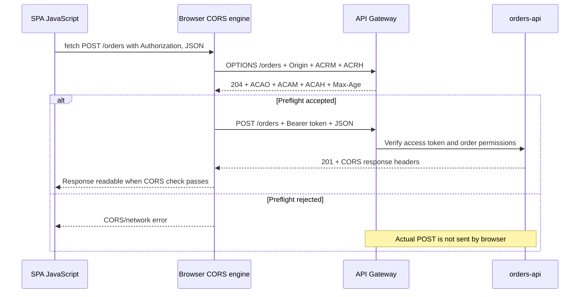
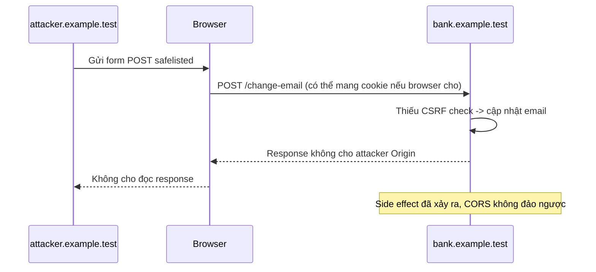
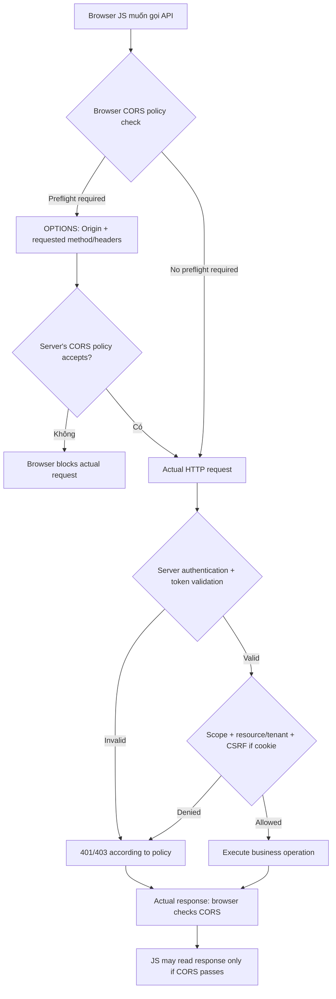

# CORS preflight: trình duyệt hỏi quyền truy cập cross-origin trước khi gửi request

Một ứng dụng SPA ở `https://app.example.test` muốn gọi API tại `https://api.example.test`. Developer viết:

```javascript
await fetch("https://api.example.test/orders", {
  method: "POST",
  headers: {
    "Authorization": "Bearer " + accessToken,
    "Content-Type": "application/json"
  },
  body: JSON.stringify({ productId: "p-42", quantity: 1 })
});
```

Trong DevTools, trình duyệt lại gửi **`OPTIONS /orders` trước `POST /orders`**. Nếu máy chủ phản hồi `401` vì không có access token trên request OPTIONS, trình duyệt báo lỗi CORS và **không gửi POST như dự định**. Developer dễ nghĩ rằng OAuth token sai, nhưng vấn đề thực tế có thể nằm ở **CORS preflight**.

**CORS preflight** là request kiểm tra trước do trình duyệt thực hiện khi một cross-origin request thuộc loại cần preflight. Nó thường dùng HTTP `OPTIONS`, thông báo **Origin**, **method dự định dùng** và **tên các request header không safelisted**. Máy chủ trả các **Access-Control-Allow-\*** headers để trình duyệt quyết định có cho JavaScript thực hiện request tiếp theo hay không.

Đây là nội dung của chương **Browser security** trong module **SECURITY_TOKEN_SECURITY_FUNDAMENTALS**: mô hình tin cậy và vòng đời token JWT/opaque, access/refresh token, OAuth 2.0/OIDC, issuer, scope, audience, lưu trữ, kiểm tra, thu hồi và phòng chống token bị đánh cắp hoặc phát lại. Bài này nhấn mạnh sự khác biệt giữa **cơ chế bảo vệ browser** và **authentication/authorization tại API**.

> **Nguyên tắc then chốt:** CORS preflight **không chứng minh user đã đăng nhập**, **không xác minh bearer token**, **không thay kiểm scope/audience** và **không phải CSRF protection đầy đủ**. Nó là cơ chế để **trình duyệt** quyết định có cho script từ origin A đọc response hoặc thực hiện cross-origin request theo chính sách CORS của origin B hay không.

## 1. Tại sao browser cần CORS?

### 1.1. Same-Origin Policy (SOP)

**Same-Origin Policy** hạn chế JavaScript ở một origin tùy ý đọc dữ liệu từ origin khác. **Origin** gồm ba thành phần:

```text
origin = (scheme, host, port)

https://app.example.test         -> (https, app.example.test, 443)
https://api.example.test         -> (https, api.example.test, 443)
http://app.example.test          -> (http, app.example.test, 80)
https://app.example.test:8443    -> (https, app.example.test, 8443)
```

Các ví dụ trên **khác origin** nếu bất kỳ thành phần nào khác. Đường dẫn `/orders` và query string **không** tham gia định nghĩa origin.

**Same-origin khác same-site**:

- `https://app.example.test` và `https://api.example.test` có thể cùng *site* theo cách xác định registrable domain, nhưng **khác origin**.
- `SameSite` của cookie dùng khái niệm site; CORS dùng origin. CORS và SameSite có tác dụng khác nhau.
- Hai origin cùng host nhưng khác port vẫn cross-origin.
- Nâng từ HTTP lên HTTPS đổi scheme, nên cũng đổi origin.

### 1.2. CORS cho phép server công bố chính sách chia sẻ

CORS (*Cross-Origin Resource Sharing*) cho phép server công bố origin nào được JavaScript của trình duyệt truy cập response, và trong trường hợp preflight, method/header nào được phép theo CORS.

Ví dụ: API chỉ chấp nhận JavaScript từ:

```text
https://app.example.test
https://admin.example.test
```

Điều này **không** nói rằng mọi người truy cập từ hai origin ấy được phép xem đơn hàng. API vẫn cần access token đúng `iss`, `aud`, `exp`, `scope` và kiểm owner/tenant.

### 1.3. SOP/CORS không có nghĩa browser không bao giờ gửi cross-origin request

Trình duyệt từ lâu cho phép một số cross-origin interactions, ví dụ:

- `` tải ảnh.
- HTML form gửi request trong những ngữ cảnh được phép.
- Top-level navigation/redirect tới origin khác.
- Một số `fetch()`/XHR cross-origin khi script không đọc được response nếu server không cho CORS.

**CORS chủ yếu hạn chế quyền của script đối với cross-origin response/request flow**, không phải một firewall từ chối mọi gói HTTP. Một **simple/safelisted request** có thể **đã được gửi và gây side effect** dù JavaScript sau đó bị chặn đọc response bởi CORS.

## 2. CORS preflight là gì?

Preflight là một **browser-generated HTTP OPTIONS request** gửi tới URL đích **trước actual request** khi request thuộc loại phải preflight. Browser hỏi:

> «Trang ở origin này muốn gửi method M với các request headers H đến URL này; server có cho phép theo CORS không?»

Server trả lời bằng CORS response headers. Nếu không đáp ứng chính sách, trình duyệt chặn actual request và JavaScript nhận lỗi dạng network/CORS. Nếu đáp ứng, browser gửi **actual request**; response của actual request vẫn phải qua **CORS response check**.



**Ghi chú:** `ACRM`, `ACRH`, `ACAO`, `ACAM`, `ACAH` là chữ viết tắt dùng trong bài cho các tên header đầy đủ dưới đây; **đừng dùng chúng làm header thật**.

### 2.1. Tín hiệu nhận biết một CORS preflight

Request điển hình:

```http
OPTIONS /orders HTTP/1.1
Host: api.example.test
Origin: https://app.example.test
Access-Control-Request-Method: POST
Access-Control-Request-Headers: authorization,content-type
```

Ở đây:

- `OPTIONS` là **HTTP method của preflight**.
- `Origin` là origin của trang đang muốn dùng fetch.
- `Access-Control-Request-Method: POST` là method **actual request dự định gửi**, không phải method của preflight.
- `Access-Control-Request-Headers` là tên request headers cần được CORS cho phép; nó **không gửi giá trị bearer token**.
- Request không mang JSON body hay `Authorization: Bearer ...` như actual POST.

**Không phải mọi request OPTIONS đều là CORS preflight.** Để nhận diện đúng, kiểm sự hiện diện/ý nghĩa của `Origin` và `Access-Control-Request-Method`; các OPTIONS bình thường của ứng dụng có thể có hợp đồng khác.

### 2.2. Response preflight thành công

```http
HTTP/1.1 204 No Content
Access-Control-Allow-Origin: https://app.example.test
Access-Control-Allow-Methods: GET, POST, PUT, DELETE
Access-Control-Allow-Headers: Authorization, Content-Type
Access-Control-Max-Age: 600
Vary: Origin, Access-Control-Request-Method, Access-Control-Request-Headers
```

Đây là **cấu hình minh họa**. Preflight được nhận khi browser thấy origin, method và request header names phù hợp response. `204` không phải bắt buộc duy nhất; những 2xx phù hợp có thể được dùng theo giao thức.

**Mã HTTP 204 một mình không đủ.** Nếu server chỉ gửi `204` mà thiếu `Access-Control-Allow-Origin`, trình duyệt vẫn có thể từ chối.

### 2.3. Actual request sau khi preflight qua

```http
POST /orders HTTP/1.1
Host: api.example.test
Origin: https://app.example.test
Authorization: Bearer <access-token>
Content-Type: application/json

{"productId":"p-42","quantity":1}
```

Response actual:

```http
HTTP/1.1 201 Created
Content-Type: application/json
Access-Control-Allow-Origin: https://app.example.test
Vary: Origin
Cache-Control: no-store

{"id":"order-123","status":"CREATED"}
```

Server phải trả CORS policy **cho actual response** tương ứng. Nếu chỉ OPTIONS có ACAO, còn POST trả 201 **không có ACAO**, browser có thể đã gửi request và server đã tạo đơn, nhưng script **không đọc được response**. Điều này gây UX lỗi và có thể khiến client retry tạo đơn trùng nếu không có idempotency.

## 3. Request nào phải preflight?

Một cách dạy phổ biến gọi nhóm không cần preflight là **simple requests**. Theo Fetch/CORS hiện đại, tên chính xác hơn là **CORS-safelisted method/headers và các điều kiện liên quan**. Những tiêu chí dưới đây là quy tắc thực hành thông dụng; chuẩn còn có giới hạn giá trị/byte và các chi tiết khác.

### 3.1. Method thường không tự kích hoạt preflight

Các method **CORS-safelisted**:

- `GET`
- `HEAD`
- `POST`

Các method như **`PUT`, `PATCH`, `DELETE`** thường kích hoạt preflight cho cross-origin fetch.

**POST không đồng nghĩa chắc chắn không preflight.** Nếu body dùng `Content-Type: application/json` hoặc có `Authorization`/custom headers, browser vẫn cần preflight.

### 3.2. Request headers được CORS-safelist có điều kiện

Ví dụ thông dụng: `Accept`, `Accept-Language`, `Content-Language` và `Content-Type` **chỉ khi giá trị đáp ứng quy tắc safelist**. `Content-Type` thông thường chỉ safelisted với ba MIME essence:

- `application/x-www-form-urlencoded`
- `multipart/form-data`
- `text/plain`

`application/json`, `application/xml` hoặc custom `X-Requested-With` **không thuộc nhóm Content-Type/header safelisted nói trên** và thường làm phát sinh preflight.

Đây không phải danh sách exhaustively đầy đủ của Fetch Standard; một số request headers như `Range` có quy tắc safelist riêng, và các giới hạn về length/byte/special cases còn áp dụng. Không tự viết CORS engine dựa chỉ vào vài dòng if/else này.

### 3.3. Header `Authorization` kích hoạt preflight

Ví dụ:

```javascript
fetch("https://api.example.test/me", {
  method: "GET",
  headers: { Authorization: "Bearer " + accessToken }
});
```

Dù method là GET, việc JavaScript thiết lập `Authorization` thường làm request **không CORS-safelisted** và phát sinh preflight, trừ khi có **kết quả preflight hợp lệ đang được browser cache**.

Đừng quên:

```http
Access-Control-Request-Headers: authorization
```

là **yêu cầu cho phép tên header**, không phải bản thân bearer token. OPTIONS **không phải nơi RS kiểm `exp`/`scope` của token user**.

### 3.4. Ví dụ so sánh

| Browser cross-origin request | Preflight thông thường? | Lý do |
| --- | --- | --- |
| `GET /public`, không custom header | Không | Method/headers safelisted |
| `GET /me` với JS `Authorization` | **Có** | `Authorization` không safelisted |
| `POST` với `application/x-www-form-urlencoded`, không custom header | Không | Method và Content-Type có thể safelisted |
| `POST` với `application/json` | **Có** | Content-Type không safelisted |
| `POST` với `text/plain` và không custom header | Thường không | Điều kiện safelist có thể thỏa |
| `PUT /profile` | **Có** | Method không safelisted |
| `DELETE /orders/42` | **Có** | Method không safelisted |
| `GET` với `X-Tenant-ID` | **Có** | Custom header không safelisted |
| `POST` với `X-CSRF-Token` | **Có** | Custom header không safelisted |
| `GET` browser tự gửi cookie, không header JS khác | **Không chỉ vì cookie** | Cookie tự gửi không tự kích hoạt preflight |
| `POST` có `Authorization` và `application/json` | **Có** | Header và Content-Type |

**Quan trọng:** «Không có preflight» **không có nghĩa CORS bị bỏ qua**. Actual cross-origin response vẫn phải có CORS headers đúng để JavaScript đọc được khi request ở mode `cors`.

### 3.5. Preflight cache có thể làm bạn «không thấy OPTIONS»

Browser có cache riêng cho kết quả CORS preflight. Một `POST` lần hai có thể **không tạo OPTIONS mới** nếu cache entry còn hợp lệ và phù hợp request. Điều đó không có nghĩa API tự chuyển thành same-origin hoặc preflight policy không còn áp dụng.

### 3.6. Một số request có yếu tố đặc biệt

Upload streaming, những request gắn listener upload với XHR, custom request headers hoặc browser implementation details có thể ảnh hưởng preflight theo Fetch/XHR. Hãy dựa trên **Network panel và chuẩn**, không hứa chỉ method + Content-Type là đủ cho tất cả client/browsers.

## 4. Ý nghĩa chính xác của các CORS headers

| Header | Bên gửi | Ý nghĩa |
| --- | --- | --- |
| `Origin` | Browser request | Origin đã khởi tạo cross-origin request |
| `Access-Control-Request-Method` | Browser preflight | Actual method muốn gửi |
| `Access-Control-Request-Headers` | Browser preflight | Tên request headers cần CORS cho phép |
| `Access-Control-Allow-Origin` | Server response | Origin nào được JS truy cập theo CORS, hoặc `*` trong trường hợp phù hợp |
| `Access-Control-Allow-Methods` | Server preflight response | Các method được CORS policy chấp thuận |
| `Access-Control-Allow-Headers` | Server preflight response | Các request header names được phép |
| `Access-Control-Allow-Credentials` | Server response | Cho phép credentialed CORS request khi credentials mode `include`; giá trị hợp lệ `true` |
| `Access-Control-Max-Age` | Server preflight response | Thời gian browser có thể cache kết quả preflight |
| `Access-Control-Expose-Headers` | Server actual response | Các response headers không safelisted mà JS được đọc |
| `Vary` | Server/cache metadata | Bảo vệ cache không dùng nhầm CORS response của origin/method/header khác |

### 4.1. `Access-Control-Allow-Origin` (ACAO)

Ví dụ origin cụ thể:

```http
Access-Control-Allow-Origin: https://app.example.test
```

Hoặc wildcard cho một **public resource phù hợp**:

```http
Access-Control-Allow-Origin: *
```

**Một response không được liệt kê nhiều origins bằng chuỗi phân tách dấu phẩy**:

```http
Access-Control-Allow-Origin: https://a.example.test, https://b.example.test
```

Đây **không phải cấu hình ACAO hợp lệ để cho phép hai origin**. Khi có nhiều origin được duyệt, server phải **kiểm Origin theo allowlist chính xác rồi trả về đúng một origin** tương ứng, thêm `Vary: Origin` khi response phụ thuộc Origin.

### 4.2. `Access-Control-Allow-Methods` (ACAM)

```http
Access-Control-Allow-Methods: GET, POST, PUT
```

Đây là danh sách method browser được cho phép **theo CORS preflight**. Nó **không thay** route authorization hay HTTP method constraints ở backend.

Ví dụ một endpoint chỉ hỗ trợ GET theo business API phải không bị ghi data bằng PUT chỉ vì preflight liệt kê PUT trên cả gateway.

### 4.3. `Access-Control-Allow-Headers` (ACAH)

```http
Access-Control-Allow-Headers: Authorization, Content-Type, X-CSRF-Token
```

Server phải cho phép những tên request header thực tế được preflight yêu cầu. Tên header trong HTTP không phân biệt hoa/thường. Nên dùng **allowlist tối thiểu** và ghi rõ `Authorization`; đừng trông cậy vào wildcard `*` cho mọi trường hợp, đặc biệt vì `Authorization` có quy tắc non-wildcard và wildcard còn có ngữ nghĩa khác với credentialed requests.

**ACAH chỉ đồng ý client được gửi *tên* header** — không xác nhận **giá trị Authorization bearer** hay **CSRF token đúng**.

### 4.4. `Access-Control-Allow-Credentials` (ACAC)

```http
Access-Control-Allow-Credentials: true
```

Khi JS dùng credentials mode `include`, browser cần server cho credentialed CORS response phù hợp, trong đó **ACAO phải là origin cụ thể, không phải `*`**. `Access-Control-Allow-Credentials` không có giá trị `false` được browser dùng như «cho phép không credentials»; khi không cần credentialed CORS, **bỏ header**.

Không tự suy «có `Authorization` bearer thì bắt buộc phải đặt `credentials: include`». Fetch credentials mode quyết định cookie/HTTP-auth/browser credentials behavior; một bearer header do JavaScript tự đặt là một request header cần CORS cho phép nhưng không nhất thiết cần cookie. **Với bearer-only API, có thể dùng `credentials: omit` và không bật ACAC**, nếu thiết kế không dùng browser cookies.

### 4.5. `Access-Control-Max-Age` (ACMA)

```http
Access-Control-Max-Age: 600
```

Số tính bằng **giây**. Browser có thể cache **kết quả CORS preflight**, thường có giới hạn tối đa do browser áp đặt; không bảo đảm 600 giây đúng tuyệt đối trên mọi phiên bản/trình duyệt.

**Đây không phải access token TTL**, không phải refresh token expiry, không phải thời gian session login hay thời gian cache kết quả introspection. Một preflight đã được cache **không miễn kiểm token/CSRF/authorization** cho request thực tế.

### 4.6. `Access-Control-Expose-Headers`

Nếu actual response:

```http
Access-Control-Expose-Headers: X-Request-Id, X-RateLimit-Remaining
```

thì script có thể đọc các response headers được nêu khi CORS check thành công. **Không nhầm với ACAH**: ACAH cho phép **request headers được gửi**, còn Expose-Headers cho **response headers được đọc**.

`Set-Cookie` là một forbidden response-header name đối với fetch; **không thể làm JavaScript đọc raw `Set-Cookie` chỉ bằng thêm nó vào Expose-Headers**. Browser có thể xử lý cookie theo quy tắc riêng.

### 4.7. `Vary` và shared caches

Với API phản hồi ACAO dựa trên `Origin`:

```http
Access-Control-Allow-Origin: https://app.example.test
Vary: Origin
```

tránh cache dùng nhầm response dành cho Origin A khi Origin B request. Với preflight response phụ thuộc method/header request, có thể dùng:

```http
Vary: Origin, Access-Control-Request-Method, Access-Control-Request-Headers
```

Browser preflight cache là cơ chế riêng với HTTP response cache; `Vary` đặc biệt quan trọng khi có CDN/proxy/shared caches hoặc dynamic CORS response. **Không để CDN cache user-specific response công khai chỉ vì có ACAO/Vary**. Dữ liệu private cần `Cache-Control` và cache key/authorization policy phù hợp.

## 5. Credentials, cookies và bearer tokens: ba kịch bản khác nhau

### 5.1. Kịch bản A — SPA dùng bearer token trong Authorization header

```javascript
const response = await fetch("https://api.example.test/orders", {
  method: "POST",
  mode: "cors",
  credentials: "omit",
  headers: {
    Authorization: "Bearer " + accessToken,
    "Content-Type": "application/json"
  },
  body: JSON.stringify({ productId: "p-42", quantity: 1 })
});
```

Browser cần preflight vì `Authorization`/JSON. API có thể cho CORS với origin cụ thể và headers:

```http
Access-Control-Allow-Origin: https://app.example.test
Access-Control-Allow-Methods: POST
Access-Control-Allow-Headers: Authorization, Content-Type
```

Khi actual POST tới backend, RS phải kiểm **chính access token**: JWT signature/`iss`/`aud`/`exp`/`scope`/`typ` hoặc opaque introspection, sender binding nếu có, và owner/tenant/transaction policy. Việc browser được gửi `Authorization` không làm token trở nên hợp lệ.

**Rủi ro phía client:** nếu token nằm trong `localStorage` hoặc nơi JavaScript có thể đọc, XSS có thể lấy token. Bearer token trong memory có thể giảm persistence nhưng không loại trừ XSS. CORS allowlist cũng không ngăn XSS xảy ra ngay trong allowed origin.

### 5.2. Kịch bản B — BFF/session cookie HttpOnly

Một **Backend for Frontend (BFF)** có thể giữ OAuth access/refresh tokens ở server, browser chỉ có session cookie `HttpOnly`:

```http
Set-Cookie: __Host-session=<opaque-id>; Path=/; Secure; HttpOnly; SameSite=Lax
```

Nếu frontend và BFF **khác origin nhưng cùng site**, browser vẫn áp CORS cho fetch và cookie được gửi theo `SameSite`/cookie policies. Nếu frontend và BFF **cross-site**, cookie có thể cần `SameSite=None; Secure` tùy thiết kế và có thể vẫn bị browser hạn chế bởi third-party-cookie rules.

JS fetch ví dụ:

```javascript
await fetch("https://bff.example.test/api/profile", {
  method: "POST",
  credentials: "include",
  headers: {
    "Content-Type": "application/json",
    "X-CSRF-Token": csrfToken
  },
  body: JSON.stringify({ displayName: "An" })
});
```

Preflight xảy ra vì JSON và `X-CSRF-Token`. Preflight **thường không gửi cookie/session credential**, dù actual request dùng `credentials: include`. Vì vậy **đừng bắt buộc preflight OPTIONS có authenticated user session**, và **đừng bỏ CSRF protection của actual POST**.

Response preflight của BFF:

```http
HTTP/1.1 204 No Content
Access-Control-Allow-Origin: https://app.example.test
Access-Control-Allow-Methods: POST
Access-Control-Allow-Headers: Content-Type, X-CSRF-Token
Access-Control-Allow-Credentials: true
Vary: Origin, Access-Control-Request-Method, Access-Control-Request-Headers
```

Actual response cũng cần:

```http
Access-Control-Allow-Origin: https://app.example.test
Access-Control-Allow-Credentials: true
Vary: Origin
```

**`credentials: include` không làm browser bỏ `SameSite`, third-party cookie blocking hay các chính sách cookie khác.** Nếu session cookie không được gửi vì browser policy, thêm ACAO/ACAC cũng không tự sửa được.

### 5.3. Kịch bản C — public endpoint không cần cookies

Một tài nguyên public có thể trả:

```http
Access-Control-Allow-Origin: *
```

Nếu request thực tế không dùng credentials mode `include` và endpoint thật sự là public, wildcard có thể phù hợp. Nhưng **đừng áp wildcard lên endpoint riêng tư dựa trên cookies** chỉ để «hết lỗi CORS».

### 5.4. Cookies không tự bắt buộc preflight

Một request `GET` cross-origin chỉ mang cookie do browser tự quản lý **không tự tạo preflight chỉ vì có Cookie**. Nhưng browser vẫn quyết định có đính cookie theo credentials mode, domain/path, Secure, SameSite và chính sách privacy.

Điểm phân biệt:

```text
Cookie được browser gửi tự động:
    Không phải một JS request header tùy ý có thể đặt;
    tự nó không làm request thành non-safelisted.

Authorization header do JS thiết lập:
    Không CORS-safelisted -> thường cần preflight.
```

Browser **cấm JavaScript tự đặt `Cookie` header** bằng fetch thông thường. Nếu muốn gửi cookie, dùng cơ chế cookie browser/`credentials` đúng thiết kế, không viết `headers: {Cookie: "..."}`.

## 6. CORS không phải authentication, authorization hay CSRF protection đầy đủ

### 6.1. CORS được trình duyệt thực thi, không phải API firewall

Một attacker có thể tự viết HTTP client:

```bash
curl -i https://api.example.test/orders \
  -H 'Origin: https://app.example.test' \
  -H 'Authorization: Bearer <some-token>'
```

`curl` không bị chính sách CORS của browser bắt buộc chặn. Caller có thể tự khai `Origin`; vì vậy **Origin không phải client authentication** và không chứng minh caller thuộc ứng dụng `app.example.test`. API phải xác minh token/sender/quyền **bất kể Origin có tồn tại hay không**.

**Không dùng code:**

```java
// SAI: tin Origin là bằng chứng đã authenticated.
if ("https://app.example.test".equals(request.getHeader("Origin"))) {
    return readPrivateAccountData();
}
```

Origin hữu ích cho **chính sách CORS, CSRF và defense in depth**, nhưng nó không thay access token validation, server-side session, authorization object/tenant hay caller proof.

### 6.2. Vì sao CORS không ngăn CSRF?

**Cross-Site Request Forgery (CSRF)** là tình huống attacker làm browser user đã đăng nhập tự gửi state-changing request đến site đích, tận dụng credential như cookie được browser tự đính kèm. Hành vi này có thể xảy ra **ngay cả khi trang attacker không được đọc response**.

Ví dụ form:

```html
<form method="POST" action="https://bank.example.test/change-email">
  <input type="hidden" name="email" value="attacker@example.test">
</form>
```

Một HTML form cross-origin có thể gửi request mà **không qua cơ chế JS preflight** theo kiểu request safelisted. Nếu cookie/session được gửi theo browser cookie policy và server thiếu CSRF protection, side effect có thể xảy ra. Browser có chặn trang attacker đọc response sau đó cũng không undo hành động.

**Phòng CSRF** với cookie-based authentication nên kết hợp:

- CSRF token **gắn session và request context**, được server xác minh.
- `Origin`/`Referer` checks theo policy, `Sec-Fetch-Site` và Fetch Metadata khi phù hợp.
- `SameSite=Lax` hoặc `Strict` khi đáp ứng UX/flow, chú ý cross-site login/redirect.
- Không cho state changes qua GET; validate Content-Type/method.
- Authorization nghiệp vụ và idempotency.
- Không cấu hình CORS phản chiếu Origin tự do kèm cookies.

**Một custom `X-CSRF-Token` header khiến JavaScript cross-origin phải preflight** có thể là lớp bảo vệ bổ sung khi không mở CORS cho attacker origin; nhưng header chỉ có tên **không chứng minh token CSRF đúng**, và hình thức «không safelisted» không thay CSRF token/Origin validation ở server.

### 6.3. Preflight thành công không có nghĩa user được ủy quyền

Ví dụ:

```text
1. Browser gửi OPTIONS với ACRH=authorization,content-type.
2. API trả CORS headers cho phép Origin và các header đó.
3. Browser gửi POST thật có bearer token.
4. API kiểm JWT/opaque token:
     iss / signature hoặc introspection
     aud, exp, nbf, typ/profile, scope
     sender binding DPoP/mTLS nếu token bound
     chủ thể/tenant/object authorization
5. Nếu token invalid -> 401.
   Nếu thiếu scope -> 403.
   Nếu đủ quyền -> xử lý business.
```

**CORS allowlist không phải OAuth client allowlist.** `client_id` trong OAuth token, browser Origin và RP redirect URI là **các identity/registration fields khác nhau**. Không suy một origin hợp lệ có thể thay thế `client_id` hoặc `aud`.

### 6.4. Allowed origin bị XSS: CORS không bảo vệ

Giả sử `https://app.example.test` nằm trong allowlist nhưng bị XSS. Script độc hại chạy **ngay tại allowed origin**, nên nó thường có quyền gọi API cross-origin như script hợp pháp, với cookies hoặc token script có thể lấy được.

Các lớp cần thêm:

- Output encoding, input validation và CSP để giảm XSS.
- Token lưu ở BFF/server-side thay vì phát raw refresh token cho JavaScript khi phù hợp.
- `HttpOnly`/`Secure`/`SameSite` cookie; CSRF protection.
- Short-lived/scoped/audience-restricted access token và sender binding.
- Runtime authorization, anomaly detection, revoke và audit.

**CORS không thể phân biệt một script tốt và một script xấu chạy trong cùng một origin đã được cho phép**.

### 6.5. Không dùng CORS để giấu API bí mật

Ẩn route `/admin` khỏi browser từ origin không được allow không làm route an toàn trước curl, app native, server-side HTTP client hoặc requests từ attacker infrastructure. Nếu endpoint cần bảo vệ, bắt buộc có **server-side authentication, role/scope và object authorization**.

### 6.6. Rủi ro «simple request gây side effect trước khi CORS fail»



Vì vậy câu «không có `Access-Control-Allow-Origin` thì browser không gửi request» là **sai** đối với một số request; preflight chỉ ngăn actual request **khi preflight được yêu cầu và không đạt**.

## 7. Cấu hình CORS allowlist an toàn

### 7.1. Phân loại các origin

| Origin | Nên cho phép? | Lý do |
| --- | --- | --- |
| `https://app.example.test` | Có, nếu thuộc frontend đã đăng ký | Exact scheme, host, port |
| `https://admin.example.test` | Có riêng cho admin API nếu policy cho phép | Cần kiểm admin authz tiếp |
| `http://app.example.test` | Không mặc định | HTTP không tương đương HTTPS |
| `https://app.example.test:8443` | Không tự động | Port khác origin |
| `https://app.example.test.attacker.test` | Không | Host giả mạo bằng suffix |
| `https://evilapp.example.test` | Không chỉ vì cùng parent site | Sibling subdomain có thể không đáng tin |
| `null` | Không mặc định | Opaque origins như sandbox/file có thể bị attacker tạo |
| Không có Origin | Không phải CORS browser request thông thường | Vẫn authn/authz bình thường; không tự cấp đặc quyền |

**Không đặt allowlist theo `Origin.endsWith("example.test")` một cách đơn giản.** Một chuỗi `https://app.example.test.evil.invalid` có thể làm hỏng kiểm suffix tự viết, còn những subdomain được takeover vẫn thuộc đúng suffix.

Nếu sản phẩm cần dynamic origins cho nhiều tenant, phải có **registration đã xác thực và allowlist exact origin theo tenant/client**, kiểm scheme/port, ownership domain và lifecycle. Wildcard subdomain rộng cho credentialed APIs là rủi ro nếu có blog, uploads, user-defined/custom domains hoặc subdomain takeover.

### 7.2. Không phản chiếu Origin vô điều kiện

**Sai:**

```javascript
// Anti-pattern pseudo-code:
res.setHeader("Access-Control-Allow-Origin", req.headers.origin);
res.setHeader("Access-Control-Allow-Credentials", "true");
```

Bất kỳ attacker-controlled web origin nào cũng có thể nhận phản hồi CORS cho credentialed requests nếu browser có gửi credentials và không bị chính sách khác chặn.

**Đúng về mặt nguyên tắc:**

```text
origin = parse Origin
if origin thuộc exact, trusted allowlist cho route/client:
    Access-Control-Allow-Origin = origin
    Vary: Origin
    Access-Control-Allow-Credentials = true CHỈ khi route thật cần
else:
    không cấp quyền CORS
```

Không cho user gửi `X-Allowed-Origin` rồi coi header đó là policy. Policy phải đến từ server config/registration/authorization context đáng tin.

### 7.3. Trường hợp `Origin: null`

Browser có thể gửi `Origin: null` từ một **opaque origin** (ví dụ sandboxed document, `file:` trong một số bối cảnh, data/blob tùy nguồn). **Không thêm `Access-Control-Allow-Origin: null` để «sửa mọi lỗi local file»** cho API private: attacker có thể cố tạo opaque origin và dùng response.

Nếu thật sự hỗ trợ một môi trường như vậy, cần threat model và mô hình cấp quyền thay thế; không dựa vào «null là origin của ứng dụng nội bộ».

### 7.4. Wildcard và credentialed requests

Response dưới đây là **sai đối với fetch credentials mode `include`**:

```http
Access-Control-Allow-Origin: *
Access-Control-Allow-Credentials: true
```

Trình duyệt không chấp nhận wildcard ACAO cho credentialed CORS response. Thay bằng origin cụ thể **được allowlist**. Đồng thời, wildcard `Access-Control-Allow-Methods`/`Access-Control-Allow-Headers` có những hạn chế với credentialed requests và `Authorization`; nên liệt kê method/header cụ thể.

**Đừng dùng cách «tắt credentials trên client» như một sửa lỗi mặc định** nếu API cần cookies/session; làm vậy có thể khiến user không xác thực. Cần quyết định **auth model** trước, sau đó cấu hình CORS tương ứng.

## 8. Java/Spring Security: cho preflight chạy trước authentication

Trong một Spring Boot web API có Spring Security, lỗi thường gặp là security filter chain xử lý OPTIONS như request API private và trả **401** trước khi CORS layer gửi headers. Browser không đưa bearer token trong preflight theo cách actual POST dùng, nên request OPTIONS bị chặn.

### 8.1. Spring Security phải tích hợp CORS đúng thứ tự

Ví dụ cấu hình cho API cookie/session-based **có CSRF protection**:

```java
import java.util.List;
import org.springframework.context.annotation.Bean;
import org.springframework.context.annotation.Configuration;
import org.springframework.http.HttpMethod;
import org.springframework.security.config.Customizer;
import org.springframework.security.config.annotation.web.builders.HttpSecurity;
import org.springframework.security.web.SecurityFilterChain;
import org.springframework.web.cors.CorsConfiguration;
import org.springframework.web.cors.UrlBasedCorsConfigurationSource;
import org.springframework.web.cors.CorsConfigurationSource;

@Configuration
public class WebCorsSecurityConfig {

    @Bean
    public CorsConfigurationSource corsConfigurationSource() {
        CorsConfiguration cors = new CorsConfiguration();
        cors.setAllowedOrigins(List.of("https://app.example.test"));
        cors.setAllowedMethods(List.of("GET", "POST", "PATCH", "DELETE"));
        cors.setAllowedHeaders(List.of(
            "Content-Type", "X-CSRF-Token", "Authorization"
        ));
        cors.setExposedHeaders(List.of("X-Request-Id"));
        cors.setAllowCredentials(true); // Cookie/session API
        cors.setMaxAge(600L);

        UrlBasedCorsConfigurationSource source =
            new UrlBasedCorsConfigurationSource();
        source.registerCorsConfiguration("/api/**", cors);
        return source;
    }

    @Bean
    public SecurityFilterChain webSecurity(HttpSecurity http)
        throws Exception {
        return http
            .cors(Customizer.withDefaults())
            // Cookie/session routes phải có CSRF protection
            // theo framework/session design.
            .csrf(Customizer.withDefaults())
            .authorizeHttpRequests(auth -> auth
                .requestMatchers("/api/**").authenticated()
                .anyRequest().permitAll()
            )
            .build();
    }
}
```

**Điều quan trọng**:

1. `CorsConfigurationSource` định nghĩa **chính sách CORS**, **không** định nghĩa ai được gọi API.
2. `http.cors(...)` tích hợp xử lý CORS trước các quyết định bảo mật thường gây 401 cho preflight. Preflight hợp lệ có thể được trả ngay bởi CORS filter.
3. `setAllowCredentials(true)` chỉ thích hợp khi request thực sự dùng credentialed browser access; không bật mặc định cho public/bearer-only API.
4. Với session cookie, **giữ CSRF protection ở actual state-changing requests**. CORS không thay `CsrfTokenRepository`/`Origin` checks.
5. Cấu hình ví dụ chưa có đầy đủ session auth, CSRF-token bootstrap, OAuth2 login, error handlers hay gateway setup — những phần đó phải phù hợp dự án thật.
6. Không cần bật `OPTIONS` cho mọi endpoint business; cần để **CORS preflight OPTIONS** được xử lý qua CORS filter. Một regular OPTIONS request không có ACRM vẫn có thể chịu route/auth policy riêng.

### 8.2. API bearer-only: cấu hình có thể khác

Khi SPA **chỉ** gửi access token qua `Authorization` và không gửi browser cookie:

```java
@Bean
CorsConfigurationSource bearerCorsSource() {
    CorsConfiguration cors = new CorsConfiguration();
    cors.setAllowedOrigins(List.of("https://app.example.test"));
    cors.setAllowedMethods(List.of("GET", "POST", "PUT", "DELETE"));
    cors.setAllowedHeaders(List.of(
        "Authorization", "Content-Type", "X-Request-Id"
    ));
    cors.setAllowCredentials(false); // Không yêu cầu credentials: include
    cors.setMaxAge(300L);

    UrlBasedCorsConfigurationSource source =
        new UrlBasedCorsConfigurationSource();
    source.registerCorsConfiguration("/api/**", cors);
    return source;
}
```

**Đây là lựa chọn thay thế**, không phải bean thứ hai nên copy vào cùng security chain ở trên. Để bearer-only API bảo mật:

- Dùng OAuth2 Resource Server JWT hoặc opaque token introspection phù hợp.
- Kiểm `iss`, signature/`active`, `aud`, `exp`, scope, sender binding và resource ownership.
- Nếu thật sự **stateless bearer-only, không có cookie-based auth**, có thể cân nhắc CSRF policy khác; **không vô hiệu hóa CSRF toàn ứng dụng** khi có browser session endpoints.
- Khi chuyển sang DPoP, header `DPoP` cũng phải được ACAH cho phép và RS phải kiểm proof, `jkt`, `jti`, `htm`, `htu`, `iat`, `ath` chứ không chỉ cho header gửi.

### 8.3. Đừng dùng `@CrossOrigin("*")` không kiểm soát

**Sai về mặt chính sách** khi áp lên private endpoints:

```java
@CrossOrigin(origins = "*")
@RestController
class AccountController {
    @GetMapping("/api/accounts/me")
    public Account privateAccount() { /* ... */ return null; }
}
```

Ngay cả khi browser không chấp nhận wildcard cùng credentials mode include, mở CORS quá rộng vẫn tạo cấu hình khó kiểm soát và không có lợi cho bảo mật. Ưu tiên policy tập trung/chi tiết theo route, reviewed origin list và CSRF/authn/authz riêng.

### 8.4. Tránh hai nơi đặt CORS phản hồi mâu thuẫn

Nếu NGINX/gateway tự thêm ACAO còn Spring cũng thêm ACAO, browser có thể thấy **hai giá trị hoặc header lặp**, khiến CORS check thất bại. Hãy xác định một lớp **CORS policy authority**:

```text
Browser
  |
  v
API Gateway (CORS policy owner?)
  |
  v
Spring Security CORS filter (disabled/consistent if gateway owns?)
  |
  v
Business API
```

Không chỉ chọn «gateway handle all» rồi bỏ kiểm issuer/audience/scope ở service nếu service có thể bị truy cập trực tiếp. CORS ownership và OAuth identity enforcement là **hai quyết định kiến trúc khác nhau**.

## 9. API Gateway, load balancer và lỗi 401/302 khi preflight

### 9.1. Vì sao preflight thường không có session/access token?

Browser CORS preflight **thông thường được gửi không kèm credentials** (không có cookies/HTTP auth như actual request), kể cả khi actual request dự kiến dùng `credentials: include`. Một số triển khai browser có ngoại lệ liên quan **TLS client certificate** ở tầng kết nối; không dùng các ngoại lệ đó làm auth contract phổ quát cho preflight.

Nếu middleware yêu cầu `Authorization` trên **mọi request**, OPTIONS có thể bị trả 401/302:

```http
HTTP/1.1 401 Unauthorized
WWW-Authenticate: Bearer
```

Browser không coi đây là CORS preflight cho phép POST. **Giải pháp đúng:** xử lý OPTIONS có CORS preflight headers hợp lệ **trước** bearer/session authorization logic; sau đó actual POST vẫn phải authentication/authorization đầy đủ.

### 9.2. Không redirect OPTIONS tới trang login

**Sai:**

```http
HTTP/1.1 302 Found
Location: https://login.example.test/authorize?...
```

Preflight không phải luồng đăng nhập tương tác. Redirect có thể bị browser chặn, gây CORS error hoặc điều hướng không mong muốn. API fetch cần trả **401/403 với CORS headers cho actual request** khi authn/authz fail; frontend quyết định bắt đầu OIDC Authorization Code + PKCE như một workflow riêng.

Với preflight, trả response trực tiếp theo CORS policy; tránh HTTP→HTTPS redirect bằng cách frontend **gọi HTTPS URL đúng ngay từ đầu**.

### 9.3. Không bỏ qua CORS trên lỗi API

Một actual request có thể trả:

```http
HTTP/1.1 401 Unauthorized
Access-Control-Allow-Origin: https://app.example.test
Vary: Origin
WWW-Authenticate: Bearer error="invalid_token"
Cache-Control: no-store
```

Nếu CORS policy cho origin đó, frontend nên được phép **quan sát trạng thái 401/403/429/5xx theo chính sách**, thay vì chỉ nhận generic CORS error che mất nguyên nhân. Response này không cấp quyền; nó cho JS xử lý lỗi hợp lệ.

Nếu JS cần đọc header `WWW-Authenticate` hoặc `X-Request-Id`, cấu hình `Access-Control-Expose-Headers` hợp lý. Không expose secrets hay raw bearer tokens.

### 9.4. Gateway phải biết method thật trong ACRM

Một gateway có thể trả `204 OPTIONS` cho tất cả routes nhưng gửi:

```http
Access-Control-Allow-Methods: GET
```

Khi browser đang yêu cầu `POST`, response **không cho phép actual method** và browser chặn. Gateway nên kiểm `Access-Control-Request-Method` đối với chính route policy, không chỉ trả generic `204`.

### 9.5. WAF, proxy và OPTIONS

WAF có thể từ chối OPTIONS, xóa `Origin`, xóa `Access-Control-Request-Headers` hoặc đổi casing/normalization. HTTP header names không phân biệt hoa thường, nhưng policy parser của WAF/proxy có thể sai. Debug theo từng hop:

```text
Browser OPTIONS
 -> CDN/WAF
 -> API Gateway
 -> App load balancer
 -> Spring CORS filter
 -> API handler (nếu OPTIONS không được filter xử lý)
```

Tìm **nơi phát sinh 301/302/401/403/404/405/5xx** và **nơi ACAO/ACAH/ACAM biến mất**. Không mặc định lỗi nằm trong Spring nếu WAF đã chặn trước.

## 10. Caching, redirects và giới hạn do trình duyệt

### 10.1. Browser CORS-preflight cache khác HTTP cache thông thường

`Access-Control-Max-Age` cho phép browser **nhớ một kết quả preflight thành công** theo các yếu tố như origin, URL, method, request header names, credentials mode và partitioning/context tùy browser/Fetch. Đừng giả định một entry ở `/orders` có thể dùng vô điều kiện cho `/admin` hoặc origin khác.

```text
Lần 1:
    OPTIONS /orders -> CORS allowed, Max-Age=600
    POST /orders -> actual request

Lần 2 (preflight cache còn hiệu lực, request tương thích):
    POST /orders -> actual request

Lần 3 (khác headers/method/origin/URL hoặc cache hết):
    OPTIONS ... -> có thể được gửi lại
    actual request sau khi được duyệt
```

Không có bảo đảm browser sẽ giữ cache đúng 600 giây; cache có thể bị dọn, chia partition, hoặc áp cap theo implementation. Browser cũng có thể preflight request trong một số tình huống khác theo chuẩn.

### 10.2. Cache preflight không phải cache authentication

Preflight trả lời câu hỏi «Origin/method/header này được phép theo chính sách CORS không?»; nó không kiểm token user. Vì vậy:

- **Không dùng `Access-Control-Max-Age` làm access token lifetime**.
- Không coi cache hit là bằng chứng user vẫn có consent, session còn active hoặc scope không đổi.
- Nếu user logout/revoke token, actual request vẫn phải bị RS từ chối bằng token/session validation.
- Không cache một response `active=true` của introspection chỉ vì browser preflight cache có Max-Age dài.

### 10.3. CORS policy thay đổi giữa lúc cache còn hạn

Giả sử `https://legacy.example.test` bị xóa khỏi allowlist lúc 10:00, nhưng browser đã cache một kết quả preflight cho origin đó lúc 09:59. Trong cửa sổ cache còn dùng được, browser có thể không gửi OPTIONS mới. Tuy nhiên, **actual response vẫn chịu CORS check** và server phải sử dụng chính sách mới để không cấp ACAO cho origin đã bị gỡ.

**Đừng coi việc gỡ một origin khỏi CORS allowlist là thao tác thu hồi OAuth tokens hoặc phiên của client.** Nếu origin bị compromise, còn cần revoke credentials, invalidate session và xử lý các API privileges tương ứng.

### 10.4. CDN/proxy cache nguy hiểm như thế nào?

Một CDN cache actual response từ `/api/me` có `Access-Control-Allow-Origin: https://app.example.test`. Nếu URL cache không bao gồm identity/authorization và private response được cache công khai, user khác có thể nhận dữ liệu không thuộc mình **ngay cả khi ACAO đúng**.

Vì vậy:

- Private API response thường cần `Cache-Control: no-store` hoặc cấu hình private cache có kiểm soát.
- Không dùng `Vary: Origin` thay cho cache key gắn identity/authorization.
- Không đưa bearer token hay session cookie vào shared-cache logs.
- Dynamic CORS response cần `Vary: Origin` để tránh cache policy của origin A được dùng cho B.
- OPTIONS preflight ở CDN/gateway phải kiểm route/method/header allowlist trước khi trả.

**CORS headers không thay chính sách HTTP caching** và không bảo vệ private body nếu reverse proxy/CDN phục vụ sai người.

### 10.5. Redirects và preflight

Một số browser/history compatibility của redirect khi preflight không đồng nhất; trong thực hành nên **trả preflight trực tiếp** với 2xx và headers thích hợp. Tránh:

- HTTP→HTTPS redirect ở API URL mà frontend đáng ra gọi HTTPS sẵn.
- Redirect `OPTIONS` tới `/login` hoặc OP authorization endpoint.
- Redirect từ endpoint API cũ sang host mới mà không cập nhật frontend CORS config.
- Redirect tới third-party host mang dữ liệu/token mà policy không dự kiến.

**Đừng gửi bearer/refresh token qua URL** để «giải quyết» redirect. Browser cũng có thể kiểm CORS tiếp qua redirect chain; cẩn trọng rò credential/cross-origin forwarding.

### 10.6. Header `Origin: null` và sandboxed contexts

Một request từ opaque origin có thể gửi `Origin: null`. Đây không phải «không có Origin»; chuỗi literal `null` vẫn có thể được dùng trong CORS response check. Đừng mặc định mọi `null` origin là localhost hoặc ứng dụng của mình.

Nếu một sản phẩm thật sự cần file:// hoặc sandboxed iframe, hãy thiết kế auth model và hosting trusted HTTPS origin thay vì mở ACAO null kèm credentials cho private APIs.

### 10.7. Private Network Access (PNA) và thay đổi browser

Một số trình duyệt/phiên bản có các kiểm tra bổ sung khi trang public muốn truy cập tài nguyên thuộc mạng private/local, ví dụ giao thức/headers liên quan `Access-Control-Request-Private-Network` và `Access-Control-Allow-Private-Network` trong những giai đoạn triển khai PNA.

**Không coi PNA là cơ chế OAuth, client authentication hay thay thế CORS**. Mức hỗ trợ và enforcement có thể thay đổi theo browser/phiên bản; khi debug truy cập router, localhost hoặc internal admin API, kiểm chính sách trình duyệt hiện tại và kiến trúc mạng. Không trả `Access-Control-Allow-Private-Network: true` rộng rãi chỉ để cho một trang Internet đọc thiết bị nội bộ.

### 10.8. `mode: "no-cors"` không phải «tắt CORS»

Developer có thể thử:

```javascript
const res = await fetch("https://api.example.test/orders", {
  mode: "no-cors"
});
console.log(res.type); // thường là "opaque"
```

Trong mode `no-cors`, script chịu các giới hạn request/headers và thường nhận **opaque response không đọc được body/status như response CORS bình thường**. Không thể dùng nó để thực hiện một API JSON có Authorization header bình thường và đọc private response.

Đây **không phải** cách sửa preflight hoặc một cơ chế tắt bảo vệ của browser.

## 11. Gỡ lỗi CORS preflight theo từng bước

### 11.1. Network tab: tìm request OPTIONS và actual request

Khi browser báo:

```text
Access to fetch at 'https://api.example.test/orders'
from origin 'https://app.example.test' has been blocked by CORS policy...
```

hãy kiểm:

1. **Request initiator:** script thật chạy từ origin nào, port/scheme nào?
2. **Có OPTIONS không?** Nếu không, request có thể safelisted hoặc preflight cache đang hit.
3. Nếu có OPTIONS, kiểm **status**, redirect chain và response headers.
4. `Origin` đúng? `Access-Control-Request-Method` có đúng actual method? `Access-Control-Request-Headers` chứa tên headers nào?
5. Server trả **ACAO** đúng origin hoặc wildcard hợp lệ chưa?
6. Server trả **ACAM** chứa method actual?
7. Server trả **ACAH** chứa tất cả header names cần phép, đặc biệt `Authorization` và `Content-Type`?
8. Nếu fetch credentials mode `include`, response có **ACAC true + ACAO origin cụ thể**?
9. Actual request có được gửi không? Nếu có, actual response có ACAO/ACAC phù hợp không?
10. Nếu actual response 401/403, kiểm backend token/CSRF/authorization, không tự quy mọi thứ về CORS.

### 11.2. Ví dụ curl mô phỏng preflight

```bash
curl -i -X OPTIONS 'https://api.example.test/orders' \
  -H 'Origin: https://app.example.test' \
  -H 'Access-Control-Request-Method: POST' \
  -H 'Access-Control-Request-Headers: authorization,content-type'
```

Response kỳ vọng nếu policy cho phép:

```http
HTTP/1.1 204 No Content
Access-Control-Allow-Origin: https://app.example.test
Access-Control-Allow-Methods: POST
Access-Control-Allow-Headers: Authorization, Content-Type
Vary: Origin, Access-Control-Request-Method, Access-Control-Request-Headers
```

**Quan trọng:** curl **không phải browser CORS engine**. Nó giúp xem server trả headers/status gì, nhưng không áp các quy tắc CORS, cache, cookie SameSite, third-party blocking và Fetch mode như browser. Phải test cả browser thật.

### 11.3. Test actual response độc lập

```bash
curl -i 'https://api.example.test/orders' \
  -H 'Origin: https://app.example.test' \
  -H 'Authorization: Bearer <valid-test-access-token>'
```

Không đưa production token vào shell history/log/chats; dùng test credentials và môi trường được phân quyền. Nếu actual response là `401` nhưng có CORS headers đúng, JavaScript có thể nhận `Response.status===401`; lúc này lỗi thuộc **token hoặc authorization**, không phải preflight.

### 11.4. Những câu hỏi khi OPTIONS trả 401

```text
Browser OPTIONS request
 -> WAF/gateway auth?
 -> Spring Security CORS integration?
 -> CSRF filter?
 -> Routing / path rewrite?
 -> OAuth2 login entry point redirect?
```

**Không sửa bằng cách gửi bearer token trong OPTIONS từ JavaScript.** Browser tạo preflight; JS không thể viết tùy ý các `Access-Control-Request-*` headers để «đính kèm auth». Hãy làm cho **CORS preflight được xử lý không phụ thuộc user token**, còn actual request vẫn bắt buộc auth.

### 11.5. Những câu hỏi khi POST thành công nhưng JS báo CORS

Kiểm:

- Actual response có `Access-Control-Allow-Origin` chưa?
- API 201 được gửi từ app nhưng gateway/exception handler xóa header?
- Response actual có wildcard ACAO trong khi `credentials: include`?
- Redirect response/callback có CORS headers đúng không?
- Server đã tạo business side effect trước khi response bị browser chặn? Có idempotency key không?

**Một response bị browser chặn đọc không có nghĩa backend chưa xử lý request.**

### 11.6. Kiểm duplicate headers

```http
Access-Control-Allow-Origin: https://app.example.test
Access-Control-Allow-Origin: https://app.example.test
```

Hai lớp gateway/backend cùng set có thể tạo duplicate hoặc bị proxy gộp bằng dấu phẩy, khiến browser chặn. Định nghĩa một chủ sở hữu CORS policy hoặc bảo đảm headers không xung đột qua các tầng.

### 11.7. Debug khi browser không gửi cookies

Kiểm lần lượt:

1. Fetch `credentials` có phải `include`?
2. Cookie có đúng `Domain`, `Path`, `Secure`, thời hạn và browser partitioning?
3. Frontend/API là **same-site hay cross-site**, `SameSite` có cho phép gửi?
4. Browser có chặn third-party cookies/tracking không?
5. HTTPS/TLS có đúng?
6. Response có ACAO exact origin + ACAC true không?
7. CSRF token có được bootstrap và gửi đúng?

**CORS thành công không buộc browser đính cookie trái SameSite/privacy policy.**

## 12. CORS preflight trong OAuth 2.0/OIDC

### 12.1. Authorization endpoint là browser navigation, không phải fetch JSON API

Trong **OIDC Authorization Code Flow + PKCE**, user agent thường được **top-level redirect** tới OP `/authorize` rồi quay về RP redirect URI cùng authorization code/`state`. Đây là **navigation flow**, không phải cross-origin `fetch()` đọc JSON từ `/authorize`.

Ví dụ:

```text
Browser -> OP /authorize?response_type=code&client_id=...
OP -> RP /callback?code=...&state=...
RP -> OP /token (backchannel nếu BFF/confidential client)
```

Nếu frontend cố gọi `fetch("https://op.example.test/authorize")` và gặp CORS, cách sửa **không phải** bật wildcard cho OP authorization endpoint; hãy dùng **đúng OIDC browser redirect flow** với registered redirect URI, `state`, PKCE/nonce theo profile.

### 12.2. Token endpoint và public browser clients

Một SPA public client triển khai Authorization Code + PKCE có thể cần gọi **token endpoint** qua browser fetch từ một origin đã được OP cho phép. Khi đó OP có thể cần cấu hình CORS cho token endpoint theo registration/client policy.

**CORS không phải xác thực public client**:

- `client_id` là identifier, không phải password.
- PKCE `code_verifier` ràng buộc authorization code với client flow.
- Redirect URI, client_id và authorization code one-time vẫn phải được AS kiểm.
- Không nhúng confidential client secret vào JavaScript rồi dựa CORS để «giữ bí mật».
- Không cho phép bất kỳ origin nào đổi bất kỳ code nào; AS vẫn enforce OAuth grant/client policy.

Nếu có BFF, token exchange có thể do **server gọi server**, không chịu browser CORS. Browser giao tiếp với BFF bằng cookie/session hoặc API theo kiến trúc của mình.

### 12.3. Introspection và revocation thường là backend dependencies

**OAuth Token Introspection (RFC 7662)** thường dành cho RS hoặc một bên được AS cho quyền hỏi token state, có client authentication/binding. **Không mở introspection endpoint bằng ACAO wildcard cho mọi browser** để frontend tự kiểm access token — nó có thể làm lộ token metadata và tăng attack surface.

Tương tự, token revocation (RFC 7009) phải tuân AS/client authentication/profile; **CORS không làm một caller được quyền revoke token của client khác**.

### 12.4. Refresh token và CORS khác nhau

Refresh token dùng tại AS token endpoint theo grant/policy. Việc browser có thể gửi POST qua CORS **không làm refresh token an toàn khi lưu localStorage**. Cần:

- Refresh token rotation hoặc sender-constraining theo BCP và loại client.
- Vị trí lưu token an toàn (BFF server-side, OS keystore cho native, browser threat model cho SPA).
- Giới hạn lifetime, revoke, detect reuse và không log token.
- CSRF nếu ứng dụng dùng cookie/session để gọi BFF refresh endpoint.

**Đừng đưa refresh token vào query/header CORS diagnostic** chỉ để thử OPTIONS.

### 12.5. DPoP-bound token cần thêm request header nhưng CORS vẫn chỉ là bước trình duyệt

Nếu browser sử dụng DPoP:

```http
Access-Control-Request-Headers: authorization,content-type,dpop
```

API preflight policy cần cho phép header `DPoP`:

```http
Access-Control-Allow-Headers: Authorization, Content-Type, DPoP
```

Nhưng RS vẫn phải kiểm **DPoP JWT signature, `typ`, `htm`, `htu`, `iat`, `jti`, `ath` và key binding `cnf.jkt`**, có replay-store policy tương ứng. Nếu attacker chỉ có token mà không có sender key, PoP có thể chặn token-only replay; **ACAH không tự xác minh key hoặc chống replay**.

### 12.6. CORS origin khác OAuth `aud`, `scope` và `iss`

```text
Origin:
    Nguồn trang web đang thực hiện browser fetch.

Issuer (iss):
    Authorization Server / OP phát hành token.

Audience (aud):
    Resource Server hoặc client dự kiến nhận token,
    tùy token type/profile.

Scope:
    Những quyền token đại diện.

Client ID:
    OAuth client registration.

Redirect URI:
    Callback được AS đăng ký cho authorization response.
```

Một token `aud=orders-api` không trở nên hợp lệ tại `payments-api` chỉ vì cả hai API cho CORS từ `https://app.example.test`. Và origin `https://app.example.test` được allow **không làm scope `payments:refund` xuất hiện trong token**.

### 12.7. Logout và browser session

Local logout phải invalidate RP session server-side, xóa session cookie và xử lý refresh token/token family theo policy. Preflight cache vẫn tồn tại không có nghĩa token/session vẫn active; request thực tế phải nhận 401/403 khi session/token không hợp lệ.

Đối với OIDC RP-Initiated/Front-Channel/Back-Channel Logout, đó là các **giao thức logout khác**; **CORS OPTIONS không phải tín hiệu logout session** và không thay được OP/RP coordination.

## 13. Threat model: CORS preflight bảo vệ gì và không bảo vệ gì?

| Rủi ro | CORS/preflight giúp gì? | Kiểm soát cần bổ sung |
| --- | --- | --- |
| Website attacker chạy JS đọc API response từ origin không được phép | Browser chặn cross-origin response nếu API không cho CORS | Không lộ dữ liệu qua cache/JSONP/postMessage/redirect; authz vẫn cần |
| Website attacker dùng custom header/method ngoài safelist | Preflight có thể chặn actual request nếu origin/method/header không cho phép | CSRF protection và API authorization độc lập |
| Attacker gửi HTML form safelisted state-changing POST | **Không chắc có preflight**; action có thể đã xảy ra | CSRF token/Origin checks/SameSite/Fetch Metadata |
| Attacker dùng curl/Postman/server | **CORS không chặn** | Authentication, rate limit, authorization, sender proof |
| XSS chạy trong allowed frontend origin | **CORS coi script nằm trong allowed origin** | CSP, output encoding, BFF, token hygiene |
| Cookie được gửi từ browser ngoài ý người dùng | CORS không tự chặn cookie-send | SameSite/CSRF/session policy |
| Bearer access token bị đánh cắp | ACAH cho Authorization không phát hiện theft | TLS/storage, TTL, audience/scope, DPoP/mTLS, revoke |
| JWT sai issuer/audience | CORS không đọc/verify JWT | RS cryptographic/profile validation |
| Refresh token bị replay | CORS không phát hiện refresh reuse | AS rotation/sender binding/revocation |
| API/OP redirect bị giả | CORS không thay redirect URI registration | PKCE/state/nonce, AS allowlisted redirects |
| CDN cache nhầm private response | CORS headers không ràng buộc identity cache | Private cache policy/cache key/authorization |
| Business POST bị gửi hai lần | OPTIONS không chống duplication | Idempotency key và transaction constraints |
| Gateway bắt OPTIONS phải login | Preflight thất bại, không có bearer user | CORS layer xử lý preflight trước auth |

### 13.1. Ba lớp cần kiểm độc lập



Sơ đồ tách rõ **browser CORS decision**, **backend credential authorization** và **response exposure**. Với một request không cần preflight, request vẫn đi tới backend; CORS fail ở response **không hoàn tác side effect**.

### 13.2. Hai sai lầm trái chiều

- **«CORS là lớp bảo mật API nên không cần JWT verification.»** Sai: attacker gọi API bằng server-side client không bị SOP/CORS chặn.
- **«CORS chỉ là phiền phức, tắt hết cho dễ.»** Cũng sai: mở đọc cross-origin response cho website không đáng tin có thể làm lộ thông tin phiên/cookies khi cấu hình credentials và cookie policies cho phép; phải có allowlist phù hợp.

Chính sách đúng là **allow origin có lý do nghiệp vụ**, đồng thời giữ token/session/CSRF/authorization và an toàn dữ liệu riêng.

## 14. Case study 1: SPA OAuth bearer token và API orders

### 14.1. Kiến trúc

```text
Frontend origin:  https://app.example.test
API origin:       https://api.example.test
AS/OP issuer:     https://login.example.test
Access token:     JWT (hoặc opaque theo AS)
Audience:         orders-api
Scope cần thiết:  orders:create
Browser cookies:  không dùng cho API bearer-only
```

User đã đăng nhập qua Authorization Code + PKCE. SPA có access token T phù hợp và gọi:

```javascript
const response = await fetch("https://api.example.test/orders", {
  method: "POST",
  mode: "cors",
  credentials: "omit",
  headers: {
    Authorization: "Bearer " + accessToken,
    "Content-Type": "application/json"
  },
  body: JSON.stringify({ productId: "p-42", quantity: 1 })
});
```

### 14.2. Preflight request

```http
OPTIONS /orders HTTP/1.1
Host: api.example.test
Origin: https://app.example.test
Access-Control-Request-Method: POST
Access-Control-Request-Headers: authorization,content-type
```

Preflight response:

```http
HTTP/1.1 204 No Content
Access-Control-Allow-Origin: https://app.example.test
Access-Control-Allow-Methods: GET, POST
Access-Control-Allow-Headers: Authorization, Content-Type
Access-Control-Max-Age: 300
Vary: Origin, Access-Control-Request-Method, Access-Control-Request-Headers
```

### 14.3. Actual request phải kiểm access token

API nhận POST với T và:

1. Kiểm issuer `https://login.example.test` được tin.
2. JWT signature và algorithm/profile phù hợp hoặc opaque introspection đáng tin.
3. `aud=orders-api`; `exp`/`nbf` và token type hợp lệ.
4. Scope chứa `orders:create`, subject được phép tạo đơn.
5. DPoP/mTLS sender binding nếu access token thuộc profile sender-constrained.
6. Kiểm product/tenant/quantity, rate limit và idempotency nếu API tạo resource.

Nếu thiếu scope, API trả 403 theo policy dù preflight đã pass. Nếu T bị revoke, API phải từ chối theo revocation strategy dù Max-Age preflight còn 300 giây.

### 14.4. Lỗi thường gặp

**OPTIONS trả 401:** Spring Security đã bật `oauth2ResourceServer` nhưng CORS filter không đứng trước authentication. Không đính T vào OPTIONS; sửa thứ tự CORS.

**OPTIONS 204 nhưng POST bị blocked:** actual 201/403 thiếu ACAO hoặc proxy xóa header. Bổ sung CORS policy trên actual response/error handler.

**GET không cần OPTIONS lần sau:** cache preflight còn active hoặc GET không có custom header; không tự suy auth bypass.

**CORS ACAO wildcard:** không có cookies có thể hoạt động trong một số public/bearer-only browser cases, nhưng API private vẫn cần allowlist theo threat model và authn/authz; không mặc định mở wildcard vì bearer tokens «đã đủ».

## 15. Case study 2: BFF dùng session cookie, CSRF và CORS

### 15.1. Kiến trúc

```text
SPA:                https://app.example.test
BFF/API:            https://bff.example.test
OP:                 https://login.example.test
Browser credential: __Host-session (HttpOnly/Secure/SameSite)
OAuth tokens:       lưu ở BFF server-side
CSRF token:         gắn browser/session, backend verify
```

SPA gửi:

```javascript
await fetch("https://bff.example.test/api/settings", {
  method: "PATCH",
  credentials: "include",
  headers: {
    "Content-Type": "application/json",
    "X-CSRF-Token": csrfToken
  },
  body: JSON.stringify({ notifications: false })
});
```

Preflight thường có `Access-Control-Request-Method: PATCH` và `Access-Control-Request-Headers: content-type,x-csrf-token`, nhưng không chứa cookie session.

### 15.2. CORS preflight cho cookie-based BFF

```http
HTTP/1.1 204 No Content
Access-Control-Allow-Origin: https://app.example.test
Access-Control-Allow-Methods: GET, PATCH
Access-Control-Allow-Headers: Content-Type, X-CSRF-Token
Access-Control-Allow-Credentials: true
Access-Control-Max-Age: 300
Vary: Origin, Access-Control-Request-Method, Access-Control-Request-Headers
```

Actual PATCH **vẫn** phải:

- Có valid server session cookie nếu browser policies cho gửi.
- Có CSRF token đúng, không chỉ header name.
- Qua authorization chủ sở hữu tài khoản/setting.
- Không bị session invalidated bởi logout/idle timeout.
- Trả ACAO và ACAC phù hợp để JS đọc response.

### 15.3. Sai lầm khi nhầm CORS với CSRF

Developer sửa lỗi 403 bằng cách:

```java
// Anti-pattern: tắt CSRF toàn hệ thống để "sửa CORS".
http.csrf(csrf -> csrf.disable());
```

Nếu BFF dùng cookie/session, việc đó có thể mở CSRF đối với các request state-changing; đó **không phải cách sửa preflight**. Cần kiểm **403 xuất hiện trên OPTIONS hay actual PATCH**:

- Nếu **OPTIONS 403**: xem CORS policy/method/header allowlist và security filter ordering.
- Nếu **PATCH 403**: xem CSRF token, session, quyền resource.

### 15.4. BFF và OAuth refresh token

Refresh token ở BFF có thể vẫn còn hạn sau khi browser session hết hạn nếu logout không xử lý đúng. Preflight không làm refresh token inactive. Logout cần invalidate RP session server-side, revoke/clean refresh token/token family theo policy; API actual sau logout phải từ chối session cũ.

### 15.5. Cookie SameSite và cross-origin same-site

`https://app.example.test` và `https://bff.example.test` **khác origin** nhưng có thể **cùng site**, nên `SameSite=Lax` không nhất thiết ngăn cookie giữa hai host nếu domain/path/credentials phù hợp. Với frontend ở site hoàn toàn khác, browser có thể chặn cookie `SameSite=Lax` trong subresource fetch; `SameSite=None; Secure` có thể cần nhưng vẫn có privacy restrictions.

**Không cố «sửa SameSite» bằng wildcard CORS**. Đây là hai cơ chế khác nhau.

## 16. Case study 3: API Gateway/CDN chặn OPTIONS trước Spring

### 16.1. Triệu chứng

Browser hiển thị:

```text
Response to preflight request doesn't pass access control check:
 It does not have HTTP ok status.
```

DevTools thấy:

```http
OPTIONS /api/orders HTTP/1.1
Host: api.example.test
Origin: https://app.example.test
Access-Control-Request-Method: POST
Access-Control-Request-Headers: authorization,content-type
```

Response:

```http
HTTP/1.1 302 Found
Location: /login
```

Nguyên nhân: gateway áp rule «mọi request không có authenticated user -> redirect login», **kể cả OPTIONS**. Spring ở phía sau thậm chí không nhận request để xử lý CORS.

### 16.2. Cách sửa đúng

1. Định nghĩa **CORS policy owner**: gateway hoặc Spring.
2. Nếu gateway xử lý preflight: đối chiếu exact Origin, ACRM/ACRH allowlist theo API route và trả 2xx + đúng CORS headers.
3. Nếu Spring xử lý preflight: gateway chuyển OPTIONS tới Spring **không bắt user bearer/session**, không redirect.
4. Actual POST vẫn phải authn/authz tại gateway/service theo kiến trúc.
5. Nếu gateway trả 401/403/5xx cho actual, thêm CORS response headers phù hợp cho allowed origin mà **không lộ dữ liệu/credential**.
6. Tránh duplicate ACAO headers do cả gateway và Spring cùng set.
7. Regression test cả browser, CDN cache, hai origins và endpoints khác nhau.

### 16.3. Vì sao không nên «permitAll OPTIONS» thiếu kiểm soát?

Mở HTTP OPTIONS về mặt authentication có thể cần thiết để CORS preflight chạy, nhưng **không có nghĩa** server nên chấp nhận **mọi Origin, mọi method và mọi header**. Một preflight response cần phản ánh **chính sách CORS** chứ không chỉ status 200.

```text
OPTIONS request đến
    -> Recognize CORS preflight
    -> Validate Origin + actual Method + requested Header names
    -> Return allowed CORS response / deny
    -> Do NOT use it as proof of user authentication

Actual request đến
    -> Verify bearer/session, scope, resource/CSRF policy
    -> Execute only if authorized
```

## 17. Ma trận kiểm thử CORS preflight

| Ca | Request/bối cảnh | Kết quả kỳ vọng |
| --- | --- | --- |
| Same-origin fetch | SPA và API cùng origin | Không cần CORS preflight theo SOP |
| Cross-origin GET public | Không custom headers | Thường không preflight; actual response vẫn CORS check |
| Cross-origin GET bearer | JS đặt `Authorization` | OPTIONS khi không có cache hit |
| Cross-origin POST JSON | `Content-Type: application/json` | Preflight |
| Cross-origin POST form | Form-urlencoded, không custom headers | Có thể không preflight |
| Cross-origin PUT | Method PUT | Preflight |
| Cross-origin DELETE | Method DELETE | Preflight |
| Custom `X-Tenant-ID` | GET kèm custom header | Preflight |
| Custom `X-CSRF-Token` | Cookie-auth POST | Preflight; actual CSRF vẫn phải kiểm |
| Cookie-only GET | Không custom headers | Cookie không tự kích hoạt preflight |
| Allowed Origin exact | `https://app.example.test` | ACAO khớp đúng một origin |
| Disallowed Origin | `https://attacker.test` | Browser không được đọc response theo CORS |
| Origin khác port | `https://app.example.test:8443` | Không được tự coi là allowed |
| Origin HTTP thay HTTPS | `http://app.example.test` | Không được tự coi là allowed |
| Origin suffix giả | `app.example.test.attacker.test` | Từ chối |
| Subdomain takeover | Origin thuộc wildcard rộng nhưng bị chiếm | Test phát hiện rủi ro allowlist quá rộng |
| Literal `Origin: null` | Opaque origin | Không allow mặc định cho private API |
| ACAO nhiều origins | Comma-separated list | Browser CORS check thất bại |
| ACAO trùng do gateway+Spring | Header duplicate | Test phát hiện config conflict |
| ACAO wildcard + credentials include | `credentials: include` | Browser chặn credentialed response |
| ACAO exact + ACAC true | Credentialed request allowed origin | Browser có thể đọc response nếu cookie/network policies thỏa |
| ACAC thiếu khi credentials include | Cookie-based SPA | Browser chặn response |
| ACAC chuỗi `True` sai dạng | Không phải lowercase `true` | Browser không coi là hợp lệ |
| Không gửi credentials | Bearer-only `credentials: omit` | Không tự cần ACAC, nhưng ACAH Authorization bắt buộc |
| Authorization không được ACAH | ACRH includes authorization | Preflight thất bại |
| Content-Type không được ACAH | ACRH includes content-type | Preflight thất bại |
| DPoP không được ACAH | ACRH includes dpop | Preflight thất bại |
| Request method không có trong ACAM | POST nhưng chỉ GET allowed | Preflight thất bại |
| OPTIONS 204 thiếu ACAO | Allowed route nhưng thiếu header | Preflight thất bại |
| OPTIONS 401 bearer challenge | Preflight không có bearer token | Browser chặn; sửa CORS ordering |
| OPTIONS 302 login | Gateway redirect | Không xem như auth flow; sửa gateway |
| OPTIONS 404/405 | Route chưa hỗ trợ | Preflight thất bại |
| WAF chặn OPTIONS | Gateway firewall | CORS preflight fail trước app |
| Actual 201 thiếu ACAO | Preflight pass, POST được xử lý | Browser chặn đọc response, side effect có thể đã xảy ra |
| Actual 401 có ACAO | Token invalid | Frontend đọc được 401 theo policy |
| Actual 403 có ACAO | Thiếu scope hoặc CSRF | Frontend đọc được 403 theo policy |
| Actual 5xx có ACAO | Business failure | Frontend thấy lỗi thay vì generic CORS |
| `WWW-Authenticate` không expose | JS muốn đọc header | Cần Expose-Headers nếu policy cho |
| `Set-Cookie` trong Expose-Headers | JavaScript cố đọc Set-Cookie | Vẫn không được đọc qua fetch headers |
| Preflight Max-Age cache hit | Request lần hai tương thích | Có thể không có OPTIONS mới |
| Max-Age hết hạn | Request lần sau | Browser có thể gửi OPTIONS mới |
| Đổi allowlist khi Max-Age chưa hết | Origin vừa bị gỡ | Actual response áp CORS policy mới; auth vẫn riêng |
| Cross-origin response CDN sai cache | Data của user A tới user B | Cache policy/authorization phải ngăn |
| `Vary: Origin` thiếu | CORS ACAO dynamic qua CDN | Regression test phát hiện cache mix |
| `mode: no-cors` | JS cố đọc private JSON | Không phải giải pháp; opaque response |
| curl gọi API không Origin | Server-to-server | CORS không chặn, auth vẫn bắt buộc |
| curl tự đặt Origin allowed | Client ngoài browser | Origin không là bằng chứng auth |
| XSS tại allowed origin | Script độc hại gọi API | CORS không ngăn; XSS/authorization protections cần hoạt động |
| Forged session Cookie from attacker | Cookie bị lộ | Server session revocation/sender controls cần |
| CSRF HTML form | Safelisted POST | CSRF protection backend từ chối |
| OAuth bearer token sai `aud` | Preflight pass | Actual RS từ chối |
| OAuth token thiếu scope | Preflight pass | Actual RS từ chối |
| Access token expired | Preflight cache còn | Actual RS từ chối |
| Opaque token revoked | Preflight pass | Actual RS/introspection từ chối |
| OP `/authorize` fetch | SPA cố AJAX login | Chuyển sang OIDC redirect flow, không bật CORS bừa |
| BFF server-to-AS `/token` | Backchannel server call | Không liên quan browser CORS |
| CORS token endpoint public client | SPA dùng code+PKCE | CORS policy + PKCE/client/grant checks riêng |
| PNA/local network request | Browser có thêm private-network checks | Không mở local-device API vô hạn |

### 17.1. Kiểm thử tự động theo layer

**Unit tests** của CORS policy:

- Exact allowed/disallowed origins, scheme/port mismatch, `Origin: null`.
- ACRM method allowlist theo route.
- ACRH được parse đúng, không bỏ qua `Authorization`, `Content-Type`, `DPoP` và custom headers.
- ACAC/ACAO logic nhất quán giữa bearer-only và cookie-based routes.

**Integration tests** của backend/gateway:

- OPTIONS không bị OAuth login redirect hoặc SecurityFilterChain chặn trước CORS.
- Actual 201/401/403/429/500 đều có CORS response hợp lệ cho origin được phép, không lộ token.
- CORS headers không bị duplicate khi đi qua gateway/WAF/CDN.
- Cookie CSRF vẫn được kiểm trên actual state-changing requests.
- JWT/opaque token sai issuer/audience/scope vẫn bị từ chối dù CORS cho phép.

**Browser end-to-end tests**:

- Kiểm Network tab, browser credentials mode, SameSite và browser cookie privacy.
- Test cross-origin GET/POST JSON/DELETE, có và không có preflight cache.
- Test frontend behavior khi preflight lỗi so với actual auth 401/403.
- Test response bị chặn đọc sau khi actual đã tạo side effect; đảm bảo client retry có idempotency.
- Test browser khác nhau/phiên bản hỗ trợ phù hợp, không chỉ dựa vào curl.

## 18. Anti-pattern thường gặp

| Anti-pattern | Tại sao sai? | Cách sửa |
| --- | --- | --- |
| «CORS là authorization» | Curl/server-side client không bị browser SOP ràng buộc | API kiểm token/session/scope/owner |
| «Origin trong request chứng minh caller chính chủ» | Non-browser client có thể tự khai Origin | Origin chỉ là tín hiệu CORS/CSRF, không là danh tính |
| «Không có ACAO thì browser không gửi request» | Safelisted requests có thể đã tới server | Bảo vệ CSRF/business authorization |
| «OPTIONS phải có bearer token user» | Browser preflight không gửi Authorization header actual | CORS layer xử lý trước auth |
| «OPTIONS 200 là đủ» | Thiếu ACAO/ACAM/ACAH vẫn CORS fail | Trả đúng CORS response headers |
| «Cho mọi OPTIONS qua là đủ» | Không kiểm Origin/method/header allowed | CORS policy cụ thể theo route |
| «Bật `@CrossOrigin("*")` mọi controller» | Mở rộng cross-origin read surface | Exact allowlist và route-specific policy |
| Phản chiếu Origin và `ACAC: true` vô điều kiện | Attacker-controlled website có thể đọc credentialed response | Allowlist origin/credential policy |
| ACAO chứa hai origins cách nhau dấu phẩy | Browser không coi là một allowed origin hợp lệ | Chọn một origin được allowlist |
| ACAO `*` + credentials include | Browser từ chối credentialed response | Origin cụ thể, ACAC true nếu cần |
| `Access-Control-Allow-Credentials: false` | Không phải giá trị «cho phép không credentials» | Bỏ header khi không cần |
| `Access-Control-Allow-Headers: *` cho mọi thứ | Wildcard semantics bị giới hạn, Authorization không phải wildcard bình thường | Allowlist headers cụ thể |
| Bỏ `Authorization` khỏi ACAH | Preflight bearer request thất bại | Thêm Authorization khi route cho phép |
| Bỏ `DPoP` khỏi ACAH | Preflight DPoP-bound request thất bại | Cho header DPoP và vẫn verify proof |
| Thêm ACAH Authorization rồi bỏ JWT validation | Bất kỳ bearer string cũng được nhận | CORS và token validation độc lập |
| Bật CORS bằng cách vô hiệu hóa CSRF | Cookie-based POST dễ bị CSRF | Giữ CSRF token/Origin checks |
| Dựa CSRF hoàn toàn vào preflight | HTML form/safelisted POST không preflight | SameSite/CSRF/Fetch Metadata |
| Lẫn same-origin với same-site | Cookie và CORS dùng semantics khác nhau | Kiểm scheme/host/port và cookie site |
| `endsWith("example.test")` đơn giản | Host spoof và subdomain takeover | Exact trusted origins/registration |
| Cho `Origin: null` trên private API | Opaque origin attacker có thể tạo | Không cho mặc định |
| Tin custom origin header từ browser JS | Browser quản lý Origin/preflight headers | Dùng server-side CORS policy |
| API redirect OPTIONS sang OP login | Preflight không phải login navigation | 2xx CORS response, login flow riêng |
| API actual 401 thiếu ACAO | JS chỉ thấy CORS error | CORS headers đúng trên errors cho allowed origins |
| Chỉ thêm ACAO ở OPTIONS | Actual response vẫn bị chặn đọc | Thêm ACAO phù hợp actual response |
| CORS config ở gateway và app cùng set headers | Duplicate/mâu thuẫn | Một authority hoặc cấu hình nhất quán |
| Dùng `mode: "no-cors"` cho JSON API | Response opaque, không đọc private JSON | Sửa API CORS policy đúng |
| Dùng `Access-Control-Max-Age` làm TTL auth | Preflight cache không có user identity/token state | Access-token/session checks mỗi actual request |
| Để CDN cache `/api/me` công khai | Rò private response giữa users | No-store/private caching và auth-aware keys |
| Dùng `Vary: Origin` thay cache key user | Origin không xác định user | Cache policy theo identity/authorization |
| Cấu hình CORS cho `/authorize` để SPA fetch login | OAuth login là navigation flow | Authorization Code + PKCE redirect |
| Token endpoint CORS mở mọi origin và bỏ client checks | CORS không cấp OAuth grant | PKCE/client/redirect/grant enforcement |
| Xem preflight pass là refresh token active | Preflight không introspect token | AS token lifecycle/reuse detection |
| Sau khi logout vẫn chấp nhận access token từ cache CORS | Trộn cache policy với token state | Verify/revoke session/token trên actual |
| Dùng curl trả 200 làm bằng chứng browser pass | Curl không thực thi CORS | Browser E2E validation |
| Bật debug ghi raw `Authorization` | Token bị lộ qua logs | Redaction/short TTL/revoke |
| Gộp lỗi CORS với 401/403 backend | Khó sửa đúng layer | Phân loại OPTIONS vs actual request |

## 19. Checklist triển khai production

1. **Phạm vi:** đã liệt kê frontend browser origins được phép gọi đúng từng API, dùng exact scheme/host/port và tenant registration nếu dynamic?
2. **Endpoint:** phân biệt public, cookie/session, bearer-only và admin APIs để không mở wildcard/ACAC bừa bãi?
3. **Method/header allowlist:** đã liệt kê method thật và các request header names gồm `Authorization`, `Content-Type`, `DPoP` hoặc `X-CSRF-Token` khi route cần?
4. **Preflight response:** OPTIONS có `Origin` và `Access-Control-Request-Method` được xử lý bởi CORS layer trước auth, trả 2xx + ACAO/ACAM/ACAH phù hợp?
5. **No credential on preflight:** không đòi bearer token, cookie session, CSRF token hoặc login redirect **trên preflight**?
6. **Actual request:** vẫn xác minh OAuth bearer token hoặc server session theo auth model; không coi preflight pass là user authenticated?
7. **JWT/opaque token:** RS kiểm `iss`, signature hoặc introspection `active`, `aud`, `exp`/`nbf`, token type, scope và owner/tenant?
8. **Sender constraint:** khi DPoP/mTLS được dùng, browser được gửi header cần thiết và backend vẫn kiểm proof/`cnf`, không chỉ cho ACAH?
9. **Cookies:** khi fetch `credentials: include`, ACAO là exact allowlisted origin, ACAC true và `SameSite`/`Secure`/Domain/Path/browser privacy được kiểm?
10. **CSRF:** cookie-auth state-changing endpoints có CSRF token và Origin/Fetch Metadata checks phù hợp; không tắt CSRF chỉ để «fix CORS»?
11. **XSS/token storage:** không nhầm CORS allowlist với bảo vệ khỏi XSS trên allowed frontend, chọn BFF/session hoặc storage phù hợp?
12. **Response path:** actual 200/201/204/401/403/429/500 từ gateway/app đều mang CORS headers đúng cho allowed origins?
13. **Headers:** không trả ACAO nhiều origin hoặc duplicate qua gateway/CDN; `Vary: Origin` khi ACAO dynamic?
14. **Redirects:** preflight không redirect login; frontend dùng HTTPS đúng, OIDC authorization redirect là workflow riêng?
15. **Cache:** hiểu preflight cache không là auth cache, `Access-Control-Max-Age` chỉ là TTL policy CORS; private responses không bị CDN cache nhầm?
16. **Origin spoofing:** không dùng Origin làm proof của OAuth client, không cho `null`/wildcard subdomains khi không có threat model?
17. **Fallback/error:** khi OPTIONS fail, actual request không gửi; khi actual CORS fail, có thể side effect đã xảy ra — client retry có idempotency?
18. **Gateway:** OPTIONS vượt WAF/security middleware đúng cách, đồng thời actual requests vẫn chịu authentication/authorization?
19. **OAuth/OIDC:** SPA Authorization Code + PKCE dùng redirect đúng, token endpoint CORS theo public-client contract; introspection/revoke không mở cho mọi browser?
20. **Security testing:** test form CSRF, XSS allowed origin, wrong-audience tokens, replay/sender binding, logout/revocation và browser cookie restrictions?
21. **Network testing:** chạy browser E2E cross-origin và curl diagnostics, kiểm preflight cache, duplicate headers, 401/302/403 và CDN behavior?
22. **Observability:** có metric OPTIONS pass/deny, CORS origin deny, actual token 401/403, preflight latency và không log raw token/cookies?

## Tổng kết

**CORS preflight** là request `OPTIONS` mà trình duyệt gửi trước một số cross-origin requests để hỏi API có cho phép **origin**, **method thực tế** và **tên request headers** hay không. Những request mang `Authorization` do JavaScript đặt, `Content-Type: application/json`, `PUT`/`DELETE` hoặc custom headers thường cần preflight khi không có kết quả phù hợp trong browser preflight cache.

Một preflight thành công cần response CORS policy phù hợp, điển hình `Access-Control-Allow-Origin`, `Access-Control-Allow-Methods` và `Access-Control-Allow-Headers`; request dùng credentials mode `include` còn cần cấu hình **ACAO origin cụ thể và ACAC true**. **Actual response cũng phải qua CORS check**; không phải chỉ OPTIONS trả 204 là xong.

**CORS không thay authentication, authorization hay CSRF protection.** Browser có thể gửi simple requests mà không preflight; curl/server-side callers không bị SOP/CORS ràng buộc; XSS chạy tại allowed origin vẫn có quyền của origin đó. API phải kiểm JWT/opaque access token, issuer, audience, scope, lifetime, sender binding, user/tenant/owner và CSRF khi dùng cookie. Preflight cache **không xác nhận token còn active**, cũng không ngăn refresh-token reuse hoặc token theft.

Thiết kế an toàn bắt đầu từ **chọn đúng auth model** (bearer-only hay session/BFF), **origin allowlist tối thiểu**, **CORS filter trước authentication middleware đối với preflight**, **actual response CORS headers nhất quán**, và **giữ nguyên server-side authorization**. Khi debug, luôn hỏi: lỗi ở **OPTIONS preflight**, ở **actual HTTP status**, hay ở **browser đọc response**? Ba trường hợp cần cách sửa khác nhau.

**Tài liệu tham khảo:** WHATWG Fetch Standard (CORS protocol, preflight request/response và CORS-preflight cache); RFC 6454 (The Web Origin Concept); RFC 9110 (HTTP Semantics); MDN Web Docs (Cross-Origin Resource Sharing/CORS, Fetch API credentials, SameSite cookies); OWASP Cross-Site Request Forgery Prevention Cheat Sheet; OAuth 2.0 RFC 6749 và Bearer Token Usage RFC 6750; OAuth 2.0 Security Best Current Practice RFC 9700; PKCE RFC 7636; Token Introspection RFC 7662; Token Revocation RFC 7009; DPoP RFC 9449; OAuth mTLS RFC 8705; OpenID Connect Core 1.0.


