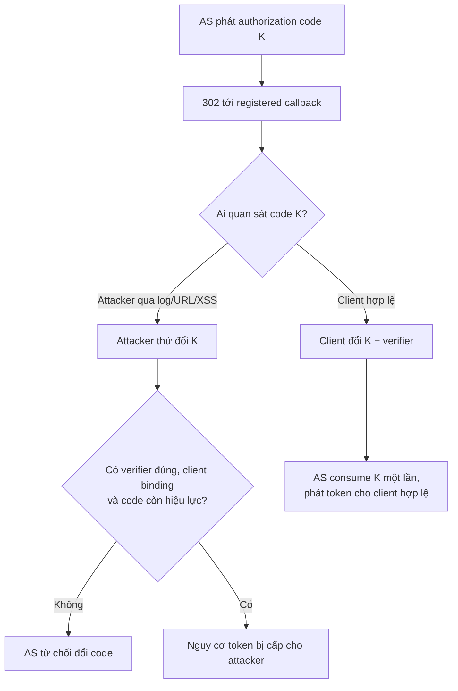
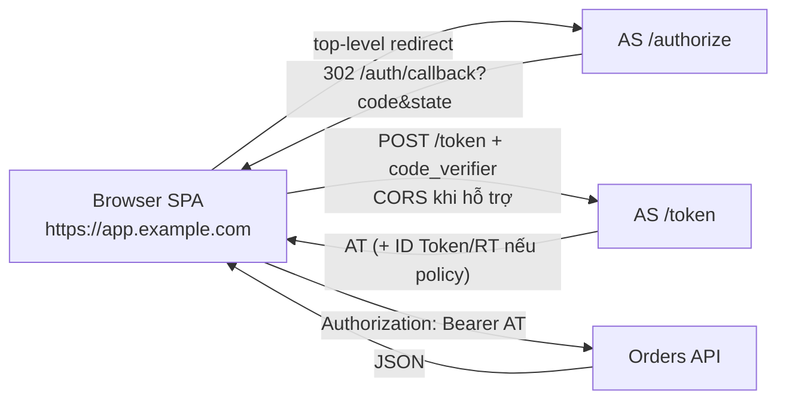

# Redirect URI trong browser app

## Mục tiêu học tập

Trong module **SECURITY_TOKEN_SECURITY_FUNDAMENTALS**, người học nắm mô hình tin cậy và vòng đời token bảo mật: phân biệt **JWT, opaque token, access token và refresh token**, sử dụng OAuth 2.0/OpenID Connect (OIDC), phát hành/kiểm tra claims, scope, audience, lưu trữ, thu hồi và phòng chống token bị đánh cắp hoặc phát lại. Ở chương **Browser security**, bài **“Redirect URI trong browser app”** đi vào điểm giao giữa **Authorization Server (AS)/OpenID Provider (OP)**, **trình duyệt**, **OAuth client** và **Resource Server (RS)**: *authorization response được gửi đến URL nào, ai có quyền nhận nó, và vì sao chỉ sai một cấu hình redirect có thể làm lộ code hoặc chiếm phiên?*

Sau bài này, bạn có thể:

- Giải thích **`redirect_uri` là gì**, phân biệt với authorization endpoint, token endpoint, URL điều hướng sau login, API endpoint, CORS origin và **`post_logout_redirect_uri`**.
- Thiết kế **registered redirect URI** cho browser app với HTTPS, host/path cụ thể, so khớp chính xác, không wildcard/open redirect; nhận diện ngoại lệ riêng cho native loopback clients mà không áp dụng tùy tiện cho SPA.
- Mô tả luồng **Authorization Code + PKCE `S256`**: authorization response chứa **`code` và `state`**, client xác minh transaction/issuer rồi đổi code ở AS; không đưa access/refresh token ra URL callback.
- Kiểm tra **`state`, expected issuer (RFC 9207 khi hỗ trợ), OIDC `nonce`, redirect URI/client/PKCE binding**, thời hạn và khả năng chỉ dùng code một lần.
- Phân tích tấn công **authorization code interception/injection**, login CSRF, **AS mix-up**, redirect manipulation, open redirect, fragment leakage, browser history/referrer/logging và XSS.
- Triển khai callback an toàn cho **SPA public client** và **BFF/confidential backend**, bao gồm router fallback, multi-tab, cookie SameSite/CSRF, CORS và proxy metadata.
- Xử lý lỗi `access_denied`, `invalid_request`, state mismatch và các điều kiện network/replay theo hướng **fail closed**.
- Viết checklist triển khai và kiểm thử tự động cho URI matching, callback, code exchange và phiên người dùng.

> **Nguyên tắc trung tâm:** **`redirect_uri` là địa chỉ đã đăng ký mà Authorization Server có thể chuyển authorization response về. Nó là một *security boundary*, không phải trường “chọn trang bất kỳ sau login”.** Browser có thể đi theo redirect, nhưng chỉ **client/transaction đúng, qua callback đúng** mới được phép đổi code và tạo session. Đối với ứng dụng mới, ưu tiên **Authorization Code + PKCE `S256`**; không đưa Bearer access token hoặc refresh token vào URL.

## 1. Redirect URI nằm ở đâu trong OAuth/OIDC?

Các vai trò tiêu biểu:

| Thành phần | Vai trò |
| --- | --- |
| **Resource Owner / End User** | Người dùng xác thực với AS/OP và quyết định quyền mà client được yêu cầu theo policy. |
| **Browser** | User agent dẫn hướng giữa client và AS/OP; **không tự xác minh OAuth authorization response** cho ứng dụng. |
| **OAuth Client / OIDC Relying Party** | Ứng dụng yêu cầu authorization, lưu transaction, nhận callback, đổi authorization code và kiểm chứng kết quả. |
| **Authorization Server (AS) / OpenID Provider (OP)** | Xác thực/ủy quyền, xác minh client registration và redirect URI, phát hành code rồi token theo grant. |
| **Resource Server (RS)** | Nhận **access token** đúng audience/scope để bảo vệ API; không nhận authorization code làm API credential. |

Ví dụ browser SPA:

```text
Client origin:             https://app.example.com
Registered redirect URI:  https://app.example.com/auth/callback
Authorization endpoint:   https://login.example.com/oauth2/authorize
Token endpoint:           https://login.example.com/oauth2/token
Resource Server:          https://api.example.com
Client ID:                web-spa
OAuth grant:              authorization_code + PKCE S256
```

Người dùng đang ở `https://app.example.com/dashboard`. Ứng dụng đưa browser đến `https://login.example.com/oauth2/authorize`. Sau đăng nhập và quyết định consent, AS chuyển browser về **`https://app.example.com/auth/callback`** với authorization code và `state`. Đây là **authorization response**, chưa phải một user session đã được xác minh bởi ứng dụng.

### 1.1. Phân biệt năm loại URL

| Giá trị | Ví dụ | Ai quyết định/tin cậy? |
| --- | --- | --- |
| **`authorization_endpoint`** | `https://login.example.com/oauth2/authorize` | AS/OP metadata được client tin cậy. |
| **`redirect_uri`** | `https://app.example.com/auth/callback` | Client đăng ký với AS; AS phải kiểm tra tương ứng với client/authorization request. |
| **`token_endpoint`** | `https://login.example.com/oauth2/token` | AS/OP metadata đáng tin; client **POST** code + PKCE verifier đến đây. |
| **Application return path** | `/dashboard`, `/orders/42` | Logic UX nội bộ của client **sau khi callback được xác minh**. |
| **`post_logout_redirect_uri`** | `https://app.example.com/signed-out` | Giá trị riêng theo OIDC logout profile/registration; **không tự là redirect_uri của OAuth login**. |

**Không lấy URL dashboard làm callback chỉ vì muốn user quay về đó**, nếu route không kiểm tra state/issuer/code đúng cách. Đồng thời **không cho request truyền `redirect_uri` tùy ý** làm nơi nhận code.

### 1.2. Authorization response không phải API access token

```http
HTTP/1.1 302 Found
Location: https://app.example.com/auth/callback?code=CODE_K&state=STATE_S
```

Authorization code là credential **một lần, thời gian ngắn**, bị ràng buộc với client/redirect URI và PKCE (khi áp dụng). Browser chuyển nó đến callback; **app chưa được xem user là authenticated** chỉ vì có `code=...`. Client còn phải xác minh transaction, gửi code tới AS token endpoint, xác minh ID Token nếu dùng OIDC, và chỉ sau đó mới tạo principal/session hợp lệ.

## 2. Luồng chuẩn: Authorization Code + PKCE với redirect URI

```mermaid
sequenceDiagram
    autonumber
    actor U as Người dùng
    participant BR as Browser
    participant CL as Browser Client hoặc BFF
    participant AS as AS/OP
    participant API as Resource Server
    U->>CL: Chọn đăng nhập
    CL->>CL: Tạo state, code_verifier,<br/>code_challenge=S256(verifier)
    CL-->>BR: Đi tới authorization_endpoint
    BR->>AS: GET /authorize?client_id=...<br/>&redirect_uri=registered<br/>&response_type=code&state=...<br/>&code_challenge=...&method=S256
    AS->>AS: Kiểm tra client_id + registered redirect_uri<br/>xác thực user/consent/policy
    AS-->>BR: 302 Location: /auth/callback?code=K&state=S
    BR->>CL: GET /auth/callback?code=K&state=S
    CL->>CL: Kiểm tra pending state, browser binding,<br/>expected issuer và one-time
    CL->>AS: POST /token code=K, redirect_uri,<br/>code_verifier; client auth nếu confidential
    AS->>AS: Verify code expiry/one-use, client,<br/>redirect binding, PKCE
    AS-->>CL: access_token (+ ID Token, RT theo policy)
    CL->>CL: Verify ID Token OIDC nếu có<br/>thiết lập phiên ứng dụng
    CL-->>BR: Redirect tới URL ứng dụng sạch
    CL->>API: Authorization: Bearer access_token
```

Sơ đồ kết hợp **SPA public client** và **BFF confidential client** ở mức logic; vị trí thực thi callback/token exchange khác nhau (mục 8–9).

### 2.1. Authorization request mẫu

```http
GET /oauth2/authorize?response_type=code&client_id=web-spa&redirect_uri=https%3A%2F%2Fapp.example.com%2Fauth%2Fcallback&scope=openid%20profile%20orders%3Aread&state=STATE_S&code_challenge=CHALLENGE_C&code_challenge_method=S256&nonce=NONCE_N HTTP/1.1
Host: login.example.com
```

Các giá trị `STATE_S`, `NONCE_N` và `CHALLENGE_C` chỉ là placeholders trong ví dụ; ứng dụng thật dùng CSPRNG và chuẩn PKCE. `scope=openid` biến authorization request thành OIDC khi OP hỗ trợ; khi chỉ dùng OAuth API access, không nhất thiết có ID Token/nonce.

### 2.2. Callback trả về

```http
GET /auth/callback?code=CODE_K&state=STATE_S HTTP/1.1
Host: app.example.com
```

Client phải **kiểm tra `state` và binding với transaction của browser trước khi đổi code**. Không tạo session từ `code` chưa xác minh; không decode một ID Token chưa verify (nếu flow có) rồi tin `sub`.

### 2.3. Token exchange mẫu

```http
POST /oauth2/token HTTP/1.1
Host: login.example.com
Content-Type: application/x-www-form-urlencoded

grant_type=authorization_code&code=CODE_K&redirect_uri=https%3A%2F%2Fapp.example.com%2Fauth%2Fcallback&client_id=web-spa&code_verifier=VERIFIER_V
```

Đối với **public browser client**, client authentication bằng shared secret không khả thi; `client_id` chỉ định danh client, **không phải bí mật**. Với **confidential BFF**, AS yêu cầu client authentication theo registration (secret/private key/mTLS...) bên cạnh PKCE theo policy. Nếu `redirect_uri` đã được dùng trong authorization request, token endpoint phải kiểm tra khớp theo quy tắc grant; không tự đổi URI sang domain khác trong token exchange.

### 2.4. Điều gì thực sự được bảo vệ?

- **Redirect URI registration/matching**: hạn chế nơi AS được phép trả authorization response.
- **`state` + browser transaction binding**: chống callback injection/login CSRF.
- **PKCE `S256`**: code bị chặn/lộ riêng lẻ **không đủ** để đổi token nếu không có `code_verifier`.
- **Code one-time + TTL ngắn**: giảm cửa sổ dùng lại authorization code.
- **Issuer binding**: giảm nguy cơ code bị gửi đến token endpoint của AS khác (mix-up).
- **OIDC ID Token validation (nếu dùng)**: bảo đảm authentication assertion đến từ OP tin cậy, dành đúng RP, đúng nonce/time.
- **Token validation tại RS**: đảm bảo access token đúng audience/scope/object policy, độc lập với việc browser callback thành công.

## 3. Quy tắc đăng ký và so khớp redirect URI

Một **registered redirect URI** là giá trị trong **client registration** ở AS. Khi client gửi authorization request chứa `redirect_uri`, AS phải đối chiếu với các URI đã đăng ký theo chính sách chuẩn hiện hành.

### 3.1. So khớp URI chính xác

**OAuth 2.0 Security Best Current Practice (RFC 9700)** yêu cầu so khớp chính xác redirect URI đã đăng ký với URI trong authorization request, ngoại trừ quy tắc đặc thù cho **port của loopback redirect URI ở native clients** theo RFC 8252. Browser SPA/web client thông thường **không** dùng ngoại lệ native loopback để cho phép port/host tùy ý trên internet.

```text
Đã đăng ký:
  https://app.example.com/auth/callback

Yêu cầu:
  https://app.example.com/auth/callback        -> MATCH
  https://app.example.com/auth/callback/       -> MISMATCH (slash cuối)
  https://app.example.com/auth/callback?x=1    -> MISMATCH nếu không đăng ký đúng giá trị ấy
  https://evil.example.net/auth/callback       -> MISMATCH
  https://app.example.com/redirect             -> MISMATCH
  http://app.example.com/auth/callback         -> MISMATCH scheme
```

Các so sánh ở trên minh họa **exact string registration**; chi tiết chuẩn hóa/encoding và profile của AS cần tuân thủ tiêu chuẩn tương ứng, không để lập trình viên tự “nới lỏng” bằng URI parsing hoặc hostname suffix matching.

### 3.2. Tránh wildcard và pattern matching tùy tiện

Phản ví dụ:

```text
Allowed redirect URIs:
  https://*.example.com/*
  https://app.example.com/*
  https://app.example.com/callback?next=*
```

Nếu AS cho phép mọi subdomain hoặc path, một subdomain bị chiếm quyền, một open redirect, một ứng dụng nội bộ khác cùng domain hoặc một parameter `next` có thể trở thành nơi nhận code.

**Không tự đặt quy tắc “hostname kết thúc bằng example.com”**: `example.com.attacker.net` cũng kết thúc chuỗi tên chứa `example.com` ở vị trí không đúng nếu so sánh substring/suffix sai. Chỉ dùng URI cụ thể được đăng ký và có chủ sở hữu rõ.

### 3.3. Redirect URI không chứa fragment

```text
https://app.example.com/auth/callback#done
```

Fragment không được gửi tới HTTP server như một phần request target. **Redirect URI đăng ký cho OAuth authorization response không được chứa fragment** theo OAuth redirect URI rules. Với SPA dùng **hash router** (ví dụ `/#/dashboard`), đừng cố đăng ký `https://app.example.com/#/auth/callback`: code response có thể không được route/parse đúng và fragment tương tác nguy hiểm với authorization response.

Hãy dùng **callback trên path thật** như `/auth/callback`; sau khi xử lý xong, SPA có thể điều hướng đến route ứng dụng qua router.

### 3.4. Scheme và localhost

Đối với **browser app chạy production**, dùng **HTTPS**, domain sở hữu/kiểm soát và URL callback cụ thể. Một số môi trường dev có callback `http://localhost:3000/auth/callback` được AS hỗ trợ cho thử nghiệm **local**; đó không phải giấy phép chấp nhận `http://` cho production browser origins.

**Native app** (ứng dụng được cài trên OS) có thể dùng **loopback redirect URI** theo RFC 8252, với chính sách đặc thù về port động. Đây là **profile khác** với SPA/web app: không coi `http://127.0.0.1:<random-port>` là mẫu callback cho website production.

### 3.5. Subdomain và multi-tenant

Nếu hệ thống có các tenant:

```text
https://tenant-a.example.com/auth/callback
https://tenant-b.example.com/auth/callback
```

Không cấu hình wildcard và tin mọi tenant domain. Thay vào đó:

- Có **registered redirect URI riêng** cho từng tenant/client configuration, hoặc một **callback dùng chung** do RP kiểm soát với session/tenant binding đáng tin.
- Nếu dùng callback chung, transaction phải lưu **expected tenant/client/issuer/return path**; không tự lấy tenant/issuer từ query callback chưa verify.
- Không chuyển code/token giữa tenant origins qua `?code=...` hoặc `?access_token=...`.
- Cần quy trình governance khi tenant đổi domain và xóa URI cũ khỏi AS registration.

### 3.6. Redirect mismatch phải được xử lý an toàn tại AS

Nếu `redirect_uri` không hợp lệ, **AS không nên chuyển user về chính URI không hợp lệ để báo lỗi**, vì như vậy sẽ giúp attacker dùng AS như open redirect hoặc nhận authorization data.

```text
Authorization request:
  client_id = web-spa
  redirect_uri = https://attacker.example/capture

AS:
  Không khớp client registration -> không redirect tới attacker.example
  Hiển thị/trả lỗi an toàn tại AS theo giao thức.
```

Client-side UX có thể hướng dẫn liên hệ quản trị cấu hình, nhưng **không log hoặc phát lại raw authorization request chứa secrets/transaction values ra public error page**.

## 4. Threat model: ai có thể tác động đến redirect URI?

Một redirect attack không nhất thiết đòi attacker kiểm soát Authorization Server. Attacker có thể điều khiển **tham số trong một liên kết**, **một subdomain**, **một open redirect trên client**, **một request callback giả** hoặc **script trong browser**.

| Kẻ tấn công kiểm soát | Mục tiêu | Kiểm soát chính |
| --- | --- | --- |
| `redirect_uri` trong authorization link | Khiến AS gửi code tới host không được phép. | AS **exact redirect URI matching** và client registration governance. |
| `next`/`returnUrl` ở client | Chuyển authorization response/URL nhạy cảm qua đích ngoài. | Chặn open redirect; callback xử lý code rồi chỉ đi tới internal route đã kiểm tra. |
| Một subdomain của tổ chức | Nhận code nếu AS dùng wildcard. | URI cụ thể, domain ownership, không wildcard theo suffix. |
| Request vào `/auth/callback` | Login CSRF hoặc code injection, gắn user browser với account khác. | `state`/transaction binding, PKCE, expected issuer, nonce/ID Token checks khi OIDC. |
| Authorization response của AS khác | AS mix-up: client gửi code/verifier đến token endpoint sai. | Ràng buộc AS từ lúc bắt đầu flow, issuer in authorization response theo profile hoặc distinct callbacks. |
| Browser extension/XSS ở client origin | Đọc code/state/verifier hoặc token trong JS/URL. | CSP/XSS defense, BFF khi phù hợp; PKCE không giải quyết hoàn toàn compromise browser. |
| Proxy/logging/analytics | Thu authorization code, transaction values hoặc tokens qua URL. | Callback tối giản, Referrer-Policy, log redaction, redirect sạch, không token vào URL. |
| DNS/TLS/reverse proxy cấu hình sai | Dẫn callback sang server không mong đợi hoặc nhận raw token/code tại điểm TLS termination. | HTTPS/domain governance, trusted proxy headers, TLS, gateway/access controls. |

### 4.1. Authorization code interception



**PKCE hạn chế code bị lấy riêng lẻ**; nó không ngăn lộ code trước tiên, và không cứu được khi attacker có **cả code và verifier**. Đối với confidential BFF, client authentication là một lớp bổ sung nhưng không thay PKCE, state hay redirect URI validation.

### 4.2. Authorization code injection và login CSRF

Attacker có thể khởi tạo một OAuth flow cho **account của attacker**, lấy code rồi lừa browser nạn nhân truy cập:

```text
https://app.example.com/auth/callback?code=ATTACKER_CODE&state=ATTACKER_STATE
```

Nếu client không kiểm tra `state` thuộc **pending authorization transaction của browser nạn nhân**, nó có thể đổi code và đăng nhập browser nạn nhân vào account attacker. Hậu quả điển hình là **login CSRF/session swapping**: nạn nhân tưởng đang làm việc trong tài khoản của mình nhưng thực tế điền dữ liệu vào tài khoản attacker.

**Biện pháp:** tạo state khó đoán, gắn browser/session và expected issuer/client/redirect, TTL ngắn, consume một lần, không cho callback lạ tự tạo transaction. PKCE giúp bổ sung binding code/verifier; không bỏ kiểm tra context của browser.

### 4.3. Authorization Server mix-up

Ứng dụng hỗ trợ hai OP:

```text
OP A: https://identity-a.example.com
OP B: https://identity-b.example.com
Callback dùng chung: https://app.example.com/auth/callback
```

Nếu ứng dụng chọn token endpoint dựa trên dữ liệu chưa xác minh trong callback, hoặc không lưu **expected issuer** khi khởi tạo login, attacker có thể khiến code từ OP A bị gửi tới endpoint OP B (hoặc ngược lại), làm lộ code hoặc gây token confusion.

**Phòng vệ:**

- Lưu AS/issuer đã chọn cùng transaction ngay từ **trước redirect**.
- Nếu AS hỗ trợ **RFC 9207** `iss` parameter trong authorization response, kiểm tra giá trị **chính xác** với expected issuer **trước token exchange**, kể cả error responses khi áp dụng.
- Nếu không có issuer response binding phù hợp, có thể dùng **redirect URI riêng cho mỗi issuer** hoặc cơ chế chống mix-up tương đương theo profile.
- Token endpoint/JWKS chỉ lấy từ **trusted issuer metadata**, không nối URL từ query/`iss` chưa verify.
- Sau exchange, verify OIDC ID Token `iss`/`aud` và access token audience theo mục đích; **chỉ verify ID Token sau exchange không sửa việc đã gửi code đến token endpoint sai trước đó**.

### 4.4. Open redirect trong callback hoặc sau login

Phản ví dụ:

```text
https://app.example.com/auth/callback?code=K&state=S&next=https://attacker.example/
```

Nếu callback chấp nhận `next` bất kỳ, ứng dụng có thể biến callback thành open redirect. Ngay cả khi code không được đính kèm đích cuối, open redirect có thể giúp phishing, bypass allowlist và leak thông tin qua referrer.

**Không đọc `next` trực tiếp từ authorization response làm source of truth.** Return path nên được lưu trước trong transaction server-side, hoặc state mapping an toàn, **chỉ cho internal relative path** và validate sau khi callback hoàn tất.

## 5. Browser làm gì với callback URL?

### 5.1. Query là một phần HTTP request target

```text
https://app.example.com/auth/callback?code=K&state=S
                                    └─────────── query
```

Với **Code Flow query response**, `code` và `state` đi qua:

- Browser address bar/history theo hành vi trình duyệt.
- Gateway/CDN/WAF, reverse proxy, application request handler và monitoring.
- Access logs nếu cấu hình ghi URL/request target đầy đủ.
- Các JavaScript/analytics đọc `location.href` trên callback page.
- Các navigation/referrer theo chính sách browser/`Referrer-Policy`.

**Authorization code không phải access token**, nhưng vẫn là credential cần giới hạn thời gian tồn tại và quan sát.

### 5.2. Fragment không gửi tới HTTP server, nhưng không phải nơi giữ token an toàn

```text
https://app.example.com/callback#access_token=<AT>
```

Fragment thường **không được gửi đến HTTP server như request target**, nhưng có thể được đọc bởi JavaScript cùng origin, XSS, extension, history/copy-share. Đó là một lý do **implicit flow phát AT trong fragment không phù hợp cho thiết kế OAuth mới**.

Với SPA dùng hash-based router, URL `/#/callback` cũng dễ tương tác không mong muốn với fragment response. Hãy dùng **real path callback** và router sau xác minh thay vì đẩy token/authorization response vào hash route.

### 5.3. Referrer-Policy và độ chính xác của tuyên bố

`Referer` có thể chứa **path/query** của URL nguồn khi điều hướng **cùng origin**, tùy policy. Với chính sách mặc định hiện đại **`strict-origin-when-cross-origin`**, HTTPS→HTTPS **cross-origin thường chỉ gửi origin**, và HTTPS→HTTP downgrade thường không gửi referrer. **Fragment không đi trong Referer chuẩn**.

**Không khẳng định mọi cross-origin navigation đều làm lộ toàn bộ query**, nhưng cũng đừng dựa vào mặc định browser để để code/AT/RT trong URL. Để giảm rò referrer từ callback nhạy cảm, nên dùng:

```http
Referrer-Policy: no-referrer
Cache-Control: no-store
```

Header này không xóa browser history, request target mà reverse proxy đã nhận, hoặc analytics đã gửi trước đó.

### 5.4. Redirect sạch sau callback

Sau khi xử lý callback và tạo session an toàn, BFF có thể:

```http
HTTP/1.1 303 See Other
Location: /dashboard
Referrer-Policy: no-referrer
Cache-Control: no-store
Set-Cookie: __Host-app-session=<opaque-id>; Path=/; Secure; HttpOnly; SameSite=Lax
```

Đây là **mẫu response minh họa**: 302/303/other redirect phù hợp flow của ứng dụng đều có thể dùng, không bắt buộc tất cả callbacks phải dùng 303. Cần kiểm tra cookie/session, TLS và cache policy thực tế. `Location: /dashboard` phải là **đường dẫn sạch**, không gắn `code`, `state`, ID Token hay AT/RT.

Với SPA callback xử lý client-side, có thể dùng `history.replaceState` sau khi SDK đã xác minh transaction, nhưng nó **không sửa được những bản sao URL/code đã lưu trước đó**.

### 5.5. Tránh third-party code trên callback page

Mã sau có thể vô tình đưa authorization code ra khỏi origin:

```javascript
// PHẢN VÍ DỤ: không gửi full callback URL vào analytics.
analytics.track("page_view", {
  url: window.location.href
});
```

Nếu callback có `?code=K&state=S`, vendor có thể nhận được K/S. Callback page nên **tối giản**, không tải tracking, quảng cáo hoặc JS ngoài cần thiết **trước khi authorization response được xác minh và URL được làm sạch**. Cần redaction ở gateway/APM, vì SPA cleanup xảy ra **sau** request callback ban đầu.

## 6. `state`: ràng buộc authorization response với browser transaction

`state` là tham số do client tạo để liên kết authorization response với một authorization request đang chờ. Trong browser app, nó giúp phát hiện callback **bất ngờ, bị tiêm hoặc thuộc phiên khác**.

### 6.1. Một transaction cần lưu gì?

```json
{
  "state_ref": "opaque-random-state",
  "expected_issuer": "https://login.example.com",
  "client_id": "web-spa",
  "redirect_uri": "https://app.example.com/auth/callback",
  "code_verifier_ref": "protected-transaction-storage",
  "nonce_ref": "oidc-nonce-if-used",
  "return_path": "/orders/42",
  "created_at": "2027-04-10T10:00:00Z",
  "expires_at": "2027-04-10T10:05:00Z",
  "consumed": false
}
```

Đây là **schema kiến trúc minh họa**, không phải JSON do browser nên gửi nguyên vẹn tới AS. Đừng nhét `code_verifier`, RT, password, email hoặc các bí mật vào `state` dạng URL để thay storage.

### 6.2. Giá trị state phải khó đoán

```javascript
// Ví dụ browser CSPRNG tạo opaque state đủ entropy.
const random = new Uint8Array(32);
crypto.getRandomValues(random);
const state = Array.from(random, b =>
  b.toString(16).padStart(2, "0")).join("");
```

32 byte từ CSPRNG trong ví dụ tạo giá trị khó đoán; độ dài/encoding cụ thể phụ thuộc SDK. Đừng dùng timestamp, `Math.random()`, user ID hoặc email làm state.

### 6.3. Gắn state với phiên và consume một lần

Kiểm tra callback:

1. Có **pending transaction** đã được tạo trước đó cho **browser/session hiện tại**.
2. `state` ở callback **khớp** một transaction đó, còn hạn và **chưa consumed**.
3. Transaction mang đúng `expected_issuer`, client, redirect URI và PKCE verifier.
4. Trước token exchange, áp issuer/mix-up check được profile hỗ trợ.
5. Đánh dấu transaction **consumed** sao cho callback replay không tạo login/session mới.

**Không chỉ tra state trong kho toàn cục mà bỏ browser binding**, vì attacker có thể gửi callback kèm state do chính attacker tạo. Ở BFF, state mapping thường gắn server-side session/correlation cookie; ở SPA, SDK dùng transaction storage đúng origin/browser.

### 6.4. Multi-tab, multi-login và state per-flow

Người dùng có thể nhấn “Đăng nhập” ở hai tab hoặc bắt đầu hai transaction:

```text
Tab A -> state=A, verifier=A
Tab B -> state=B, verifier=B
Callback B đến trước callback A.
```

Nếu ứng dụng giữ một biến toàn cục `currentVerifier` hoặc `currentState` rồi ghi đè khi khởi tạo flow B, callback A sẽ dùng sai verifier/nonce. **Không nên lấy giá trị “mới nhất”**. Cần lưu mapping **state → transaction** có TTL/one-time, xác định tab/session binding theo thiết kế, xóa đúng transaction đã dùng.

Trong SPA, `sessionStorage` thường tách theo tab browsing context và có thể giữ giá trị qua redirect cùng tab; nhưng duplicate tabs, opener behavior hoặc khôi phục browser có thể ảnh hưởng. Không thiết kế bảo mật dựa trên giả định một storage key duy nhất luôn “đúng tab”. SDK OAuth/OIDC đã được kiểm chứng tốt hơn tự ghép transaction state thiếu khóa.

### 6.5. State và PKCE có thay thế nhau không?

**Không hoàn toàn.** PKCE ràng buộc việc **đổi code** với verifier; state và transaction binding giúp client nhận ra **callback thuộc request/browser đúng**. Một số OAuth Security BCP profiles cho phép PKCE đáp ứng một phần mục tiêu CSRF khi triển khai bảo đảm binding đầy đủ; nhưng với browser/OIDC integration nhiều issuer và nhiều tab, vẫn nên **dùng state và kiểm tra transaction** để phòng login CSRF, mix-up và nhầm context.

## 7. PKCE và issuer binding: không chỉ kiểm tra URL

### 7.1. PKCE `S256`

Client tạo `code_verifier` bằng entropy đủ mạnh, sau đó tính:

\[
\text{code\_challenge} = \operatorname{BASE64URL}\bigl(\operatorname{SHA256}(\operatorname{ASCII}(\text{code\_verifier}))\bigr)
\]

Chú ý:

- `code_verifier` phải được lưu trong **transaction của client**, không gửi qua authorization URL.
- `code_challenge` được đưa vào authorization request; `code_challenge_method=S256`.
- AS lưu challenge với authorization code và so sánh khi token request mang verifier.
- Code hết hạn hoặc được dùng lại phải bị từ chối; token endpoint không được cấp token vì chỉ thấy `code` có hình dạng hợp lệ.
- PKCE không ngăn XSS đọc cả `code` và verifier tại SPA; cần chống XSS và cân nhắc BFF.

### 7.2. Vì sao không dùng `plain`?

`plain` khiến challenge có quan hệ trực tiếp với verifier; nếu authorization request URL bị quan sát, rủi ro lộ verifier tăng. Dùng **`S256`** khi AS hỗ trợ theo best practice. Không downgrade sang `plain` chỉ vì tích hợp gặp lỗi chưa xác định; xác minh client/AS SDK, encoding và registration.

### 7.3. Expected issuer và RFC 9207

Nếu AS hỗ trợ issuer identification:

```text
Authorization response:
  code=K
  state=S
  iss=https://login.example.com

Pending transaction:
  expected_issuer=https://login.example.com
```

Client cần so khớp `iss` với expected issuer **trước khi chọn token endpoint**. Nếu sử dụng nhiều AS, không được lấy endpoint từ một giá trị `iss` chưa xác minh rồi tự fetch metadata/JWKS trên domain bất kỳ. **Trusted issuer allowlist/config** phải được xác định khi bắt đầu authorization.

Nếu không có `iss` ở authorization response do AS/profile chưa hỗ trợ, cần biện pháp mix-up defense tương ứng, ví dụ callback URI khác nhau cho mỗi issuer hoặc cách binding profile tin cậy khác.

### 7.4. OIDC `nonce` và ID Token

Trong OIDC, ID Token dành cho **Relying Party** xác thực sự kiện user login, không phải Bearer access token cho API. Nếu RP gửi nonce, nó phải verify **`nonce` trong ID Token** theo profile. Ngoài ra cần:

- Verify chữ ký/JWS thuật toán và key từ **trusted issuer**.
- Kiểm tra `iss`, `aud` chứa đúng client ID, `azp` khi áp dụng.
- Kiểm tra `exp`, `iat` và `auth_time`/`acr` khi flow/chính sách yêu cầu độ mới/assurance.
- Dùng `(iss, sub)` đã verify để xác định subject, không lấy `user_id` từ callback query/email.
- Không gửi ID Token vào `Authorization: Bearer` đến RS; RS chỉ nhận access token đúng audience/scope/type.

**Nonce không thay state hoặc PKCE**: nó gắn ID Token với authentication request khi áp dụng; state gắn authorization response với transaction; PKCE gắn code exchange với verifier.

## 8. SPA public client: redirect URI trên cùng origin với ứng dụng

Một **Single Page Application (SPA)** chạy chủ yếu trong browser thường được đăng ký như **OAuth public client**: JavaScript bundle được tải về và người dùng/attacker có thể đọc mã nguồn, nên không có bí mật dùng chung nào được bảo vệ như ở confidential backend.

### 8.1. Kiến trúc tổng quát



SPA tự xử lý callback và gửi token request **từ browser đến AS**. Cấu hình AS phải hỗ trợ **public browser client + Code/PKCE + CORS cho token endpoint** nếu mô hình yêu cầu. **Đăng ký redirect URI không tự mở CORS**, và CORS không biến client thành confidential.

### 8.2. Ví dụ JavaScript tạo PKCE và authorization URL

```javascript
// Ví dụ minh họa cho cùng một browser origin, chỉ dùng trong môi trường HTTPS.
// Trong ứng dụng thật, ưu tiên OAuth/OIDC SDK đã kiểm chứng.
const oauth = {
  issuer: "https://login.example.com",
  authorizeEndpoint: "https://login.example.com/oauth2/authorize",
  clientId: "web-spa",
  redirectUri: "https://app.example.com/auth/callback"
};

function base64url(bytes) {
  return btoa(String.fromCharCode(...bytes))
    .replace(/\+/g, "-")
    .replace(/\//g, "_")
    .replace(/=+$/g, "");
}

function randomValue() {
  const bytes = new Uint8Array(32);
  crypto.getRandomValues(bytes);
  return base64url(bytes);
}

async function pkceS256(verifier) {
  const digest = await crypto.subtle.digest(
    "SHA-256", new TextEncoder().encode(verifier));
  return base64url(new Uint8Array(digest));
}

async function beginAuthorization(returnPath = "/dashboard") {
  // Chỉ cho đường dẫn nội bộ hợp lệ, không dùng URL do caller tùy ý quyết định.
  const allowed = new Set(["/dashboard", "/orders"]);
  if (!allowed.has(returnPath)) throw new Error("Invalid return path");

  const state = randomValue();
  const nonce = randomValue();       // Dùng khi OIDC request có nonce.
  const verifier = randomValue();
  const challenge = await pkceS256(verifier);

  const transaction = {
    expectedIssuer: oauth.issuer,
    redirectUri: oauth.redirectUri,
    clientId: oauth.clientId,
    verifier,
    nonce,
    returnPath,
    expiresAt: Date.now() + 5 * 60 * 1000
  };

  // sessionStorage là JS-accessible; XSS có thể đọc. Đây là demo,
  // không thay kiến trúc bảo vệ token/transaction của SDK production.
  sessionStorage.setItem("oauth-tx:" + state, JSON.stringify(transaction));

  const url = new URL(oauth.authorizeEndpoint);
  url.searchParams.set("response_type", "code");
  url.searchParams.set("client_id", oauth.clientId);
  url.searchParams.set("redirect_uri", oauth.redirectUri);
  url.searchParams.set("scope", "openid profile orders:read");
  url.searchParams.set("state", state);
  url.searchParams.set("nonce", nonce);
  url.searchParams.set("code_challenge", challenge);
  url.searchParams.set("code_challenge_method", "S256");
  window.location.assign(url.toString());
}
```

**Lưu ý chuyên môn:** đoạn trên minh họa việc tạo transaction/PKCE; **chưa** bao gồm tất cả cơ chế SDK như issuer mix-up defense, nonce validation ở ID Token, storage isolation, error handling, parallel login retries, refresh token protection hay token response cryptography. Không dùng nguyên đoạn làm thư viện OAuth tự xây cho production.

### 8.3. Callback SPA phải làm những bước nào?

```javascript
// Pseudocode cho callback SPA: tập trung vào kiểm tra transaction.
async function handleCallback(sdk) {
  const responseUrl = new URL(window.location.href);
  const state = responseUrl.searchParams.get("state");
  const error = responseUrl.searchParams.get("error");
  const code = responseUrl.searchParams.get("code");

  if (!state) throw new Error("Missing state");
  const stored = sessionStorage.getItem("oauth-tx:" + state);
  if (!stored) throw new Error("Unexpected or replayed callback");

  const tx = JSON.parse(stored);
  if (Date.now() > tx.expiresAt) throw new Error("Expired transaction");
  if (tx.redirectUri !== oauth.redirectUri ||
      tx.expectedIssuer !== oauth.issuer ||
      tx.clientId !== oauth.clientId) {
    throw new Error("Wrong authorization context");
  }

  // Khi issuer response parameter được profile yêu cầu/hỗ trợ,
  // SDK phải kiểm tra đúng với tx.expectedIssuer trước token exchange.
  await sdk.validateAuthorizationResponseIssuer(responseUrl, tx);

  // Bỏ entry trước khi xử lý; callback replay không thể dùng cùng state.
  sessionStorage.removeItem("oauth-tx:" + state);
  window.history.replaceState(null, "", "/auth/callback");

  if (error) {
    // Không coi lỗi thành công; không dùng code/token từ error response.
    throw new Error("Authorization was not completed");
  }
  if (!code) throw new Error("Missing authorization code");

  // SDK trusted thực hiện token exchange bằng đúng AS, verifier, redirect URI;
  // rồi verify ID Token/nonce/signature/audience khi dùng OIDC.
  await sdk.exchangeAndValidateCode({
    code,
    codeVerifier: tx.verifier,
    redirectUri: tx.redirectUri,
    expectedIssuer: tx.expectedIssuer,
    nonce: tx.nonce
  });

  // Điều hướng chỉ tới internal returnPath đã allowlist.
  window.location.replace(tx.returnPath);
}
```

**Những method `sdk.validateAuthorizationResponseIssuer` và `sdk.exchangeAndValidateCode` là *pseudocode* — không phải API của một SDK cụ thể.** Ứng dụng phải dựa trên thư viện OAuth/OIDC có kiểm thử bảo mật, thay vì chỉ parse `code` và POST thủ công rồi decode JWT.

**Một giới hạn khác:** dòng `sessionStorage.removeItem` trước token exchange làm callback không retry tự động nếu network lỗi; app cần thiết kế retry **an toàn và idempotent** theo SDK, không lưu code/verifier lâu hơn cần thiết hoặc đổi code nhiều lần. Đây là ví dụ về **consume transaction**, không khẳng định có đúng một thứ tự duy nhất cho mọi SPA SDK.

### 8.4. Không để callback token trong browser URL

Một anti-pattern:

```javascript
// KHÔNG AN TOÀN: Bearer AT trở thành URL và có thể leak qua history/logs.
window.location.assign("/dashboard?access_token=" +
  encodeURIComponent(accessToken));
```

SPA nên giữ access token trong memory/storage có kiểm soát theo threat model, sử dụng **`Authorization: Bearer` qua HTTPS** đến RS đúng audience, tránh lưu RT lâu dài trong JavaScript-accessible storage khi có phương án an toàn hơn. **Không có storage JS-accessible nào loại trừ XSS đang thực thi trong origin**.

## 9. Backend for Frontend: redirect URI kết thúc ở server

**BFF (Backend for Frontend)** thường là **confidential client** giữ token server-side; browser chỉ nhận một session cookie. Đây là lựa chọn giảm bề mặt lộ AT/RT ở JavaScript.

### 9.1. Luồng BFF

```mermaid
sequenceDiagram
    autonumber
    participant BR as Browser
    participant BFF as BFF Client
    participant OP as AS/OP
    participant API as Resource Server
    BR->>BFF: GET /login
    BFF->>BFF: Lưu state, PKCE verifier, nonce, issuer,<br/>CSRF/session binding trong transaction store
    BFF-->>BR: 302 /authorize
    BR->>OP: User login/consent
    OP-->>BR: 302 /auth/callback?code=K&state=S
    BR->>BFF: GET /auth/callback?code=K&state=S
    BFF->>BFF: Verify state/issuer/browser binding
    BFF->>OP: POST /token code=K, verifier<br/>và client authentication
    OP-->>BFF: ID Token, AT (+ RT nếu policy)
    BFF->>BFF: Validate ID Token, store AT/RT server-side
    BFF-->>BR: Cookie HttpOnly session;<br/>302 /dashboard URL sạch
    BR->>BFF: GET /api/orders với cookie
    BFF->>API: Authorization: Bearer AT
    API-->>BFF: Orders data
    BFF-->>BR: JSON không chứa token
```

**Một điểm quan trọng:** Browser vẫn thấy **authorization code trên callback URL**, nhưng **Bearer AT/RT không được đưa ra URL/JS**. BFF callback phải có log redaction/CSRF protection, không vì token nằm backend mà bỏ kiểm tra redirect URI.

### 9.2. Cookie session minh họa

```http
Set-Cookie: __Host-portal-session=<opaque-id>; Path=/; Secure; HttpOnly; SameSite=Lax
Cache-Control: no-store
```

Cookie:

- **`Secure`:** chỉ gửi trong ngữ cảnh HTTPS theo browser rules.
- **`HttpOnly`:** JavaScript không thể đọc chuỗi cookie nhưng XSS vẫn có thể dùng phiên đang hoạt động để gọi API.
- **`SameSite`:** giảm một số CSRF; không thay CSRF/Origin checks cho state-changing requests.
- **Prefix `__Host-`:** yêu cầu `Secure`, `Path=/` và **không có `Domain`** khi browser hỗ trợ.

Session ID phải **rotate sau authentication/step-up**, hết hạn và bị invalid server-side khi logout; một cookie bị xóa ở browser **không chứng minh** refresh token server-side đã được AS revoke.

### 9.3. BFF callback không phải một API công khai “đổi code hộ”

Không thiết kế:

```text
POST /exchange-code
{
  "code": "<untrusted>",
  "redirect_uri": "<caller-chosen>",
  "issuer": "<caller-chosen>"
}
```

Nếu BFF chọn token endpoint/redirect URI từ dữ liệu caller tự khai và dùng client credentials để đổi code, nó có thể trở thành **confused deputy**, bị AS mix-up hoặc token exfiltration. Cần lấy **issuer/client/redirect URI/verifier** từ trusted transaction đã lưu; request callback chỉ cung cấp **authorization response values** để đối chiếu.

### 9.4. BFF không xóa bỏ các quyền API

RP login thành công chỉ chứng minh user được xác thực theo ID Token/session. Khi BFF gọi Orders API:

```text
accessToken.iss  = trusted issuer
accessToken.aud  = api://orders
scope            = orders:read
user/tenant      = được phép xem order cụ thể
```

RS vẫn phải kiểm tra signature/introspection, token purpose, time, audience, scope, revocation và object-level policy. **Không dùng ID Token như access token**.

## 10. CORS, cookies và browser policy không phải redirect URI

### 10.1. CORS origin khác full redirect URI

```text
SPA origin:
  https://app.example.com

Registered redirect URI:
  https://app.example.com/auth/callback

Allowed CORS origin tại AS token endpoint (nếu hỗ trợ browser SPA):
  https://app.example.com
```

**CORS origin** gồm scheme/host/port, **không có path**. **`redirect_uri`** gồm URI cụ thể được đăng ký (path có ý nghĩa). CORS trả lời browser **có cho mã JavaScript đọc cross-origin response không**; redirect registration trả lời AS **được gửi authorization code về URL nào**.

**CORS không chứng minh danh tính client.** Script/server khác có thể gửi HTTP requests ngoài browser; public client vẫn cần PKCE và AS phải kiểm tra client/redirect/grant.

### 10.2. Không nhầm CORS lỗi với invalid redirect URI

| Hiện tượng | Nguyên nhân thường gặp | Hướng xử lý |
| --- | --- | --- |
| AS hiển thị `invalid_redirect_uri` / `redirect_uri_mismatch` ngay lúc bắt đầu login. | URI trong authorization request khác registration. | So sánh scheme/host/port/path/query chính xác; sửa registration hoặc client config. |
| Login chuyển về đúng callback nhưng SPA không gọi/read được token endpoint. | AS token endpoint chưa cho CORS origin/method/header theo browser profile. | Cấu hình AS CORS cho client origin tin cậy; không sửa redirect URI thành `*`. |
| Callback 404 khi browser quay về SPA deep link. | Host/CDN/router không phục vụ `/auth/callback` hoặc thiếu SPA fallback. | Cấu hình route/fallback đúng, không đặt secret trong fragment workaround. |
| Callback mất cookie transaction. | SameSite/cross-site redirect/form_post, cookie scope hoặc third-party restrictions. | Xem mục 10.3; gắn state đúng và đổi flow cookie policy có kiểm soát. |
| Browser hiển thị `Mixed Content` hoặc downgrade lỗi. | HTTPS page gọi HTTP token/API endpoint. | Dùng HTTPS endpoints, không giải quyết bằng CORS wildcard. |

### 10.3. Cookie `SameSite` khi browser quay từ OP về RP

**Top-level cross-site GET navigation** về callback thường gửi cookie `SameSite=Lax` đáp ứng điều kiện browser áp dụng. Vì vậy BFF callback Code Flow query GET có thể nhận **temporary login transaction cookie** khi chính sách được cấu hình hợp lệ.

Nếu dùng **OIDC `response_mode=form_post`**, OP khiến browser gửi **cross-site POST** tới RP. Cookie `SameSite=Lax` thường **không được gửi với cross-site POST**, có thể khiến mất transaction/session binding. Một số browser có hành vi ngoại lệ tạm thời cho cookie mới, **không được dựa vào ngoại lệ** để thiết kế bảo mật.

Các lựa chọn:

- Ưu tiên Code Flow query GET callback khi profile/điều kiện phù hợp, kết hợp referrer/log redaction.
- Nếu `form_post` bắt buộc, thiết kế cookie `SameSite=None; Secure` khi thật sự cần và browser hỗ trợ, đồng thời bảo vệ CSRF/session fixation và cân nhắc third-party cookie restrictions.
- Có thể dùng một transaction store/correlation mechanism đáng tin phù hợp kiến trúc thay vì giả định cookie sẽ luôn được gửi.
- Test trên browser thực tế, private mode và các bối cảnh cross-site; không bỏ state verification để “sửa lỗi mất cookie”.

**`SameSite=None` không đồng nghĩa “CSRF đã được xử lý”**; nó tăng khả năng cookie được gửi cross-site theo browser policy và vì vậy cần các bảo vệ ứng dụng khác.

### 10.4. Third-party cookies, iframe và silent login

Một số cách triển khai OIDC cũ dựa vào **hidden iframe**, silent authorization `prompt=none` hoặc browser third-party cookies. Browser privacy restrictions có thể chặn OP cookies trong iframe, làm `login_required` hoặc không hoàn tất callback. Đây **không tự là redirect URI mismatch**.

Thay vì vô hiệu CSRF hoặc dùng wildcard callback, nên đánh giá **top-level redirect Code+PKCE**, BFF/OP session profile và cơ chế session management/logout được hỗ trợ. Không cố nhét access token vào fragment để tránh iframe restrictions.

### 10.5. Service Worker và browser cache

Một **Service Worker** cùng scope có thể intercept navigation tới `/auth/callback`. Nếu nó trả một cached SPA shell cũ hoặc ghi URL callback vào telemetry, có thể làm xử lý code sai hoặc lộ `code`.

- Callback phải được route đúng tới code handler và không bị cache sai.
- Thận trọng khi Service Worker ghi `request.url` (có thể chứa `code`/`state`) vào logs/cache.
- Với BFF callback phía server, tránh CDN/cache ghi hoặc phục vụ cached callback response cho browser khác.
- `Cache-Control: no-store` và route rules phù hợp giảm caching response, nhưng **không bảo vệ URL đã đi qua gateway/history**.

## 11. SPA router, reverse proxy và callback “đúng nhưng 404”

### 11.1. Deep link cần phục vụ được

Ví dụ server chỉ có file `index.html` ở `/`, nhưng AS redirect tới:

```text
https://app.example.com/auth/callback?code=K&state=S
```

Nếu CDN/router trả **404**, SPA không chạy code handler. Cấu hình hosting cần hỗ trợ **SPA fallback** cho route `/auth/callback` hoặc server route cụ thể. Tuy nhiên phải phân biệt:

- **SPA callback:** origin server phục vụ shell HTML cho SPA, JS SDK xử lý code.
- **BFF callback:** backend thực sự nhận `GET /auth/callback` và xử lý code trước khi redirect sạch.

**Không rewrite một callback BFF sang SPA shell** vô tình bỏ qua server-side state/token exchange, và không để SPA router dùng fallback chứa token/code chưa được xác minh.

### 11.2. Reverse proxy và forwarded headers

Ứng dụng BFF phía sau TLS termination có thể nhìn thấy internal request:

```text
Client ngoài: https://app.example.com/auth/callback
Proxy -> BFF: http://app-internal:8080/auth/callback
```

Nếu backend tự suy redirect URI từ `request.scheme`/`Host` không được chuẩn hóa, nó có thể gửi `http://app-internal:8080/auth/callback` lên AS rồi nhận `redirect_uri_mismatch`. Nguy hiểm hơn, nếu tin `Host`/`X-Forwarded-Host` do attacker tự đặt, ứng dụng có thể phát authorization request dùng **attacker-controlled host**.

**Thiết kế:**

- Cấu hình **external redirect URI cố định** từ trusted deployment/client registration.
- Nếu dùng forwarded headers, chỉ tin headers do **trusted reverse proxy** tạo/ghi đè; không tin client-provided `X-Forwarded-*` trực tiếp.
- Bảo vệ `Host` allowlist, không lấy tenant/callback endpoint từ header chưa validate.
- Test cả HTTPS gateway và internal HTTP hop; không tự downgrade callback về HTTP vì backend thấy scheme nội bộ.

### 11.3. Trailing slash, default port và encoding

Các URI dễ khác nhau:

```text
https://app.example.com/auth/callback
https://app.example.com/auth/callback/
https://app.example.com:443/auth/callback
https://APP.example.com/auth/callback
https://app.example.com/auth/%63allback
```

Đừng đoán AS sẽ canonicalize/normalize chúng “giống nhau” theo cách bạn muốn. Theo client registration/profile, **dùng chính xác chuỗi đã đăng ký** khi tạo authorization request và token exchange. Nếu SDK tự normalize URL, phải xác định hành vi dựa trên SDK và AS thực tế, không mở wildcard để chữa lỗi.

### 11.4. Return URL không phải redirect URI

Một flow có thể đưa user trở lại trang đang xem:

```text
Trước login: /orders/42
OAuth redirect URI cố định: /auth/callback
Sau callback thành công: /orders/42
```

Lưu return path cùng pending transaction; chấp nhận **chỉ path nội bộ an toàn**, không cho scheme/host ngoài, `//evil.example`, backslash/protocol tricks hoặc URL chứa token. Khi login thất bại, không redirect đến path do callback tự khai.

## 12. Callback lỗi: không được bỏ qua transaction validation

AS có thể trả **authorization error** thay vì code. Ví dụ user từ chối consent:

```http
HTTP/1.1 302 Found
Location: https://app.example.com/auth/callback?error=access_denied&state=STATE_S
```

Client cần kiểm tra **callback thực sự khớp pending transaction** trước khi dùng error response cho điều hướng/hiển thị trạng thái. Không tạo session từ lỗi, không nhầm `error` và `code` trong cùng response thành kết quả thành công.

### 12.1. Phân biệt lỗi theo tầng

| Tình huống | Tầng phát sinh | Hướng xử lý |
| --- | --- | --- |
| `redirect_uri` không khớp registration. | AS authorization endpoint. | AS **không redirect đến URI không hợp lệ**; sửa cấu hình và không leak request data. |
| `error=access_denied` với state hợp lệ. | Authorization response. | User không đồng ý/cancel; không tạo session mới hoặc cấp scope. |
| `error=login_required` với `prompt=none` khi OIDC profile hỗ trợ. | OP authorization response. | Không tự xác thực; có thể bắt đầu flow tương tác mới theo UX/policy. |
| `error=consent_required` hoặc `interaction_required`. | OP/AS authorization response. | Không tự chấp thuận scope; xử lý tương tác khi phù hợp. |
| Callback thiếu/sai `state`. | Client callback validation. | Từ chối, audit an toàn, không đổi code. |
| Callback có `code` nhưng không có pending transaction. | Client. | Từ chối code injection/replay; không tự tạo state/verifier. |
| Authorization response `iss` khác expected issuer. | Client mix-up defense. | Từ chối **trước token exchange**. |
| Code đã expired/consumed, PKCE verifier sai. | AS token endpoint. | `invalid_grant` hoặc lỗi phù hợp, không retry với verifier khác. |
| OIDC ID Token signature/issuer/audience/nonce sai. | RP post-exchange validation. | Không lập session; không dùng ID Token đó làm principal. |
| Token endpoint mất kết nối. | Network/AS. | Transaction cleanup/retry theo profile, không báo login thành công khi chưa verify token. |
| Callback route 404 hoặc SPA script lỗi. | Hosting/router/browser. | Sửa routing; không “workaround” bằng token trong fragment hoặc redirect wildcard. |

### 12.2. Quy tắc chung để phản hồi lỗi

- **Không hiển thị raw query** có `code`/`state` trong public error body, tracking event hoặc support link.
- **Không đưa user tới arbitrary external `returnUrl`** lấy từ callback.
- **Không phát code hoặc token sang AS khác để thử lại**.
- **Không tạo authenticated session** cho tới khi authorization response và ID Token (nếu dùng) được xác minh.
- Có thể dùng **correlation ID** và error category trung tính để vận hành tra cứu, không log raw authorization code, verifier, ID Token hay credential.
- **Không retry cùng authorization code vô hạn**; code là one-time. Khi giao dịch không thể tiếp tục, khởi tạo authorization request mới với state/verifier/nonce mới.

### 12.3. Xử lý callback lặp

Browser có thể reload callback, bấm Back hoặc có hai mạng gửi cùng code:

```text
T0: GET /auth/callback?code=K&state=S -> PASS
T1: transaction S được consume, AS code K được consume
T2: GET /auth/callback?code=K&state=S -> REPLAY/ALREADY_PROCESSED
```

Client có thể redirect người dùng tới một trang login/status đã làm sạch URL, nhưng **không được tạo session mới từ lần callback lặp**, không gọi API bằng code cũ hoặc bỏ qua state vì user “đã từng login”.

## 13. Java/Spring Security: cấu hình redirect URI cho BFF

**Spring Security OAuth2 Client** thường tự quản lý authorization request, `state` correlation, xử lý callback và token exchange theo client registration. Ưu tiên khả năng framework/SDK đã kiểm chứng thay vì tự xây một `@GetMapping("/callback")` parse code.

### 13.1. Cấu hình mẫu bằng Spring Boot

```yaml
# Ví dụ minh họa, property names theo Spring Boot OAuth2 Client.
# Đưa client secret thật vào secret manager/environment, không commit.
spring:
  security:
    oauth2:
      client:
        registration:
          identity:
            provider: identity
            client-id: portal-bff
            client-secret: "<secret-from-secret-manager>"
            authorization-grant-type: authorization_code
            redirect-uri: "{baseUrl}/login/oauth2/code/{registrationId}"
            scope:
              - openid
              - profile
        provider:
          identity:
            issuer-uri: https://login.example.com
```

Trong một deployment BFF có base URL `https://app.example.com` và registration ID `identity`, callback kết quả thường là:

```text
https://app.example.com/login/oauth2/code/identity
```

**Đăng ký URI này chính xác ở AS**. Không đăng ký một URI khác kiểu `https://app.example.com/auth/callback` rồi kỳ vọng Spring tự chuyển đổi, trừ khi bạn cũng cấu hình redirection endpoint tương ứng.

### 13.2. Spring Security filter chain

```java
// Spring Security 6-style minh họa.
@Configuration
@EnableWebSecurity
class WebSecurityConfig {

    @Bean
    SecurityFilterChain webChain(HttpSecurity http) throws Exception {
        http
            .authorizeHttpRequests(auth -> auth
                .requestMatchers("/", "/login", "/error",
                                 "/signed-out").permitAll()
                .anyRequest().authenticated())
            .oauth2Login(Customizer.withDefaults());

        // Đừng disable CSRF toàn ứng dụng chỉ vì login dùng redirect.
        // Spring Security mặc định có CSRF protection cho web session
        // theo cấu hình phù hợp.
        return http.build();
    }
}
```

**Đối chiếu phiên bản thư viện/AS thực tế** trước khi dùng. Cần kiểm tra Code+PKCE `S256` có thực sự được áp cho client registration/flow đang triển khai; **confidential client có secret không phải lý do tắt PKCE** nếu AS/security policy yêu cầu.

### 13.3. Không nối redirect URI từ untrusted request host

Phản ví dụ:

```java
// KHÔNG AN TOÀN: attacker có thể tác động Host nếu proxy không kiểm soát.
String callback = "https://" + request.getHeader("Host")
    + "/login/oauth2/code/identity";
```

Phương án an toàn:

```java
// Minh họa: cấu hình trusted external URI qua deployment config.
String registeredCallback =
    "https://app.example.com/login/oauth2/code/identity";
```

Nếu dùng `{baseUrl}` động theo forwarded headers, deployment phải giới hạn ingress/proxy được tin, sanitize/overwrite `Forwarded`/`X-Forwarded-Host`/`X-Forwarded-Proto`, và có host allowlist. **Không lấy host từ arbitrary client request làm trusted OAuth redirect URI**.

### 13.4. Không tự parse authorization code trong controller chung

Phản ví dụ:

```java
@GetMapping("/login/oauth2/code/identity")
public String callback(@RequestParam String code) {
    // SAI: đổi code hoặc tạo session mà không kiểm tra state/PKCE/issuer.
    userSession.loginFromCode(code);
    return "redirect:/dashboard";
}
```

Một callback cần cả transaction/issuer binding, code exchange và OIDC ID Token validation; dùng cơ chế `oauth2Login`/SDK được kiểm chứng để tránh tự bỏ sót. Nếu bắt buộc custom handler, cần threat model, integration tests và review riêng; không dựa vào một controller nhận `code` tự do.

### 13.5. Return path sau login trong Spring

Một success handler có thể redirect tới **đường dẫn nội bộ** đã xác thực và được lưu trong saved request/session. Nếu cho user truyền `continue`/`returnUrl`:

```text
Cho phép:
  /dashboard
  /orders/42

Từ chối:
  https://attacker.example/capture
  //attacker.example/capture
  javascript:...
  /auth/callback?access_token=<AT>
```

Đừng viết success handler đọc bất kỳ string từ request rồi `sendRedirect(value)`. Framework có thể có saved-request logic; cần giới hạn allowed destinations và kiểm soát Host/proxy như ở mục 11.

## 14. Các anti-pattern và cách sửa

| Anti-pattern | Hệ quả | Sửa đúng |
| --- | --- | --- |
| Đăng ký `https://*.example.com/*`. | Subdomain/route bị compromise có thể nhận code. | URI cụ thể, exact match. |
| Chấp nhận `http://` callback trên production browser app. | Rủi ro interception/downgrade. | HTTPS domain tin cậy; local dev ngoại lệ riêng theo AS. |
| Tự thay `redirect_uri` trên token request. | `invalid_grant` hoặc lỗi binding; tạo đường nhầm client/issuer. | Lưu và dùng đúng URI của authorization transaction. |
| Dùng `/#/callback` làm redirect URI. | Fragment không được server nhận; tương tác lỗi với response/SPA routing. | Path callback thật, xử lý rồi điều hướng router. |
| AS trả lỗi mismatch bằng redirect tới URI attacker khai. | Biến AS thành open redirect / leak endpoint. | Xử lý lỗi tại AS, không redirect đến URI không hợp lệ. |
| Sử dụng `?next=https://...` từ callback làm redirect cuối. | Open redirect/phishing/leak. | Return path internal đã lưu cùng transaction. |
| Chấp nhận callback có `code` mà không có `state` hợp lệ. | Login CSRF/code injection. | State/browser binding/one-time/TTL/issuer check. |
| Coi PKCE đủ nên bỏ issuer mix-up defense khi dùng nhiều OP. | Có thể gửi code đến token endpoint sai. | Expected issuer + RFC 9207/alternative profile defense. |
| Lưu `code_verifier` trong `state` URL. | Leaks verifier cùng code, phá mục tiêu PKCE. | Verifier ở protected transaction storage. |
| Dùng một `state`/verifier cố định cho mọi lần login. | Replay, nhầm phiên, không chống CSRF đúng. | Random per-flow, consume once. |
| Một biến global `currentState` cho nhiều tab. | Callback sai verifier/nonce hoặc session swapping. | Mapping state→transaction; quản lý TTL/multi-tab. |
| SPA hard-code `client_secret`. | Secret có thể bị trích xuất từ JS bundle. | Public client Code+PKCE hoặc confidential BFF. |
| Cho CORS wildcard vì gặp redirect mismatch. | Không giải quyết callback URI; tạo cấu hình CORS quá rộng. | Sửa URI registration, cấu hình CORS riêng đúng origin. |
| Bỏ state check khi `SameSite=Lax` làm mất cookie trên `form_post`. | Login CSRF hoặc callback unbound. | Thiết kế lại response mode/cookie/transaction binding. |
| Để callback page chạy analytics trước khi xử lý code. | Code/state đi vào vendor telemetry. | Callback tối giản, no-referrer, log redaction, redirect sạch. |
| Bỏ qua exception khi ID Token `aud`/`nonce` sai. | Cross-client token confusion hoặc replay. | Verify OIDC ID Token theo expected transaction. |
| Dùng ID Token làm API bearer token sau callback. | Sai token purpose/audience. | Dùng access token đúng RS audience/scope. |
| Cấp AT qua `?access_token=` để tránh token endpoint. | Token lộ URL/history/logs; implicit-style risk. | Code+PKCE, AT qua token response và header/BFF. |
| Tin `X-Forwarded-Host` từ public internet. | Host header injection/URI confusion. | Trusted proxy + allowlist + fixed external URL. |
| Coi URL sạch sau `history.replaceState` là chưa từng lộ. | Logs/history/analytics có thể đã sao chép code. | Redaction từ edge và bảo vệ callback ngay từ đầu. |
| Bắt buộc mọi browser dùng hidden iframe `prompt=none` để login. | Third-party cookie restrictions làm thất bại. | Top-level Code+PKCE hoặc cơ chế OP/BFF phù hợp. |
| Ghi full callback URL vào server logs/APM. | Lộ code/state/transaction data. | Redact query ở nguồn, route template/correlation ID. |

## 15. Tình huống thực tế: từ lỗi cấu hình đến tấn công

### 15.1. Callback trên subdomain cũ không còn được quản lý

**Bối cảnh:** tổ chức từng đăng ký:

```text
https://old-login.example.com/callback
```

Sau khi di chuyển hạ tầng, DNS `old-login` vẫn trỏ tới một dịch vụ đã ngừng sử dụng, có nguy cơ bị takeover. Nếu AS vẫn cho phép callback cũ, authorization response có thể đi tới origin không còn được tổ chức kiểm soát.

**Xử lý:**

1. Duy trì inventory của **client registrations và redirect URIs**.
2. Chỉ đăng ký callback ở domain/path thực sự đang vận hành và TLS được kiểm soát.
3. Xóa URI cũ khỏi AS khi migration hoàn tất, không giữ “phòng khi cần” vô hạn.
4. Không dùng wildcard subdomain để né việc cập nhật registration.
5. Đánh giá code/transaction leakage trong khoảng URI cũ còn được đăng ký; PKCE giảm thiểu interception đơn lẻ nhưng không thay domain governance.

### 15.2. Login CSRF bằng callback của tài khoản attacker

**Bối cảnh:** attacker khởi tạo login account A, lấy code và gửi URL callback cho nạn nhân:

```text
https://app.example.com/auth/callback?code=CODE_A&state=STATE_A
```

**Nếu ứng dụng sai:** callback tự nhận code mà không kiểm tra state gắn browser, rồi tạo session cho user A ở browser nạn nhân.

**Đúng:** không tồn tại pending transaction `STATE_A` thuộc browser nạn nhân → từ chối. Nếu state trùng do bug, code/PKCE verifier/issuer/browser binding vẫn phải được kiểm chứng. Không thể tự tạo transaction dựa trên state do callback cung cấp.

### 15.3. SPA và BFF dùng chung một client ID với hai redirect URI

```text
Client ID: portal
SPA callback: https://app.example.com/auth/callback
BFF callback: https://api.example.com/login/oauth2/code/portal
```

Sự khác biệt public/confidential, token storage, client authentication, CORS và cookie có thể làm client registration trở nên khó kiểm soát. Nếu một client ID được dùng cho cả browser JS lẫn server secret, **đừng coi SPA biết cùng client ID là confidential**.

**Khuyến nghị:** dùng **client registration riêng** cho SPA public và BFF confidential khi khả thi, mỗi client có redirect URI/PKCE/client auth policy rõ. Nếu AS hỗ trợ nhiều URI cho một client, vẫn phải xác định security profile không bị hạ xuống mức public và kiểm thử cross-client redirect/token substitution.

### 15.4. Token endpoint CORS lỗi nhưng redirect URI hoàn toàn đúng

AS redirect về `https://app.example.com/auth/callback` thành công, SPA đọc `code` và `state` hợp lệ. Khi JS gọi `POST https://login.example.com/oauth2/token`, browser báo CORS.

**Không nên:** sửa AS redirect URI thành wildcard hoặc tắt PKCE để “cho token response đi qua”.

**Nên:** xác minh AS có hỗ trợ token endpoint dành cho browser public client hay không; nếu có, cấu hình **exact allowed origin**, methods/headers phù hợp, và token endpoint vẫn kiểm tra code/PKCE/client. Nếu AS không hỗ trợ browser token exchange, cân nhắc BFF theo registration đúng.

### 15.5. `response_mode=form_post` làm mất correlation cookie

OP gửi:

```http
POST /auth/callback HTTP/1.1
Host: app.example.com
Content-Type: application/x-www-form-urlencoded

code=CODE_K&state=STATE_S
```

Nếu cookie correlation là `SameSite=Lax` và request là **cross-site POST**, browser có thể không gửi cookie. RP không tìm được pending transaction.

**Không nên:** bỏ state validation hoặc nhận `code` tự do.

**Nên:** đánh giá lại response mode/cookie SameSite và trusted transaction binding; chọn cấu hình được profile/SDK hỗ trợ, có CSRF protection và kiểm thử trên browser thực.

### 15.6. Login thành công nhưng quay về 404

Host tĩnh của SPA không biết `/auth/callback`, chỉ phục vụ `/`. AS chuyển browser về callback rồi nhận 404.

**Sửa:** cấu hình route/fallback phục vụ callback, để SDK xử lý rồi redirect sạch; **không** sửa AS registration thành `https://app.example.com/#/callback` hoặc đưa `code` sang query của `/` một cách thủ công.

Nếu callback thuộc BFF, phải route tới backend filter/controller **đã được framework bảo vệ**, không fallback sang SPA.

### 15.7. Reverse proxy tạo URI `http` thay vì `https`

TLS termination tại CDN, BFF nhận internal HTTP nên tự tạo:

```text
http://app-internal:8080/login/oauth2/code/identity
```

AS đã đăng ký `https://app.example.com/login/oauth2/code/identity` nên từ chối. Để sửa, cấu hình **external base URL** và trusted proxy forwarding, không thêm wildcard/HTTP internal callback vào production registration.

### 15.8. Nhiều OP chia một callback làm AS mix-up

User chọn OP A. Attacker thay đổi callback context khiến client lấy token endpoint của OP B từ query. Client gửi code K (OP A phát) đến OP B.

**Sửa:** transaction state ghi **OP A** từ trước redirect, kiểm tra issuer response `iss` theo RFC 9207 khi hỗ trợ, hoặc dùng distinct redirect URI/mix-up defense thích hợp. **Không tin issuer query chưa được so khớp để chọn endpoint**, không chỉ dựa vào ID Token validation sau khi đã lộ code.

### 15.9. Code xuất hiện trong APM dù app đã redirect sạch

BFF callback nhận `GET /auth/callback?code=K&state=S` rồi trả `302 /dashboard`. Trên browser URL nhanh chóng sạch, nhưng reverse proxy đã ghi `K` trong `http.url`.

**Đúng:** xử lý URL logging tại edge/proxy/APM và retention; callback redirect sạch là biện pháp bổ sung. Nếu code có TTL ngắn, PKCE bảo vệ exchange, nhưng vẫn phải điều tra rò code như một security exposure, đặc biệt nếu verifier/client credentials cũng xuất hiện ở tracing.

### 15.10. User quay lại trang callback bằng nút Back

Browser history giữ callback URL; user bấm Back sau khi đã login:

```text
Lần 1: code K / state S -> được xử lý, tiêu thụ một lần.
Lần 2: code K / state S -> transaction đã consumed.
```

Client phải **không tạo session mới hoặc gọi token exchange lặp với code đã used**. Có thể chuyển về trang an toàn mà không tiết lộ lý do nhạy cảm. Sử dụng `history.replaceState`/server redirect sạch để giảm UX lỗi, nhưng **one-time transaction/AS code consume** mới là bảo vệ cốt lõi.

### 15.11. Return URL chuyển người dùng về website attacker

App nhận `returnUrl=https://attacker.example` trước login rồi sau callback redirect thẳng đến nó. Người dùng thấy màn hình login từ OP uy tín, sau đó đột ngột tới website attacker với một số dữ liệu trong URL/referrer.

**Sửa:** chỉ lưu **relative internal path** được validate, không cho external scheme/host, path normalization tricks hoặc query chứa credential; không để callback lấy return URL do attacker thêm vào response.

### 15.12. Phân biệt login callback với logout callback

Ứng dụng:

```text
OAuth redirect_uri:            /login/oauth2/code/identity
OIDC post_logout_redirect_uri: /signed-out
```

Nếu đăng ký `/signed-out` làm login callback để tránh lỗi URI mismatch, ứng dụng có thể nhận authorization code trên route không được thiết kế để verify. **Đừng trộn login với logout endpoints**. OIDC logout còn có `state`/`id_token_hint` và profile khác; `post_logout_redirect_uri` chỉ được dùng như đã đăng ký với OP, không nhận AT/RT trong URL.

## 16. Ma trận kiểm thử Redirect URI trong browser app

**Fixture chung:**

```text
Trusted issuer:      https://login.example.com
Client ID SPA:       web-spa (public)
Client ID BFF:       portal-bff (confidential)
Redirect URI SPA:    https://app.example.com/auth/callback
Redirect URI BFF:    https://app.example.com/login/oauth2/code/identity
Orders API audience: api://orders
Flow:                authorization_code + PKCE S256
Test transaction:    STATE_S -> verifier V, nonce N, issuer, redirect URI
```

Chỉ dùng **dummy code/token/test accounts**. Không ghi raw AT/RT/code_verifier hoặc credential production vào test artifacts.

| Tình huống | Kết quả mong đợi |
| --- | --- |
| Authorization request dùng đúng redirect URI đã đăng ký cho `web-spa`. | AS chấp nhận URI nếu các điều kiện khác PASS. |
| Path đúng nhưng có slash cuối không đăng ký. | AS từ chối mismatch. |
| Scheme `http` thay `https` ở production browser client. | AS từ chối URI không đăng ký/chính sách HTTPS. |
| Port `:8443` thay port đăng ký. | Từ chối khi không exact match. |
| Query thêm `?next=...` vào redirect URI không đăng ký. | Từ chối; không nới wildcard. |
| `redirect_uri` trỏ tới attacker origin. | AS không redirect authorization response hoặc lỗi về attacker. |
| Wildcard subdomain `*.example.com` làm attacker subdomain nhận code. | Security architecture FAIL; dùng URI cụ thể. |
| URI đăng ký chứa `#fragment`. | Registration/flow phải từ chối theo redirect URI rules. |
| SPA cố dùng `/#/auth/callback`. | Test phát hiện callback/hash routing không an toàn/không hợp lệ; dùng path callback. |
| Native loopback client dùng port động theo RFC 8252. | Áp exception chỉ khi đúng **native client profile**, không nới cho production SPA. |
| Local dev `http://localhost:3000` nhưng production URI vẫn HTTPS. | Registration tách dev/prod, không chấp nhận localhost tùy ý ngoài dev policy. |
| Redirect URI đúng nhưng CDN trả 404 callback. | Hosting test FAIL; cần fallback/route phù hợp. |
| Redirect URI đúng nhưng CDN cache nhầm callback response. | Cache policy test FAIL; response/query nhạy cảm không bị chia sẻ. |
| Reverse proxy tự dựng callback từ `Host` attacker. | Từ chối untrusted host; dùng fixed external URI/trusted proxy. |
| `X-Forwarded-Proto` có thể giả mạo thành HTTP/HTTPS. | Chỉ tin forwarded header từ trusted proxy, không cho redirect hijack. |
| Callback có code/state từ pending transaction hợp lệ. | Client kiểm tra state/issuer, PKCE exchange, ID Token nếu OIDC, rồi session. |
| Callback code có `state` sai. | Từ chối; không exchange code hoặc tạo session. |
| Callback code không có `state`/transaction. | Từ chối login CSRF/injection. |
| Callback có `state` của browser/tab khác. | Không nhận nhầm browser transaction; tùy storage binding, từ chối. |
| Callback `state` đã consumed. | Từ chối replay; không tạo session mới. |
| Code hết hạn hoặc đã dùng. | AS token endpoint từ chối `invalid_grant`. |
| `code_verifier` không khớp `code_challenge`. | AS từ chối, không phát AT/RT. |
| Authorization request dùng `code_challenge_method=plain` dù policy yêu cầu `S256`. | AS từ chối/downgrade test FAIL. |
| Token exchange dùng `redirect_uri` khác authorization request. | AS từ chối binding mismatch. |
| Token exchange dùng client ID khác client của code. | AS từ chối cross-client code redemption. |
| SPA bundle hard-code client secret. | Security test FAIL; public client không có shared secret bảo mật. |
| BFF confidential client client authentication sai. | AS từ chối; không coi code alone là đủ. |
| Browser nhận callback từ AS A trong transaction dự kiến AS B. | Từ chối mix-up trước token exchange. |
| RFC 9207 `iss` khác expected issuer. | Từ chối; không gửi code tới endpoint của issuer sai. |
| AS không hỗ trợ `iss` nhưng app nhiều issuers. | Kiểm tra distinct redirect URIs hoặc mix-up defense khác; không bỏ mặc. |
| OIDC ID Token `aud` khác client ID RP. | Từ chối ID Token; không tạo session. |
| OIDC ID Token nonce sai khi transaction có nonce. | Từ chối ID Token; không tạo session. |
| OIDC ID Token `iss`/signature/`exp` sai. | Từ chối identity assertion. |
| Callback trả `error=access_denied` với state đúng. | Không tạo session mới; hiển thị denial an toàn. |
| Callback error thiếu/sai state. | Từ chối callback không thuộc pending transaction. |
| Client nhận code và error cùng lúc. | Không xử lý là success; fail closed theo profile. |
| Callback `prompt=none` trả `login_required`. | Không coi user đã đăng nhập; có thể khởi động interactive flow mới. |
| BFF Code Flow GET callback với `SameSite=Lax` cookie hợp lệ. | Transaction cookie được nhận theo browser policy; state vẫn phải verify. |
| `form_post` cross-site POST bị mất Lax correlation cookie. | Test phát hiện và sửa flow/cookie/transaction strategy, không bỏ state. |
| SPA redirect đúng nhưng token endpoint CORS không cho origin. | Phân loại đúng lỗi CORS, không sửa redirect URI thành wildcard. |
| SPA token response CORS hợp lệ nhưng `code_verifier` sai. | AS vẫn từ chối; CORS không phải client authentication. |
| Callback page gửi `location.href` tới analytics. | Security test FAIL; không để code/state đi vào bên thứ ba. |
| Gateway/APM log raw `code`/`state`/`Authorization`. | Security test FAIL; redaction tại nguồn. |
| Callback có open redirect `next=https://attacker.example`. | Không đi tới attacker; chỉ return path internal đã allowlist. |
| SPA dùng `history.replaceState` sau callback. | URL hiển thị sạch; không tuyên bố proxy logs đã được xóa. |
| Service Worker intercept callback và dùng cached response cũ. | Test phát hiện; callback phải xử lý code đúng, không serve cache nhầm. |
| Browser Back/reload callback đã consumed. | Không redeem lại code/tạo session; UX chuyển về trang sạch an toàn. |
| RP login xong dùng ID Token gọi Orders API. | Orders từ chối sai token purpose/audience. |
| AT đúng audience nhưng thiếu `orders:write`. | RS trả `403 insufficient_scope`, không nhầm lỗi redirect. |
| AT hợp lệ đủ scope nhưng order thuộc tenant khác. | RS từ chối object-level authorization (403/404 theo policy). |

### 16.1. Test property của URI matching

Không chỉ test một URI đúng, hãy tạo tập URI **gần giống** với URI đã đăng ký:

```text
Registered:
  https://app.example.com/auth/callback

Mutation classes:
  scheme -> http
  host -> app.example.com.attacker.net
  host -> attacker.example.com
  port -> 8443
  path -> /auth/callback/
  path -> /auth/callbacK
  query -> ?next=https://attacker.example
  fragment -> #callback
  userinfo -> app.example.com@attacker.example
  encoding -> %2F, %2e, backslash normalization

Expected: AS chỉ chấp nhận URI thực sự đã đăng ký theo policy.
```

**Không yêu cầu hệ thống chuẩn hóa theo mọi cách “có vẻ tương đương”**; đây là bộ test để bảo đảm những cách viết sai/đánh lừa URI parser không nới quyền redirect.

### 16.2. Test race của callback transaction

```text
Thread A: Callback K/S đến RP và bắt đầu validate state S.
Thread B: Callback K/S thứ hai đến RP gần như đồng thời.

Expected:
  - Chỉ một callback có thể consume pending transaction S.
  - Chỉ một code redemption thành công tại AS.
  - Không tạo hai session user từ cùng S/K.
  - Audit/correlation không log K, verifier hoặc ID Token.
```

Nếu transaction store nằm ở nhiều BFF nodes, cần **atomic consume/CAS/transaction**, không chỉ khóa trong một JVM. Với SPA, SDK cần xử lý một lần và tránh lưu token response vào session khác khi callback bị race.

### 16.3. Ví dụ kiểm thử Java ở mức ý tưởng

```java
// Pseudocode JUnit với test doubles, không phải SDK compile-ready.
@Test
void rejectsUnknownRedirectUri() {
    var request = oauthRequest()
        .clientId("web-spa")
        .redirectUri("https://attacker.example/collect");

    assertAuthorizationErrorWithoutRedirectToUntrustedUri(
        () -> authorizationServer.authorize(request));
}

@Test
void rejectsCallbackWithWrongState() {
    PendingTransaction tx = startLoginForCurrentBrowser();
    assertCallbackRejected(() -> client.handleCallback(
        "CODE_K", "STATE_FROM_ANOTHER_BROWSER"));
    assertFalse(sessionStore.authenticatedForCurrentBrowser());
}

@Test
void rejectsCodeExchangeWithWrongRedirectUri() {
    var code = issueCodeFor("web-spa",
        "https://app.example.com/auth/callback");
    assertOAuthError("invalid_grant", () -> tokenEndpoint.exchange(
        code, "https://app.example.com/other", verifierFor(code)));
}

@Test
void preventsCallbackReplayAcrossNodes() {
    PendingTransaction tx = startLoginForCurrentBrowser();
    assertExactlyOneSuccessFromConcurrentCallbacks(tx);
    assertEquals(1, tokenEndpoint.redemptionCount(tx.code()));
}
```

Các test doubles `oauthRequest`, `authorizationServer`, `client` và `tokenEndpoint` là **minh họa**. Trong thực tế cần AS test server/harness có trust keys, registration, browser cookie contexts, TLS/forwarded headers và token endpoint semantics đã cấu hình.

## 17. Audit, log redaction và ứng cứu sự cố redirect URI

### 17.1. Audit những gì?

Khi điều tra lỗi `redirect_uri_mismatch` hoặc callback injection, hệ thống cần đủ dữ liệu để khôi phục transaction **mà không làm rò code/token**.

```json
{
  "event_type": "OAUTH_CALLBACK_REJECTED",
  "event_id": "evt-45a2",
  "correlation_id": "login-req-8b2c",
  "client_ref": "portal-bff",
  "expected_issuer": "https://login.example.com",
  "redirect_uri_ref": "registered-callback-identity",
  "reason_code": "STATE_MISMATCH",
  "browser_transaction_ref": "tx-hmac-55a1",
  "http_route": "GET /login/oauth2/code/identity",
  "occurred_at": "2027-04-10T10:01:00Z"
}
```

Các trường trên là **schema minh họa của ứng dụng**, không phải audit event chuẩn bắt buộc của OAuth. `browser_transaction_ref` phải là tham chiếu/giá trị pseudonymized **không thể dùng như credential**, với phân quyền/retention phù hợp.

| Dữ liệu | Có nên ghi raw? | Thay bằng |
| --- | --- | --- |
| Authorization code | **Không** | Correlation ID, trạng thái `code_present=true`, code redemption outcome. |
| PKCE `code_verifier` | **Không** | `pkce_method=S256` và kết quả kiểm chứng. |
| `state`/`nonce` đầy đủ | **Không** trong logs rộng quyền | Transaction reference/HMAC có kiểm soát. |
| ID Token, access token, refresh token | **Không** | Token purpose, issuer/client refs, outcome và TTL category. |
| `Authorization`/`Cookie` headers | **Không** | Header presence booleans/correlation. |
| Full callback URL | **Không** | Route template + reason code; redact query/path có secret. |
| Client secret/private key | **Không** | Client authentication method + result. |
| Redirect URI đăng ký | Có thể ghi **reference/allowlisted URI** theo quyền. | Tránh raw URI từ input attacker trong audit/metrics khi không cần. |
| Untrusted `returnUrl` | Tránh nguyên văn trong public logs. | Normalized rejection reason và route template. |

**Redaction cần nằm tại nguồn:** CDN/WAF, reverse proxy, framework access log, APM/spans/error reporting, analytics SDK, support tooling và HAR exports. Một handler Spring không ghi `code` vẫn có thể làm lộ qua gateway `$request_uri`.

### 17.2. Metrics và cảnh báo có ích

- Số lượng **redirect mismatch** theo client registration/environment, không dùng full untrusted URI làm metric label.
- Tỷ lệ callback bị từ chối vì **state missing/mismatch/expired/replayed**; tăng đột biến có thể là bug deploy hoặc probing.
- Số **issuer mismatch** trên ứng dụng đa OP; không gửi code tới token endpoint sai để “kiểm tra lại”.
- Tỷ lệ token endpoint **`invalid_grant`** sau callback, có thể do code reuse, PKCE sai, redirect binding hoặc clock/TTL.
- Lỗi CORS/token endpoint riêng với lỗi **redirect URI registration**, tránh sửa sai nguyên nhân.
- Callback route 404/503, SameSite cookie missing, cache hits bất thường ở `/auth/callback`.
- Số URL/trace có chứa pattern `code=`/`access_token=`/`id_token=` sau redaction; không lưu giá trị thật trong metrics.

### 17.3. Incident: nhận thấy code redirect tới host lạ

**Tình huống:** đội bảo mật phát hiện authorization response có thể đi tới `https://retired.example.com/callback` không còn do tổ chức kiểm soát.

Các bước:

1. **Ngừng khả năng nhận code mới qua URI đó:** xóa/disable registration không còn đúng; sửa open redirect/client config.
2. **Đánh giá phạm vi:** client ID, issuer, các URI được đăng ký, thời gian lỗ hổng tồn tại, liệu host có bị takeover/traffic redirect hay không.
3. **Xem xét code redemption:** authorization code một lần, TTL ngắn, PKCE và confidential client authentication có được thực thi không; liệu attacker có verifier/client credential không.
4. **Xử lý token/session phát sinh nếu có bằng chứng compromise:** revoke AT/RT/grant theo AS/RS capability, xác nhận enforcement tại API (JWT offline có thể vẫn còn hạn).
5. **Điều tra logs/analytics/backup** đã chứa code/state/ID Token/AT nếu flow cũ dùng front-channel.
6. **Quản trị lại domain/redirect URI**, thêm regression tests cho URI matching, multi-tenant và CORS/proxy.
7. Ghi audit và thông báo theo chính sách incident/privacy; không paste raw code/token trong ticket/email/chat.

**Không dùng “code đã hết hạn nên chắc chắn không có sự cố” như kết luận tự động.** Cần xem code đã được đổi thành token trước khi hết hạn hay chưa, có trùng PKCE verifier/client binding không và tài nguyên nào bị truy cập.

### 17.4. Khi nào phải thu hồi token?

Authorization code bị lộ riêng lẻ **không đồng nghĩa** access token đã bị lộ; PKCE/client binding có thể làm attacker không đổi được code. Tuy nhiên:

- Nếu attacker đã redeem code thành công hoặc chiếm callback+verifier/client credentials, phải xử lý **AT/RT đã cấp**.
- Nếu app từng phát **Bearer AT trong URL/fragment**, đánh giá token leakage và revocation trực tiếp tại AS/RS.
- Nếu session bị **login CSRF/account confusion**, invalid phiên sai, kiểm tra các hành động do user thực hiện trong account attacker và quy trình account linking.
- Nếu lộ **ID Token**, xem nguy cơ PII/replay/token substitution ở RP; không coi revoke AT tự làm ID Token không dùng được trong mọi ngữ cảnh.
- Nếu không có cơ chế revoke JWT AT tức thì ở RS, **công bố cửa sổ hiệu lực còn lại** và ưu tiên kiểm soát API nhạy cảm theo threat model.

## 18. Câu hỏi tự kiểm tra

1. `redirect_uri` trong browser app là gì và tại sao được xem là security boundary?
2. Phân biệt `redirect_uri`, `authorization_endpoint`, `token_endpoint`, internal `returnUrl` và `post_logout_redirect_uri`.
3. Một authorization response `code=K&state=S` có đủ để client coi user đã authenticated chưa?
4. AS nên so khớp registered redirect URI như thế nào? Vì sao wildcard subdomain/path nguy hiểm?
5. Có được đăng ký `https://app.example.com/#/callback` làm OAuth redirect URI không? Vì sao?
6. Ngoại lệ loopback dynamic port của RFC 8252 có áp dụng chung cho production SPA không?
7. Vì sao authorization code trong callback query khác với access token trong URL?
8. `state` giải quyết rủi ro gì và vì sao phải gắn browser/pending transaction?
9. PKCE `S256` giúp gì khi code bị lộ, và trường hợp nào PKCE vẫn không cứu được?
10. Khi dùng nhiều OP, tại sao expected issuer phải được xác định **trước token exchange**?
11. `iss` parameter trong RFC 9207 đóng vai trò gì? Nếu AS không hỗ trợ thì cần đánh giá gì?
12. OIDC `nonce` thay `state` hoặc PKCE được không?
13. Vì sao cùng một trang SPA có thể có hai `state`/verifier hợp lệ ở hai tab?
14. Callback `state` đúng nhưng ID Token `aud` thuộc client khác: có được tạo session không?
15. Callback trả `error=access_denied`: client được tạo session mới không?
16. Tại sao `Referrer-Policy: no-referrer` không phải biện pháp duy nhất bảo vệ callback?
17. CORS origin khác registered redirect URI ở điểm nào?
18. Một SPA callback 404 sau khi OP redirect thành công: cần sửa AS wildcard hay cấu hình routing?
19. Vì sao `SameSite=Lax` cookie có thể hoạt động với top-level GET callback nhưng không hoạt động với `form_post` cross-site POST?
20. Vì sao không nên bỏ `state` check để khắc phục việc mất correlation cookie?
21. Reverse proxy phía sau TLS termination tạo `http://app-internal`: cần xử lý ở đâu?
22. Vì sao `Host`/`X-Forwarded-Host` do browser tự gửi không đáng tin để tạo redirect URI?
23. BFF giúp giảm nguy cơ nào so với SPA giữ AT/RT trong JS, và rủi ro nào vẫn còn?
24. Nếu token endpoint CORS bị chặn, có được bỏ PKCE hoặc chuyển access token vào fragment không?
25. Một callback được gửi lại sau khi state/code đã consumed phải xử lý ra sao?
26. User đang xem `/orders/42` trước login: có thể giữ return path thế nào mà không mở open redirect?
27. Nếu authorization code bị log, nhưng PKCE verifier không lộ, có thể kết luận AT/RT chắc chắn không bị compromise không?
28. OIDC ID Token và access token khác nhau ở audience và nơi sử dụng như thế nào?

**Gợi ý trả lời:**

1. Đó là URL đã đăng ký để AS chuyển authorization response về; nếu cho chọn tùy ý, code có thể tới origin của attacker.
2. Redirect URI nhận callback; authorization/token endpoints thuộc AS; returnUrl chỉ là UX sau callback; post-logout URI thuộc logout profile riêng.
3. Chưa. Client cần transaction/issuer/PKCE/token response và OIDC ID Token validation khi áp dụng.
4. Exact matching theo client registration/profile; wildcard tăng quyền tới các route/subdomain không được kiểm soát.
5. Không. Redirect URI OAuth không chứa fragment; fragment cũng không đi trong HTTP request target.
6. Không. Đây là ngoại lệ cho native loopback clients, không phải wildcard port cho browser site.
7. Code một lần ngắn hạn và cần client/redirect/PKCE binding; Bearer AT có thể gọi RS trực tiếp khi còn hiệu lực.
8. Chống callback injection/login CSRF; phải kiểm tra pending state thuộc browser và consume một lần.
9. Code đơn lẻ không đủ đổi token; nếu attacker có cả verifier hoặc chiếm runtime, PKCE có thể không đủ.
10. Để không đưa code đến token endpoint của một issuer khác (AS mix-up).
11. Giúp xác định issuer của authorization response; nếu thiếu cần distinct callbacks hoặc mix-up defense tương đương.
12. Không. Nonce gắn ID Token với authentication request, state gắn authorization callback, PKCE gắn code exchange.
13. Hai authorization transactions độc lập có thể tồn tại; map state→transaction thay vì một biến global.
14. Không. ID Token `aud` phải đúng client ID RP và các điều kiện validation khác.
15. Không. Denial không phải xác thực thành công; phải kiểm tra state của error response và xử lý UX an toàn.
16. Không ngăn logs, history, URL đích hoặc third-party scripts đã đọc `location.href`.
17. CORS origin gồm scheme/host/port; redirect URI còn có path/query cụ thể và dùng cho authorization response routing.
18. Sửa route/fallback hoặc backend callback handler, không nới AS redirect URI.
19. Browser SameSite policy thường không gửi Lax cookie trên cross-site POST; cần thiết kế response mode/transaction cookie phù hợp.
20. Bỏ state làm mất ràng buộc callback/browser, mở login CSRF.
21. Cấu hình trusted external URI và proxy forwarding; không đăng ký internal HTTP host như production callback.
22. Attacker có thể tác động các headers nếu proxy không overwrite/allowlist; dễ sinh host injection.
23. BFF giữ token server-side; vẫn phải chống XSS session riding, CSRF, backend compromise và RS authorization.
24. Không. Phải cấu hình token endpoint CORS đúng hoặc dùng BFF; không downgrade bảo mật.
25. Không exchange/create session lặp; từ chối/restart flow mới an toàn nếu cần.
26. Lưu relative internal path đã allowlist trong transaction, redirect chỉ sau callback thành công.
27. Không thể kết luận tuyệt đối; cần điều tra code redemption, verifier/credential leak và token/session phát sinh.
28. ID Token dành cho OIDC RP (aud chứa client ID) để xác thực user; AT dành cho RS đúng resource audience và scope.

## 19. Checklist triển khai Redirect URI trong browser app

### 19.1. Client registration và môi trường

- [ ] Mỗi OAuth client có **client ID, client type (public/confidential), trusted issuer và redirect URIs** rõ ràng.
- [ ] Production browser app dùng **HTTPS URI cụ thể**, không dùng wildcard host/subdomain/path hoặc arbitrary query.
- [ ] AS so khớp redirect URI **chính xác** theo current profile; không áp native loopback exception tùy tiện cho SPA.
- [ ] Không đăng ký URI có `#fragment`; dùng callback trên **path thật**.
- [ ] Tách redirect registrations **dev/staging/prod** và xóa URI/domain đã nghỉ sử dụng.
- [ ] Khi nhiều tenants, callback chung hoặc URI riêng phải có owner/issuer/tenant mapping đáng tin, không wildcard.
- [ ] `redirect_uri` của login tách khỏi `post_logout_redirect_uri` của OIDC logout.
- [ ] Nếu mismatch, AS không gửi authorization response/error tới URI không được phép.

### 19.2. Authorization Code Flow và transaction

- [ ] Dùng **`response_type=code` + PKCE `S256`**; không đưa Bearer AT/RT vào front-channel URL.
- [ ] Tạo `state` ngẫu nhiên mỗi authorization request, gắn browser/transaction, TTL và consume một lần.
- [ ] Lưu `code_verifier` phía client trong transaction **không đưa vào `state`/query URL**.
- [ ] Khi dùng OIDC, dùng/verify `nonce` theo flow/profile; verify ID Token issuer, audience, signature, expiry và claims liên quan.
- [ ] Trong multi-AS clients, expected issuer được lưu từ lúc bắt đầu flow và kiểm tra authorization response `iss` theo RFC 9207 khi hỗ trợ hoặc áp defense tương đương.
- [ ] Token request chỉ tới **trusted token endpoint**; code bị ràng buộc client/redirect URI/PKCE và one-time.
- [ ] Không để callback tự chọn token endpoint, JWKS URL, client ID hoặc verifier từ user input chưa verify.
- [ ] Hỗ trợ multi-tab/parallel transactions bằng mapping state→transaction, tránh một `currentState` global.
- [ ] Không coi callback `code`/state đơn thuần là bằng chứng authentication; chỉ tạo user session sau verification.

### 19.3. SPA và browser policy

- [ ] SPA public client **không chứa shared client secret** trong JavaScript bundle.
- [ ] Token endpoint CORS được cấu hình riêng cho đúng **origin** nếu SPA gọi trực tiếp, không sửa redirect URI thành wildcard.
- [ ] Callback SPA có route/fallback đúng, không dùng hash router fragment làm registered redirect URI.
- [ ] Callback page tối giản, tránh external analytics/tracking/scripts trước khi xử lý code.
- [ ] Dùng `Referrer-Policy: no-referrer` và cache policy phù hợp ở callback; làm sạch URL sau khi đã xử lý an toàn.
- [ ] Không lưu code, verifier, ID Token hoặc AT/RT trong full URL, history, shared logs hay analytics.
- [ ] Dùng CSP/XSS protections phù hợp, nhưng không coi CSP hay `history.replaceState` là sửa lỗi token đã đi qua URL.
- [ ] Đánh giá cookie `SameSite` với top-level GET, `response_mode=form_post` và third-party cookie restrictions bằng browser tests.
- [ ] Service Worker/CDN không cache nhầm callback hoặc gửi `request.url` có code vào telemetry.

### 19.4. BFF / Spring Security

- [ ] BFF dùng **confidential client credentials ở backend**, token vault server-side; browser nhận HttpOnly session cookie.
- [ ] Spring OAuth2 client registration `redirect-uri` khớp AS registration và framework redirection endpoint.
- [ ] Đảm bảo PKCE `S256`, state/issuer binding và OIDC validation theo SDK/security profile thực tế.
- [ ] External base URL/forwarded headers chỉ đến từ **trusted proxy/allowlist**, không tin Host do attacker tùy ý điều khiển.
- [ ] Callback xử lý trước khi tạo session, redirect về relative internal path sạch sau success.
- [ ] Cookie `Secure`/`HttpOnly`/`SameSite`/`__Host-` theo ngữ cảnh, server-side session invalidation và CSRF protection.
- [ ] Logout session/RT revocation là workflow riêng; redirect URI đúng không chứng minh token đã được revoke.
- [ ] Resource Server vẫn kiểm tra AT đúng issuer, audience, expiry, scope, token type và quyền object/tenant.

### 19.5. Rủi ro, logging và kiểm thử

- [ ] Chặn open redirect trong `next`/`returnUrl` và không tin return path từ callback query.
- [ ] Xóa registered URIs của domain/subdomain cũ, quản lý domain ownership/TLS.
- [ ] Redact authorization `code`/`state`, PKCE verifier, AT/RT, ID Token và `Authorization`/`Cookie` tại CDN/proxy/APM/app logs.
- [ ] Test error path: mismatch, denied consent, login_required, missing/duplicate/expired state, code reuse và token exchange failure.
- [ ] Test AS mix-up/multi-issuer, cross-tenant/cross-client redirect, nonce/audience/signature mismatch.
- [ ] Test CORS riêng với redirect matching; test HTTP vs HTTPS, ports, trailing slash, encoding và query.
- [ ] Test SPA fallback 404, Service Worker caches, BFF forwarded headers và SameSite/form_post behavior.
- [ ] Test callback race/replay nhiều nodes, không tạo session từ authorization response chưa verify.
- [ ] Có incident runbook cho code/AT/RT leakage: revoke khi cần, kiểm tra RS enforcement, điều tra logs và sửa registration.
- [ ] Chỉ dùng fake tokens/test users; không copy code/secret thật vào ticket, CI output hoặc tài liệu học.

## 20. Tài liệu tham khảo

- **RFC 6749 — The OAuth 2.0 Authorization Framework:** `3.1.2` Redirection Endpoint, `4.1` Authorization Code Grant, `4.1.3` token request và client/redirect binding.
- **RFC 9700 — Best Current Practice for OAuth 2.0 Security:** exact redirection URI matching với ngoại lệ native loopback phù hợp, PKCE, authorization code injection/CSRF, AS mix-up, redirect security và tránh các flow không an toàn.
- **RFC 7636 — Proof Key for Code Exchange (PKCE):** `code_verifier`, `code_challenge`, `S256` và bảo vệ authorization code bị intercept.
- **RFC 9207 — OAuth 2.0 Authorization Server Issuer Identification:** xác định issuer trong authorization response và giảm AS mix-up khi hỗ trợ.
- **RFC 8252 — OAuth 2.0 for Native Apps:** loopback redirect URIs và dynamic port exception cho native clients, **không áp dụng như wildcard cho browser apps**.
- **RFC 6750 — OAuth 2.0 Bearer Token Usage:** `Authorization: Bearer`, rủi ro token ở URI query và cách RS bảo vệ API.
- **RFC 9068 — JWT Profile for OAuth 2.0 Access Tokens:** token type/audience/issuer trong JWT access token và phân biệt với OIDC ID Token.
- **RFC 7009 / RFC 7662:** Token Revocation và Introspection khi AT/RT bị lộ hoặc phiên/grant bị thu hồi.
- **OpenID Connect Core 1.0:** Authorization Code Flow, Authentication Response, ID Token validation, `nonce`, `state` và các flow legacy.
- **OpenID Connect Discovery 1.0:** trusted issuer metadata, authorization/token/JWKS endpoints và client/OP trust boundary.
- **OAuth 2.0 Form Post Response Mode:** authorization response qua HTTP POST khi AS/RP hỗ trợ, bảo vệ cookie/CSRF/callback.
- **OAuth 2.0 for Browser-Based Applications (IETF guidance):** public browser clients, Code+PKCE, token storage và BFF pattern.
- **MDN Web Docs — SameSite cookies, Referrer-Policy, CORS, History API, Service Workers:** hành vi browser, cookie cross-site callback, referrer và routing/cache.
- **OWASP OAuth 2.0 Cheat Sheet / Session Management Cheat Sheet / API Security Top 10:** redirect validation, CSRF, XSS, session cookies và object-level authorization.

**Ghi nhớ:** **Redirect URI là điểm đến có đăng ký của OAuth/OIDC authorization response, không phải một return URL tùy ý.** Trong browser app, hãy dùng **HTTPS callback URI cụ thể, so khớp chính xác, Authorization Code + PKCE `S256`, state/browser transaction binding, issuer mix-up defense và OIDC ID Token validation khi áp dụng**. SPA public client và BFF confidential client có cơ chế token exchange/storage khác nhau; **CORS, cookie SameSite, router fallback và reverse proxy** phải được cấu hình tương ứng, không dùng wildcard để giải quyết lỗi. Sau callback, **không đưa AT/RT vào URL**, làm sạch authorization code và redaction logs; Resource Server vẫn phải thực thi issuer, audience, scope, thời hạn, trạng thái revoke và quyền trên từng tài nguyên. Một redirect URI đúng là **điều kiện cần**, không phải bằng chứng duy nhất rằng đăng nhập và phân quyền đã an toàn.
