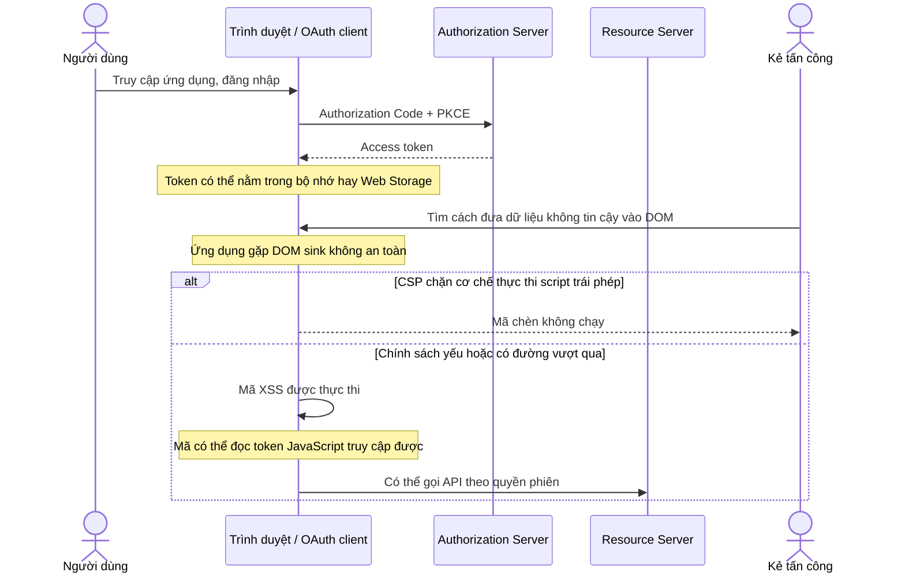
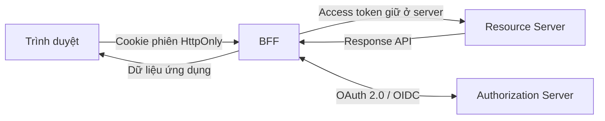

# CSP giảm nguy cơ token theft

## 1. Mục tiêu và bối cảnh bảo mật token trên trình duyệt

**Content Security Policy (CSP)** là cơ chế bảo mật được trình duyệt thực thi dựa trên chính sách do website công bố, thường qua HTTP response header `Content-Security-Policy`. CSP có thể giới hạn nguồn script, kết nối mạng, biểu mẫu và nhiều loại tài nguyên mà một tài liệu web được phép sử dụng. Lợi ích nổi bật trong bài này là **làm khó việc thực thi mã Cross-Site Scripting (XSS)**, từ đó giảm một đường phổ biến dẫn đến **đánh cắp token** (*token theft*).

Bài thuộc module `SECURITY_TOKEN_SECURITY_FUNDAMENTALS` và chương **Browser security**. Để đánh giá CSP đúng cách, cần đặt nó trong toàn bộ vòng đời token: Authorization Server phát hành token; OAuth/OIDC client nhận, lưu và sử dụng token; Resource Server kiểm tra claims, `issuer`, `audience`, `scope` và hiệu lực; hệ thống có cơ chế làm mới, thu hồi và phản ứng khi token bị lộ.

Điểm cần nắm ngay:

- **Access token**, dù là JWT hay opaque, có thể bị lạm dụng nếu nó là *bearer token* và người khác lấy được bản sao còn hiệu lực.
- **Refresh token** có giá trị đặc biệt cao vì có thể được dùng để xin access token mới; nếu có trong JavaScript và xảy ra XSS, hậu quả có thể vượt quá thời hạn sống của một access token.
- **CSP giảm một số khả năng XSS dẫn tới lấy token**; CSP không biến bearer token thành token gắn với người gửi, không mã hóa token và không thay thế kiểm tra quyền ở API.
- Ngay cả khi mã độc **không trích xuất được token**, XSS chạy trong phiên hợp lệ vẫn có thể gọi API thay người dùng. Vì vậy «ngăn token bị sao chép» và «ngăn thao tác trái phép trong phiên» là hai mục tiêu khác nhau.

> **Kết quả học tập:** Sau bài này, bạn có thể giải thích chuỗi XSS → token theft → replay, đọc và thiết kế chính sách CSP phù hợp, triển khai nonce cho script, phân biệt tác dụng của các directive, nhận ra giới hạn của CSP và lập kế hoạch thử nghiệm, giám sát, xử lý sự cố.

## 2. Threat model: XSS có thể dẫn đến token theft ra sao?

Giả sử một Single-Page Application (SPA) nhận access token từ Authorization Server theo OAuth 2.0 Authorization Code + PKCE rồi giữ token trong `localStorage`. Ứng dụng có màn hình hiển thị bình luận người dùng. Nếu nội dung bình luận được đưa vào DOM bằng cách có thể diễn giải HTML/script, kẻ tấn công có thể cố khiến mã của họ chạy với quyền của origin ứng dụng.



Nếu kẻ tấn công lấy được bearer access token, họ có thể cố gửi token đó đến API từ môi trường khác. API vẫn thấy chữ ký, `exp`, `iss`, `aud` và `scope` hợp lệ nếu token chưa hết hạn và chưa bị thu hồi. Với opaque token, việc tra cứu hoặc introspection cũng có thể trả kết quả còn hiệu lực. **Chữ ký JWT hay định dạng opaque không tự chặn việc phát lại bản sao token.**

CSP can thiệp vào **hai mắt xích** có liên quan nhưng khác nhau:

1. **Hạn chế thực thi mã không được phép:** Ví dụ chặn inline script, event handler trong HTML và các nguồn JavaScript không được tin cậy.
2. **Giới hạn một số kênh chuyển dữ liệu ra ngoài:** Ví dụ kiểm soát `fetch`/`XMLHttpRequest` bằng `connect-src`, tải ảnh bằng `img-src` và gửi biểu mẫu bằng `form-action`.

Mắt xích thứ hai **không phải cơ chế Data Loss Prevention hoàn chỉnh**: chuyển hướng trang, các destination đã được cho phép, endpoint nội bộ bị lạm dụng và nhiều cách khác vẫn có thể mang dữ liệu đi. Nếu mã độc thực sự chạy trong origin, không nên dựa riêng vào `connect-src` để khẳng định token được an toàn.

## 3. CSP hoạt động thế nào?

Server trả về một hoặc nhiều header `Content-Security-Policy` trong response của trang HTML. Trình duyệt tính toán directive nào áp dụng cho từng hoạt động và từ chối hành động không đáp ứng chính sách. Mỗi response có thể có chính sách khác nhau; nhiều chính sách được thực thi đồng thời sẽ tạo tác dụng ràng buộc bổ sung, không phải chính sách sau ghi đè chính sách trước.

| Cơ chế | Vai trò | Lưu ý |
| --- | --- | --- |
| `Content-Security-Policy` | **Thực thi** các hạn chế trên trình duyệt hỗ trợ | Là bảo vệ thực tế khi cấu hình đúng |
| `Content-Security-Policy-Report-Only` | Theo dõi vi phạm **mà không chặn** | Phù hợp để đo tác động trước khi bật chính sách mới |
| `<meta http-equiv="Content-Security-Policy">` | Khai báo hạn chế một phần ngay trong HTML | Có giới hạn về thời điểm áp dụng và một số directive; ưu tiên response header |
| CSP violation report | Cung cấp tín hiệu về tài nguyên/script bị từ chối hoặc sẽ bị từ chối | Có thể sai lệch, giả mạo hoặc chứa dữ liệu nhạy cảm trong URL; cần xử lý như dữ liệu không tin cậy |

**Không phải mọi directive đều kế thừa `default-src`.** Nhiều loại tài nguyên sẽ dùng `default-src` khi không có directive chuyên biệt, nhưng `form-action`, `base-uri` và `frame-ancestors` cần được khai báo riêng nếu muốn áp đặt hạn chế tương ứng.

### 3.1. Những directive quan trọng với nguy cơ đánh cắp token

| Directive | Kiểm soát gì? | Liên hệ với token theft |
| --- | --- | --- |
| `script-src` | Nguồn và cách script được phép thực thi, gồm inline script với nonce/hash phù hợp | Lớp phòng thủ chủ chốt chống nhiều dạng XSS |
| `script-src-attr` | Inline script trong thuộc tính handler như `onclick` | Có thể đặt `'none'` để chặn handler nhúng trong HTML |
| `connect-src` | `fetch`, XHR, WebSocket, EventSource, `sendBeacon` và các kết nối tương ứng | Hạn chế một số đường gửi token/response đến host bên ngoài |
| `img-src` | Nguồn ảnh được tải | Hạn chế lạm dụng việc tải ảnh như một kênh gửi dữ liệu |
| `form-action` | Đích gửi biểu mẫu | Hạn chế biểu mẫu bị gửi sang domain không được phép |
| `base-uri` | Giá trị `<base>` của tài liệu | Ngăn thay đổi cách phân giải URL tương đối theo hướng kẻ tấn công |
| `object-src` | Nội dung nhúng qua `<object>`/`<embed>` | Loại bỏ bề mặt thực thi legacy không cần thiết |
| `default-src` | Giá trị dự phòng cho một số resource directive | Đặt nền chính sách tối thiểu, không thay thế các directive chuyên biệt |
| `frame-ancestors` | Ai được nhúng trang hiện tại trong frame | Chủ yếu giảm clickjacking; **không trực tiếp ngăn script lấy token** |
| `require-trusted-types-for 'script'` | Bật cơ chế Trusted Types tại một số DOM sink, nếu trình duyệt hỗ trợ | Giảm khả năng chuỗi không tin cậy đi vào sink thực thi |

Ví dụ, nếu không có `connect-src` và `default-src` cho phép rộng, việc gắn `script-src` chặt chẽ **không đồng nghĩa** tất cả hoạt động mạng đã bị khóa. Ngược lại, `connect-src` chặt chẽ **không chặn script độc hại chạy** nếu chính sách cho phép mã đó thực thi.

## 4. Mẫu CSP khởi đầu cho ứng dụng web có xác thực

Ví dụ dưới đây dành cho một ứng dụng thực thi JavaScript do server gắn nonce và chỉ gọi API cùng origin hoặc `https://api.example.test`. Đây là **mẫu để điều chỉnh**, không phải cấu hình có thể sao chép nguyên xi vào mọi sản phẩm:

```http
Content-Security-Policy: default-src 'none'; script-src 'nonce-{RANDOM_PER_RESPONSE}' 'strict-dynamic'; script-src-attr 'none'; style-src 'self'; img-src 'self'; font-src 'self'; connect-src 'self' https://api.example.test; form-action 'self'; base-uri 'none'; object-src 'none'; frame-ancestors 'none'
```

Giải thích các lựa chọn:

- `default-src 'none'` đặt mặc định từ chối phần lớn resource load khi không có chỉ thị riêng.
- `script-src 'nonce-…' 'strict-dynamic'` yêu cầu script khởi đầu có nonce hợp lệ, hoặc được tin cậy bằng cơ chế CSP khác đã cấu hình. Trong trình duyệt hỗ trợ `'strict-dynamic'`, sự tin cậy **có thể được truyền** sang script do script đáng tin cậy tải động bằng API tạo script; điều này tiện cho bundler nhưng cũng có nghĩa **script được phép ban đầu phải đáng tin**.
- `script-src-attr 'none'` chặn inline event handlers. Không cần phụ thuộc vào cơ chế `onclick="…"` trong HTML.
- `connect-src` liệt kê host thực sự cần cho các yêu cầu API, ví dụ ứng dụng nội bộ hoặc một backend cụ thể.
- `img-src`, `style-src`, `font-src` chỉ cho phép nguồn cần thiết; điều chỉnh nếu ứng dụng thực sự dùng ảnh dữ liệu, CDN hoặc font từ domain khác.
- `form-action 'self'` giới hạn đích submit của form; khi có luồng chuyển tiếp sang nhà cung cấp OAuth hoặc dịch vụ thanh toán, cần xem đúng đặc điểm của flow thay vì mở rộng tùy tiện.
- `base-uri 'none'`, `object-src 'none'` và `frame-ancestors 'none'` giảm thêm bề mặt bị lạm dụng; cấu hình `frame-ancestors` khác nếu hệ thống cần được nhúng có chủ đích.

`{RANDOM_PER_RESPONSE}` là ký hiệu minh họa, **không** dùng làm nonce thật. Nếu ứng dụng dùng WebSocket, OAuth iframe, hình ảnh từ CDN hoặc script khởi tạo đặc biệt, phải khai báo chính xác các nguồn tương ứng.

**CSP dạng này chặn được gì?** Nhiều trường hợp nội dung do người dùng chèn, bao gồm HTML có inline script hoặc event handler, sẽ không thực thi nếu không có nonce/hash hợp lệ. Chính sách có thể chặn các kết nối và resource load đến nguồn ngoài allowlist.

**CSP dạng này không bảo đảm gì?** Không ngăn việc đánh cắp token từ một script bên thứ ba đã được tin cậy nhưng bị xâm phạm, từ mã ứng dụng hợp lệ bị sửa, từ máy người dùng đã bị chiếm hoặc từ log/backend. Nếu mã độc chạy được, nó vẫn có thể gửi request đến chính API mà ứng dụng được phép sử dụng.

### 4.1. Nonce và hash: cho phép script cần thiết mà không mở rộng toàn bộ inline script

**Nonce** là giá trị ngẫu nhiên đủ mạnh, sinh mới cho mỗi response HTML và được dùng đồng thời trong CSP header và thuộc tính `nonce` của script được phép chạy:

```html
<script nonce="{{CSP_NONCE}}" src="/assets/app.js"></script>
```

Trình duyệt chỉ cho phép script khớp nonce với chính sách. Một response có thể sử dụng cùng nonce cho các script hợp lệ của **response đó**; không dùng một nonce cố định cho tất cả người dùng hoặc tất cả lần tải. Tránh cache HTML mang nonce cũ nếu header và nội dung không được sinh lại đồng bộ.

**Hash** cho phép một nội dung inline script cụ thể thông qua hash tính từ chính nội dung đó, phù hợp với script tĩnh ít thay đổi. Khi script đổi nội dung, hash cũng phải cập nhật. Cả nonce và hash cần được triển khai theo tài liệu CSP; một chuỗi dễ đoán không đủ để tạo ranh giới tin cậy.

Các cấu hình nên tránh:

```http
# Ví dụ chính sách yếu: đừng dùng để bảo vệ trang có token.
Content-Security-Policy: script-src * 'unsafe-inline' 'unsafe-eval'; connect-src *
```

`'unsafe-inline'` làm suy yếu việc chặn inline script và event handler; `'unsafe-eval'` mở lại các API thực thi chuỗi như `eval` theo cơ chế áp dụng. Wildcard và allowlist quá rộng cũng có thể tạo đường thực thi hoặc chuyển dữ liệu không mong muốn. Một số cấu hình CSP có ngoại lệ liên quan nonce/hash và tương thích trình duyệt; nên đánh giá **chính sách hiệu lực trên browser mục tiêu**, không chỉ tìm từ khóa trong header.

### 4.2. Ví dụ triển khai nonce ở backend Node.js

Đoạn minh họa dưới đây dùng Express và API `crypto` của Node.js. Server sinh 16 byte ngẫu nhiên (128 bit) cho từng response, đặt CSP và chuyển nonce cho template HTML:

```javascript
import { randomBytes } from "node:crypto";
import express from "express";

const app = express();

app.use((req, res, next) => {
  const nonce = randomBytes(16).toString("base64");
  res.locals.cspNonce = nonce;

  const policy = [
    "default-src 'none'",
    `script-src 'nonce-${nonce}' 'strict-dynamic'`,
    "script-src-attr 'none'",
    "style-src 'self'",
    "img-src 'self'",
    "font-src 'self'",
    "connect-src 'self' https://api.example.test",
    "form-action 'self'",
    "base-uri 'none'",
    "object-src 'none'",
    "frame-ancestors 'none'",
  ].join("; ");

  res.setHeader("Content-Security-Policy", policy);
  next();
});

app.get("/", (req, res) => {
  // Template engine phải escape nội dung người dùng theo ngữ cảnh.
  res.render("index", { cspNonce: res.locals.cspNonce });
});
```

Trong template, giá trị nonce phải được gắn vào **script hợp pháp**; cần escape thuộc tính đúng cách và không đưa nonce tới những phần HTML do người dùng kiểm soát. Cần thiết kế cách render phù hợp với framework thực tế; middleware này chỉ minh họa cơ chế nonce, chưa có toàn bộ cấu hình triển khai, static assets hay luồng OAuth.

Đặc biệt với SPA được phát dưới dạng HTML tĩnh qua CDN, chọn **hash-based CSP** cho script tĩnh hoặc cơ chế edge/server tạo nonce riêng cho HTML và header. Không sinh nonce một lần lúc build rồi tái sử dụng lâu dài như mật khẩu cấu hình.

## 5. CSP bảo vệ token ở các vị trí lưu trữ đến mức nào?

| Vị trí / kiến trúc | XSS được thực thi có thể làm gì? | CSP hỗ trợ đến đâu? |
| --- | --- | --- |
| `localStorage` | JavaScript cùng origin có thể đọc trực tiếp bearer token | CSP chặn nhiều đường để XSS **bắt đầu chạy**; nếu script ác ý đã chạy được, token vẫn lộ |
| `sessionStorage` | Script trong cùng tab có thể đọc token | Giới hạn thời gian tồn tại hơn `localStorage` nhưng không tạo cách ly với XSS |
| `IndexedDB` hoặc storage JavaScript truy cập được | Script cùng origin có thể truy vấn dữ liệu, tùy quyền và cách lưu | CSP không biến storage thành kho bí mật chống script độc hại |
| Biến/bộ nhớ ứng dụng | Không phải biến nào cũng đọc trực tiếp được, nhưng mã trong trang có thể can thiệp flow hoặc sử dụng API có sẵn | Có thể chặn điểm kích hoạt XSS; không bảo vệ tuyệt đối mã chạy cùng origin |
| Cookie phiên **`HttpOnly`** | Không đọc giá trị cookie qua `document.cookie`, nhưng vẫn có thể gọi request dùng phiên | CSP giảm khả năng XSS; `HttpOnly` riêng biệt làm giảm **trích xuất credential** |
| **BFF giữ access/refresh token ở server** | Không lấy token backend chỉ từ JavaScript nếu BFF không đưa token ra response; vẫn có thể lạm dụng request của phiên | Kết hợp CSP + BFF giúp thu hẹp đường đánh cắp token ra ngoài, nhưng không thay phân quyền và chống XSS |

### 5.1. Tại sao `HttpOnly` và BFF thường bổ sung tốt cho CSP?

Với browser-based OAuth client, tránh để refresh token lâu dài trong Web Storage khi có thể lựa chọn kiến trúc an toàn hơn. Một mô hình **Backend-for-Frontend (BFF)** để backend thực hiện OAuth flow, lưu access/refresh token phía server và cấp cho trình duyệt cookie phiên `HttpOnly; Secure; SameSite` phù hợp:



- **CSP** làm khó mã XSS được thực thi và hạn chế một số kết nối không mong muốn.
- **`HttpOnly`** ngăn JavaScript đọc trực tiếp giá trị cookie phiên.
- **BFF** tránh cấp bearer access token và refresh token cho JavaScript trong một mô hình triển khai phù hợp.
- **Resource Server** vẫn phải kiểm tra `iss`, `aud`, `exp`, `nbf` (nếu có), `scope`/quyền và các ràng buộc token.
- **CSRF protection** vẫn cần khi xác thực dựa trên cookie và các request thay đổi trạng thái; `SameSite` giúp giảm một số trường hợp nhưng không thay thế mọi biện pháp.

**Giới hạn:** Nếu XSS đã chạy, nó có thể yêu cầu BFF thực hiện hành động mà phiên được phép. Không nên nói BFF hoặc cookie `HttpOnly` «chống XSS»; chúng giảm một loại hậu quả là **lấy bản sao token để dùng bên ngoài trình duyệt**.

Một anti-pattern cần tránh: đặt refresh token trong cookie `HttpOnly` nhưng cung cấp endpoint cùng origin trả access token trực tiếp cho JavaScript. XSS có thể gọi endpoint đó và lấy access token từ response. Phải kiểm tra **toàn bộ đường đi token**, không suy ra an toàn chỉ từ chỗ lưu refresh token.

### 5.2. CSP không thay thế kiểm soát token của OAuth 2.0/OIDC

- **Authorization Code + PKCE:** Hạn chế đánh cắp/mạo dụng authorization code trong flow tương ứng; không ngăn XSS chạy sau đăng nhập.
- **`state` và OIDC `nonce`:** Liên kết phản hồi authorization/xác thực với giao dịch đang chờ theo luồng; không bảo vệ token trong `localStorage` trước script ác ý.
- **`aud`, `scope`, `exp`:** Giới hạn API, quyền và thời gian sử dụng của access token; không tự chứng minh người gửi sở hữu token.
- **Refresh token rotation và reuse detection:** Giúp phát hiện token làm mới bị dùng lại; cần thao tác tiêu thụ token nguyên tử và chính sách thu hồi family khi cần.
- **DPoP hoặc mTLS-bound access token:** Ràng buộc token với khóa/chứng chỉ. Có thể hạn chế dùng bản sao token ở nơi khác, nhưng mã XSS chạy tại client có thể sử dụng chức năng ký hoặc gọi API trong phiên; chúng không loại bỏ XSS.
- **Revocation và session invalidation:** Là lớp phản ứng khi nghi lộ token. Đối với JWT tự xác minh, cần thiết kế thời hạn ngắn hoặc cơ chế thu hồi mà API thực sự kiểm tra.

## 6. Trusted Types, safe DOM sinks và bảo mật chuỗi cung ứng

CSP tốt có thể chặn nhiều đoạn script chèn vào HTML, nhưng tốt hơn là **không biến dữ liệu thành mã** ngay từ đầu.

Ví dụ một đường đi không an toàn:

```javascript
const query = new URLSearchParams(location.search).get("q") ?? "";
document.querySelector("#search-term").innerHTML = query; // Nguy hiểm
```

Khi chỉ cần văn bản, dùng:

```javascript
const query = new URLSearchParams(location.search).get("q") ?? "";
document.querySelector("#search-term").textContent = query; // An toàn cho text
```

Nếu cần cho phép một phần HTML có chủ đích, dùng thư viện sanitize đáng tin cậy, cấu hình allowlist phù hợp, kiểm tra URL và thuộc tính, rồi bổ sung **Trusted Types** nếu trình duyệt mục tiêu hỗ trợ. Ví dụ directive:

```http
Content-Security-Policy: require-trusted-types-for 'script'; trusted-types app-policy
```

Ví dụ này **chỉ minh họa phần Trusted Types**: phải hợp nhất với CSP chính của trang, đồng thời thực sự định nghĩa và sử dụng policy `app-policy` được review. Trusted Types áp dụng cho một số DOM sink, không bao trùm mọi thao tác trình duyệt hoặc mọi nền tảng. Việc tạo một policy «tin mọi chuỗi» sẽ làm mất ý nghĩa bảo vệ.

Đặc biệt lưu ý script từ analytics, quảng cáo, extension hoặc CDN: một script được CSP cho phép có thể chạy với nhiều quyền như code ứng dụng. Nếu script đã được tin cậy bị xâm phạm, `strict-dynamic` có thể cho phép nó tải tiếp script khác. Cần giới hạn bên thứ ba, kiểm tra dependencies, dùng **Subresource Integrity (SRI)** cho tài nguyên tĩnh bên ngoài khi khả thi, và cân nhắc cô lập nội dung không tin cậy trong iframe sandbox với quyền tối thiểu.

## 7. Giới hạn và những hiểu lầm thường gặp

| Nhận định | Đánh giá đúng |
| --- | --- |
| «Đã có CSP nên XSS không xảy ra.» | **Sai.** CSP là defense-in-depth; lỗi logic, allowlist rộng, script đáng tin bị xâm phạm hoặc chính sách không đầy đủ vẫn có thể để XSS gây hại. |
| «Chỉ cần `connect-src 'self'` là token không thể đi ra ngoài.» | **Sai.** Có nhiều kênh khác như ảnh, form, điều hướng và cả các endpoint same-origin/đích đã cho phép. `connect-src` không chặn mọi luồng dữ liệu. |
| «CSP bảo vệ JWT tốt hơn opaque token.» | **Sai.** CSP bảo vệ môi trường thực thi của trang, không phụ thuộc định dạng bearer token. |
| «`'unsafe-inline'` giúp SPA hoạt động và vẫn chặn được XSS.» | **Không nên mặc định.** Cho phép inline script rộng thường vô hiệu hóa một phần phòng thủ trọng tâm. |
| «Nonce có thể hard-code nếu chỉ server biết giá trị.» | **Sai.** Nonce CSP phải không thể đoán trước và cần thay theo response. |
| «`Report-Only` đã chặn mã độc.» | **Sai.** Chế độ này chỉ ghi nhận; cần header enforce để chặn. |
| «`frame-ancestors 'none'` ngăn token theft.» | **Không trực tiếp.** Nó chủ yếu chống embedding/clickjacking, có lợi cho bảo mật trang nhưng khác mục tiêu chặn XSS. |
| «`HttpOnly` và CSP làm cho mọi thao tác phiên an toàn.» | **Sai.** Một XSS đang chạy vẫn có thể lạm dụng các API hợp lệ trong phiên người dùng. |

Ngoài ra, `CORS` là chính sách chi phối việc một origin đọc response từ origin khác trong browser; nó **không thay cho CSP** và không ngăn mã XSS cùng origin dùng các API mà ứng dụng được phép truy cập.

## 8. Triển khai CSP từng bước trên hệ thống thật

Một trang hiện hữu thường có script inline, thư viện cũ, ảnh từ CDN và nhiều luồng tích hợp. Bật `default-src 'none'` ngay mà chưa đánh giá có thể khiến chức năng hỏng. Cần triển khai có quan sát và kiểm thử.

### 8.1. Điều tra bề mặt và xây chính sách

1. **Kiểm kê nguồn tài nguyên:** Script, CSS, ảnh, font, iframe, API, WebSocket, analytics, OAuth/OIDC redirects và tích hợp bên thứ ba.
2. **Rà soát DOM sink:** Tìm đường từ dữ liệu không tin cậy đến `innerHTML`, `outerHTML`, `insertAdjacentHTML`, script động và event handler. Sửa sink nguy hiểm trước khi trông chờ CSP.
3. **Chọn nonce/hash hoặc kiến trúc static:** Dùng nonce cho HTML được render theo request; hash cho script tĩnh được quản lý; xử lý yêu cầu caching và hydration của framework.
4. **Đặt allowlist tối thiểu:** Tránh wildcard, `data:` hay `blob:` nếu không thật sự cần; xem kỹ ảnh/CSS, kết nối telemetry và các domain có thể chuyển tiếp dữ liệu.
5. **Kiểm tra token storage:** Nếu access/refresh token có trong JavaScript, lập kế hoạch giảm thời gian lưu, giới hạn quyền hoặc chuyển sang kiến trúc BFF nếu phù hợp.

### 8.2. Bắt đầu bằng Report-Only

Trong giai đoạn thử nghiệm, server có thể gửi một header `Content-Security-Policy-Report-Only` với các directive dự kiến rồi quan sát trang trên trình duyệt và môi trường đại diện. Việc thu thập báo cáo có thể dùng `report-to` cùng `Reporting-Endpoints` hoặc `report-uri` cho khả năng tương thích theo trình duyệt, nhưng endpoint nhận báo cáo phải được kiểm soát lưu lượng, bảo vệ dữ liệu nhạy cảm và xử lý input không tin cậy.

Báo cáo CSP không phải bằng chứng chắc chắn đã có khai thác: ad blocker, extension, trình duyệt cũ hoặc đoạn mã ứng dụng hợp lệ cũng có thể tạo violation. Mặt khác, **không có báo cáo không chứng minh là không có XSS**, do trình duyệt có thể không gửi, report bị chặn hoặc mã độc chọn con đường không tạo vi phạm.

Khi chính sách đã được điều chỉnh từ dữ liệu thực tế, chuyển sang header **enforce** và có thể giữ một chính sách Report-Only chặt hơn để thử thay đổi trong tương lai. Kiểm tra cả desktop, mobile, trình duyệt cũ và những luồng đăng nhập/đăng xuất/làm mới phiên.

### 8.3. Kiểm thử nên thực hiện

| Kiểm thử | Kỳ vọng |
| --- | --- |
| HTML dữ liệu người dùng được chèn vào vùng hiển thị | Nội dung hiển thị như text hoặc HTML đã sanitize; không trở thành script |
| Inline script không có nonce/hash hợp lệ | Bị chặn bởi CSP enforce trên browser hỗ trợ |
| Event handler nội tuyến không được phép | Bị chặn bởi chính sách `script-src-attr`/fallback phù hợp |
| Script hợp pháp với nonce đúng | Hoạt động bình thường; không làm hỏng login và hydration |
| `fetch` từ trang sang domain không cho phép | Bị `connect-src` chặn; không suy ra mọi kênh gửi dữ liệu đều đã khóa |
| Ảnh hoặc form gửi đến đích không cho phép | Bị directive tương ứng chặn |
| API sử dụng access token sai `aud`, hết hạn hoặc thiếu `scope` | Resource Server từ chối **độc lập với CSP** |
| Mã độc chạy được trong phiên dù token chỉ ở BFF | Server vẫn giới hạn quyền, chống CSRF và yêu cầu xác thực lại cho thao tác nhạy cảm |
| HTML bị cache hoặc có nhiều instance backend | Nonce trong header và HTML luôn khớp với response thực tế |

Khi thử nghiệm hành vi gửi dữ liệu ra ngoài, chỉ dùng **token giả hoặc chuỗi đánh dấu vô hại**, không dùng access/refresh token thật trong payload hoặc URL.

## 9. Phản ứng khi nghi token bị lộ dù có CSP

CSP violation liên quan `script-src` hoặc `connect-src` có thể là tín hiệu để điều tra nhưng chưa đủ để kết luận token đã bị trích xuất. Cần liên hệ với log xác thực và vận hành của hệ thống:

1. **Khoanh vùng nguồn:** Xác định URL/trang, script, tính năng nhập liệu và khoảng thời gian có thể bị XSS. Chặn hoặc xóa nội dung gây hại nếu thích hợp.
2. **Sửa lỗi thực thi:** Thay DOM sink không an toàn, sanitize HTML có kiểm soát, cập nhật thư viện, thu hẹp CSP và Trusted Types.
3. **Đánh giá token bị ảnh hưởng:** Phân biệt access token, refresh token, ID token và cookie phiên; xác định chúng có thể đọc được qua JavaScript hay không.
4. **Giảm thời gian bị lạm dụng:** Thu hồi refresh token/phiên, phát hiện reuse, buộc xác thực lại; thu hồi access token nếu kiến trúc hỗ trợ. JWT tự xác minh cần TTL ngắn hoặc cơ chế kiểm tra trạng thái phù hợp để giảm cửa sổ replay.
5. **Kiểm tra hành vi API:** Theo dõi request bất thường, truy cập vượt mức bình thường, thay đổi quyền; không kết luận chỉ dựa trên IP/user-agent.
6. **Chặn tái diễn:** Thêm kiểm thử hồi quy, theo dõi CSP violations và rà soát quy trình triển khai tài nguyên bên thứ ba.

Không log access token, refresh token, cookie phiên, authorization code hoặc khóa bí mật nguyên văn. CSP report có thể chứa URL, chỉ thị hoặc mẫu nội dung vi phạm; cần **loại dữ liệu nhạy cảm trước khi lưu/đưa vào hệ thống quan sát**.

## 10. Tình huống tự đánh giá

**A — SPA có CSP nhưng lưu access token trong `localStorage`:** CSP chặn một inline event handler được chèn vào trang. **Kết luận:** Bước thực thi mã bị chặn nên một đường XSS → token theft đã bị cắt; không thể kết luận mọi đường XSS hoặc mọi kênh lộ token đều biến mất.

**B — `connect-src` chỉ cho API nội bộ, script bên thứ ba đã được allowlist bị xâm phạm:** Script có thể đọc token JavaScript truy cập được và gửi các yêu cầu trong phạm vi cho phép. **Kết luận:** Danh sách host được phép không bảo đảm script luôn đáng tin; giảm script bên thứ ba và giữ token khỏi JavaScript khi có thể.

**C — Đặt nonce cố định trong HTML cache của CDN:** Mọi response dùng chung nonce. **Kết luận:** Nonce mất tính bất ngờ; cần tạo mới theo response hoặc chuyển sang hash-based CSP thích hợp cho tài nguyên tĩnh.

**D — Token chỉ ở BFF, trình duyệt giữ cookie `HttpOnly`:** XSS không đọc được token backend nhưng gọi API thay người dùng qua cookie phiên. **Kết luận:** BFF giảm rủi ro trích xuất bearer token, còn CSP, chống XSS, quyền API, CSRF và step-up authentication vẫn cần thiết.

**E — API nhận một JWT có chữ ký và claims hợp lệ, dù token do kẻ tấn công sao chép:** **Kết luận:** CSP ở trang web không kiểm soát request gửi từ bên ngoài trình duyệt. API cần TTL, `audience`, `scope`, thu hồi và sender-constrained token khi yêu cầu mức bảo đảm cao hơn.

### Checklist vận hành

- [ ] Đã xác định dữ liệu không tin cậy và sửa DOM sink có thể thực thi nội dung.
- [ ] CSP được gửi qua HTTP header enforce cho trang nhạy cảm; Report-Only chỉ dùng đúng vai trò quan sát.
- [ ] Script sử dụng nonce/hash phù hợp; không dùng nonce cố định, wildcard hoặc `'unsafe-inline'`/ `'unsafe-eval'` rộng rãi.
- [ ] `connect-src`, `img-src`, `form-action`, `base-uri` và `object-src` được đặt theo nguyên tắc tối thiểu.
- [ ] Các tài nguyên hợp lệ của SPA/OAuth/OIDC, WebSocket, CSS, CDN hoạt động trên các trình duyệt mục tiêu.
- [ ] Đã đánh giá Trusted Types, thư viện sanitize, bên thứ ba và các phụ thuộc JavaScript.
- [ ] Biết vị trí của access token/refresh token/ID token; tránh credential lâu dài trong storage JavaScript có thể đọc nếu kiến trúc cho phép.
- [ ] Resource Server xác minh claims, hiệu lực, quyền và ràng buộc token; có cách thu hồi/giảm cửa sổ sử dụng khi bị lộ.
- [ ] Kiểm thử cả **chặn XSS**, **hạn chế exfiltration** và **lạm dụng phiên** với dữ liệu thử an toàn.
- [ ] Có quy trình phân tích CSP report, ứng phó sự cố và không thu thập token bí mật vào log.

## 11. Tổng kết

CSP là một lớp kiểm soát **ở trình duyệt** có giá trị lớn để giảm nguy cơ mã XSS chạy và giới hạn một số kênh chuyển dữ liệu, nhờ đó góp phần giảm khả năng **token theft**. Lớp bảo vệ quan trọng nhất thường là `script-src` nghiêm ngặt với nonce/hash thích hợp, kết hợp những directive hạn chế kết nối/tài nguyên và cách xử lý DOM an toàn. CSP vẫn có giới hạn khi script được tin cậy bị xâm phạm hoặc mã độc đã chạy trong origin.

Mô hình bảo vệ token đầy đủ cần kết hợp **CSP + loại bỏ XSS tại nguồn + lưu trữ token an toàn + kiểm tra claims/scope/audience ở API + thời hạn/thu hồi token + giới hạn khả năng replay**. BFF, cookie `HttpOnly` và sender-constrained token có thể giảm thêm rủi ro trong điều kiện phù hợp, nhưng không thay thế quyền API và bảo vệ thao tác trong phiên.

### Tài liệu học tiếp

- [MDN — Content Security Policy (CSP)](https://developer.mozilla.org/en-US/docs/Web/HTTP/CSP): mô hình chính sách, directive, nonce/hash, chính sách báo cáo.
- [OWASP — Content Security Policy Cheat Sheet](https://cheatsheetseries.owasp.org/cheatsheets/Content_Security_Policy_Cheat_Sheet.html): cách thiết kế, triển khai và lỗi cấu hình thường gặp.
- [OWASP — Cross Site Scripting Prevention Cheat Sheet](https://cheatsheetseries.owasp.org/cheatsheets/Cross_Site_Scripting_Prevention_Cheat_Sheet.html): output encoding, HTML sanitization và DOM sinks.
- [W3C — Content Security Policy Level 3](https://www.w3.org/TR/CSP3/): ngữ nghĩa kỹ thuật của các directive.
- [RFC 9700 — Best Current Practice for OAuth 2.0 Security](https://www.rfc-editor.org/rfc/rfc9700): bảo mật OAuth, refresh token, token replay và sender constraints.
