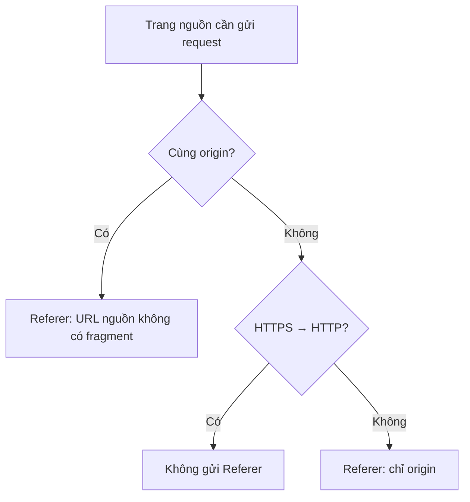
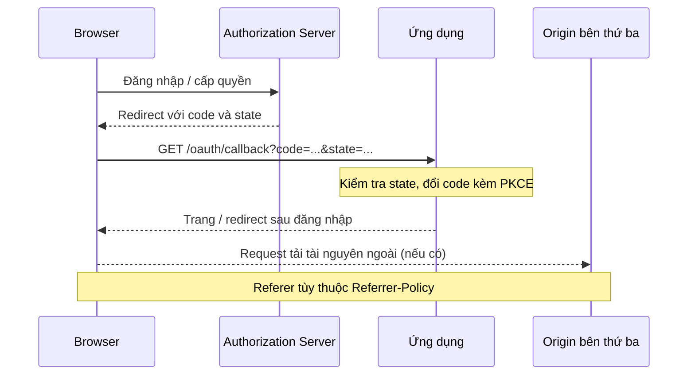

# Referrer-Policy: Kiểm soát thông tin nguồn điều hướng trong trình duyệt

## 1. Vì sao Referrer-Policy liên quan đến bảo mật token?

Trong một hệ thống có xác thực và phân quyền, trình duyệt thường đi qua nhiều địa chỉ: trang đăng nhập, trang callback OAuth 2.0/OpenID Connect (OIDC), API nội bộ, CDN, công cụ phân tích và các liên kết ngoài. Khi trình duyệt gửi yêu cầu HTTP tiếp theo, nó **có thể gửi kèm địa chỉ của trang nguồn** qua request header `Referer`. Địa chỉ đó đôi khi chứa tham số nhạy cảm như `code`, `state`, đường dẫn quản trị, mã mời hoặc một token bị đặt sai chỗ trong URL.

`Referrer-Policy` là cơ chế của **trình duyệt** cho phép ứng dụng chỉ định sẽ tiết lộ bao nhiêu thông tin về URL nguồn khi phát sinh yêu cầu tiếp theo. Nó bảo vệ một kênh rò rỉ dữ liệu cụ thể: **URL nguồn bị đưa vào request header `Referer`**.

Trong phạm vi **SECURITY_TOKEN_SECURITY_FUNDAMENTALS**, cần phân biệt ba lớp vấn đề:

- **Phát hành và kiểm tra token:** máy chủ kiểm tra chữ ký JWT hoặc tra cứu opaque token, `iss`, `aud`, `exp`, scope, quyền truy cập và trạng thái thu hồi.
- **Vòng đời và lưu trữ token:** access token có thời hạn ngắn; refresh token được bảo vệ nghiêm ngặt; thiết kế xử lý token bị đánh cắp hoặc bị phát lại.
- **Bề mặt trình duyệt:** tránh đưa token vào URL, kiểm soát dữ liệu trình duyệt tự gửi đến các origin khác, hạn chế XSS và bảo vệ OAuth/OIDC callback. `Referrer-Policy` thuộc lớp này.

> **Điểm mấu chốt:** Chính sách này không xác thực người dùng, không xác minh JWT, không thu hồi token và không ngăn JavaScript độc hại đọc dữ liệu mà JavaScript đã có quyền truy cập. Nó giảm nguy cơ **rò rỉ URL nguồn** trong quá trình điều hướng và tải tài nguyên.

### Sau bài học, bạn cần làm được gì?

1. Phân biệt `Referer`, `Referrer-Policy`, `Origin` và `document.referrer`.
2. Chọn được giá trị chính sách thích hợp cho trang thông thường và trang nhạy cảm như OAuth callback.
3. Cấu hình và kiểm tra chính sách ở HTTP response, HTML và ứng dụng Java.
4. Nhận diện giới hạn của chính sách và phối hợp nó với Authorization Code + PKCE, cơ chế bảo vệ CSRF, cookie và kiểm soát token.

## 2. Trình duyệt gửi `Referer` như thế nào?

Giả sử người dùng đang ở:

```text
https://app.example.com/oauth/callback?code=AUTH_CODE_123&state=XYZ#result
```

Trang này tải ảnh ở:

```text
https://telemetry.example.net/pixel.gif
```

Trong một chính sách cho phép tiết lộ URL đầy đủ, request đến máy chủ telemetry có thể chứa:

```http
GET /pixel.gif HTTP/1.1
Host: telemetry.example.net
Referer: https://app.example.com/oauth/callback?code=AUTH_CODE_123&state=XYZ
```

Máy chủ đích có thể ghi `Referer` vào access log, hệ thống phân tích, log ứng dụng hoặc dữ liệu theo dõi. Nếu query chứa credential, người nhận ngoài ý muốn có cơ hội nhìn thấy nó. Ở các trình duyệt hiện đại với chính sách mặc định `strict-origin-when-cross-origin`, request HTTPS khác origin trong ví dụ thông thường chỉ gửi `https://app.example.com/`; ví dụ URL đầy đủ ở trên minh họa **cấu hình quá dễ dãi** như `unsafe-url` hoặc chính sách cũ không giới hạn cross-origin.

### Những thuật ngữ dễ nhầm

| Thành phần | Vai trò | Ai quyết định / sử dụng? |
| --- | --- | --- |
| `Referer` | **Request header** cho biết URL nguồn của một yêu cầu HTTP. Tên header bị viết thiếu chữ “r” theo lịch sử và vẫn giữ như vậy. | Trình duyệt tạo và điều chỉnh theo chính sách; máy chủ đích có thể đọc. |
| `Referrer-Policy` | **Response header** chỉ dẫn trình duyệt mức thông tin được phép đưa vào `Referer` cho các yêu cầu tiếp theo từ ngữ cảnh tài liệu. | Máy chủ của trang nguồn cấu hình. |
| `document.referrer` | Thuộc tính JavaScript biểu thị referrer của tài liệu đang mở, nếu có. | Mã JavaScript trên trang có thể đọc; giá trị phụ thuộc điều hướng và chính sách. |
| `Origin` | Request header xác định origin của yêu cầu, dùng nhiều trong CORS và bảo vệ CSRF. | Trình duyệt gửi trong những loại yêu cầu nhất định; không đồng nghĩa với `Referer`. |
| `referrerpolicy` | Thuộc tính HTML hoặc tùy chọn của Fetch API dùng để chỉ định chính sách cho một yêu cầu cụ thể. | Mã HTML/JavaScript của trang. |

### URL đầy đủ và origin

Với URL nguồn `https://app.example.com/account?tab=security#devices`:

- **Origin** là `https://app.example.com/` (scheme + host + port nếu có).
- **URL đầy đủ** trong ngữ cảnh `Referer` gồm origin, đường dẫn `/account` và query `?tab=security`.
- **Fragment** sau dấu `#` không được đưa vào `Referer`; thông tin username/password trong phần userinfo của URL cũng không được dùng làm referrer.
- Hai địa chỉ chỉ cùng origin khi **scheme, host và port** đều trùng. `https://app.example.com` và `https://api.example.com` khác origin; `https://app.example.com` và `http://app.example.com` cũng khác origin.

Tùy trình duyệt, tiện ích mở rộng, quyền riêng tư người dùng hoặc phương thức điều hướng, header `Referer` có thể bị lược bỏ hay rút gọn thêm. Máy chủ **không được coi header này là danh tính đáng tin cậy**.

## 3. Tám giá trị của Referrer-Policy

Cùng xét trang nguồn HTTPS có URL `https://app.example.com/private?ticket=123`. Trong bảng sau, “URL” nghĩa là gửi URL nguồn có đường dẫn và query (không có fragment); “origin” nghĩa là chỉ gửi `https://app.example.com/`; “—” nghĩa là không gửi `Referer`.

| Giá trị | Đến URL HTTPS **cùng origin** | Đến HTTPS **khác origin** | Từ HTTPS đến HTTP (**downgrade**) |
| --- | :---: | :---: | :---: |
| `no-referrer` | — | — | — |
| `no-referrer-when-downgrade` | URL | URL | — |
| `origin` | origin | origin | origin |
| `origin-when-cross-origin` | URL | origin | origin |
| `same-origin` | URL | — | — |
| `strict-origin` | origin | origin | — |
| `strict-origin-when-cross-origin` | URL | origin | — |
| `unsafe-url` | URL | URL | URL |

Đọc từng giá trị theo mục tiêu sử dụng:

- **`no-referrer`:** không gửi `Referer`. Phù hợp cho trang nhạy cảm như callback xử lý authorization code hoặc trang chứa đường dẫn cần hạn chế lộ thông tin.
- **`strict-origin-when-cross-origin`:** gửi URL đầy đủ cho request cùng origin; chỉ gửi origin khi đi đến origin HTTPS khác; không gửi khi HTTPS → HTTP. Đây là **mặc định phổ biến của các trình duyệt hiện đại** và là điểm khởi đầu hợp lý cho phần lớn ứng dụng.
- **`same-origin`:** vẫn giữ referrer trong nội bộ cùng origin, nhưng không gửi cho origin khác. Hữu ích nếu ứng dụng cần số liệu điều hướng nội bộ và không cần attribution từ bên ngoài.
- **`strict-origin`:** chỉ tiết lộ origin cho các hướng kết nối đủ an toàn; không để lộ path/query, kể cả trong request cùng origin.
- **`origin`:** chỉ gửi origin, nhưng vẫn có thể gửi origin khi HTTPS → HTTP. Khi muốn chặn downgrade, ưu tiên `strict-origin`.
- **`origin-when-cross-origin`:** giữ URL đầy đủ cùng origin, gửi origin khác origin, kể cả lúc downgrade; kém chặt hơn biến thể `strict-*`.
- **`no-referrer-when-downgrade`:** không gửi khi downgrade, nhưng có thể gửi **cả path/query cho website HTTPS khác origin**. Đây là mặc định lịch sử, không nên giả định nó vẫn là mặc định hiện nay.
- **`unsafe-url`:** gửi URL nguồn đầy đủ cả khi khác origin hoặc downgrade. Tên chính sách phản ánh nguy cơ lộ path/query; hiếm khi có lý do hợp lý để dùng trên ứng dụng xác thực.

Đối với trang HTTP làm nguồn, quy tắc vẫn dựa trên việc có đi từ mức bảo mật cao hơn xuống mức thấp hơn hay không. Bảng tập trung vào **nguồn HTTPS** vì đây là tình huống bắt buộc cho ứng dụng xử lý token trong thực tế.

### Quy trình ra quyết định với `strict-origin-when-cross-origin`



Ví dụ:

```text
Nguồn: https://app.example.com/profile?tab=security

Đích 1: https://app.example.com/api/me
Referer: https://app.example.com/profile?tab=security

Đích 2: https://cdn.example.net/asset.css
Referer: https://app.example.com/

Đích 3: http://metrics.example.net/pixel
Referer: [không gửi]
```

Lưu ý rằng `strict-origin-when-cross-origin` **vẫn gửi query trong request cùng origin**. Vì vậy, nếu có authorization code, access token hoặc dữ liệu nhạy cảm trong URL, chỉ dùng chính sách mặc định không đủ để ngăn nó xuất hiện trong log của tài nguyên cùng origin.

## 4. Đặt chính sách ở đâu?

### 4.1. HTTP response header: lựa chọn ưu tiên

Máy chủ trả về chính sách cùng trang HTML:

```http
HTTP/1.1 200 OK
Content-Type: text/html; charset=UTF-8
Referrer-Policy: strict-origin-when-cross-origin
```

Ưu điểm của response header là trình duyệt có thể áp dụng ngay khi nhận phản hồi, kể cả trước khi xử lý hết HTML và tải tài nguyên. Với trang nhạy cảm:

```http
HTTP/1.1 200 OK
Content-Type: text/html; charset=UTF-8
Referrer-Policy: no-referrer
Cache-Control: no-store
```

`Cache-Control: no-store` là một kiểm soát riêng về lưu cache. Nó **không thay thế** `Referrer-Policy`; trong ví dụ, hai header giải quyết hai đường rò rỉ khác nhau.

Ví dụ cấu hình Nginx cho chính sách nền:

```nginx
server {
    listen 443 ssl;
    server_name app.example.com;

    add_header Referrer-Policy "strict-origin-when-cross-origin" always;

    # Các cấu hình TLS, proxy và location khác...
}
```

Tham số `always` giúp Nginx thêm header cả ở nhiều response có mã trạng thái không phải 2xx. Khi có `add_header` ở block `location` con, cần kiểm tra quy tắc kế thừa cấu hình Nginx để tránh làm mất header ở một số đường dẫn. Chính sách riêng cho callback có thể đặt ở tầng ứng dụng hoặc route phù hợp, nhưng cần kiểm tra header cuối cùng tại trình duyệt để tránh hai lớp cấu hình ghi đè nhau.

### 4.2. Ví dụ Java với Spring Boot

Trong ứng dụng Java dùng Spring Boot 3 / Jakarta Servlet, có thể thêm response header ngay trước khi xử lý request. Ví dụ sau minh họa chính sách nền và một tuyến callback nhạy cảm:

```java
import jakarta.servlet.FilterChain;
import jakarta.servlet.ServletException;
import jakarta.servlet.http.HttpServletRequest;
import jakarta.servlet.http.HttpServletResponse;
import org.springframework.stereotype.Component;
import org.springframework.web.filter.OncePerRequestFilter;

import java.io.IOException;

@Component
public class ReferrerPolicyFilter extends OncePerRequestFilter {

    @Override
    protected void doFilterInternal(
            HttpServletRequest request,
            HttpServletResponse response,
            FilterChain filterChain
    ) throws ServletException, IOException {

        String path = request.getServletPath();
        boolean sensitiveCallback =
                path.equals("/oauth/callback")
                || path.startsWith("/login/oauth2/code/");

        String policy = sensitiveCallback
                ? "no-referrer"
                : "strict-origin-when-cross-origin";

        response.setHeader("Referrer-Policy", policy);
        filterChain.doFilter(request, response);
    }
}
```

Đường dẫn callback trong ví dụ phải được điều chỉnh theo ứng dụng thật. Nếu Spring Security, reverse proxy hoặc một filter khác cũng thiết lập `Referrer-Policy`, cần chọn một nơi quản lý nhất quán và kiểm tra giá trị cuối cùng ở response. Với ứng dụng dùng `javax.servlet` cũ, tên package import sẽ khác. Ví dụ này nhằm giải thích cơ chế phát hành header, không phải một cấu hình bảo mật Spring Security đầy đủ.

**Một điểm thời gian quan trọng:** `Referrer-Policy` trên response của trang callback điều khiển các request **phát sinh sau khi trang callback được nhận**. Nó không thể thay đổi `Referer` của request đã gửi đến chính callback trước khi response xuất hiện.

### 4.3. HTML `meta` và thuộc tính cho từng phần tử

Trong HTML có thể khai báo:

```html
<head>
  <meta name="referrer" content="strict-origin-when-cross-origin">
</head>
```

Cách này hữu ích khi không kiểm soát được response header, nhưng thường được áp dụng **muộn hơn HTTP header**: những tài nguyên được yêu cầu trước khi trình duyệt xử lý thẻ `meta` có thể chịu chính sách khác. Với ứng dụng có quyền cấu hình server, hãy ưu tiên header.

Đối với một yêu cầu đặc biệt:

```html
<!-- Liên kết ngoài không chuyển URL nguồn. -->
<a href="https://partner.example.net/help"
   target="_blank"
   rel="noreferrer noopener">
  Xem hướng dẫn đối tác
</a>

<!-- Ảnh này không gửi Referer dù trang có chính sách chung khác. -->

```

`rel="noreferrer"` áp dụng cho liên kết và chặn referrer khi điều hướng qua liên kết đó; `noopener` giúp ngăn trang đích truy cập cửa sổ mở nó qua `window.opener`. Đây là **hai cơ chế khác nhau**. Nhiều phần tử tải tài nguyên hỗ trợ thuộc tính `referrerpolicy`; cần kiểm tra loại phần tử và trình duyệt mục tiêu khi sử dụng.

Với Fetch API:

```javascript
fetch("https://telemetry.example.net/event", {
  method: "POST",
  referrerPolicy: "no-referrer",
  credentials: "omit"
});
```

`referrerPolicy` điều khiển referrer của request này. `credentials: "omit"` là quyết định **riêng** về việc gửi credential như cookie; không có nghĩa body, query hay header do ứng dụng tự thêm sẽ được lọc token.

### 4.4. Phạm vi và mức độ ưu tiên

- Response header xác lập chính sách cho ngữ cảnh được trả về; những request từ tài liệu thường kế thừa chính sách của tài liệu.
- Thuộc tính `referrerpolicy` trên phần tử hoặc tùy chọn `referrerPolicy` trong Fetch có thể đặt chính sách riêng cho request tương ứng.
- `rel="noreferrer"` trên liên kết yêu cầu không tiết lộ referrer cho lần điều hướng đó.
- Header và `meta` phải dùng **giá trị hợp lệ**; cấu hình sai có thể bị trình duyệt bỏ qua và dẫn đến hành vi mặc định.
- Trang trong `iframe`, response chuyển hướng và tài nguyên được tải từ origin khác có ngữ cảnh/chính sách riêng. Đừng suy từ header của một URL rằng toàn bộ chuỗi chuyển hướng hoặc mọi frame đều có cùng hành vi; hãy kiểm tra request thực.

## 5. Mô hình rủi ro: OAuth 2.0 / OIDC callback

Một ví dụ phổ biến là **Authorization Code Flow với PKCE**:



Authorization code là một credential ngắn hạn, thường chỉ dùng một lần, được trao đổi để lấy token. `state` ràng buộc yêu cầu/callback và chống CSRF trong OAuth; nó không nên được coi là bí mật thay thế cho PKCE. Trong OIDC, cần thêm các kiểm tra tương ứng như `nonce` khi luồng sử dụng, xác minh ID token, issuer, audience và các điều kiện của giao thức.

### Kịch bản rò rỉ

1. Authorization server điều hướng đến `https://app.example.com/oauth/callback?code=abc&state=xyz`.
2. Trang callback tải script, ảnh, pixel quảng cáo hoặc gửi người dùng sang một website khác.
3. Nếu chính sách cho phép gửi **URL đầy đủ tới origin khác** (ví dụ `unsafe-url`), origin bên thứ ba có thể nhận `code=abc` qua `Referer` và lưu trong log.
4. Nếu trình duyệt dùng `strict-origin-when-cross-origin`, origin HTTPS khác thường chỉ nhận `https://app.example.com/`; **request cùng origin vẫn có thể mang query đầy đủ**.
5. Dùng `no-referrer` trên trang callback hạn chế cả hai trường hợp đối với các request phát sinh từ trang đó.

Code bị lộ không mặc nhiên đồng nghĩa kẻ tấn công đổi được token: PKCE, redirect URI binding, thời hạn ngắn và tính một lần giúp giảm khả năng khai thác. Tuy vậy, **không nên dựa vào PKCE để cho phép rò rỉ code**.

### Thiết kế callback an toàn

- Sử dụng **Authorization Code Flow + PKCE**; hạn chế các luồng đưa access token trực tiếp vào URL của trình duyệt.
- Kiểm tra `state` và các điều kiện OAuth/OIDC trước khi thiết lập phiên. Khi đổi code, dùng đúng `redirect_uri` và `code_verifier` theo giao thức.
- Xử lý và loại bỏ `code`/`state` khỏi URL càng sớm càng tốt: phía server có thể đổi code rồi **redirect đến URL sạch**; SPA có thể dùng `history.replaceState` sau khi đã đọc và kiểm tra tham số cần thiết.
- Tránh tải tài nguyên hoặc script không cần thiết, đặc biệt từ bên thứ ba, trên trang callback trước khi xử lý xong URL.
- Phục vụ callback với `Referrer-Policy: no-referrer`; với trang HTML nhạy cảm có thể bổ sung `Cache-Control: no-store` và Content Security Policy (CSP) phù hợp.
- Giới hạn log và dữ liệu telemetry: **không ghi nguyên URL chứa code/token**, không ghi Authorization header hoặc cookie chứa credential. Một chính sách referrer tốt không sửa được log đã thu thập từ request đến callback.
- Sau đăng nhập, duy trì phiên qua cơ chế lưu trữ phù hợp, ví dụ session cookie với `Secure`, `HttpOnly` và `SameSite` được lựa chọn theo luồng đăng nhập; refresh token nên được giữ ở thành phần tin cậy phù hợp với kiến trúc.

Ví dụ SPA sau khi đã lấy tham số callback và thực hiện các kiểm tra cần thiết:

```javascript
const current = new URL(window.location.href);
const code = current.searchParams.get("code");
const state = current.searchParams.get("state");

// Chuyển code/state đến logic callback đã xác minh state và PKCE.
// Không đưa code, state hay token vào log / công cụ analytics.

current.searchParams.delete("code");
current.searchParams.delete("state");
window.history.replaceState(null, "", current.pathname + current.search + current.hash);
```

Đoạn mã chỉ minh họa **làm sạch địa chỉ hiển thị**, không thực hiện đổi code, xác minh `state` hay xác thực OIDC. Trong luồng thực, hãy hoàn tất việc dùng các tham số và giữ nguyên các query không nhạy cảm khi phù hợp. `replaceState` không xóa dữ liệu từng xuất hiện trong network log, browser history trước đó hoặc hệ thống quan sát, vì thế phòng ngừa từ đầu vẫn quan trọng.

### JWT, opaque token, access token và refresh token có khác nhau ở đây không?

| Loại | Nếu bị đưa vào URL và lộ qua `Referer` | Cách xử lý đúng |
| --- | --- | --- |
| JWT access token | Có thể bị dùng như bearer token nếu còn hiệu lực; payload có thể tiết lộ claims dù chữ ký không bị phá. | Tránh đưa vào URL; giới hạn `exp`, `aud`, scope; kiểm soát nơi lưu và truyền. |
| Opaque access token | Không đọc được claims trực tiếp, nhưng chuỗi token vẫn có thể được sử dụng nếu được máy chủ chấp nhận. | Tránh đưa vào URL; kiểm tra hiệu lực, quyền, thu hồi và giám sát lạm dụng. |
| Refresh token | Có thể cho phép lấy access token mới hoặc kéo dài phiên, nên hậu quả rò rỉ thường nghiêm trọng. | Không bao giờ đưa vào URL; bảo vệ lưu trữ, thực hiện rotation/reuse detection hoặc cơ chế ràng buộc token phù hợp. |
| Authorization code | Có thể bị kẻ khác thử đổi lấy token trong thời gian hiệu lực nếu các lớp bảo vệ khác yếu. | Authorization Code + PKCE, dùng một lần, thời hạn ngắn, callback sạch và policy nghiêm ngặt. |

`Referrer-Policy` không phân biệt được JWT hay opaque token trong URL: nó chỉ nhìn vào **thông tin URL nguồn** và quy tắc tiết lộ. Việc phân biệt định dạng và loại credential vẫn thuộc thiết kế vòng đời token và kiểm tra server.

## 6. Kết hợp với các lớp phòng vệ khác

| Cơ chế | Bảo vệ chính | Điều **không** được giải quyết chỉ bằng cơ chế đó |
| --- | --- | --- |
| `Referrer-Policy` | Giới hạn URL nguồn trong `Referer` của request do browser phát sinh. | Không chống XSS, token bị log từ URL đích, request body hay header tự gửi. |
| CSP | Giới hạn nguồn script, frame, kết nối và tài nguyên được phép theo chính sách. | Không tự thay đổi quy tắc referrer hoặc loại bỏ credential trong URL. |
| CORS | Quyết định JavaScript của origin khác có được đọc response cross-origin hay không. | Không ngăn request phát sinh, cũng không đảm bảo chặn `Referer`. |
| `SameSite`, `Secure`, `HttpOnly` cookie | Giảm một số rủi ro CSRF, chỉ gửi cookie qua HTTPS, ngăn JS đọc cookie tương ứng. | Không ngăn URL nguồn bị tiết lộ; không thay thế kiểm tra phiên/CSRF. |
| CSRF token / kiểm tra `Origin` | Ràng buộc thao tác thay đổi trạng thái với ngữ cảnh hợp lệ. | Không kiểm soát thông tin path/query trong `Referer`. |
| PKCE, `state` và xác minh OIDC | Giảm nguy cơ đánh cắp code, callback giả mạo và sai ngữ cảnh đăng nhập. | Không đảm bảo URL callback không bị ghi log hoặc tiết lộ đến thành phần khác. |
| JWT/opaque validation, scope, audience, expiry, revoke | Chặn token sai, hết hạn, sai đối tượng hoặc đã bị thu hồi. | Không tự ngăn bearer token còn hiệu lực bị lộ từ trình duyệt. |

**Đừng nhầm `Origin` với `Referer`.** `Origin` thường chỉ có scheme/host/port và có thể được gửi trong các tình huống như CORS hoặc một số request thay đổi trạng thái. `Referer` có thể chứa cả path/query nhưng có thể bị bỏ do policy/quyền riêng tư. Cả hai đều không phải bằng chứng xác thực độc lập: HTTP client ngoài trình duyệt có thể tự tạo header. Hệ thống chống CSRF nên có chiến lược xác minh phù hợp (`Origin` khi có, CSRF token, `state` cho OAuth, cookie `SameSite`...), thay vì cho phép thao tác nhạy cảm chỉ vì `Referer` “trông đúng”.

Nếu bật `no-referrer` toàn website, một số hệ thống thống kê nguồn truy cập hoặc kiểm tra CSRF chỉ dựa trên `Referer` có thể bị ảnh hưởng. Cần kiểm tra luồng hợp lệ và cập nhật cơ chế phụ thuộc, thay vì nới chính sách ngay trên callback nhạy cảm.

## 7. Thực hành kiểm tra chính sách

### Bước 1: Đọc response header thực tế

```bash
curl -I https://app.example.com/
curl -I https://app.example.com/oauth/callback
```

Kỳ vọng ở môi trường được cấu hình theo ví dụ:

```text
/                 Referrer-Policy: strict-origin-when-cross-origin
/oauth/callback   Referrer-Policy: no-referrer
```

`curl -I` giúp xác định **máy chủ trả về header nào**, nhưng không chứng minh trình duyệt đã gửi `Referer` ra sao. Callback thực tế có thể redirect hoặc yêu cầu tham số; hãy kiểm tra response tương ứng trong Network của trình duyệt. Không dùng authorization code hoặc token thật trong thao tác kiểm thử và báo cáo.

### Bước 2: Quan sát request từ trình duyệt

1. Mở DevTools → **Network**, bật **Preserve log** khi cần theo dõi điều hướng.
2. Tải trang thử nghiệm có liên kết/tài nguyên đến cùng origin và một origin HTTPS khác mà bạn kiểm soát.
3. Mở từng request → **Request Headers** → kiểm tra `Referer`; đồng thời kiểm tra **Response Headers** của trang nguồn để xem `Referrer-Policy`.
4. Lặp lại với trang có `no-referrer`. Với request phát sinh từ trang đó, `Referer` phải vắng mặt, trừ khi kiểm thử bị thay đổi bởi ngữ cảnh hoặc chính sách riêng ở phần tử.
5. Xác minh response cuối cùng sau proxy, CDN, filter Java và redirect; tránh chỉ nhìn cấu hình ở một lớp.

### Bộ trường hợp mong đợi

| Trường hợp | Policy nguồn | Kết quả mong đợi |
| --- | --- | --- |
| `/account?tab=2` → `/api/profile` cùng origin | `strict-origin-when-cross-origin` | `Referer` có URL nguồn và query. |
| Trang HTTPS → CDN HTTPS khác origin | `strict-origin-when-cross-origin` | `Referer` chỉ có origin nguồn. |
| Trang HTTPS → endpoint HTTP | `strict-origin-when-cross-origin` | Không có `Referer`. |
| Callback → tài nguyên bất kỳ | `no-referrer` | Không có `Referer`. |
| Liên kết có `rel="noreferrer"` → website ngoài | Chính sách chung bất kỳ | Lần điều hướng qua liên kết không gửi `Referer`. |
| Trang với `unsafe-url` → HTTPS khác origin | `unsafe-url` | Có thể gửi URL đầy đủ, bao gồm query; đây là cấu hình cần tránh. |

Đối với HTTPS → HTTP, trình duyệt còn có thể chặn yêu cầu vì **mixed content**. Nếu request không được phát đi, đó không phải là bằng chứng policy đã chặn referrer; hãy tách biệt hai cơ chế khi phân tích.

### Bước 3: Kiểm thử hồi quy với dữ liệu giả

Dùng URL giả như `/oauth/callback?code=TEST_ONLY&state=TEST_ONLY`. Kiểm tra rằng mọi request ra ngoài từ trang callback không mang chuỗi `TEST_ONLY` trong `Referer` và không đưa chuỗi này vào logs/analytics. Kiểm tra cả request cùng origin, vì chính sách mặc định vẫn có thể gửi toàn bộ path/query cho trường hợp này. Không sao chép secret thực vào ảnh chụp DevTools hay ticket.

## 8. Chọn chính sách cho từng loại trang

| Khu vực | Gợi ý | Lý do / điều kiện cần cân nhắc |
| --- | --- | --- |
| Phần lớn trang ứng dụng | `strict-origin-when-cross-origin` | Cân bằng tương thích và hạn chế lộ path/query sang origin khác; hợp lý làm baseline. |
| OAuth/OIDC callback xử lý `code`/`state` | `no-referrer` | Không để URL callback chuyển tiếp qua referrer của các request sau đó; vẫn phải xử lý và làm sạch URL. |
| Trang chứa đường dẫn hoặc query đặc biệt nhạy cảm | `no-referrer` hoặc `strict-origin` | Hạn chế cả path/query nội bộ nếu nghiệp vụ cho phép. |
| Trang cần đo hành trình nội bộ nhưng không muốn gửi referrer ra ngoài | `same-origin` | Giữ URL nguồn cho request nội bộ; xem xét dữ liệu nhạy cảm ở query. |
| Liên kết ngoài riêng lẻ | `rel="noreferrer noopener"` hoặc `referrerpolicy="no-referrer"` | Có thể siết một đường điều hướng mà không thay policy của toàn trang. |

Đây là các **mẫu thiết kế để đánh giá**, không phải bộ quy tắc cứng cho mọi hệ thống. Quyết định cuối cùng còn phụ thuộc tracking nội bộ, thiết kế CSRF, kiến trúc callback và loại dữ liệu có trong URL.

## 9. Các lỗi triển khai thường gặp

**Lỗi 1: “Website dùng HTTPS nên URL sẽ không lộ.”** HTTPS bảo vệ dữ liệu trên đường truyền, nhưng website đích vẫn đọc được header `Referer` mà trình duyệt gửi hợp lệ cho nó. HTTPS không quyết định mức path/query được tiết lộ.

**Lỗi 2: “Chính sách mặc định đã đủ để bảo vệ callback.”** `strict-origin-when-cross-origin` che query khi gửi tới HTTPS khác origin, nhưng **không che khi request cùng origin**. Callback chứa code nên ưu tiên `no-referrer` và URL sạch.

**Lỗi 3: “Dùng `no-referrer` là có thể để token trong query.”** Token còn xuất hiện trong request đến máy chủ, browser history, log reverse proxy, analytics do ứng dụng chủ động gửi, link được sao chép hoặc JavaScript. Thiết kế cần tránh token trong URL ngay từ đầu.

**Lỗi 4: “`Referrer-Policy` là biện pháp chống CSRF.”** Nó chủ yếu điều khiển tiết lộ referrer. CSRF cần cơ chế chuyên dụng; nếu ứng dụng đang bắt buộc `Referer` cho CSRF mà lại tắt header, cần sửa quy trình kiểm tra.

**Lỗi 5: “CORS sẽ chặn bên thứ ba nhận `Referer`.”** CORS hạn chế khả năng JavaScript đọc response cross-origin, không nhất thiết chặn request được gửi đến máy chủ nhận. Một pixel ảnh vẫn có thể tạo request và máy chủ đích vẫn nhìn thấy header được gửi.

**Lỗi 6: “`<meta name="referrer">` luôn tương đương HTTP header.”** Meta chỉ có hiệu lực khi được trình duyệt xử lý; request khởi phát sớm có thể đã dùng policy khác. Response header là lựa chọn chủ đạo khi có quyền điều khiển server.

**Lỗi 7: “`document.referrer` cho biết chắc ai gọi endpoint.”** Đây là giá trị trên tài liệu trong trình duyệt, có thể rỗng hoặc rút gọn; endpoint HTTP còn có thể được gọi từ client không phải browser. Không sử dụng như bằng chứng cho phép truy cập.

**Lỗi 8: “Cứ bật `unsafe-url` để analytics chính xác hơn.”** Nó có thể đưa đường dẫn và query sang origin khác, kể cả khi downgrade. Nếu cần attribution, hãy dùng dữ liệu đo lường được thiết kế có chủ đích, không phụ thuộc việc chuyển toàn bộ URL nguồn.

## 10. Tình huống vận dụng

**Tình huống A.** Trang `https://app.example.com/order?id=987` tải script từ `https://cdn.example.net/script.js` và trả header `Referrer-Policy: strict-origin-when-cross-origin`. CDN thấy gì?

**Giải đáp:** Với request HTTPS khác origin thông thường, `Referer` chỉ chứa `https://app.example.com/`, không có `/order?id=987`.

**Tình huống B.** Trang `/oauth/callback?code=abc` trả policy mặc định nhưng tải `/static/app.js` cùng origin. Liệu `code` có thể xuất hiện trong `Referer` của request JS?

**Giải đáp:** Có. Vì cùng origin, `strict-origin-when-cross-origin` cho phép URL nguồn đầy đủ. Áp dụng `no-referrer` cho callback và không để code nằm trong URL lâu hơn cần thiết.

**Tình huống C.** Ứng dụng kiểm tra quyền bằng JWT `aud`/`scope` đầy đủ nhưng nhận access token từ query `?access_token=...` rồi hiển thị một widget bên thứ ba. Có vấn đề gì?

**Giải đáp:** Kiểm tra JWT tốt không loại bỏ nguy cơ token đi vào logs, lịch sử hoặc referrer khi policy quá dễ dãi. Cần đổi cách truyền token, không cho token vào query và áp dụng chính sách referrer phù hợp.

**Tình huống D.** Nhóm bảo mật bật `no-referrer` toàn site, sau đó chức năng chuyển tiền lỗi vì bộ lọc CSRF cũ từ chối request thiếu `Referer`. Có nên đổi sang `unsafe-url`?

**Giải đáp:** Không. Cần kiểm tra lại chiến lược CSRF bằng các tín hiệu phù hợp như `Origin`, CSRF token và cookie `SameSite` theo tình huống. Không nới chính sách để khắc phục việc phụ thuộc vào một header có thể vắng mặt.

## 11. Ghi nhớ

1. `Referrer-Policy` quy định **bao nhiêu URL nguồn** được đưa vào request header `Referer`.
2. `strict-origin-when-cross-origin` là baseline thông dụng: URL đầy đủ cùng origin, chỉ origin khi khác origin và không gửi khi HTTPS → HTTP.
3. `no-referrer` đáng cân nhắc ở OAuth/OIDC callback và trang chứa URL nhạy cảm; chính sách trên response chỉ điều khiển các request phát sinh **sau đó**.
4. Token không nên nằm trong URL; nếu lộ, JWT, opaque token hay refresh token đều có rủi ro theo quyền của credential, không phụ thuộc việc payload có đọc được hay không.
5. Luôn kiểm tra request thật trong DevTools và phối hợp với PKCE, CSRF protection, CSP, cookie security, kiểm soát log, validation và thu hồi token.

### Tài liệu tham khảo

- [MDN — Referrer-Policy](https://developer.mozilla.org/en-US/docs/Web/HTTP/Headers/Referrer-Policy): cú pháp, các giá trị và ví dụ browser.
- [W3C — Referrer Policy](https://w3c.github.io/webappsec-referrer-policy/): quy tắc tiêu chuẩn cho referrer và referrer policy.
- [RFC 9700 — Best Current Practice for OAuth 2.0 Security](https://www.rfc-editor.org/rfc/rfc9700.html): các yêu cầu và nguy cơ bảo mật trong OAuth 2.0.
- [RFC 7636 — Proof Key for Code Exchange (PKCE)](https://www.rfc-editor.org/rfc/rfc7636): cách PKCE giảm nguy cơ đổi code bị chặn bắt.
