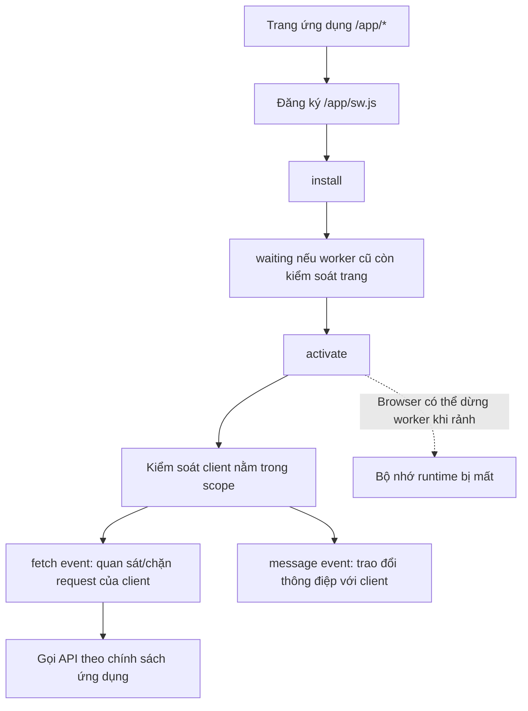

# Service worker và token storage trong bảo mật trình duyệt

## 1. Vì sao service worker liên quan đến token security?

Trong ứng dụng web dùng OAuth 2.0/OpenID Connect (OIDC), **access token** cho phép client truy cập API; **refresh token** giúp xin access token mới; **ID Token** cho client biết kết quả xác thực người dùng. Nếu ứng dụng chạy hoàn toàn trong trình duyệt, một câu hỏi quan trọng là: **giữ các credential này ở đâu để giảm nguy cơ bị đánh cắp hoặc sử dụng sai?**

**Service worker** là JavaScript chạy trong ngữ cảnh worker do trình duyệt quản lý, tách với trang web và có thể chặn, xử lý các yêu cầu mạng từ những trang mà nó kiểm soát. Vì service worker không có DOM và không dùng `window.localStorage`, đôi khi nó được đề xuất làm nơi giữ access token thay cho JavaScript của trang.

Tuy nhiên, cần phân biệt ba mục tiêu khác nhau:

1. **Không để script của trang đọc trực tiếp token**: có thể cải thiện khi token chỉ nằm trong bộ nhớ của service worker và được đưa vào worker qua luồng tin cậy.
2. **Không để script độc hại sử dụng quyền của người dùng**: service worker không tự giải quyết điều này. XSS có thể ra lệnh tạo request hợp lệ, và worker có thể tự gắn token khi xử lý request đó.
3. **Giữ token bền qua reload hoặc khởi động lại browser**: bộ nhớ service worker **không bền vững**; lưu bền trong IndexedDB hay Cache Storage lại phát sinh rủi ro riêng.

Vì vậy service worker là **một ranh giới kỹ thuật có giới hạn**, không phải kho bí mật bất khả xâm phạm. Đối với ứng dụng web có backend, mô hình **Backend for Frontend (BFF)** lưu OAuth token ở server và phát cookie phiên được bảo vệ cho browser thường giúp giảm lượng token OAuth xuất hiện phía trình duyệt.

## 2. Service worker hoạt động như thế nào?

Một trang có thể đăng ký file JavaScript thuộc cùng origin bằng `navigator.serviceWorker.register(...)`. Trình duyệt quản lý vòng đời **install → waiting → activate**, rồi gán một service worker đang active để kiểm soát các trang trong phạm vi (**scope**) phù hợp.



Ví dụ đăng ký với scope rõ ràng:

```javascript
// Chạy trong trang HTTPS thuộc https://app.example.com/app/
if ('serviceWorker' in navigator) {
  const registration = await navigator.serviceWorker.register('/app/sw.js', {
    scope: '/app/'
  });

  // ready cho biết có registration active đủ để dùng;
  // việc trang hiện tại đã được control còn cần kiểm tra controller.
  await navigator.serviceWorker.ready;
  console.log('Controlled:', Boolean(navigator.serviceWorker.controller));
}
```

Những điểm cần nhớ:

- Service worker thường yêu cầu **secure context** như HTTPS (localhost có ngoại lệ phục vụ phát triển). Script service worker phải tuân thủ giới hạn same-origin của đăng ký.
- **Scope nói về những trang/client được kiểm soát**, không đơn giản là danh sách URL API. Ví dụ worker kiểm soát `/app/dashboard` vẫn có thể xử lý các `fetch` được trang đó khởi tạo tới `/api/...` hoặc origin khác, tùy API và chính sách mạng.
- Service worker mới cài đặt **không chắc kiểm soát ngay trang đã mở**. `clients.claim()` và `skipWaiting()` thay đổi thời điểm takeover, cần thiết kế an toàn khi nhiều phiên bản cùng tồn tại.
- Service worker **chạy theo sự kiện**. Browser có thể tạm dừng hoặc kết thúc tiến trình worker lúc rảnh; khởi tạo lại worker khiến mọi biến JavaScript trong memory quay về trạng thái ban đầu.
- Service worker không có `window`, DOM, `localStorage` hoặc `sessionStorage` như trang; nhưng có những API như `fetch`, `postMessage`, `IndexedDB`, `Cache Storage` và `Web Crypto`, với mức hỗ trợ/phạm vi tương ứng.
- Việc trang có service worker **không đồng nghĩa mọi request được bảo vệ**. Trang chưa được control, trang ngoài scope, đường tải trước worker kích hoạt, hoặc request do phần mềm khác thực hiện có thể không qua worker như mong đợi.

**Giới hạn bảo mật:** service worker thuộc chính origin ứng dụng. Nếu origin có XSS hoặc cung cấp script worker bị chỉnh sửa, attacker có thể lợi dụng quyền của origin. Việc chạy trong worker chỉ làm giảm một số cách **đọc trực tiếp biến token** của trang, không tạo ranh giới trust độc lập với toàn bộ origin.

## 3. So sánh các nơi lưu credential trong browser

| Nơi lưu | Trang JavaScript đọc được? | Service worker dùng được? | Có bền qua restart? | Đánh đổi bảo mật |
| --- | --- | --- | --- | --- |
| Biến JS trong `window`/SPA memory | Có, trong phạm vi code và origin có quyền | Không đọc trực tiếp; phải đi qua thông điệp hoặc mạng | Không | Không ghi xuống đĩa nhưng XSS có thể đọc/dùng token |
| Biến JS **trong service worker memory** | Không thể đọc trực tiếp từ `window` | Có, trong lifetime của worker instance | **Không được bảo đảm** | Giảm trực tiếp lộ token qua DOM/page; worker có thể dừng bất kỳ lúc nào; XSS vẫn có thể kích hoạt request |
| `localStorage` | Có (script cùng origin) | **Không có API trực tiếp** trong service worker | Thường có | Dễ bị đọc khi XSS; không nên coi là kho bí mật cho refresh token |
| `sessionStorage` | Có trong context của tab tương ứng | **Không có API trực tiếp** trong service worker | Theo phiên tab, có ngoại lệ khôi phục | Vẫn lộ trước XSS trong tab; không thể dùng làm memory bền cho worker |
| `IndexedDB` | Có, bởi các context same-origin được phép | Có | Thường có, tùy quota/eviction/chế độ riêng tư | Lưu bền nhưng các script same-origin khác cũng có thể đọc dữ liệu; không là vùng bí mật riêng của worker |
| `Cache Storage` | Có qua Cache API nếu origin được phép | Có | Có thể bền tới lúc bị xóa/evict | Phù hợp cache tài nguyên công khai, **rủi ro lớn khi cache response/token nhạy cảm** |
| Cookie `HttpOnly; Secure` | Không đọc trực tiếp qua `document.cookie` | Không đọc qua DOM; browser tự đính cookie theo chính sách | Theo phiên hoặc `Max-Age`/`Expires` | Giảm trộm cookie trực tiếp qua JS, nhưng cookie auth cần chống CSRF |
| Token tại **BFF/backend** | Trang không giữ OAuth token; chỉ có cookie phiên | Service worker có thể gửi request cùng session, không cần thấy OAuth token | Theo kho server/session | Giảm token OAuth trên browser; vẫn cần CSRF, XSS, kiểm tra quyền và an toàn session |

Các đặc điểm “bền” phía trình duyệt không được xem là cam kết lưu lâu dài: người dùng có thể xóa dữ liệu, browser có quota/eviction hoặc chạy ở chế độ private. Đối với token, đây là lý do không nên phụ thuộc tuyệt đối vào client storage để duy trì phiên.

### 3.1. `CryptoKey` không thể trích xuất có giải quyết token theft?

Web Crypto có thể tạo khóa bất đối xứng với `extractable: false`. Bên không có quyền đối với object khóa thường không thể xuất private-key bytes qua `exportKey`. Nhưng nếu một script cùng origin **có thể truy cập CryptoKey hoặc gọi API ký thay nó**, script ấy vẫn có thể sử dụng khóa để tạo chữ ký. Nếu lưu `CryptoKey` trong IndexedDB mà các script cùng origin truy cập được, không nên coi đó là kho khóa chỉ service worker đọc được.

Khóa không thể trích xuất là biện pháp bổ sung hữu ích cho proof-of-possession, ví dụ **DPoP**, nhưng **không chứng minh ứng dụng không thể bị lạm dụng dưới XSS**.

## 4. Các loại token phải được xử lý khác nhau

| Token | Được dùng ở đâu? | Cần tránh trong browser? | Kiểm soát liên quan |
| --- | --- | --- | --- |
| **Access token bearer** (JWT/opaque) | Header `Authorization` khi gọi Resource Server | Hạn chế để page script/third-party script đọc; không cache vào response công khai | `aud`, `scope`, `iss`, hạn dùng ngắn, token validation, sender constraint nếu có |
| **Refresh token** | Token endpoint của AS | Đặc biệt hạn chế lưu bền ở JS-accessible storage; ưu tiên BFF khi có backend | Rotation và reuse detection hoặc sender constraint theo chính sách AS, thu hồi khi nghi lộ |
| **ID Token** của OIDC | Client/RP kiểm tra danh tính sau login | Không dùng làm access token gọi API; tránh đưa claims/token vào log hay cache | Chữ ký, `iss`, `aud`, `exp`, `nonce` khi yêu cầu |
| **Authorization code** | Client đổi lấy token qua token endpoint | Không đưa vào log/các redirect ngoài; dùng một lần | PKCE S256, `state`, redirect URI chính xác |
| **Session cookie** | Browser ↔ backend/BFF | Giữ dạng `HttpOnly; Secure; SameSite` phù hợp và phạm vi hẹp | CSRF protection, session fixation prevention, expiry/revocation |

Dù access token là **JWT được ký** hay **opaque token**, nếu nó là bearer thì ai có chuỗi còn hiệu lực có thể thử trình token cho API. Khả năng xác minh JWT offline không làm token miễn nhiễm với hành vi đánh cắp. Và mặc dù service worker có thể giữ token, **Resource Server vẫn phải tự xác thực token**: chữ ký hoặc introspection, issuer, audience, thời hạn, quyền và khóa ràng buộc nếu là PoP token.

## 5. Kiến trúc A: BFF giữ OAuth token ở server

Với ứng dụng web có backend, BFF dùng **Authorization Code Flow + PKCE**, đối chiếu `state` (và OIDC `nonce` khi dùng), nhận token tại backend rồi tạo phiên ứng dụng. Browser chỉ có cookie chứa một session ID ngẫu nhiên.

```mermaid
sequenceDiagram
    participant U as Browser và service worker
    participant B as BFF / Web Backend
    participant A as Authorization Server / OP
    participant R as Resource Server
    U->>B: /login
    B->>A: /authorize (code + PKCE, state, nonce)
    A-->>B: Callback có code, state (qua browser)
    B->>A: /token + code_verifier
    A-->>B: Token response
    B->>B: Xác minh, lưu access/refresh token ở server
    B-->>U: Set-Cookie session HttpOnly; Secure; SameSite
    U->>B: Gọi API BFF bằng cookie + CSRF token
    B->>B: Kiểm tra phiên, CSRF, quyền người dùng
    B->>R: Gọi API với access token cho đúng audience
    R-->>B: Kết quả theo scope/permission
    B-->>U: Dữ liệu đã được kiểm soát
```

Trong mô hình này, **service worker không cần lưu OAuth access token/refresh token**. Worker có thể giúp tải tài sản giao diện công khai, hỗ trợ offline hoặc tối ưu hiệu năng; các yêu cầu tài khoản, quản trị, thanh toán nên đi tới BFF với kiểm tra phiên và CSRF đúng chính sách.

Ví dụ phản hồi session cookie (giá trị chỉ minh họa):

```http
HTTP/1.1 200 OK
Set-Cookie: __Host-session=random-session-id; Path=/; Secure; HttpOnly; SameSite=Lax
Cache-Control: no-store
```

Server phải quản lý session ID, thời gian hết hạn, xoay session ID sau login và vô hiệu hóa khi logout. Cookie `HttpOnly` **không chống CSRF**: browser vẫn có thể tự gửi cookie khi request thỏa chính sách. Dùng anti-CSRF token ràng buộc phiên, kiểm tra Origin/Fetch Metadata khi thích hợp và không để GET thực hiện thao tác thay đổi trạng thái.

Nếu BFF gọi nhiều API, mỗi access token phải có đúng `aud` và `scope`. Không chuyền nguyên token OAuth vào HTML, JSON response gửi browser, `Location` hoặc log của service worker.

## 6. Kiến trúc B: service worker giữ token trong bộ nhớ tạm

Có thể cân nhắc một mẫu **service-worker-mediated**: worker tự quản lý OAuth token, page tạo yêu cầu thông thường, worker chặn request đích, gắn access token rồi gọi RS. Trong trường hợp token **chưa từng được trao cho page JS**, XSS ở trang không thể đơn giản đọc một biến token bằng `localStorage.getItem()`.

```mermaid
sequenceDiagram
    participant P as Trang SPA
    participant W as Service worker (memory)
    participant A as Authorization Server
    participant R as Resource Server
    Note over W: Access token/khóa nằm trong worker memory nếu worker đang chạy
    P->>W: fetch /api/private/profile
    W->>W: Kiểm tra origin/path, token hiện có
    W->>R: Request + Authorization theo policy
    R->>R: Xác thực iss, aud, exp, scope và PoP nếu có
    R-->>W: Response
    W-->>P: Dữ liệu API
    Note over P,W: XSS ở P vẫn có thể gọi API và đọc dữ liệu được trả về cho P
    Note over W: Browser có thể chấm dứt worker; memory/token biến mất
```

Nhưng để mô hình này có ý nghĩa, cần trả lời đầy đủ:

1. **Worker lấy token bằng cách nào?** Nếu trang đã nhận access/refresh token rồi gửi qua `postMessage`, token đã từng nằm trong JavaScript của trang, nên mục tiêu tránh token exposure ở page bị suy giảm. Một luồng lấy token **trực tiếp trong worker** hoặc qua backend trung gian cần được thiết kế, không thể mặc định có sẵn.
2. **PKCE verifier và `state` tồn tại qua redirect ra sao?** Service worker có thể bị chấm dứt giữa các lần điều hướng; chỉ lưu chúng trong biến memory có thể khiến callback không hoàn tất. Nếu đưa vào IndexedDB, lại phải đánh giá khả năng đọc từ same-origin JavaScript.
3. **Refresh token được xử lý thế nào?** Lưu trong worker memory có thể mất bất kỳ lúc nào; lưu trong IndexedDB tăng độ bền nhưng tăng khả năng lộ. Thực hiện refresh/rotation đồng thời từ nhiều tab mà không đồng bộ có thể gây lỗi reuse.
4. **Khi chưa có controller thì sao?** Trang tải trước khi worker active có thể gửi request mà worker không can thiệp. Cần thiết kế fail closed cho đường đi yêu cầu token, không fallback bằng cách rò token ra trang.
5. **Ai được yêu cầu worker gửi authenticated request?** Nếu XSS điều khiển trang, nó có thể gọi mọi route mà worker tự gắn token. Bộ lọc trong worker và phân quyền tại API vẫn là rào cản cần thiết.
6. **Khi token/khóa bị thu hồi hoặc hết hạn thì sao?** Worker phải xử lý 401/403, logout và trạng thái phiên mà không tạo vòng lặp refresh vô hạn.

Vì vậy mẫu này phù hợp khi đội ngũ có thể mô hình hóa trọn vòng đời worker và OAuth. **Không xây dựng “token vault” chỉ bằng vài dòng `postMessage` và IndexedDB.**

## 7. Ví dụ service worker chỉ gắn token cho API được phép

Đoạn JavaScript dưới đây minh họa **cơ chế lọc request** và nguyên tắc “token chỉ ở worker memory”. Nó không phải một OAuth client đầy đủ: phần khởi tạo token (`accessToken`) phải do **luồng lấy token tin cậy chạy trong worker** thực hiện. Cố ý không cung cấp handler nhận raw token từ page qua `message`.

```javascript
// /app/sw.js -- minh họa (KHÔNG đủ để chạy OAuth production)
const TRUSTED_API_ORIGIN = self.location.origin;
const PRIVATE_API_PREFIX = '/api/private/';
let accessToken = null; // Giá trị tạm trong worker, mất khi worker bị terminate.

// Một thành phần OAuth đáng tin trong worker sẽ cấp/refresh accessToken.
// Tuyệt đối không khởi tạo bằng token page JS postMessage tùy ý.
self.addEventListener('fetch', (event) => {
  const request = event.request;
  const url = new URL(request.url);

  // Chỉ các request từ client đã được kiểm soát mới tới fetch listener.
  // Kiểm tra CHÍNH XÁC origin và prefix route có ranh giới slash.
  if (url.origin !== TRUSTED_API_ORIGIN ||
      !url.pathname.startsWith(PRIVATE_API_PREFIX) ||
      request.mode === 'navigate') {
    return; // Không can thiệp request ngoài phạm vi.
  }

  event.respondWith((async () => {
    // Fail closed: không có token trong worker => không gửi request
    // yêu cầu bearer authorization tới API.
    if (!accessToken) {
      return new Response('Authentication required', {
        status: 401,
        headers: { 'Content-Type': 'text/plain; charset=utf-8',
                   'Cache-Control': 'no-store' }
      });
    }

    const headers = new Headers(request.headers);
    headers.set('Authorization', 'Bearer ' + accessToken);

    // Request mới giữ method/body. Dùng manual redirect để không
    // tự theo chuyển hướng do endpoint/proxy ngoài dự kiến đưa ra.
    const authorizedRequest = new Request(request, {
      headers,
      credentials: 'omit',  // Ví dụ API này chỉ dùng bearer; không kèm cookie.
      cache: 'no-store',    // Không lưu vào HTTP cache.
      redirect: 'manual'
    });

    return fetch(authorizedRequest);
  })());
});
```

**Những giới hạn cụ thể của ví dụ:**

- `accessToken` ban đầu là `null`: chỉ có chính sách chặn request cho đến khi một thành phần quản lý OAuth thực sự cung cấp token cho worker. Không nên sao chép đoạn này rồi coi là đã triển khai đăng nhập.
- API minh họa là **same-origin** ở `/api/private/`. Với API cross-origin, phải cấu hình CORS/credentials rõ ràng, kiểm tra **origin chính xác** được phép và không cho worker tự gắn token vào mọi URL.
- `redirect: 'manual'` yêu cầu ứng dụng chủ động xử lý chuyển hướng; không được tự động gửi header chứa token qua một chuỗi redirect không tin cậy.
- `cache: 'no-store'` là chỉ thị cho **HTTP cache**, không tự ngăn code nơi khác lưu response vào **Cache Storage** bằng Cache API.
- XSS trên trang được kiểm soát vẫn có thể gọi `fetch('/api/private/...')` và đọc response ứng dụng cho phép. Worker giấu token khỏi truy cập biến trực tiếp, **không ngăn được hành động nhân danh người dùng**.
- Worker có thể mất token do browser dừng runtime. Cần xử lý khởi tạo lại phiên một cách an toàn; backend/API phải từ chối request thiếu credential, không phụ thuộc worker để bảo vệ đường API.
- Worker cần kiểm soát định dạng request, phương thức và endpoint theo nghiệp vụ. Ví dụ trên chỉ minh họa origin/path và không thay authorization hay xác thực input trên server.

Nếu dùng **DPoP**, worker có thể ký proof cho từng request bằng `CryptoKey` không extractable. Proof phải gắn với method/URI, access token (`ath`), thời gian (`iat`) và `jti`/nonce theo RFC 9449, và RS phải so khớp `cnf.jkt`. Không tự chế JWT/DPoP cryptography chỉ từ mẫu này.

## 8. Service worker và IndexedDB: độ bền đổi lấy bề mặt lộ lọt

**IndexedDB** lưu dữ liệu có cấu trúc, có thể được dùng từ page và service worker thuộc cùng origin. Do đó:

- Lưu refresh token dưới một key như `refresh-token` trong IndexedDB **không tạo ranh giới bí mật dành riêng cho service worker**. Script cùng origin đủ quyền vẫn có thể mở database và đọc record.
- Mã hóa token trước khi lưu chỉ hữu ích khi **khóa giải mã được bảo vệ độc lập** khỏi mã của origin. Nếu khóa nằm cùng IndexedDB hoặc có API giải mã mà script độc hại tùy ý gọi, mục tiêu chống XSS bị suy yếu.
- Đối với khóa DPoP non-extractable, cần phân biệt không xuất được private-key bytes với không thể sử dụng khóa để ký. Khi origin bị kiểm soát, attacker có thể kích hoạt hành động ký hoặc ra lệnh thực hiện API.
- Transaction IndexedDB cần xử lý lỗi quota, dữ liệu stale, đa tab và sự kiện storage bị xóa. Token trong IndexedDB **có thể còn lại sau logout** nếu không chủ động xóa.
- Tránh giữ lịch sử access token/refresh token cũ, không sao chép token vào debug output của database hay gửi cho worker bằng thông điệp không có chính sách.

**Đặc biệt với PKCE:** Nếu service worker khởi tạo giao dịch đăng nhập nhưng browser redirect tới OP rồi quay lại, worker có thể bị dừng giữa chừng. Lưu `code_verifier` vào IndexedDB giữ được tiến trình nhưng làm tăng rủi ro bị JS cùng origin lấy. BFF giữ giao dịch `state`/verifier ở backend là một phương án giảm dữ liệu nhạy cảm phía browser.

## 9. Cache Storage và offline-first: nguy cơ vô tình lưu response nhạy cảm

**Cache Storage** (API `caches.open`, `cache.put`, `caches.match`) rất hữu ích cho tài sản tĩnh như font, CSS, hình ảnh công khai và phần giao diện offline. Nhưng **nó không phải secure vault** và cần đặc biệt thận trọng với response API có dữ liệu cá nhân hoặc token.

Mẫu sai:

```javascript
// KHÔNG AN TOÀN cho dữ liệu cá nhân/tài khoản:
self.addEventListener('fetch', (event) => {
  event.respondWith((async () => {
    const cache = await caches.open('offline-data');
    const cached = await cache.match(event.request);
    if (cached) return cached;

    const response = await fetch(event.request);
    await cache.put(event.request, response.clone());
    return response;
  })());
});
```

Đoạn mã trên cố cache **mọi request** mà worker chặn được, kể cả response sau xác thực nếu điều kiện của Cache API cho phép. Hệ quả có thể là thông tin người dùng A còn trong cache khi người dùng B sử dụng thiết bị, hoặc script cùng origin đọc được dữ liệu đã cache.

**Quan trọng:** `Cache-Control: no-store` hướng tới HTTP cache **không tự động cấm** code JavaScript chủ động gọi `cache.put(...)`. Chỉ thị cache của response không thay thế quy tắc cho phép/loại trừ trong service worker.

Mẫu an toàn hơn: chỉ cache những tài nguyên tĩnh công khai, khớp URL chính xác:

```javascript
const STATIC_CACHE = 'public-assets-v1';
const CACHEABLE_PATHS = new Set([
  '/app/assets/app.css',
  '/app/assets/logo.svg',
  '/app/offline.html'
]);

self.addEventListener('fetch', (event) => {
  const request = event.request;
  const url = new URL(request.url);

  if (request.method !== 'GET' ||
      url.origin !== self.location.origin ||
      !CACHEABLE_PATHS.has(url.pathname) ||
      request.headers.has('Authorization')) {
    return; // Không cache API auth, response cá nhân hoặc URL ngoài danh sách.
  }

  event.respondWith((async () => {
    const cache = await caches.open(STATIC_CACHE);
    const cached = await cache.match(request);
    if (cached) return cached;

    const response = await fetch(request);
    if (response.ok && response.type === 'basic') {
      await cache.put(request, response.clone());
    }
    return response;
  })());
});
```

Mẫu chỉ mang tính giáo dục. **Một service worker thực tế nên có một bộ điều phối `fetch`**, kết hợp chính sách request auth và chính sách cache để tránh hai listener `respondWith` cạnh tranh. Đối với tài nguyên có query string biến đổi hoặc cần phân biệt phiên bản, cách match key phải được thiết kế riêng; ở ví dụ này chỉ dùng tài sản tĩnh công khai mà query không làm thay đổi nội dung nhạy cảm.

Backend nên trả `Cache-Control: no-store` cho response nhạy cảm và các endpoint cấp token, đồng thời worker **chủ động loại trừ** chúng khỏi Cache Storage. Không lưu token/refresh token, header `Authorization`, `Set-Cookie` hoặc bản sao JSON tài khoản trong cache offline.

## 10. Ranh giới truyền thông điệp: `postMessage` và confused deputy

Trang và worker thường dùng `navigator.serviceWorker.controller.postMessage(...)` để trao đổi trạng thái. Một handler dễ mắc lỗi là:

```javascript
// KHÔNG AN TOÀN: worker làm lộ token trực tiếp ra trang.
self.addEventListener('message', (event) => {
  if (event.data && event.data.type === 'GET_ACCESS_TOKEN') {
    event.source.postMessage({ token: accessToken });
  }
});
```

Handler này làm mất lợi ích của việc giữ token ngoài page. Script cùng origin, bao gồm script được chèn qua XSS, có thể thử yêu cầu thông tin. Cũng nguy hiểm nếu worker cho phép message chỉ định URL/headers tùy ý rồi tự gắn bearer token để fetch, vì worker có thể trở thành **confused deputy** (thực hiện yêu cầu với quyền lớn hơn người gọi).

Quy tắc thiết kế message API:

1. **Không có lệnh “GET_TOKEN”, “GET_REFRESH_TOKEN”, “EXPORT_KEY”**. Không trả credential hoặc private key về trang qua message, URL, log hoặc error.
2. Chỉ nhận tập lệnh **tối thiểu, có schema rõ ràng**; validate type, độ dài, dữ liệu và ranh giới origin của client gửi.
3. Kiểm tra `event.source`/client ID và URL client theo chính sách; tuy nhiên đây chỉ giúp phân loại nguồn, **không tạo ranh giới ngăn XSS cùng origin**.
4. Nếu worker nhận thông điệp yêu cầu fetch, chỉ cho phép **origin, path, method và dữ liệu nghiệp vụ cụ thể**, không dùng target URL tùy ý. Resource Server vẫn kiểm tra quyền và input.
5. Không dùng `BroadcastChannel`, localStorage, Cache Storage hoặc event debug để phát token ra mọi tab.
6. Trạng thái đăng nhập được hiển thị cho UI chỉ nên là dữ liệu tối thiểu (ví dụ “đã đăng nhập”); tránh tiết lộ claims/token cho các trang không cần biết.

Ngay cả khi event handler kiểm tra đúng origin của window, JavaScript độc hại chạy **trong origin hợp lệ** vẫn có thể gửi message. Phải kết hợp **CSP, chống XSS và backend authorization**.

## 11. Token bị dùng sai mà không cần trích xuất

Xét ứng dụng có worker giữ access token trong memory và gắn vào mọi request dưới `/api/private/`. Kẻ tấn công tìm được XSS trong trang dashboard:

```javascript
// Ví dụ diễn giải rủi ro: script độc hại có thể kích hoạt request
// do chính service worker hợp lệ bổ sung bearer token.
const result = await fetch('/api/private/profile', {
  credentials: 'omit'
});
const profile = await result.json();
// Nếu XSS hoạt động cùng origin, nó có thể đọc response đã được cấp quyền.
```

Ở tình huống này, việc XSS không đọc được biến `accessToken` **không ngăn được khai thác dữ liệu trả về API**. DPoP cũng không tự giải quyết nếu worker ký request do script độc hại yêu cầu. Để giảm tác hại:

- Phòng chống XSS bằng encoding/sanitization theo ngữ cảnh, CSP, giảm script bên thứ ba, kiểm soát dependencies và không đưa untrusted HTML trực tiếp vào DOM.
- Thiết kế API theo **least privilege**: scope, audience, permission và quyền trên bản ghi; không coi “đến từ browser đã đăng nhập” là đủ.
- Yêu cầu xác thực lại hoặc step-up cho hành động nhạy cảm phù hợp bối cảnh (ví dụ thay phương thức thanh toán), kết hợp xác minh ý định.
- Dùng idempotency key và kiểm soát transaction cho thao tác không được lặp; token proof không tự chống phát lại nghiệp vụ.
- Không hiển thị API response nhạy cảm không cần thiết cho client; kiểm soát download/export và rate limit.

## 12. Multi-tab, refresh rotation và vòng đời token

Trình duyệt có thể có nhiều tab cùng origin cùng được một worker active kiểm soát. Worker vẫn có thể bị dừng rồi khởi tạo lại; các hoạt động async/refresh cần xử lý race.

Một số tình huống:

| Tình huống | Nguy cơ | Cách xử lý |
| --- | --- | --- |
| Hai tab đồng thời phát hiện access token hết hạn | Cùng refresh bằng một refresh token cũ; AS rotation có thể đánh dấu reuse | Áp dụng điều phối single-flight khi worker đang chạy và cơ chế nhất quán phía server nếu cần; không mặc định memory lock tồn tại mãi |
| Worker bị terminate trong lúc tab không tải trang | Mất access token/refresh token chỉ lưu memory | Phương án khởi tạo phiên lại an toàn, session tại BFF hoặc đăng nhập lại; không gửi token qua DOM làm fallback |
| Worker phiên bản mới chờ activate | Tab cũ và tab mới có policy/token management khác nhau | Quản trị version, kiểm tra controller, chuyển trạng thái an toàn; không `skipWaiting()` tùy tiện trong luồng auth |
| Logout ở một tab nhưng tab khác vẫn mở | Tab cũ có thể tiếp tục gửi request hoặc dùng cache | Thu hồi phiên/token ở backend/AS, thông báo trạng thái tối thiểu cho tab khác, xóa cache nhạy cảm |
| Refresh token bị dùng lại | Có thể là lỗi race hoặc bị đánh cắp | AS reuse detection, xử lý token family theo chính sách, giám sát và yêu cầu xác thực lại |
| Đổi tài khoản trên cùng browser | Dữ liệu offline hoặc IndexedDB tài khoản trước còn lại | Không cache dữ liệu nhạy cảm; kiểm tra quyền và xóa đúng dữ liệu gắn với phiên khi logout |

Nếu service worker được dùng để quản lý token, thiết kế phải ghi rõ **ai là nguồn sự thật của phiên**, thời điểm token bị thu hồi, và cách tất cả tab xác nhận logout. Xóa biến memory ở một worker không thu hồi được access token đã bị đánh cắp hoặc một phiên server vẫn hợp lệ.

## 13. Cấu hình service worker an toàn khi triển khai

### 13.1. File script, scope và chính sách nội dung

- Chỉ phục vụ file `sw.js` từ origin/hạ tầng tin cậy qua HTTPS, với MIME type JavaScript phù hợp; không để user upload/script tùy ý cùng origin có thể trở thành service worker.
- Giới hạn `scope` cần thiết. Header `Service-Worker-Allowed` có thể mở rộng scope so với thư mục file worker; chỉ dùng khi có lý do và đánh giá rủi ro.
- Dùng CSP thích hợp (`script-src`, `worker-src`, `connect-src`, `object-src`, `base-uri`...), tránh inline script không cần thiết; CSP giảm bề mặt chèn mã nhưng không thay code review.
- Tránh để worker tự động tin nội dung import từ CDN chưa được kiểm soát. Kiểm soát phụ thuộc, quy trình deploy và cập nhật phiên bản.
- Xử lý worker update/activation có kế hoạch, kiểm tra request khi controller đổi phiên bản; không giả định một lần deploy sẽ thay mọi worker trên thiết bị ngay tức thì.
- Thu hẹp cache namespace theo mục đích, xóa tài sản phiên bản cũ khi activate; không xóa dữ liệu ngoài phạm vi ứng dụng.
- Không đăng ký worker trên origin chung với nhiều ứng dụng có mức tin cậy khác nhau nếu có thể tách origin. **Origin** là ranh giới bảo mật quan trọng hơn `Path`.

### 13.2. Header response cho API nhạy cảm

Ví dụ Spring MVC trả dữ liệu cá nhân (không lưu vào HTTP cache):

```java
import org.springframework.http.CacheControl;
import org.springframework.http.ResponseEntity;
import org.springframework.web.bind.annotation.GetMapping;
import org.springframework.web.bind.annotation.RestController;

@RestController
class AccountController {
    private final AccountService accountService;

    AccountController(AccountService accountService) {
        this.accountService = accountService;
    }

    @GetMapping("/api/private/me")
    ResponseEntity<AccountDto> currentAccount() {
        AccountDto dto = accountService.currentAccountForAuthenticatedUser();
        return ResponseEntity.ok()
                .cacheControl(CacheControl.noStore())
                .body(dto);
    }
}
```

`AccountService`/`AccountDto` ở đây là thành phần giả định, chưa bao gồm xác thực và phân quyền ở lớp bảo mật. Ví dụ chỉ minh họa response cache policy; **worker vẫn phải tự loại trừ** endpoint này khỏi Cache Storage. Các token endpoint, OAuth callback và session endpoint cũng cần chính sách log/cache phù hợp.

### 13.3. HTTP request của worker và CORS

Worker **không vượt qua Same-Origin Policy**. Nếu worker gửi request có `Authorization` tới API khác origin, browser vẫn áp dụng CORS phù hợp; API phải cho phép đúng origin và headers/methods. Không phản chiếu `Access-Control-Allow-Origin` tùy ý khi dùng credential.

Worker cũng không tự đọc `HttpOnly` cookie như một biến; cookie có thể được browser đính theo chính sách `credentials`/`SameSite`. Với API dùng cookie session, cần CSRF token/Origin check phù hợp; với API dùng bearer trong header, cần chống XSS và quyền tối thiểu. Không trộn hai kiểu xác thực mà không có chủ đích.

## 14. Logout và ứng phó khi worker hoặc token bị xâm phạm

Quy trình logout có thể gồm:

1. Thu hồi hoặc kết thúc **phiên server/BFF**; yêu cầu AS thu hồi refresh token/grant khi phù hợp. Không chỉ “xóa dữ liệu trên browser” rồi coi token không còn hiệu lực.
2. Xóa token trong memory của worker đang chạy; xóa những bản ghi IndexedDB hoặc Cache Storage được ứng dụng dùng cho credential nếu có. Không chuyển raw token qua message để “kiểm tra đã xóa”.
3. Dừng thực hiện các request gắn quyền, đưa các tab về trạng thái chưa đăng nhập và kiểm tra lỗi 401/403.
4. Tránh lưu response có dữ liệu tài khoản trong offline cache; nếu đã lưu, xóa bằng tên cache/khóa được kiểm soát và xem xét thời điểm tài khoản thay đổi.
5. Xoay session ID/refresh token theo chính sách khi đăng nhập lại; khôi phục đăng nhập qua OAuth state/PKCE/nonce đúng luồng.

**Khi nghi service worker độc hại đã được cài đặt**, xử lý như một sự cố mã chạy với quyền origin:

- Sửa lỗ hổng XSS hoặc nguồn cung cấp `sw.js`; đánh giá khả năng attacker còn kiểm soát script, CDN và asset pipeline.
- Thu hồi phiên, token và credential có nguy cơ lộ; đánh giá API calls và dữ liệu nhạy cảm đã trả.
- Phát hành worker sạch/phiên bản mới, dùng cơ chế `unregister()` và xóa Cache Storage/IndexedDB có kiểm soát nếu cần. Một số browser hỗ trợ `Clear-Site-Data: "storage"` để làm sạch storage và service worker; thao tác có thể xóa phiên, cần kiểm thử khả năng hỗ trợ và tác động.
- Không giả định người dùng lập tức nhận bản sửa khi worker đang offline hoặc chưa kiểm tra cập nhật. Giám sát dấu hiệu worker cũ tiếp tục hoạt động và hướng dẫn người dùng làm mới phiên khi cần.
- Ghi nhận lỗi với request ID và loại sự kiện; **không log access token, refresh token, DPoP proof, private key hoặc cookie xác thực**.

## 15. Checklist kiểm thử

| Kiểm thử | Kết quả mong đợi |
| --- | --- |
| Trang trước khi service worker được active/control | Không thể gọi API được bảo vệ khi thiếu auth; không có fallback đưa token vào trang |
| Worker bị terminate rồi khởi động lại | Không dùng token memory đã mất; xử lý tái xác thực/khôi phục an toàn |
| Page JS thử đọc `localStorage`/IndexedDB/Cache Storage | Không tìm thấy OAuth token nếu chọn kiến trúc worker-memory/BFF; dữ liệu bí mật không tồn tại trong kho chung |
| Trang gửi message `GET_TOKEN`/URL tùy ý | Worker không trả token và không thực hiện fetch với đặc quyền vào đích tùy ý |
| Cross-origin script cố dùng endpoint được worker gắn bearer | Worker không tự đính bearer tới origin ngoài allowlist |
| XSS trong trang gọi API hợp lệ | Backend vẫn phân quyền đầy đủ, giới hạn scope/audience và hành động nhạy cảm |
| API trả dữ liệu người dùng và response `no-store` | HTTP cache không lưu; service worker cũng không chủ động `cache.put` dữ liệu nhạy cảm |
| Người dùng A logout, B login cùng browser | Không thấy cache/tài khoản A; quyền phiên B được kiểm tra độc lập |
| Hai tab refresh cùng lúc | Không gây reuse nhầm do race chưa xử lý; refresh policy theo thiết kế |
| Worker cũ/new khi cập nhật phiên bản | Không đính token bằng policy sai; kiểm tra controller/scope/update |
| Service worker script bị đổi/đăng ký sai scope | Bị policy/deployment kiểm soát; phát hiện và khắc phục được |
| API nhận JWT đúng chữ ký nhưng sai `aud`/`scope` | RS từ chối dù request đến qua worker hợp lệ |
| DPoP token được sao chép không kèm private key | RS từ chối proof/key mismatch; vẫn kiểm tra `htm`, `htu`, `ath`, `jti` và nonce |
| Refresh token bị thu hồi hoặc rotate | Token cũ không được chấp nhận theo chính sách AS/RS |
| Cookie phiên với cross-site POST thiếu CSRF | Server từ chối thao tác, không tạo side effect |

Kiểm thử cần đi qua **browser thật**, nơi worker lifecycle, Fetch API, CORS, Cache API, IndexedDB và cookie chính sách giao nhau. Unit test chỉ kiểm tra một hàm filter URL sẽ không chứng minh toàn bộ luồng token an toàn.

## 16. Các quan niệm sai thường gặp

1. **“Service worker là tiến trình sống mãi.”** Sai: worker theo sự kiện, có thể bị terminate; memory mất.
2. **“Chuyển token từ page vào worker qua `postMessage` thì page chưa từng thấy token.”** Sai: token đã đi qua page nếu page nhận nó trước.
3. **“IndexedDB chỉ worker đọc được.”** Sai: các context same-origin đủ quyền cũng có thể truy cập.
4. **“Cache Storage tôn trọng mọi `Cache-Control: no-store` tự động.”** Sai: code chủ động `cache.put` cần chính sách riêng.
5. **“Worker giữ token nên XSS không thể sử dụng API.”** Sai: XSS có thể yêu cầu worker thực hiện request hợp lệ và đọc response của trang.
6. **“`HttpOnly` cookie loại bỏ CSRF.”** Sai: browser vẫn tự đính cookie; cần CSRF protection.
7. **“Có JWT signature thì không cần chống theft.”** Sai: bearer JWT bị đánh cắp vẫn có thể được dùng trước khi hết hạn/thu hồi.
8. **“DPoP giúp an toàn tuyệt đối nếu script độc hại điều khiển origin.”** Sai: script có thể kích hoạt hoạt động ký/gọi API từ client hợp lệ.
9. **“Scope `/app/` nghĩa worker chỉ chặn request gửi tới `/app/`.”** Sai: scope xác định client được kiểm soát; request từ client ấy có thể tới các URL khác.
10. **“Xóa cache và unregister worker là đủ logout.”** Sai: phiên và token/grant phía server vẫn phải được vô hiệu hóa theo chính sách.

## 17. Ghi nhớ

- **Service worker là lớp trung gian cho những client được kiểm soát**, có thể chặn `fetch` và giữ một số trạng thái tạm thời. Nó không có DOM/`localStorage`, và browser có thể dừng worker bất kỳ lúc nào.
- **Memory trong worker** hạn chế đọc token trực tiếp từ page, nhưng không lưu bền và không ngăn XSS yêu cầu thao tác đã xác thực.
- **IndexedDB và Cache Storage thuộc origin**, không phải kho bí mật riêng của worker. Đặc biệt, không cache response tài khoản hoặc token chỉ vì ứng dụng có tính năng offline.
- **BFF lưu OAuth token ở backend** và dùng cookie phiên được bảo vệ thường giảm bề mặt token trong browser; cần CSRF, chống XSS, quản lý phiên và phân quyền.
- Mỗi access token vẫn phải được kiểm tra đúng `iss`, `aud`, `exp`, `scope` và bằng chứng PoP nếu có; refresh token cần rotation/reuse detection hoặc sender constraint thích hợp. ID Token không dùng làm bearer gọi API.
- Thiết kế bảo mật phải xét **lifecycle worker, nhiều tab, scope, update, postMessage, CORS, offline cache, logout và cách ứng phó khi script cùng origin bị chiếm quyền**.

**Tài liệu tham khảo:** MDN Web Docs — Service Worker API, ServiceWorkerGlobalScope, Cache API, IndexedDB API, Web Crypto API, Service Worker lifecycle; OAuth 2.0 (RFC 6749); PKCE (RFC 7636); OAuth 2.0 Security Best Current Practice (RFC 9700); JWT Profile for OAuth 2.0 Access Tokens (RFC 9068); DPoP (RFC 9449); OAuth 2.0 mTLS (RFC 8705); OpenID Connect Core 1.0; OWASP HTML5 Security Cheat Sheet, Cross-Site Request Forgery Prevention Cheat Sheet và Session Management Cheat Sheet.

