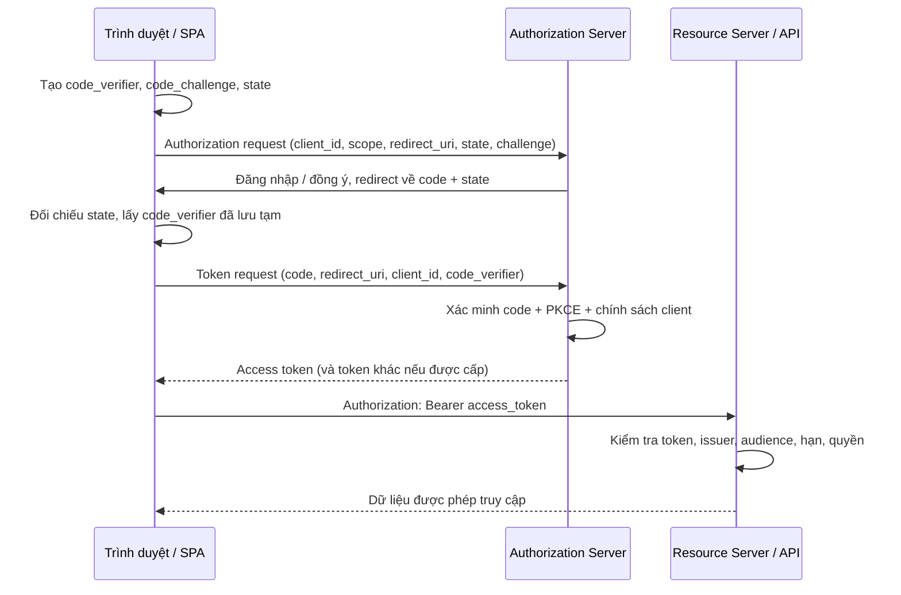

# Không nhúng secret client vào JavaScript

> **Chương:** Browser security
> **Phạm vi:** Token security fundamentals — hiểu mô hình tin cậy giữa trình duyệt, OAuth 2.0/OIDC, máy chủ xác thực và API; bảo vệ vòng đời token từ lúc phát hành đến khi hết hạn hoặc bị thu hồi.

## 1. Mục tiêu học tập

Sau bài này, bạn có thể:

1. Giải thích vì sao **trình duyệt không thể giữ bí mật thay cho ứng dụng** và phân biệt `client_id` với `client_secret`.
2. Nhận diện các cách vô tình đưa bí mật vào JavaScript, bundle, source map, cấu hình public và request từ trình duyệt.
3. Chọn giữa **SPA public client + Authorization Code/PKCE**, **Backend for Frontend (BFF)** và **backend confidential client**.
4. Giải thích vai trò của access token, refresh token, JWT/opaque token, scope và audience trong kiến trúc đã chọn.
5. Kiểm tra, khắc phục và ứng phó khi phát hiện `client_secret` hoặc khóa ký token đã bị lộ.

## 2. Tư duy nền tảng: ai giữ được bí mật?

Một ứng dụng web có ít nhất ba miền tin cậy:

- **Trình duyệt của người dùng:** chạy JavaScript do ứng dụng cung cấp, nhưng chính người dùng và các phần mềm trên máy người dùng có thể xem, sao chép và sửa mã, request, response. Mọi byte gửi xuống trình duyệt phải được coi là có thể bị quan sát.
- **Backend do tổ chức vận hành:** có thể giữ credential ngoài tầm truy cập trực tiếp của người dùng, áp dụng kiểm soát truy cập và liên lạc máy chủ với máy chủ.
- **Authorization Server (AS)/Identity Provider (IdP):** xác thực người dùng, chấp nhận các yêu cầu OAuth/OIDC hợp lệ và phát hành token theo chính sách.

Trong OAuth 2.0, **public client** là client *không có khả năng bảo vệ credential riêng một cách đáng tin cậy*, chẳng hạn SPA chạy trong trình duyệt hoặc ứng dụng mobile cài trên máy người dùng. **Confidential client** là client có khả năng bảo vệ credential, điển hình là backend vận hành trên máy chủ đáng tin cậy. Đây là phân loại theo khả năng giữ bí mật, không phải theo việc ứng dụng có đăng nhập người dùng hay không.

| Thành phần | Ý nghĩa | Có thể xuất hiện trong JavaScript công khai? |
| --- | --- | --- |
| `client_id` | Định danh ứng dụng đã đăng ký với AS; **không phải mật khẩu** | **Có**; public client cần gửi `client_id` |
| `client_secret` | Credential bí mật để xác thực **confidential client** với AS | **Không** |
| Private key dùng để xác thực client hoặc ký JWT | Khóa riêng chỉ bên sở hữu được giữ; ví dụ `private_key_jwt`, khóa ký token | **Không** |
| Public key/JWKS | Khóa công khai phục vụ xác minh chữ ký | **Có**, nếu đúng là khóa công khai |
| Access token | Credential mà bên sở hữu trình ra để truy cập API | Có thể phải tồn tại tạm thời trong SPA, nhưng **rất nhạy cảm**; cần hạn chế khả năng bị đánh cắp |
| Refresh token | Credential dùng xin access token mới; thường sống lâu hơn | Hạn chế tối đa trong trình duyệt; ưu tiên lưu phía backend hoặc dùng cơ chế an toàn do AS hỗ trợ |
| API key | Khóa do hệ thống phát hành; có thể là định danh công khai hoặc credential có quyền truy cập | Nếu là **credential bí mật** thì **không**; phải xem chính sách thực tế của API |

**Quy tắc cốt lõi:** bất cứ thứ gì được nhúng vào HTML, JavaScript, CSS, cấu hình tải từ trình duyệt, hoặc response mà JavaScript đọc được đều không thể được xem là một server-side secret.

## 3. Tại sao nhúng `client_secret` vào JavaScript là lỗi bảo mật?

Giả sử nhóm phát triển đăng ký một ứng dụng OAuth có `client_id = shop-web` và một `client_secret`. Nếu đưa cả hai giá trị vào mã frontend:

```javascript
// SAI: mã này sẽ được tải xuống và chạy trên máy người dùng.
const clientId = "shop-web";
const clientSecret = "super-secret-value";

await fetch("https://id.example.test/oauth2/token", {
  method: "POST",
  headers: { "Content-Type": "application/x-www-form-urlencoded" },
  body: new URLSearchParams({
    grant_type: "client_credentials",
    client_id: clientId,
    client_secret: clientSecret,
  }),
});
```

Một người dùng hoặc kẻ tấn công có thể:

1. Mở **Developer Tools → Sources/Network** để xem bundle hoặc request.
2. Tải tệp JavaScript được công khai qua CDN hoặc hosting; tìm literal, cấu hình khởi tạo và chuỗi đã được biến đổi.
3. Đọc **source map** hoặc biến được thay thế ở **build time**, nếu chúng được triển khai công khai.
4. Sao chép request gửi đến token endpoint, kể cả credential trong body hoặc header `Authorization: Basic ...`.

Không cần khai thác XSS để đọc một secret được phân phối công khai. **Minify, obfuscation, Base64, mã hóa kèm khóa giải mã nằm trong frontend và ẩn bằng biến môi trường không tạo ra ranh giới tin cậy.**

Ví dụ thường gặp:

```javascript
// Vẫn SAI với SPA: nhiều công cụ build thay thế giá trị khi tạo bundle.
const secret = import.meta.env.VITE_OAUTH_CLIENT_SECRET;
const otherSecret = process.env.REACT_APP_OAUTH_CLIENT_SECRET;
```

Tiền tố public như `VITE_`, `REACT_APP_`, `NEXT_PUBLIC_` biểu thị dữ liệu có thể xuất hiện trong client bundle. Một biến môi trường chỉ giữ được bí mật khi nó **chỉ được đọc bởi runtime phía server** và không được tuần tự hóa vào response cho trình duyệt.

**Hậu quả tùy thuộc quyền được gắn với credential:**

- Nếu AS cho dùng `client_credentials`, kẻ tấn công có thể giả danh ứng dụng để xin token theo quyền máy chủ đã cấp cho client.
- Nếu client dùng secret khi đổi authorization code, secret bị lộ làm mất ý nghĩa xác thực confidential client. Tuy nhiên, **chỉ có client secret không mặc nhiên thay thế được đăng nhập của người dùng, authorization code hoặc PKCE verifier**.
- Nếu lộ **khóa ký JWT** hoặc khóa riêng client authentication, tác động có thể nghiêm trọng hơn: tùy cấu hình, kẻ tấn công có thể ký thông điệp/token giả hoặc giả danh client.
- Nếu token, refresh token cũng bị lộ, chúng có thể bị sử dụng lại trong thời hạn và phạm vi quyền tương ứng; đây là rủi ro khác với việc lộ `client_secret`.

## 4. Ba kiến trúc đúng và khi nào sử dụng

### 4.1. SPA là public client: Authorization Code + PKCE

Với SPA thuần chạy trong trình duyệt, đăng ký nó là **public client** và dùng **OAuth 2.0 Authorization Code Flow cùng PKCE (S256)**. SPA chỉ biết `client_id`, redirect URI, authorization/token endpoints và scope được phép yêu cầu. Không tạo hay gửi `client_secret` từ frontend.



**PKCE giải quyết điều gì?** SPA tạo một `code_verifier` đủ ngẫu nhiên và chỉ gửi `code_challenge` trong yêu cầu đăng nhập. Khi đổi `code` lấy token, nó trình `code_verifier`. Nếu một bên khác chặn được authorization code nhưng không có verifier, bên đó không đổi được code thành token. PKCE **không biến SPA thành confidential client**, không che giấu token trước JavaScript độc hại/XSS, và không thay thế kiểm tra `state` hay cấu hình redirect URI.

Ví dụ ngắn minh họa việc **tạo yêu cầu đăng nhập**, không nhúng client secret:

```javascript
// Chạy ở frontend; các giá trị sau là định danh/cấu hình công khai.
const clientId = "shop-spa";
const redirectUri = "https://shop.example.test/callback";
const authorizationEndpoint = "https://id.example.test/oauth2/authorize";

function base64url(bytes) {
  return btoa(String.fromCharCode(...bytes))
    .replaceAll("+", "-")
    .replaceAll("/", "_")
    .replace(/=+$/, "");
}

const verifier = base64url(crypto.getRandomValues(new Uint8Array(32)));
const digest = await crypto.subtle.digest(
  "SHA-256",
  new TextEncoder().encode(verifier)
);
const challenge = base64url(new Uint8Array(digest));
const state = base64url(crypto.getRandomValues(new Uint8Array(32)));

sessionStorage.setItem("oauth:pkce", verifier);
sessionStorage.setItem("oauth:state", state);

const url = new URL(authorizationEndpoint);
url.search = new URLSearchParams({
  response_type: "code",
  client_id: clientId,
  redirect_uri: redirectUri,
  scope: "api.read",
  state,
  code_challenge: challenge,
  code_challenge_method: "S256",
}).toString();

location.assign(url.toString());
```

Ở `/callback`, ứng dụng phải so khớp `state` nhận về với giá trị tạm đã lưu, kiểm tra lỗi OAuth và chỉ đổi `code` hợp lệ:

```javascript
const params = new URLSearchParams(location.search);
const expectedState = sessionStorage.getItem("oauth:state");
const verifier = sessionStorage.getItem("oauth:pkce");
const code = params.get("code");

if (
  params.has("error") ||
  !code ||
  !verifier ||
  !expectedState ||
  params.get("state") !== expectedState
) {
  throw new Error("OAuth callback không hợp lệ");
}

// Dùng một lần, xóa cả khi token request thất bại.
sessionStorage.removeItem("oauth:state");
sessionStorage.removeItem("oauth:pkce");

const tokenResponse = await fetch("https://id.example.test/oauth2/token", {
  method: "POST",
  headers: { "Content-Type": "application/x-www-form-urlencoded" },
  body: new URLSearchParams({
    grant_type: "authorization_code",
    client_id: "shop-spa",
    code,
    redirect_uri: "https://shop.example.test/callback",
    code_verifier: verifier,
  }),
});

if (!tokenResponse.ok) throw new Error("Token exchange thất bại");
const tokens = await tokenResponse.json();
history.replaceState({}, "", "/callback");
// Giữ access token trong bộ nhớ và đưa vào Authorization header khi gọi API;
// không ghi token ra console, URL, telemetry hay kho lưu trữ bền vững.
```

Đoạn mã trên nhằm giải thích cơ chế; khi làm sản phẩm thực tế hãy ưu tiên **OAuth/OIDC SDK đã được kiểm thử**, xử lý callback, lỗi, đồng bộ tab, renewal, CORS tại token endpoint và kiểm tra ID token/nonce nếu dùng OIDC. Lưu tạm PKCE verifier trong `sessionStorage` chỉ tránh tồn tại lâu hơn một phiên/tab; nó vẫn có thể bị JavaScript độc hại đọc khi có XSS. Access token có mặt trong SPA cần được bảo vệ trước XSS và có thời hạn ngắn.

### 4.2. BFF: browser giữ session cookie, backend giữ token và secret

Nếu cần giới hạn việc token xuất hiện trong JavaScript, hãy cân nhắc **Backend for Frontend (BFF)**. Browser đăng nhập thông qua backend. BFF là confidential client: nó quản lý `client_secret` (nếu AS yêu cầu), đổi authorization code, giữ token ở phía server và tạo session được đại diện bằng cookie.

```mermaid
sequenceDiagram
    participant B as Browser
    participant F as BFF / Backend
    participant AS as Authorization Server
    participant R as Resource Server
    B->>F: GET /login
    F->>AS: Authorization request (code + PKCE/state theo cấu hình)
    AS-->>B: Redirect về callback trên BFF với code
    B->>F: GET /login/oauth2/code/app?code=...&state=...
    F->>AS: Đổi code lấy token, xác thực client trên server
    AS-->>F: Access token / refresh token
    F-->>B: Set-Cookie: session=...; HttpOnly; Secure; SameSite=Lax
    B->>F: GET /api/orders cùng session cookie
    F->>R: Bearer access token từ kho server
    R-->>F: Kết quả đã phân quyền
    F-->>B: JSON kết quả phù hợp
```

Chú ý các ranh giới sau:

- Cookie **HttpOnly** giúp JavaScript không đọc trực tiếp session cookie; **Secure** yêu cầu HTTPS; **SameSite** giảm một số bối cảnh gửi cookie chéo site. Cookie/session vẫn cần kiểm soát **CSRF**, đặc biệt đối với request thay đổi dữ liệu.
- BFF phải xác thực người dùng, kiểm tra quyền cho từng endpoint và bảo vệ session; chỉ thêm một proxy chuyển tiếp tùy ý mà không có kiểm soát truy cập có thể tạo ra một **open proxy**.
- BFF cần lưu `client_secret` và refresh token bằng cơ chế server-side phù hợp, tránh in log. Browser không được nhận lại chúng qua JSON, HTML hay cấu hình runtime.

Ví dụ cấu hình Spring Boot cho **backend confidential client**:

```yaml
# application.yml — chỉ deploy cho server, không công bố qua frontend.
spring:
  security:
    oauth2:
      client:
        registration:
          shop-bff:
            client-id: shop-bff
            client-secret: ${OAUTH_CLIENT_SECRET}
            client-authentication-method: client_secret_basic
            authorization-grant-type: authorization_code
            scope: openid, profile
        provider:
          shop-bff:
            issuer-uri: https://id.example.test
```

Biến `OAUTH_CLIENT_SECRET` phải được cấp **cho tiến trình backend**, ví dụ qua secret manager hoặc secret được bảo vệ của nền tảng triển khai; hạn chế quyền đọc và luân chuyển định kỳ. Ví dụ này giả định IdP hỗ trợ discovery/OIDC và đăng ký confidential client tương ứng. Không sao chép cấu hình này vào tệp public hoặc inject bí mật vào một biến `NEXT_PUBLIC_...`, `VITE_...`.

### 4.3. Gọi máy chủ với máy chủ: confidential client

Khi một backend hoặc worker cần gọi API **nhân danh chính ứng dụng** (không nhân danh người dùng), OAuth **Client Credentials Grant** có thể phù hợp nếu AS/API hỗ trợ. Chỉ backend gửi `client_secret` hoặc phương thức xác thực client mạnh hơn đến token endpoint. API xác thực access token và giới hạn đúng scope/audience.

Không dùng `client_credentials` trực tiếp trong SPA để làm thay quyền của người dùng. Chúng ta không nên cấp cho browser một token dịch vụ có quyền rộng chỉ vì cần gọi một API có khóa riêng.

| Nhu cầu | Kiểu client/flow phù hợp | Bí mật nằm ở đâu? | Điểm cần kiểm soát |
| --- | --- | --- | --- |
| SPA thuần đăng nhập và gọi API | Public client + Authorization Code/PKCE | Không có `client_secret` | XSS, callback, CORS, scope/audience, thời hạn token |
| Web app muốn giấu token khỏi JavaScript | BFF/confidential client + Authorization Code (PKCE khi áp dụng) | Backend/secret manager | Session cookie, CSRF, phân quyền, lưu token server |
| Backend gọi API dịch vụ | Confidential client + Client Credentials | Backend/secret manager | Quyền service account, xoay khóa, token theo audience |
| Mobile/native app | Public client + Authorization Code/PKCE | Không nhúng `client_secret` vào app | Redirect qua system browser, secure storage phù hợp nền tảng |

## 5. Gắn vấn đề với vòng đời token

Việc không nhúng `client_secret` giải quyết **bảo vệ credential của client**, nhưng kiến trúc token vẫn cần các lớp kiểm soát độc lập:

**Phát hành:** AS xác định client, flow, người dùng (nếu có), scope và audience. Public client sử dụng `client_id` + PKCE; confidential client sử dụng phương thức xác thực server-side thích hợp. Chỉ yêu cầu scope thực sự cần.

**Truyền token:** Access token là bearer credential phổ biến: ai giữ token hợp lệ có thể gọi tài nguyên được phép, trừ khi có ràng buộc bổ sung như sender-constrained token. Dùng HTTPS; ưu tiên header `Authorization: Bearer ...`; tránh đưa token vào query string, log, link hoặc công cụ phân tích.

**Kiểm tra tại API:** API phải xác minh token do AS tin cậy phát hành, chưa hết hạn, đúng **issuer (`iss`)**, **audience (`aud`)**, quyền/scope cần thiết và các điều kiện khác. Không coi `client_id` hoặc sự hiện diện của chuỗi JWT là bằng chứng đã phân quyền.

- Với **JWT access token**, API kiểm tra chữ ký bằng khóa tin cậy/ JWKS, thuật toán cho phép, thời hạn và claims. API không lấy một secret tùy ý từ browser để "xác thực JWT".
- Với **opaque access token**, API thường dùng introspection hoặc tra cứu server-side để biết token có đang hoạt động và có quyền gì.
- **ID token (OIDC)** cho biết thông tin về lần xác thực dành cho OIDC client; không sử dụng ID token thay access token để gọi API. Client OIDC cần kiểm tra ID token, `nonce` khi có yêu cầu, audience và issuer theo đặc tả/thư viện.
- **Refresh token** phục vụ xin access token mới; nếu cấp cho browser-based public client, AS cần các biện pháp như **refresh token rotation** hoặc sender-constraining cùng giới hạn thời gian/chính sách phù hợp. BFF có thể giữ refresh token ở phía server.

**Hết hạn và thu hồi:** Access token thường ngắn hạn. Khi có dấu hiệu bị đánh cắp, cần thu hồi/đình chỉ refresh token hoặc session và áp dụng cơ chế revoke/introspection/denylist nếu mô hình token hỗ trợ; JWT tự chứa đã phát hành có thể còn hiệu lực đến lúc hết hạn nếu API chỉ kiểm tra chữ ký offline.

**Phòng phát lại:** PKCE bảo vệ lần đổi authorization code; `state` chống callback không khớp; HTTPS bảo vệ đường truyền; token rotation, DPoP hoặc mTLS (nơi được hỗ trợ) giảm một số rủi ro token replay. Chúng giải quyết các lớp nguy cơ khác nhau và không khiến một `client_secret` công khai trở nên an toàn.

## 6. Các kiểm soát browser đi kèm

Không nhúng secret là điều kiện nền tảng; các kiểm soát dưới đây giảm nguy cơ mất token/session:

- **Phòng XSS:** encode/escape đầu ra đúng ngữ cảnh, tránh chèn HTML không tin cậy, kiểm soát dependency, thiết lập CSP phù hợp và cân nhắc Trusted Types. CSP giúp giảm một số kiểu thực thi script nhưng **không bảo vệ một secret đã nằm trong bundle**.
- **CORS:** cấu hình origin cụ thể cho token endpoint/API, tránh mở bừa thông tin có credential. CORS là cơ chế giới hạn đọc response giữa các origin trên browser, **không phải cách bảo vệ client secret**; request HTTP từ công cụ ngoài browser vẫn có thể được gửi.
- **Session/CSRF với BFF:** cookie `HttpOnly; Secure; SameSite` theo bối cảnh, kiểm tra CSRF token hoặc Origin/Referer đối với request thay đổi dữ liệu, session fixation, timeout và logout.
- **Redirect URI:** đăng ký chính xác URI được phép; không dùng wildcard rộng hoặc open redirect trong login/callback. Kiểm tra `state`; với OIDC, dùng `nonce` và xác minh ID token theo SDK.
- **Quyền tối thiểu:** tách scope đọc/ghi; không phát token quyền admin/service cho giao diện người dùng; dùng audience riêng theo API khi có thể.
- **Giảm bề mặt lộ:** không để secret/token trong log, error report, URL, screenshot debug, source map cấu hình nhạy cảm, analytics, repository hoặc response public.

## 7. Tình huống thực tế và cách xử lý

Một SPA bán hàng cần gọi API vận chuyển. API này dùng OAuth `client_credentials` với scope `shipping.write`. Nhóm phát triển đặt `client_secret` vào `VITE_SHIPPING_SECRET` rồi gọi token endpoint từ trình duyệt. Kẻ tấn công tải bundle, đọc secret, xin access token với phạm vi `shipping.write` và gửi yêu cầu giả.

Cách sửa phù hợp:

1. Chuyển thao tác cần credential dịch vụ sang endpoint backend, ví dụ `POST /api/shipments`.
2. Backend **xác thực người dùng**, kiểm tra người đó được phép tạo vận đơn cho đơn hàng tương ứng; sau đó mới xin hoặc sử dụng lại service access token.
3. Credential được lưu trong secret manager của backend; AS cấp token với scope/audience tối thiểu; backend giới hạn tốc độ, kiểm toán và chống gọi lặp không chủ ý khi cần.
4. **Thu hồi/rotate client secret đã lộ**, đánh giá token đang tồn tại và lịch sử sử dụng. Gỡ secret khỏi bundle là chưa đủ vì bản cũ có thể còn trong CDN, cache, source map, release và git history.

Nếu phát hiện sự cố ngoài thực tế, thứ tự xử lý là **cô lập quyền truy cập → thu hồi/rotate credential → kiểm tra token, log và hành vi bất thường → sửa kiến trúc → triển khai và giám sát**. Cần phối hợp với chủ sở hữu AS/API vì việc xoay secret có thể làm backend đang sử dụng credential cũ ngừng hoạt động. Không đưa secret thực vào ticket, log hoặc trao đổi công khai.

## 8. Checklist review trước khi phát hành

- [ ] Không có `client_secret`, API key bí mật, private key/JWT signing key trong source frontend, HTML, JSON public, bundle, source map hoặc network response.
- [ ] Phân loại đúng public/confidential client; SPA dùng Authorization Code + **PKCE S256**, không dùng implicit flow hay `client_credentials` trong browser.
- [ ] `client_id` được xem là định danh công khai; AS không dựa vào một client secret phân phối công khai để xác thực SPA.
- [ ] Redirect URI đăng ký chặt chẽ; callback xác minh `state`; OIDC kiểm tra `nonce` và ID token bằng thư viện phù hợp.
- [ ] Backend giữ secret trong secret manager/cấu hình runtime riêng; không đưa bí mật qua tiền tố biến môi trường public.
- [ ] API xác minh access token: chữ ký hoặc introspection, issuer, audience, expiry, scope/quyền; tách ID token khỏi access token.
- [ ] Hạn chế lưu token phía browser; chống XSS; nếu dùng BFF thì session cookie bảo mật và có chống CSRF.
- [ ] Đã có quy trình rotate/revoke credential và xử lý trường hợp token/secret từng bị xuất bản.

## 9. Câu hỏi tự kiểm tra

**1. “Đưa secret vào `.env` của Vite là an toàn vì `.env` không commit lên Git?”**

Không. Nếu mã client đọc qua `import.meta.env.VITE_...`, công cụ build có thể nhúng giá trị vào bundle công khai. Không commit chỉ giải quyết một đường rò rỉ, không giải quyết việc phân phối cho browser.

**2. “`client_id` cũng hiện trong DevTools; như vậy OAuth bị lộ?”**

Không. `client_id` là định danh dự kiến được nhìn thấy. OAuth bảo vệ bằng redirect URI, PKCE, các bước xác thực/ủy quyền, chính sách AS và việc giữ kín những credential thực sự cần bí mật.

**3. “Có PKCE rồi, tôi có thể để `client_secret` trong SPA?”**

Không. PKCE chống việc đổi authorization code bị chặn mà thiếu verifier; nó không che client secret. SPA vẫn là public client.

**4. “Dùng HTTPS, CORS và minify có đủ giấu secret không?”**

Không. HTTPS bảo vệ đường truyền khỏi bên thứ ba trên mạng; CORS giới hạn hành vi của trình duyệt; minify làm mã khó đọc hơn. Người dùng cuối vẫn nhận và có thể xem dữ liệu trong chính ứng dụng của họ.

**5. “Vì sao BFF tốt hơn trong trường hợp cần bảo vệ refresh token?”**

BFF có thể giữ refresh token và access token phía server, chỉ phát session cookie `HttpOnly` cho browser. Đổi lại BFF phải thực hiện đúng quản lý session, phân quyền và chống CSRF.

**6. “Đã lỡ public secret nhưng xóa khỏi commit mới nhất là xong?”**

Không. Secret có thể còn trong build/CDN/cache/git history và đã bị sao chép. Cần rotate/revoke và điều tra theo phạm vi quyền của credential.

## 10. Bài tập ứng dụng

Bạn nhận pull request với đoạn mã sau:

```typescript
const oauth = {
  clientId: import.meta.env.VITE_CLIENT_ID,
  clientSecret: import.meta.env.VITE_CLIENT_SECRET,
  tokenUrl: "https://id.example.test/oauth2/token",
};

export async function loadOrders() {
  // Frontend xin token bằng client_credentials rồi gọi /orders.
}
```

Hãy mô tả: (a) dữ liệu nào được phép để ở frontend, (b) cách attacker lấy secret, (c) vì sao không thể sửa chỉ bằng cách mã hóa chuỗi trong bundle, (d) sơ đồ kiến trúc thay thế cho chức năng xem đơn hàng của người dùng và chức năng đồng bộ đơn hàng giữa các backend, (e) quy trình ứng phó nếu bản build chứa secret đã được phát hành.

**Gợi ý đáp án:** `clientId`/endpoint có thể công khai; `clientSecret` phải loại khỏi frontend. Xem đơn hàng người dùng dùng SPA public client + PKCE với API kiểm tra token/scope/audience, hoặc BFF có session. Đồng bộ giữa backend dùng confidential client và `client_credentials` phía server. Secret đã lộ cần rotate/revoke, rà soát token/log và phát hành lại ứng dụng đã sửa.

---

**Ghi nhớ:** Trong token security, `client_secret` là **bằng chứng xác thực của confidential client**. JavaScript chạy trên trình duyệt không thể bảo vệ bằng chứng đó. Thiết kế OAuth phải đi từ **ranh giới tin cậy** trước, rồi mới quyết định loại client, flow, nơi lưu token, cách kiểm tra claims và cơ chế thu hồi.
