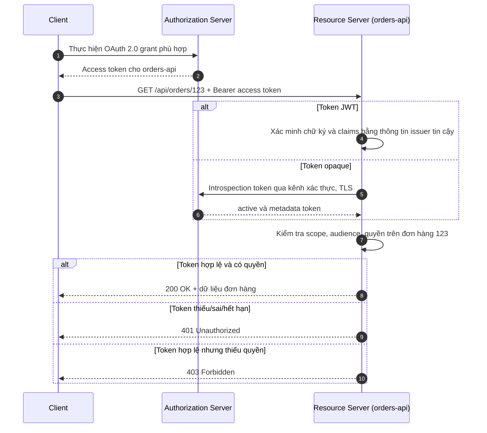

# Resource server nhận access token

## 1. Mục tiêu bài học

Sau bài này, bạn có thể:

- Mô tả đường đi của **access token** từ client đến **resource server** trong OAuth 2.0 và chỉ ra ranh giới tin cậy giữa client, authorization server và API.
- Giải thích resource server phải xác thực token như thế nào khi token là **JWT** hoặc **opaque token**.
- Phân biệt kiểm tra token hợp lệ với quyết định cấp quyền dựa trên `scope`, `audience` và quyền truy cập tài nguyên cụ thể.
- Thiết kế phản hồi `401`/`403`, cấu hình kiểm tra token cho API Java và nhận diện những rủi ro như token bị đánh cắp, dùng sai API hoặc phát lại.

## 2. Resource server đứng ở đâu trong hệ thống?

Trong OAuth 2.0, **resource server** là dịch vụ nắm giữ tài nguyên được bảo vệ (ví dụ: API đơn hàng, hồ sơ người dùng, dữ liệu thanh toán). Resource server **nhận access token** do client gửi cùng yêu cầu truy cập tài nguyên. Nó quyết định có chấp nhận yêu cầu hay không dựa trên token và chính sách của tài nguyên.

Ba vai trò cần tách rõ:

| Thành phần | Trách nhiệm chính | Không nên nhầm với |
| --- | --- | --- |
| **Authorization server (AS)** | Xác thực và cấp quyền theo luồng OAuth 2.0, phát hành token, công bố khóa hoặc cung cấp introspection. | Resource server phục vụ dữ liệu nghiệp vụ. |
| **Client** | Nhận và sử dụng access token theo luồng được cho phép, gửi token đến đúng API. | Một chủ thể tự chứng thực quyền của mình chỉ bằng cách khai báo thông tin. |
| **Resource server (RS)** | Kiểm tra token, ánh xạ thông tin bảo mật và thực thi quyền truy cập tài nguyên. | Nơi tự phát hành access token hoặc xử lý refresh token cho client. |

Ví dụ: ứng dụng bán hàng muốn lấy đơn hàng `123` tại `orders-api`. Sau khi client được cấp access token, luồng sử dụng sẽ là:



Yêu cầu HTTP điển hình:

```http
GET /api/orders/123 HTTP/1.1
Host: orders.example.test
Authorization: Bearer <ACCESS_TOKEN>
Accept: application/json
```

`Authorization: Bearer ...` có nghĩa: **ai nắm giữ token thì có thể thử sử dụng nó**, trừ khi có thêm cơ chế ràng buộc người gửi. Resource server không thể mặc định rằng người gửi token chính là chủ thể ban đầu được cấp token. Vì vậy, toàn bộ đường truyền phải dùng HTTPS, token phải có thời hạn và được bảo vệ khỏi rò rỉ.

> **Ranh giới tin cậy:** Client là nguồn dữ liệu đầu vào không đáng tin cậy. Resource server chỉ tin vào kết quả kiểm tra token bằng thông tin đã cấu hình từ authorization server đáng tin cậy; nó không tin nội dung client tự khai, token chỉ được giải mã, hoặc URL chứa địa chỉ khóa tùy ý do token cung cấp.

## 3. Resource server kiểm tra những gì khi nhận token?

Một API cần có một quy trình kiểm tra có thứ tự. Không được coi sự xuất hiện của header `Authorization` là bằng chứng đã xác thực.

1. **Trích xuất token đúng cách:** chấp nhận cơ chế xác thực được API hỗ trợ (thường là `Bearer` trong header `Authorization`); từ chối token thiếu, trống, sai cấu trúc hoặc có nhiều giá trị gây nhập nhằng. Tránh truyền token trong query string.
2. **Kiểm tra tính xác thực và trạng thái:** với JWT, xác minh chữ ký bằng khóa/thuật toán được cho phép; với opaque token, hỏi authorization server qua introspection và chỉ chấp nhận kết quả `active: true`. Với JWT đã được cấp, việc có chữ ký hợp lệ không tự chứng minh rằng token chưa bị thu hồi.
3. **Kiểm tra các ràng buộc của token:** issuer (`iss`), đối tượng nhận (`aud`), thời hạn (`exp`), thời điểm bắt đầu có hiệu lực (`nbf` nếu có), loại token/profile phù hợp và các ràng buộc riêng của hệ thống.
4. **Diễn giải chủ thể và quyền:** xác định `sub` đại diện cho ai, client nào được cấp token và token có các scope/authority được API hiểu hay không.
5. **Thực thi phân quyền nghiệp vụ:** đối chiếu phương thức, endpoint, tài nguyên cụ thể, chủ sở hữu, tenant, trạng thái đơn hàng và quy tắc chính sách. Đây là bước riêng sau khi token đã được xác thực.
6. **Phản hồi an toàn:** nếu không xác thực được thì từ chối truy cập; nếu đã xác thực nhưng thiếu quyền thì từ chối theo chính sách. Không đưa token hoặc nội dung nhạy cảm vào thông báo lỗi hay log.

Có thể hình dung hai câu hỏi độc lập:

- **Authentication:** “Access token này có thực sự hợp lệ cho API này và nó đại diện cho ai?”
- **Authorization:** “Chủ thể đã được xác thực có được phép thực hiện hành động này trên tài nguyên này không?”

Một token hợp lệ nhưng chỉ có `orders:read` không cho phép tạo đơn hàng. Một token có `orders:read` cũng không tự cho phép xem đơn hàng của người khác.

## 4. JWT và opaque token: hai cách xác minh

**JWT** và **opaque** mô tả **định dạng/khả năng diễn giải token**; còn **access token** và **refresh token** mô tả **mục đích sử dụng**. Access token có thể ở dạng JWT hoặc opaque. Resource server chủ yếu xử lý **access token**.

| Tiêu chí | JWT access token | Opaque access token |
| --- | --- | --- |
| Hình dạng | Có cấu trúc claims; JWT thường là chuỗi ba phần `header.payload.signature` khi dùng JWS. | Chuỗi tham chiếu không mang ý nghĩa mà resource server có thể tự đọc. |
| Kiểm tra thường gặp | Xác minh chữ ký và claims tại API bằng khóa issuer đáng tin cậy. | Gửi token đến introspection endpoint của AS để lấy trạng thái và metadata. |
| Phụ thuộc mạng khi xử lý | Có thể xác minh cục bộ khi khóa và metadata đã được lấy/cached. | Thường cần kết nối AS hoặc một cache introspection có kiểm soát. |
| Thu hồi tức thời | Khó bảo đảm nếu chỉ xác minh cục bộ; thường kết hợp TTL ngắn và cơ chế thu hồi bổ sung. | AS có thể trả `active: false`; cache có thể tạo độ trễ nhận biết thu hồi. |
| Rủi ro đặc trưng | Bỏ qua chữ ký/claims, dùng sai `aud`, thuật toán yếu, tin dữ liệu chỉ được decode. | Đánh giá sai trạng thái introspection, cache quá lâu, lộ thông tin xác thực của RS. |

### 4.1. Nếu access token là JWT

Một **payload minh họa** (không phải token hoàn chỉnh và không có giá trị xác thực) có thể trông như sau:

```json
{
  "iss": "https://auth.example.test",
  "sub": "user-42",
  "aud": ["orders-api"],
  "scope": "orders:read",
  "iat": 1893452400,
  "exp": 1893456000
}
```

Resource server phải:

- Xác minh chữ ký JWS bằng khóa thuộc **issuer đã cấu hình tin cậy**; chọn thuật toán từ danh sách cho phép, không tự chấp nhận thuật toán được header token đề nghị (ví dụ `alg: none`).
- Kiểm tra `iss` khớp chính xác issuer đã cấu hình và `aud` chứa định danh của API đang phục vụ, ví dụ `orders-api`. Chữ ký hợp lệ nhưng token dành cho API khác vẫn phải bị từ chối.
- Kiểm tra `exp` chưa hết hạn, `nbf` không nằm trong tương lai vượt ngưỡng cho phép; chỉ sử dụng độ lệch đồng hồ nhỏ, có kiểm soát. Có thể áp dụng chính sách với `iat` và thời gian sống tối đa.
- Nếu hệ thống dùng một **access-token JWT profile** cụ thể, xác minh các điều kiện bổ sung của profile (chẳng hạn kiểu token `at+jwt` khi profile quy định). Không suy luận token nào có ba phần đều là access token hợp lệ.
- Ánh xạ `scope` sang quyền của API và **tiếp tục** kiểm tra quyền trên tài nguyên.

**Decode không phải verify.** Bất kỳ ai cũng có thể giải mã phần payload của JWT dạng JWS và sửa nó khi chưa ký hợp lệ. Chữ ký xác minh tính toàn vẹn và bên phát hành được tin cậy; JWT ký thông thường **không mã hóa nội dung**, nên không đặt bí mật, mật khẩu hoặc thông tin cá nhân không cần thiết trong claims.

`kid` trong header có thể giúp chọn khóa tương ứng từ JWKS đã biết. Resource server chỉ lấy khóa từ nguồn tin cậy được cấu hình; không truy cập tùy ý `jku`, `x5u` hoặc địa chỉ do token chưa được xác minh chỉ định. Cần hỗ trợ quay vòng khóa, cache JWKS hợp lý và xử lý an toàn khi khóa không còn hợp lệ.

### 4.2. Nếu access token là opaque

Resource server không tự “giải mã” opaque token. Nó gọi **introspection endpoint** (RFC 7662), thường qua HTTPS với danh tính riêng được authorization server cho phép.

Ví dụ response **minh họa** khi token còn hiệu lực:

```json
{
  "active": true,
  "client_id": "orders-web",
  "sub": "user-42",
  "aud": "orders-api",
  "scope": "orders:read",
  "exp": 1893456000
}
```

Resource server phải coi `active: false`, phản hồi không hợp lệ, hoặc không thể xác minh trạng thái như **không đủ căn cứ để cấp quyền**. Khi `active: true`, RS vẫn phải kiểm tra audience, scope và quyền nghiệp vụ dựa vào metadata tin cậy. Trường metadata nào bắt buộc phải có phụ thuộc vào hợp đồng giữa AS và RS; không suy diễn rằng introspection luôn trả mọi claim.

Ưu điểm là authorization server có thể quyết định trực tiếp token nào đang còn hiệu lực. Đổi lại, API cần chính sách **timeout, cache và hành vi khi introspection gián đoạn**. Nếu cache kết quả `active: true`, thời gian cache phải ngắn, không vượt thời hạn token và phù hợp yêu cầu thu hồi. Không được mở quyền truy cập chỉ vì AS tạm thời không phản hồi.

**Lưu ý:** “JWT = luôn kiểm tra cục bộ” và “opaque = luôn tra mạng ở mọi request” là cách nói đơn giản hóa. Một hệ thống có thể introspect cả JWT hoặc cache trạng thái opaque; điều quan trọng là phương án xác minh phải đáp ứng yêu cầu thu hồi và mức độ rủi ro.

## 5. Hiểu đúng các claims trước khi phân quyền

| Claim/metadata | Câu hỏi cần trả lời | Cách sử dụng an toàn |
| --- | --- | --- |
| `iss` (issuer) | Ai phát hành token? | Chỉ chấp nhận issuer nằm trong cấu hình tin cậy; môi trường/tenant khác có thể có issuer khác. |
| `aud` (audience) | Token dành cho dịch vụ nào? | Bắt buộc giới hạn token vào API này; ngăn token dùng nhầm sang API khác. |
| `sub` (subject) | Token đại diện cho chủ thể nào? | Có thể là người dùng hoặc ứng dụng tùy grant; không giả định luôn là tài khoản người dùng. |
| `scope` / `scp` | Client được cấp phạm vi truy cập nào? | Ánh xạ rõ ràng sang thao tác API; sự có mặt của scope không thay thế kiểm tra chủ sở hữu tài nguyên. |
| `exp`, `nbf`, `iat` | Token có còn trong khoảng thời gian hợp lệ? | Kiểm tra thời gian với đồng hồ tin cậy, xử lý sai lệch giới hạn. |
| `client_id` / claim client phù hợp | Client nào nhận token? | Dùng khi chính sách yêu cầu phân biệt ứng dụng gọi API; không thay thế `aud` hoặc scope. |
| `jti` | Token có định danh duy nhất không? | Có thể hỗ trợ truy vết/denylist/chống replay khi thiết kế thêm trạng thái; bản thân `jti` không ngăn replay. |
| `cnf` | Token có ràng buộc với khóa/chứng thư của bên gửi? | Với DPoP hoặc mTLS, RS phải kiểm chứng bằng chứng sở hữu khóa tương ứng theo profile áp dụng. |

Ví dụ sau giúp tách **scope** và **quyền trên dữ liệu**:

- Token có `scope = orders:read`, `aud = orders-api`, `sub = user-42`.
- Client gọi `GET /api/orders/123`. API xác minh token trước.
- API tải đơn hàng `123` và kiểm tra `ownerId == user-42` hoặc một chính sách ủy quyền phù hợp.
- Nếu đơn hàng thuộc `user-99` và không có quyền quản trị hợp lệ, API không trả dữ liệu dù token có scope đúng.

Trong hệ thống nhiều tenant, hãy kiểm tra cả tenant của token/chủ thể với tenant sở hữu tài nguyên; không tin `tenantId` do client đưa trên đường dẫn hoặc body nếu không có chính sách xác nhận.

## 6. Phản hồi HTTP khi access token không đủ điều kiện

Resource server thường tuân theo cơ chế Bearer Token Usage (RFC 6750):

| Tình huống | Phản hồi điển hình | Giải thích |
| --- | --- | --- |
| Không có token ở endpoint được bảo vệ | `401 Unauthorized` kèm `WWW-Authenticate: Bearer` | Client cần cung cấp thông tin xác thực. |
| Token sai/hết hạn/chữ ký không hợp lệ/issuer hoặc audience sai | `401 Unauthorized`; có thể kèm `error="invalid_token"` | Chưa có căn cứ xác thực hợp lệ cho request. |
| Token hợp lệ nhưng không có `orders:write` để ghi đơn hàng | `403 Forbidden`; có thể kèm `error="insufficient_scope"` | Đã xác thực nhưng không đủ quyền. |
| Scope hợp lệ nhưng không được đọc đơn hàng của chủ thể khác | Thường `403`; có thể dùng `404` theo chính sách chống dò tài nguyên | Từ chối dựa trên quyền với đối tượng cụ thể. |

Ví dụ phản hồi thiếu token:

```http
HTTP/1.1 401 Unauthorized
WWW-Authenticate: Bearer realm="orders-api"
```

Ví dụ token có quyền đọc nhưng không có quyền ghi:

```http
HTTP/1.1 403 Forbidden
WWW-Authenticate: Bearer realm="orders-api", error="insufficient_scope", scope="orders:write"
```

Không trả lại toàn bộ token, claims nhạy cảm, stack trace hoặc chi tiết nội bộ của khóa và hệ thống introspection trong response. Với lỗi hạ tầng như AS không khả dụng, có thể cần báo lỗi dịch vụ (ví dụ `503`) nhưng **tuyệt đối không** cho request đi qua khi chưa xác minh được token.

## 7. Minh họa cấu hình Spring Security cho Java API

Ví dụ sau mô tả `orders-api` với hai quyền `orders:read` và `orders:write`. Các URL, định danh và secret chỉ là ví dụ; triển khai thực tế phải thay bằng cấu hình của tổ chức.

### 7.1. Chế độ JWT

Với Spring Boot 3 / Spring Security 6, thêm dependency `spring-boot-starter-oauth2-resource-server`. Thiết lập issuer và audience cho API:

```yaml
spring:
  security:
    oauth2:
      resourceserver:
        jwt:
          issuer-uri: https://auth.example.test
          audiences: orders-api
```

Tùy phiên bản Spring Boot, thuộc tính `audiences` có thể được tự động dùng để xác thực audience. Nếu phiên bản không hỗ trợ hoặc có yêu cầu đặc thù, cần tự đăng ký `JwtDecoder`/`OAuth2TokenValidator` để **bắt buộc** kiểm tra `aud`; không dựa vào issuer validation như một cách thay thế.

Cấu hình endpoint:

```java
@Configuration
class ApiSecurityConfig {

    @Bean
    SecurityFilterChain apiSecurity(HttpSecurity http) throws Exception {
        http
            .authorizeHttpRequests(auth -> auth
                .requestMatchers(HttpMethod.GET, "/api/orders/**")
                    .hasAuthority("SCOPE_orders:read")
                .requestMatchers(HttpMethod.POST, "/api/orders/**")
                    .hasAuthority("SCOPE_orders:write")
                .anyRequest().authenticated()
            )
            .oauth2ResourceServer(oauth2 ->
                oauth2.jwt(Customizer.withDefaults())
            );
        return http.build();
    }
}
```

Đoạn Java lược bỏ `import` để tập trung vào chính sách. Với cấu hình mặc định, Spring Security ánh xạ các scope phù hợp thành authority có tiền tố `SCOPE_`. Quy tắc `hasAuthority("SCOPE_orders:read")` chỉ kiểm tra quyền cấp cho thao tác; controller/service vẫn phải kiểm tra `ownerId` hoặc chính sách chi tiết của đơn hàng.

Nếu cần audience validator tường minh, có thể cấu hình decoder tương tự sau (kèm các import tương ứng từ Spring Security):

```java
@Bean
JwtDecoder jwtDecoder() {
    String issuer = "https://auth.example.test";
    NimbusJwtDecoder decoder = NimbusJwtDecoder
        .withJwkSetUri("https://auth.example.test/oauth2/jwks")
        .build();

    OAuth2TokenValidator<Jwt> issuerAndTime =
        JwtValidators.createDefaultWithIssuer(issuer);

    OAuth2TokenValidator<Jwt> audience = jwt ->
        jwt.getAudience().contains("orders-api")
            ? OAuth2TokenValidatorResult.success()
            : OAuth2TokenValidatorResult.failure(
                new OAuth2Error("invalid_token", "Sai audience", null)
            );

    decoder.setJwtValidator(
        new DelegatingOAuth2TokenValidator<>(issuerAndTime, audience)
    );
    return decoder;
}
```

URI JWKS ở trên là giả định minh họa; nó phải trỏ tới **nguồn khóa đáng tin cậy** thực tế của authorization server. Trong ví dụ này validator mặc định kiểm tra issuer và các ràng buộc thời gian, còn validator bổ sung yêu cầu `aud` chứa `orders-api`.

### 7.2. Chế độ opaque token

Khi AS phát hành opaque access token, API có thể chuyển sang introspection:

```yaml
spring:
  security:
    oauth2:
      resourceserver:
        opaque-token:
          introspection-uri: https://auth.example.test/oauth2/introspect
          client-id: orders-resource-server
          client-secret: ${RS_INTROSPECTION_SECRET}
```

Trong `SecurityFilterChain`, thay cấu hình xác minh JWT bằng:

```java
.oauth2ResourceServer(oauth2 ->
    oauth2.opaqueToken(Customizer.withDefaults())
)
```

Secret introspection chỉ nằm phía backend, được cấp qua secret manager hoặc biến môi trường an toàn, không đẩy ra browser hay lưu trong repository. Đảm bảo response introspection chứa dữ liệu cần thiết cho chính sách (`aud`, `scope`, `sub`...) và thực thi kiểm tra các điều kiện mà provider/framework chưa tự kiểm tra. Hai ví dụ JWT và opaque là **hai phương án cấu hình thay thế** cho cùng API; cần chọn/thiết kế bộ xác minh nhất quán với định dạng AS cấp.

> **Lưu ý triển khai:** API thuần Bearer header và API sử dụng cookie có mô hình CSRF khác nhau. Không sao chép cấu hình tắt CSRF, CORS hoặc session một cách máy móc; các quyết định này phải dựa trên cách client gửi thông tin xác thực.

## 8. Token bị đánh cắp hoặc phát lại thì sao?

Resource server phải giả định access token dạng Bearer có thể bị lộ. Chỉ kiểm tra chữ ký và `exp` vẫn chưa đủ khi kẻ tấn công đang cầm token còn hạn.

| Rủi ro | Ví dụ | Biện pháp phù hợp |
| --- | --- | --- |
| **Lộ Bearer token** | Token bị ghi vào URL, log, analytics hoặc JavaScript bị XSS đọc được. | HTTPS mọi chặng; dùng header `Authorization`; không log token; giảm thời hạn sống; bảo vệ lưu trữ và browser; xác định cơ chế cookie/BFF phù hợp. |
| **Replay** | Kẻ tấn công gửi lại cùng token nhiều lần trước lúc hết hạn. | TTL ngắn, phát hiện bất thường, token ràng buộc bên gửi (mTLS/DPoP khi hệ thống hỗ trợ), chính sách chống phát lại cho yêu cầu có rủi ro cao. |
| **Dùng sai audience** | Token cấp cho `profile-api` bị chuyển tới `orders-api`. | Kiểm tra `aud` chính xác ở resource server; không chuyển tiếp token sang API downstream khác audience. |
| **Token thay thế/giả mạo** | Dùng ID token thay access token hoặc dùng JWT sửa payload. | Chỉ chấp nhận đúng loại/profile access token, issuer và audience; xác minh chữ ký; từ chối thuật toán không được phép. |
| **Thu hồi không được áp dụng** | User đăng xuất nhưng JWT còn hạn vẫn được dùng. | Access token ngắn hạn; introspection, denylist hoặc cơ chế thu hồi/binding phù hợp; hiểu rõ khoảng trễ của cache. |
| **Quyền rộng quá mức** | Token có scope tổng quát được dùng để xem mọi đơn hàng. | Least privilege, scope theo thao tác, kiểm tra đối tượng và tenant, tách quyền dịch vụ/người dùng. |
| **Lộ secret introspection** | Secret của RS nằm trong mã nguồn hoặc frontend. | Giữ secret phía server, cấp phát qua secret manager, quay vòng và giới hạn quyền truy cập introspection endpoint. |

**DPoP** (RFC 9449) và **mTLS certificate-bound token** (RFC 8705) có thể ràng buộc access token với khóa/chứng thư mà bên gửi phải chứng minh sở hữu. Đây là biện pháp mạnh hơn Bearer thuần nhưng đòi hỏi AS, client và RS cùng hỗ trợ. Không chỉ đọc claim `cnf` rồi mặc định rằng token đã chống phát lại; RS còn phải thực sự kiểm tra proof hoặc chứng thư và các điều kiện chống replay tương ứng.

**Refresh token** dùng để client yêu cầu AS cấp token mới; nó không phải thông tin xác thực để gọi `/api/orders`. **ID token** (OIDC) cung cấp thông tin xác thực cho client/relying party; nó cũng không thay thế access token cho API. Khi resource server gọi API downstream, token chuyển tiếp phải thực sự được cấp cho downstream audience và quyền phù hợp, hoặc dịch vụ phải nhận token mới/token exchange theo thiết kế, thay vì gửi nguyên token bất kỳ.

## 9. Kiểm thử luồng nhận access token

Một bộ kiểm thử integration tối thiểu cho `orders-api` nên có các tình huống sau:

| Thử nghiệm | Kết quả mong đợi |
| --- | --- |
| Thiếu header `Authorization` | Từ chối với `401`. |
| Header Bearer trống, token sai định dạng | Từ chối với `401`. |
| JWT hết hạn hoặc chưa đến `nbf` | Từ chối với `401`. |
| JWT bị sửa payload/chữ ký hoặc dùng `alg` không cho phép | Từ chối với `401`. |
| Token ký hợp lệ nhưng `iss` không tin cậy | Từ chối với `401`. |
| Token ký hợp lệ nhưng `aud = profile-api` | Từ chối với `401`. |
| Token hợp lệ, `aud` đúng, thiếu `orders:write` khi gọi thao tác ghi | Từ chối với `403`. |
| Token `orders:read` đúng, nhưng `sub` không được xem đơn hàng mục tiêu | Từ chối theo chính sách đối tượng (`403` hoặc `404`). |
| Token hợp lệ, scope đúng, đúng chủ sở hữu | Trả kết quả nghiệp vụ hợp lệ. |
| Opaque token có `active: false` | Từ chối, không cấp quyền. |
| Introspection timeout hoặc AS không khả dụng | Không cấp quyền khi chưa kiểm chứng được trạng thái. |
| Token ràng buộc DPoP/mTLS nhưng thiếu hoặc sai bằng chứng gửi | Từ chối theo profile ràng buộc. |

Thực hiện cả kiểm thử **âm tính** (token sai, quyền thiếu) và kiểm thử **dương tính** (token hợp lệ). Dùng token thử nghiệm của môi trường riêng, không đưa access token thật vào mã nguồn, test snapshot hay báo cáo lỗi.

## 10. Tổng kết và bài tập tình huống

Khi resource server nhận `Authorization: Bearer <ACCESS_TOKEN>`, nó cần lần lượt **xác minh token**, **kiểm tra token dành cho chính API**, rồi **phân quyền thao tác và tài nguyên**. JWT thường được xác minh bằng chữ ký và claims; opaque token thường được xác minh qua introspection. Cả hai đều có thể bị sử dụng trái phép nếu token bị lộ, audience bị bỏ qua hoặc quyền nghiệp vụ được kiểm tra quá rộng.

**Tự kiểm tra:** Có ba access token đều còn hạn, được ký bởi một authorization server tin cậy:

1. Token A có `aud = profile-api` và `scope = orders:read`.
2. Token B có `aud = orders-api` và `scope = orders:read`, nhưng `sub = user-99` không có quyền với đơn hàng của `user-42`.
3. Token C có `aud = orders-api`, `scope = orders:read` và `sub = user-42`, là chủ sở hữu đơn hàng.

Với request `GET /api/orders/123` (đơn hàng thuộc `user-42`), resource server phải từ chối **A** vì sai audience, từ chối **B** vì không có quyền trên đối tượng, và chỉ cho phép **C** nếu toàn bộ bước kiểm tra khác đều đạt. Như vậy, “token hợp lệ” chỉ là điều kiện cần; **đúng audience và đúng quyền trên tài nguyên** mới hoàn chỉnh quyết định truy cập.
