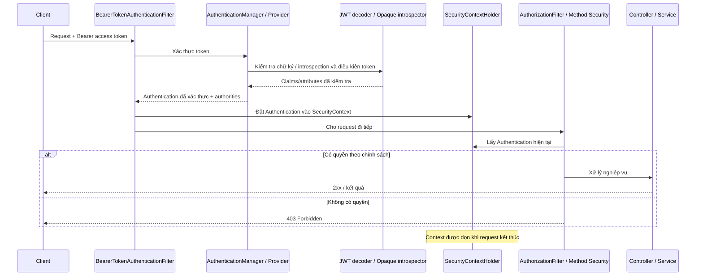
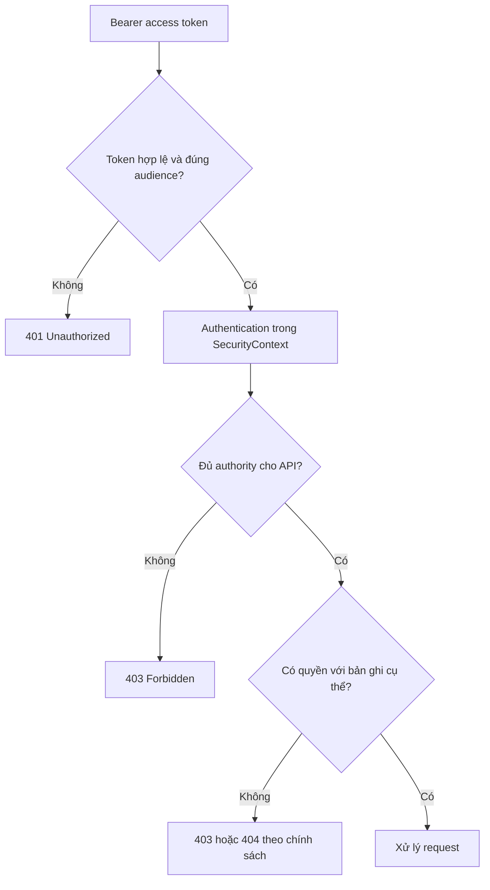

# SecurityContext sau khi token hợp lệ trong Resource Server

## 1. Bối cảnh: token hợp lệ rồi thì điều gì xảy ra?

Khi client gọi API với **access token**, Resource Server phải xác định token có thể được tin cậy theo chính sách của API hay không. Nếu đạt các kiểm tra bắt buộc, Spring Security tạo một đối tượng `Authentication` thể hiện danh tính đã xác thực cùng các quyền đã ánh xạ, rồi đặt nó vào `SecurityContext` của quá trình xử lý request.

Đó là điểm chuyển giao quan trọng: **token từ bên ngoài** trở thành **thông tin xác thực mà các bộ phận bên trong ứng dụng có thể sử dụng**. Từ đây, bộ lọc phân quyền, controller và service có thể xác định ai đang gọi, được phép làm gì, và có cần từ chối một tài nguyên cụ thể hay không.

Bài học thuộc chương **Resource server**, trong module **SECURITY_TOKEN_SECURITY_FUNDAMENTALS**. Kiến thức liên quan trực tiếp đến mô hình tin cậy và vòng đời token bảo mật: JWT/opaque token, access token/refresh token, xác thực và phân quyền trong OAuth 2.0/OIDC, kiểm tra claims, issuer, audience, scope, thời hạn, trạng thái thu hồi, cũng như phòng ngừa token bị đánh cắp hoặc phát lại.

**Phạm vi ví dụ:** Spring Security 6, Spring Boot 3, ứng dụng Servlet với API dùng OAuth 2.0 Bearer access token. Phần riêng cho WebFlux được giải thích ở cuối bài. Cấu hình, API và khả năng thực thi có thể thay đổi theo phiên bản thư viện cụ thể.

### Mục tiêu học tập

Sau bài này, bạn có thể:

1. Mô tả đường đi từ `Authorization: Bearer ...` đến `SecurityContextHolder`.
2. Phân biệt `SecurityContext`, `Authentication`, `principal`, `credentials`, `authorities` và token claims.
3. Nhận biết khác biệt giữa JWT Resource Server và opaque-token Resource Server.
4. Áp dụng `Authentication` vào kiểm tra scope, quyền truy cập đối tượng và controller/service.
5. Giải thích vòng đời per-request, giới hạn của `ThreadLocal`, lỗi 401/403 và các trường hợp token đã bị thu hồi.
6. Kiểm thử cả việc **giải mã/xác thực token** lẫn việc **phân quyền sau xác thực**, không nhầm hai bước.

## 2. Luồng xử lý từ Bearer token đến SecurityContext

Client gửi một request:

```http
GET /api/orders/ord-42 HTTP/1.1
Host: api.example.test
Authorization: Bearer <access-token>
```

Luồng điển hình trong Spring Security Servlet:



Các bước cần hiểu rõ:

1. **Trích Bearer token:** `BearerTokenAuthenticationFilter` thường đọc token từ header `Authorization`. Nếu không trích được token hợp lệ theo cú pháp hoặc token bị từ chối, request có thể bị trả 401, tùy trường hợp và cấu hình.
2. **Xác thực token:** `AuthenticationManager` chuyển yêu cầu tới provider thích hợp. Với JWT là `JwtAuthenticationProvider` và `JwtDecoder`; với opaque token là `OpaqueTokenAuthenticationProvider` và `OpaqueTokenIntrospector`.
3. **Ánh xạ danh tính/quyền:** từ claims hoặc introspection attributes, provider tạo đối tượng `Authentication` đã được xác thực. Những scope/claims chỉ trở thành `GrantedAuthority` theo **quy tắc ánh xạ đã cấu hình**.
4. **Lưu trong context hiện tại:** filter đặt `Authentication` vào `SecurityContextHolder`, giúp các thành phần ở phía sau của cùng luồng xử lý request đọc được.
5. **Phân quyền:** kiểm tra `requestMatchers`, `@PreAuthorize`, ownership hoặc quy tắc nghiệp vụ. **Token hợp lệ không đồng nghĩa được phép truy cập mọi endpoint.**
6. **Kết thúc request:** bộ lọc liên quan của Spring Security dọn/khôi phục context thích hợp để thông tin xác thực của request A không rò sang request B.

> Phải phân biệt “được phép tin rằng token do bên phát hành hợp lệ cấp” với “được phép thực hiện thao tác cụ thể”. Phân quyền là quyết định riêng, sử dụng `Authentication` và dữ liệu nghiệp vụ.

## 3. SecurityContext chứa gì?

`SecurityContext` là một container chứa `Authentication` hiện tại. Trong ứng dụng Servlet truyền thống, có thể truy cập bằng:

```java
Authentication authentication =
    SecurityContextHolder.getContext().getAuthentication();
```

Cấu trúc logic:

```text
SecurityContextHolder
└── SecurityContext (context gắn với xử lý request hiện tại)
    └── Authentication
        ├── principal       : danh tính/đối tượng đại diện người gọi
        ├── credentials     : thông tin xác thực, tùy loại Authentication
        ├── authorities     : tập GrantedAuthority sau khi chuyển đổi
        ├── details         : thông tin phụ, phụ thuộc cơ chế xác thực
        ├── name            : tên định danh do Authentication cung cấp
        └── authenticated   : trạng thái đã xác thực của Authentication
```

| Khái niệm | Ý nghĩa | Lưu ý bảo mật |
|---|---|---|
| `SecurityContextHolder` | Điểm truy cập context trong Servlet; mặc định dùng chiến lược dựa trên `ThreadLocal`. | Không dùng nó như biến toàn cục chứa người dùng của cả ứng dụng. |
| `SecurityContext` | Đối tượng giữ `Authentication`. | Có thể rỗng hoặc chứa authentication ẩn danh; cần kiểm tra trước khi ép kiểu. |
| `Authentication` | Danh tính đã được xác thực, các quyền ánh xạ và thuộc tính liên quan. | Chỉ tin khi được thiết lập qua chuỗi xác thực đáng tin cậy. |
| `principal` | Có thể là `Jwt` hoặc `OAuth2AuthenticatedPrincipal`. | Không mặc định luôn là `UserDetails`, `String` hay entity `User` trong database. |
| `authorities` | Các quyền dưới dạng `GrantedAuthority`, ví dụ `SCOPE_orders:read`. | Scope không tự đồng nghĩa với quyền xem **mọi** đơn hàng. |
| `credentials` | Giá trị tùy triển khai, có thể chứa thông tin liên quan token. | Không log, trả ra HTTP response hoặc lưu lại context/token tùy tiện. |
| `authenticated` | Provider đánh dấu đã xác thực. | Không suy ra token vẫn còn hiệu lực mãi sau thời điểm kiểm tra. |

**SecurityContext không phải kho lưu phiên OAuth, cơ sở dữ liệu người dùng hay nơi lưu danh sách thu hồi token.** Nó là kết quả xác thực mà request hiện tại dùng trong logic bảo mật.

### Ví dụ với JWT đã được xác thực

Giả sử JWT access token mang các claims minh họa:

```json
{
  "iss": "https://issuer.example.test",
  "sub": "user-123",
  "aud": ["orders-api"],
  "exp": 1893456000,
  "nbf": 1893450000,
  "scope": "orders:read orders:write",
  "tenant_id": "tenant-7"
}
```

Đây là **payload minh họa**, chưa phải bằng chứng xác thực: một chuỗi JSON tương tự có thể bị bất kỳ ai tự tạo. Resource Server chỉ tạo authentication đáng tin sau khi kiểm tra chữ ký (với JWT ký), khóa/thuật toán được cho phép, thời hạn, issuer, audience và các điều kiện phù hợp. Nếu có yêu cầu kiểm tra `tenant_id`, trạng thái thu hồi, `token_use` hoặc token type, hệ thống phải triển khai và kiểm tra rõ các ràng buộc đó.

Theo cách ánh xạ scope mặc định thường gặp trong Spring Security JWT Resource Server, kết quả có thể là:

```text
Authentication type : JwtAuthenticationToken
name                : user-123       (từ sub theo mặc định)
principal           : Jwt đã được decoder kiểm tra
authorities         : [SCOPE_orders:read, SCOPE_orders:write]
isAuthenticated     : true
```

Không có gì bảo đảm claim `roles: ["ADMIN"]` tự biến thành `ROLE_ADMIN`. Điều đó chỉ xảy ra nếu ứng dụng có converter phù hợp. Tương tự, `tenant_id` chưa phải một permission: nó phải được sử dụng trong chính sách giới hạn tài nguyên.

## 4. JWT và opaque token tạo Authentication khác nhau thế nào?

| Khía cạnh | JWT access token | Opaque access token |
|---|---|---|
| Cách xác thực | Resource Server dùng `JwtDecoder` để kiểm tra token, thường xác minh chữ ký với khóa từ JWKS và các claims bắt buộc. | Resource Server gọi introspection endpoint qua `OpaqueTokenIntrospector` hoặc cơ chế tương đương để biết token có `active` và attributes được phép dùng. |
| Loại Authentication thường gặp | `JwtAuthenticationToken` | `BearerTokenAuthentication` |
| Principal thường gặp | `Jwt` | `OAuth2AuthenticatedPrincipal` |
| Dữ liệu quyền | Claims được converter ánh xạ, thường `scope` hoặc `scp` thành `SCOPE_...`. | Scope/attributes từ introspection được ánh xạ thành authorities. |
| Thu hồi token | JWT kiểm tra offline không tự nhận biết việc thu hồi sớm nếu thiếu cơ chế bổ sung; thường vẫn hợp lệ đến `exp`. | Kết quả introspection có thể phản ánh trạng thái thu hồi, nhưng cache introspection phải có chính sách chấp nhận được. |
| Điểm cần cấu hình | Chữ ký, thuật toán cho phép, issuer, audience, expiry và quy tắc quyền. | Xác thực tới introspection endpoint, `active`, quy tắc audience/issuer hoặc ràng buộc token theo hợp đồng hệ thống và quy tắc quyền. |

**JWT/opaque** mô tả hình thức access token; **access/refresh token** mô tả mục đích sử dụng. Resource Server thường nhận **access token** để bảo vệ API. Refresh token thuộc luồng cấp lại token của client với Authorization Server; không được coi nó là access token. **OIDC ID token** chủ yếu chứng minh một lần xác thực với client; không tự động là credential hợp lệ để gọi Resource Server.

Đừng mặc định mọi issuer dùng tên claim giống nhau. Đặc biệt với opaque introspection, thông tin được trả về phụ thuộc Authorization Server và custom introspector.

## 5. Từ claims đến authorities: nguồn gốc và ranh giới tin cậy

Một chính sách phân quyền thông thường có ba lớp:

1. **Token hợp lệ cho API này:** kiểm tra issuer tin cậy, signature hoặc introspection, thời hạn, audience đúng Resource Server, cùng điều kiện policy bổ sung. Audience sai phải bị từ chối **ngay ở xác thực**; không chờ đến authorization.
2. **Có quyền gọi chức năng:** ví dụ `scope=orders:read` được ánh xạ thành `SCOPE_orders:read`, rồi security rule kiểm tra `hasAuthority("SCOPE_orders:read")`.
3. **Có quyền đối với đối tượng cụ thể:** người gọi chỉ được xem `ord-42` nếu nó thuộc tenant và/hoặc chủ sở hữu mà người gọi được phép truy cập, ngay cả khi đã có scope đọc đơn hàng.



### Scope, role và ownership không thay thế nhau

- **Scope** thể hiện quyền được cấp cho access token trong một ngữ cảnh OAuth 2.0: `orders:read`, `orders:write`...
- **Role** là mô hình quyền của ứng dụng: `ROLE_SUPPORT`, `ROLE_ADMIN`..., chỉ có ý nghĩa khi mapping và nguồn cấp role đáng tin, đúng domain.
- **Ownership/tenant policy** gắn với dữ liệu thực tế: đơn hàng nào thuộc người dùng hoặc tổ chức nào. Phải kiểm tra với dữ liệu mà server quản lý, không chỉ so sánh từ path do client gửi.

Ví dụ: token của user-123 có `SCOPE_orders:read` và audience `orders-api`, nhưng đơn hàng `ord-99` thuộc user-456. Endpoint vẫn cần từ chối truy cập `ord-99` (lỗ hổng **BOLA/IDOR** nếu bỏ qua kiểm tra này).

### Định danh người dùng phải có ngữ cảnh issuer

Một giá trị `sub` có thể trùng giữa hai Authorization Server khác nhau. Nếu API hỗ trợ đa issuer, định danh ổn định thường phải xét tổ hợp `(iss, sub)`, không lấy `sub` đơn lẻ cho toàn hệ thống. Claims như `preferred_username` hoặc email có thể đổi hoặc không được kiểm chứng; không dùng tùy tiện làm khóa phân quyền.

## 6. Ví dụ Spring Security JWT Resource Server

### 6.1. Tạo filter chain và kiểm tra quyền

Ví dụ Java với endpoint đọc đơn hàng. Có thể đưa `issuer-uri` và `jwk-set-uri` vào cấu hình môi trường; Resource Server phải biết issuer và audience mà nó chấp nhận.

```java
@Configuration
@EnableMethodSecurity
public class ApiSecurityConfig {

    @Bean
    SecurityFilterChain apiSecurity(HttpSecurity http) throws Exception {
        http
            .csrf(csrf -> csrf.disable())
            .sessionManagement(sm ->
                sm.sessionCreationPolicy(SessionCreationPolicy.STATELESS))
            .authorizeHttpRequests(auth -> auth
                .requestMatchers("/actuator/health").permitAll()
                .requestMatchers(HttpMethod.GET, "/api/orders/**")
                    .hasAuthority("SCOPE_orders:read")
                .requestMatchers(HttpMethod.POST, "/api/orders/**")
                    .hasAuthority("SCOPE_orders:write")
                .anyRequest().authenticated())
            .oauth2ResourceServer(oauth -> oauth
                .jwt(Customizer.withDefaults()));

        return http.build();
    }
}
```

Các class trong ví dụ thuộc Spring Security/Spring Framework: `HttpSecurity`, `SecurityFilterChain`, `SessionCreationPolicy`, `HttpMethod`, `@EnableMethodSecurity`, `@Configuration`, `@Bean` và `Customizer`. Các import tương ứng được lược bỏ để tập trung vào dòng xử lý.

`SessionCreationPolicy.STATELESS` diễn đạt rõ chính sách API: không tạo hoặc dựa vào `HttpSession` để ghi nhớ `SecurityContext` làm bằng chứng xác thực cho request tiếp theo. Client phải gửi credential hợp lệ trên những request yêu cầu xác thực. **Stateless không có nghĩa là không thể thu hồi token**; đó là quyết định của kiến trúc Authorization Server/Resource Server.

Ví dụ tắt CSRF vì giả định API **chỉ nhận Bearer token trong header** và không dùng cookie để browser tự động xác thực. Nếu ứng dụng còn dựa vào cookie/session hoặc các credential tự động được browser đính kèm, phải thiết kế bảo vệ CSRF phù hợp và không sao chép cấu hình `csrf.disable()` một cách máy móc.

### 6.2. Kiểm tra issuer, thời hạn và audience

Nhiều hệ thống cấu hình issuer và JWKS rồi quên **audience**. Chữ ký hợp lệ chỉ cho biết token được issuer ký; một token được cấp để gọi API A không nên mặc nhiên dùng được ở API B. Cần cấu hình decoder để chỉ nhận token có audience phù hợp.

Ví dụ minh họa validator trên `NimbusJwtDecoder` (giá trị URI đến từ cấu hình tin cậy của hệ thống):

```java
@Bean
JwtDecoder jwtDecoder(
        @Value("${security.jwt.issuer}") String issuer,
        @Value("${security.jwt.jwk-set-uri}") String jwkSetUri,
        @Value("${security.jwt.audience}") String requiredAudience) {

    NimbusJwtDecoder decoder =
        NimbusJwtDecoder.withJwkSetUri(jwkSetUri).build();

    OAuth2TokenValidator<Jwt> standardChecks =
        JwtValidators.createDefaultWithIssuer(issuer);

    OAuth2TokenValidator<Jwt> audienceCheck = jwt ->
        jwt.getAudience().contains(requiredAudience)
            ? OAuth2TokenValidatorResult.success()
            : OAuth2TokenValidatorResult.failure(
                new OAuth2Error(
                    "invalid_token",
                    "Token audience is not accepted by this API",
                    null
                ));

    decoder.setJwtValidator(
        new DelegatingOAuth2TokenValidator<>(standardChecks, audienceCheck));

    return decoder;
}
```

Các import cho ví dụ: `JwtDecoder`, `NimbusJwtDecoder`, `Jwt`, `JwtValidators`, `OAuth2TokenValidator`, `OAuth2TokenValidatorResult`, `DelegatingOAuth2TokenValidator`, `OAuth2Error`, `@Bean`, `@Value`. Cần cấu hình thuật toán xác minh cho phép và cách lấy khóa đáng tin cậy theo hợp đồng của issuer; không lấy URI khóa hoặc thuật toán từ dữ liệu token không được kiểm soát.

`JwtValidators.createDefaultWithIssuer` cung cấp kiểm tra tiêu chuẩn liên quan thời hạn và issuer. Validator audience được kết hợp với các kiểm tra đó, tránh vô tình **thay thế** validation mặc định khi gọi `setJwtValidator`. Nếu hệ thống cần xử lý nhiều issuer, nhiều audience, token type hoặc thu hồi tức thì thì chính sách phải được mở rộng một cách có chủ đích.

### 6.3. Truy cập Authentication trong controller

Spring MVC cho phép inject `Authentication` vào handler method, hoặc inject principal được ánh xạ. Với JWT:

```java
@RestController
@RequestMapping("/api")
public class IdentityController {

    @GetMapping("/me")
    public Map<String, Object> me(JwtAuthenticationToken auth) {
        Jwt jwt = auth.getToken();

        return Map.of(
            "subject", jwt.getSubject(),
            "issuer", jwt.getIssuer().toString(),
            "authorities", auth.getAuthorities().stream()
                .map(GrantedAuthority::getAuthority)
                .toList()
        );
    }
}
```

Đoạn mã trên chỉ dùng để minh họa: `/api/me` trả các thuộc tính đã chọn và cần được bảo vệ bằng `authenticated()`; trong sản phẩm thực tế nên giới hạn dữ liệu trả về theo nhu cầu, có thể không cần công bố toàn bộ authorities hoặc issuer. Không trả hoặc ghi log chuỗi access token gốc.

Có thể sử dụng `@AuthenticationPrincipal Jwt jwt` khi chỉ cần claims của JWT, hoặc lấy `Authentication` từ `SecurityContextHolder` trong service có request context. Tuy nhiên, việc truyền **subject hoặc đối tượng actor đã chuẩn hóa** vào tầng nghiệp vụ thường giúp code dễ kiểm thử và ít phụ thuộc vào security framework hơn.

### 6.4. Kiểm tra quyền với tài nguyên cụ thể

```java
@Service
public class OrderQueryService {
    private final OrderRepository repository;

    public OrderQueryService(OrderRepository repository) {
        this.repository = repository;
    }

    @PreAuthorize("hasAuthority('SCOPE_orders:read')")
    public OrderDto getOrder(String orderId, String subject, String tenantId) {
        Order order = repository.findByIdAndTenantId(orderId, tenantId)
            .orElseThrow(() -> new ResponseStatusException(
                HttpStatus.NOT_FOUND, "Order not found"));

        if (!order.getOwnerSubject().equals(subject)) {
            throw new AccessDeniedException("Not allowed to read order");
        }
        return OrderDto.from(order);
    }
}
```

Đây là mã ví dụ: `OrderRepository`, `Order`, `OrderDto` là các kiểu domain do dự án tự định nghĩa. Controller đã xác thực cần lấy `subject` và `tenantId` từ **nguồn đã được kiểm chứng, đã chuẩn hóa** (ví dụ JWT đã được xác thực cùng logic ánh xạ tenant được server tin cậy); tuyệt đối không lấy chúng nguyên từ query string rồi gọi service. Với đa issuer, nên dùng định danh actor dạng `issuer + subject` để tránh trùng.

Trong thực tế, có thể đặt policy ownership trong authorization service và dùng method security; ví dụ chỉ nhằm nhấn mạnh một authority là điều kiện **cần**, chưa chắc là điều kiện **đủ** cho đối tượng dữ liệu.

## 7. Opaque token: cùng SecurityContext, khác cách xác thực

Nếu API dùng opaque access token, Resource Server thường cấu hình introspection:

```java
@Bean
SecurityFilterChain apiSecurity(HttpSecurity http) throws Exception {
    http
        .csrf(csrf -> csrf.disable())
        .sessionManagement(sm ->
            sm.sessionCreationPolicy(SessionCreationPolicy.STATELESS))
        .authorizeHttpRequests(auth -> auth
            .anyRequest().authenticated())
        .oauth2ResourceServer(oauth -> oauth
            .opaqueToken(Customizer.withDefaults()));

    return http.build();
}
```

Với cấu hình Spring Boot điển hình:

```yaml
spring:
  security:
    oauth2:
      resourceserver:
        opaquetoken:
          introspection-uri: https://issuer.example.test/oauth2/introspect
          client-id: resource-server-client
          client-secret: ${INTROSPECTION_CLIENT_SECRET}
```

Mẫu `client-secret` được đọc từ secret manager/biến môi trường ở môi trường triển khai; không lưu secret thật trong repository. **Chọn JWT hoặc opaque theo đúng mô hình đã cấu hình; hai filter chain trên là hai ví dụ thay thế nhau**, không đặt hai bean `apiSecurity` trùng tên trong cùng ứng dụng.

Khi introspection thành công, ứng dụng thường nhận `BearerTokenAuthentication`. Để code dùng được với cả JWT và opaque token, làm việc qua `Authentication` hoặc một lớp chuyển đổi principal sang actor của domain:

```java
@GetMapping("/api/actor")
public Map<String, Object> actor(Authentication authentication) {
    return Map.of(
        "name", authentication.getName(),
        "authorities", authentication.getAuthorities().stream()
            .map(GrantedAuthority::getAuthority).toList()
    );
}
```

`Authentication.getName()` phù hợp làm thông tin hiển thị/kỹ thuật đơn giản, nhưng **không bảo đảm luôn tương ứng với subject ổn định của domain** khi thay đổi provider, issuer hoặc converter. Nếu business logic cần subject, issuer và tenant chuẩn hóa, hãy tạo một `CurrentActor` riêng dựa trên thông tin đã được xác thực và kiểm tra đầy đủ.

Với introspection, việc kiểm tra `active` là cần thiết nhưng không thay thế mọi ràng buộc riêng của API: chỉ nhận token dành cho resource phù hợp; kiểm tra scope/issuer/client và đặc tính khác nếu hợp đồng authorization yêu cầu. Cũng cần cân nhắc độ trễ, cache và sự cố mạng của introspection endpoint.

## 8. SecurityContext sống bao lâu?

### 8.1. Context của Servlet gắn với luồng xử lý request

Ở Servlet thông thường, `SecurityContextHolder` mặc định dựa trên `ThreadLocal`: trong quá trình xử lý, các thành phần trên cùng thread có thể đọc context hiện tại. Spring Security thiết lập và dọn context theo vòng đời filter chain. Đây không phải thuộc tính bất biến của thread hay user.

```text
Request A, thread #12:
  Xác thực token A -> SecurityContext(A) -> Controller A -> dọn context

Request B, thread #12 được tái sử dụng:
  Xác thực token B -> SecurityContext(B) -> Controller B -> dọn context
```

Nếu một ứng dụng tự set `SecurityContextHolder` nhưng không dọn đúng cách, pool thread có thể làm lộ danh tính từ request trước sang request sau. Thường nên để Spring Security quản lý; nếu tạo context thủ công trong một khối xử lý đặc biệt, phải bao trùm nó bằng vòng đời/cleanup đúng, không lưu context vào static field.

### 8.2. Stateless API vẫn có SecurityContext trong một request

Nhầm lẫn phổ biến: “không dùng session nên không có `SecurityContext`”. Thực tế stateless chỉ nói rằng **request sau không dựa vào session server của request trước để khôi phục xác thực**. Resource Server vẫn cần context tạm thời cho filter phân quyền, method security và code ứng dụng.

Có thể có cơ chế lưu context vào request attributes trong quá trình dispatch nội bộ tùy cấu hình Spring Security; điều này không đồng nghĩa API đã chuyển sang xác thực bằng HTTP session giữa các request. Khi cần xác nhận đúng hành vi, kiểm tra `SecurityContextRepository` và `SessionCreationPolicy` của filter chain đang chạy.

### 8.3. Async, thread pool và WebFlux

- **`@Async`, `CompletableFuture`, executor:** tác vụ chạy ở thread khác **không mặc nhiên** có đúng context của thread request. Spring Security có các wrapper như `DelegatingSecurityContextRunnable`, `DelegatingSecurityContextExecutor` hoặc tích hợp hỗ trợ truyền context; dùng khi thật sự cần và dọn sau khi chạy. Tránh `MODE_INHERITABLETHREADLOCAL` làm giải pháp chung cho thread pool.
- **Tác vụ chạy sau khi request đã kết thúc:** ngữ cảnh xác thực được truyền tới tác vụ chỉ là snapshot về danh tính/quyền tại thời điểm đó. Với hành động nhạy cảm hoặc lâu dài, cần kiểm tra lại quyền và trạng thái phiên/token theo yêu cầu, đặc biệt sau thu hồi.
- **WebFlux:** không dùng giả định `SecurityContextHolder` ThreadLocal của Servlet. Reactive Spring Security dùng `ReactiveSecurityContextHolder` cùng Reactor Context; security context được truyền theo chuỗi reactive thay vì dựa thuần vào thread hiện tại.

**Quy tắc:** SecurityContext mô tả authentication đang được gắn vào luồng xử lý hiện tại, không phải bằng chứng rằng token sẽ mãi hợp lệ hoặc mọi công việc nền đều có cùng quyền.

## 9. Sau xác thực: 401, 403 và những trường hợp dễ hiểu nhầm

| Tình huống | Đánh giá | Kết quả thông thường |
|---|---|---|
| Không gửi Bearer token tới endpoint yêu cầu đăng nhập | Chưa có identity đã xác thực để truy cập API. | **401 Unauthorized**, có thể kèm `WWW-Authenticate: Bearer`. |
| JWT hết hạn, chữ ký sai, issuer sai hoặc audience không đúng API | Token không qua xác thực; không tạo authentication hợp lệ. | **401**, thường với `invalid_token` trong Bearer challenge. |
| Opaque token có `active=false` | Token bị từ chối tại introspection. | **401**. |
| Token hợp lệ, thiếu `SCOPE_orders:write` | Đã xác thực nhưng không được phép chức năng. | **403 Forbidden**, có thể kèm `insufficient_scope`. |
| Token hợp lệ và đủ scope nhưng truy cập đơn hàng của người khác | Không được phép đối tượng cụ thể. | **403** hoặc **404** theo policy chống lộ sự tồn tại tài nguyên. |
| Endpoint `permitAll` nhưng request tự gửi Bearer token **sai** | Filter xác thực vẫn có thể thử xử lý token được gửi. | Có thể nhận **401** dù endpoint cho anonymous, tùy filter chain. |
| JWT hợp lệ về chữ ký, nhưng đã bị thu hồi tại Authorization Server | Nếu API chỉ kiểm chữ ký/`exp` offline thì chưa tự phát hiện thu hồi. | Có thể vẫn được chấp nhận đến `exp` trừ khi có denylist/version/introspection phù hợp. |

HTTP status chính xác còn phụ thuộc `AuthenticationEntryPoint`, `AccessDeniedHandler`, policy và exception handler của ứng dụng. Với Bearer access token, dùng phản hồi và `WWW-Authenticate` đúng chuẩn giúp client phân biệt thiếu credential, token lỗi và thiếu scope.

### Đừng tự suy ra quyền từ việc `isAuthenticated()` là true

Một `Authentication` đã xác thực không bảo đảm:
- Token đúng audience nếu decoder/introspector **chưa được cấu hình** kiểm audience.
- Token chưa bị thu hồi nếu Resource Server chưa có cơ chế cập nhật trạng thái thu hồi.
- User còn active trong cơ sở dữ liệu nghiệp vụ nếu không có kiểm tra này.
- Người gọi được phép xem một bản ghi bất kỳ có cùng loại tài nguyên.
- Principal đã được mapping sang tenant hoặc account phù hợp.

`Authentication` đáng tin trong **phạm vi các điều kiện mà hệ thống thực sự đã kiểm tra**. Do đó phải xác định bộ kiểm tra bắt buộc trước khi dùng nó để phân quyền.

## 10. Những lỗi triển khai thường gặp và cách sửa

### Lỗi 1: Tự parse JWT rồi nhét claims vào SecurityContext

Code ứng dụng chỉ giải mã Base64 payload và đặt `UsernamePasswordAuthenticationToken` đã xác thực mà **không kiểm chữ ký, issuer, audience, expiry** là lỗ hổng: attacker có thể tự sửa `sub` hoặc `scope` để giả mạo. Hãy dùng `JwtDecoder` và authentication provider phù hợp, cấu hình đầy đủ validators, keys và audience.

### Lỗi 2: Chỉ dựa vào `hasRole("ADMIN")` khi JWT chỉ có `scope`

Mặc định `JwtGrantedAuthoritiesConverter` thường lấy scope và thêm tiền tố `SCOPE_`. Vì vậy `hasRole("ADMIN")` kiểm `ROLE_ADMIN`, không trùng `SCOPE_admin`. Nếu hệ thống thật sự cần role, phải thiết kế mapping từ claim đáng tin đến `GrantedAuthority`, phối hợp với các scope cần giữ, thay vì đổi tên tùy tiện.

### Lỗi 3: Tin vào `X-User-Id` dù đã có principal xác thực

Header tự do từ internet không tự động mang độ tin cậy của `Authentication`. Định danh và quyền phải lấy từ principal đã qua chuỗi xác thực hoặc từ gateway đáng tin với ranh giới truyền tin được bảo vệ và cấu hình chống giả mạo rõ ràng.

### Lỗi 4: Đưa context vào thread pool mà không kiểm soát vòng đời

Lưu `SecurityContext` trong singleton, static cache hoặc tự dùng global `SecurityContextHolder` có thể khiến người dùng A bị xử lý dưới quyền người dùng B. Dùng context theo request và phương pháp truyền context được hỗ trợ; tránh giữ token lâu hơn cần thiết.

### Lỗi 5: Log toàn bộ JWT hoặc Authentication

`JwtAuthenticationToken` có thể giữ `Jwt` và giá trị token gốc. Log, tracing hoặc thông báo lỗi không được phát tán bearer credential, vì bất kỳ ai có token còn hiệu lực đều có thể dùng lại. Khi cần giám sát, log ID sự kiện, issuer, subject đã xử lý an toàn, decision và correlation ID theo chính sách bảo vệ dữ liệu.

### Lỗi 6: Coi xác thực token là kiểm tra thu hồi

JWT đã được ký không tự mất hiệu lực khi user logout, khi refresh token bị thu hồi hoặc khi tài khoản bị khóa nếu Resource Server không kiểm tra trạng thái phù hợp. Tùy yêu cầu, có thể dùng TTL ngắn, denylist theo `jti`, session version, introspection hoặc gọi dịch vụ policy; đánh giá độ trễ và độ nhất quán.

### Lỗi 7: Trao quyền chỉ dựa trên claim chưa rõ semantics

Các claims `roles`, `groups`, `tenant_id` phải có định nghĩa issuer, cách phát hành và ràng buộc audience rõ ràng. Một role cấp trong ứng dụng khác không nhất thiết có quyền tương ứng trong API này; cần mapping theo ngữ cảnh Resource Server.

## 11. Kiểm thử đúng tầng xác thực và phân quyền

Mục đích kiểm thử là bảo đảm cả quá trình **token được chấp nhận** và **quyền từ authentication được thi hành**.

| Bài kiểm thử | Cần chứng minh |
|---|---|
| Không có token hoặc token sai chữ ký | Endpoint bảo vệ không tạo `Authentication` hợp lệ; trả 401. |
| Token còn hạn nhưng `aud` là API khác | Decoder hoặc kiểm tra token từ chối 401. |
| Token `exp` đã qua hoặc `nbf` chưa tới | Token bị từ chối theo clock skew đã quy định. |
| Token hợp lệ, `scope=orders:read` | `SCOPE_orders:read` xuất hiện trong authorities theo mapping. |
| Token hợp lệ nhưng không có scope cần thiết | 403 ở endpoint/method bảo vệ tương ứng. |
| Token hợp lệ và có scope, nhưng sai owner/tenant | 403 hoặc 404 theo business policy. |
| Hai request trên thread được tái sử dụng, user khác nhau | Context của request trước không bị rò sang request sau. |
| Opaque token bị introspection từ chối | Không tạo authentication hợp lệ; 401. |
| JWT còn hạn nhưng đã thu hồi theo policy bắt buộc | API từ chối thông qua cơ chế thu hồi được triển khai. |
| Tác vụ async hoặc WebFlux | Principal không mất/sai ngữ cảnh, và không mang quyền cũ trái phép. |

Ví dụ test authorization bằng Spring Security Test và MockMvc:

```java
mockMvc.perform(get("/api/orders/ord-42")
        .with(jwt().authorities(
            new SimpleGrantedAuthority("SCOPE_orders:read"))))
    .andExpect(status().isOk());

mockMvc.perform(get("/api/orders/ord-42")
        .with(jwt().authorities(
            new SimpleGrantedAuthority("SCOPE_orders:write"))))
    .andExpect(status().isForbidden());
```

Đoạn này **chỉ minh họa kiểm tra authorization** trong điều kiện controller/service trả thành công khi có quyền phù hợp; cần chuẩn bị mock repository, dữ liệu ownership và fixture tương ứng. Hàm `jwt()` của Spring Security Test tạo authentication thử nghiệm, **không thực sự xác minh chữ ký, issuer, audience hay thu hồi của token**. Để kiểm tra các điều kiện đó, bổ sung test tích hợp với `JwtDecoder` thật (hoặc introspection endpoint/test double được kiểm soát), nhiều token có chữ ký/issuer/audience/trạng thái khác nhau và một Resource Server chạy qua filter chain thật.

Đặc biệt, test “token hợp lệ” không thể chỉ dựa vào việc set trực tiếp `SecurityContextHolder` trong unit test; cách đó bỏ qua phần bảo mật quan trọng nhất ở ranh giới đầu vào.

## 12. Bài tập tình huống

Hệ thống bán hàng có ba API: `catalog-api`, `orders-api` và `billing-api`. Authorization Server ký JWT với cùng key cho cả ba API. Một client lấy JWT có:

```json
{
  "iss": "https://issuer.example.test",
  "sub": "staff-21",
  "aud": ["catalog-api"],
  "scope": "catalog:read orders:read",
  "exp": 1893456000
}
```

Client cố gửi JWT đó tới `GET /api/orders/ord-42` của `orders-api`. Resource Server chỉ kiểm chữ ký, `iss`, `exp` và scope, nên tạo `JwtAuthenticationToken` có authority `SCOPE_orders:read`, rồi trả dữ liệu đơn hàng.

**Câu hỏi:**

1. Bước nào đã thiếu kiểm tra, dù token có chữ ký và `scope=orders:read`?
2. Sau khi bổ sung kiểm tra đúng, lỗi phù hợp phải xuất hiện trước hay sau khi đặt `Authentication` vào `SecurityContext`?
3. Nếu token có audience đúng `orders-api` và đủ scope, điều kiện nào vẫn cần trước khi trả `ord-42`?
4. Nếu token thuộc issuer khác có cùng `sub=staff-21`, backend có nên mặc nhiên coi đó là cùng người dùng?
5. Nếu JWT đã bị thu hồi nhưng vẫn còn hạn, Resource Server cần thêm gì để từ chối ngay?

**Gợi ý hướng giải:** thiếu kiểm tra `aud`, nên token phải bị từ chối ở lớp xác thực với 401 trước khi tạo authentication hợp lệ; scope không sửa được audience sai. Nếu audience đúng, service vẫn kiểm quyền với đơn hàng/tenant. Với nhiều issuer, định danh phải có ngữ cảnh issuer; muốn thu hồi sớm cần một cơ chế cập nhật trạng thái thu hồi ngoài chữ ký và `exp`.

## 13. Tổng kết và tự đánh giá

Hãy kiểm tra xem bạn có thể trả lời ngắn gọn các câu hỏi sau mà không nhìn lại nội dung:

- Vì sao `Authentication.isAuthenticated() == true` chưa đủ để quyết định truy cập một hóa đơn?
- `JwtAuthenticationToken` khác `BearerTokenAuthentication` ở principal và nguồn dữ liệu nào?
- Nếu claim `scope` chứa `orders:read`, authority nào thường được tạo theo mặc định?
- Tại sao `SecurityContextHolder` trong Servlet cần được dọn cuối request, và tại sao thread pool/async làm vấn đề phức tạp hơn?
- Trong Spring Security Test, `jwt()` đã kiểm chữ ký thật của JWT chưa?
- Tại sao API `billing-api` không được nhận JWT có audience chỉ dành cho `catalog-api`, dù chung issuer và key?

**Điểm cần ghi nhớ:** `SecurityContext` là cách Spring Security cung cấp **kết quả xác thực** cho phần còn lại của request. Độ tin cậy của kết quả đó phụ thuộc vào validator, provider, mapping authorities và chính sách thu hồi đã cấu hình. Sau khi token hợp lệ, ứng dụng vẫn phải kiểm tra quyền thực hiện hành động và quyền truy cập **đúng đối tượng dữ liệu**.
