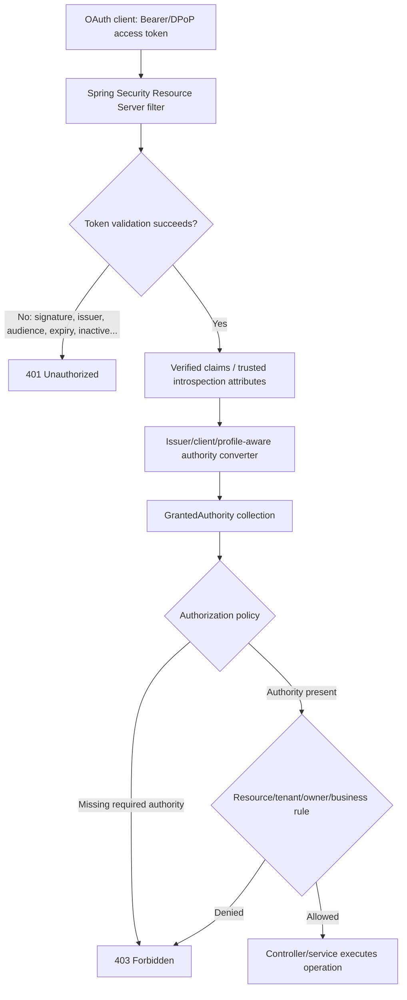
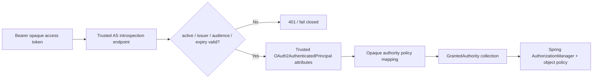
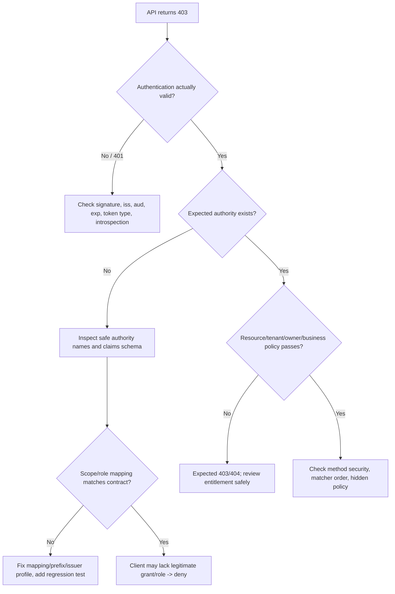
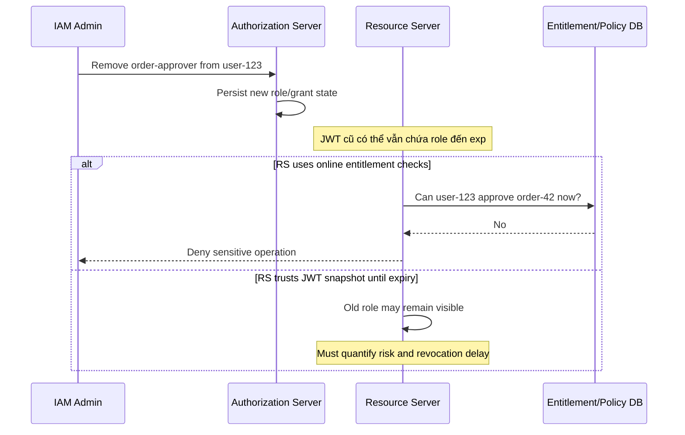

# Mapping claims thành authorities trong Resource Server

Một API Java nhận access token JWT hợp lệ:

```json
{
  "iss": "https://login.example.test",
  "sub": "user-123",
  "aud": ["orders-api"],
  "scope": "orders:read orders:create",
  "roles": ["order-operator"],
  "tenant_id": "tenant-A",
  "exp": 1893456600
}
```

Nhưng khi developer viết `hasAuthority("orders:read")`, Spring Security trả `403 Forbidden`. Đổi thành `hasRole("order-operator")` cũng không hoạt động. Developer bối rối: token rõ ràng có `scope` và `roles`, tại sao API không cho phép?

Vấn đề là **claim trong token không tự trở thành GrantedAuthority của Spring Security**. Resource Server phải **xác minh access token**, **diễn giải claim theo hợp đồng với Authorization Server (AS)**, **chuyển các giá trị được phép thành authorities**, rồi mới dùng authorities trong authorization policy. Một authority là *quyền mà hệ thống quyết định chấp nhận từ bằng chứng đáng tin*, không phải một chuỗi bất kỳ xuất hiện trong JSON.

Trong chương **Resource server** của module **SECURITY_TOKEN_SECURITY_FUNDAMENTALS**, bài này nối mô hình tin cậy OAuth 2.0/OIDC, JWT/opaque token, access token/refresh token, `iss`, `aud`, `scope`, lưu trữ, xác minh, thu hồi và chống token theft/replay với **Spring Security GrantedAuthority**, role-based authorization (RBAC) và attribute-based authorization (ABAC). Mục tiêu là biết **claim nào được map**, **map cho ai**, **theo trust policy nào** và **khi nào không được tạo authority**.

> **Nguyên tắc:** **Validate trước, map sau, authorize cuối cùng.** Không map authority từ JWT chỉ mới decode mà chưa kiểm chữ ký và audience; không suy quyền API từ ID token; không tin role/header do client tự khai. Mapping authorities là một bước biến dữ liệu đã tin cậy thành **quyền cục bộ có ý nghĩa rõ ràng**.

## 1. Bức tranh tổng thể: claims, authorities và authorization

### 1.1. Claim là dữ liệu; authority là cách Resource Server diễn giải dữ liệu

**Claim** là một thuộc tính trong JWT hoặc metadata đáng tin từ token introspection, ví dụ:

- `iss`: issuer phát token.
- `sub`: subject theo issuer và token profile.
- `aud`: bên nhận mà token hướng tới.
- `exp`, `nbf`, `iat`: thời hạn/phát hành.
- `scope` hoặc `scp`: phạm vi OAuth được cấp theo profile.
- `client_id`: OAuth client tương ứng nếu profile chứa trường này.
- `roles` hoặc `groups`: vai trò/nhóm theo **hợp đồng riêng của AS**, không phải mặc định mọi OAuth access token.
- `tenant_id`, `department`, `entitlements`: thuộc tính tùy tổ chức.

**Authority** trong Spring Security thường là một chuỗi do `GrantedAuthority.getAuthority()` cung cấp, ví dụ:

```text
SCOPE_orders:read
SCOPE_orders:create
APP_ORDER_OPERATOR
TENANT_REPORT_VIEWER
```

Authority được dùng với `hasAuthority(...)`, `hasAnyAuthority(...)` hoặc các authorization manager tùy biến. Chính sách phải biết authority này có ý nghĩa gì; **một claim tên `admin` không tự tạo quyền ADMIN trên toàn hệ thống**.

### 1.2. Luồng tin cậy



Một `403` có thể đến từ mapping sai hoặc policy thiếu quyền, nhưng **không được sửa bằng cách bỏ xác minh token** hay tự cấp authority rộng hơn.

### 1.3. Phân biệt authentication và authorization

| Câu hỏi | Lớp trách nhiệm | Ví dụ |
| --- | --- | --- |
| «Token này có thật, đúng issuer và dành cho API này không?» | Authentication/token validation tại RS | Kiểm chữ ký JWT hoặc introspection `active=true`; `iss`, `aud`, `exp` |
| «Client/user có grant ở mức nào?» | AS cấp token và claims | `scope=orders:read` |
| «Scope đó map thành authority nào tại API này?» | **Authority mapping** của RS | `orders:read` → `SCOPE_orders:read` |
| «Endpoint đòi authority nào?» | Authorization policy của RS | GET `/orders` đòi `SCOPE_orders:read` |
| «User này có quyền trên order 42 thuộc tenant B không?» | Business authorization/object-level check | Subject, tenant, ownership, order status |
| «Quyền có bị rút sau khi token đã cấp không?» | Revocation/entitlement freshness | Short TTL, introspection, policy DB, denylist |

Mapping **không** thay thế object-level authorization. Có `SCOPE_orders:read` chỉ cho phép *loại thao tác đọc order*; không nhất thiết cho phép xem **mọi order của mọi tenant**.

### 1.4. Identity vs authority

`sub` là subject identifier, **không phải role**. `preferred_username`, `email`, `name` cũng không phải authority và không phải khóa định danh tin cậy xuyên issuer. Trong Spring, principal name của `JwtAuthenticationToken` mặc định thường lấy từ `sub`; developer có thể tùy biến cách hiển thị, nhưng authorization nên dùng **stable issuer+subject** cùng tenant binding theo nghiệp vụ.

`client_id` xác định OAuth client, **không tự chứng minh end user có vai trò admin**. Với `client_credentials`, subject/principal có thể là workload/client identity theo profile; không ép mọi access token thành user profile.

## 2. Trước mapping: Resource Server phải xác minh token

### 2.1. Access token JWT phải được verify, không chỉ decode

Một JWT có dạng ba phần `header.payload.signature`. Bất kỳ ai có chuỗi token đều có thể decode payload Base64URL; **decode không chứng minh claims đáng tin**. RS cần:

1. Xác minh token có đúng **access token type/profile** RS chấp nhận, không nhầm với ID token hay DPoP proof.
2. Dùng **issuer/JWKS trust configuration được đăng ký trước**, không tải key từ URL tùy ý attacker chèn trong header.
3. Kiểm chữ ký và `alg` allowlist; từ chối `alg=none`/algorithm confusion.
4. Kiểm `iss` bằng expected issuer; `aud` chứa resource identifier của chính RS.
5. Kiểm `exp`/`nbf`, clock skew, các điều kiện profile như `typ` và `client_id` nếu cần.
6. Kiểm token bị revoke/denylisted, session/grant state nếu chính sách yêu cầu freshness vượt kiểm JWT offline.
7. Nếu access token sender-constrained, kiểm DPoP/mTLS proof và `cnf` trước khi cho API truy cập.

**Chỉ sau khi token đã đi qua tất cả validation bắt buộc**, RS mới nên chuyển claims thành authorities để authorization.

```http
GET /api/orders/42 HTTP/1.1
Host: orders.example.test
Authorization: Bearer <access-token>
```

Không bao giờ coi header `X-Roles: ADMIN` do caller gửi là thay thế `scope`/`roles` trong token được verify.

### 2.2. Opaque token qua introspection

Opaque token thường là một handle mà RS không thể đọc claims offline. RS dùng **RFC 7662 Token Introspection** theo trust contract để nhận metadata, ví dụ:

```json
{
  "active": true,
  "iss": "https://login.example.test",
  "sub": "user-123",
  "client_id": "shop-web",
  "aud": ["orders-api"],
  "scope": "orders:read orders:create",
  "exp": 1893456600
}
```

Chỉ lấy metadata từ **introspection endpoint đã cấu hình**, được RS xác thực và truyền qua TLS; không chấp nhận body JSON từ browser giả làm introspection response. `active=true` một mình **chưa đủ** nếu AS trả token active cho audience khác hoặc RS không nhận scope/issuer cần thiết; cần profile/contract rõ ràng.

Nếu introspection timeout, kết luận là **unavailable/unknown**, không tự biến thành `active=true` hoặc tạo authorities từ dữ liệu chưa xác minh.

### 2.3. Access token khác ID token và refresh token

| Token | Bên nhận chính | Có dùng làm credentials tại API Resource Server không? |
| --- | --- | --- |
| **Access token** | RS theo `aud`/resource | **Có**, theo token format/profile và validation |
| **ID token** | OIDC Relying Party để biết authentication event | **Không** dùng như OAuth access token cho API |
| **Refresh token** | AS token endpoint để nhận access token mới | **Không** gửi cho RS làm API bearer |
| **Authorization code** | AS token endpoint để đổi token một lần | **Không** dùng làm API token |
| **DPoP proof** | AS/RS để chứng minh sender possession | **Không** thay access token; kiểm kèm token bound |

Một ID token có thể có `roles` hoặc `groups` phục vụ ứng dụng RP, nhưng **RS không nên lấy ID token đó làm access token** rồi cấp quyền API. `aud` của ID token thông thường là client ID, không phải API resource audience.

### 2.4. JWT còn hạn không có nghĩa quyền không bao giờ đổi

JWT được ký offline có thể chứa role/scope tại thời điểm phát hành. Nếu admin gỡ quyền lúc 10:05 nhưng token hết hạn lúc 10:20, RS chỉ kiểm signature/`exp` có thể vẫn thấy role cũ. Những lựa chọn quản trị freshness:

- Short-lived access tokens và yêu cầu cấp token mới khi cần.
- Online introspection/authorization check hoặc denylist phiên/grant.
- Entitlement/policy DB check khi thao tác nhạy cảm.
- Revocation event và invalidation cache với SLA rõ ràng.

**Mapping authorities là snapshot từ evidence tại thời điểm request**, không tự phản ánh quyền đang thay đổi ở nơi khác nếu RS không có cơ chế cập nhật.

## 3. Spring Security: authority và cơ chế mapping mặc định

### 3.1. `GrantedAuthority` và naming conventions

Spring Security biểu diễn authority thông qua `GrantedAuthority`. Một implementation đơn giản:

```java
import org.springframework.security.core.GrantedAuthority;
import org.springframework.security.core.authority.SimpleGrantedAuthority;

GrantedAuthority readOrders =
    new SimpleGrantedAuthority("SCOPE_orders:read");

GrantedAuthority operator =
    new SimpleGrantedAuthority("APP_ORDER_OPERATOR");
```

Spring **không có nghĩa vụ hiểu** `APP_ORDER_OPERATOR` có quyền gì; ứng dụng tự đặt chính sách `hasAuthority("APP_ORDER_OPERATOR")` và test nó.

### 3.2. Mặc định mapping scope/scp cho JWT Resource Server

Với cấu hình phổ biến Spring Security OAuth2 Resource Server JWT, `JwtGrantedAuthoritiesConverter` đọc **scope claims chuẩn/được framework hỗ trợ** (thường `scope` hoặc `scp`) và tạo authority có **prefix `SCOPE_`**.

| Access token claim | Ví dụ claim value | Authority mặc định thường tạo |
| --- | --- | --- |
| `scope` dạng string | `"orders:read orders:create"` | `SCOPE_orders:read`, `SCOPE_orders:create` |
| `scp` dạng collection | `["orders:read", "orders:create"]` | `SCOPE_orders:read`, `SCOPE_orders:create` |
| `roles` tùy biến | `["admin"]` | **Không tự được map thành `ROLE_admin`** bởi converter scope mặc định |
| `groups` tùy biến | `["finance"]` | **Không tự thành role/authority** nếu không viết converter |
| `tenant_id` | `"tenant-A"` | **Không tự thành authority**; dùng tenant authorization riêng |

Không mặc định rằng converter sẽ *merge cả `scope` và `scp`* khi cả hai có mặt; nó chọn một well-known authority claim theo logic/config framework. Nếu hệ thống cần hỗ trợ hai nguồn, hãy định nghĩa quy tắc ưu tiên hoặc merge **có kiểm tra xung đột** và test rõ.

### 3.3. `hasAuthority` và `hasRole` khác nhau

```java
// Authority đúng chính xác chuỗi bên trong:
.hasAuthority("SCOPE_orders:read")

// hasRole thường thêm prefix ROLE_:
.hasRole("ADMIN")  // yêu cầu authority ROLE_ADMIN

// Tùy biến không ROLE_:
.hasAuthority("APP_ORDER_OPERATOR")
```

Nếu converter tạo `SCOPE_orders:read`, thì `hasAuthority("orders:read")` **không khớp**. Nếu converter tạo `APP_ORDER_OPERATOR`, `hasRole("ORDER_OPERATOR")` thường **không khớp**.

**Không «chữa 403» bằng cách thêm `ROLE_ADMIN` cho mọi token**. Hãy xem authority thật đã được converter tạo và policy endpoint cần authority gì — không log raw token.

### 3.4. Authentication principal trong Spring

Một JWT sau khi verify có thể trở thành `JwtAuthenticationToken`:

```text
Authentication:
  principal: verified Jwt
  name:      sub (mặc định trong nhiều cấu hình)
  authorities:
    SCOPE_orders:read
    SCOPE_orders:create
  authenticated: true
```

`authenticated=true` nghĩa là Spring đã xây Authentication đáng tin theo security chain, **không** nghĩa user có mọi quyền. Authorization Managers/method security tiếp tục kiểm authorities và resource context.

### 3.5. Spring Boot JWT Resource Server config tối thiểu

```yaml
spring:
  security:
    oauth2:
      resourceserver:
        jwt:
          issuer-uri: https://login.example.test
```

Đây là **ví dụ cấu hình issuer trust**, không tự bảo đảm RS đã kiểm đúng `aud` của API. Ứng dụng cần đặt **audience validation** tương ứng profile/phiên bản framework. Khi AS đổi format claims, converter phải được update có kiểm soát, không tự cho mọi JSON claim thành quyền.

## 4. Ví dụ mapping scope đúng trong Resource Server

### 4.1. API policy

Giả sử:

| HTTP request | Required authority | Kiểm nghiệp vụ thêm |
| --- | --- | --- |
| `GET /api/orders/{id}` | `SCOPE_orders:read` | Subject có quyền trên order ID |
| `POST /api/orders` | `SCOPE_orders:create` | Client/subject được tạo order trong tenant |
| `PATCH /api/orders/{id}` | `SCOPE_orders:write` | Order còn trạng thái cho phép sửa |
| `POST /api/orders/{id}/refund` | `SCOPE_orders:refund` và role nghiệp vụ nếu policy yêu cầu | Phân quyền người phê duyệt, giới hạn số tiền, step-up |

Một scope là **phạm vi quyền được AS cấp**, không mặc định là business role. `orders:refund` vẫn có thể cần bước phê duyệt, giới hạn amount và kiểm ủy quyền cụ thể.

### 4.2. Spring Security filter chain

```java
import org.springframework.context.annotation.Bean;
import org.springframework.context.annotation.Configuration;
import org.springframework.http.HttpMethod;
import org.springframework.security.config.annotation.web.builders.HttpSecurity;
import org.springframework.security.web.SecurityFilterChain;

@Configuration
class ApiSecurityConfig {

    @Bean
    SecurityFilterChain apiSecurity(HttpSecurity http) throws Exception {
        return http
            .authorizeHttpRequests(auth -> auth
                .requestMatchers(HttpMethod.GET, "/api/orders/**")
                    .hasAuthority("SCOPE_orders:read")
                .requestMatchers(HttpMethod.POST, "/api/orders")
                    .hasAuthority("SCOPE_orders:create")
                .requestMatchers(HttpMethod.PATCH, "/api/orders/**")
                    .hasAuthority("SCOPE_orders:write")
                .anyRequest().denyAll()
            )
            .oauth2ResourceServer(oauth2 -> oauth2.jwt(
                org.springframework.security.config.Customizer.withDefaults()
            ))
            .build();
    }
}
```

Đây là **ví dụ tối giản về URL authorization** trong Spring Security 6 phong cách lambda DSL. Mẫu path/order còn phụ thuộc route matching và thứ tự matchers; nếu có `POST /api/orders/{id}/refund`, phải cấu hình rule chi tiết trước rule rộng và không để endpoint nhạy cảm rơi vào `permitAll`. Ứng dụng production cần issuer/audience validators, proper error handling, CSRF theo auth model và business ownership check.

### 4.3. Kết quả với hai access tokens

**Token A:**

```json
{
  "iss": "https://login.example.test",
  "sub": "user-123",
  "aud": "orders-api",
  "scope": "orders:read",
  "exp": 1893456600
}
```

Được converter tạo `SCOPE_orders:read`. GET order có thể qua bước scope, nhưng POST tạo order phải trả `403` nếu thiếu `SCOPE_orders:create`.

**Token B:**

```json
{
  "iss": "https://login.example.test",
  "sub": "user-123",
  "aud": "payments-api",
  "scope": "orders:read orders:create",
  "exp": 1893456600
}
```

Dù có `scope=orders:read`, Token B có `aud=payments-api`, **không dành cho orders-api**. RS phải từ chối ở **token validation (401)** trước khi mapping authority; nếu chỉ nhìn scope rồi cho qua thì đã phá audience isolation.

## 5. Thiết kế authority vocabulary rõ ràng

### 5.1. Phân biệt scope, role, group và entitlement

| Loại claim | Câu hỏi nó trả lời | Ví dụ | Cách dùng tại RS |
| --- | --- | --- | --- |
| OAuth `scope`/`scp` | Token được cấp những operation scope nào? | `orders:read` | `SCOPE_orders:read` theo converter |
| Business role | User/client được gán chức năng gì theo issuer/app policy? | `order-operator` | Map sang `APP_ORDER_OPERATOR` nếu issuer được tin |
| Group | User thuộc tập thể/nhóm nào? | `finance-team` | Chỉ map group khi group semantics được quản trị rõ |
| Entitlement | Quyền chi tiết, có thể resource-specific | `approve-invoice` | Có thể map authority hoặc check online tùy freshness |
| Tenant membership | User thuộc tenant nào? | `tenant-A` | Verify membership và resource tenant, **không chỉ tên chuỗi** |
| Subject/actor/client | Ai đang hành động? | `sub`, `client_id` | Identity/ownership/delegation checks, không là role |

### 5.2. Naming conventions gợi ý

```text
SCOPE_orders:read       -> OAuth scope
SCOPE_orders:refund     -> OAuth scope
APP_ORDER_OPERATOR      -> role của ứng dụng
APP_ORDER_APPROVER      -> role của ứng dụng
SYSTEM_REPORT_EXPORTER  -> authority workload theo client registration
```

Tên là **thỏa thuận nội bộ**, không phải tất cả đều là chuẩn của OAuth. Nên:

- Tránh cùng một chuỗi «admin» có nghĩa khác nhau tại các API/tenant.
- Dùng namespace/prefix rõ cho authorities phát sinh từ những nguồn khác nhau.
- Không lẫn `ROLE_ADMIN` toàn cục với `APP_ORDER_ADMIN` cục bộ.
- Tránh cấp admin chỉ vì claim chứa một substring giống «admin».

### 5.3. Default deny và allowlist mapping

Nếu token chứa:

```json
{
  "roles": ["order-operator", "unknown-experimental-role"]
}
```

Một converter tốt chỉ map những role được policy công nhận:

```text
order-operator          -> APP_ORDER_OPERATOR
unknown-experimental-role -> không cấp authority (hoặc reject nếu token vi phạm schema nghiêm ngặt)
```

**Không tự prepend `ROLE_` vào mọi string role không rõ nguồn.** Khi AS thêm một group hoặc claim mới, RS không được mặc nhiên phát sinh quyền cao hơn.

## 6. Tùy chỉnh converter cho scope/scp trong Spring Security

Khi AS dùng tên claim khác `scope` hoặc `scp`, hoặc API muốn prefix riêng, có thể cấu hình `JwtGrantedAuthoritiesConverter`.

### 6.1. Dùng tên claim và prefix cụ thể

```java
import org.springframework.context.annotation.Bean;
import org.springframework.security.oauth2.server.resource.authentication.JwtAuthenticationConverter;
import org.springframework.security.oauth2.server.resource.authentication.JwtGrantedAuthoritiesConverter;

@Bean
JwtAuthenticationConverter jwtAuthenticationConverter() {
    JwtGrantedAuthoritiesConverter scopeConverter =
        new JwtGrantedAuthoritiesConverter();

    // Ví dụ AS luôn phát claim scp là danh sách scopes.
    scopeConverter.setAuthoritiesClaimName("scp");
    scopeConverter.setAuthorityPrefix("SCOPE_");

    JwtAuthenticationConverter authConverter =
        new JwtAuthenticationConverter();
    authConverter.setJwtGrantedAuthoritiesConverter(scopeConverter);
    return authConverter;
}
```

Điều kiện thành công:

- Claim `scp` thực sự có kiểu mà converter hỗ trợ (collection/string theo cấu hình và version).
- Tên/prefix trùng policy ở controller/method security.
- Issuer/client token format được xác minh đúng trước khi converter chạy.
- Nếu AS sử dụng cả `scope` và `scp`, không tự giả định converter sẽ merge cả hai.

### 6.2. Khi API muốn giữ prefix mặc định

Ví dụ token:

```json
{
  "scp": ["orders:read", "orders:create"]
}
```

Converter tạo:

```text
SCOPE_orders:read
SCOPE_orders:create
```

Endpoint kiểm:

```java
@PreAuthorize("hasAuthority('SCOPE_orders:read')")
```

Nếu developer đặt `scopeConverter.setAuthorityPrefix("")`, policy buộc phải đổi thành `hasAuthority('orders:read')`. Việc thay prefix là một **migration chính sách**, không phải chỉnh sửa định dạng vô hại; cần test tất cả endpoint.

### 6.3. Scope string khác scope array

Với string:

```json
{ "scope": "orders:read orders:create" }
```

thông thường delimiter là **dấu cách**. Với array:

```json
{ "scp": ["orders:read", "orders:create"] }
```

converter có thể đọc collection. Không tự parse `"orders:read,orders:create"` thành hai scope nếu contract AS dùng space-separated OAuth scope string; việc tùy tiện chấp nhận mọi delimiter có thể tạo authority không đúng.

Spring Security một số phiên bản cung cấp `setAuthoritiesClaimDelimiter(...)` cho converter string claim; cần kiểm API version được dự án sử dụng. Đừng phụ thuộc một hàm chỉ có ở framework version mới mà không kiểm build compatibility.

### 6.4. Tránh conflation giữa scope và role

Một AS có thể phát:

```json
{
  "scope": "roles:read",
  "roles": ["admin"]
}
```

`scope=roles:read` không nghĩa client có quyền ADMIN — nó có thể chỉ cấp quyền **đọc danh sách roles**. Tương tự `roles=["admin"]` là một claim tùy biến, chỉ có ý nghĩa khi API xác định issuer/profile/tenant và app-role mapping đúng.

## 7. Converter tự viết: merge scope với role có allowlist

Một triển khai cần vừa sử dụng các OAuth scopes vừa thêm role nghiệp vụ. Có thể kết hợp `JwtGrantedAuthoritiesConverter` mặc định và một mapping **cố định, chặt chẽ** cho claim `roles`.

### 7.1. Thiết kế mapping tường minh

```text
Verified JWT:
  scope: "orders:read orders:create"
  roles: ["order-operator", "order-approver"]

Mapping:
  scope orders:read       -> SCOPE_orders:read
  scope orders:create     -> SCOPE_orders:create
  role order-operator     -> APP_ORDER_OPERATOR
  role order-approver     -> APP_ORDER_APPROVER

Unknown role / malformed schema:
  -> Không tạo authority, hoặc reject token nếu policy strict
```

### 7.2. Java implementation minh họa

```java
import java.util.Collection;
import java.util.LinkedHashSet;
import java.util.List;
import java.util.Map;
import java.util.Set;

import org.springframework.core.convert.converter.Converter;
import org.springframework.security.authentication.BadCredentialsException;
import org.springframework.security.core.GrantedAuthority;
import org.springframework.security.core.authority.SimpleGrantedAuthority;
import org.springframework.security.oauth2.jwt.Jwt;
import org.springframework.security.oauth2.server.resource.authentication.JwtAuthenticationConverter;
import org.springframework.security.oauth2.server.resource.authentication.JwtGrantedAuthoritiesConverter;

public final class OrdersAuthorityConverter
        implements Converter<Jwt, Collection<GrantedAuthority>> {

    private static final Map<String, String> ALLOWED_ROLES = Map.of(
        "order-operator", "APP_ORDER_OPERATOR",
        "order-approver", "APP_ORDER_APPROVER"
    );

    private final JwtGrantedAuthoritiesConverter scopes =
        new JwtGrantedAuthoritiesConverter();

    public OrdersAuthorityConverter() {
        // Cấu hình này dành cho profile chỉ có claim "scope".
        scopes.setAuthoritiesClaimName("scope");
        scopes.setAuthorityPrefix("SCOPE_");
    }

    @Override
    public Collection<GrantedAuthority> convert(Jwt verifiedJwt) {
        Set<GrantedAuthority> result = new LinkedHashSet<>();
        Collection<GrantedAuthority> scopeAuthorities =
            scopes.convert(verifiedJwt);
        if (scopeAuthorities != null) {
            result.addAll(scopeAuthorities);
        }

        Object raw = verifiedJwt.getClaims().get("roles");
        if (raw == null) {
            return List.copyOf(result); // roles optional
        }

        if (!(raw instanceof List<?> roles) || roles.size() > 40) {
            throw new BadCredentialsException(
                "Unexpected roles claim shape"
            );
        }

        for (Object value : roles) {
            if (!(value instanceof String role) || role.isBlank()) {
                throw new BadCredentialsException(
                    "Unexpected role element"
                );
            }
            String authority = ALLOWED_ROLES.get(role);
            if (authority != null) {
                result.add(new SimpleGrantedAuthority(authority));
            }
        }

        return List.copyOf(result);
    }
}
```

**Ý nghĩa bảo mật của đoạn mã:**

1. `roles` **không được parse như bất kỳ JSON object tùy ý**. Policy chỉ chấp nhận một array tối đa 40 phần tử kiểu string; giới hạn này là ví dụ, cần theo token profile thực.
2. Role **không nằm trong ALLOWED_ROLES** không tự sinh authority — *deny by default*.
3. `LinkedHashSet` loại trùng authorities và giữ thứ tự nhất quán hữu ích cho test; **thứ tự không quyết định quyền**.
4. Scope do `JwtGrantedAuthoritiesConverter` chuyển với `SCOPE_`; role có namespace `APP_`.
5. Converter phải chạy **sau** JWT validation; tên biến `verifiedJwt` chỉ là giả định đúng khi được gắn vào authenticated Resource Server chain.
6. Nếu cần reject toàn bộ token khi role unknown, thay nhánh ignore bằng chính sách schema validation/reject phù hợp; **không tùy tiện thêm admin role**.

**Giới hạn:** mã giả định API chỉ tin issuer/profile đã phát `roles` đúng nghĩa. Nếu cùng JWT processor chấp nhận nhiều issuer có schema khác nhau, không dùng chung converter này mà không ràng buộc issuer/client/tenant.

### 7.3. Nối converter vào Spring Security

```java
import org.springframework.context.annotation.Bean;
import org.springframework.context.annotation.Configuration;
import org.springframework.security.config.annotation.web.builders.HttpSecurity;
import org.springframework.security.web.SecurityFilterChain;
import org.springframework.security.oauth2.server.resource.authentication.JwtAuthenticationConverter;

@Configuration
public class OrdersResourceServerConfiguration {

    @Bean
    JwtAuthenticationConverter jwtAuthenticationConverter() {
        JwtAuthenticationConverter converter =
            new JwtAuthenticationConverter();
        converter.setJwtGrantedAuthoritiesConverter(
            new OrdersAuthorityConverter()
        );
        return converter;
    }

    @Bean
    SecurityFilterChain securityFilterChain(
            HttpSecurity http,
            JwtAuthenticationConverter converter) throws Exception {
        return http
            .authorizeHttpRequests(auth -> auth
                .requestMatchers("/api/ops/**")
                    .hasAuthority("APP_ORDER_OPERATOR")
                .requestMatchers("/api/orders/**")
                    .hasAuthority("SCOPE_orders:read")
                .anyRequest().denyAll()
            )
            .oauth2ResourceServer(oauth2 ->
                oauth2.jwt(jwt ->
                    jwt.jwtAuthenticationConverter(converter)
                )
            )
            .build();
    }
}
```

**Không copy hai `SecurityFilterChain` ví dụ trong bài vào cùng ứng dụng rồi giả định match-order tự đúng.** Trong dự án thực, cần thiết kế một chain hoặc nhiều chain với `securityMatcher`/`@Order` tách rõ, tránh chain rộng bắt request trước chain hẹp. Các route GET/POST/method matchers cũng cần chi tiết theo endpoint.

### 7.4. Converter phải quyết định policy của missing claims

| Đầu vào | Quyết định hợp lý với API này |
| --- | --- |
| Không có `scope` | Không có `SCOPE_...`; endpoint cần scope sẽ 403 |
| `scope=""` | Không tạo scope authority |
| `roles` không có | Không tạo role authorities, vẫn giữ scopes |
| `roles=[]` | Không tạo role authorities |
| `roles=123` | Reject token/mapping vì schema sai theo strict policy |
| `roles=["order-operator"]` | Map đúng `APP_ORDER_OPERATOR` |
| `roles=["unknown"]` | Không cấp quyền; có thể audit schema drift |
| `roles=["admin"]` | Không tự map `ROLE_ADMIN` |
| `roles=["order-operator", 42]` | Reject vì phần tử không đúng kiểu |
| `roles` cực lớn | Reject/giới hạn kích thước để chống CPU/memory abuse |

Một ứng dụng có thể chọn **ignore malformed optional claim** thay vì reject; nhưng phải xác định policy và kiểm cả trường hợp fail-open. **Không mặc định coi lỗi parse là «đủ quyền»**.

## 8. Kiểm tra issuer, audience và token profile trước mapping

### 8.1. Vì sao chỉ cấu hình `issuer-uri` chưa đủ cho mọi RS?

Một AS phát token cho nhiều resources:

```text
orders-api
payments-api
profile-api
```

Hai token cùng issuer/signature:

```json
{"iss":"https://login.example.test","aud":"orders-api","scope":"orders:read"}
```

và:

```json
{"iss":"https://login.example.test","aud":"payments-api","scope":"payments:refund"}
```

nên được RS khác nhau chấp nhận. Nếu orders-api chỉ verify issuer mà bỏ audience, nó có nguy cơ chấp nhận token **không dành cho mình**. Một converter không thể sửa lỗi trust này bằng cách đặt prefix đúng.

### 8.2. Java validator bổ sung audience

Ví dụ dùng Spring Security `NimbusJwtDecoder` từ **JWKS URI được cấu hình đáng tin**:

```java
import org.springframework.context.annotation.Bean;
import org.springframework.security.oauth2.core.OAuth2Error;
import org.springframework.security.oauth2.core.OAuth2TokenValidator;
import org.springframework.security.oauth2.core.OAuth2TokenValidatorResult;
import org.springframework.security.oauth2.core.DelegatingOAuth2TokenValidator;
import org.springframework.security.oauth2.jwt.Jwt;
import org.springframework.security.oauth2.jwt.JwtDecoder;
import org.springframework.security.oauth2.jwt.JwtValidators;
import org.springframework.security.oauth2.jwt.NimbusJwtDecoder;

public class OrdersJwtValidationConfig {
    private static final String ISSUER =
        "https://login.example.test";
    private static final String TRUSTED_JWKS =
        "https://login.example.test/.well-known/jwks.json";
    private static final String AUDIENCE = "orders-api";

    @Bean
    JwtDecoder jwtDecoder() {
        NimbusJwtDecoder decoder =
            NimbusJwtDecoder.withJwkSetUri(TRUSTED_JWKS).build();

        OAuth2TokenValidator<Jwt> audienceValidator = token ->
            token.getAudience().contains(AUDIENCE)
                ? OAuth2TokenValidatorResult.success()
                : OAuth2TokenValidatorResult.failure(
                    new OAuth2Error(
                        "invalid_token",
                        "Token audience is not accepted by orders-api",
                        null
                    )
                );

        decoder.setJwtValidator(
            new DelegatingOAuth2TokenValidator<>(
                JwtValidators.createDefaultWithIssuer(ISSUER),
                audienceValidator
            )
        );
        return decoder;
    }
}
```

**Lưu ý quan trọng:**

- `TRUSTED_JWKS` chỉ là URL ví dụ; URI thật phải lấy từ **issuer registration/discovery đáng tin** và được cấu hình trước, không lấy từ JWT header `jku` do attacker cung cấp.
- `JwtValidators.createDefaultWithIssuer` cung cấp các kiểm tra mặc định theo Spring profile/phiên bản, nhưng **đừng giả định nó tự thực thi mọi điều kiện RFC 9068** (token type `at+jwt`, client_id, profile constraints, token binding). Thêm validators theo contract thật.
- Khi custom decoder, phải **giữ** xác minh signature/`exp`/`nbf`/issuer, không override khiến bỏ mặc định.
- AS có thể phát `aud` là string hoặc array theo JWT profile; `Jwt.getAudience()` chuẩn hóa thành danh sách cho kiểm tra trong Spring.
- Token hợp lệ theo audience chưa đủ; scope/role/resource policy và revocation freshness vẫn cần.

### 8.3. Phân biệt `401` và `403`

| Trường hợp | Kết quả khuyến nghị | Vì sao |
| --- | --- | --- |
| Không có token cho endpoint protected | `401 Unauthorized` | Chưa có authentication evidence |
| JWT chữ ký sai, issuer/audience sai, hết hạn | `401` / `invalid_token` | Token không hợp lệ với RS |
| Opaque introspection báo `active=false` | `401` | Token inactive |
| Token hợp lệ nhưng thiếu `SCOPE_orders:read` | `403 Forbidden`; tùy OAuth Bearer profile có thể `insufficient_scope` | Authentication hợp lệ nhưng không đủ quyền |
| Scope đủ nhưng tenant/order ownership không hợp lệ | `403` hoặc `404` theo non-disclosure policy | Business authorization |
| Introspection unavailable/timeout | Không được giả active; trả dependency error thích hợp như `503` | Không có kết luận đáng tin |

Theo RFC 6750, các bearer-token errors có `invalid_token` và `insufficient_scope` trong `WWW-Authenticate` theo ngữ cảnh. **Không tiết lộ token raw hoặc private claim trong error details**. Một hệ thống có thể chọn `404` để tránh lộ resource existence theo policy; không vì thế bỏ authorization.

## 9. Claims lồng nhau: realm roles, resource roles và groups

Không phải AS nào cũng phát `roles` ở top-level. Một số nhà cung cấp IAM dùng claims lồng nhau, tên riêng hoặc collection group IDs.

### 9.1. Ví dụ profile có nested claims

```json
{
  "iss": "https://login.example.test/realms/acme",
  "aud": ["orders-api"],
  "sub": "user-123",
  "scope": "orders:read",
  "realm_access": {
    "roles": ["authenticated-user", "tenant-support"]
  },
  "resource_access": {
    "orders-api": {
      "roles": ["order-operator", "order-approver"]
    },
    "inventory-api": {
      "roles": ["inventory-admin"]
    }
  }
}
```

Đây là **minh họa một profile kiểu Keycloak**, không phải cấu trúc OAuth 2.0 bắt buộc. Resource Server `orders-api` không nên map **mọi role ở mọi resource** thành authority của chính nó.

### 9.2. Điều gì được map?

| Claim path | Ví dụ | Quyết định của orders-api |
| --- | --- | --- |
| `scope` | `orders:read` | `SCOPE_orders:read` |
| `realm_access.roles` | `authenticated-user` | Có thể không map thành authority đặc quyền |
| `realm_access.roles` | `tenant-support` | Chỉ map nếu profile xác nhận ý nghĩa và trust |
| `resource_access.orders-api.roles` | `order-operator` | `APP_ORDER_OPERATOR` nếu allowlist |
| `resource_access.orders-api.roles` | `order-approver` | `APP_ORDER_APPROVER` nếu allowlist |
| `resource_access.inventory-api.roles` | `inventory-admin` | **Không** tự map thành admin orders-api |

Một API nên định nghĩa rõ **resource-specific role source**. Role admin dành cho `inventory-api` không được tự trao quyền quản trị orders-api.

### 9.3. Custom converter đọc claim lồng nhau

Pseudocode Java cho logic parse **sau khi verify JWT**:

```java
List<String> extractOrdersRoles(Jwt jwt) {
    Object rawAccess = jwt.getClaim("resource_access");
    if (!(rawAccess instanceof Map<?, ?> resources)) {
        return List.of();
    }

    Object rawOrders = resources.get("orders-api");
    if (!(rawOrders instanceof Map<?, ?> orders)) {
        return List.of();
    }

    Object rawRoles = orders.get("roles");
    if (!(rawRoles instanceof List<?> values) || values.size() > 40) {
        throw new BadCredentialsException(
            "Invalid orders-api roles claim"
        );
    }

    List<String> result = new ArrayList<>();
    for (Object value : values) {
        if (!(value instanceof String role)) {
            throw new BadCredentialsException("Invalid role element");
        }
        result.add(role);
    }
    return List.copyOf(result);
}
```

**Đoạn trên chỉ biểu diễn extractor, chưa là converter hoàn chỉnh.** Trong triển khai thật cần xác định cách xử lý missing/empty claims, map role qua allowlist (`order-operator` → `APP_ORDER_OPERATOR`), kiểm size/string lengths và token profile/issuer/audience; không nối role raw trực tiếp thành `ROLE_...`.

### 9.4. Group claim không phải role mặc định

Ví dụ:

```json
{
  "groups": ["finance", "support", "users"]
}
```

Một group `support` trong IAM có thể bao gồm người hỗ trợ nhiều sản phẩm nhưng không có quyền duyệt hoàn tiền. Đừng map:

```text
groups contains "support" -> ROLE_ADMIN
```

nếu không có policy có chủ sở hữu và cơ chế governance. Có thể dùng **mapping table**:

```text
(issuer, groupId, appResource, tenantScope)
     -> internal role/entitlement
```

và cần giải quyết: ai được sửa group membership, thời gian đồng bộ, nested groups, group overage, claims size và revocation latency.

### 9.5. Claims từ các IAM khác nhau có cùng tên nhưng nghĩa khác

Một hệ thống có thể nhận:

- `scope` string cho delegated permissions.
- `scp` array/string theo profile của nhà cung cấp.
- `roles` cho application roles hoặc workload application permissions theo registration.
- `groups` chứa group identifiers không trực tiếp diễn tả quyền API.
- `permissions`, `entitlements` hoặc claim namespaced URI.

**Đừng tổng quát hóa tên claim thành ý nghĩa bảo mật xuyên mọi issuer.** Nếu có nhiều AS, hãy dùng **issuer-specific mapping policy** và điều kiện audience/token type rõ ràng.

## 10. Multi-issuer và multi-tenant: cùng chuỗi role không đồng nghĩa cùng quyền

### 10.1. Tình huống nguy hiểm

Hai Authorization Servers:

```text
Issuer A: https://login.enterprise-a.test
Issuer B: https://login.enterprise-b.test
```

cùng phát:

```json
{"roles":["admin"],"sub":"user-123"}
```

Nhưng «admin» ở issuer A là quản trị team A, «admin» ở issuer B là quản trị tenant B. Nếu RS map tất cả token cùng có `roles=["admin"]` sang `ROLE_ADMIN` toàn cục, một user có thể leo quyền sai tenant/issuer.

### 10.2. Identity key phải mang issuer

```text
PrincipalIdentity = (trustedIssuer, subject)
TenantContext = (trustedIssuer, tenantId, membership)
ClientContext = (trustedIssuer, clientId, grantType, intendedResource)
```

`sub=user-123` không phải global account key xuyên các OP. Email/username lại càng không bền vì đổi tên, trùng, tái sử dụng hoặc chưa được verify.

### 10.3. Tách authority vocabulary theo issuer/trust contract

Giả sử:

```text
Issuer A:
    roles.admin -> APP_TENANT_ADMIN (chỉ trong tenant A)

Issuer B:
    roles.admin -> không map ở orders-api
    roles.orders_operator -> APP_ORDER_OPERATOR
```

**Nếu issuer B không được trust đối với orders-api, RS phải từ chối token ngay ở validator**, không phải map authorities rỗng rồi để authenticated principal xuất hiện trong service.

Nếu hai issuer đều được trust, Spring Security có thể dùng issuer-aware authentication manager resolution theo mô hình **multi-tenant JWT Resource Server**, nhưng resolver **phải giới hạn issuers vào registration đáng tin**. Không tạo trust cho issuer bất kỳ chỉ vì attacker gửi `iss` trong JWT.

### 10.4. Chỉ tin tenant claim khi issuer là nguồn có thẩm quyền

Một JWT:

```json
{
  "sub": "user-123",
  "tenant_id": "tenant-B",
  "roles": ["tenant-admin"]
}
```

không bảo đảm user được quản trị **mọi dữ liệu thuộc tenant-B** nếu:

- Claim phát từ issuer không quản trị tenant-B.
- Tenant membership đã bị revoke sau token issuance.
- API không kiểm order/payment thật thuộc tenant nào.
- Claim do client tự gửi qua headers/body, không từ token đã verify.
- Role là app role toàn cục, không dành cho tenant này.

**Role mapping và tenant authorization phải cùng một trust model**. Một authority như `APP_TENANT_ADMIN` thường **không đủ** nếu business check không xác định tenant người dùng đang thao tác.

### 10.5. Tránh authority explosion theo tenant ID

Một thiết kế có thể tạo hàng nghìn authorities:

```text
ROLE_TENANT_1001_ADMIN
ROLE_TENANT_1002_ADMIN
ROLE_TENANT_1003_VIEWER
...
```

Điều này gây:

- JWT/Authentication lớn, tăng network/memory.
- Khó revoke role của một tenant.
- Policy dài và khó review.
- Nguy cơ lộ topology/tenant identifiers.

Thường dễ quản trị hơn khi authority là **quyền loại thao tác** và tenant/owner được kiểm bằng **attribute/entitlement service**:

```text
APP_TENANT_ADMIN
    AND canAdministerTenant(issuer, sub, requestedTenantId)
```

Tuy nhiên, nếu entitlement cache stale hoặc policy service unavailable, cần quyết định **fail closed và freshness SLA**; không biến tenant check thành phép so sánh claim tùy tiện.

## 11. OAuth scopes, business roles và ABAC phải đi cùng nhau

### 11.1. Ba lớp cho một request đọc order

```text
Authentication:
  Is access token valid for orders-api?

Coarse-grained authorization:
  Does Authentication contain SCOPE_orders:read?

Fine-grained authorization:
  Is subject allowed to read this particular order?
  Does order belong to allowed tenant?
  Is sharing/delegation/business state still valid?
```

Một request có scope đúng nhưng order sai tenant **vẫn phải từ chối**.

### 11.2. Method security kết hợp scope và business policy

```java
import org.springframework.security.access.prepost.PreAuthorize;
import org.springframework.stereotype.Service;

@Service
public class OrderQueryService {
    private final OrderRepository orderRepository;

    public OrderQueryService(OrderRepository orderRepository) {
        this.orderRepository = orderRepository;
    }

    @PreAuthorize(
        "hasAuthority('SCOPE_orders:read') " +
        "and @orderAccess.canRead(authentication, #orderId)"
    )
    public OrderDto getOrder(String orderId) {
        Order order = orderRepository.findById(orderId)
            .orElseThrow(NotFoundException::new);
        return OrderDto.from(order);
    }
}
```

Để `@PreAuthorize` hoạt động, phải bật **method security** (ví dụ `@EnableMethodSecurity` trong Spring Security 6), và bean `orderAccess` thực hiện kiểm quyền dựa trên **verified Authentication principal**, tenant/resource thực tại DB hoặc policy service. `orderAccess` không được tin `tenantId`/`userId` do caller tự khai như bằng chứng membership.

### 11.3. Vì sao check ở endpoint chưa đủ?

Giả sử:

```text
Token: user-123, SCOPE_orders:read, tenant-A
Request: GET /api/orders/order-999
DB: order-999 thuộc tenant-B
```

Nếu controller chỉ kiểm `hasAuthority('SCOPE_orders:read')`, user có thể đọc order B nếu repository truy vấn bằng ID mà không lọc tenant. Cần object-level policy:

```sql
SELECT *
FROM orders
WHERE order_id = :orderId
  AND tenant_id = :trustedTenantId;
```

Đây chỉ là truy vấn minh họa; nếu user có quyền nhiều tenant hoặc delegated access, policy cần kiểm membership/entitlement thực tế. Không chỉ dùng `tenant_id` từ query parameter mà quên xác thực membership.

### 11.4. Kiểm quyền ngay trước side effect nhạy cảm

Đối với hoàn tiền/thay đổi quyền, có thể cần:

- Token scope đủ, role approver đúng.
- Resource thuộc tenant/organization được phép.
- Amount dưới hạn mức, thứ tự duyệt và segregation of duties.
- Authentication freshness/step-up nếu chính sách yêu cầu.
- Transaction-level authorization recheck ngay trước commit nếu entitlement có thể đổi nhanh.
- Business idempotency để không thực thi hai lần khi client retry.

**`SCOPE_orders:refund` không tự đồng nghĩa «đã có consent cho mọi hoàn tiền bất kỳ»**. Scope là quyền tương đối thô; RS vẫn chịu trách nhiệm business authorization.

### 11.5. RBAC vs ABAC — không phải đối thủ

| Cơ chế | Đầu vào | Câu hỏi nó trả lời |
| --- | --- | --- |
| **OAuth scopes** | `scope`/`scp` đã verify | Token có được phép gọi loại API này? |
| **RBAC** | App roles từ trust policy | Chủ thể thuộc nhóm quyền chức năng nào? |
| **ABAC/ReBAC** | Subject, tenant, resource owner, relation, amount, thời gian, risk | Chủ thể có quyền trên **đối tượng và ngữ cảnh này** không? |
| **Transaction authorization** | Step-up, multi-approval, business rules | Hành động nhạy cảm này đã đủ điều kiện thực thi? |

Một hệ thống ổn định thường sử dụng **scope + role (nếu cần) + object policy**, không cố nhồi tất cả quyền tạm thời vào một chuỗi `ROLE_...`.

## 12. Client Credentials, user delegation và actor claims

### 12.1. Machine-to-machine token khác user token

Với OAuth `client_credentials`:

```json
{
  "iss": "https://login.example.test",
  "aud": ["reports-api"],
  "client_id": "daily-exporter",
  "scope": "reports:export",
  "exp": 1893456600
}
```

Đây có thể đại diện cho **service principal**, không có human user subject trong nghĩa thông thường. Nếu RS nhận token và map `SCOPE_reports:export`, vẫn cần kiểm client/grant/profile, workload identity và resource policy.

**Không tự suy service có quyền trên dữ liệu của user-123** chỉ vì token `client_credentials` có `scope=reports:export`. Một backend thay user cần delegated authorization rõ ràng hoặc policy service principal được phép.

### 12.2. Không map client ID thành user role

```text
client_id = "admin-console"
```

không tự tạo authority `ROLE_ADMIN`. Tên client có thể do registration đặt; chỉ một **client-specific entitlement policy** được AS/RS quản trị mới quyết định workload có thể làm gì.

Nếu `client_id=admin-console` và token không có scope/admin entitlement phù hợp, endpoint yêu cầu `APP_ORDER_APPROVER` vẫn phải từ chối.

### 12.3. Delegated token và token exchange

Một hệ thống dùng **RFC 8693 Token Exchange** hoặc delegation có thể mang context về:

- Subject cuối cùng.
- Actor hoặc service đang thực hiện.
- Scope/audience/resource mà token đã được cấp.
- Giới hạn delegation và quyền mà actor được phép dùng.

Ví dụ claim `act` hoặc token-exchange metadata có thể giúp mô tả actor chain theo profile, nhưng **không được tự coi actor `service-A` có toàn bộ quyền của subject**. RS cần xác định actor policy, nguồn trust, audience, scope, delegation limits và resource ownership.

### 12.4. User vs service identity trong audit

Một log audit tốt (không chứa raw token) có thể ghi:

```text
trusted_issuer: https://login.example.test
subject:       user-123 (nếu có)
client_id:     admin-console
actor:         proxy-service-A (nếu delegated)
audience:      orders-api
operation:     refund:request
resource_id:   order-42
decision:      DENY
reason:        missing_required_approver_role
```

Không nên chỉ ghi `username` hoặc `ROLE_ADMIN` thiếu issuer/tenant/resource context; điều tra quyền sai sẽ rất khó.

## 13. Mapping authorities từ opaque token introspection

### 13.1. Vì sao không dùng `JwtAuthenticationConverter` trực tiếp?

Với OAuth2 Resource Server dùng opaque token, Spring Security thường gọi `OpaqueTokenIntrospector` để nhận **`OAuth2AuthenticatedPrincipal`** với attributes và authorities. Đó là **luồng khác với JWT decoder**:



Không gửi một opaque token vào hàm Base64URL JWT decode rồi cố đọc `roles`. Metadata chỉ đáng tin khi được lấy qua **introspection client đã được AS ủy quyền**, với TLS và response validation theo contract.

### 13.2. Kết quả introspection cần nhiều hơn `active=true`

```json
{
  "active": true,
  "iss": "https://login.example.test",
  "aud": ["orders-api"],
  "sub": "user-123",
  "client_id": "shop-web",
  "scope": "orders:read orders:create",
  "roles": ["order-operator"],
  "exp": 1893456600
}
```

**RFC 7662 định nghĩa các trường chuẩn và cho phép mở rộng**, nhưng không bảo đảm mọi AS trả đủ `iss`, `aud`, `roles` trong mỗi response. Nếu RS yêu cầu audience/issuer để xây authority, **phải có hợp đồng introspection profile phù hợp**. Không fallback «thiếu audience = dùng cho mọi API».

### 13.3. Delegating introspector theo policy

Đoạn Java minh họa dưới dùng một `OpaqueTokenIntrospector` đã được cấu hình ở nơi khác làm **delegate đáng tin**. Không tự gửi introspection request tới URL lấy từ token.

```java
import java.util.Collection;
import java.util.LinkedHashSet;
import java.util.List;
import java.util.Set;

import org.springframework.security.core.GrantedAuthority;
import org.springframework.security.core.authority.SimpleGrantedAuthority;
import org.springframework.security.oauth2.core.DefaultOAuth2AuthenticatedPrincipal;
import org.springframework.security.oauth2.core.OAuth2AuthenticatedPrincipal;
import org.springframework.security.oauth2.server.resource.introspection.BadOpaqueTokenException;
import org.springframework.security.oauth2.server.resource.introspection.OpaqueTokenIntrospector;

public final class OrdersOpaqueIntrospector
        implements OpaqueTokenIntrospector {

    private static final String ISSUER =
        "https://login.example.test";
    private static final String AUDIENCE = "orders-api";
    private static final Set<String> KNOWN_SCOPES = Set.of(
        "orders:read", "orders:create", "orders:write"
    );

    private final OpaqueTokenIntrospector trustedDelegate;

    public OrdersOpaqueIntrospector(OpaqueTokenIntrospector delegate) {
        this.trustedDelegate = delegate;
    }

    @Override
    public OAuth2AuthenticatedPrincipal introspect(String token) {
        // Delegate đã xử lý protocol introspection, client auth,
        // TLS và phản hồi inactive từ AS.
        OAuth2AuthenticatedPrincipal p =
            trustedDelegate.introspect(token);

        Object rawIssuer = p.getAttribute("iss");
        if (!ISSUER.equals(rawIssuer)) {
            throw new BadOpaqueTokenException("Issuer not accepted");
        }

        Object rawAudience = p.getAttribute("aud");
        boolean hasAudience =
            (rawAudience instanceof String value
                && AUDIENCE.equals(value))
            || (rawAudience instanceof Collection<?> values
                && values.contains(AUDIENCE));
        if (!hasAudience) {
            throw new BadOpaqueTokenException("Audience not accepted");
        }

        // Ví dụ profile nội bộ chỉ chấp nhận scope dạng string.
        Object rawScope = p.getAttribute("scope");
        if (!(rawScope instanceof String scopes)) {
            throw new BadOpaqueTokenException("Invalid scope format");
        }

        Set<GrantedAuthority> mapped = new LinkedHashSet<>();
        for (String scope : scopes.trim().split("\\s+")) {
            if (KNOWN_SCOPES.contains(scope)) {
                mapped.add(
                    new SimpleGrantedAuthority("SCOPE_" + scope)
                );
            }
        }

        return new DefaultOAuth2AuthenticatedPrincipal(
            p.getName(),
            p.getAttributes(),
            List.copyOf(mapped)
        );
    }
}
```

**Giới hạn của ví dụ:**

- **`trustedDelegate` phải được tạo riêng theo AS registration**, client credentials/TLS và expected issuer; không được tiêm nhầm instance của chính `OrdersOpaqueIntrospector` gây vòng lặp.
- Converter này **chỉ map scope thuộc allowlist**; muốn role cần thêm policy/validation tương đương mục 7.
- `scope` missing/malformed được reject theo profile ví dụ; ứng dụng khác có thể cho request public với authorities rỗng, nhưng **protected API** phải deny theo policy.
- Thực tế AS có thể trả `scope` dạng array; phải chốt contract, không ép string converter nếu provider phát collection.
- Không tin `active=true` đơn lẻ khi thiếu client/issuer/audience binding mà policy RS yêu cầu.
- Giữ nguyên `p.getAttributes()` trong principal không có nghĩa mọi attribute đó là authority; chỉ tập mapped được coi quyền bởi AuthorizationManager.

### 13.4. Cấu hình Spring Security opaque token

```java
@Bean
SecurityFilterChain opaqueApiSecurity(
    HttpSecurity http,
    OrdersOpaqueIntrospector introspector
) throws Exception {
    return http
        .authorizeHttpRequests(auth -> auth
            .requestMatchers("/api/orders/**")
                .hasAuthority("SCOPE_orders:read")
            .anyRequest().denyAll()
        )
        .oauth2ResourceServer(oauth2 -> oauth2
            .opaqueToken(opaque -> opaque
                .introspector(introspector)
            )
        )
        .build();
}
```

Đây là **một phương án thay thế JWT resource server chain**, không phải cấu hình chạy cùng chain JWT ở ví dụ trước. Nếu RS phải hỗ trợ **cả JWT và opaque token**, cần thiết kế resolver/profile detection an toàn, không nhận bất kỳ bearer string và đoán token type bằng parser rồi bỏ validation. Nhiều hệ thống chọn định dạng token nhất quán theo issuer/resource để đơn giản hóa trust.

### 13.5. Cache introspection và role freshness

Caching `OAuth2AuthenticatedPrincipal` giúp giảm AS calls nhưng cũng cache **authorities từ snapshot cũ**. Nếu admin rút quyền `orders:write`, RS có thể vẫn dùng cache `active=true` kèm scope/role cũ tới khi entry hết TTL.

Cần:

- Cache TTL không vượt `exp` và yêu cầu revocation/role freshness.
- Invalidate theo grant/session/subject khi có trusted revocation event, nếu hệ thống hỗ trợ.
- Phân biệt `INACTIVE` và `UNAVAILABLE`; không fail-open khi AS timeout.
- Cache key/issuer/client context đúng, không dùng một opaque handle chung mà bỏ AS/resource trust boundary.
- Không lưu raw token làm log/key công khai; dùng protected keyed lookup/fingerprint khi cần.

## 14. Authorities có thay đổi sau token issuance không?

### 14.1. Quyền tại thời điểm token được cấp và quyền hiện hành

Giả sử:

```text
09:00 AS phát access token T:
      scope=orders:read
      roles=order-approver
      exp=09:15

09:05 Admin rút quyền order-approver của user.

09:06 User gửi T tới RS:
      signature/exp vẫn đúng
      roles trong T chưa đổi
```

Nếu RS chỉ kiểm JWT offline và map `roles`, authority `APP_ORDER_APPROVER` vẫn có thể xuất hiện cho đến token expiry. Đây là **stale authorization**; một converter Java thuần không thể biết DB/AS đã đổi gì.

### 14.2. Các lựa chọn freshness

| Phương án | Ưu điểm | Giới hạn |
| --- | --- | --- |
| Short-lived JWT + refresh grant policy | Ít round trip tại RS | Quyền cũ còn trong TTL |
| Opaque introspection với cache ngắn | AS kiểm active state tập trung | Độ trễ, dependency, cache stale |
| JWT + denylist/session version | Thu hồi token cụ thể/session nhanh hơn | Cần state/distribution, cache/invalidation |
| Authorization/policy service check lúc dùng | Truy cập entitlement mới hơn | Latency/availability; cần fail closed |
| Event-driven entitlement cache invalidation | Giảm online dependency | Event lag/loss, replay/out-of-order |
| Re-authentication/step-up cho thao tác nhạy cảm | Thêm assurance ở thời điểm hành động | Không thay quyền resource và grant revocation |

Một API public đọc thông tin ít nhạy cảm có thể chấp nhận TTL khác API hoàn tiền hoặc cấp quyền IAM. **Không có một thời hạn universal** bảo đảm cho mọi nghiệp vụ.

### 14.3. Lỗi mapping do stale group membership

Một hệ thống nhận `groups=["finance-team"]` rồi map thành `APP_APPROVER`. User bị xóa khỏi finance-team tại IdP, nhưng token cũ còn `groups`. Nếu RS thiếu online policy/TTL ngắn, user vẫn có authority cũ.

Với quyền nhạy cảm:

- Xác định **source of truth** của group/role và SLA cập nhật.
- Chỉ map claim có freshness đủ cho mức rủi ro hoặc kiểm lại entitlement online.
- Bảo đảm không dùng cache sau revoke quá SLA.
- Có audit, user/issuer/tenant correlation và bước revoke tokens/grants phù hợp.

### 14.4. Logout không tự thu hồi mọi JWT authorities

User logout RP và xóa cookie không làm JWT access token đã copy tự đổi. RS offline vẫn có thể nhận token T đến `exp` nếu không có denylist/online state. Vì vậy **không quảng cáo «logout ⇒ mọi authorities không còn được dùng ngay»** trừ khi token/RS/session enforcement thực hiện điều đó.

## 15. Authority mapping và an toàn chống token theft/replay

### 15.1. Token bị đánh cắp vẫn có thể tạo cùng authorities

Một **bearer access token** bị lấy cắp rồi trình lại sẽ mang nguyên `scope`/`roles`. Nếu RS chỉ kiểm JWT signature/claims/authorities, attacker có thể nhận **những quyền mà token vẫn hợp lệ**. Mapping đúng không chứng minh sender là người có quyền.

**Giải pháp bổ trợ:**

- TLS, tránh token trong query/log/browser storage không cần thiết.
- Short expiry, audience hẹp, scope tối thiểu.
- DPoP-bound/mTLS-bound access token khi client/RS hỗ trợ; kiểm `cnf` và proof/certificate.
- Revoke, denylist/introspection và phản ứng khi phát hiện token theft.
- Least-privilege authorization ở object/tenant, rate limits, anomaly detection.

### 15.2. DPoP và authority mapping là hai thứ khác

Với DPoP:

```http
GET /api/orders/42 HTTP/1.1
Host: orders.example.test
Authorization: DPoP <access-token>
DPoP: <signed-proof-jwt>
```

RS phải xác minh:

```text
Access token:
  signature/iss/aud/exp/scope/profile
  cnf.jkt bound to DPoP proof public key

DPoP proof:
  typ/signature/key thumbprint
  htm, htu, iat, jti, ath
  nonce if configured
  replay detection for proof jti

Authority mapping:
  scope orders:read -> SCOPE_orders:read

Authorization:
  SCOPE_orders:read AND permitted order ownership
```

**Không map quyền từ claim `scope` trong DPoP proof**. Proof là bằng chứng gửi request, **không phải access token authorization grant**.

### 15.3. mTLS và issuer/client binding

Với certificate-bound token, RS/gateway phải xác minh mTLS peer certificate và `cnf.x5t#S256` match token. **Không tin `X-Client-Cert` do Internet caller tự khai**. Sau sender binding, map authorities từ token/introspection đã xác minh và vẫn kiểm scope/tenant.

### 15.4. OAuth token exchange và confused deputy

Nếu service A đổi token để gọi service B theo RFC 8693, RS B cần kiểm:

- Token mới được cấp **cho `aud=service-B`**, không dùng raw token dành service A.
- Scope/role/actor delegation có nghĩa riêng tại B.
- AS policy không cho actor nâng quyền vượt delegated scope.
- Mapping của B không tự copy `ROLE_ADMIN` từ identity context của A.

Một service downstream tin role được gateway/actor truyền như plain header có thể gặp **confused-deputy/privilege-escalation**, kể cả token ban đầu được verify đúng ở gateway.

## 16. Gateway và microservice: authorities thuộc về ai?

### 16.1. Không cho gateway tự khai quyền qua headers không bảo vệ

Ví dụ nguy hiểm:

```http
GET /api/admin/refunds HTTP/1.1
Host: orders.example.test
Authorization: Bearer <token>
X-User-Id: user-123
X-User-Roles: ADMIN
```

Nếu backend tin `X-User-Roles` từ caller trực tiếp, attacker có thể cấp quyền cho mình. Một gateway có thể xác minh token và truyền identity/authorities downstream **chỉ qua trust boundary được bảo vệ**:

- Gateway xóa/ghi đè inbound identity headers từ Internet.
- Service-to-service mTLS và allowlisted gateway identity, không cho truy cập bypass.
- Nếu cần propagation, dùng signed internal assertion/token có audience riêng, expiry ngắn, issuer trust và claim contract.
- Backend nhạy cảm có thể tự verify access token hoặc internal token được trao đổi đúng cách.
- Service B map authorities **theo business policy của B**, không copy mọi role từ A.

### 16.2. Kiểm audience tại từng RS

```text
Client -> Gateway (aud=public-api)
Gateway -> orders-api (aud=orders-api or trusted assertion)
Gateway -> payments-api (aud=payments-api or trusted assertion)
```

Nếu một bearer token chỉ `aud=public-api`, downstream `payments-api` không tự được nhận token đó trừ khi có kiến trúc trust/delegation cụ thể. Việc gateway đã xác minh chữ ký không tự làm audience của token đổi.

### 16.3. Shared security library không đồng nghĩa shared authority semantics

Một thư viện trung tâm có thể tái sử dụng:

- JWT signature/issuer/audience validators.
- DPoP/mTLS proof validation.
- Typed claim extraction và kiểm schema.
- Common audit/error handling.

Nhưng **role-to-authority mapping** vẫn cần resource-specific configuration. `admin` của finance service có thể không liên quan `admin` của IAM service. Tái dùng một `ROLE_ADMIN` toàn hệ thống mà không namespacing có thể mở rộng quyền vô tình.

## 17. Case study 1: API đơn hàng nhận JWT đúng scope nhưng sai tenant

### 17.1. Bối cảnh

```text
Authorization Server:
  https://login.example.test

Resource Server:
  orders-api

Tenant:
  tenant-A, tenant-B

API:
  GET /api/orders/{orderId}
  POST /api/orders
  POST /api/orders/{orderId}/refund
```

Token T:

```json
{
  "iss": "https://login.example.test",
  "sub": "user-123",
  "aud": ["orders-api"],
  "scope": "orders:read orders:create",
  "roles": ["order-operator"],
  "tenant_id": "tenant-A",
  "exp": 1893456600
}
```

Sau signature/issuer/audience/lifetime validation, converter tạo:

```text
SCOPE_orders:read
SCOPE_orders:create
APP_ORDER_OPERATOR
```

### 17.2. Request A: đọc order thuộc tenant-A

```http
GET /api/orders/order-42 HTTP/1.1
Host: orders.example.test
Authorization: Bearer <T>
```

RS kiểm `SCOPE_orders:read` và DB/policy xác nhận `order-42.tenant_id=tenant-A`, user có membership hợp lệ → **được phép nếu các điều kiện khác thỏa**.

### 17.3. Request B: đọc order thuộc tenant-B

```http
GET /api/orders/order-99 HTTP/1.1
Host: orders.example.test
Authorization: Bearer <T>
```

`SCOPE_orders:read` **vẫn có**, nhưng order-99 thuộc tenant-B và user không có membership/quyền delegated tương ứng. RS phải trả **403 hoặc 404 theo non-disclosure policy**, không để client đọc chỉ vì có authority chung.

### 17.4. Request C: hoàn tiền

```http
POST /api/orders/order-42/refund HTTP/1.1
Host: orders.example.test
Authorization: Bearer <T>
Idempotency-Key: refund-42-001
Content-Type: application/json

{"amount":250000,"currency":"VND"}
```

Token thiếu `SCOPE_orders:refund` và `APP_ORDER_APPROVER`, nên dù user là `APP_ORDER_OPERATOR`, **không được phép hoàn tiền**. Không map `order-operator` thành approver chỉ để test qua.

### 17.5. Điều gì xảy ra nếu roles claim bị đổi trong body?

Client thêm:

```json
{"amount":250000,"roles":["order-approver"]}
```

Không thay authorities: role trong **request body** là dữ liệu do caller khai, không phải claim từ access token được verify. Nếu một endpoint quản trị thực sự cho phép đổi role, **endpoint đó phải có quyền quản trị riêng, transaction/audit và policy source-of-truth**.

## 18. Case study 2: chuyển từ scope sang role của nhà cung cấp IAM

### 18.1. Trước migration

AS cũ phát:

```json
{
  "scope": "orders:read orders:write",
  "roles": ["ORDER_MANAGER"]
}
```

RS đang dùng Spring Security default:

```text
SCOPE_orders:read
SCOPE_orders:write
```

`roles` không được default converter map. Một endpoint viết:

```java
@PreAuthorize("hasRole('ORDER_MANAGER')")
```

thì đòi `ROLE_ORDER_MANAGER`, nên kết quả `403` là **đúng với cấu hình**. Không có bug chữ ký JWT.

### 18.2. Sau migration

AS mới phát:

```json
{
  "scp": ["orders:read", "orders:write"],
  "resource_access": {
    "orders-api": {
      "roles": ["order-operator"]
    }
  }
}
```

Quy trình migration an toàn:

1. Xác định profile/issuer/`aud` và nơi xuất hiện claim roles đã được ký.
2. Chọn converter đọc `scp` đúng kiểu array và resource roles chỉ từ `resource_access.orders-api.roles`.
3. Mapping tường minh `order-operator` → `APP_ORDER_OPERATOR`.
4. Giữ scope prefix `SCOPE_` hoặc migrate policy có versioning/test.
5. Test cả token format cũ và mới trong **thời gian rollout** nếu AS thực sự cấp song song; không accept schema lạ vô thời hạn.
6. Canary deploy, quan sát `403` thiếu authorities, audit schema drift và false-positive privilege.
7. Xóa compatibility path cũ khi mọi access token cũ hết hạn và AS hoàn tất migration.

### 18.3. Nguy cơ chỉ sửa code để «không còn 403»

**Sai:**

```java
String roles = jwt.getClaimAsString("roles");
return Set.of(new SimpleGrantedAuthority("ROLE_ADMIN"));
```

Đoạn này cấp admin không phụ thuộc giá trị role thực sự — một privilege escalation nghiêm trọng.

**Đúng:** converter strict schema + issuer/resource-aware allowlist; deny unknown; endpoint policy kiểm đúng app authority và object access.

## 19. Case study 3: backend jobs dùng `client_credentials`

### 19.1. Workload token

Một service `invoice-exporter` gọi `reports-api` bằng client credentials:

```json
{
  "iss": "https://login.example.test",
  "aud": ["reports-api"],
  "client_id": "invoice-exporter",
  "scope": "reports:export",
  "exp": 1893456600
}
```

RS có thể map:

```text
SCOPE_reports:export
```

theo scope converter và kiểm thêm **client registration/tenant/workload permissions**. Không tự gắn:

```text
ROLE_USER
ROLE_FINANCE_ADMIN
```

chỉ vì service «xuất hóa đơn», hoặc vì access token không có human `sub`.

### 19.2. Request hợp lệ theo workload permission

```http
POST /api/reports/export HTTP/1.1
Host: reports.example.test
Authorization: Bearer <service-access-token>
Content-Type: application/json

{"reportType":"monthly-invoices","tenantId":"tenant-A"}
```

Nếu workload chỉ được xuất tenant-A, RS phải kiểm `tenantId` trong request **so với trusted client entitlement/policy**, không để client tự gửi tenant-B và mở rộng quyền.

### 19.3. Token dành cho service khác

Một token `aud=orders-api, scope=orders:read` không được chấp nhận tại reports-api dù code có thể map `SCOPE_orders:read`. Audience validation phải từ chối trước.

### 19.4. Token exchange và actor chain

Nếu job nhận delegated user access rồi token-exchange sang token cho reports-api:

- Token mới phải có `aud=reports-api`.
- Scope của token mới không vượt delegated permission/AS policy.
- Actor/workload identity phải được RS nhận diện đúng nguồn.
- Nếu report chứa private dữ liệu user, cần resource/tenant authorization và consent/grant semantics.

**Không dùng client credentials để giả làm user** và không tự map `client_id=invoice-exporter` sang toàn quyền đọc invoice của mọi tenant.

## 20. Unit test và integration test cho authority mapping

### 20.1. Unit test converter: kiểm trực tiếp chuỗi authorities

```java
import static org.assertj.core.api.Assertions.assertThat;

import java.util.List;
import java.util.Set;
import java.util.stream.Collectors;

import org.junit.jupiter.api.Test;
import org.springframework.security.core.GrantedAuthority;
import org.springframework.security.oauth2.jwt.Jwt;

class OrdersAuthorityConverterTest {

    private final OrdersAuthorityConverter converter =
        new OrdersAuthorityConverter();

    @Test
    void scopeAndRoleAreMappedThroughDistinctNamespaces() {
        Jwt jwt = Jwt.withTokenValue("unit-test-only")
            .header("alg", "RS256")
            .claim("scope", "orders:read orders:create")
            .claim("roles", List.of("order-operator"))
            .build();

        Set<String> names = converter.convert(jwt).stream()
            .map(GrantedAuthority::getAuthority)
            .collect(Collectors.toSet());

        assertThat(names).containsExactlyInAnyOrder(
            "SCOPE_orders:read",
            "SCOPE_orders:create",
            "APP_ORDER_OPERATOR"
        );
    }

    @Test
    void unknownRoleDoesNotBecomeAdministrator() {
        Jwt jwt = Jwt.withTokenValue("unit-test-only")
            .header("alg", "RS256")
            .claim("scope", "orders:read")
            .claim("roles", List.of("admin", "some-unknown-role"))
            .build();

        Set<String> names = converter.convert(jwt).stream()
            .map(GrantedAuthority::getAuthority)
            .collect(Collectors.toSet());

        assertThat(names).contains("SCOPE_orders:read");
        assertThat(names).doesNotContain(
            "ROLE_ADMIN", "APP_ORDER_APPROVER"
        );
    }
}
```

**Giới hạn:** `Jwt.withTokenValue(...)` ở unit test tạo một object Jwt để kiểm **converter**, **không xác minh chữ ký/token expiry/issuer/audience**. Đây không phải test Resource Server authentication end-to-end.

### 20.2. Integration test: kiểm đủ đường HTTP và JWT validation

Trong Spring Security Test, `MockMvc` hỗ trợ request post-processors như `jwt()`:

```java
// Ví dụ minh họa test URL authorization.
mockMvc.perform(get("/api/orders/order-42")
        .with(jwt().authorities(
            new SimpleGrantedAuthority("SCOPE_orders:read")
        )))
    .andExpect(status().isOk());
```

**Cực kỳ quan trọng:** helper `jwt().authorities(...)` có thể **chèn sẵn authorities và bỏ qua converter thực tế**; do đó test này chỉ kiểm URL/method authorization, **không chứng minh claim mapping hoặc JWT signature validation hoạt động**.

Để test toàn chain:

- Mock một `JwtDecoder` trả về **Jwt đã được kiểm theo scenario** hoặc dùng integration profile có AS test signer/JWKS.
- Để **real JwtAuthenticationConverter** chạy, không inject authorities trực tiếp.
- Có tests token sai signature/issuer/audience/lifetime bị 401.
- Có tests claims đúng nhưng thiếu scope/role bị 403.
- Có tests thiếu owner/tenant entitlement bị 403/404.
- Với opaque token, mock trusted introspector `active=true/false` và claims shape, cùng integration tests endpoint thật.
- Nếu dùng DPoP/mTLS, test token confirmation binding và proof/certificate, không chỉ scopes.

### 20.3. Test method security riêng

Một controller có thể pass `hasAuthority("SCOPE_orders:read")` nhưng service method bị gọi qua đường khác (scheduler, method trực tiếp, controller khác). Nếu nghiệp vụ cần guard bền, kết hợp:

- `@EnableMethodSecurity` với `@PreAuthorize` trên **public service method** được Spring proxy intercept.
- Domain authorization tại service/data access layer.
- Test cả method invocation bình thường và các đường internal self-invocation/proxy bypass có thể xảy ra.

Không cho phép internal caller vô tình bypass mọi security chỉ vì endpoint A đã kiểm scope ở một route.

## 21. Ma trận kiểm thử Resource Server mapping claims thành authorities

### 21.1. Mapping schema và authority naming

| Ca kiểm thử | Access token claim/setting | Kết quả mong đợi |
| --- | --- | --- |
| Scope string chuẩn | `scope="orders:read orders:create"` | Có đúng hai `SCOPE_...` |
| Scope string rỗng | `scope=""` | Không tự cấp scope authority |
| Scope không có | Không `scope`/`scp` | Endpoint đòi scope phải từ chối |
| Scope array theo profile | `scp=["orders:read"]` | Map khi converter cấu hình hỗ trợ |
| Scope string delimiter sai | `"orders:read,orders:create"` | Không tự suy hai scopes nếu contract dùng dấu cách |
| Scope casing | `"Orders:Read"` | Không tự hạ chữ thành `orders:read` khi quyền phân biệt case |
| Scope trùng | `"orders:read orders:read"` | Dedup authorities nếu policy muốn, không sinh quyền mới |
| Có cả `scope` và `scp` | Hai tập khác nhau | Áp quy tắc ưu tiên/merge đã chốt, không tự nâng quyền |
| Roles top-level hợp lệ | `["order-operator"]` | `APP_ORDER_OPERATOR` |
| Role approver hợp lệ | `["order-approver"]` | `APP_ORDER_APPROVER` |
| Role không biết | `["experimental-admin"]` | Không tự map thành admin |
| Role có kiểu sai | `roles=123` | Reject hoặc deny theo strict schema policy |
| Role array chứa số | `["order-operator", 42]` | Reject theo strict schema policy |
| Role map thay list | `roles={"admin":true}` | Không đọc như một role hợp lệ |
| Role array rất lớn | Hàng chục nghìn phần tử | Size guard/reject, không tạo memory DoS |
| Role xuất hiện nhiều | `["order-operator", "order-operator"]` | Không tạo duplicate authority có ý nghĩa |
| Role uppercase/lowercase khác | `"ADMIN"` vs `"admin"` | Không tự match bằng substring/case folding tùy tiện |
| `hasAuthority` đúng prefix | `SCOPE_orders:read` | `hasAuthority('SCOPE_orders:read')` pass |
| `hasAuthority` thiếu prefix | `orders:read` | Không pass nếu converter tạo `SCOPE_...` |
| `hasRole('ADMIN')` | Có `ROLE_ADMIN` | Pass nếu đúng role và policy |
| `hasRole('ADMIN')` với `APP_ORDER_OPERATOR` | Khác namespace | Không pass |
| Claim `sub` là admin | `sub="admin"` | Không tự sinh `ROLE_ADMIN` |
| Claim `email` có admin substring | `email="admin@..."` | Không sinh admin authority |
| `client_id` tên admin-console | Không app-role entitlement | Không tự sinh admin |

### 21.2. Trust, JWT và opaque token

| Ca kiểm thử | Tình huống | Kết quả mong đợi |
| --- | --- | --- |
| JWT signature hợp lệ | Đúng issuer/audience/expiry | Được chạy authority converter |
| JWT signature sai | Attacker sửa `roles` | Từ chối token trước converter |
| `alg=none` | Không có chữ ký hợp lệ | Từ chối |
| JWKS header `jku` lạ | URL attacker | Không tải key tùy ý |
| Issuer sai | AS-B gửi token vào RS chỉ trust AS-A | 401 |
| Audience sai | Token `aud=payments-api` tới orders-api | 401, không cấp scope dù scope giống |
| Token hết hạn | `exp` ở quá khứ | 401 |
| Token `nbf` tương lai | Chưa tới thời điểm hợp lệ | 401 |
| Access token wrong profile | ID token được đưa vào `Authorization` | Từ chối theo token type/audience |
| Refresh token gửi tới RS | Token endpoint credential thay API token | Từ chối |
| DPoP proof đưa làm access token | JWT proof nhưng không phải AT | Từ chối |
| `aud` dạng array | Chứa orders-api trong allowed resources | Validate audience đúng; scopes vẫn riêng |
| `aud` dạng string | `orders-api` | Profile validator chấp nhận khi phù hợp |
| Issuer thuộc allowlist nhưng audience wrong | Token AS đúng cho API khác | Vẫn 401 |
| Multi-issuer token unknown | `iss` chưa đăng ký | Không auto-fetch JWKS/trust issuer |
| Opaque `active=true` | Issuer/aud/scope đúng contract | Map theo introspection attributes đáng tin |
| Opaque `active=false` | Token revoked/expired | 401, không giữ authorities |
| Opaque introspection timeout | Không có kết luận | Fail closed/dependency unavailable |
| Opaque thiếu required `aud` | Provider không trả resource metadata | Reject hoặc contract-specific validation; không tự allow |
| Opaque `scope` malformed | Claim sai kiểu profile | Không cấp authority qua cast sai |
| Opaque cache stale sau role revoke | Cached principal vẫn có role | Test phát hiện revoke freshness gap |
| Access-token cache stale | JWT/opaque bị revoke, cache còn | Không hứa revoke tức thì ngoài SLA |

### 21.3. Nested roles, issuer, client và tenant

| Ca kiểm thử | Dữ liệu | Kết quả mong đợi |
| --- | --- | --- |
| `resource_access.orders-api.roles` | `order-operator` | Map allowlisted orders role |
| `resource_access.inventory-api.roles` | `inventory-admin` | Không cấp admin ở orders-api |
| `realm_access.roles` | `tenant-support` | Chỉ map nếu explicit trust policy |
| `groups` không có hợp đồng | `["finance"]` | Không tự suy approver |
| Group membership stale | User đã bị xóa khỏi group | Online policy/TTL/revoke theo SLA |
| Pairwise subject | Cùng user có `sub` khác tại issuer khác | Không tự gộp identity |
| Issuer A/B cùng `sub` | `user-123` tại hai OP | Principal identity khác |
| Issuer A/B cùng role admin | `roles=["admin"]` | Áp issuer-specific mapping |
| Token tenant-A, object tenant-B | `SCOPE_orders:read` hợp lệ | Object authorization từ chối |
| Token có role tenant-admin nhưng tenant unknown | Membership chưa xác minh | Không dùng role để bypass tenant policy |
| Token mượn quyền client khác | `client_id` mismatch policy | Từ chối/restrict theo contract |
| `client_credentials` userless | Service principal đúng | Không tạo user role bừa |
| Actor `act` không đủ delegation | Service acting for user | Không vượt delegated audience/scope |
| Token exchange audience sai | Token mới không dành RS | RS từ chối |
| Gateway `X-User-Roles: ADMIN` giả | Attacker tự khai header | Backend không tin |
| Gateway identity context thiếu mTLS | Header từ source lạ | Không chấp nhận như authenticated principal |
| Multi-region policy cache cũ | Tenant role bị revoke nhưng pod B stale | Bounded lag/fail closed theo policy |

### 21.4. API authorization và vận hành

| Ca kiểm thử | Endpoint/tình huống | Kết quả mong đợi |
| --- | --- | --- |
| GET order, scope đủ, owner đúng | `SCOPE_orders:read` | 200 khi đủ mọi điều kiện |
| GET order, thiếu scope | Token valid nhưng không có read | 403 |
| GET order, sai owner | Có scope nhưng order thuộc user khác | 403/404 theo policy |
| POST order, thiếu create scope | Token chỉ `orders:read` | 403 |
| Refund, có scope nhưng không có approver role | `orders:refund` không đủ | 403 |
| Refund, có approver nhưng sai amount limit | Token/role đúng | Từ chối business policy |
| Two-step approval | User tự phê duyệt giao dịch mình tạo | Từ chối theo segregation of duties |
| JWT expired sau preflight CORS pass | Browser đã được CORS | Actual API 401 |
| Logout nhưng token cũ còn hạn | RS JWT offline | Revocation gap được đo/kiểm theo SLA |
| Access token bị replay không có DPoP key | DPoP-bound AT | Từ chối sender mismatch |
| DPoP proof `jti` replay | Cùng proof hai lần | Reject proof replay, không cấp quyền từ proof |
| mTLS wrong cert | Token bound certificate khác | Từ chối |
| Method security chưa enabled | `@PreAuthorize` không có hiệu lực | Integration test phải phát hiện |
| Service self-invocation | Bypass Spring proxy AOP | Domain guard/transaction check vẫn hoạt động |
| Internal service gọi thẳng method | Không qua controller filter | Service/policy check bảo vệ resource |
| JWT converter unit test | `Jwt.withTokenValue` unsigned test object | Chỉ xác minh mapping, không nhầm với signature test |
| MockMvc `jwt().authorities(...)` | Inject sẵn GrantedAuthorities | Test URL rule, không tuyên bố converter đã được test |
| Introspection cache outage | AS timeout/CB open | Không tạo fallback authority rộng |
| Unknown role sau AS migration | New claim value | Không privilege escalation; alert schema drift |
| Role rename rollout | Token cũ/mới song song | Mapping/version policy có kiểm soát |
| Security log debug | Token được gửi trong API request | Không log raw bearer/refresh token/PII |

### 21.5. Kịch bản fault-injection và thử sai có chủ đích

Để chứng minh policy không fail-open:

1. Cho introspection AS trả `503`/timeout, kiểm RS không map authorities từ response rỗng/stale tùy tiện.
2. Làm JWKS rotation đúng và sai, kiểm RS chỉ lấy keys từ issuer đã cấu hình.
3. Phát JWT đúng chữ ký nhưng sai `aud`; đảm bảo `JwtAuthenticationConverter` **không được dùng để hợp thức hóa** token sai resource.
4. Gửi role claim JSON array rất lớn, nested objects bất thường hoặc phần tử số để test schema guards.
5. Tắt `@EnableMethodSecurity` trong test fixture và phát hiện một method service vẫn thực thi mà không kiểm role.
6. Cho tenant membership thay đổi giữa check và commit để test authorization freshness/transaction policy trên endpoint nhạy cảm.
7. Kiểm cả backend có thể truy cập trực tiếp không qua gateway; giả headers identity/roles và xác nhận không leo quyền.
8. Test logout/revocation với JWT offline/opaque cached để đo độ trễ thực sự trước khi RS không còn nhận role cũ.

## 22. Anti-pattern thường gặp

| Anti-pattern | Hệ quả | Phương án đúng |
| --- | --- | --- |
| Decode JWT rồi map roles ngay | Attacker tự sửa claims | Validate signature/iss/aud/type/lifetime trước |
| Dùng ID token cho Resource Server API | Sai mục đích/audience | Chỉ nhận access token đúng profile |
| Thấy `scope` là cho qua mọi endpoint | Vượt permission/resource policy | Map scope cụ thể và enforce route/owner |
| Chỉ verify issuer, bỏ `aud` | Token dành API khác được nhận | Audience validator tại mỗi RS |
| Map mọi `roles` sang `ROLE_...` | Privilege injection khi claim schema thay đổi | Explicit allowlist và namespace |
| `roles=["admin"]` là admin toàn tổ chức | Cross-issuer/cross-tenant escalation | Issuer/app/tenant-specific policy |
| Map role của `inventory-api` sang orders-api | Cross-resource privilege | Chỉ đọc resource-specific roles |
| Parse `roles` không kiểm kiểu | Class cast/empty/fail-open | Strict typed schema, size bounds |
| Tự đọc role từ request body/headers | Caller tự cấp quyền | Chỉ từ trusted claims/policy |
| Lấy `sub` làm role | Identity confusion | Stable issuer+subject làm principal |
| Dùng email làm authorization identity | Email có thể đổi/trùng | Issuer+subject, membership source |
| Tin `client_id` tên admin | Tên registration không là user permission | Client entitlement policy |
| Không phân biệt `SCOPE_` và `ROLE_` | `hasRole`/`hasAuthority` mismatch | Authority vocabulary + tests |
| Cho `hasAuthority('orders:read')` khi converter tạo `SCOPE_...` | Legitimate 403 | Đồng nhất prefix và policy |
| Đổi prefix nhưng không migrate policy | Widespread deny hoặc privilege drift | Versioned migration và tests |
| Dựa `hasRole('ADMIN')` khi token chỉ có `roles` | Role không được map mặc định | Custom converter có allowlist |
| Converter tự merge scope và roles từ mọi issuer | Trust confusion | Issuer/profile-specific converters |
| Tạo `ROLE_TENANT_X_ADMIN` hàng chục nghìn entries | Authority explosion/stale quyền | RBAC + tenant ABAC |
| Không kiểm owner sau scope | IDOR/cross-tenant leak | Resource-level authorization |
| Chỉ kiểm ở controller | Service/job có thể bypass | Method/domain authorization |
| Không bật `@EnableMethodSecurity` | Annotation không được enforce | Bật và integration test |
| Opaque introspection `active=true` là đủ | Nhận token sai audience/client | Trusted issuer/aud/profile checks |
| Introspection timeout -> allow | Fail-open khi auth dependency outage | Fail closed/unavailable |
| Cache roles vô hạn | Quyền đã revoke vẫn sống | Bounded freshness/revocation |
| Logout chỉ xóa cookie, JWT vẫn accepted | Token theft/replay window | Token lifecycle/revocation strategy |
| DPoP header là authority | Proof sender bị nhầm grant | Validate proof, map scope từ AT |
| Tin `X-User-Roles` từ Internet | Header spoofing | Protected gateway trust boundary |
| Copy role của service A sang service B | Confused deputy | Audience/token exchange + B policy |
| `MockMvc jwt().authorities()` làm test converter | Bỏ qua mapping implementation | Unit-test converter và integration-test filter |
| Để debug log toàn token hoặc claims riêng tư | Rò credentials/PII | Redaction, metadata-only audit |

## 23. Checklist triển khai production

1. **Trust trước mapping:** Resource Server chỉ tạo authorities sau JWT signature/issuer/audience/expiry/token-profile validation hoặc opaque introspection đáng tin?
2. **Đúng loại token:** ID token, refresh token, authorization code, DPoP proof không bị chấp nhận như API access token?
3. **Issuer registration:** JWKS/introspection endpoints được cấu hình từ trusted registration, không tải key/issuer theo URL attacker khai?
4. **Audience:** mọi RS kiểm `aud` dành cho chính nó, kể cả khi AS phát token chung nhiều APIs?
5. **Scope contract:** đã thống nhất `scope` string hay `scp` array, delimiter, case-sensitivity, prefix `SCOPE_` và profile version?
6. **Authority vocabulary:** đặt tên rõ `SCOPE_`, `APP_`, `ROLE_`; Spring `hasRole` vs `hasAuthority` được test?
7. **Custom roles:** claim `roles`/`groups`/`resource_access` chỉ được map theo issuer/resource-specific allowlist, kiểm schema, size, types?
8. **Unknown values:** roles không biết, claim sai kiểu, missing required fields có deny/reject policy rõ ràng, không fail-open?
9. **Multi-issuer:** cùng `sub`, `roles=admin` từ hai issuers không tự trở thành cùng principal/quyền; trust issuer được allowlist?
10. **Multi-tenant:** roles và tenant membership có nguồn thẩm quyền, không dựa query/header của caller để suy sở hữu tài nguyên?
11. **Scopes vs object policy:** endpoint kiểm operation authority **và** owner/tenant/amount/state/relationship theo nghiệp vụ?
12. **Machine-to-machine:** `client_credentials` token không bị gán user role; client entitlement/workload identity được kiểm đúng?
13. **Delegation:** token exchange/actor chain không nâng quyền vượt resource/audience/scope policy; không copy role của upstream vào downstream?
14. **Opaque token:** introspection client được AS ủy quyền, TLS, `active`, issuer/audience/scope contract và timeout fail-closed được kiểm?
15. **Freshness:** JWT roles/scopes stale và introspection cache TTL được đánh giá theo revoke/role-change SLA; quyền nhạy cảm có online check nếu cần?
16. **Replay/token theft:** bearer access token bị copy vẫn nguy hiểm; sender-bound DPoP/mTLS, short TTL, revoke/denylist theo threat model?
17. **Gateway:** identity/role headers inbound được lọc, gateway-service channel xác thực, service không bị bypass qua public/internal endpoint?
18. **Method security:** `@EnableMethodSecurity`/`@PreAuthorize` và domain checks được test, tránh tự gọi nội bộ bypass proxy?
19. **CORS và CSRF:** CORS preflight không xác minh JWT, cookie-based endpoints vẫn có CSRF protection; không coi Origin là authentication?
20. **Tests:** converter unit tests, JWT decoder/integration tests, authorization negative cases, tenant IDOR, issuer/audience mismatch, opaque unavailable?
21. **Migration:** khi đổi AS roles/scp format, có versioning, rollout, tests old/new tokens, telemetry và removal deadline?
22. **Observability:** có logs/metrics 401 vs 403, unknown role, malformed claims, scope mismatch, tenant deny và token revoke lag mà không rò raw credentials?
23. **Incident response:** khi authority mapping bị sai, có phương án cập nhật policy/revoke tokens/clear caches và điều tra privileged actions đã xảy ra?

## 24. Quy trình chẩn đoán lỗi `403` do authority mapping

Khi API trả `403`, không nên thay code thành `permitAll()` hoặc gán admin ngay. Dùng trình tự:



### 24.1. Kiểm xem authorities thật là gì mà không lộ token

Trong môi trường kiểm thử có dữ liệu giả, có thể log **authority names đã normalized** sau converter:

```text
request_id=trace-123
issuer=https://login.example.test
audience=orders-api
principal_fingerprint=<keyed-hash>
authority_names=[SCOPE_orders:read, APP_ORDER_OPERATOR]
operation=POST /api/orders
authorization_result=DENY
reason=missing_required_scope
```

Không log raw JWT, refresh token, DPoP proof, full PII, session cookie hoặc value `Authorization` header. Việc log tên authorities cũng cần retention/access controls phù hợp, nhất là role nhạy cảm.

### 24.2. Khi token không có claim mà API mong đợi

Phân loại lỗi nguồn:

- **AS phát thiếu claim:** registration/mappers/scopes/consent/client policy chưa đúng.
- **RS đọc sai field:** token có `scp` nhưng converter chỉ đọc `scope`.
- **RS đọc sai level:** role trong `resource_access.orders-api.roles` nhưng converter tìm top-level `roles`.
- **RS lọc đúng claim không đáng tin:** role từ resource/issuer không được phép, nên 403 là **kết quả mong muốn**.
- **Người dùng thực sự thiếu quyền:** backend không tự thêm quyền; cần nguồn entitlement và quy trình cấp quyền hợp lệ.
- **Token được phát trước khi đổi quyền:** token/cache stale, cần reissue/revoke/online check theo SLA.

**Không được tự sửa dữ liệu `scope`/`roles` ở phía browser**: claims JWT được ký, sửa payload phá chữ ký. Nếu một UI cần quyền mới, AS phải cấp token/grant theo policy, sau đó RS vẫn tự xác minh.

### 24.3. Sơ đồ phản ứng khi đổi role



## 25. Từ điển nhanh và các nhầm lẫn cần tránh

| Thuật ngữ | Diễn giải ngắn |
| --- | --- |
| **Claim** | Dữ liệu trong token JWT hoặc introspection metadata đáng tin |
| **GrantedAuthority** | Đơn vị quyền Spring Security dùng khi đánh giá authorization |
| **Scope** | Phạm vi OAuth token được cấp, thường map thành `SCOPE_...` |
| **Role** | Nhóm quyền nghiệp vụ; định nghĩa và mapping do ứng dụng/issuer contract sở hữu |
| **Group** | Membership tại IAM; không tự đồng nghĩa với role ứng dụng |
| **RBAC** | Kiểm quyền dựa vai trò |
| **ABAC/ReBAC** | Kiểm theo thuộc tính/ngữ cảnh hoặc quan hệ subject-resource |
| **JwtAuthenticationConverter** | Spring component chuyển verified Jwt thành Authentication |
| **JwtGrantedAuthoritiesConverter** | Component chuyển scope/scp claim thành GrantedAuthorities |
| **OpaqueTokenIntrospector** | Giao diện hỏi trusted AS token state/metadata, tạo principal cho opaque token |
| **Authority prefix** | Convention `SCOPE_`/`ROLE_`/`APP_`, phải khớp policy |
| **Issuer (iss)** | AS/OP phát token, là phần của ranh giới tin cậy |
| **Audience (aud)** | Recipient/resource token dành cho; RS phải kiểm |
| **Subject (sub)** | Identity trong namespace issuer; không phải global role |
| **Revocation freshness** | Độ trễ từ thay đổi/revoke đến các RS từ chối quyền/token cũ |

## Tổng kết

**Mapping claims thành authorities** là bước Resource Server chuyển **thông tin ủy quyền đã được xác minh** thành `GrantedAuthority` mà Spring Security có thể dùng trong `hasAuthority`, `hasRole`, `@PreAuthorize` và các authorization policies. Bước này **không tự xác minh token** và **không thay business authorization**.

Trên Spring Security, `scope`/`scp` của access token thường được ánh xạ thành `SCOPE_...` theo `JwtGrantedAuthoritiesConverter`. Claims tùy biến như `roles`, `groups` hoặc `resource_access.orders-api.roles` **không mặc định thành role của API**: cần converter theo issuer/resource contract, kiểm schema, allowlist và namespace rõ. `hasRole("ADMIN")` thường đòi `ROLE_ADMIN`, trong khi `hasAuthority("APP_ORDER_OPERATOR")` chỉ match đúng authority tương ứng.

**Thứ tự an toàn:** xác minh JWT/opaque access token (signature/introspection, `iss`, `aud`, token profile, lifetime, revocation/sender binding), **map scope/roles có kiểm soát**, rồi kiểm operation authority **và** object/tenant/owner/business policy. Multi-issuer, multi-tenant, `client_credentials`, token exchange, stale entitlements và gateway forwarding đòi trust boundaries riêng; không chỉ nhìn chuỗi `admin` hoặc `scope` là đủ.

Cuối cùng, **authority mapping đúng không ngăn một bearer token bị đánh cắp được phát lại** và không tự làm quyền đã revoke biến mất khỏi JWT cũ. Token lifetime, introspection/denylist, DPoP/mTLS, logout/session enforcement, event/cache freshness và domain authorization phải được phối hợp theo yêu cầu bảo mật thực tế.

**Tài liệu tham khảo:** Spring Security Reference (OAuth 2.0 Resource Server JWT and Opaque Tokens; `JwtAuthenticationConverter`, `JwtGrantedAuthoritiesConverter`, Method Security); RFC 6749 (OAuth 2.0 Authorization Framework); RFC 6750 (Bearer Token Usage); RFC 7662 (Token Introspection); RFC 7009 (Token Revocation); RFC 7519 (JSON Web Token); RFC 8725 (JWT Best Current Practices); RFC 9068 (JWT Access Token Profile); RFC 9700 (Best Current Practice for OAuth 2.0 Security); RFC 8705 (OAuth mTLS and Certificate-Bound Tokens); RFC 9449 (DPoP); RFC 8693 (Token Exchange); OpenID Connect Core 1.0 (ID token validation and claims); OWASP Authorization Cheat Sheet và API Security Top 10 (Broken Object Level Authorization).


