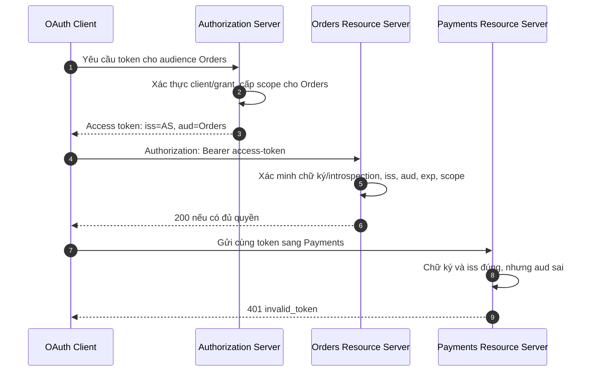
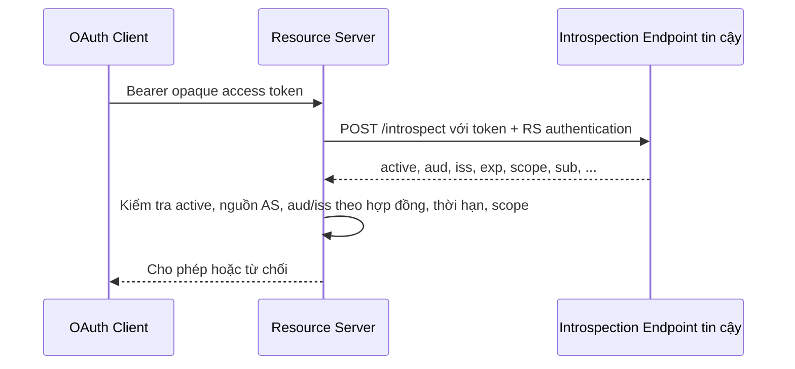

# Audience và issuer validation tại Resource Server

## 1. Vì sao Resource Server phải kiểm tra cả issuer lẫn audience?

Trong OAuth 2.0/OIDC, **Authorization Server (AS)** phát hành access token cho client; **Resource Server (RS)** nhận token từ client để quyết định có cho truy cập API hay không. RS có thể nhận JWT tự chứa claims hoặc opaque token cần xác thực qua introspection. Dù định dạng nào, RS không được kết luận “token có vẻ hợp lệ” là đủ: token phải **đến từ nguồn phát hành được tin cậy** và **dành cho chính tài nguyên/API đang nhận nó**.

Hai kiểm tra lõi là:

- **Issuer validation – `iss`:** Token có được AS mà API tin cậy phát hành hay không?
- **Audience validation – `aud`:** Token có được phát hành để sử dụng tại API này hay không?

Ví dụ tổ chức có hai API:

- Orders API: `https://api.example.com/orders`
- Payments API: `https://api.example.com/payments`

Một token do AS tin cậy cấp cho **Orders API** không mặc nhiên có quyền truy cập **Payments API**, kể cả khi JWT có chữ ký hợp lệ và mang scope tên gần giống. Nếu Payments API chỉ kiểm tra chữ ký/hạn sử dụng mà bỏ qua audience, token có thể bị sử dụng ở **đối tượng nhận sai** (*token substitution* hoặc *cross-resource token replay*).

Ngược lại, nếu token có `aud` đúng Payments API nhưng `iss` là một AS không được phép cấp token cho Payments API, RS phải từ chối. Không thể dùng audience đúng để bù cho issuer sai.

**Mục tiêu sau bài học:** cấu hình đúng niềm tin đối với AS, kiểm tra `iss`/`aud` cho JWT và opaque access token, nhận diện nhầm lẫn ID Token với access token, xây chính sách multi-issuer/multi-tenant và kiểm thử các ca token bị đưa nhầm API.

## 2. Hiểu chính xác hai claim

### 2.1. `iss`: issuer là một định danh, không chỉ là hostname

Claim `iss` trong JWT là chuỗi định danh **bên phát hành** token. Trong hệ thống OAuth/OIDC, issuer thường là URL HTTPS gắn với AS hoặc một realm/tenant cụ thể, ví dụ:

```text
https://identity.example.com/realms/production
```

RS phải so sánh với **issuer đã được cấu hình là đáng tin** cho ứng dụng hoặc endpoint đó. Không được thay kiểm tra này bằng các biểu thức như:

```java
// SAI: chỉ kiểm tra prefix hoặc có chứa domain.
issuer.startsWith("https://identity.example.com")
issuer.contains("example.com")
```

Ví dụ `https://identity.example.com/realms/other` có thể là issuer của tenant khác, không được cấp quyền cho cùng API. Hậu tố path, scheme, port và chuỗi ký tự của issuer đều có thể có ý nghĩa. Dùng so khớp theo quy tắc của profile và định danh issuer đã đăng ký, không tự “chuẩn hóa cho giống” bằng cách cắt path, sửa slash hoặc ép thành hostname.

Khóa công khai để xác minh chữ ký JWT thường được lấy từ **JWKS endpoint đáng tin**, có thể được xác định qua metadata/discovery của issuer đã cho phép. Việc xác minh chữ ký bằng khóa nào đó và việc tin cậy issuer là **hai điều kiện riêng biệt**.

### 2.2. `aud`: audience định danh bên được phép nhận token

Claim `aud` nêu **đối tượng nhận dự kiến**. Với access token dùng cho API, audience cần chứa **resource indicator/identifier của API** mà RS đang đại diện, theo quy ước đã thống nhất giữa AS và RS.

Ví dụ:

```json
{
  "iss": "https://identity.example.com/realms/production",
  "sub": "user-42",
  "aud": ["https://api.example.com/orders"],
  "scope": "orders:read",
  "client_id": "web-client",
  "iat": 1893455400,
  "exp": 1893456000
}
```

Các timestamp trên chỉ minh họa cấu trúc, không phải token thực được phát hành. Trong JWT, `aud` theo RFC 7519 có thể là **một chuỗi** hoặc **mảng chuỗi**. API nên dùng parser JWT chuẩn để nhận cả hai hình thức, rồi kiểm tra định danh audience dự kiến.

Với Orders API, kết quả có thể là:

```text
expectedIssuer   = "https://identity.example.com/realms/production"
expectedAudience = "https://api.example.com/orders"

iss == expectedIssuer               → PASS
aud chứa expectedAudience           → PASS
```

Cùng token đó gửi sang Payments API:

```text
expectedAudience = "https://api.example.com/payments"
aud chứa expectedAudience           → FAIL → từ chối
```

**Audience không phải scope.** `aud` trả lời “token dành cho API nào?”, còn `scope`/permission trả lời “token được phép làm gì tại API đó?”. Phải kiểm tra **cả hai**.

**Audience cũng không nhất thiết là OAuth `client_id`.** Nhiều hệ thống dùng client ID làm audience của **ID Token** vì ID Token dành cho OIDC client. Đối với **access token**, RS cần định danh riêng của API theo hợp đồng với AS. Đừng chấp nhận ID Token ở API chỉ vì nó có `aud` bằng frontend client ID.

### 2.3. Issuer và audience là một cặp chính sách

Có thể có nhiều issuer được tin và nhiều audience hợp lệ trong một hệ thống. Một lỗi nguy hiểm là lưu hai danh sách độc lập:

```text
allowedIssuers   = {issuer-A, issuer-B}
allowedAudiences = {orders, payroll}
```

Nếu **issuer-A chỉ được cấp token cho Orders** còn **issuer-B chỉ được cấp token cho Payroll**, việc kiểm tra “issuer thuộc danh sách” và “audience thuộc danh sách” độc lập có thể nhận nhầm cặp `(issuer-A, payroll)`.

Chính sách tốt hơn xác định **cặp hoặc mapping cụ thể**:

| Issuer được tin | API/audience được phép | Ngữ cảnh |
| --- | --- | --- |
| `https://idp.example.com/realm/customers` | `https://api.example.com/orders` | Người dùng mua hàng |
| `https://idp.example.com/realm/staff` | `https://api.example.com/orders` | Nhân viên thao tác đơn |
| `https://idp.example.com/realm/staff` | `https://api.example.com/payroll` | Nhân viên được phân quyền bảng lương |

Các dòng là **chính sách tin cậy AS**, không phải kết luận mọi người dùng ở issuer đó đều có quyền. Sau khi issuer/audience hợp lệ, RS vẫn phải xác minh scope, role, quyền bản ghi và các điều kiện nghiệp vụ.

## 3. Chuỗi tin cậy từ phát hành tới sử dụng token



Một RS nhận bearer token nên thực hiện các bước ở ranh giới tin cậy:

1. **Lấy token qua kênh được hỗ trợ:** thường là `Authorization: Bearer ...` trên HTTPS; tránh token trong query string vì URL dễ lọt vào log/history.
2. **Xác định chính sách API:** endpoint hoặc service cần issuer và audience nào; không cho token tự quyết định chính sách tin cậy của RS.
3. **Xác minh token:** với JWT thì chữ ký, thuật toán và khóa từ AS được tin; với opaque token thì introspection qua endpoint tin cậy.
4. **Đối chiếu `iss`:** phải bằng issuer được cho phép theo chính sách của tài nguyên này.
5. **Đối chiếu `aud`:** phải chứa audience được định nghĩa cho API đó.
6. **Kiểm tra thời gian và loại token:** `exp`, `nbf`, các điều kiện profile khác; chỉ chấp nhận access token phù hợp, tránh nhận ID Token/refresh token.
7. **Kiểm tra quyền:** `scope`/authority, subject, client identity, tenant, quyền trên từng bản ghi hoặc thao tác.
8. **Kiểm tra thêm nếu sender-constrained:** DPoP/mTLS proof phải khớp khóa/chứng chỉ đã ràng buộc; sau đó áp dụng giới hạn tốc độ/chống replay nghiệp vụ.
9. **Trả lỗi phù hợp và ghi audit an toàn:** không ghi raw token, không tiết lộ khóa hoặc nội dung nhạy cảm.

Với token không hợp lệ, RS cần **fail closed**: không dùng “issuer mặc định”, không bỏ qua audience khi claim thiếu, không chuyển sang API khác theo dữ liệu trong token.

## 4. JWT access token: chữ ký đúng vẫn chưa đủ

JWT là một dạng token có header, payload và signature. Ví dụ header của JWT access token theo profile RFC 9068 có thể là:

```json
{
  "alg": "RS256",
  "kid": "prod-key-2026-01",
  "typ": "at+jwt"
}
```

Payload có thể chứa:

```json
{
  "iss": "https://identity.example.com/realms/production",
  "sub": "user-42",
  "aud": "https://api.example.com/orders",
  "client_id": "web-client",
  "scope": "orders:read",
  "iat": 1893455400,
  "exp": 1893456000,
  "jti": "example-unique-token-id"
}
```

Lưu ý đây là **dữ liệu JSON để giải thích**, không phải chuỗi JWT đã ký. Claim `aud` ở dạng string vẫn hợp lệ theo mô hình JWT nếu profile/AS sử dụng cách biểu diễn đó.

### 4.1. Phải xác thực chữ ký bằng trust anchor có trước

RS cấu hình issuer và JWKS endpoint/metadata đáng tin. Trình xác minh JWT chọn khóa dựa trên `kid` trong **tập khóa đã tin**, không lấy khóa tùy ý từ payload/header do người gửi kiểm soát.

Những sai sót phổ biến:

- Dùng `alg` do token tự công bố mà không giới hạn thuật toán; chấp nhận `none` hoặc nhầm khóa đối xứng/bất đối xứng.
- Tải một `jku`/`x5u` URL do header JWT cung cấp mà không kiểm soát, khiến bên phát hành khóa do attacker tự chọn.
- Tìm issuer từ claim `iss` **chưa xác minh**, rồi tự động discovery và tin bất kỳ JWKS của issuer đó.
- Chỉ kiểm tra chữ ký hợp lệ với một khóa trong hệ thống mà không ràng buộc **khóa đó thuộc issuer nào**.
- Không kiểm tra `typ` khi chấp nhận profile JWT Access Token yêu cầu `at+jwt` hoặc `application/at+jwt`; có nguy cơ **cross-JWT confusion** với loại JWT khác.

Với RFC 9068, RS phải thực hiện các điều kiện kiểm tra theo profile, bao gồm định dạng và `typ` của JWT access token. Không nên dựa vào một ví dụ kiểm tra `aud` để tuyên bố thư viện đã kiểm tra tất cả yêu cầu của profile. Nếu hệ thống dùng access token JWT ngoài RFC 9068, quy tắc loại token cần được đặc tả rõ với AS.

### 4.2. Mỗi điều kiện chặn một kiểu lỗi khác nhau

| Điều kiện | Token sẽ bị từ chối khi | Vì sao cần |
| --- | --- | --- |
| Chữ ký, thuật toán, khóa | Token tự ký bằng khóa không được tin, sai chữ ký hoặc thuật toán ngoài allowlist | Chặn token giả |
| `iss` | Token có issuer lạ, sai realm/tenant hoặc không đúng định danh đã cấu hình | Chặn AS không được phép cấp token |
| `aud` | Token dành cho API khác hoặc không có audience bắt buộc | Chặn token bị dùng chéo Resource Server |
| `exp`, `nbf` | Token hết hạn/chưa hợp lệ | Thu hẹp cửa sổ sử dụng |
| Token type/profile | Nhầm ID Token, JWT nội bộ khác hoặc refresh token | Chặn cross-token confusion |
| `scope`/permission | Thiếu quyền cần thiết | Chặn truy cập ngoài phạm vi cấp |
| Phân quyền dữ liệu | User/token không có quyền với đơn hàng/tài nguyên cụ thể | Chặn IDOR và lỗi phân quyền nghiệp vụ |
| `cnf` và proof (nếu có) | Token sender-constrained nhưng bằng chứng khóa không khớp | Giảm dùng lại token bị đánh cắp |

**`jti` không tự động ngăn bearer token replay.** Nếu cần phát hiện dùng lại token hoặc proof, RS phải có chính sách kiểm tra trạng thái/cửa sổ thời gian thích hợp. DPoP proof có `jti` riêng với yêu cầu chống replay theo RFC 9449.

## 5. Opaque access token và introspection

Một opaque token là một chuỗi mà RS **không nên giải mã để suy ra claims**. Thông thường RS hỏi AS qua **OAuth 2.0 Token Introspection** (RFC 7662) bằng kết nối HTTPS được xác thực và quyền truy cập thích hợp.



Ví dụ phản hồi introspection **có các trường mà AS đã cam kết cung cấp**:

```json
{
  "active": true,
  "iss": "https://identity.example.com/realms/production",
  "aud": ["https://api.example.com/orders"],
  "sub": "user-42",
  "client_id": "web-client",
  "scope": "orders:read",
  "token_type": "Bearer",
  "exp": 1893456000
}
```

**Hai lưu ý thực tế:**

1. `active: true` chỉ có ý nghĩa khi phản hồi đến từ **introspection endpoint tin cậy**, qua TLS và xác thực đúng RS. Không chấp nhận JSON “introspection” do chính client gửi.
2. Trong RFC 7662, một số thuộc tính như `iss` và `aud` là **tùy chọn ở cấp giao thức**. Nếu ứng dụng yêu cầu audience binding, AS và RS cần thỏa thuận hợp đồng để RS có thể xác minh audience, hoặc dùng một cơ chế ràng buộc tài nguyên **đáng tin cậy, không mơ hồ** khác. Không được mặc định “không có aud thì token dùng được mọi API”.

Với nhiều AS, **endpoint introspection được cấu hình trước cho mỗi trust domain**; không suy đoán URL bằng cách lấy chuỗi từ opaque token. Một kết quả `active: false` hoặc introspection lỗi/timeout phải bị từ chối theo chính sách, không “cho qua tạm” để đảm bảo availability.

**Cache introspection:** cache ngắn hạn có thể giảm độ trễ nhưng làm thu hồi token có hiệu lực chậm hơn trong thời gian cache còn sống. Giới hạn cache theo expiry/trust domain và chính sách bảo mật; không cache token hoặc phản hồi nhạy cảm vào nơi không an toàn.

## 6. Thiết kế Spring Security Resource Server

Trong Spring Security, cấu hình OAuth2 Resource Server với JWT thường tự kiểm tra chữ ký, thời hạn và những điều kiện cơ bản theo decoder; **audience cụ thể của API cần được cấu hình rõ ràng** theo hợp đồng với AS.

Ví dụ sau dùng Spring Security 6+ trên Spring Boot 3.x, với một issuer, một JWKS URI đã tin và một audience cho Orders API. Các giá trị URL chỉ là ví dụ:

```java
import org.springframework.context.annotation.Bean;
import org.springframework.context.annotation.Configuration;
import org.springframework.http.HttpMethod;
import org.springframework.security.config.Customizer;
import org.springframework.security.config.annotation.web.builders.HttpSecurity;
import org.springframework.security.oauth2.core.OAuth2Error;
import org.springframework.security.oauth2.core.OAuth2TokenValidator;
import org.springframework.security.oauth2.core.OAuth2TokenValidatorResult;
import org.springframework.security.oauth2.core.DelegatingOAuth2TokenValidator;
import org.springframework.security.oauth2.jose.jws.SignatureAlgorithm;
import org.springframework.security.oauth2.jwt.Jwt;
import org.springframework.security.oauth2.jwt.JwtDecoder;
import org.springframework.security.oauth2.jwt.JwtValidators;
import org.springframework.security.oauth2.jwt.NimbusJwtDecoder;
import org.springframework.security.web.SecurityFilterChain;

@Configuration
public class OrdersResourceServerSecurity {

    private static final String EXPECTED_ISSUER =
        "https://identity.example.com/realms/production";

    private static final String EXPECTED_AUDIENCE =
        "https://api.example.com/orders";

    private static final String TRUSTED_JWKS_URI =
        "https://identity.example.com/realms/production/keys";

    @Bean
    JwtDecoder jwtDecoder() {
        // JWK set cố định lấy từ cấu hình tin cậy của AS.
        // Không nhận URI khóa từ header JWT hay tham số của request.
        NimbusJwtDecoder decoder = NimbusJwtDecoder
            .withJwkSetUri(TRUSTED_JWKS_URI)
            .jwsAlgorithm(SignatureAlgorithm.RS256)
            .build();

        OAuth2TokenValidator<Jwt> audienceValidator = jwt ->
            jwt.getAudience().contains(EXPECTED_AUDIENCE)
                ? OAuth2TokenValidatorResult.success()
                : OAuth2TokenValidatorResult.failure(
                    new OAuth2Error(
                        "invalid_token", "Access token has wrong audience", null
                    )
                );

        // createDefaultWithIssuer giữ các kiểm tra mặc định như
        // thời gian exp/nbf và bắt buộc issuer đã được tin.
        decoder.setJwtValidator(new DelegatingOAuth2TokenValidator<>(
            JwtValidators.createDefaultWithIssuer(EXPECTED_ISSUER),
            audienceValidator
        ));
        return decoder;
    }

    @Bean
    SecurityFilterChain apiSecurity(HttpSecurity http) throws Exception {
        http.authorizeHttpRequests(auth -> auth
            .requestMatchers("/public/**").permitAll()
            .requestMatchers(HttpMethod.GET, "/orders/**")
                .hasAuthority("SCOPE_orders:read")
            .anyRequest().authenticated()
        );
        http.oauth2ResourceServer(oauth2 -> oauth2.jwt(Customizer.withDefaults()));
        return http.build();
    }
}
```

Ví dụ này tập trung vào **issuer + audience**, chưa phải toàn bộ chính sách production. Để dùng thực tế:

- Cấu hình issuer, audience và JWKS URI qua cấu hình đã được kiểm duyệt, không hardcode như ví dụ. Thường ưu tiên metadata/discovery của issuer đã tin để xác định JWKS URI.
- `SignatureAlgorithm.RS256` phải khớp thuật toán hợp lệ đã thỏa thuận; không bật thuật toán theo header token một cách tùy ý.
- Nếu AS dùng **RFC 9068 JWT access token**, bổ sung/xác nhận kiểm tra profile như `typ=at+jwt`, các claims bắt buộc và phân biệt access token với ID Token; kiểm tra hành vi cụ thể của phiên bản thư viện.
- Authority `SCOPE_orders:read` trong Spring thường đến từ claim `scope`/`scp` qua converter mặc định; cần kiểm tra cấu hình converter của dự án. Các endpoint còn lại trong ví dụ mới chỉ yêu cầu authenticated: phải bổ sung quyền theo mỗi hành động trước khi đưa vào production.
- Với API **chỉ** dùng header Bearer và không nhận cookie auth, cấu hình CSRF có thể khác ứng dụng web session; đừng tắt CSRF toàn cục nếu còn endpoint dùng cookie.
- Định tuyến cho nhiều API hoặc nhiều issuer yêu cầu validator/policy riêng, không dùng một `EXPECTED_AUDIENCE` toàn hệ thống.

### 6.1. Cấu hình bằng application properties

Trong ứng dụng dùng một issuer, Spring Boot hỗ trợ cấu hình issuer và JWKS URI để thiết lập decoder:

```yaml
spring:
  security:
    oauth2:
      resourceserver:
        jwt:
          issuer-uri: https://identity.example.com/realms/production
          jwk-set-uri: https://identity.example.com/realms/production/keys
```

Cấu hình trên giúp xác minh issuer/khóa theo cơ chế framework, **không nên suy ra rằng RS đã tự kiểm tra audience dành cho ứng dụng**. Cần thêm audience validator hoặc cơ chế cấu hình audience tương thích với phiên bản Spring Boot/Security đang dùng.

Nếu dự án định nghĩa một `@Bean JwtDecoder` tùy chỉnh như ví dụ trước, bean đó có thể thay thế decoder tự cấu hình của Boot. Tránh để hai nơi quy định issuer/JWKS khác nhau, gây nhầm lẫn giữa triển khai và vận hành.

### 6.2. Hành vi khi validation lỗi

Với Bearer token không hợp lệ (`iss`, `aud`, signature, expiry...), RS thường trả **401 Unauthorized** và `WWW-Authenticate: Bearer` theo RFC 6750. Với token hợp lệ nhưng **không đủ scope/quyền**, trả **403 Forbidden** theo chính sách HTTP/OAuth.

Ví dụ khái niệm:

```http
HTTP/1.1 401 Unauthorized
WWW-Authenticate: Bearer error="invalid_token"
Cache-Control: no-store
```

Đừng trả nguyên JWT, claims chưa xác minh, JWKS nội bộ hoặc stack trace trong response; log lý do ở mức tối thiểu với request ID.

## 7. Multi-issuer và multi-tenant: cần chính sách tường minh

Một API có thể phục vụ nhiều tổ chức/tenant, nhận token từ các issuer khác nhau. Đây là nơi kiểm tra `iss` sai rất dễ tạo lỗ hổng:

- Khác issuer có thể dùng **cùng giá trị `sub`**. Không định danh người dùng toàn cục chỉ bằng `sub`; nên dùng cặp `(iss, sub)` theo trust domain.
- Hai issuer có thể cấp cùng tên scope `orders:read` nhưng ý nghĩa quyền khác nhau. RS phải gắn issuer, tenant, audience và role vào ngữ cảnh phân quyền.
- Một issuer hợp lệ cho hệ thống A không mặc nhiên được phép cấp token cho hệ thống B.
- Không chọn JWKS của issuer từ claim `iss` chưa xác minh **nếu issuer đó không có trong allowlist được cấu hình trước**; kẻ tấn công có thể tự dựng issuer, ký token và chỉ vào JWKS của mình.

Mô hình chính sách:

```text
Khi nhận JWT:
  - Đọc "iss" chỉ để chọn một cấu hình trong allowlist tĩnh
    (giá trị chưa xác minh KHÔNG được xem là đáng tin)
  - Không tìm thấy issuer đã đăng ký → REJECT
  - Chọn decoder/JWKS được cấu hình sẵn cho đúng issuer đó
  - Xác minh chữ ký, thuật toán, exp/nbf và iss chính xác
  - Kiểm tra aud đúng API + ánh xạ issuer → audience được phép
  - Áp dụng scope, tenant, quyền dữ liệu và các điều kiện nghiệp vụ
```

Một thư viện hỗ trợ **multi-tenancy** có thể cung cấp issuer resolver với danh sách issuer được tin. Cần cấu hình allowlist và **đúng decoder của từng issuer**; mọi đường đi chọn issuer đều phải từ chối issuer lạ. Nếu dùng token opaque, ánh xạ introspection endpoint cũng phải được xác định bởi cấu hình tin cậy, không do token tùy ý điều khiển.

### 7.1. Ví dụ lỗi do kiểm tra hai allowlist độc lập

Giả sử:

```text
issuer-A được cấp token cho orders-api
issuer-B được cấp token cho payroll-api
```

RS kiểm tra:

```java
// SAI trong hệ thống chỉ cho phép từng cặp issuer–audience:
if (allowedIssuers.contains(iss) &&
    allowedAudiences.contains(aud)) {
    allow();
}
```

Một token từ issuer-A mang audience payroll có thể đi qua hai kiểm tra nếu cả A và payroll nằm trong các danh sách độc lập. Sửa bằng **policy mapping** `issuer → tập audience được issuer đó cấp cho RS cụ thể`, và kiểm tra quyền ở mức tenant/resource sau đó.

## 8. Audience ở nhiều dịch vụ và nguyên tắc least privilege

Trong kiến trúc microservices, thường có API Gateway, Orders API, Inventory API và Payments API. Việc tất cả chúng chấp nhận một audience chung như `internal-api` có thể làm rộng phạm vi nơi một access token bị đánh cắp sử dụng được.

Các lựa chọn kiến trúc:

| Mẫu | Ưu điểm | Đánh đổi |
| --- | --- | --- |
| Audience riêng cho từng service | Giới hạn token dùng chéo service | Cần AS hỗ trợ resource indicator/token exchange và cấu hình từng RS |
| Audience riêng cho một nhóm API cùng ranh giới tin cậy | Đơn giản hơn khi có nhiều endpoint liên quan | Token có thể được trình ở nhiều RS trong nhóm; phải giới hạn scope và quyền |
| Audience chung toàn tổ chức | Dễ ban đầu | Bề mặt replay/token substitution lớn; nên tránh khi service khác ranh giới tin cậy |
| Token exchange/on-behalf-of với audience đích | Service A xin token dành cho service B theo quyền đã định | Cần AS hỗ trợ, kiểm soát actor/delegation và vòng đời token |

**OAuth 2.0 Resource Indicators (RFC 8707)** cho phép client thể hiện resource đích thông qua tham số `resource` khi AS hỗ trợ. AS quyết định audience phù hợp và scope được cấp; client **không được tự sửa `aud` của token**. Khi service gọi downstream API, không tự động forward token của browser tới mọi service; cân nhắc token exchange hoặc token được cấp đúng resource.

Ngay cả khi `aud` cho phép truy cập một API, `scope` và quyền chi tiết vẫn phải được RS kiểm tra. Ví dụ một token cho Orders API và scope `orders:read` không được dùng để xóa đơn hàng hoặc đọc đơn của user khác.

## 9. Phân biệt access token và ID Token khi kiểm tra audience

Một lỗi cấu hình rất thường gặp là nhận nhầm ID Token như access token.

### ID Token

- Được OP phát hành để **OIDC client/RP** kiểm tra kết quả xác thực.
- `aud` thường chứa `client_id` của RP.
- Client cần kiểm tra chữ ký, `iss`, `aud`, `exp` và `nonce` nếu đã gửi nonce; các điều kiện bổ sung như `azp` phụ thuộc profile và tình huống.
- **Không dùng ID Token làm bằng chứng cấp quyền gọi API** chỉ vì token có chữ ký hợp lệ.

### Access token

- Được AS phát hành để client truy cập **Resource Server**.
- `aud` phải phù hợp API/resource nhận token theo quy tắc phát hành.
- RS kiểm tra chữ ký/introspection, `iss`, `aud`, thời gian, quyền và token type/profile cần thiết.
- Một token có thể dùng định dạng JWT hoặc opaque, bearer hoặc sender-constrained.

Ví dụ API vô tình kiểm tra `aud = web-client` (client ID của frontend) vì sao chép validator dành cho ID Token. Khi đó ID Token được cấp cho frontend có thể vượt qua điều kiện audience của API nếu API không kiểm tra loại token. Đây là dạng **cross-JWT confusion** cần tránh bằng cấu hình audience **riêng của API** và xác thực token type/profile.

## 10. Kiểm thử và kịch bản tấn công phòng thủ

| Kịch bản | Issuer | Audience | Các yếu tố khác | Kỳ vọng |
| --- | --- | --- | --- | --- |
| Token hợp lệ cho Orders API | Đúng | Chứa Orders | Chữ ký/hạn/quyền đúng | Cho phép đúng hành động |
| JWT đúng chữ ký nhưng issuer khác tenant | Sai | Orders | Còn hạn | **401**, từ chối |
| JWT do issuer tự dựng, chứa audience Orders | Không tin | Orders | Kẻ tấn công tự ký | **401**, không tự tải JWKS lạ |
| JWT được cấp cho Payments API đưa sang Orders | Đúng | Payments | Scope có vẻ đủ | **401**, từ chối do audience |
| `aud` thiếu hoặc rỗng khi policy yêu cầu | Đúng | Thiếu | Khác hợp lệ | **401**, từ chối |
| `aud` dạng string đúng | Đúng | Orders | Claims phù hợp | Cho phép nếu profile hỗ trợ |
| `aud` dạng array có Orders | Đúng | Orders + audience khác | Claims phù hợp | Chỉ cho phép khi đa audience phù hợp chính sách AS/RS |
| JWT hết hạn hoặc `nbf` ở tương lai | Đúng | Đúng | Thời gian sai | **401**, từ chối |
| JWT ký bằng thuật toán ngoài allowlist | Đúng theo payload | Đúng | Chữ ký/alg không tin | **401**, từ chối |
| ID Token dành cho web-client được dùng làm access token | OP đúng | Client ID | Token type sai | **401**, từ chối |
| Access token đúng iss/aud nhưng thiếu `orders:write` | Đúng | Đúng | Scope thiếu | **403**, không thực hiện cập nhật |
| Opaque introspection `active:false` | AS tin | Bất kỳ | Token không active | **401**, từ chối |
| Opaque token thiếu audience mà hợp đồng yêu cầu | AS tin | Thiếu | Active true | **401** hoặc chính sách fail closed tương đương |
| Sai cặp issuer–audience dù mỗi giá trị thuộc một allowlist | Thuộc list | Thuộc list | Cặp không được phép | **401**, từ chối |
| Token PoP được trình không có DPoP/mTLS proof hợp lệ | Đúng | Đúng | Sender constraint sai | **401**, từ chối |
| Token đúng iss/aud/scope nhưng user không sở hữu đơn | Đúng | Đúng | Quyền dữ liệu sai | **403** hoặc 404 theo thiết kế chống lộ tài nguyên |

### 10.1. Kiểm thử tích hợp Spring Security

Với dự án Spring Security, dùng token test có các claims đã kiểm soát để xác minh **audience validator** hoạt động; đừng chỉ test parser JWT. Nên có các nhóm test:

1. **Issuer fail:** chữ ký có thể hợp lệ với JWKS nhưng `iss` không khớp issuer ứng dụng đã chọn.
2. **Audience fail:** cùng token của AS tin, đổi `aud` thành API khác; test cho thấy RS trả 401.
3. **Subject and scope:** đúng iss/aud nhưng thiếu quyền phải bị chặn khi truy cập endpoint nhạy cảm.
4. **Multi-tenant:** token issuer của tenant A không truy cập dữ liệu tenant B dù `sub` giống.
5. **Key rotation:** JWT ký bằng khóa mới do AS tin cậy phát hành được chấp nhận sau cập nhật JWKS; khóa lạ bị từ chối, không tự tải JWKS ngoài trust domain.
6. **Introspection:** phản hồi `active:false`, không có `aud` bắt buộc, timeout và cache stale đều xử lý fail closed theo chính sách.

Trong unit test, không cần tạo JWT thật nếu chỉ muốn test một `OAuth2TokenValidator<Jwt>`. Nhưng để xác minh **tích hợp end-to-end**, phải đảm bảo decoder thực sự dùng validator mới và policy request không bỏ qua nó.

### 10.2. Ví dụ kiểm tra validator độc lập

```java
import static org.junit.jupiter.api.Assertions.assertTrue;

// Ví dụ kiểm thử đơn vị validator, không đi qua bước xác minh chữ ký.
OAuth2TokenValidator<Jwt> audienceValidator = jwt ->
    jwt.getAudience().contains("https://api.example.com/orders")
        ? OAuth2TokenValidatorResult.success()
        : OAuth2TokenValidatorResult.failure(
            new OAuth2Error("invalid_token", "aud mismatch", null));

// Case sai aud:
Jwt tokenForPayments = Jwt.withTokenValue("test-only")
    .header("alg", "RS256")
    .claim("aud", "https://api.example.com/payments")
    .build();

assertTrue(audienceValidator.validate(tokenForPayments).hasErrors());
```

Ví dụ dùng JUnit `assertTrue(...)` để không phụ thuộc Java assertions có bật hay không. Các class OAuth2/JWT cần được import từ Spring Security theo dự án. Đây chỉ là test validator audience; không khẳng định JWT giả đã có chữ ký hợp lệ và không thay thế integration test qua decoder thực tế.

## 11. Giám sát, logging và phản hồi an toàn

Không nên đưa nguyên JWT, opaque token hoặc nội dung chữ ký vào log vì log có thể trở thành đường phát tán bearer token.

Thông tin audit tối thiểu:

- Thời gian, request ID/correlation ID, API và endpoint.
- Kết quả xác thực: `invalid_signature`, `invalid_issuer`, `invalid_audience`, `expired_token`, `introspection_inactive`, `insufficient_scope`.
- Issuer **đã được xác minh** và audience kỳ vọng; nếu cần ghi issuer chưa xác minh, đánh dấu rõ là dữ liệu không tin và giới hạn/encode để tránh log injection.
- Client ID hoặc subject chỉ sau khi token đã được kiểm tra và theo nguyên tắc tối thiểu dữ liệu.
- Thông tin sự cố JWKS fetch, timeout introspection, rotation keys ở mức không chứa token/secret.

Ví dụ:

```text
WARN auth.failure request_id=cb18d9 api=orders
     reason=invalid_audience expected_aud=https://api.example.com/orders
WARN auth.failure request_id=cb18da api=orders
     reason=invalid_issuer issuer_status=untrusted
```

Không tự động “fallback cho qua” khi JWKS endpoint không sẵn sàng. Cần chính sách cache khóa đáng tin, thời hạn và quản lý key rotation hợp lý; khi không thể xác minh token, RS từ chối yêu cầu theo mô hình fail closed.

## 12. Những lỗi thiết kế thường gặp

1. **Chỉ kiểm tra JWT signature:** token từ đúng AS nhưng cấp cho API khác vẫn có thể được dùng nếu không kiểm tra `aud`.
2. **Chỉ kiểm tra `aud` mà không kiểm tra `iss`:** bên phát hành giả có thể tự ký token với audience của API.
3. **Dùng `client_id` thay audience của RS:** dễ nhận nhầm ID Token hoặc token của client không dành cho API.
4. **Kiểm tra issuer theo prefix/hostname:** nhận nhầm realm, tenant hoặc issuer lạ có URL tương tự.
5. **Tin `iss` để tự chọn JWKS trên Internet:** biến dữ liệu chưa xác minh thành quyết định trust và tăng bề mặt SSRF/key substitution.
6. **Cho JWT header chỉ định `jku`/`x5u` tùy ý:** tải khóa do attacker kiểm soát.
7. **Dùng scope thay audience:** scope tên giống nhau ở nhiều API không thể bảo đảm token thuộc resource hiện tại.
8. **Khai báo allowlist issuer và audience độc lập:** bỏ qua ràng buộc cặp issuer–audience theo tenant/resource.
9. **Bỏ qua `aud` khi introspection không trả claim:** làm token opaque có thể dùng chéo API.
10. **Chấp nhận ID Token vì nó là JWT hợp lệ:** sai đối tượng và mục đích sử dụng.
11. **Cho phép tất cả thuật toán JWT do token tự đề xuất:** bỏ sót allowlist và profile kiểm tra loại token.
12. **Xem kiểm tra issuer/audience là đủ phân quyền:** vẫn cần scope, permission, resource ownership và kiểm tra sender constraint nếu AS đã ràng buộc token.

## 13. Câu hỏi tự kiểm tra

**Câu 1.** Orders API nhận token `iss=https://identity.example.com/realms/production`, `aud=https://api.example.com/payments`, signature và `exp` đều hợp lệ. Cho phép hay từ chối? Vì sao?

**Câu 2.** Hai issuer cùng nằm trong danh sách tin cậy. Một issuer chỉ được phép phát hành cho Orders, issuer còn lại chỉ được cho Payroll. Tại sao kiểm tra hai allowlist độc lập có thể sai?

**Câu 3.** API nhận một ID Token với `aud=web-client` và `sub` đúng user, trong khi API mong đợi audience `https://api.example.com/orders`. Có được dùng ID Token để cấp quyền đọc đơn hàng không?

**Câu 4.** RS nhận opaque token. Introspection endpoint trả `active:true` nhưng không có `aud`. Những thông tin nào phải được quy định trong hợp đồng AS–RS trước khi quyết định chấp nhận?

**Câu 5.** Client gọi Orders API và Payments API. Nên cấp một token audience chung hay dùng token theo audience riêng? Cân nhắc bề mặt token replay, scope, resource indicator và hỗ trợ token exchange.

**Câu 6.** Khi AS luân chuyển signing key, vì sao RS cần cập nhật JWKS từ **issuer đã tin** và không thể chỉ dùng `kid` của JWT để tải khóa từ URL tùy ý?

## 14. Ghi nhớ

- `iss` xác định **bên phát hành**, `aud` xác định **đối tượng nhận dự kiến**. **Cả hai bắt buộc đi cùng** kiểm tra chữ ký hoặc introspection, thời hạn và chính sách token type.
- Một JWT có signature hợp lệ **vẫn phải bị từ chối** nếu issuer sai hoặc audience không chứa định danh API hiện tại.
- **Access token** có thể là JWT hoặc opaque. JWT cần trust anchor/JWKS và validate claims; opaque token cần introspection từ AS tin cậy, cùng hợp đồng audience rõ ràng.
- Đừng dùng **ID Token** làm access token hoặc thay `aud` của API bằng client ID của frontend.
- Multi-issuer/multi-tenant cần **mapping issuer → audience/resource**, kiểm tra tenant và định danh subject gắn issuer, không chỉ hai allowlist độc lập.
- `aud` xác định **API nào**, `scope`/permission xác định **làm gì**, và authorization nghiệp vụ xác định **được thao tác trên bản ghi nào**.
- Giới hạn thời hạn và quyền của token, quản lý JWKS/key rotation, không đưa token vào URL/log; với token bị ràng buộc khóa cần kiểm tra DPoP/mTLS để giảm replay.

**Chuẩn tham khảo:** JSON Web Token (RFC 7519); JSON Web Token Best Current Practices (RFC 8725); OAuth 2.0 (RFC 6749); OAuth 2.0 Bearer Token Usage (RFC 6750); OAuth 2.0 Token Introspection (RFC 7662); OAuth 2.0 Resource Indicators (RFC 8707); JWT Profile for OAuth 2.0 Access Tokens (RFC 9068); OAuth 2.0 Security Best Current Practice (RFC 9700); OpenID Connect Core 1.0; Spring Security — OAuth2 Resource Server JWT and Opaque Token documentation.

