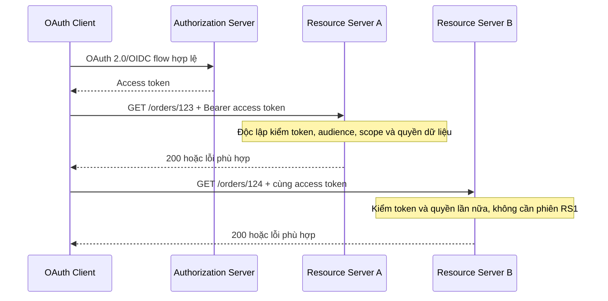
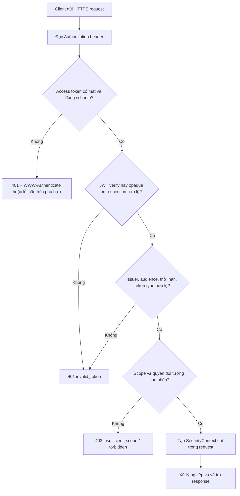
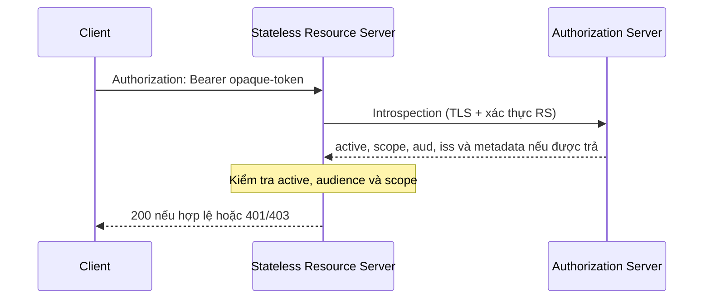

# Stateless resource server

## 1. Stateless resource server là gì?

**Resource Server (RS)** trong OAuth 2.0 là ứng dụng hoặc API bảo vệ dữ liệu, chỉ cho phép truy cập khi request đáp ứng điều kiện xác thực và phân quyền. **Stateless resource server** là cách thiết kế RS mà **thông tin xác thực của một request không phụ thuộc vào phiên đăng nhập được lưu tại RS từ các request trước**. Mỗi request tới tài nguyên bảo vệ phải cung cấp credential phù hợp, thường là **access token**, và được RS đánh giá độc lập.

Trong module `SECURITY_TOKEN_SECURITY_FUNDAMENTALS`, cách thiết kế này gắn trực tiếp với mô hình tin cậy và vòng đời token: Authorization Server (AS) phát hành token; OAuth client trình token; Resource Server kiểm tra tính hợp lệ, `issuer`, `audience`, thời gian, `scope` và quyền trên đối tượng dữ liệu; các thành phần khác xử lý làm mới, hết hạn và thu hồi token.

**Stateless không có nghĩa là toàn hệ thống không lưu bất kỳ trạng thái nào.** Cơ sở dữ liệu nghiệp vụ, bộ nhớ đệm khóa công khai, nhật ký giám sát, rate limiter, danh sách thu hồi và cơ chế chống phát lại vẫn có thể lưu trạng thái. Điều *stateless* ở đây là RS không cần giữ **phiên xác thực riêng theo người dùng giữa hai request** để xác định ai đang gọi API.

Hình dung hai lần gọi:

```http
GET /api/orders/123 HTTP/1.1
Host: api.example.test
Authorization: Bearer <ACCESS_TOKEN>
```

```http
GET /api/orders/124 HTTP/1.1
Host: api.example.test
Authorization: Bearer <ACCESS_TOKEN>
```

Mỗi lần gọi đều có header `Authorization`, dù client đang sử dụng cùng một access token còn hiệu lực. RS xác minh và tạo ngữ cảnh bảo mật **cho request đó**; lần gọi sau có thể đến một instance RS khác mà không cần chuyển một `HttpSession` từ instance trước. `<ACCESS_TOKEN>` chỉ là placeholder, không phải token thật.

> **Điểm mấu chốt:** Không tạo session tại RS khác với việc bỏ qua xác thực. Với API stateless, *mỗi request cần được xác thực và phân quyền đúng*. Việc dùng lại một access token hợp lệ trên nhiều request là bình thường; điều đó không chứng minh token chưa bị đánh cắp.

## 2. Mô hình tin cậy: các thành phần giữ trách nhiệm gì?

| Thành phần | Trách nhiệm chính | Trạng thái thường có |
| --- | --- | --- |
| **Authorization Server (AS)** | Xác thực người dùng/client; cấp access token, refresh token, quản lý phiên/ủy quyền và thu hồi khi có hỗ trợ | Phiên đăng nhập, grant, refresh token, khóa ký, trạng thái thu hồi |
| **Client** | Sở hữu authorization grant, nhận access token và gửi tới API; lưu token phù hợp môi trường | Cookie phiên client, access token, có thể cả refresh token |
| **Resource Server stateless** | Nhận request, kiểm tra access token, xác định principal và quyền rồi xử lý nghiệp vụ | Không cần session xác thực theo từng người dùng; có thể có JWKS cache, introspection cache, audit và dữ liệu nghiệp vụ |
| **API gateway/reverse proxy** | Chuyển request, bảo vệ kết nối, có thể lọc traffic hoặc làm một phần xác thực theo kiến trúc | Cấu hình routing, rate limit, cache; phải đồng nhất cách xử lý `Authorization` |



Kết nối giữa các bên phải được bảo vệ bằng TLS. Trường `Authorization: Bearer …` là cách phổ biến để client trình **access token** (RFC 6750). **Refresh token** được dùng ở token endpoint để xin token mới; **ID token** của OpenID Connect dùng để client xử lý kết quả xác thực và không được dùng thay access token để gọi Resource Server.

## 3. Stateless đối chiếu với session-based resource server

| Tiêu chí | RS dùng session tại server | Stateless RS theo request |
| --- | --- | --- |
| Credential ở request | Có thể là cookie chứa session ID | Thường là `Authorization: Bearer <access_token>` |
| Nơi lưu identity giữa các request | Session store của RS | Không cần lưu identity của client giữa các request |
| Mỗi request xác thực bằng gì? | Tra session ID để lấy ngữ cảnh | Xác minh access token hoặc tra cứu trạng thái token qua AS |
| Khả năng mở rộng | Cần shared session store, sticky session hoặc cơ chế tương đương | Instance có thể tự xử lý request, miễn có cấu hình/nguồn tin cậy tương đương |
| Thu hồi | Xóa session thường có hiệu lực ngay với store nhất quán | Tùy JWT/opaque, TTL, introspection, denylist hoặc cơ chế thu hồi |
| Rủi ro khi credential bị lấy | Session ID có thể bị lạm dụng | Bearer token có thể bị replay trong thời hạn còn hiệu lực |
| CSRF | Cần phòng vệ đặc biệt với cookie tự gửi | API chỉ dùng bearer header thường ít chịu CSRF cổ điển hơn; nếu còn cookie tự đính kèm vẫn phải xét CSRF |

**Không đồng nhất "JWT" với "stateless".** JWT được ký giúp RS có thể xác minh tại chỗ mà không hỏi AS cho mỗi request, nhưng RS vẫn có thể xây session và trở thành stateful. Ngược lại, RS có thể **không giữ session xác thực** dù dùng **opaque token** và gọi introspection cho mỗi request. Khi đó RS stateless đối với user session, nhưng toàn bộ quyết định xác thực vẫn phụ thuộc vào trạng thái bên AS.

Một thiết kế thường thấy là **hybrid**: JWT xác minh offline, nhưng RS kiểm tra thêm quyền dữ liệu ở database, version của phiên hoặc danh sách token bị thu hồi. Lớp trạng thái bổ sung này có chi phí, song không tự biến thiết kế thành một ứng dụng dùng server-side `HttpSession` cho mọi người dùng.

## 4. Chu trình xử lý request độc lập

Đối với tài nguyên cần xác thực, RS nên xử lý mỗi request theo cùng quy trình:



Điều kiện cụ thể:

1. **Đọc token an toàn:** Kiểm tra trường `Authorization`, scheme và cấu trúc hợp lệ. Không dùng `replace("Bearer", "")` mù quáng, không tự đổi hoa/thường token, không chấp nhận header trùng/mơ hồ.
2. **Xác thực token:** Với JWT, kiểm chữ ký bằng khóa và thuật toán tin cậy; với opaque token, kiểm qua cơ chế AS hỗ trợ như RFC 7662. Không coi việc Base64URL decode JWT là bước xác minh.
3. **Kiểm tra claims/ràng buộc:** `iss`, `aud`, `exp`, `nbf`, định dạng token dành cho API, mức sai lệch đồng hồ cho phép và những điều kiện theo hợp đồng với AS.
4. **Đánh giá scope/quyền:** Ví dụ `scope=orders:read` cho phép đọc đơn hàng, nhưng RS vẫn phải kiểm tra đơn cụ thể có thuộc người dùng hoặc tổ chức được phép truy cập hay không.
5. **Tạo ngữ cảnh request:** Principal/authorities đã xác thực được dùng trong xử lý controller/service, rồi không lưu thành phiên đăng nhập của RS.
6. **Gửi kết quả:** Không phản hồi token thô, không đưa token vào log hoặc URL. Dữ liệu nhạy cảm nên có chính sách HTTP cache phù hợp, ví dụ `Cache-Control: no-store` khi cần.

Trạng thái hiện tại của request cần **không tin cậy mặc định**. Nếu chỉ đọc `sub`, `role` hay `tenant_id` từ payload JWT chưa được xác minh, attacker có thể tự tạo chuỗi giả để mạo danh. Nếu API nhận `X-User-Id` từ internet rồi coi đó là danh tính, thiết kế stateless cũng không an toàn.

## 5. JWT stateless: ưu điểm và ràng buộc

Một **JWT access token** thường gồm ba đoạn Base64URL tách bởi dấu chấm. RS dùng khóa xác minh, thường được AS công bố qua **JWKS**. Ví dụ payload *minh họa*, không phải JWT hoàn chỉnh:

```json
{
  "iss": "https://auth.example.test",
  "sub": "user-42",
  "aud": ["orders-api"],
  "scope": "orders:read",
  "iat": 1795400000,
  "nbf": 1795400000,
  "exp": 1795400300,
  "jti": "at-42"
}
```

RS không cần truy vấn bảng session để xác thực JWT này, nhưng phải bảo đảm:

- **Nguồn tin cậy:** Cấu hình trước issuer và JWKS endpoint. Không tùy tiện lấy khóa từ URL/`jku` do token không tin cậy cung cấp.
- **Chữ ký/thuật toán:** Chỉ cho phép thuật toán phù hợp chính sách; không tự chấp nhận `alg=none` hoặc nhầm khóa bất đối xứng thành khóa HMAC.
- **`iss` và `aud`:** Token phải do đúng AS cấp, dành cho đúng Resource Server. Access token dành cho API khác phải bị từ chối dù chữ ký hợp lệ.
- **Thời gian:** Kiểm `exp`, `nbf` (nếu có), đồng hồ của các instance và `iat` theo chính sách. Cho phép clock skew nhỏ, có chủ đích; không bỏ qua hạn dùng.
- **Loại token:** Không chấp nhận ID token hoặc refresh token như access token. Có thể cần xác minh `typ` hoặc các claims khác theo profile access token mà AS phát hành.
- **Scope và quyền nghiệp vụ:** Chỉ sử dụng claims đã xác minh, kiểm quyền tại từng endpoint và quyền theo từng đối tượng dữ liệu (object-level authorization).
- **Độ mới của khóa:** Cache JWKS có TTL phù hợp và cập nhật khi AS luân chuyển khóa. Mất kết nối AS khi cache hết hạn phải được xử lý *fail closed* theo chính sách, không tự chấp nhận token không xác minh được.

Lợi ích của JWT offline verification là giảm số lần gọi AS, thường giảm độ trễ và hỗ trợ mở rộng nhiều instance RS. Đổi lại, **việc thu hồi JWT trước `exp` cần một cơ chế bổ sung** nếu RS chỉ xác minh chữ ký và thời hạn.

### 5.1. Vì sao JWT không tự giải quyết logout/revocation?

Ví dụ, người dùng đăng xuất lúc 10:00 nhưng access token đã cấp có `exp` tới 10:05. Nếu RS chỉ kiểm chữ ký/claims, token đã phát hành vẫn có thể được chấp nhận tới lúc hết hạn. Xóa cookie phiên bên client không tự thu hồi token bản sao kẻ tấn công đang nắm.

Các cách xử lý tùy nhu cầu:

| Biện pháp | Lợi ích | Đánh đổi |
| --- | --- | --- |
| **Access token ngắn hạn** | Giảm cửa sổ bị dùng lại và giảm tác hại khi lộ token | Client phải làm mới thường xuyên; không thu hồi tức thì |
| **Denylist `jti` hoặc token hash** | Chặn token đã được đánh dấu thu hồi | Cần trạng thái dùng chung, TTL và kiểm tra mỗi request; chỉ hiệu quả khi mọi RS cùng kiểm |
| **Version phiên/người dùng** | Thu hồi cả nhóm token nếu mỗi request so version với dữ liệu mới | Cần truy cập state/cache; phải thiết kế ảnh hưởng tải và nhất quán |
| **Introspection/gateway kiểm tra trạng thái** | Có thể phát hiện inactive theo AS | Thêm kết nối, độ trễ và phụ thuộc sẵn sàng của AS |
| **Sender-constrained access token** | Giảm rủi ro dùng bản sao token nếu attacker không có khóa/chứng chỉ | Cần DPoP/mTLS và quản lý bằng chứng sở hữu khóa |

Không nên tùy tiện dùng `jti` để **cấm lần dùng thứ hai của cùng access token**: một token hợp lệ thường được dùng nhiều lần. Denylist hoạt động bằng cách kiểm tra token đã bị **thu hồi** hay chưa, khác với dấu hiệu proof bị **phát lại** theo từng request.

## 6. Opaque token: RS vẫn có thể stateless

Opaque access token là chuỗi mà RS không trực tiếp đọc claims như JWT. Một RS không giữ phiên có thể kiểm tra opaque token bằng **Token Introspection** (RFC 7662):



Ở đây RS **không lưu login session cho client**, nhưng AS giữ trạng thái token; RS phải xác thực với introspection endpoint và kiểm tra phản hồi. Nếu `active: false`, từ chối truy cập. Nếu `active: true`, RS vẫn cần xác minh audience, phạm vi quyền và ràng buộc cần thiết theo hợp đồng với AS.

**Cache introspection** có thể giảm độ trễ nhưng làm chậm phát hiện token đã bị thu hồi. Hãy đặt TTL theo rủi ro và thời hạn còn lại của token; không cache `active: true` vô hạn. Nếu AS tạm không truy cập được và không có trạng thái đã xác minh còn được phép dùng theo chính sách, RS nên từ chối an toàn và trả lỗi hạ tầng phù hợp, không giả định token hợp lệ.

| Đặc điểm | JWT RS kiểm cục bộ | Opaque RS introspect |
| --- | --- | --- |
| Có thể không giữ HttpSession tại RS? | Có | Có |
| RS thường cần kết nối AS cho mỗi request? | Không nếu có khóa hợp lệ trong cache | Có, trừ khi cache kết quả theo chính sách |
| Thu hồi nhanh trước khi hết hạn | Cần state/check bổ sung | Thuận tiện hơn nếu AS phản ánh trạng thái và cache ngắn |
| Nguy cơ nếu bearer token bị sao chép | Có | Có |
| Kiểm soát `aud`/`scope` và object-level authorization | Luôn phải làm | Luôn phải làm |

## 7. Cấu hình Spring Security Resource Server stateless

Với Java/Spring Boot, nên dùng **Spring Security OAuth2 Resource Server** để framework xử lý `Authorization`, JWT decoder/opaque introspector và ánh xạ principal. Ví dụ sau minh họa một API dùng **JWT access token trong Bearer header**, không dùng cookie/session cho đăng nhập.

### 7.1. Cấu hình nguồn phát hành

```yaml
# application.yml — ví dụ cho JWT access token
spring:
  security:
    oauth2:
      resourceserver:
        jwt:
          issuer-uri: https://auth.example.test
```

`issuer-uri` cho phép framework xác định metadata/JWKS tin cậy theo cơ chế được hỗ trợ và kiểm tra issuer. **Cấu hình này chưa tự bảo đảm mọi phiên bản Spring Security đều kiểm `aud` là `orders-api`**; phải kiểm tra cấu hình đang chạy và bổ sung `audience` validator hoặc thuộc tính phù hợp với phiên bản framework.

### 7.2. SecurityFilterChain chỉ nhận Bearer token

```java
import org.springframework.context.annotation.Bean;
import org.springframework.context.annotation.Configuration;
import org.springframework.http.HttpMethod;
import org.springframework.security.config.Customizer;
import org.springframework.security.config.annotation.web.builders.HttpSecurity;
import org.springframework.security.config.annotation.web.configurers.AbstractHttpConfigurer;
import org.springframework.security.config.http.SessionCreationPolicy;
import org.springframework.security.web.SecurityFilterChain;

@Configuration
class ResourceServerSecurityConfig {
    @Bean
    SecurityFilterChain apiSecurity(HttpSecurity http) throws Exception {
        http
            .sessionManagement(session ->
                session.sessionCreationPolicy(SessionCreationPolicy.STATELESS))
            .csrf(AbstractHttpConfigurer::disable) // Chỉ cho API Bearer-only không dùng cookie auth
            .authorizeHttpRequests(auth -> auth
                .requestMatchers("/actuator/health").permitAll()
                .requestMatchers(HttpMethod.GET, "/api/orders/**")
                    .hasAuthority("SCOPE_orders:read")
                .anyRequest().denyAll()
            )
            .oauth2ResourceServer(oauth2 ->
                oauth2.jwt(Customizer.withDefaults())
            );
        return http.build();
    }
}
```

Ý nghĩa:

1. `SessionCreationPolicy.STATELESS` yêu cầu Spring Security **không tạo hoặc sử dụng `HttpSession` để lấy `SecurityContext`**. Framework vẫn tạo `Authentication` cho request hiện tại.
2. `oauth2ResourceServer().jwt()` bật cơ chế xác thực JWT bearer token. Controller có thể lấy principal đã được xác minh bằng `@AuthenticationPrincipal Jwt jwt`.
3. `hasAuthority("SCOPE_orders:read")` yêu cầu quyền đọc đơn; authority mapping mặc định từ `scope`/`scp` phải được rà soát theo dạng token AS phát hành.
4. `anyRequest().denyAll()` từ chối các đường dẫn chưa được khai báo. Hệ thống thật phải thêm các API và quyền tương ứng.
5. **Vô hiệu hóa CSRF trong ví dụ chỉ đúng với API thuần Bearer header, không dựa vào credential được browser tự đính kèm.** Nếu cùng ứng dụng có cookie authentication, form login hoặc session, phải đánh giá CSRF và tách filter chain thích hợp; không sao chép `csrf().disable()` cho mọi website.

Nếu ứng dụng/nghiệp vụ khác tự tạo `HttpSession`, cấu hình này không có nghĩa toàn bộ ứng dụng không còn bất kỳ session nào. Ngoài ra, **stateless authentication không thay thế authorization**: một người có `orders:read` vẫn có thể bị chặn khi truy cập đơn hàng của người khác.

### 7.3. Bổ sung audience validator (ví dụ rõ ràng)

Để tránh việc RS chấp nhận JWT đúng issuer nhưng dành cho API khác, có thể cấu hình `JwtDecoder` với validator `aud`. Ví dụ này minh họa cách làm khi đã xác định **JWKS URI chính xác từ Authorization Server**:

```java
import org.springframework.context.annotation.Bean;
import org.springframework.security.oauth2.core.OAuth2Error;
import org.springframework.security.oauth2.core.OAuth2TokenValidator;
import org.springframework.security.oauth2.core.OAuth2TokenValidatorResult;
import org.springframework.security.oauth2.core.DelegatingOAuth2TokenValidator;
import org.springframework.security.oauth2.jwt.Jwt;
import org.springframework.security.oauth2.jwt.JwtDecoder;
import org.springframework.security.oauth2.jwt.JwtValidators;
import org.springframework.security.oauth2.jwt.NimbusJwtDecoder;

@Bean
JwtDecoder jwtDecoder() {
    String issuer = "https://auth.example.test";
    // Endpoint chỉ là ví dụ; dùng JWKS URI thực tế do AS công bố.
    NimbusJwtDecoder decoder = NimbusJwtDecoder
        .withJwkSetUri("https://auth.example.test/oauth2/jwks")
        .build();

    OAuth2TokenValidator<Jwt> audience = jwt ->
        jwt.getAudience().contains("orders-api")
            ? OAuth2TokenValidatorResult.success()
            : OAuth2TokenValidatorResult.failure(
                new OAuth2Error("invalid_token", "Invalid audience", null));

    decoder.setJwtValidator(new DelegatingOAuth2TokenValidator<>(
        JwtValidators.createDefaultWithIssuer(issuer), audience));
    return decoder;
}
```

`JwtValidators.createDefaultWithIssuer` bổ sung các kiểm tra chuẩn (bao gồm issuer và thời gian theo khả năng của phiên bản Spring Security); validator bổ sung yêu cầu `aud` chứa `orders-api`. Triển khai thật còn phải giới hạn thuật toán, chọn đúng loại access token và metadata theo hồ sơ AS đang dùng. **Không** gỡ các validator mặc định chỉ để thêm audience.

### 7.4. Opaque token và sự khác biệt trong cấu hình

Nếu AS phát opaque token, RS có thể dùng `oauth2ResourceServer(oauth2 -> oauth2.opaqueToken(Customizer.withDefaults()))` cùng cấu hình `introspection-uri` và thông tin xác thực với AS qua TLS. Lúc này `SessionCreationPolicy.STATELESS` vẫn có ý nghĩa: **không lưu session người dùng tại RS**. Credential kết nối AS phải đặt trong secret manager hoặc cấu hình an toàn, không hard-code trong repository.

## 8. Sai lầm thường gặp khi xây stateless Resource Server

| Sai lầm | Tác hại | Cách sửa |
| --- | --- | --- |
| Chỉ decode JWT rồi đọc `sub` | Kẻ tấn công có thể giả danh bằng payload chưa verify | Xác minh chữ ký, issuer, audience, thời gian và token type trước khi tin claims |
| Nghĩ JWT có chữ ký thì API nào cũng nhận được | Token dành cho API khác vẫn được dùng trái phép | Luôn kiểm `aud` cho RS cụ thể |
| Chỉ có `.authenticated()` mà không kiểm scope/quyền dữ liệu | Người dùng hợp lệ xem/sửa tài nguyên ngoài quyền | Kiểm `scope`, role và object-level authorization |
| Bật `STATELESS` rồi cho rằng logout lập tức vô hiệu JWT | Token bị lộ vẫn có thể hoạt động đến `exp` | Access token TTL ngắn, revocation/denylist hoặc introspection nếu cần |
| Lưu `SecurityContext` hoặc danh tính vào biến static/thread dùng chung | Lẫn principal giữa request/tenant, nguy cơ rò dữ liệu | Dựa vào request-bound `SecurityContext` do framework quản lý |
| Tắt CSRF cho ứng dụng có cookie phiên | Browser tự gửi cookie trong request giả mạo | Xem cách gửi credential và bảo vệ CSRF theo từng filter chain |
| Cho phép `X-User-Id` hoặc `X-Role` từ client như token hợp lệ | Mạo danh qua header giả | Chỉ tin identity header từ proxy tin cậy sau cơ chế bảo vệ kênh và xóa header bên ngoài |
| Tự đọc token từ query string | Credential có thể xuất hiện trong log/history/proxy | Dùng `Authorization` trên HTTPS theo RFC 6750 |
| Cache introspection `active: true` vô thời hạn | Token thu hồi vẫn có thể truy cập | TTL ngắn, phù hợp với mức rủi ro và hạn dùng token |
| Coi nhiều request dùng cùng JWT là replay trái phép | Chặn nhầm hoạt động hợp lệ | Phân biệt bearer access token tái sử dụng hợp pháp với DPoP proof/refresh token dùng lại bất hợp pháp |

## 9. Stateless có chống được token theft và replay không?

**Không.** Stateless chỉ mô tả cách RS xử lý danh tính giữa các request. **Bearer access token** vẫn có thể bị sao chép từ Web Storage, log, request trace, thiết bị nhiễm mã độc hoặc đường truyền bảo vệ kém và gửi lại từ nơi khác trước khi token hết hạn.

Phòng thủ theo vòng đời token:

- **Phát hành:** AS cấp access token có `aud` đúng API, `scope` tối thiểu, thời hạn ngắn; refresh token có cơ chế rotation/reuse detection hoặc sender constraint phù hợp.
- **Lưu trữ/truyền:** Dùng HTTPS/TLS; không đặt access/refresh token trong URL, log, lỗi hoặc analytics. Với ứng dụng web, cân nhắc BFF giữ token phía server và cookie phiên `HttpOnly; Secure; SameSite`, đồng thời chống CSRF và XSS.
- **Xác minh:** RS kiểm chữ ký hoặc introspection, issuer, audience, thời gian, token type, scopes và quyền theo đối tượng. Mọi request đều phải được xử lý độc lập.
- **Ngăn phát lại khi cần:** DPoP (RFC 9449) hoặc mTLS-bound access token (RFC 8705) ràng buộc token với khóa/chứng chỉ. RS phải xác minh proof hoặc chứng chỉ; **DPoP proof `jti` cần kiểm tra chống dùng lại** trong cửa sổ phù hợp. Cơ chế này có thể cần bộ nhớ trạng thái phân tán.
- **Thu hồi/phản ứng:** Theo dõi sự cố, vô hiệu hóa phiên và refresh token, thu hồi access token khi hệ thống hỗ trợ. Đảm bảo các instance RS nhất quán về chính sách revocation; các hệ thống cache phải có TTL phù hợp.

DPoP hoặc mTLS không biến mã độc đang chạy trên client hợp lệ thành vô hại: nếu kẻ tấn công sử dụng được chức năng ký hay phiên hiện tại, API vẫn cần phân quyền và giám sát. Còn `jti` trên JWT thông thường **không tự tạo cơ chế chống replay**.

## 10. Mở rộng nhiều instance mà vẫn giữ tính an toàn

Stateless RS giúp load balancer phân phối các request giữa nhiều instance mà không buộc client dính vào một instance nhất định. Để không biến ưu thế đó thành lỗi bảo mật, các instance cần đồng nhất:

1. **Issuer/JWKS/algorithm:** Cùng trust configuration, biết cách cập nhật khóa khi AS luân chuyển; đồng hồ được đồng bộ.
2. **Audience và quyền:** Cùng quy tắc `aud`, `scope`, tenant và object-level authorization.
3. **Revocation/DPoP replay cache nếu áp dụng:** Dùng state chia sẻ hoặc cơ chế tương đương, tránh trường hợp token bị thu hồi ở A nhưng vẫn được B chấp nhận.
4. **Gateway và proxy:** Không để một lớp nhận token A còn lớp khác nhận token B khi `Authorization` bị trùng hoặc chuẩn hóa khác nhau; không tin header identity từ internet.
5. **Giám sát và dữ liệu:** Ghi request ID/trace ID có kiểm soát, không lưu bearer token thô; hạn chế cache HTTP cho response có dữ liệu riêng tư.
6. **Lỗi ngoại vi:** Nếu JWKS hoặc introspection tạm không sẵn sàng, chính sách phải xác định rõ khi nào có thể dùng cache hợp lệ, thời điểm từ chối và cách phân biệt lỗi hạ tầng với token sai. Không chuyển sang `allow` khi không thể xác minh.

Các kiểm soát như rate limit, audit log và dữ liệu nghiệp vụ có trạng thái riêng; chúng **không làm mất ý nghĩa stateless ở tầng xác thực request**.

## 11. Mã phản hồi HTTP và hành vi client

| Kết quả | HTTP phù hợp | Ý nghĩa |
| --- | --- | --- |
| Thiếu access token tại endpoint bắt buộc xác thực | `401 Unauthorized` + `WWW-Authenticate: Bearer` | Client chưa trình credential |
| Access token hết hạn, chữ ký sai, issuer/audience không hợp lệ, inactive | `401 Unauthorized` với Bearer `invalid_token` khi thích hợp | Credential không được chấp nhận |
| Bearer request malformed hoặc trùng credential mơ hồ | Có thể `400 Bad Request`, Bearer `invalid_request` theo RFC 6750 | Lỗi request cần được sửa |
| Access token hợp lệ nhưng thiếu scope | `403 Forbidden`, có thể dùng `insufficient_scope` | Đã xác thực nhưng không đủ quyền |
| Token hợp lệ nhưng đối tượng không thuộc quyền truy cập | `403 Forbidden` hoặc che giấu sự tồn tại đối tượng theo thiết kế | Phân quyền ở tầng dữ liệu vẫn áp dụng |
| Introspection timeout hoặc lỗi dịch vụ AS | Lỗi hạ tầng phù hợp, thường nhóm `5xx` | Không đánh đồng mọi timeout với `invalid_token` |

Ví dụ phản hồi cho token hết hạn:

```http
HTTP/1.1 401 Unauthorized
WWW-Authenticate: Bearer realm="orders-api", error="invalid_token"
Cache-Control: no-store
Content-Type: application/json

{"error":"unauthorized"}
```

Client có thể làm mới access token qua Authorization Server nếu luồng của nó cho phép, rồi gửi **request mới kèm token mới**. Resource Server không nên nhận refresh token qua `Authorization` và tự tiến hành refresh như một cách bỏ qua ranh giới trách nhiệm.

Với browser client gọi API cross-origin, request có `Authorization` thường dẫn đến **CORS preflight**; preflight cần được xử lý theo cấu hình CORS nhưng **request chính vẫn phải kiểm access token**. CORS và CSP có tác dụng ở trình duyệt, không thay thế bảo mật token tại RS.

## 12. Tình huống tự kiểm tra

**Tình huống A — Hai request đến hai instance khác nhau:** Client gửi cùng JWT cho RS-A rồi RS-B. Cả hai cùng issuer, audience, public key và policy. **Kết luận:** Hoạt động hợp lệ đối với stateless RS; không cần sticky session, nhưng mỗi request đều phải được xác minh.

**Tình huống B — JWT đã ký nhưng `aud` là `payments-api`:** Resource Server `orders-api` xác minh chữ ký thành công. **Kết luận:** Phải từ chối vì token không dành cho API này.

**Tình huống C — Người dùng logout, JWT còn hiệu lực:** Không có revocation check hoặc short TTL. **Kết luận:** RS offline vẫn có thể chấp nhận JWT cho tới `exp`; stateless không đảm bảo thu hồi tức thời.

**Tình huống D — RS dùng opaque token và introspection:** RS không dùng `HttpSession`, mỗi request gọi AS hỏi `active`. **Kết luận:** RS vẫn stateless ở tầng session xác thực; nguồn trạng thái token nằm ở AS.

**Tình huống E — Hai instance kiểm DPoP `jti` độc lập trong RAM:** Cùng proof được gửi đến hai instance, mỗi nơi tưởng chưa thấy. **Kết luận:** Thiếu cơ chế chống replay dùng chung; cần lưu trạng thái nguyên tử trong cửa sổ chấp nhận hoặc giải pháp tương đương.

**Tình huống F — JWT có `scope=orders:read`, nhưng đơn hàng thuộc tenant khác:** **Kết luận:** Chữ ký và scope chưa đủ; phải kiểm object/tenant authorization.

### Checklist triển khai

- [ ] API nhận access token trong `Authorization` qua HTTPS và không dựa vào session login lưu tại RS.
- [ ] Framework xác thực token và tạo `SecurityContext` theo request; không tin claims chưa verify.
- [ ] JWT/opaque được xử lý đúng mô hình tin cậy; `iss`, `aud`, thời gian, token type và thuật toán được kiểm tra.
- [ ] Scope và quyền đối tượng/tenant được thực thi tại API/service.
- [ ] Không nhận ID token hay refresh token thay access token.
- [ ] Không coi JWT là cơ chế thu hồi tức thời; có TTL và chiến lược revocation phù hợp.
- [ ] Nếu API có cookie tự gửi, đã đánh giá CSRF ngay cả khi cấu hình `STATELESS`.
- [ ] Nếu dùng DPoP/mTLS, xác minh chứng cứ sở hữu khóa và chống replay proof phù hợp.
- [ ] Nhiều instance có cấu hình issuer, JWKS, scope, đồng hồ và revocation nhất quán.
- [ ] Log, cache, proxy, APM không làm lộ credential; mã lỗi 401/403 và `WWW-Authenticate` đúng ngữ cảnh.

## 13. Kết luận

**Stateless resource server** không dựa vào session xác thực được lưu giữa các request. Nó tiếp nhận access token và quyết định tin cậy, quyền truy cập **mỗi lần** client gọi API. JWT cho phép kiểm tra tại chỗ để giảm phụ thuộc AS; opaque token có thể được introspect mà RS vẫn không giữ phiên người dùng. Cả hai cần xác minh đúng và kiểm quyền theo endpoint lẫn dữ liệu.

Trong bảo mật token, stateless là quyết định kiến trúc giúp scale, nhưng không tự phòng chống token bị đánh cắp hoặc phát lại. Bảo vệ đầy đủ cần kết hợp **TLS, kiểm issuer/audience/scope/thời hạn, giới hạn quyền, quản lý vòng đời access/refresh token, thu hồi và sender-constrained token** khi thích hợp.

### Tài liệu tham khảo

- [RFC 6749 — The OAuth 2.0 Authorization Framework](https://www.rfc-editor.org/rfc/rfc6749): vai trò AS, client, Resource Server và vòng đời access/refresh token.
- [RFC 6750 — Bearer Token Usage](https://www.rfc-editor.org/rfc/rfc6750): cách client trình bearer access token và challenge.
- [RFC 7662 — OAuth 2.0 Token Introspection](https://www.rfc-editor.org/rfc/rfc7662): cách RS kiểm trạng thái token qua AS.
- [RFC 9068 — JWT Profile for OAuth 2.0 Access Tokens](https://www.rfc-editor.org/rfc/rfc9068): hồ sơ JWT access token và kiểm tra tại RS.
- [RFC 9700 — Best Current Practice for OAuth 2.0 Security](https://www.rfc-editor.org/rfc/rfc9700): giảm rủi ro token theft, replay và bảo mật refresh token.
- [Spring Security — OAuth 2.0 Resource Server](https://docs.spring.io/spring-security/reference/servlet/oauth2/resource-server/index.html): JWT, opaque token, filter và tích hợp Java.
- [RFC 9449 — DPoP](https://www.rfc-editor.org/rfc/rfc9449) và [RFC 8705 — mTLS-bound access tokens](https://www.rfc-editor.org/rfc/rfc8705): ràng buộc access token với bên gửi.
