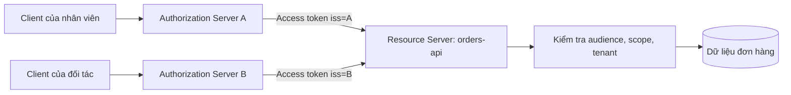
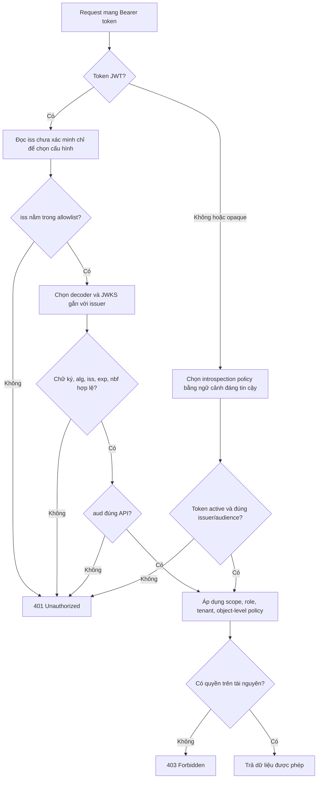

# Resource server với nhiều issuer

> **Chương:** Resource server
> **Phạm vi module:** `SECURITY_TOKEN_SECURITY_FUNDAMENTALS` — mô hình tin cậy và vòng đời token trong xác thực, phân quyền, OAuth 2.0/OIDC; phân biệt JWT/opaque token, access/refresh token; phát hành, kiểm tra claims, scope, audience, lưu trữ, thu hồi và phòng chống token bị đánh cắp hoặc phát lại.

## 1. Mục tiêu học tập

Sau bài này, bạn có thể:

1. Giải thích **issuer** là gì và vì sao một resource server có thể cần chấp nhận access token từ nhiều authorization server.
2. Thiết kế **danh sách issuer tin cậy (allowlist)** và xác minh mỗi token với đúng cấu hình/khóa của issuer phát hành.
3. Phân biệt việc **xác thực token** (`iss`, chữ ký, `exp`, `aud`) với **phân quyền truy cập tài nguyên** (scope, role, tenant, chủ sở hữu dữ liệu).
4. Cấu hình Spring Security Resource Server để chấp nhận nhiều issuer JWT một cách có kiểm soát, bao gồm kiểm tra audience riêng.
5. Xử lý khác biệt giữa **JWT** và **opaque access token**, cũng như rủi ro nhầm lẫn token, người dùng và tenant.
6. Đề xuất bộ kiểm thử âm tính, giám sát và quy trình thu hồi niềm tin khi một issuer bị ngừng sử dụng hoặc gặp sự cố.

## 2. Bài toán thực tế

Một API `orders-api` được sử dụng bởi hai hệ thống:

- Khách hàng nội bộ đăng nhập qua **Issuer A**, ví dụ `https://login-a.example.test/realms/employees`.
- Khách hàng đối tác đăng nhập qua **Issuer B**, ví dụ `https://login-b.example.test/realms/partners`.

Cả hai hệ thống xác thực có thể phát hành **access token** mà API cần chấp nhận. Token A được ký bằng khóa thuộc A; token B được ký bằng khóa thuộc B. Hai issuer có thể khác nhau về phương thức đăng nhập, khóa ký, định dạng claims, scope và chính sách thời hạn.



Vấn đề không phải đơn thuần là tải nhiều bộ khóa công khai. API đang **mở rộng ranh giới tin cậy**: chấp nhận danh tính và quyền được khẳng định bởi nhiều tổ chức/hệ thống phát hành token. Việc mở rộng đó phải là lựa chọn quản trị tường minh.

### Thuật ngữ cần phân biệt

| Thuật ngữ | Vai trò |
| --- | --- |
| **Authorization Server (AS)** | Thành phần cấp access token theo OAuth 2.0; có thể đồng thời là OpenID Provider (OIDC). |
| **Issuer (`iss`)** | Định danh chính xác của bên phát hành token; thường là URL HTTPS. |
| **Resource Server (RS)** | API bảo vệ tài nguyên và đánh giá token, quyền trên từng request. |
| **Client** | Ứng dụng yêu cầu token; client ID/secret của ứng dụng không thay cho việc RS xác minh token. |
| **Audience (`aud`)** | Tài nguyên/dịch vụ mà token hướng đến; giúp ngăn token dùng sai API. |
| **Subject (`sub`)** | Đối tượng được token nhắc đến; chỉ có ý nghĩa đầy đủ trong phạm vi issuer. |
| **Scope/permission** | Quyền được token cho phép thể hiện; RS còn phải áp dụng chính sách dữ liệu của chính mình. |

**Một issuer không phải một tenant.** Có thể một issuer phục vụ nhiều tenant, và một tenant tin cậy nhiều issuer trong giai đoạn chuyển đổi. Phải định nghĩa quan hệ issuer–tenant–audience–quyền thay vì suy luận một-một từ URL.

## 3. Mô hình tin cậy của resource server

Một RS có một issuer thường khai báo `issuer-uri`, nhận metadata/JWKS từ địa chỉ tin cậy và xác minh token. Với **nhiều issuer**, cấu hình mở rộng thành một tập các chính sách độc lập:

```text
Trusted issuer A
  issuer = https://login-a.example.test/realms/employees
  jwks   = discovery/JWKS đã cấu hình cho A
  audience = api://orders-internal
  scopes được RS công nhận = orders.read, orders.write
  tenant/nhóm dữ liệu = internal

Trusted issuer B
  issuer = https://login-b.example.test/realms/partners
  jwks   = discovery/JWKS đã cấu hình cho B
  audience = api://orders-partner
  scopes được RS công nhận = orders.read
  tenant/nhóm dữ liệu = partner-đã-đăng-ký

Issuer C / URL bất kỳ khác
  không nằm trong danh sách tin cậy -> từ chối
```

Đây là **ví dụ chính sách**, không phải một quy tắc rằng mọi hệ thống phải dùng audience khác nhau. Nếu hai issuer đều phát hành cho cùng một resource identifier, cùng `aud` cũng có thể hợp lệ, nhưng vẫn phải áp dụng ranh giới dữ liệu và quyền phù hợp.

Các nguyên tắc:

1. **Allowlist tường minh:** chỉ chấp nhận `iss` đã được quản trị và kiểm duyệt. Không tự thêm issuer theo giá trị request hoặc một token chưa xác minh.
2. **Tách khóa tin cậy:** token của A phải xác minh bằng khóa của A. Không thử mọi JWKS cho đến khi tìm được khóa phù hợp mà bỏ qua issuer.
3. **So khớp issuer chính xác:** `https://id.example.test/a` khác `https://id.example.test/b`; dấu gạch chéo cuối, path, scheme và port có thể làm khác identifier. Dùng định danh đã đăng ký, không so sánh theo substring hoặc domain suffix.
4. **Ràng buộc audience:** chỉ nhận token dành cho chính API. Token đăng nhập ứng dụng khác hoặc token gọi API khác không tự nhiên hợp lệ ở đây.
5. **Phân quyền độc lập:** chữ ký hợp lệ không có nghĩa client/người dùng được phép xem đơn hàng hay tenant bất kỳ.
6. **Vòng đời tin cậy:** có thể thêm hoặc gỡ issuer theo quy trình duyệt/triển khai; việc thu hồi niềm tin cần có tác động dự kiến đến người dùng đang hoạt động.

## 4. Luồng xử lý token từ nhiều issuer



### 4.1. Bước chọn issuer của JWT: dữ liệu chưa xác minh

JWT access token thường có dạng `header.payload.signature`. Để biết bộ khóa nào cần dùng, resolver có thể đọc trường `iss` từ payload **trước khi xác minh chữ ký**.

Đó chỉ là thao tác **định tuyến đến cấu hình tin cậy**, không phải chấp nhận claim `iss` là sự thật. Kẻ tấn công có thể tự tạo JWT ghi `iss` bằng A, nhưng token vẫn phải vượt qua kiểm tra chữ ký với khóa của A và mọi validator của A. Nếu `iss` không có trong allowlist, yêu cầu phải bị từ chối **trước khi tải bất kỳ metadata tùy ý nào**.

**Sai nghiêm trọng:**

```java
// PSEUDOCODE SAI: cho mọi issuer không xác minh tự điều khiển discovery!
String issuer = parseUnverifiedJwt(token).getIssuer();
JwtDecoder decoder = JwtDecoders.fromIssuerLocation(issuer);
return decoder.decode(token);
```

Cách làm này có thể tạo ra **issuer confusion**, tin cậy nhầm AS do attacker điều khiển hoặc khiến server truy cập URL tùy ý (SSRF), tùy cách implementation gọi discovery. Dù decoder thực hiện kiểm tra chữ ký, khóa ký lúc đó vẫn đến từ một issuer mà hệ thống chưa từng quyết định tin cậy.

### 4.2. Xác minh JWT theo từng issuer

Sau khi chọn được cấu hình đã biết, resource server kiểm tra tối thiểu:

- **Chữ ký** hợp lệ với khóa/thuật toán được cho phép của **chính issuer đó**; không tin `alg: none`, không tự đọc `jku`/`x5u` tùy ý từ JWT header. Giá trị `kid` chỉ để tìm khóa trong kho khóa thuộc issuer đã cấu hình.
- `iss` bằng **đúng issuer tin cậy**; không chỉ kiểm tra host chung.
- `exp` chưa hết hạn; `nbf` không ở tương lai ngoài clock skew được phép; xem `iat` và các ràng buộc thời gian khác theo hợp đồng token.
- `aud` bao gồm định danh API mong đợi, theo chính sách riêng từng issuer; `aud` có thể là chuỗi hoặc mảng trong JWT.
- Token thuộc **loại được RS chấp nhận** (access token). Nếu issuer sử dụng JWT access token profile, có thể kiểm tra `typ` theo profile; không giả định mọi JWT access token đều có cùng `typ`.
- Các claim bổ sung (client, tenant, tổ chức, assurance) được kiểm tra theo hợp đồng tin cậy, **sau khi** token đã xác thực.

### 4.3. Xác minh quyền trên request

Chỉ sau bước xác thực token, RS mới quyết định:

- `scope` / `scp` có quyền thao tác cần thiết không?
- Người dùng có được phép truy cập **tenant** trong URL và bản ghi dữ liệu này không?
- Chủ thể có thuộc đúng tổ chức, nhóm hoặc quan hệ sở hữu đối với đối tượng không?
- Scope từ hai issuer có cùng ngữ nghĩa hay phải ánh xạ sang quyền nội bộ riêng?

Ví dụ, `orders.read` từ B không đồng nghĩa được xem toàn bộ đơn hàng nội bộ của A. Một `403 Forbidden` sau xác thực có thể là kết quả đúng dù JWT hợp lệ.

## 5. Ví dụ cấu hình Spring Security Resource Server (JWT)

Giả sử API viết bằng **Spring Boot 3 / Spring Security 6**, nhận JWT access token từ hai issuer đã đăng ký. Để giải thích rõ cả `iss` và `aud`, ta dựng decoder và authentication manager **riêng cho mỗi issuer**.

> Ví dụ dùng servlet stack. Import/package và cách cấu hình có thể khác ở phiên bản Spring Security cụ thể; trước khi đưa vào production cần kiểm thử với version dự án.

```java
package example.security;

import jakarta.servlet.http.HttpServletRequest;
import java.util.Map;

import org.springframework.context.annotation.Bean;
import org.springframework.context.annotation.Configuration;
import org.springframework.http.HttpMethod;
import org.springframework.security.authentication.AuthenticationManager;
import org.springframework.security.authentication.AuthenticationManagerResolver;
import org.springframework.security.config.annotation.web.builders.HttpSecurity;
import org.springframework.security.oauth2.core.DelegatingOAuth2TokenValidator;
import org.springframework.security.oauth2.core.OAuth2Error;
import org.springframework.security.oauth2.core.OAuth2TokenValidator;
import org.springframework.security.oauth2.core.OAuth2TokenValidatorResult;
import org.springframework.security.oauth2.jwt.Jwt;
import org.springframework.security.oauth2.jwt.JwtValidators;
import org.springframework.security.oauth2.jwt.NimbusJwtDecoder;
import org.springframework.security.oauth2.server.resource.authentication.JwtAuthenticationProvider;
import org.springframework.security.oauth2.server.resource.authentication.JwtIssuerAuthenticationManagerResolver;
import org.springframework.security.web.SecurityFilterChain;

@Configuration
public class MultiIssuerResourceServerSecurity {

    private static final String ISSUER_A =
        "https://login-a.example.test/realms/employees";
    private static final String ISSUER_B =
        "https://login-b.example.test/realms/partners";

    @Bean
    SecurityFilterChain securityFilterChain(HttpSecurity http) throws Exception {
        // Map cố định: issuer ngoài map không nhận được AuthenticationManager.
        Map<String, AuthenticationManager> managers = Map.of(
            ISSUER_A, jwtManager(ISSUER_A, "api://orders-internal"),
            ISSUER_B, jwtManager(ISSUER_B, "api://orders-partner")
        );

        AuthenticationManagerResolver<String> trustedManagers = managers::get;
        AuthenticationManagerResolver<HttpServletRequest> resolver =
            new JwtIssuerAuthenticationManagerResolver(trustedManagers);

        http
            .authorizeHttpRequests(auth -> auth
                .requestMatchers(HttpMethod.GET, "/api/orders/**")
                    .hasAuthority("SCOPE_orders.read")
                .requestMatchers(HttpMethod.POST, "/api/orders/**")
                    .hasAuthority("SCOPE_orders.write")
                .anyRequest().authenticated()
            )
            .oauth2ResourceServer(oauth -> oauth
                .authenticationManagerResolver(resolver)
            );

        return http.build();
    }

    private static AuthenticationManager jwtManager(
        String issuer, String requiredAudience
    ) {
        // Discovery/JWKS chỉ khởi tạo cho issuer nằm trong danh sách cấu hình.
        NimbusJwtDecoder decoder =
            NimbusJwtDecoder.withIssuerLocation(issuer).build();

        OAuth2TokenValidator<Jwt> defaultValidation =
            JwtValidators.createDefaultWithIssuer(issuer);

        OAuth2TokenValidator<Jwt> audienceValidation = jwt ->
            jwt.getAudience() != null && jwt.getAudience().contains(requiredAudience)
                ? OAuth2TokenValidatorResult.success()
                : OAuth2TokenValidatorResult.failure(
                    new OAuth2Error(
                        "invalid_token",
                        "Access token không dành cho resource server này",
                        null
                    )
                );

        decoder.setJwtValidator(new DelegatingOAuth2TokenValidator<>(
            defaultValidation,
            audienceValidation
        ));

        JwtAuthenticationProvider provider = new JwtAuthenticationProvider(decoder);
        return provider::authenticate;
    }
}
```

**Điểm quan trọng trong ví dụ:**

1. Resolver có thể đọc `iss` chưa xác thực để chọn trong map, nhưng **chỉ có hai issuer được cấu hình**. Không có bước tin cậy một URL bất kỳ do client cung cấp.
2. Mỗi decoder phải kiểm tra chữ ký và `iss` của chính mình; validator bổ sung yêu cầu **audience của API đó**. Spring không nên được mặc định xem là đã kiểm tra audience kinh doanh đúng nếu ứng dụng chưa cấu hình.
3. `JwtAuthenticationProvider` mặc định thường chuyển scope trong `scope`/`scp` thành authority dạng `SCOPE_...`. Nếu AS đặt quyền ở claim khác (`roles`, `permissions`), cần **converter được phê duyệt cho issuer đó**.
4. Quy tắc `hasAuthority("SCOPE_orders.read")` chỉ là **lớp kiểm tra coarse-grained**. Endpoint thực tế vẫn phải kiểm tra tenant, vai trò và quyền truy cập từng đơn hàng.
5. Decoder có thể cần truy cập discovery/JWKS để khởi tạo hoặc kiểm tra khóa. Thiết kế startup, timeout, cache và cách ứng xử khi IdP mất kết nối phải được xác định; không tắt kiểm tra chữ ký để “giữ API hoạt động”.

Ví dụ tập trung vào chọn issuer, chữ ký, thời hạn và audience. Với một AS có khả năng phát hành **ID token và access token mang audience trùng nhau**, phải có kiểm tra **loại token** theo hợp đồng AS (ví dụ token type/profile và claim bắt buộc), đồng thời cấu hình thuật toán ký được cho phép. Không coi ví dụ này là đầy đủ cho mọi JWT profile. Đối với API thuần Bearer token không dùng session cookie, cần cấu hình CSRF phù hợp với kiến trúc; nếu cùng phục vụ đăng nhập bằng cookie, không được tắt CSRF trên các luồng dùng cookie chỉ để đơn giản hóa ví dụ.

Nếu chỉ cần kiểm tra issuer mặc định với tập tĩnh, Spring Security có API như `JwtIssuerAuthenticationManagerResolver.fromTrustedIssuers(...)` ở các phiên bản hỗ trợ. Tuy nhiên, khi cần audience, claims, authority converter hoặc chính sách khác nhau theo issuer, **tách các authentication manager** như trên giúp ranh giới rõ ràng hơn.

### 5.1. Cần bổ sung chính sách tenant và chủ sở hữu

Với dữ liệu chia tenant, code tầng nghiệp vụ cần ràng buộc bản ghi với principal đã xác thực. Ví dụ quy tắc trừu tượng:

```text
Input:
  issuer = claim "iss" sau khi xác thực token
  subject = claim "sub" sau khi xác thực token
  requestedTenant = tenant trong URL hoặc bản ghi DB
  permissions = quyền đã ánh xạ theo chính sách issuer

Check:
  trustBinding(issuer, subject) -> memberships / tenant được phép
  requestedTenant thuộc memberships
  quyền yêu cầu phù hợp với thao tác và đối tượng
  SELECT dữ liệu có điều kiện tenant_id = requestedTenant

Nếu một điều kiện sai -> 403; không truy vấn dữ liệu tenant khác.
```

Trên database, nếu lưu người dùng liên kết với nhà phát hành, hãy dùng khóa logic **`(issuer, subject)`**. Hai người dùng ở hai issuer khác nhau có thể đều có `sub = 123`; chỉ dùng `sub` làm khóa toàn cục sẽ gây **nhầm danh tính**. Tương tự, không tự coi `email` giống nhau là cùng tài khoản nếu chưa có quy trình account linking được bảo vệ.

### 5.2. Quyền khác nhau theo issuer

Nếu A phát hành `scope=orders.write` cho nhân viên còn B cũng phát hành scope cùng tên cho đại lý, RS cần chọn chính sách phù hợp:

| Request | Issuer | Scope | Điều kiện nghiệp vụ bổ sung | Kết quả |
| --- | --- | --- | --- | --- |
| Đọc đơn hàng nội bộ của nhân viên | A | `orders.read` | Nhân viên có quyền trên đơn | Có thể cho phép |
| Đọc đơn của tenant đối tác | B | `orders.read` | `sub` được gắn với đúng tenant và đơn | Có thể cho phép |
| Đọc đơn nội bộ bằng token đối tác | B | `orders.read` | Không có quyền tenant nội bộ | Từ chối **403** |
| Tạo đơn bằng token đối tác chỉ có read | B | `orders.read` | Thiếu quyền ghi | Từ chối **403** |
| Gọi API orders bằng token dành cho inventory | A | `inventory.read` | `aud` không dành cho orders API | Từ chối **401** |

Scope là tuyên bố quyền do AS phát hành. RS là nơi ra quyết định cuối cùng đối với **tài nguyên cụ thể**.

## 6. JWT và opaque token khác nhau ra sao trong multi-issuer?

| Đặc điểm | JWT access token | Opaque access token |
| --- | --- | --- |
| Có thể đọc `iss` từ token chưa kiểm tra? | Thường có thể, nhưng **chưa đáng tin** trước xác minh | Thường **không thể**; chuỗi token không có claims để đọc |
| Xác minh token | Chữ ký + claim validators với khóa issuer | Introspection hoặc tra cứu do AS/RS tin cậy quản lý |
| Lựa chọn issuer | Dựa vào `iss` **chỉ để tra allowlist**, rồi xác minh | Dựa vào **ngữ cảnh được cấu hình và ràng buộc trước** (API/tenant/client/gateway đáng tin cậy) |
| Thu hồi | JWT offline khó thu hồi ngay nếu không có cơ chế bổ sung | Introspection có thể phản ánh trạng thái active/revoked |
| Rủi ro chính | Tin nhầm issuer/khóa, thiếu `aud`, nhầm tenant | Gọi nhầm introspection endpoint, lộ credential introspection, tin response thiếu context |

### 6.1. Opaque token: không đoán issuer từ chuỗi token

Opaque token có thể là một chuỗi không có cấu trúc công khai. RS **không thể đọc `iss` từ payload** như JWT. Một số hệ thống có prefix token riêng để định tuyến, nhưng prefix tự nó không chứng minh issuer nếu không được AS bảo đảm bằng hợp đồng bảo mật.

Thay vào đó, kiến trúc nên:

1. Xác định AS/introspection policy từ **route, hostname, tenant context hoặc mapping đã cấu hình**. Nếu giá trị do người dùng chọn, phải kiểm tra đối chiếu lại với quyền tenant; không tin một HTTP header như `X-Issuer` do client tùy ý tự khai.
2. Chỉ gọi **introspection endpoint** của AS tương ứng qua HTTPS, dùng credential phía backend, timeout và hạn mức phù hợp.
3. Kiểm tra response `active=true`, thời hạn, audience, scope, client/issuer/tenant khi có. Nếu AS không cung cấp `iss`, ràng buộc response vào **endpoint AS đã được chọn bằng chính sách tin cậy**.
4. Không “thử lần lượt mọi issuer” bằng cách gửi cùng bearer token đến nhiều hệ thống xác thực. Cách này vừa khó kiểm soát tải, vừa có thể tiết lộ token cho nơi không cần nhận nó.
5. Không nhận ID token, refresh token hoặc chuỗi token có hình thức bất kỳ như access token chỉ dựa vào việc introspection báo một trường chung là active; cần hợp đồng loại token và intended audience.

### 6.2. Khi chấp nhận cả JWT lẫn opaque token

RS phải có quy tắc rõ **issuer nào phát loại token nào, route nào nhận loại nào**, cùng cơ chế xác thực cho từng loại. Không dựa vào việc token “có hai dấu chấm” để cho phép bỏ qua JWT validation hoặc tự rơi sang introspection không giới hạn.

Ví dụ API có thể định nghĩa các endpoint khác nhau cho nội bộ và đối tác; mỗi đường nhận token theo một chính sách đã cấu hình. Dù dùng cơ chế nào, logic **phân quyền nghiệp vụ sau xác thực** phải thống nhất.

## 7. Access token, ID token và refresh token

Trong OAuth 2.0/OIDC, ba loại credential không thể thay thế nhau:

- **Access token:** RS dùng để xác thực request API, theo issuer, audience, thời hạn và quyền được cấp. Access token có thể là JWT hoặc opaque.
- **ID token:** OIDC client dùng để nhận thông tin về phiên xác thực người dùng. Audience của ID token thường là **client_id của RP**, không phải resource server. API **không nhận ID token như access token**, kể cả khi chữ ký hợp lệ và chứa `sub`.
- **Refresh token:** OAuth client dùng để xin access token mới từ AS. **RS không được dùng refresh token để cấp quyền truy cập API**. Quy tắc rotation, sender constraining và thu hồi refresh token thuộc vòng đời của AS/client.

Một resource server không trực tiếp xác thực bằng PKCE: **PKCE** là cơ chế bảo vệ bước đổi authorization code của OAuth client. RS kiểm tra access token và thực thi phân quyền đối với request đến API. Client Credentials cũng là flow dùng để **cấp token**; RS chỉ nhận access token hợp lệ theo audience/scope.

## 8. Các lỗi bảo mật thường gặp

### 8.1. Chấp nhận issuer theo domain suffix

```java
// SAI: domain đuôi giống nhau không chứng minh cùng nhà phát hành.
if (issuer.endsWith("example.test")) {
    return trustToken();
}
```

Không dùng `startsWith`, `contains` hoặc regex dễ bao phủ path/domain không mong muốn. Chỉ so khớp đầy đủ với định danh issuer đã đăng ký.

### 8.2. Dùng JWKS chung cho mọi issuer

JWT header có thể mang `kid`; `kid` chỉ có nghĩa trong tập khóa đã chọn. Nếu hệ thống lấy khóa trên tất cả issuer theo cùng `kid`, hoặc chấp nhận URL `jku`/`x5u` bất kỳ trong token, attacker có thể gây nhầm khóa hoặc tấn công mạng nội bộ. Pin trusted issuer–JWKS mapping; đặt chính sách thuật toán rõ ràng.

### 8.3. Chỉ kiểm tra chữ ký, bỏ qua `aud`

Một JWT do issuer A ký hợp lệ có thể dùng để gọi **inventory-api**. Nếu **orders-api** chấp nhận nó chỉ vì cùng AS và chữ ký đúng, đã xảy ra **token substitution/cross-resource token replay**. Cần ràng buộc audience đúng API.

### 8.4. Coi `iss` + scope là đủ để truy cập tenant

Ví dụ cả issuer A và B đều có claim `scope=orders.read`. Nếu bộ lọc chỉ hỏi scope, người thuộc B có thể thử URL `/api/tenants/internal/orders`. Phải kiểm tra tenant membership và object-level permission. Không gộp người dùng bằng `sub` hoặc `email` đơn lẻ qua nhiều issuer.

### 8.5. Tự đăng ký issuer từ request

```text
GET /orders
X-Auth-Issuer: https://attacker.example.test

Server tự tải discovery/JWKS của URL này -> SAI
```

Không tiếp nhận URL issuer, JWKS hoặc introspection endpoint từ client như một cấu hình tin cậy. Khi có đối tác mới, quy trình onboarding phải ghi rõ issuer, metadata, hợp đồng audience, quyền, cách thu hồi và chủ sở hữu cấu hình.

### 8.6. Quá phụ thuộc JWT offline

JWT offline giảm số lần gọi AS nhưng RS có thể tiếp tục chấp nhận token đã phát hành đến khi `exp` dù session phía AS bị đóng. Với rủi ro cao cần thời hạn access token ngắn, cơ chế kiểm tra trạng thái/denylist hoặc sender-constrained access token khi kiến trúc hỗ trợ. Không dùng refresh token làm đường vòng kiểm tra token tại API.

## 9. Vận hành và xử lý sự cố

**Thêm issuer mới:**

1. Xác định pháp nhân/hệ thống sở hữu AS và ai có quyền phê duyệt.
2. Đăng ký chính xác `iss`, discovery/JWKS, thuật toán cho phép, audience, các claim bắt buộc và chính sách token.
3. Gắn issuer vào role/scope mapping và tenant được phép; kiểm tra chồng chéo `sub`, `email`, scope.
4. Kiểm thử positive và negative trước khi thêm vào allowlist triển khai.
5. Giám sát tỷ lệ 401, 403, lỗi JWKS/introspection và hoạt động bất thường theo issuer (không ghi bearer token vào log).

**Khóa ký của issuer xoay vòng:** bộ khóa JWKS hợp lệ có thể thay đổi. Cache cần thời gian sống phù hợp, timeout và cơ chế làm mới trên `kid` mới (theo khả năng của thư viện). Không vô hiệu hóa xác minh chữ ký khi key rotation chưa đồng bộ; điều tra lỗi cấu hình và phối hợp issuer.

**Issuer mất kết nối:** JWT có thể còn được kiểm tra bằng JWKS cache trong giới hạn chính sách; opaque token thường phụ thuộc introspection. Quyết định fail-closed với token chưa thể xác minh; thiết kế retry/timeout/circuit breaker để giữ ổn định, **không chuyển mặc định sang cho phép**.

**Issuer bị xâm nhập hoặc ngừng hợp tác:** gỡ khỏi allowlist, làm mất hiệu lực đường xác minh token mới và cũ tại RS sau khi cấu hình được áp dụng, chặn tài khoản/token liên quan theo cơ chế hệ thống, kiểm tra audit và thông báo bên có trách nhiệm. Thu hồi riêng refresh token/session ở AS có thể cần phối hợp với issuer.

**Migration từ A sang B:** tạm tin cả A và B trong khoảng thời gian định trước, lập kế hoạch chuyển principal từ `(A, sub)` sang `(B, sub)` qua account linking có xác thực, giám sát token còn dùng A, sau đó gỡ A. Không kéo dài thời gian tin cậy hai issuer vô hạn chỉ vì dễ cấu hình.

## 10. Kiểm thử bắt buộc theo ranh giới tin cậy

| Trường hợp | Kết quả mong đợi | Mục đích |
| --- | --- | --- |
| JWT từ A, chữ ký A hợp lệ, `aud=api://orders-internal`, đúng scope và tenant | **200** hoặc thành công theo nghiệp vụ | Luồng hợp lệ A |
| JWT từ B, chữ ký B hợp lệ, `aud=api://orders-partner`, đúng scope và tenant | **200** hoặc thành công theo nghiệp vụ | Luồng hợp lệ B |
| JWT tự ký khai `iss=A` | **401** | Không tin claim trước khi xác minh chữ ký |
| JWT hợp lệ của issuer C không có trong allowlist | **401** | Chỉ chấp nhận issuer đã đăng ký |
| JWT hợp lệ của A với `aud=api://inventory` | **401** | Không dùng token sai audience |
| JWT hết hạn / `nbf` ở tương lai | **401** | Kiểm tra vòng đời |
| Token có `alg=none` hoặc khóa sai issuer | **401** | Chống giả mạo / key confusion |
| ID token dùng làm bearer token gọi orders-api | **401** | Không đánh đồng ID và access token |
| JWT A/B hợp lệ nhưng thiếu scope cần thiết | **403** | Phân quyền thao tác |
| Token B có `orders.read` nhưng gọi dữ liệu tenant nội bộ của A | **403** | Phân quyền tenant/object |
| Hai issuer cùng `sub=42` nhưng là hai người khác nhau | Phân tách danh tính | Không va chạm định danh |
| Opaque token gửi nhầm đường introspection issuer | **401** | Ràng buộc AS và token |
| Issuer đưa `jku` tới URL bất kỳ | **401** hoặc bỏ qua header tùy profile | Không truy cập khóa ngoài trust config |

Mã trạng thái phản ánh loại lỗi: **401 Unauthorized** cho token thiếu, sai hoặc không thể xác thực; **403 Forbidden** khi token đã xác thực nhưng không đủ quyền. Một số chính sách ẩn tài nguyên có thể trả 404 để tránh tiết lộ sự tồn tại của dữ liệu; điều đó phải được thiết kế nhất quán.

Có thể bổ sung integration test cung cấp **JWKS giả có kiểm soát** cho issuer A/B và test API theo từng bộ khóa, claim, audience, tenant. Test cả trường hợp `kid` trùng nhau giữa hai issuer để xác minh decoder không trộn key set.

## 11. Câu hỏi tự kiểm tra

**Câu 1. Nếu `iss` chưa xác minh, tại sao resolver có thể đọc nó để chọn decoder?**

Vì đây chỉ là **gợi ý định tuyến bị giới hạn bởi allowlist**, không phải điều kiện xác thực. Decoder được chọn còn phải xác minh chữ ký và `iss` chính xác.

**Câu 2. Đã xác minh chữ ký với JWKS của A, tại sao vẫn phải kiểm tra `aud`?**

Khóa ký chứng minh nguồn phát hành hợp lệ, không chứng minh token được cấp cho API hiện tại. `aud` ngăn sử dụng token của API khác.

**Câu 3. Hai issuer cùng phát hành `sub=42` thì có phải cùng một người?**

Không. Danh tính phải được hiểu theo cặp `(iss, sub)` hoặc khóa nội bộ đã được liên kết bằng quy trình xác minh.

**Câu 4. API có thể dùng `X-Issuer` do frontend gửi để quyết định tin issuer nào không?**

Không. Header tự khai không là bằng chứng tin cậy. Có thể dùng định tuyến đã đăng ký rồi **xác minh lại toàn bộ token và tenant binding**, nhưng không biến header thành nguồn cấu hình JWKS hoặc danh sách tin cậy.

**Câu 5. Vì sao multi-issuer với opaque token phức tạp hơn JWT?**

Opaque token không tự cung cấp claim issuer có thể đọc trực tiếp; hệ thống phải biết endpoint introspection qua mapping chính sách tin cậy, sau đó kiểm tra trạng thái/quyền/đích của token.

**Câu 6. Chỉ cần `SCOPE_orders.read` để cho người dùng B đọc tất cả dữ liệu không?**

Không. Scope phải đi cùng chính sách issuer, tenant membership và kiểm tra quyền trên từng bản ghi.

## 12. Bài tập thực hành

Một nhóm vận hành đang mở cổng API dùng chung cho ba nhóm: nhân viên nội bộ (issuer A), đối tác giao nhận (issuer B), khách hàng doanh nghiệp (issuer C). API có endpoint `GET /tenants/{tenantId}/orders/{orderId}`, `POST /tenants/{tenantId}/orders`. Mỗi issuer có cặp JWKS và audience riêng.

Hãy xây dựng:

1. Bảng cấu hình trust cho A, B, C: issuer, audience, claim quyền, tenant mapping, owner và điều kiện thu hồi.
2. Chính sách xác thực request JWT: issuer allowlist, signature/key per issuer, `iss`, `exp`, `aud`.
3. Chính sách phân quyền: ai được đọc/tạo đơn của tenant nào, cách kết hợp scope và quyền thực tế, cách tránh `sub` trùng giữa issuer.
4. Tối thiểu **sáu ca test âm tính** gồm token giả mạo A, token đúng issuer sai audience, ID token, token hết hạn, thiếu scope và token B đọc tenant A.
5. Quy trình chuyển dần tài khoản từ issuer A sang C, thời điểm ngừng tin issuer A, cách giám sát và khôi phục nếu cấu hình mới gây lỗi.

**Gợi ý thiết kế:** dùng allowlist định nghĩa từ phía server; JWT decoder riêng theo issuer và audience; lưu danh tính bằng `(iss, sub)`; chính sách quyền theo tenant/object; audit có issuer và mã nguyên nhân từ chối, không bao giờ log nguyên bearer token. Thêm issuer phải có phê duyệt; gỡ issuer phải làm các token của issuer đó không còn được chấp nhận tại RS.

---

**Ghi nhớ:** Resource server hỗ trợ nhiều issuer là một **hệ thống quản lý nhiều ranh giới tin cậy**, không phải chỉ là một bộ giải mã JWT với nhiều khóa. **Chọn đúng issuer → xác minh token với cấu hình của issuer đó → kiểm tra audience và vòng đời → phân quyền dữ liệu/tenant** là chuỗi kiểm tra không thể bỏ bước.
