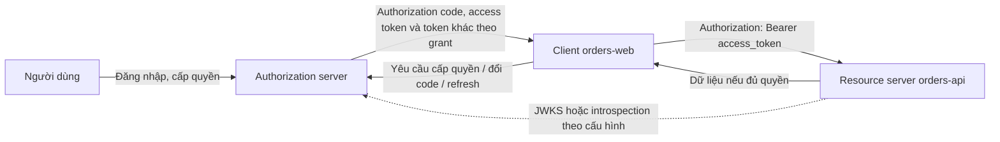
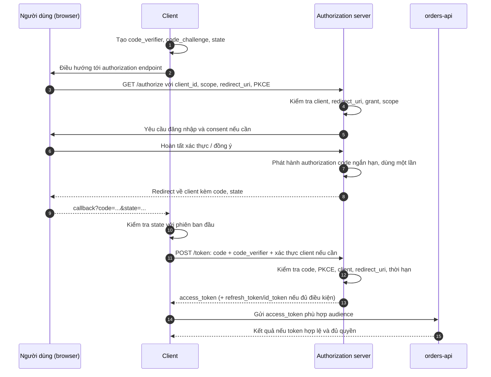
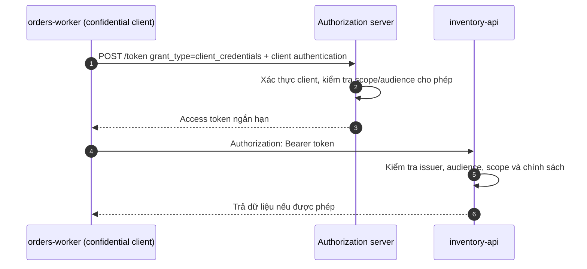
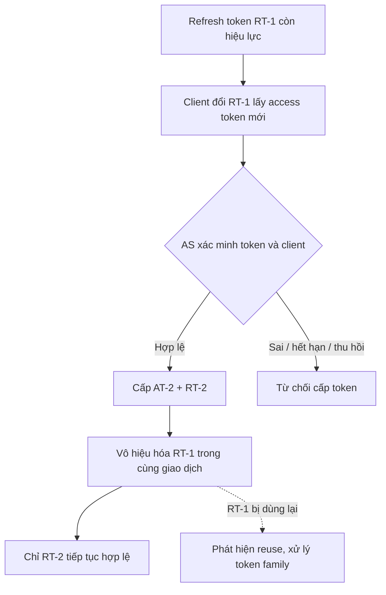
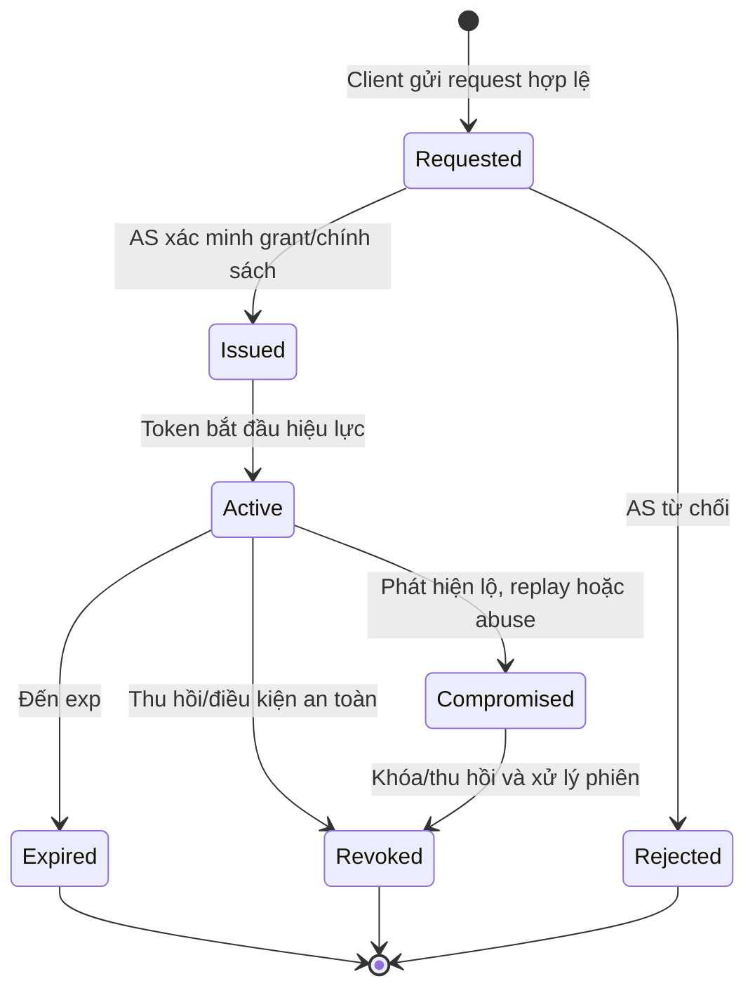

# Authorization server phát hành token

## 1. Mục tiêu và phạm vi

**Authorization server (AS)** là thành phần của OAuth 2.0 chịu trách nhiệm đánh giá yêu cầu cấp quyền và **phát hành token** để client truy cập tài nguyên được bảo vệ. Trong hệ thống có OpenID Connect (OIDC), AS còn đóng vai trò **OpenID Provider**, xác thực người dùng và phát hành **ID token** cho client khi luồng OIDC yêu cầu.

Sau bài này, bạn có thể:

- Mô tả AS nhận yêu cầu từ client, xác thực các bên, đánh giá phạm vi quyền và quyết định phát hành token.
- Phân biệt **authorization code**, **access token**, **refresh token** và **ID token** theo người nhận, mục đích và vòng đời.
- Giải thích luồng **Authorization Code + PKCE**, **Client Credentials** và **Refresh Token Grant** qua các endpoint OAuth 2.0.
- Xác định cách AS thiết lập `issuer`, `audience`, `subject`, `scope`, thời hạn, chữ ký và trạng thái thu hồi cho JWT hoặc opaque token.
- Thiết kế biện pháp bảo vệ khi phát hành, lưu giữ, quay vòng, xác minh và thu hồi token; biết cách kiểm thử những tình huống token bị đánh cắp hoặc tái sử dụng.

Bài học tập trung vào trách nhiệm **phát hành token của authorization server**, trong bối cảnh mô hình tin cậy và vòng đời token bảo mật. Resource server (API) sẽ nhận và kiểm tra access token; client nhận và gửi token theo đúng mục đích. Các thành phần phối hợp nhưng **không có cùng nhiệm vụ**.

## 2. AS nằm ở đâu trong OAuth 2.0/OIDC?

Một ví dụ: ứng dụng quản lý đơn hàng `orders-web` cần gọi `orders-api` để xem đơn hàng của người dùng.

| Thành phần | Việc chịu trách nhiệm |
| --- | --- |
| **Resource owner** | Chủ thể có quyền với dữ liệu, thường là người dùng cuối trong luồng tương tác. |
| **Client** | Ứng dụng yêu cầu quyền và giữ/sử dụng token theo chính sách, ví dụ `orders-web`. |
| **Authorization server** | Xác thực client khi cần, xác thực người dùng theo luồng, xác minh yêu cầu/consent và cấp token. |
| **Resource server** | Dịch vụ giữ dữ liệu, ví dụ `orders-api`, kiểm tra access token và quyết định quyền trên từng tài nguyên. |



**Ranh giới tin cậy rất quan trọng:**

- AS chỉ phát hành token sau khi **xác minh client và điều kiện grant** tương ứng. Đối với public client (ứng dụng trình duyệt/mobile), `client_id` là định danh, **không phải bí mật hay bằng chứng tự đủ để xác thực client**.
- Người dùng đăng nhập vào AS không có nghĩa client được toàn quyền với mọi API. AS vẫn phải áp dụng quyền của người dùng, chính sách client, phạm vi đã cấp và đối tượng nhận token.
- Resource server không tin một token chỉ vì nó được gửi từ client. RS phải xác minh token từ issuer đã tin cậy, kiểm tra audience, scope và quyền trên tài nguyên cụ thể.
- Client không nên nhận private signing key của AS. Nếu access token được ký bất đối xứng, RS dùng **public key** để xác minh còn AS giữ **private key** phát hành.

AS có thể tự xác thực người dùng hoặc liên kết với hệ thống đăng nhập bên ngoài (federation). Dù cách đăng nhập nào, trách nhiệm cuối cùng của AS là chỉ phát hành token đúng chính sách, đúng người nhận và đúng phạm vi.

## 3. Authorization server phải biết gì trước khi phát hành?

Không thể cấp token an toàn chỉ từ một `username` hoặc chuỗi `scope` do client gửi đến. AS cần một **bản ghi đăng ký client** và một **chính sách phát hành**.

| Thuộc tính/chính sách | Ví dụ | Vai trò |
| --- | --- | --- |
| `client_id` | `orders-web` | Định danh client; riêng nó không chứng minh danh tính public client. |
| Loại client và cách xác thực | Public + PKCE, hoặc confidential + `client_secret_basic`, private_key_jwt, mTLS | Quy định cần bằng chứng gì khi gọi token endpoint. |
| `redirect_uri` đăng ký | `https://orders.example.test/callback` | Giới hạn điểm nhận authorization code, kiểm tra khớp chính xác theo chính sách chuẩn. |
| Các grant được phép | `authorization_code`, `refresh_token` hoặc `client_credentials` | Chặn client dùng luồng không được cấp. |
| Scope được phép | `orders:read`, `orders:write` | Giới hạn quyền tối đa client có thể yêu cầu. |
| Resource/audience được phép | `orders-api` | Tránh cấp token dùng được trên API không thuộc phạm vi được phép. |
| Thời hạn và định dạng token | Access 10 phút, refresh 7 ngày (ví dụ) | Quyết định rủi ro bị lộ, tải vận hành và khả năng thu hồi. |
| Chính sách consent/quyền người dùng | Cho phép người dùng đồng ý xem đơn hàng, kiểm tra chính sách tổ chức | Bảo đảm scope được cấp đúng thẩm quyền. |
| Chính sách bảo vệ token | Rotate refresh token, ràng buộc DPoP/mTLS nếu hỗ trợ | Giảm nguy cơ sử dụng lại token bị lấy cắp. |

**Public client** không giữ được secret dài hạn ở nơi thực sự bí mật: JavaScript chạy trên trình duyệt và ứng dụng mobile phân phối cho người dùng là ví dụ. **Confidential client** như backend có thể giữ credential ở môi trường server và phải xác thực với AS theo cơ chế đã đăng ký. PKCE bảo vệ **authorization code** trước hành vi chặn/chiếm đoạt code; PKCE không biến public client thành confidential client.

AS nên quyết định **scope được cấp thực tế** bằng giao của nhiều điều kiện: scope client được đăng ký, scope client yêu cầu, quyền của resource owner và chính sách/consent. Một request xin `orders:*` không tự tạo ra quyền đó nếu client hoặc người dùng không được phép.

## 4. Luồng phổ biến: Authorization Code + PKCE

Authorization Code Flow tách việc người dùng tương tác/đăng nhập trong trình duyệt khỏi việc đổi code lấy token ở **token endpoint**. PKCE (Proof Key for Code Exchange, RFC 7636) ràng buộc yêu cầu cấp code với bên đổi code, đặc biệt cần thiết cho public client và cũng được khuyến nghị cho confidential client.

### 4.1. Diễn tiến theo từng bước



**Bước 1 — Client tạo giá trị cho từng phiên yêu cầu.** Client sinh `code_verifier` khó đoán bằng nguồn ngẫu nhiên mật mã; từ đó tạo `code_challenge = BASE64URL(SHA256(ASCII(code_verifier)))` cho phương thức `S256`. Client giữ `code_verifier` riêng cho transaction, gửi `code_challenge` trong authorization request. Client đồng thời tạo `state` khó đoán gắn với phiên để chống CSRF/nhầm luồng callback. Trong OIDC, nếu gửi `nonce`, client phải kiểm tra nó với ID token nhận được.

**Bước 2 — Client yêu cầu cấp quyền.** Ví dụ URL được xuống dòng để dễ đọc:

```http
GET /oauth2/authorize?response_type=code
    &client_id=orders-web
    &redirect_uri=https%3A%2F%2Forders.example.test%2Fcallback
    &scope=openid%20orders%3Aread
    &state=<RANDOM_STATE>
    &code_challenge=<S256_CHALLENGE>
    &code_challenge_method=S256
HTTP/1.1
Host: auth.example.test
```

Đây là minh họa tham số; request HTTP thật phải là một URI hợp lệ trên **một dòng** hoặc được URL encode đúng cách. Scope `openid` làm yêu cầu trở thành luồng OIDC; với yêu cầu OAuth thuần không cần nhận ID token thì bỏ `openid`. Việc lựa chọn audience có thể đến từ chính sách đăng ký client, request `resource` theo Resource Indicators (RFC 8707) nếu AS hỗ trợ, hoặc cơ chế được tài liệu hóa khác; không tự suy ra audience từ tên scope.

**Bước 3 — AS xác minh trước khi cấp code.** AS xác minh client đã đăng ký, grant/response type được phép, `redirect_uri` khớp URI đăng ký và scope hợp lệ. Sau đó AS xác thực người dùng, yêu cầu consent nếu cần và áp chính sách. AS tạo **authorization code bí mật, thời hạn ngắn, dùng một lần**, liên kết với `client_id`, `redirect_uri`, `code_challenge` và quyền vừa phê duyệt. Không ghi code và token vào log.

**Bước 4 — Client nhận callback.** AS redirect về đúng `redirect_uri` đã được kiểm tra:

```http
HTTP/1.1 302 Found
Location: https://orders.example.test/callback?code=<AUTH_CODE>&state=<RANDOM_STATE>
```

Client xác minh `state` khớp giá trị đã lưu của transaction. Không chấp nhận callback lạ, thiếu state hoặc state không khớp.

**Bước 5 — Client đổi code tại token endpoint.** Ví dụ public client dùng PKCE, không có `client_secret`:

```http
POST /oauth2/token HTTP/1.1
Host: auth.example.test
Content-Type: application/x-www-form-urlencoded

grant_type=authorization_code&client_id=orders-web&code=<AUTH_CODE>&redirect_uri=https%3A%2F%2Forders.example.test%2Fcallback&code_verifier=<ORIGINAL_VERIFIER>
```

AS kiểm tra code còn hạn, chưa sử dụng, được cấp cho client và redirect URI tương ứng; tính lại `code_challenge` từ verifier để so với giá trị đã gắn vào code. **Confidential client** ngoài PKCE phải xác thực tại token endpoint bằng phương thức đã đăng ký; client secret không nằm trong URL hoặc JavaScript trình duyệt.

**Bước 6 — AS phát hành token.** Response JSON điển hình:

```http
HTTP/1.1 200 OK
Content-Type: application/json
Cache-Control: no-store
Pragma: no-cache

{
  "access_token": "<ACCESS_TOKEN>",
  "token_type": "Bearer",
  "expires_in": 600,
  "scope": "orders:read"
}
```

`refresh_token` **có thể** xuất hiện nếu grant, loại client và chính sách cho phép; không có nghĩa AS phải luôn cấp refresh token. Với yêu cầu OIDC hợp lệ có `scope=openid`, token response còn có `id_token` theo OIDC. AS không được trả refresh token hay ID token chỉ vì client khai báo muốn nhận mà bỏ qua chính sách.

### 4.2. Ba lớp bảo vệ dễ nhầm

| Cơ chế | Chống lỗi/tấn công gì? | Ai xác minh? |
| --- | --- | --- |
| **PKCE (S256)** | Code bị lấy cắp/tiêm chèn rồi bị đổi lấy token bởi bên không có verifier. | **AS** kiểm tra verifier khi đổi code. |
| **state** | CSRF và nhầm lẫn giữa transaction authorization bắt đầu và callback nhận về. | **Client** xác minh giá trị callback tương ứng transaction đã tạo. |
| **nonce** (OIDC) | Ràng buộc ID token với lần yêu cầu xác thực, giảm nguy cơ thay thế/phát lại ID token. | **Client** kiểm tra `nonce` trong ID token theo OIDC. |

PKCE không thay thế `state` trong mọi thiết kế, và `state` không thay thế PKCE. **Authorization code không phải access token**: client không gửi code cho API để truy cập dữ liệu.

## 5. Client Credentials: phát hành token cho dịch vụ gọi dịch vụ

Không phải token nào cũng được phát hành thay mặt người dùng. Trong **Client Credentials Grant**, một ứng dụng backend đã được AS tin cậy và xác thực dùng danh tính của chính client để yêu cầu quyền gọi API.



Ví dụ token request, với client được đăng ký phương thức HTTP Basic để xác thực:

```http
POST /oauth2/token HTTP/1.1
Host: auth.example.test
Authorization: Basic <BASE64_OF_CLIENT_ID_AND_SECRET>
Content-Type: application/x-www-form-urlencoded

grant_type=client_credentials&scope=inventory%3Aread
```

AS chỉ cấp `inventory:read` nếu client này được phép sử dụng scope đó cho `inventory-api`. **Client Credentials không tự hàm ý danh tính người dùng cuối**; `sub` (nếu có) phải được hiểu theo profile của token và bối cảnh machine-to-machine. Resource server không nên suy luận một token service là hành động do người dùng bất kỳ xác nhận.

Với Client Credentials, thường **không cần refresh token** vì confidential client có thể xác thực lại và yêu cầu access token mới. Nếu cần delegated user access, hãy chọn grant phù hợp thay vì mượn client credentials để bỏ qua sự cho phép của người dùng.

## 6. Refresh token: cấp lại quyền truy cập mà không đăng nhập liên tục

**Access token** dùng để gọi API; **refresh token** dùng để yêu cầu **authorization server** cấp token mới. Resource server không phải nơi nhận refresh token. Refresh token thường có tuổi thọ dài hơn access token và vì thế cần bảo vệ nghiêm ngặt hơn.

Ví dụ client được cho phép dùng Refresh Token Grant:

```http
POST /oauth2/token HTTP/1.1
Host: auth.example.test
Content-Type: application/x-www-form-urlencoded
Authorization: Basic <CONFIDENTIAL_CLIENT_CREDENTIALS>

grant_type=refresh_token&refresh_token=<REFRESH_TOKEN>
```

AS cần kiểm tra:

1. Refresh token tồn tại, còn hiệu lực, không bị thu hồi và chưa bị dùng lại trái chính sách.
2. Refresh token được cấp cho **client hiện tại**; confidential client phải xác thực đúng cách, public client áp dụng biện pháp bảo vệ tương ứng.
3. Quyền, audience/resource và scope trong lần cấp mới **không được mở rộng** so với quyền đã cấp nếu không có một luồng cấp quyền mới hợp lệ.
4. Session, chính sách người dùng/tổ chức và dấu hiệu nguy cơ có thể yêu cầu xác thực lại hoặc từ chối.

**Refresh token rotation** thay refresh token cũ bằng token mới sau mỗi lần sử dụng thành công; token cũ bị vô hiệu hóa. Nếu token cũ xuất hiện trở lại, đó là dấu hiệu **reuse** có thể chỉ ra token bị đánh cắp, và AS cần xử lý toàn bộ chuỗi liên quan theo chính sách (ví dụ thu hồi cả token family và buộc cấp quyền lại). Các request refresh đồng thời cần xử lý atomically để tránh hai lượt sử dụng cùng thắng hoặc gây kết quả nhập nhằng.



Refresh token có thể được ràng buộc với client, thiết bị hoặc khóa bằng chính sách sender-constrained token. Trình duyệt, backend và mobile có yêu cầu lưu trữ khác nhau; không để refresh token trong URL, log, repository hoặc local storage không được bảo vệ trước script tùy ý.

## 7. AS phát hành loại token nào?

Các tên gọi giải thích **mục đích** khác với **định dạng**:

| Giá trị | Nơi sử dụng | Đặc điểm/vòng đời |
| --- | --- | --- |
| **Authorization code** | Client đổi tại AS token endpoint | Ngắn hạn, bí mật, ràng buộc client/redirect URI/PKCE, dùng một lần. |
| **Access token** | Client gửi tới resource server | Có quyền/scope, audience và thời hạn; có thể là JWT hoặc opaque. |
| **Refresh token** | Client gửi tới AS token endpoint | Cấp lại access token; có thể bị rotate/thu hồi; thường sống lâu hơn. |
| **ID token (OIDC)** | Client/relying party xác nhận kết quả đăng nhập | Thường là JWT, có các claims OIDC; audience chính là client, không phải API nghiệp vụ. |

**JWT** là một định dạng chứa claims (thường ký bằng JWS); **opaque token** là chuỗi không có cấu trúc tự diễn giải cho bên nhận. Cả hai đều có thể đại diện cho **access token**. Một JWT ký thông thường **không được mã hóa**: chữ ký chứng minh tính toàn vẹn và nguồn phát hành khi xác minh đúng; claims vẫn có thể bị đọc bởi bên cầm token.

Ví dụ payload JWT **minh họa** do AS phát hành cho `orders-api`:

```json
{
  "iss": "https://auth.example.test",
  "sub": "user-42",
  "aud": ["orders-api"],
  "client_id": "orders-web",
  "scope": "orders:read",
  "iat": 1893452400,
  "nbf": 1893452400,
  "exp": 1893453000,
  "jti": "at-unique-4d47b"
}
```

Các giá trị thời gian trên chỉ là dữ liệu ví dụ, không phải mốc hiện tại. AS chịu trách nhiệm phát hành các claims đáng tin cậy, chính xác và tối thiểu:

| Claim | AS quyết định điều gì? | Sai sót nguy hiểm |
| --- | --- | --- |
| `iss` | Issuer ổn định, được công bố bằng metadata tin cậy. | Token phát từ môi trường/issuer lạ được hệ thống khác chấp nhận. |
| `sub` | Chủ thể của token: người dùng hay client/service theo grant và profile. | Gán danh tính người dùng mà chưa xác thực hoặc nhầm danh tính service. |
| `aud` | Những resource server đích được phép nhận token. | Token cho `profile-api` bị dùng tại `orders-api`. |
| `scope`/`scp` | Phạm vi đã được chấp thuận, bị giới hạn theo client/người dùng/API. | Cấp scope rộng hơn yêu cầu được chấp thuận. |
| `iat`, `nbf`, `exp` | Thời điểm phát hành, bắt đầu hiệu lực, hết hạn. | Token sống quá lâu hoặc thiếu kiểm tra thời gian. |
| `jti` | Định danh duy nhất, có thể giúp audit hoặc denylist. | Cho rằng chỉ cần `jti` là đã chống replay. |
| `client_id` và `cnf` (nếu dùng) | Client nhận token và ràng buộc với khóa/chứng thư sở hữu. | Dùng sai thông tin client hoặc không thực thi proof tương ứng. |

Một JWT access token theo profile cụ thể (ví dụ RFC 9068) còn có yêu cầu riêng về header/claims như kiểu `at+jwt`; **AS và RS phải thống nhất profile**, không phát hành JWT tùy ý rồi để API suy đoán ý nghĩa của nó. ID token theo OIDC lại có profile khác: audience của ID token là client (`client_id`), client kiểm tra issuer, audience, thời gian và `nonce` khi áp dụng. **Không dùng ID token làm access token** tại API.

## 8. JWT access token và opaque access token: chọn cách phát hành

### 8.1. Phát hành JWT

Thông thường AS:

1. Xác định chính sách, chủ thể, scope, audience và TTL đã được chấp thuận.
2. Tạo header và claims theo **access token profile** được triển khai.
3. Ký token với private key và thuật toán nằm trong allowlist (ví dụ cơ chế chữ ký bất đối xứng phù hợp).
4. Công bố public key qua **JWKS endpoint** tin cậy để các resource server xác minh.
5. Quản lý vòng đời signing key: `kid` ổn định trong thời gian sử dụng, quay vòng, đồng tồn tại key cũ cần thiết và ngừng nhận key bị lộ theo kế hoạch ứng phó.

Phát hành JWT giúp RS có thể xác minh cục bộ theo chữ ký và claims, giảm phụ thuộc mạng của request tới AS. Nhưng một JWT còn hạn có chữ ký hợp lệ có thể vẫn dùng được sau logout/thu hồi nếu RS **chỉ** kiểm tra cục bộ. Do đó hệ thống cần TTL phù hợp, và nếu yêu cầu thu hồi gần như tức thời thì dùng introspection, denylist, sự kiện thu hồi hoặc cơ chế bổ sung được thiết kế đồng bộ.

AS không được dùng cùng một private signing key không kiểm soát cho mọi môi trường hoặc đưa private key sang resource server. Cấu hình khóa, thuật toán và issuer phải cố định từ nguồn tin cậy; không tiếp nhận `alg=none` hay URL key bất kỳ từ token do kẻ gửi tự chỉ định.

### 8.2. Phát hành opaque token

AS sinh **giá trị ngẫu nhiên mật mã**, khó đoán, ví dụ 256 bit entropy, rồi lưu quan hệ giữa token và thông tin cấp quyền trong kho trạng thái được bảo vệ. Resource server dùng **token introspection** (RFC 7662) với danh tính được phép để biết token còn hiệu lực hay không.

Ví dụ response introspection cho resource server hợp lệ:

```json
{
  "active": true,
  "client_id": "orders-web",
  "sub": "user-42",
  "aud": "orders-api",
  "scope": "orders:read",
  "exp": 1893453000
}
```

Một giá trị có `active: false` sẽ không được sử dụng để cấp quyền. Việc AS trả metadata gì cho resource server phải theo hợp đồng tin cậy và nguyên tắc tối thiểu thông tin; không công khai introspection endpoint cho caller tùy ý.

Đoạn Java sau chỉ minh họa **nguồn entropy** tạo opaque token, không phải một OAuth authorization server hoàn chỉnh:

```java
import java.security.SecureRandom;
import java.util.Base64;

public final class OpaqueTokenGenerator {
    private static final SecureRandom RANDOM = new SecureRandom();

    public static String newToken() {
        byte[] secret = new byte[32]; // 256 bit entropy
        RANDOM.nextBytes(secret);
        return Base64.getUrlEncoder()
            .withoutPadding()
            .encodeToString(secret);
    }
}
```

Trong triển khai thực tế, ưu tiên **Spring Authorization Server** hoặc nhà cung cấp identity/OAuth được duy trì và kiểm định; không ghép vài dòng tạo random/token rồi coi như đã triển khai đầy đủ authorization, client authentication, revocation, khóa và audit. Với token tham chiếu/refresh token, cân nhắc lưu hash an toàn thay cho lưu plaintext, quản lý chỉ mục và quyền truy cập kho token; không đưa token vào log.

### 8.3. Chọn định dạng theo yêu cầu vận hành

| Yêu cầu | JWT access token | Opaque access token |
| --- | --- | --- |
| API cần tự xác minh khi AS tạm ngắt kết nối | Hợp lý nếu JWKS được cache tin cậy. | Cần introspection hoặc cache kết quả có giới hạn. |
| Phải nhận biết thu hồi nhanh | Cần bổ sung trạng thái ngoài chữ ký hoặc TTL ngắn. | Thuận lợi hơn nếu introspection không bị cache quá lâu. |
| Không muốn client nhìn thấy claims | JWT ký thuần không che giấu claims. | Chỉ hiện chuỗi ngẫu nhiên đối với client. |
| Quản lý key, quy mô lớn | Cần quản lý signing key, issuer/audience/profile nhất quán. | Cần kho trạng thái và introspection chịu tải, độ trễ thấp. |

**Không có định dạng nào tự bảo vệ khỏi việc Bearer token bị đánh cắp.** Một token tự chứa hay tham chiếu vẫn phải có audience, scope, TTL và quy tắc sử dụng đúng.

## 9. Metadata, endpoint và trách nhiệm thực thi

Các URI bên dưới là ví dụ; đường dẫn thật phụ thuộc authorization server và metadata của deployment.

| Endpoint | Bên gọi | Tác dụng |
| --- | --- | --- |
| `/oauth2/authorize` | Browser/client thông qua user-agent | Khởi tạo authorization request, xác thực user/consent, trả code. |
| `/oauth2/token` | Client | Đổi code, refresh token, hoặc client credentials để nhận token. |
| `/.well-known/oauth-authorization-server` | Client/RS | OAuth Authorization Server Metadata (RFC 8414) nếu AS công bố. |
| `/.well-known/openid-configuration` | OIDC client | OpenID Provider Configuration nếu AS hỗ trợ OIDC. |
| `/oauth2/jwks` | Resource server/client phù hợp | Public keys dùng xác minh JWT được ký. |
| `/oauth2/introspect` | Resource server được ủy quyền | Kiểm tra trạng thái và metadata token theo RFC 7662. |
| `/oauth2/revoke` | Client được phép | Yêu cầu thu hồi token theo RFC 7009 và chính sách AS. |
| `/userinfo` (OIDC) | Client có access token phù hợp | Lấy claims người dùng theo OIDC nếu provider hỗ trợ. |

**Phát hành, xác minh và thu hồi** có thể diễn ra ở các endpoint khác nhau. AS cần triển khai kiểm soát client authentication, rate limit, audit, HTTPS, chống lộ credential, chống replay và giới hạn thông tin trả về ở từng endpoint.

Một yêu cầu token không hợp lệ nên nhận lỗi OAuth có cấu trúc. Ví dụ:

```http
HTTP/1.1 400 Bad Request
Content-Type: application/json
Cache-Control: no-store

{
  "error": "invalid_grant"
}
```

Các lỗi điển hình gồm `invalid_request`, `invalid_client`, `unauthorized_client`, `invalid_grant`, `unsupported_grant_type` và `invalid_scope`. `invalid_client` thường là lỗi xác thực client và có thể cần `401` cùng challenge thích hợp. AS không nên lộ chi tiết “người dùng có tồn tại hay không”, secret, token, nội bộ kho dữ liệu hoặc nguyên nhân quá cụ thể giúp attacker dò hệ thống. Với authorization endpoint, chỉ redirect lỗi đến `redirect_uri` **đã được xác minh**; một URI sai/không đăng ký phải được xử lý tại AS thay vì redirect đến đích tùy ý.

## 10. Ví dụ Java: cấu hình chính sách cấp token trong Spring Authorization Server

Spring Authorization Server hỗ trợ các endpoint, grant và cơ chế phát hành OAuth 2.0/OIDC; ứng dụng phải cung cấp cấu hình signing key, issuer, kho client, đăng nhập, consent và token storage phù hợp. Ví dụ dưới đây minh họa **đăng ký một confidential web client**, có PKCE, các grant được phép và TTL/rotation. Đây là **đoạn cấu hình minh họa**, chưa phải server có thể chạy độc lập.

```java
@Bean
PasswordEncoder passwordEncoder() {
    return PasswordEncoderFactories.createDelegatingPasswordEncoder();
}

@Bean
RegisteredClientRepository registeredClientRepository(PasswordEncoder encoder) {
    String secret = System.getenv("ORDERS_WEB_CLIENT_SECRET");
    if (secret == null || secret.isBlank()) {
        throw new IllegalStateException("Missing client credential");
    }

    RegisteredClient ordersWeb = RegisteredClient
        .withId(UUID.randomUUID().toString())
        .clientId("orders-web")
        .clientSecret(encoder.encode(secret))
        .clientAuthenticationMethod(ClientAuthenticationMethod.CLIENT_SECRET_BASIC)
        .authorizationGrantType(AuthorizationGrantType.AUTHORIZATION_CODE)
        .authorizationGrantType(AuthorizationGrantType.REFRESH_TOKEN)
        .redirectUri("https://orders.example.test/callback")
        .scope("orders:read")
        .clientSettings(ClientSettings.builder()
            .requireProofKey(true)
            .build())
        .tokenSettings(TokenSettings.builder()
            .accessTokenTimeToLive(Duration.ofMinutes(10))
            .refreshTokenTimeToLive(Duration.ofDays(7))
            .reuseRefreshTokens(false)
            .build())
        .build();

    return new InMemoryRegisteredClientRepository(ordersWeb);
}
```

Các kiểu Java trong ví dụ thuộc Spring Authorization Server/Spring Security và `java.time`, `java.util`; các `import` được lược bỏ để tập trung vào chính sách.

- `requireProofKey(true)` yêu cầu PKCE cho client này. Confidential client vẫn phải xác thực bằng cơ chế `CLIENT_SECRET_BASIC` được cấu hình khi đổi code/refresh.
- `accessTokenTimeToLive` và `refreshTokenTimeToLive` quy định TTL tối đa theo chính sách, **không phải bảo đảm mọi request đều được cấp refresh token**.
- `reuseRefreshTokens(false)` chỉ định cơ chế tạo refresh token mới trong framework; trong môi trường production còn cần kho authorization bền vững, chính sách xử lý token reuse, phát hiện bất thường và thu hồi. Mặc định của thư viện không thay thế thiết kế phản ứng bảo mật.
- `InMemoryRegisteredClientRepository` thích hợp cho ví dụ hoặc thử nghiệm. Khi triển khai thật, dùng kho đăng ký client an toàn, có migration/persistence, vòng đời secret và audit. Secret môi trường cũng nên được cung cấp qua secret manager; chỉ lưu hash/encoder phù hợp cho client secret khi hệ thống cần so khớp.
- Cần cấu hình **issuer**, JWK signing key (khi phát JWT), source xác thực người dùng, cấu hình OAuth2 Authorization Server security chain, resource/audience mapping, consent và phân quyền nghiệp vụ. Không được xem đoạn ví dụ là cấu hình hoàn chỉnh để đưa trực tiếp lên Internet.

Với mobile/browser thuần, đăng ký public client và PKCE theo hướng dẫn framework, **không nhúng confidential client secret** vào ứng dụng phân phối cho người dùng. Với service-to-service, cấu hình riêng một confidential client chỉ có `client_credentials` và các scope API cần thiết.

## 11. Thu hồi token, đăng xuất và quản lý vòng đời

Có thể hình dung vòng đời một access token:



**Đăng xuất** khỏi phiên đăng nhập của người dùng tại AS không đồng nghĩa mọi access token JWT đã phát đều bị vô hiệu hóa tức thời. **Thu hồi refresh token** thường ngăn cấp access token mới; nhưng access token còn hạn đã được phát có thể vẫn được RS chấp nhận nếu không kiểm tra trạng thái thu hồi. Muốn đáp ứng yêu cầu “cắt quyền ngay”, cần xác định từ thiết kế RS nào nhận sự kiện thu hồi, introspection, denylist hay phương án kiểm soát tương đương.

Các bước vận hành cần có:

- **Giảm quyền mặc định:** ngắn hạn cho access token, refresh token chỉ khi cần, scope theo tác vụ và audience đúng API.
- **Ràng buộc người gửi khi phù hợp:** DPoP (RFC 9449) hoặc mTLS-bound access token (RFC 8705) yêu cầu AS phát hành token và RS xác minh bằng chứng khóa/chứng thư. Claim `cnf` đơn lẻ không đủ bảo vệ nếu RS không kiểm proof.
- **Bảo vệ kho lưu:** AS giữ signing keys và client credentials trong cơ chế bảo mật chuyên dụng, giới hạn quyền truy cập; client bảo vệ refresh token theo loại ứng dụng; RS không ghi token đầy đủ vào log.
- **Hỗ trợ quay vòng khóa:** công bố key mới trước khi dùng nếu có kế hoạch, duy trì khả năng xác minh key cũ đủ thời gian cần thiết, có quy trình ứng phó khi private key bị lộ.
- **Kiểm toán không lộ bí mật:** ghi issuer, client id, grant, kết quả cấp/từ chối và correlation ID; không ghi authorization code, access token, refresh token, verifier, client secret.
- **Chống lạm dụng endpoint:** HTTPS, giới hạn tần suất, bảo vệ login/consent khỏi CSRF và session fixation, kiểm soát redirect URI, phát hiện retry bất thường.
- **Kiểm soát nguồn cấp token:** không dùng Resource Owner Password Credentials Grant cho thiết kế mới; tránh implicit flow nếu có thể dùng Authorization Code + PKCE theo hướng dẫn bảo mật OAuth hiện đại.

Độ lệch đồng hồ giữa AS/RS có thể ảnh hưởng `nbf` và `exp`; đồng bộ thời gian và chỉ cho phép khoảng clock skew nhỏ có kiểm soát, không kéo dài tùy tiện thời hạn token.

## 12. Các lỗi thiết kế thường gặp

| Sai lầm | Hậu quả | Cách xử lý |
| --- | --- | --- |
| AS chấp nhận `redirect_uri` từ client mà không so khớp đăng ký | Code/token bị chuyển sang domain attacker. | Kiểm tra URI chính xác theo client, từ chối redirect tới URI không hợp lệ. |
| Bỏ PKCE, dùng code nhiều lần | Authorization code bị chặn/chèn có thể đổi lấy token. | PKCE S256, code TTL ngắn và single-use, ràng buộc client/redirect. |
| Chỉ tin `client_id` ở public client | Kẻ khác có thể khai lại cùng id. | PKCE, redirect URI và các chính sách dành riêng public client; không coi `client_id` là bí mật. |
| Trả scope như client yêu cầu mà không phê duyệt | Leo thang đặc quyền. | Áp giao giữa chính sách client, quyền chủ thể, resource và consent. |
| Cấp access token không có audience giới hạn | Token bị dùng nhầm tại dịch vụ khác. | Gắn audience rõ ràng và yêu cầu RS kiểm tra. |
| Dùng ID token làm access token | Resource server nhận token được thiết kế cho client. | Phát hành token riêng đúng mục đích và profile. |
| Refresh token không quay vòng/không ràng buộc phù hợp | Token bị đánh cắp có thể cấp lại access token trong thời gian dài. | Rotation, phát hiện reuse, sender constraint nếu có, thời hạn và thu hồi. |
| Signing key/secret nằm trong source hoặc log | Attacker có thể giả token hoặc gọi token endpoint. | Secret manager, khóa bất đối xứng, quyền truy cập tối thiểu, rotate. |
| Cho rằng thu hồi JWT sẽ có hiệu lực ngay tại mọi API | Token cũ vẫn được sử dụng đến lúc hết hạn. | TTL ngắn và thiết kế xác minh trạng thái khi cần thu hồi nhanh. |
| Không bảo vệ metadata/JWKS/introspection | Bị lạm dụng tài nguyên hoặc rò metadata nhạy cảm. | Công khai tối thiểu nơi được thiết kế public; bảo vệ endpoint nhạy cảm, hạn mức và xác thực RS. |

## 13. Kiểm thử hệ thống phát hành token

Một bộ kiểm thử integration nên đi qua **authorization endpoint, token endpoint, metadata/JWKS, introspection/revocation** (nếu triển khai) và kết quả xác minh ở resource server.

| Tình huống | Kết quả mong đợi |
| --- | --- |
| Authorization Code + PKCE hợp lệ, người dùng được cấp quyền | AS trả code dùng một lần và token với scope/audience đúng. |
| `redirect_uri` không nằm trong danh sách đăng ký | AS từ chối; không redirect kèm code đến URI đó. |
| Thiếu/sai `code_verifier` so với challenge | Token endpoint trả lỗi, không cấp token. |
| Code hết hạn hoặc đã đổi một lần | Không được đổi lấy token thêm lần nữa. |
| `client_id` hoặc client authentication sai | Không cấp token, lỗi phù hợp. |
| Client yêu cầu scope hoặc audience vượt chính sách | AS từ chối hoặc giới hạn về tập được phép theo chính sách; không âm thầm cấp quyền rộng. |
| Client Credentials hợp lệ với scope service | Cấp access token đúng resource và không giả danh người dùng cuối. |
| Refresh token của client A được client B mang đến | Từ chối, không cấp token. |
| Refresh token bị dùng lại sau rotation | Từ chối và kích hoạt chính sách reuse/thu hồi tương ứng. |
| Refresh request cố nâng scope/audience ngoài quyền cũ | Từ chối phần yêu cầu mở rộng. |
| AS phát JWT | Chữ ký xác minh bằng JWKS công bố, `iss`/`aud`/`exp` đúng, `kid` được quản lý. |
| AS phát opaque token | Introspection cho RS hợp lệ trả đúng `active` và metadata; token bị revoke trả không active. |
| OIDC client yêu cầu `openid` hợp lệ | Phát ID token đúng profile/audience client; client kiểm nonce nếu gửi. |
| Hết hạn, logout, revoke hoặc compromise | Token mới bị chặn theo chính sách; token đã phát được xử lý đúng cơ chế thu hồi đã thiết kế. |

Khi kiểm thử, dùng khóa và credential riêng của môi trường thử nghiệm. Không chép token thật vào fixture, CI log, bug report hoặc ảnh chụp HTTP traffic.

## 14. Bài tập tình huống

Một hệ thống có ba ứng dụng: `orders-web` (client của người dùng), `orders-worker` (backend chạy lịch) và `orders-api` (resource server).

**Yêu cầu:**

1. `orders-web` cần đọc đơn hàng của người dùng sau khi họ đăng nhập.
2. `orders-worker` chỉ cần đọc trạng thái xử lý đơn hàng theo quyền của chính service.
3. Người dùng đăng xuất và yêu cầu chặn quyền truy cập cũ nhanh nhất có thể.

**Hướng giải:**

- Với `orders-web`, dùng Authorization Code + PKCE, yêu cầu `orders:read`, kiểm tra consent/quyền người dùng và cấp access token có audience `orders-api`. Nếu dùng OIDC, phát thêm ID token cho chính `orders-web`, không dùng ID token để gọi API.
- Với `orders-worker`, đăng ký confidential client riêng và dùng Client Credentials, cấp scope chỉ dành cho tác vụ nền, không nhúng danh tính người dùng cuối không có thật.
- Với yêu cầu đăng xuất/thu hồi nhanh, không coi logout là cơ chế hủy mọi JWT đang lưu hành. Giới hạn TTL và chọn introspection hoặc cơ chế thu hồi được RS thực thi; xử lý refresh token để ngăn tạo token mới.
- Với cả hai client, resource server tiếp tục kiểm tra access token, audience, scope và quyền dữ liệu của request. Scope `orders:read` tự nó không cho phép đọc mọi đơn hàng của mọi người.

**Điểm cốt lõi:** Authorization server là nơi ra quyết định **phát hành token dựa trên chính sách đã xác minh**. Giá trị của một access token đến từ quyền có thật, audience chính xác, thời hạn phù hợp và cách RS kiểm tra nó; bản thân chuỗi JWT hoặc opaque không tự biến token thành quyền truy cập an toàn.
