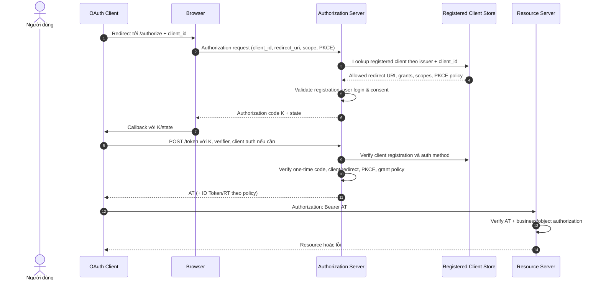
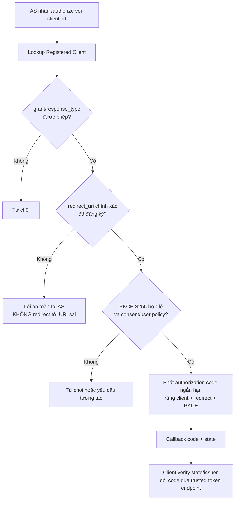
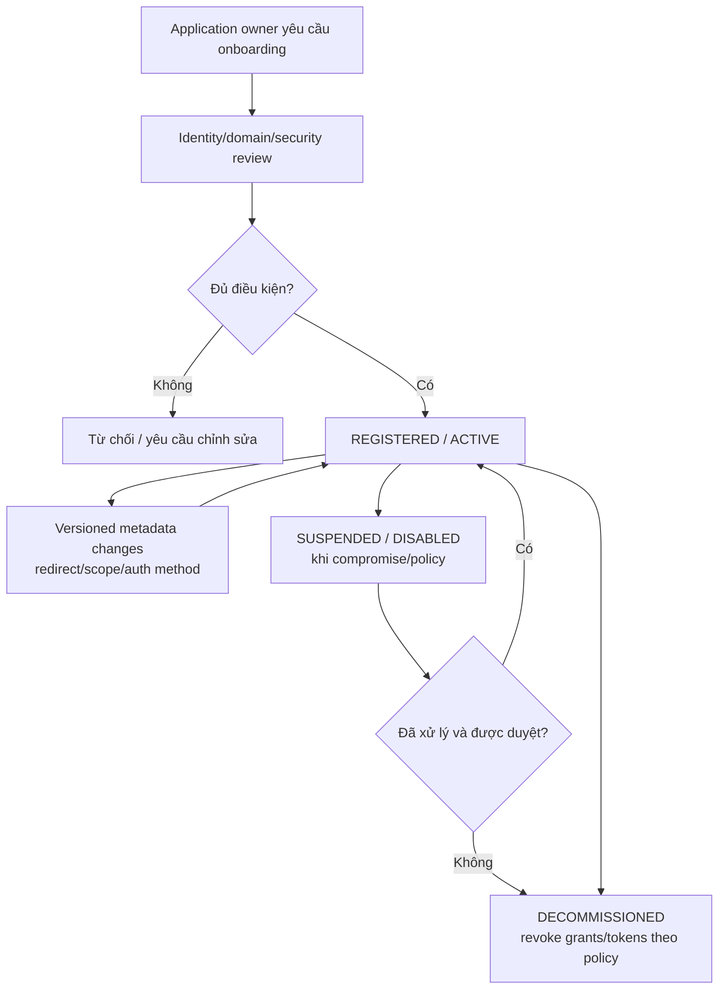

# Registered client

## Mục tiêu học tập

Module **SECURITY_TOKEN_SECURITY_FUNDAMENTALS** nghiên cứu mô hình tin cậy và vòng đời token bảo mật: phân biệt **JWT**, **opaque token**, **access token** và **refresh token**, sử dụng OAuth 2.0/OpenID Connect (OIDC), phát hành và kiểm tra claims, scope, audience, lưu trữ, thu hồi, phòng chống token bị đánh cắp hoặc phát lại. Trong chương **Authorization server**, bài **“Registered client”** tập trung vào đối tượng cấu hình cốt lõi của Authorization Server (AS): **một OAuth/OIDC client được đăng ký là ai, có thể dùng grant nào, được nhận token theo điều kiện gì và phải xác thực với AS thế nào?**

Sau bài này, người học có thể:

- Giải thích **registered client**, `client_id`, thông tin registration, **client authentication** và sự khác biệt với user authentication/authorization grant.
- Phân biệt **public client** (SPA, native) và **confidential client** (server-side/BFF, machine-to-machine), hiểu vì sao `client_id` không phải bí mật và public client không giấu được shared client secret.
- Đọc và thiết kế các trường registration: `redirect_uris`, `grant_types`, `response_types`, `token_endpoint_auth_method`, `scope`, `jwks_uri`, `client_name`, `post_logout_redirect_uris` và settings do AS định nghĩa.
- Áp chính sách **Authorization Code + PKCE `S256`**, client/redirect binding, issuer và resource/audience restriction.
- Chọn phương pháp client authentication: `client_secret_basic`, `client_secret_post` (hạn chế), `private_key_jwt`, mTLS và `none` cho public client; phân biệt client assertion với access token.
- Hiểu **static registration**, **Dynamic Client Registration (RFC 7591)** và **registration management (RFC 7592)**, cách giới hạn ai được đăng ký/sửa client và bảo vệ registration credentials.
- Thiết kế vòng đời **client secret/keys/certificates**, redirect URIs, consent, refresh-token families, grant restrictions, disable/decommission và security audit.
- Thực hành cấu hình **Spring Authorization Server RegisteredClient**, Java/Spring Security Resource Server, tình huống bảo mật, ma trận kiểm thử và checklist triển khai.

> **Quy tắc cốt lõi:** **`client_id` định danh một client trong phạm vi Authorization Server, không chứng minh client đang gọi đúng là client ấy.** AS chỉ tin confidential client sau khi **client authentication hợp lệ**; đối với public client, AS phải dựa vào chính sách registration, PKCE, redirect URI, refresh-token replay controls và các giới hạn khác. **Registered client không tự được quyền truy cập dữ liệu người dùng**: quyền thực tế còn phụ thuộc authorization grant, user/consent, resource/audience, scope và kiểm tra ở Resource Server.

## 1. Registered client là gì?

Trong OAuth 2.0, **client** là ứng dụng yêu cầu truy cập tài nguyên được bảo vệ thay mặt Resource Owner hoặc theo quyền của chính ứng dụng, tùy grant. **Registered client** là **bản ghi client mà AS quản lý**, chứa thông tin nhận dạng, các endpoint/cơ chế được phép và policy để đánh giá các authorization/token requests.

Ví dụ hệ thống có:

```text
Issuer / Authorization Server: https://identity.example.com
Resource Server:               https://api.example.com
Client A:                      orders-web-bff (confidential)
Client B:                      orders-spa (public)
Client C:                      billing-worker (confidential)

Registered clients ở AS:
  orders-web-bff -> authorization_code, refresh_token, PKCE, redirect URI
  orders-spa     -> authorization_code, PKCE, no shared client secret
  billing-worker -> client_credentials, client auth bằng private_key_jwt/mTLS
```

AS **không** suy rằng ba client trên giống nhau chỉ vì cùng gọi Orders API. Mỗi client có registration/policy riêng; một AT dành cho `api://orders` cũng không tự trở thành credential để giả mạo một OAuth client khác tại AS.

### 1.1. Các vai trò liên quan

| Thành phần | Trách nhiệm chính |
| --- | --- |
| **Resource Owner / End User** | Xác thực và quyết định cho phép client theo authorization flow và AS policy. |
| **OAuth Client** | Khởi tạo authorization, nhận code/token, lưu credential đúng kiến trúc, dùng AT tại RS. |
| **Authorization Server (AS)** | Lưu/kiểm tra registered clients, xác thực client nếu được yêu cầu, đánh giá grant, phát hành/thu hồi token. |
| **OpenID Provider (OP)** | AS hỗ trợ OIDC, phát hành ID Token và cung cấp thông tin authentication cho Relying Party. |
| **Resource Server (RS)** | Xác minh AT đúng issuer, audience, token type, lifetime, scopes/revocation và object authorization. |

**Registered client là cấu hình tin cậy ở AS, không phải bảng user.** Một client có thể phục vụ hàng nghìn user; một user có thể sử dụng nhiều client. Không thiết kế client registration riêng cho mỗi browser tab hoặc mỗi access token.

### 1.2. Vị trí trong OAuth Authorization Code Flow



`client_id` xuất hiện trong front-channel authorization request **là bình thường và không bí mật**. Điều quan trọng là **AS không được coi sự hiện diện của `client_id` tương đương đã xác thực một confidential client**, và phải kiểm tra mọi tham số có liên quan với registration.

### 1.3. Registered client khác gì authorization grant?

| Registered client | Authorization grant/consent |
| --- | --- |
| Định danh và cấu hình một **ứng dụng** được AS biết. | Đại diện quyết định/ủy quyền cho **một client**, subject/resource/scope theo flow. |
| Có thể tồn tại nhiều năm qua nhiều user sessions. | Có vòng đời cấp/thu hồi/hết hiệu lực theo user/client/resource/policy. |
| Chứa `client_id`, redirect URI, auth method, allowed grants, allowed scopes. | Chứa subject/client binding, approved scopes/resources, grant status/version, consent khi áp dụng. |
| Có thể disable/rotate key hoặc decommission. | Có thể revoke consent/grant/refresh family mà không xóa client registration. |
| Không tự cấp quyền đọc mọi tài nguyên. | Vẫn phải được AS đánh giá và RS áp object-level authorization. |

**Ví dụ:** User A rút quyền `orders:write` đối với `orders-web-bff`. Điều đó không buộc AS xóa registered client `orders-web-bff`; AS phải vô hiệu/điều chỉnh grant của User A và xử lý AT/RT theo policy. Ngược lại, disable **client registration** có thể ảnh hưởng tất cả grants/sessions thuộc client đó, một phạm vi rộng hơn nhiều.

## 2. `client_id`, internal ID và identity của client

AS thường cần hai định danh:

- **`client_id`**: string do AS cấp, client sử dụng trong OAuth protocol; được công bố cho browser/public clients và có thể xuất hiện trong authorization URL.
- **Internal record ID**: khóa nội bộ của database/framework, dùng versioning, indexing, audit; không nhất thiết bằng `client_id`.

Ví dụ schema:

```json
{
  "internal_id": "8c9a6b1d-8a54-470e-9e30-8f4d9ba77567",
  "issuer": "https://identity.example.com",
  "client_id": "orders-web-bff",
  "display_name": "Orders Portal",
  "client_type": "confidential",
  "enabled": true
}
```

**Đây là schema minh họa của hệ thống**, không phải response bắt buộc theo RFC. **`client_id` chỉ có ý nghĩa trong ngữ cảnh AS/issuer**, nên một RS hoặc một AS khác không được tự kết luận hai client IDs giống nhau là cùng một identity.

### 2.1. `client_id` không phải mật khẩu

Một SPA chứa:

```javascript
const CLIENT_ID = "orders-spa"; // Public identifier, không phải bí mật.
```

Người xem source/devtools có thể biết ID này; **đó không phải lỗ hổng tự thân**. Nguy cơ xuất hiện nếu AS cho:

```text
POST /token
client_id=orders-spa
grant_type=authorization_code
code=K

-> Cấp token mà không kiểm tra code/PKCE/redirect/client binding.
```

**Client ID là khóa lookup, không phải bằng chứng possession.** Confidential client cần credential/private key/certificate phù hợp; public client cần các ràng buộc có thể áp trong kiến trúc công khai.

### 2.2. Một `client_id` có nên dùng chung cho SPA và BFF?

Thông thường **nên tách registrations** khi security profiles khác nhau:

```text
orders-spa:
  public, PKCE, token endpoint auth method none, browser CORS policy.

orders-web-bff:
  confidential, PKCE, private_key_jwt hoặc client_secret_basic,
  tokens server-side, HTTPS callback của BFF.
```

Nếu gộp hai ứng dụng thành một `client_id`, có nguy cơ **hạ chuẩn client authentication**, trộn redirect URIs, phạm vi grants/scopes và sự kiện audit. Mọi lựa chọn gộp phải được AS hỗ trợ đúng profile và đánh giá chặt, không coi SPA là confidential chỉ vì có chung ID với BFF.

### 2.3. Client owner, contact và môi trường

Bản ghi nên gắn metadata vận hành:

- Chủ sở hữu/team chịu trách nhiệm và kênh liên hệ khi secret lộ hoặc redirect URI bị takeover.
- Môi trường `dev`/`staging`/`prod` được tách biệt.
- Verified domain/app owner và danh sách callbacks còn được vận hành.
- Security classification, rotation policy, thời điểm review/decommission.
- Trusted legal/privacy links khi AS hiển thị consent branding.

Các field này có thể **không thuộc core protocol**, nhưng cần cho governance. **Không dùng `client_name`/`logo_uri` như bằng chứng domain ownership hay client authentication**; đó có thể chỉ là dữ liệu hiển thị do người đăng ký cung cấp.

## 3. Registration metadata: trường nào quyết định hành vi?

Một registration có thể mô tả bằng các thuộc tính OAuth/OIDC và một số policy mở rộng riêng AS.

### 3.1. Bảng trường quan trọng

| Trường | Ý nghĩa | Kiểm tra an toàn |
| --- | --- | --- |
| **`client_id`** | Định danh client tại AS. | Không bí mật; namespace issuer/tenant rõ ràng. |
| **`client_secret`** | Shared credential nếu AS cấp cho confidential client. | Hash/secret vault, rotate, không trả lại tùy tiện; không dùng cho SPA/mobile public. |
| **`redirect_uris`** | Danh sách URI nhận authorization response. | HTTPS browser web, exact match, không wildcard/open redirect, chặn domain takeover. |
| **`grant_types`** | Những authorization grant được phép, ví dụ `authorization_code`, `refresh_token`, `client_credentials`. | Token endpoint không nhận grant ngoài registration/policy. |
| **`response_types`** | Authorization response types, thường `code`. | Không bật implicit `token` khi không cần; đồng nhất với grants/profile. |
| **`token_endpoint_auth_method`** | Phương thức xác thực client tại token endpoint. | `none` chỉ cho public; phương thức confidential phải xác minh đầy đủ. |
| **`scope` / allowed scopes** | Tập scope client có thể yêu cầu. | Không coi scopes được đăng ký là scopes đã được user/AS cấp. |
| **`jwks_uri` hoặc `jwks`** | Public keys dùng cho profile client JWT authentication/encryption/signatures khi hỗ trợ. | Trusted HTTPS URI, key ownership, `kid`/`alg` constraints và rotation. |
| **`client_name`, `logo_uri`, `client_uri`** | Branding/UX consent. | Xác minh domain và chống phishing/SSRF/remote resource abuse khi fetch URL. |
| **`contacts`** | Vận hành/security owners. | Không biến thông tin liên hệ thành auth factor. |
| **`post_logout_redirect_uris`** | Destination cho OIDC RP-Initiated Logout khi OP hỗ trợ. | Đăng ký riêng, không tự bằng OAuth login `redirect_uris`. |
| **`require_pkce`/`require_proof_key`** | Policy AS yêu cầu PKCE (thường field riêng của implementation). | Dùng `S256`, không downgrade/bỏ verifier. |
| **Token lifetimes/refresh policy** | `access_token_ttl`, `refresh_token_ttl`, rotation/sender constraint (tùy AS). | Risk-based, không mở dài hạn chỉ vì client được đăng ký. |
| **Allowed resources/audiences** | APIs client được phép yêu cầu AT khi AS hỗ trợ resource indicators. | Không cấp AT cho arbitrary `aud`/`resource` từ request. |

**Phân biệt:** tên trường `redirect_uris`, `grant_types`, `response_types`, `token_endpoint_auth_method` phổ biến trong **RFC 7591 dynamic registration metadata**; Spring Authorization Server có **tên API/field model riêng** (ví dụ `redirectUri(...)`, `authorizationGrantType(...)`, `clientAuthenticationMethod(...)`). Không cố dùng JSON mẫu như file cấu hình Spring mà không có lớp mapping.

### 3.2. JSON registration mẫu — confidential web client

```json
{
  "client_name": "Orders Portal BFF",
  "redirect_uris": [
    "https://portal.example.com/login/oauth2/code/identity"
  ],
  "grant_types": ["authorization_code", "refresh_token"],
  "response_types": ["code"],
  "token_endpoint_auth_method": "private_key_jwt",
  "scope": "openid profile orders:read orders:write",
  "jwks_uri": "https://portal.example.com/.well-known/jwks.json",
  "client_uri": "https://portal.example.com",
  "contacts": ["security-team@example.com"]
}
```

**Đây là request metadata minh họa theo phong cách RFC 7591**, không khẳng định AS nào cũng hỗ trợ dynamic registration hoặc chấp nhận chính xác các scopes/fields. Việc `grant_types` có `refresh_token` **chỉ cho phép cân nhắc refresh grant**, không bảo đảm AS sẽ cấp RT trong mọi lần login. Không tự hiểu `orders:write` đã được user đồng ý chỉ vì nó có trong client metadata.

### 3.3. JSON registration mẫu — browser SPA

```json
{
  "client_name": "Orders SPA",
  "redirect_uris": [
    "https://app.example.com/auth/callback"
  ],
  "grant_types": ["authorization_code"],
  "response_types": ["code"],
  "token_endpoint_auth_method": "none",
  "scope": "openid profile orders:read",
  "client_uri": "https://app.example.com"
}
```

SPA không có `client_secret`. Ở runtime, **authorization request vẫn phải dùng PKCE `S256`** và callback được ràng buộc `state`, issuer, transaction/redirect URI. Nếu AS hỗ trợ RT cho SPA, cần cấu hình replay protection (rotation hoặc sender-constraining) và token storage/expiry policy; không thêm `refresh_token` vào metadata chỉ để “có RT mãi mãi”.

### 3.4. JSON registration mẫu — machine-to-machine

```json
{
  "client_name": "Billing Worker",
  "grant_types": ["client_credentials"],
  "response_types": [],
  "token_endpoint_auth_method": "private_key_jwt",
  "scope": "billing:submit",
  "jwks_uri": "https://billing.example.com/oauth-client-jwks"
}
```

Client Credentials dùng **quyền ứng dụng**, không biểu thị user đang login. Không yêu cầu browser redirect URI cho một workload chỉ dùng token endpoint `client_credentials`, và đừng tự gắn `sub=user-42` vào AT chỉ vì service gọi API thay người dùng nếu không có delegation grant rõ ràng.

## 4. Public và confidential client: mô hình tin cậy

**Confidential client** có khả năng bảo vệ credential khỏi Resource Owner/user-agent theo triển khai và môi trường. **Public client** không thể giữ credential bí mật như vậy (browser SPA, native/mobile distributed binary).

| Đặc điểm | Public browser SPA | Public native/mobile | Confidential web BFF/server | Confidential backend workload |
| --- | --- | --- | --- | --- |
| Chạy ở đâu? | JavaScript trong browser. | Thiết bị người dùng. | Backend kiểm soát bởi tổ chức. | Backend/workload kiểm soát. |
| Giữ shared secret an toàn? | **Không**. | **Không** một cách đáng tin đối với binary phân phối rộng. | Có thể, với secret manager/IAM. | Có thể, với workload identity/secret manager. |
| Token endpoint auth | Thường `none`; PKCE/code binding vẫn bắt buộc. | Thường `none` + PKCE; có OS app links/loopback callback theo RFC 8252. | `client_secret_basic`, `private_key_jwt`, mTLS tùy registration. | `private_key_jwt`/mTLS/secret theo policy. |
| Authorization Code redirect | HTTPS SPA path. | App link/custom scheme/loopback theo native profile. | HTTPS BFF server endpoint. | Không cần nếu chỉ client credentials. |
| RT replay protection | Rotation hoặc sender-constraining theo OAuth Security BCP khi RT được cấp. | Tương tự public client. | RT vẫn phải bảo vệ, rotate/binding theo risk policy. | Thường không cấp RT trong `client_credentials` grant. |
| Rủi ro chính | XSS, token storage, browser policy, callback. | App impersonation, deep link interception, thiết bị mất. | Secret/key compromise, session cookies, CSRF, BFF vault. | Workload identity/keys bị lộ, excessive scope. |

### 4.1. `client_secret` trong JavaScript không khiến SPA thành confidential

```javascript
// PHẢN VÍ DỤ: client_secret nằm trong bundle và ai cũng có thể đọc.
const clientId = "orders-spa";
const clientSecret = "hard-coded-shared-secret"; // KHÔNG BẢO MẬT.
```

Minify, source-map removal hoặc obfuscation **không ngăn trích xuất secret** khỏi browser. AS nên đăng ký client này là public với `token_endpoint_auth_method=none`, PKCE `S256`, exact redirect URI và threat-model browser token protection. Nếu cần confidential authentication, chuyển token exchange/secret sang **BFF**.

### 4.2. Confidential chỉ có nghĩa credential được bảo vệ theo môi trường

Một BFF được cấu hình `client_secret_basic` nhưng ghi secret vào log, đặt trong Docker image public hoặc cho browser truy cập qua `/config` **không còn đáp ứng mục tiêu confidential**. Client authentication method chỉ có ý nghĩa khi key/secret thực sự được giữ và rotation/invalidation hoạt động.

### 4.3. Sender constraint không biến public client thành confidential

DPoP (RFC 9449) hoặc mTLS-bound tokens (RFC 8705) có thể hạn chế replay bằng bản sao token. Nhưng private key DPoP trong browser có thể bị **script cùng origin** sử dụng để ký proof khi XSS đang chạy; nó không làm browser JavaScript trở thành máy chủ bí mật. **Đừng dùng sender constraint làm lý do bỏ PKCE, scope restriction hoặc revocation**.

## 5. Client authentication: AS xác minh ai đang gọi `/token`?

**Client identification** là việc biết request khai `client_id=orders-web-bff`. **Client authentication** là AS kiểm chứng caller sở hữu **credential/khóa/chứng chỉ** liên kết với client registration. Hai khái niệm khác nhau:

```text
Client identification:
  client_id=orders-web-bff
  -> AS biết nên lookup registration nào.

Client authentication:
  Client chứng minh possession of registered secret/key/certificate.
  -> AS có bằng chứng caller được xác thực theo auth method.
```

Public client có thể **được nhận diện** bằng `client_id` nhưng không thể xác thực đáng tin bằng một shared secret nhúng trong distributed app. AS không được coi một `client_id` công khai là bằng chứng đã chứng minh identity ở token endpoint.

### 5.1. Chọn phương pháp theo khả năng bảo vệ credential

| Method | Cách hoạt động | Phù hợp/cảnh báo |
| --- | --- | --- |
| **`client_secret_basic`** | Client đưa ID/secret trong HTTP Basic tại token endpoint qua TLS. | Confidential server; secret trong vault, redaction, expiry/rotation. |
| **`client_secret_post`** | Client gửi ID/secret trong form POST body. | Chỉ khi AS/profile cho phép; body capture/logging có thể lộ credential. Thường ưu tiên Basic hoặc phương pháp mạnh hơn khi có lựa chọn. |
| **`private_key_jwt`** | Client ký JWT client assertion bằng private key; AS verify public key đã đăng ký. | Confidential backend; hỗ trợ key rotation/JWKS; kiểm tra `iss`/`sub`/`aud`/`exp`/`jti` replay. |
| **`tls_client_auth` / `self_signed_tls_client_auth`** | Client xác thực qua mTLS và certificate profile tương ứng. | Hạ tầng TLS/client cert đúng trust model; cần lifecycle/rotation/revocation cert. |
| **`none`** | Không có confidential client authentication; public client trình `client_id` khi profile yêu cầu. | Browser SPA/native public; cần PKCE, redirect/client/code binding, RT replay protection. |

**Cần phân biệt:** việc request có `Authorization: Bearer <access_token>` là **trình AT tới Resource Server**, không phải mặc định một phương pháp xác thực OAuth client tại AS token endpoint. Một `private_key_jwt` **client assertion** cũng không phải JWT access token; `aud` của nó dành cho AS token endpoint theo profile.

### 5.2. HTTP ví dụ `client_secret_basic`

```http
POST /oauth2/token HTTP/1.1
Host: identity.example.com
Authorization: Basic <base64-encoded-client-credentials>
Content-Type: application/x-www-form-urlencoded

grant_type=authorization_code&code=CODE_K&redirect_uri=https%3A%2F%2Fportal.example.com%2Flogin%2Foauth2%2Fcode%2Fidentity&code_verifier=VERIFIER_V
```

**`Basic` không mã hóa bí mật để bảo vệ khỏi người đọc được header**; Base64 chỉ là encoding. HTTPS, proxy redaction và secret storage là bắt buộc. Việc xây giá trị Basic theo RFC cần xử lý encoding/escaping đúng chuẩn, không đơn giản nối raw strings trong mọi trường hợp.

### 5.3. HTTP ví dụ `private_key_jwt`

```http
POST /oauth2/token HTTP/1.1
Host: identity.example.com
Content-Type: application/x-www-form-urlencoded

grant_type=client_credentials&scope=billing%3Asubmit&client_id=billing-worker&client_assertion_type=urn%3Aietf%3Aparams%3Aoauth%3Aclient-assertion-type%3Ajwt-bearer&client_assertion=<signed-client-authentication-jwt>
```

JWT assertion minh họa payload:

```json
{
  "iss": "billing-worker",
  "sub": "billing-worker",
  "aud": "https://identity.example.com/oauth2/token",
  "iat": 1800000000,
  "exp": 1800000060,
  "jti": "assertion-4f18e63a"
}
```

Với `private_key_jwt`, AS phải:

1. Lookup registration bằng client identity theo profile.
2. Chỉ tin **đúng public key/JWKS đã gắn client**, không tự fetch `jku`/`x5u` tùy ý từ JWT header.
3. Verify signature/allowed `alg`, key type, `kid` và policy tránh algorithm confusion.
4. Kiểm tra `iss`/`sub` đúng client ID, `aud` đúng AS endpoint identifier được profile quy định, `exp`/`iat` đủ ngắn, `jti` chưa dùng khi replay protection yêu cầu.
5. Không nhận JWT assertion ký bởi **AS signing key** làm client authentication chỉ vì chữ ký “hợp lệ”: đây là hai namespace trust khác nhau.
6. Trả lỗi authentication phù hợp nếu assertion expired/replayed/binding sai; không log raw JWT assertion.

**Cảnh báo:** `client_assertion` được dùng cho authentication và `grant_type=urn:ietf:params:oauth:grant-type:jwt-bearer` (JWT bearer grant) là hai trường hợp khác nhau. Đừng nhầm assertion client authentication với credential để impersonate end user.

### 5.4. mTLS: client authentication và sender-constrained token

mTLS có **hai mục đích có thể liên quan nhưng không đồng nhất**:

- **mTLS client authentication:** AS xác minh client certificate theo registration/trust chain (`RFC 8705`).
- **Certificate-bound access token:** AT chứa binding phù hợp, RS kiểm tra chứng chỉ bên gửi API match token binding.

Client được xác thực tại `/token` bằng mTLS **không tự bảo đảm** AT sau đó là certificate-bound nếu AS/client/RS không bật và áp profile đó. Ngược lại, sender-constrained AT không thay check `aud`, scope, expiry, revocation hoặc object policy.

### 5.5. Không cho client đổi auth method theo ý request

Một confidential client đã đăng ký `private_key_jwt` không nên có fallback:

```text
if client_assertion_missing:
    accept client_id only    // SAI
```

Điều này biến confidential client thành public ở thời điểm attacker chọn. AS phải **enforce registered method** hoặc chính sách chuyển đổi được quản trị rõ, không downgrade âm thầm khi secret expired/khóa rotation lỗi.

## 6. Redirect URI và callback binding trong registration

Khi authorization response đi qua browser, `redirect_uri` là **ranh giới nơi AS được phép trả code**. Nó phải được client đăng ký và AS kiểm tra trước khi phát authorization code.

### 6.1. Exact matching và HTTPS

Giả sử registration có:

```text
https://portal.example.com/login/oauth2/code/identity
```

Các URI sau **không phải URI đã đăng ký**:

```text
https://portal.example.com/login/oauth2/code/identity/
https://portal.example.com/login/oauth2/code/identity?next=...
https://evil.example.net/login/oauth2/code/identity
http://portal.example.com/login/oauth2/code/identity
```

Theo **RFC 9700**, AS cần exact matching redirect URI theo client registration, ngoại lệ đặc thù cho **port của native loopback redirects** theo RFC 8252. **Browser web/SPA** không được dùng ngoại lệ native loopback để cho arbitrary host/path/port.

### 6.2. Không đăng ký wildcard và redirector

Phản ví dụ:

```text
https://*.example.com/*
https://portal.example.com/redirect?next=*
https://portal.example.com/?return=https://attacker.example/
```

Một subdomain bị takeover hoặc một open redirect có thể khiến code đi tới destination ngoài dự kiến. **Không dùng một redirect URI chỉ định một endpoint open redirect như “trạm trung chuyển”** cho authorization response.

Đăng ký **URI cụ thể**; return path sau login cần được lưu trước trong transaction/state mapping đáng tin, rồi chỉ redirect sang **internal relative path** đã kiểm tra sau khi code/ID Token được verify.

### 6.3. Redirect URI không chứa fragment

```text
https://app.example.com/#/auth/callback
```

OAuth redirect endpoint URI không được chứa fragment. Browser hash router không phải lý do đăng ký callback có `#...`. Dùng path `https://app.example.com/auth/callback` được hosting phục vụ, rồi điều hướng router sau khi xử lý authorization response.

### 6.4. Code + PKCE và state



AS và client cần phối hợp:

- AS enforce `client_id` và registered redirect URI, allowed `response_type=code`, PKCE challenge.
- Client tạo `state` ngẫu nhiên, gắn browser transaction và expected issuer; kiểm tra trước token exchange.
- Code phải ngắn hạn, **one-time**, ràng `client_id`, redirect URI (theo grant) và PKCE challenge.
- Token endpoint kiểm tra verifier/client authentication/binding; không đổi code khi client ID sai hoặc URI bị thay.
- OIDC RP kiểm tra ID Token issuer, audience, nonce khi áp dụng, signature/time; **authorization code tự nó chưa là login success**.

### 6.5. Lỗi `redirect_uri_mismatch` không phải lỗi CORS

**`redirect_uri`** là full URI được AS kiểm tra cho authorization response. **CORS origin** chỉ gồm scheme/host/port và quyết định browser script có đọc cross-origin token endpoint response hay không. Một SPA có thể redirect hợp lệ nhưng CORS token exchange vẫn lỗi; không sửa bằng cách bật wildcard redirects.

**`post_logout_redirect_uri`** trong OIDC RP-Initiated Logout cũng là một registry riêng, không mặc định dùng làm OAuth authorization callback.

## 7. Allowed grant types, response types và token lifecycle

Một registered client chỉ **được phép sử dụng** những grants/response types đã được AS định nghĩa cho nó. Mỗi grant có trust model khác nhau:

| Grant / response | Chủ thể sử dụng | Chính sách an toàn |
| --- | --- | --- |
| **`authorization_code` / `response_type=code`** | Browser user authorization qua redirect, SPA/BFF/native. | Exact redirect URI, PKCE `S256`, state/issuer binding, code one-time, client auth nếu confidential. |
| **`refresh_token` grant** | Client có RT hợp lệ từ authorization grant trước đó. | RT/client/grant binding, expiry, rotation/replay detection hoặc sender constraint cho public client; revoke. |
| **`client_credentials`** | Confidential machine client truy cập theo quyền của ứng dụng. | Client authentication, scope/resource restriction, không giả subject user. |
| **`urn:ietf:params:oauth:grant-type:device_code`** | TV/CLI/thiết bị hạn chế nhập liệu khi AS hỗ trợ RFC 8628. | Client/user code binding, polling interval/expiry, chống device phishing, public client policy. |
| **Token Exchange (`RFC 8693`)** | Dịch vụ được phép đổi token cho delegation/impersonation có kiểm soát. | Subject/actor/delegation policy, requested audience/resources, token provenance và issuance restrictions. |
| **Implicit `response_type=token`** | Legacy front-channel AT. | **Không bật cho thiết kế mới** khi Code+PKCE phù hợp; rủi ro AT fragment/front-channel. |
| **Resource Owner Password Credentials** | Legacy password grant. | Không triển khai cho client mới; RFC 9700 không khuyến nghị/sử dụng grant này do rủi ro user password exposure. |

**Được phép `authorization_code` không mặc nhiên được phép `refresh_token`**. AS phải kiểm tra từng request; ví dụ một BFF chỉ được cấp RT nếu policy/scope/consent/resource yêu cầu và AS cho phép. Trong OAuth/OIDC, `offline_access` có semantics theo profile, không phải “có scope này thì AS bắt buộc cấp RT bất kể policy”.

### 7.1. Grant policy tại token endpoint

Pseudocode quyết định:

```text
client = findByIssuerAndClientId(request.client_id)
require(client.enabled)
require(request.grant_type in client.allowed_grants)

if client.confidential:
    requireAuthenticateByRegisteredMethod(request, client)
else:
    requirePublicClientProfileAndBindings(request, client)

if grant_type == authorization_code:
    requireValidOneTimeCodeBoundTo(client, redirect_uri, PKCE)
if grant_type == refresh_token:
    requireActiveRefreshFamilyAndGrantBoundTo(client)
if grant_type == client_credentials:
    requireConfidentialClientWithApprovedResourceAndScopes

authorizeScopesResourcesAudienceUnderPolicy()
issueLeastPrivilegeTokenWithBoundedLifetime()
```

**Thứ tự chính xác tùy framework**, nhưng **không được phát token chỉ vì `grant_type` và `client_id` nằm trong registration**. Phải kiểm tra sự kiện grant cụ thể, authorization và ràng buộc token.

### 7.2. AS không được cấp RT trên `client_credentials` chỉ vì client có `refresh_token` grant

Theo mô hình OAuth 2.0, trong Client Credentials flow client có thể yêu cầu AT khác bằng chính client authentication; **refresh token thường không nên được phát hành** cho grant này. Không làm tự động:

```text
if "refresh_token" in client.allowed_grants:
    issue_refresh_token_for_every_grant()  // SAI
```

Issuance policy phải phụ thuộc **grant thực tế**, client type, risk và tiêu chuẩn/profile.

### 7.3. Access token type/format không được quyết định tùy tiện từ client input

AS có thể cấu hình JWT AT hoặc opaque AT theo resource/policy. Client registration không cho client tùy ý đặt:

```text
requested_alg=none
token_audience=api://admin
expires_in=315360000
```

rồi được AS chấp nhận. Token type, ký/mã hóa, `iss`, `aud`, `exp`, scope và sender constraint phải đến từ **trusted AS policy**, có thể bị giới hạn bởi client/resource registration.

## 8. Scope, resource/audience và consent: registration không phải quyền truy cập

Giả sử client đăng ký allowed scopes:

```text
orders:read orders:write profile openid
```

Điều này chỉ nói rằng client **có thể yêu cầu** các scopes đó. Để cấp quyền thực tế, AS còn phải đánh giá:

1. **Resource Owner/user** đã xác thực và có quyền gì (nếu flow có user).
2. **Consent** đã được cấp hay cần hiển thị, với scopes/resources cụ thể.
3. **Business/admin policy** có hạn chế client/tenant/subject không.
4. **Requested resource/audience** có thuộc APIs client được phép truy cập không.
5. **Grant và refresh family** hiện ACTIVE, không bị revoke hoặc vượt policy.
6. **Token lifetime/sender constraint** phù hợp độ rủi ro.

### 8.1. Luồng ví dụ giảm scopes

```text
Registered client:
  allowed = orders:read orders:write

Authorization request:
  requested = orders:read orders:write

User consent + AS policy:
  granted = orders:read

Access token:
  scope = "orders:read"
  aud = "api://orders"
```

Client **không được tự suy** được `orders:write` vì scope nằm trong registration. RS cũng phải kiểm tra user/tenant/owner của đối tượng trước khi đọc/ghi.

### 8.2. Audience/resource indicators

Khi AS hỗ trợ **RFC 8707 Resource Indicators**, client có thể yêu cầu resource:

```http
GET /oauth2/authorize?response_type=code&client_id=orders-web-bff&redirect_uri=https%3A%2F%2Fportal.example.com%2Flogin%2Foauth2%2Fcode%2Fidentity&resource=https%3A%2F%2Fapi.example.com%2Forders&scope=orders%3Aread&state=S&code_challenge=C&code_challenge_method=S256 HTTP/1.1
Host: identity.example.com
```

AS cần xác minh resource URI phù hợp policy, không tạo token cho arbitrary API do client gõ trong `resource`. `resource` của RFC 8707 **không đồng nghĩa JSON claim `aud` phải được sao chép nguyên văn** nếu AS profile định nghĩa mapping khác; mục tiêu là **giới hạn token cho RS cụ thể**.

### 8.3. Cross-API token substitution

Nếu client nhận AT có `aud=api://orders` rồi gửi sang Billing API, Billing phải từ chối dù JWT chữ ký đúng. **Registered client đã được AS tin cậy không đồng nghĩa mọi RS tin tất cả AT của client đó.** RS kiểm tra issuer, audience, type, expiry/revocation, scope và object policy riêng.

### 8.4. Consent UI không được tin mù quáng metadata do client tự khai

`client_name`, `logo_uri`, `client_uri` hoặc privacy URL có thể được hiển thị cho người dùng. Nếu AS cho self-service registration không kiểm tra domain/branding, attacker có thể đăng ký client có tên/logo giống app uy tín để đánh lừa người dùng.

Biện pháp:

- Client owner/domain verification và review với scopes nhạy cảm.
- Hiển thị rõ **application identity và quyền thực sự** đang xin, không chỉ tên/logo.
- Không tự fetch `logo_uri` hoặc `jwks_uri` tới internal IP/localhost bằng SSRF-unsafe HTTP client.
- Không cho branding giả mạo security indicators của AS.
- Consent approval gắn với **verified client_id + issuer**, không chỉ display name.

### 8.5. Client Credentials không đi qua user consent

`billing-worker` dùng Client Credentials có thể nhận AT theo **service policy** mà không có browser/user consent. Vì vậy **không gắn token vào user ID giả** hoặc giải thích một AT machine-to-machine bằng việc “user đã đồng ý”. Phải phân biệt client/service principal với subject user khi thiết kế claims và audit.

## 9. Vòng đời registered client: từ onboarding đến decommission

Registration là một **thực thể có vòng đời**. Mô hình state tùy AS nhưng cần quản trị cả cấu hình lẫn credentials:



Đây là **state machine minh họa của hệ thống**, không phải RFC 6749/7591 bắt buộc dùng những trạng thái đó. Trong production, các thay đổi phải có version, audit, approvals và rollbacks theo policy.

### 9.1. Quy trình onboarding an toàn

1. **Định danh owner và workload**: tổ chức, team, người chịu trách nhiệm, môi trường, domain/URI owner.
2. **Phân loại client**: public SPA/native hay confidential BFF/service.
3. **Chọn flow**: Code+PKCE cho browser/user; Client Credentials cho service; device grant khi thật sự cần.
4. **Đăng ký callbacks**: HTTPS, specific paths, exact matching, không wildcard/open redirect.
5. **Chọn client authentication**: `none` public; secret/private key/mTLS confidential.
6. **Giới hạn scopes/resources**: least privilege, audience restriction và consent/admin policy.
7. **Thiết lập token settings**: AT TTL, RT issue/rotation/revoke, sender constraints, key policy.
8. **Security review/threat model**: XSS, CSRF, secret leakage, domain takeover, phishing consent.
9. **Phê duyệt và audit**: lưu requestor, approver, timestamps, version; thông báo owner.
10. **Kiểm thử end-to-end**: authorization/code/PKCE/token validation/refresh/revoke/logout ở đúng môi trường.

**AS không nên có “chấp nhận client mới chỉ cần biết `client_name`” cho tất cả scopes**, nhất là admin/financial APIs. Việc registration tự động (Dynamic Client Registration) cần giới hạn quyền caller và allowed metadata.

### 9.2. Thay đổi redirect URI

Khi BFF chuyển từ:

```text
https://portal-old.example.com/login/oauth2/code/identity
```

sang:

```text
https://portal.example.com/login/oauth2/code/identity
```

thì:

- Owner phải chứng minh quyền kiểm soát domain mới.
- AS đăng ký URI mới có approval, version và thời gian migration có hạn.
- Client deploy config trùng URI mới, token endpoint dùng đúng URI của authorization transaction.
- Loại bỏ URI cũ sau migration; không duy trì domain cũ nếu có nguy cơ takeover.
- Mọi thay đổi URI phải được kiểm thử chống redirect mismatch, open redirect, cookie/callback issues.

**Không mở wildcard** chỉ để né tác vụ update registration.

### 9.3. Thay đổi scopes và grants

Đối với thêm `orders:admin` hoặc `client_credentials`, yêu cầu security review nâng quyền. **Không áp scope mới tự động cho các grants/consents cũ** chỉ vì registration giờ cho phép nó; AS còn phải kiểm tra approval/authorization tương ứng. Khi **thu hẹp** allowed scopes, cần quyết định AT hiện hữu còn hạn và RT có thể xin scope cũ hay không; update registration không tự viết lại JWT đã phát hành.

### 9.4. Disable client registration

**Disable registered client** thường nên ngăn **authorization requests mới, token requests/refresh hoặc client_credentials issuance** theo policy. Nhưng:

- Các AT đã phát hành có thể vẫn hoạt động ở RS nếu là JWT verify offline.
- Một số RT/grants cũ có thể tồn tại trong storage và phải bị revoke/invalid rõ ràng.
- Người dùng có thể còn RP/OP sessions; disable client không tự xóa session/dữ liệu của họ.
- RS cần revocation check/denylist/introspection hoặc TTL strategy để chặn AT sớm.

Khi compromise nghiêm trọng, cần **incident response rộng hơn** việc đặt `enabled=false`. Kết quả bảo mật phải được xác minh ở **AS và các RS**, không chỉ UI của admin portal.

### 9.5. Decommission và retention

Khi ngừng client:

1. Disable authorization/token usage và đóng kênh cấp token.
2. Revoke grants/RT families, xử lý AT đang còn hạn theo SLO.
3. Rotate/revoke secret, private keys/certs theo policy; đảm bảo không còn backend workloads đang dùng.
4. Xóa redirect URIs/JWKS metadata không còn an toàn.
5. Đảm bảo retention/audit của security events theo compliance; không xóa bằng chứng điều tra trước thời hạn.
6. Thông báo owner/users theo policy và xác minh client không còn xuất hiện trong issuance metrics.

**Xóa bản ghi registration khỏi database ngay** có thể làm mất khả năng truy vết token/grants cũ. Nên tách **logical disabled/decommissioned** và physical purge theo lifecycle rõ ràng.

## 10. Client secrets, private keys, JWKS và rotation

Một registered client confidential phải quản lý credential theo vòng đời: **cấp, lưu, sử dụng, rotate, revoke, audit**.

### 10.1. Quản lý `client_secret`

**Sai:** hard-code secret trong repo, browser bundle, Docker image public, Helm values không bảo vệ, URL/query hoặc log.

**Đúng:**

- Secret ngẫu nhiên đủ entropy, chỉ cấp cho confidential client cần dùng.
- Lưu ở secret manager/vault; ứng dụng lấy thông qua workload identity/least-privilege IAM.
- AS lưu secret bằng hash phù hợp khi chỉ cần so sánh (ví dụ password encoder thích hợp) hoặc cơ chế được framework hỗ trợ; không ghi raw trong logs.
- Hỗ trợ rotate theo kỳ/sự cố, có version/expiration/overlap **được quản lý** khi cần zero downtime.
- Có sự kiện khi client authentication thất bại tăng đột biến hoặc credential bị dùng ngoài workload dự kiến.
- **Không sử dụng cùng một secret** cho nhiều client/môi trường/tenants.

### 10.2. Secret rotation: giai đoạn chồng lấn có kiểm soát

```text
T0: client credential version v1 ACTIVE
T1: AS cấp v2, v1 vẫn được chấp nhận trong grace window ngắn
T2: BFF rollout sử dụng v2 trên tất cả nodes
T3: Test v2 thành công, v1 không còn traffic
T4: Disable v1 -> mọi request dùng v1 phải fail
```

Overlap giảm downtime nhưng tăng số credential hợp lệ trong một thời gian; giới hạn bằng SLO và audit. **Nếu secret bị compromise, không kéo dài overlap chỉ vì tiện rollout**; security response có thể yêu cầu revoke v1 ngay và xử lý khả năng gián đoạn.

### 10.3. `private_key_jwt` và đăng ký JWKS

Client giữ **private key** trong KMS/HSM hoặc vùng lưu phù hợp. AS biết **public key** qua `jwks`/`jwks_uri` đã được gắn với registration:

```json
{
  "keys": [
    {
      "kty": "RSA",
      "use": "sig",
      "kid": "billing-worker-key-2027-01",
      "alg": "RS256",
      "n": "<public-modulus>",
      "e": "AQAB"
    }
  ]
}
```

Đây là **JWKS minh họa**; không đưa `d`/RSA private components hoặc symmetric shared secret vào public JWKS. Key material phải thuộc client đã verify; `jwks_uri` được AS fetch chỉ theo **SSRF-safe** policy (HTTPS, hostname/IP allowlist, redirect rules, cache/timeout, egress policy).

**Không để JWT header `jku` chỉ định arbitrary key URL** rồi AS tự tải key về và chấp nhận signature. `kid` chỉ là chỉ dẫn chọn key **trong tập key đã tin**, không chứng minh người ký có quyền đăng nhập client.

### 10.4. Key rotation

```text
JWKS trước:
  kid=old-key

Trong rollout:
  kid=old-key, kid=new-key

Sau khi client chuyển ký new-key và hết overlap:
  remove old-key theo policy
```

Kiểm tra cache JWKS/rotation timings tại AS, client assertion lifetime ngắn, `jti` replay store, clock skew allowance và chính sách khóa bị lộ. Nếu có key compromise, revoke key/disable client hoặc kiểm soát khẩn cấp thay vì chờ planned overlap.

### 10.5. Chữ ký và algorithm restrictions

AS phải:

- Chỉ chấp nhận JWS algorithms cho client auth theo registration/profile, tránh `alg=none` hoặc algorithm confusion.
- Không nhầm **AS signing keys** (ký AT/ID Token) với **client authentication public keys** (verify `private_key_jwt`).
- Xác minh `iss`, `sub`, `aud`, `exp`, `jti` của client assertion theo security profile; không chấp nhận arbitrary audience.
- Ngăn replay một client assertion bằng tracking `jti` khi yêu cầu hoặc cơ chế chống replay tương đương.
- Cấu hình key rollover/cert pinning/trust phù hợp mTLS nếu sử dụng.

### 10.6. Credential lộ: không chỉ đổi secret

Nếu attacker có secret của client confidential:

- Có thể giả client tại token endpoint; mức tác động phụ thuộc grants/resource policy và token đã cấp.
- Revoke/rotate secret, tìm issuance bất thường và AT/RT phát sinh.
- Với `client_credentials`, đánh giá AT còn hạn tại RS; JWT offline có thể chưa bị chặn ngay.
- Với `authorization_code`, vẫn còn code/redirect/PKCE binding nhưng attacker có thể tận dụng vulnerabilities khác.
- Điều tra secret lộ ở code repo, CI logs, APM, container image, support tickets, backups.

**Đừng nói “secret mới đã lưu nên mọi access token cũ đã hết hiệu lực”.** Token revocation và client credential rotation có semantics riêng.

## 11. Dynamic Client Registration và management APIs

Không phải AS nào cũng cần client admin portal thao tác thủ công. **RFC 7591 — OAuth 2.0 Dynamic Client Registration Protocol** định nghĩa cách client đăng ký metadata qua endpoint; **RFC 7592** định nghĩa registration management để đọc/cập nhật/xóa registration theo profile.

### 11.1. Static registration

Admin/DevOps tạo bản ghi client thông qua console/configuration/database migration theo AS:

```text
Owner request
  -> security review
  -> registered client trong AS
  -> client_id (+ confidential credential nếu cần)
  -> owner deploy cấu hình
```

Ưu điểm: kiểm soát/phê duyệt dễ hơn. Nhược điểm: onboarding thủ công, khó scale khi có nhiều clients/tenants; cần process drift review.

### 11.2. Dynamic registration RFC 7591

Một HTTP ví dụ **chỉ khi AS hỗ trợ endpoint và caller được quyền**:

```http
POST /connect/register HTTP/1.1
Host: identity.example.com
Authorization: Bearer <initial-access-token-if-required>
Content-Type: application/json

{
  "client_name": "Orders Partner App",
  "redirect_uris": ["https://partner.example.com/oauth/callback"],
  "grant_types": ["authorization_code"],
  "response_types": ["code"],
  "token_endpoint_auth_method": "private_key_jwt",
  "jwks_uri": "https://partner.example.com/.well-known/jwks.json",
  "scope": "orders:read"
}
```

**Endpoint `/connect/register` là ví dụ**, không phải tên path RFC bắt buộc. AS có thể yêu cầu **initial access token** (IAT) hoặc policy khác; không mặc định hỗ trợ **open anonymous registration** trong production.

Response minh họa:

```json
{
  "client_id": "partner-orders-318",
  "client_id_issued_at": 1800000000,
  "redirect_uris": ["https://partner.example.com/oauth/callback"],
  "grant_types": ["authorization_code"],
  "token_endpoint_auth_method": "private_key_jwt",
  "client_name": "Orders Partner App",
  "registration_client_uri": "https://identity.example.com/connect/register/partner-orders-318",
  "registration_access_token": "<sensitive-management-token>"
}
```

**Không phải AS nào cũng trả `registration_client_uri`/`registration_access_token`** — chúng phụ thuộc registration management hỗ trợ theo RFC 7592. Nếu có, `registration_access_token` là **credential quản trị registration**, không phải OAuth access token để gọi Orders API và không được log/chia sẻ.

### 11.3. Ai được phép đăng ký client?

Dynamic Registration tự do có thể bị attacker lợi dụng để:

- Tạo nhiều clients gây exhaustion/DoS.
- Đăng ký phishing client dùng tên/logo giống ứng dụng thật.
- Khai scopes/grants rộng hoặc bypass review của tài nguyên nhạy cảm.
- Đưa `jwks_uri`/`logo_uri` tới internal URLs gây SSRF.
- Dùng redirect URI thuộc domain người khác mà chưa verify ownership.

**Bảo vệ:**

- Chỉ cho đăng ký theo trusted onboarding policy, initial access token/verified organization hoặc admin approval.
- Validate redirect domain ownership, allowlisted schemes, auth methods, grants, resource scopes.
- Quota/rate limits, owner attribution, audit, expiry/onboarding review.
- Chỉ cấp `client_secret` nếu đúng confidential client, qua kênh được bảo vệ.
- Không cho caller tự khai “trusted admin app” rồi được auto-grant `orders:admin`.
- Hạn chế fetch metadata URLs, chống SSRF, DNS rebinding và unsafe redirects.

### 11.4. Registration Management RFC 7592

Một client/owner có thể cần cập nhật callback khi domain đổi. Khi có RFC 7592:

```text
Client / authorized manager
  -> registration_client_uri
  -> registration_access_token hợp lệ
  -> GET/PUT/DELETE theo API profile

AS:
  verify management token + owner/scopes/organization policy
  validate proposed redirect URIs/grants/keys
  audit changed fields and version
```

**Không cho access token của Orders API sửa registration** chỉ vì nó có `client_id`. Registration management credential có trust boundary/mục đích khác; tác vụ nâng quyền (thêm redirect URI, đổi jwks, bật client_credentials/admin scope) có thể cần approval/re-authentication riêng.

### 11.5. DCR và OIDC registration

OIDC Dynamic Client Registration mở rộng metadata (ví dụ `post_logout_redirect_uris`, `id_token_signed_response_alg`, `application_type`) theo OP profile. AS/OP phải kiểm tra **tính nhất quán** giữa OIDC settings và OAuth grants/response types. Đừng chấp nhận một client profile tuyên bố `application_type=native` rồi cho phép redirect URI không phù hợp với thực tế hoặc bypass TLS policy.

## 12. Registered client state, persistence và concurrency

Registered client thay đổi ít hơn token nhưng có thể được đọc trong **mọi authorization/token request**. Hệ thống có nhiều AS nodes phải thống nhất phiên bản cấu hình và xử lý thay đổi nhạy cảm.

### 12.1. Metadata persistence minh họa

```text
registered_clients
  internal_id (PK)
  issuer_id
  client_id (unique per issuer)
  client_type
  status ACTIVE/DISABLED/DECOMMISSIONED
  authentication_method
  credential_versions / trusted_jwks_ref
  allowed_grants
  allowed_response_types
  allowed_scopes/resources
  redirect_uris
  token_policy_ref
  owner_ref
  version
  created_at / updated_at
```

Đây **không phải SQL schema bắt buộc**. Trong thực tế nên chuẩn hóa các tập multi-value và bảo vệ secrets tách khỏi metadata rộng quyền. `client_id` uniqueness nên gắn issuer/tenant namespace theo AS design.

### 12.2. Registered client cache và stale config

```text
AS Node A: client=orders-web-bff, enabled=false, version=8
AS Node B: client=orders-web-bff, enabled=true, version=7 (cache cũ)

Node B nhận refresh token request.
Nếu chỉ tin stale config, Node B vẫn có thể cấp AT.
```

Chính sách cần:

- Cache TTL/invalidation phù hợp **SLO disable/revoke client**.
- Cơ chế version/notification/reconciliation giữa các AS nodes.
- Token endpoint vẫn kiểm tra RT/grant state, không chỉ client.enabled.
- Với security-critical disable, cân nhắc đồng bộ/strong consistency khi cấp token.
- Không trả ACTIVE từ cache cũ trong chế độ strict khi storage state không truy cập được, nếu security policy đòi disable có hiệu lực ngay.

### 12.3. Atomic update và optimistic locking

Admin A thêm redirect URI trong khi admin B disable client. Nếu update dạng **read-modify-write không có version**, action cuối có thể vô tình **phục hồi enabled=true** hoặc ghi đè URI bị xóa.

```text
UPDATE registered_client
SET fields=..., version=version+1
WHERE internal_id=? AND version=7

Affected rows = 0 -> conflict; đọc bản mới và review lại.
```

**Không có operation “un-disable tự động”** vì một thay đổi branding hoặc redirect URI. Tách permission cho **enable/disable** với sửa metadata thông thường, yêu cầu review/step-up khi policy nhạy cảm.

### 12.4. Audit changes

```json
{
  "event_type": "REGISTERED_CLIENT_UPDATED",
  "event_id": "evt-91c8",
  "issuer": "https://identity.example.com",
  "client_ref": "orders-web-bff",
  "actor_ref": "admin-safe-ref",
  "change_type": "REDIRECT_URI_REMOVED",
  "version_before": 7,
  "version_after": 8,
  "approved_by": "security-review-safe-ref",
  "occurred_at": "2027-03-10T10:00:00Z"
}
```

Audit **không** chứa raw client secret, private key, authentication JWT assertion, AT/RT hay registration management token. Metadata như redirect URI và owner identity cũng có thể nhạy cảm tùy tổ chức, cần retention và access controls.

## 13. Spring Authorization Server: `RegisteredClient` trong Java

**Spring Authorization Server** có model `org.springframework.security.oauth2.server.authorization.client.RegisteredClient` để mô tả client registration. Nó khác đối tượng Spring Security OAuth2 Client phía **consumer** (`ClientRegistration`). Tên tương tự nhưng vai trò khác nhau:

| Spring model | Chạy tại | Dùng để |
| --- | --- | --- |
| **`RegisteredClient`** | **Authorization Server** | AS lưu và áp policy với client đến `/authorize`/`/token`. |
| **`RegisteredClientRepository`** | **Authorization Server** | Lookup/persist registration theo internal ID/client ID. |
| **`ClientRegistration`** | **OAuth2 Client/BFF/RP** | BFF biết `client_id`, issuer endpoints, redirect URI, credentials để gọi AS. |
| **`OAuth2AuthorizedClient`** | **OAuth2 Client/BFF** | Lưu authorization/token theo user/client, không phải AS registered client record. |
| **`JwtDecoder` / opaque introspector** | **Resource Server** | Xác minh access token, không được dùng làm client registration repository. |

### 13.1. Cấu hình confidential BFF

Ví dụ mang tính **tham khảo API Spring Authorization Server**; đối chiếu phiên bản dependency đang dùng và môi trường. Không ghi secret thật trong source.

```java
import java.time.Duration;
import java.util.UUID;

import org.springframework.security.crypto.password.PasswordEncoder;
import org.springframework.security.oauth2.core.AuthorizationGrantType;
import org.springframework.security.oauth2.core.ClientAuthenticationMethod;
import org.springframework.security.oauth2.core.oidc.OidcScopes;
import org.springframework.security.oauth2.server.authorization.client.RegisteredClient;
import org.springframework.security.oauth2.server.authorization.settings.ClientSettings;
import org.springframework.security.oauth2.server.authorization.settings.TokenSettings;

// Tạo RegisteredClient như một thành phần của onboarding/provisioning AS.
// secretManager là abstraction của hệ thống, không phải API Spring mặc định.
RegisteredClient ordersBff(
        PasswordEncoder passwordEncoder,
        SecretManager secretManager) {

    String rawSecret = secretManager.read("oauth/orders-web-bff");
    String encodedSecret = passwordEncoder.encode(rawSecret);

    return RegisteredClient.withId(UUID.randomUUID().toString())
        .clientId("orders-web-bff")
        .clientSecret(encodedSecret)
        .clientAuthenticationMethod(
            ClientAuthenticationMethod.CLIENT_SECRET_BASIC)
        .authorizationGrantType(
            AuthorizationGrantType.AUTHORIZATION_CODE)
        .authorizationGrantType(
            AuthorizationGrantType.REFRESH_TOKEN)
        .redirectUri(
            "https://portal.example.com/login/oauth2/code/identity")
        .postLogoutRedirectUri(
            "https://portal.example.com/signed-out")
        .scope(OidcScopes.OPENID)
        .scope(OidcScopes.PROFILE)
        .scope("orders:read")
        .clientSettings(ClientSettings.builder()
            .requireProofKey(true)
            .requireAuthorizationConsent(true)
            .build())
        .tokenSettings(TokenSettings.builder()
            .accessTokenTimeToLive(Duration.ofMinutes(5))
            .refreshTokenTimeToLive(Duration.ofDays(7))
            .reuseRefreshTokens(false)
            .build())
        .build();
}
```

**Các ràng buộc cần hiểu:**

- `clientSecret` lưu **encoded value** được AS credential validator hỗ trợ, không hard-code raw secret; lựa chọn encoder và môi trường cần khớp.
- `requireProofKey(true)` yêu cầu PKCE, nhưng **không tự giải quyết state/issuer/redirect governance** ở client.
- `requireAuthorizationConsent(true)` bật yêu cầu consent theo cấu hình client; **không tự cấp mọi scope** hoặc thay policy quản trị.
- `reuseRefreshTokens(false)` biểu thị refresh token rotation theo khả năng framework, vẫn cần đảm bảo replay/family handling, concurrency và RS revocation semantics phù hợp threat model.
- Thời hạn **5 phút/7 ngày là ví dụ**, không phải quy định bắt buộc OAuth.
- `postLogoutRedirectUri` dùng nếu ứng dụng có OIDC logout profile; không bắt buộc với client chỉ dùng OAuth.
- Nếu code chạy ở provisioning nhiều lần, **đừng tự tạo UUID mới và ghi thêm bản ghi duplicate mỗi startup**; phải ổn định internal ID/update idempotently theo storage.
- `SecretManager` là interface **giả lập riêng ứng dụng**, không được coi là class có sẵn trong Spring.

### 13.2. Cấu hình public SPA với PKCE

```java
RegisteredClient ordersSpa() {
    return RegisteredClient.withId(UUID.randomUUID().toString())
        .clientId("orders-spa")
        .clientAuthenticationMethod(ClientAuthenticationMethod.NONE)
        .authorizationGrantType(
            AuthorizationGrantType.AUTHORIZATION_CODE)
        .redirectUri("https://app.example.com/auth/callback")
        .scope("orders:read")
        .clientSettings(ClientSettings.builder()
            .requireProofKey(true)
            .requireAuthorizationConsent(true)
            .build())
        .tokenSettings(TokenSettings.builder()
            .accessTokenTimeToLive(Duration.ofMinutes(5))
            .build())
        .build();
}
```

Đây là **public client**:

- **Không có `clientSecret(...)`**, dù developer có thể xem `client_id` trong JavaScript.
- Chỉ bật `authorization_code`; **chưa cho phép refresh_token grant** trong ví dụ. Nếu cần cấp RT cho SPA, AS phải có chính sách rotation/sender-constraining và quản lý storage/XSS rủi ro.
- **`redirectUri(...)` là full URI cụ thể**, không phải CORS origin; token endpoint CORS phải cấu hình riêng nếu browser gọi trực tiếp AS.
- PKCE challenge phải dùng `S256` theo yêu cầu security profile; không chấp nhận client xin flow với `code_challenge_method=plain` khi policy cấm.

### 13.3. Cấu hình machine-to-machine client

```java
RegisteredClient billingWorker() {
    return RegisteredClient.withId(UUID.randomUUID().toString())
        .clientId("billing-worker")
        .clientAuthenticationMethod(
            ClientAuthenticationMethod.PRIVATE_KEY_JWT)
        .authorizationGrantType(
            AuthorizationGrantType.CLIENT_CREDENTIALS)
        .scope("billing:submit")
        .clientSettings(ClientSettings.builder()
            .jwkSetUrl("https://billing.example.com/oauth-client-jwks")
            .build())
        .tokenSettings(TokenSettings.builder()
            .accessTokenTimeToLive(Duration.ofMinutes(5))
            .build())
        .build();
}
```

Client này **không có redirect URI** vì `client_credentials` không đi qua browser authorization redirect. Trong production, AS phải verify JWKS URL thuộc owner đã được duyệt, chống SSRF, định nghĩa algorithms/claim validation và key rotation. `ClientAuthenticationMethod.PRIVATE_KEY_JWT` và `jwkSetUrl` chỉ hợp lệ nếu **đúng phiên bản Spring Authorization Server** đang sử dụng; kiểm tra runtime/test, không sao chép mù quáng.

### 13.4. RegisteredClientRepository

```java
// Demo trong môi trường test/sandbox; không dùng in-memory
// làm persistence bền vững mặc định cho AS production nhiều node.
@Bean
RegisteredClientRepository registeredClientRepository(
        PasswordEncoder passwordEncoder,
        SecretManager secretManager) {
    return new InMemoryRegisteredClientRepository(
        ordersBff(passwordEncoder, secretManager),
        ordersSpa(),
        billingWorker()
    );
}
```

Trong production có thể dùng **`JdbcRegisteredClientRepository`** hoặc implementation database riêng hỗ trợ consistency/governance. Spring's JDBC schema, JSON serialization và cấu hình resource/converters phải theo phiên bản đang chạy.

**Không triển khai `new InMemoryRegisteredClientRepository(...)` với ID mới sinh mỗi startup** rồi xem đó là persistence cho cluster. Rotation, disable, client secret changes và owner audit cần **nguồn sự thật bền vững**.

### 13.5. Cách AS tìm registration

Pseudocode về logic:

```java
// Không phải implementation đầy đủ của Spring Authorization Server filter.
RegisteredClient client =
    registeredClientRepository.findByClientId(requestedClientId);

if (client == null || clientIsDisabledByPolicy(client)) {
    throw new OAuthClientValidationException();
}

enforceRegisteredAuthenticationMethod(client, request);
enforceAllowedGrantAndScopes(client, request);
// Với authorization_code còn kiểm tra state/issuer ở client,
// AS kiểm tra registered redirect URI, PKCE, code one-time và bindings.
```

**Framework xử lý request validators/filters theo pipeline cụ thể**, không thay các hooks chuẩn bằng đoạn pseudocode trên. AS phải xác thực client đúng phương pháp, chặn grant không hợp lệ và áp resource/policy ở cả authorization lẫn token issuance.

### 13.6. Spring ClientRegistration khác RegisteredClient

Bên **BFF OAuth2 Client**, Spring Security có thể dùng:

```yaml
spring:
  security:
    oauth2:
      client:
        registration:
          identity:
            provider: identity
            client-id: orders-web-bff
            client-secret: "${CLIENT_SECRET_FROM_SECURE_ENV}"
            authorization-grant-type: authorization_code
            redirect-uri: "{baseUrl}/login/oauth2/code/{registrationId}"
            scope:
              - openid
              - profile
              - orders:read
        provider:
          identity:
            issuer-uri: https://identity.example.com
```

**Đây là cấu hình phía OAuth2 Client/BFF**, không tạo registered client trên AS. URI của BFF **phải khớp** registration mà AS đã lưu. Với production, load secrets qua vault/integration và xác minh `{baseUrl}` phía sau reverse proxy không bị Host injection. Secret env placeholder trong YAML chỉ minh họa; không commit giá trị thật.

## 14. HTTP walkthrough: AS đánh giá registered client

### 14.1. Authorization request hợp lệ

```http
GET /oauth2/authorize?response_type=code&client_id=orders-web-bff&redirect_uri=https%3A%2F%2Fportal.example.com%2Flogin%2Foauth2%2Fcode%2Fidentity&scope=openid%20orders%3Aread&state=STATE_S&code_challenge=CHALLENGE_C&code_challenge_method=S256 HTTP/1.1
Host: identity.example.com
```

AS lookup `orders-web-bff` rồi kiểm tra:

1. Registration ACTIVE, issuer/client đúng.
2. `authorization_code` và `response_type=code` được phép.
3. `redirect_uri` exact-match một URI đã đăng ký.
4. `orders:read`/`openid` không vượt allowed scopes và resource/user policy.
5. PKCE `S256` challenge hợp lệ theo yêu cầu.
6. User được xác thực và consent/grant được phê duyệt khi cần.

Sau đó AS có thể trả code qua callback:

```http
HTTP/1.1 302 Found
Location: https://portal.example.com/login/oauth2/code/identity?code=CODE_K&state=STATE_S
Cache-Control: no-store
```

**Response chỉ mang code/state**, không mang Bearer AT/RT trong URL. Code phải ngắn hạn, sử dụng một lần và ràng đúng transaction.

### 14.2. Token endpoint với confidential client

```http
POST /oauth2/token HTTP/1.1
Host: identity.example.com
Authorization: Basic <registered-client-credentials>
Content-Type: application/x-www-form-urlencoded

grant_type=authorization_code&code=CODE_K&redirect_uri=https%3A%2F%2Fportal.example.com%2Flogin%2Foauth2%2Fcode%2Fidentity&code_verifier=VERIFIER_V
```

AS kiểm tra credential theo registration, one-time code, client/redirect binding, PKCE verifier và grant status; nếu PASS, có thể trả:

```http
HTTP/1.1 200 OK
Content-Type: application/json
Cache-Control: no-store
Pragma: no-cache

{
  "access_token": "<opaque-or-JWT-access-token>",
  "token_type": "Bearer",
  "expires_in": 300,
  "scope": "orders:read"
}
```

Đây là response minh họa; với OIDC `openid` và thành công theo profile, token response còn có **`id_token`**, và với RT policy có thể có **`refresh_token`**. **Không cố định** mọi AS đều trả opaque/JWT hay refresh token giống ví dụ.

### 14.3. Client Credentials

```http
POST /oauth2/token HTTP/1.1
Host: identity.example.com
Content-Type: application/x-www-form-urlencoded

grant_type=client_credentials&scope=billing%3Asubmit&client_id=billing-worker&client_assertion_type=urn%3Aietf%3Aparams%3Aoauth%3Aclient-assertion-type%3Ajwt-bearer&client_assertion=<signed-assertion>
```

AS xác thực `billing-worker` theo `private_key_jwt` và cho phép `client_credentials`; kiểm tra `billing:submit` thuộc allowed scopes/resource policy. **Không cần user login/consent qua browser**, không trả OIDC ID Token cho service chỉ dùng `client_credentials`.

### 14.4. Lỗi client authentication

Nếu confidential client gửi sai secret/assertion/mTLS identity, AS phải từ chối (thường OAuth `invalid_client` theo RFC 6749), không fallback nhận `client_id` một mình.

```http
HTTP/1.1 401 Unauthorized
Content-Type: application/json
Cache-Control: no-store

{"error":"invalid_client"}
```

HTTP status và `WWW-Authenticate` cụ thể phụ thuộc authentication method/standard handling. **Không dùng public response nêu “client_id tồn tại nhưng secret sai”** khi điều đó tạo enumeration oracle không cần thiết. Không echo credential trong response/log.

### 14.5. Grant không được phép

`orders-spa` chỉ được `authorization_code`, nhưng client gửi:

```http
POST /oauth2/token HTTP/1.1
Host: identity.example.com
Content-Type: application/x-www-form-urlencoded

grant_type=client_credentials&client_id=orders-spa
```

AS phải từ chối vì **grant không được đăng ký và client không confidential-authenticated**. Lỗi OAuth phù hợp có thể là `unauthorized_client` hoặc `invalid_client` tùy thứ tự/profile, không cấp token dù caller biết client ID.

### 14.6. Scope không được phép

Nếu `orders-web-bff` chỉ được `orders:read` nhưng client xin `orders:admin`:

```text
Requested:  orders:admin
Registered: orders:read
Result:     reject (invalid_scope) hoặc policy narrowing theo chuẩn/profile
```

**Không tự cấp `orders:admin` vì user đang login là admin**, trừ khi AS policy/registration cho phép scope đó và đúng grant. Client allowed scope là **trần khả năng yêu cầu**, còn quyền user là một điều kiện khác.

## 15. Threat model: sai registered client có thể gây gì?

### 15.1. Client impersonation qua `client_id`

Attacker đọc `orders-web-bff` trong authorization URL rồi gọi:

```text
POST /token
  client_id=orders-web-bff
  grant_type=client_credentials
```

**Hệ thống đúng:** `client_credentials` không thuộc grant của client hoặc thiếu confidential authentication nên bị từ chối. **Hệ thống sai:** coi `client_id` như secret và phát AT, dẫn đến client impersonation.

### 15.2. Stolen client secret

Attacker lấy secret từ CI log/container image:

- Có thể xác thực client ở AS tùy registered method.
- Với `client_credentials` có thể xin AT tới hạn allowed scopes/resources.
- Với Authorization Code vẫn phải vượt code/redirect/PKCE constraints; secret đơn lẻ không mặc định cho impersonate user.
- Cần rotate/revoke secret, audit issuance, xử lý AT/RT phát sinh theo mức compromise.

**Không công bố “mọi token đã vô hiệu” nếu RS JWT offline vẫn verify token còn hạn.**

### 15.3. Redirect URI takeover

Client registration còn `https://old-portal.example.com/callback`, nhưng domain/subdomain đã bị bên thứ ba chiếm. AS tiếp tục redirect code về host đó.

**Phòng vệ:** inventory, domain ownership, exact URI matching, xóa callbacks cũ và PKCE. **PKCE giúp giảm khả năng đổi code chỉ khi attacker không có verifier**, không hợp thức hóa callback đã mất quyền kiểm soát.

### 15.4. Open redirect và wildcard

Attacker lợi dụng registered URI `https://portal.example.com/redirect?next=...` hoặc wildcard path để đưa browser sang domain attacker. Không cho AS gửi code tới URI chưa đăng ký; **client callback không được làm open redirect** sau khi nhận code.

### 15.5. Auth method downgrade

`private_key_jwt` client khi key expired được AS “tạm cho” gửi `client_id` mà không assertion. Attacker chỉ cần biết ID để giả workload.

**Phòng vệ:** enforce method, quản lý key rotation trước expiry, không fallback bí mật thành không xác thực. Credential errors phải fail closed, có cơ chế emergency rotation/disable được duyệt.

### 15.6. Malicious `jwks_uri`/`logo_uri` trong DCR

Attacker đăng ký:

```json
{
  "jwks_uri": "http://127.0.0.1:8080/admin/secrets",
  "logo_uri": "http://169.254.169.254/latest/meta-data/"
}
```

Nếu AS fetch tùy ý, có nguy cơ **SSRF** vào internal services/metadata. **Chặn URLs không phù hợp**, dùng allowlist HTTPS/domain ownership, IP/port validation, DNS rebinding protection, redirect restrictions, egress policies và không tự fetch metadata chưa duyệt. Các URL ví dụ là **phản ví dụ**, không phải endpoint hợp lệ cần thử trên production.

### 15.7. Overbroad grants/scopes

Đăng ký `grant_types=[authorization_code, client_credentials, refresh_token]` và `scope="*"` cho mọi client giúp tích hợp nhanh nhưng có thể cho service xin token với quyền vượt nhu cầu, và refresh access lâu dài. **Phân tách clients theo workload**, dùng least privilege, owner/consent approval, resource indicators, audience và token lifetimes phù hợp.

### 15.8. Multi-issuer/client_id collision

Hai AS có thể cấp cùng `client_id=orders-web-bff`. Nếu policy/logs chỉ key theo client ID, sự kiện của AS A có thể tác động client của AS B. Dùng **issuer/tenant namespace** và chỉ tin metadata/keys từ trusted issuer. AT của issuer A không tự hợp lệ ở RS configured chỉ issuer B.

### 15.9. Registration Management Token bị lộ

Một `registration_access_token` theo RFC 7592 có thể cho phép sửa client metadata (ví dụ redirect URI/JWKS), tùy quyền/profile. **Không nhầm nó với Orders API AT và không lưu cùng logs/telemetry**. Khi token quản trị này lộ, revoke/rotate credential, review lịch sử thay đổi registration và kiểm tra token/code issuance do các thay đổi phát sinh.

### 15.10. Disabled client nhưng AS node dùng cache cũ

AS Node A thấy registration DISABLED version 8; Node B còn ACTIVE version 7 và vẫn cấp token. Phải có **invalidation/version consistency và security-critical disable SLO**; nếu cần immediate disable, token issuance phải kiểm tra trạng thái mới đáng tin, không chỉ TTL cache dài.

### 15.11. User/client confusion tại Resource Server

API coi claim `client_id` trong token là user ID hoặc coi AT dành cho Billing như AT cho Orders. **Registered client không thay thế user/tenant authorization**. RS phải verify issuer, audience, token purpose, expiry, scopes/revocation và quyền trên object; đối với `client_credentials` không giả lập user không tồn tại.

### 15.12. Credential transport leakage

Client gửi secret trong query:

```text
https://identity.example.com/oauth2/token?client_id=orders-bff&client_secret=<SECRET>
```

Secret có thể xuất hiện trong browser history, proxies, logs, traces và link sharing. **Token endpoint là HTTPS POST; client authentication theo registered method**. Hạn chế log cả `Authorization` header/form bodies chứa `client_assertion`/`client_secret`.

## 16. Ma trận kiểm thử Registered Client trên AS

### 16.1. Test fixture

```text
Issuer: https://identity.example.com
RS Orders: api://orders
RS Billing: api://billing

Client A / orders-web-bff:
  confidential, client_secret_basic, Code+PKCE, refresh_token
  redirect: https://portal.example.com/login/oauth2/code/identity
  scopes: openid profile orders:read

Client B / orders-spa:
  public, auth_method none, Code+PKCE S256
  redirect: https://app.example.com/auth/callback
  scopes: orders:read

Client C / billing-worker:
  confidential, private_key_jwt, client_credentials
  scopes: billing:submit
  public key: trusted billing-worker JWKS
```

**Chỉ dùng dummy clients/secrets/codes/tokens trong test**. Giữ tách biệt production issuer, keys và confidential client credentials.

### 16.2. Registration và authentication

| Kiểm thử | Kết quả mong đợi |
| --- | --- |
| Lookup `client_id=orders-web-bff` thuộc đúng issuer. | Trả registration ACTIVE với đúng auth method/grants/URI. |
| Client ID không tồn tại. | Authorization/token endpoint từ chối an toàn; không tự tạo client. |
| `client_id` tồn tại nhưng client DISABLED. | Không cấp authorization code/token mới; kiểm tra cache/SLO. |
| `client_id` cùng string ở issuer khác. | Namespace tách biệt, không dùng nhầm secrets/keys. |
| Confidential client gửi đúng Basic secret. | AS xác thực theo registration rồi mới đánh giá grant. |
| Confidential client gửi sai Basic secret. | AS trả lỗi authentication; không cấp token. |
| Confidential client bỏ secret và chỉ gửi client ID. | Không fallback thành public. |
| Client dùng `client_secret_post` trong khi đăng ký `client_secret_basic`. | AS chỉ chấp nhận method được registration/profile cho phép. |
| Public SPA gửi `client_id` không có secret. | Được nhận diện theo `none` nhưng còn phải PASS PKCE/redirect/grant. |
| Public SPA gửi secret giả để được client_credentials. | Không trở thành confidential và không được dùng grant ngoài registration. |
| `private_key_jwt` assertion signature đúng, key đăng ký, claims đúng. | AS authenticate theo profile, sau đó đánh giá grant/scope. |
| Assertion `iss` hoặc `sub` khác client ID. | Từ chối client authentication. |
| Assertion `aud` không khớp AS endpoint identifier. | Từ chối client authentication. |
| Assertion `exp` quá hạn. | Từ chối. |
| Assertion `jti` đã dùng (replay). | Từ chối khi replay detection theo profile; không mint AT mới. |
| JWT assertion header `alg=none` hoặc algorithm không cho phép. | Từ chối, không downgrade. |
| JWT header `jku` chỉ tới host attacker/internal IP. | Không tải key tùy ý; chỉ trusted registered keys/JWKS. |
| Rotation JWKS có old/new keys trong overlap hợp lệ. | Chấp nhận các keys được phê duyệt trong thời gian policy; từ chối old sau cutoff. |
| mTLS client gửi certificate sai registration. | Từ chối client auth dù client_id đúng. |
| Client key/secret bị disable trong khi token endpoint cache cũ. | Hệ kiểm tra consistency/revocation đáp ứng security SLO; không tiếp tục cấp token ngoài policy. |

### 16.3. Authorization Code, redirect và PKCE

| Kiểm thử | Kết quả mong đợi |
| --- | --- |
| Client A dùng URI đã đăng ký, Code+S256. | AS chấp nhận URI khi các điều kiện khác hợp lệ. |
| URI có slash cuối khác registration. | AS reject mismatch. |
| URI thay host sang `evil.example`. | AS không redirect authorization response tới host lạ. |
| URI `http` thay `https` ở production. | AS reject theo registration/HTTPS policy. |
| URI có `#fragment`. | Registration/authorization request bị từ chối theo quy tắc redirect endpoint. |
| URI cho wildcard `*.example.com`. | Security configuration FAIL; bắt exact URIs. |
| URI callback trỏ tới open redirect `?next=...`. | Security review FAIL; không cấp code tới redirector không bảo vệ. |
| Authorization request `response_type=token` cho client chỉ có `code`. | Từ chối response type chưa đăng ký. |
| Client yêu cầu Code Flow nhưng thiếu PKCE, policy bắt buộc. | AS từ chối, không cấp code/token. |
| `code_challenge_method=plain` trong policy chỉ `S256`. | AS reject downgrade. |
| Code K bị attacker lấy nhưng không có verifier. | Token endpoint reject code redemption. |
| Client đổi K bằng verifier sai. | `invalid_grant`/lỗi phù hợp, không mint AT/RT. |
| Client đổi code với `redirect_uri` khác authorization request. | Token endpoint từ chối binding mismatch. |
| Client B thử redeem code được cấp cho client A. | AS từ chối cross-client code substitution. |
| Code K đã dùng được gửi lại. | Từ chối one-time code reuse; không phát token thêm. |
| User chọn OP B nhưng client dùng token endpoint OP A. | Client/AS mix-up defenses phát hiện, không gửi code tới issuer sai. |
| Callback `state` không thuộc browser transaction. | Client không trao đổi code và không tạo session (client-side test). |
| OIDC ID Token `aud` hoặc `nonce` sai. | RP từ chối identity assertion, không coi login thành công. |

### 16.4. Grants, scope, audience và token

| Kiểm thử | Kết quả mong đợi |
| --- | --- |
| Client B xin `client_credentials` dù chỉ cho `authorization_code`. | AS từ chối, không nâng quyền vì biết client ID. |
| Client C xin authorization code dù không có redirect URI. | AS từ chối grant/response type chưa đăng ký. |
| Client C authenticated và xin `billing:submit`. | AS áp service policy/resource binding rồi cấp AT nếu được phép. |
| Client C xin `orders:admin`. | AS từ chối `invalid_scope`/policy, không vượt allowed scopes. |
| Client A allowed `orders:read`, user consent không cho. | AS không cấp scope đó nếu policy yêu cầu consent. |
| Client A allowed `orders:read` nhưng xin `orders:write`. | Không cấp scope chưa đăng ký, không dựa vào user role đơn lẻ. |
| Client A xin `resource` là API ngoài allowlist. | AS từ chối/giới hạn theo resource indicator policy. |
| AT có `aud=api://orders` gửi Billing API. | Billing RS từ chối sai audience dù issuer/signature đúng. |
| AT thuộc Client C service nhưng RS coi như user subject. | Security test FAIL; phải phân biệt service principal với user. |
| Client A có `refresh_token` grant nhưng request không thỏa issuance policy. | Không bắt buộc cấp RT. |
| Client B không có RT grant nhưng client xin refresh. | AS từ chối nếu không được cho phép. |
| RT đã revoked nhưng client auth vẫn hợp lệ. | `invalid_grant`, không mint AT mới. |
| Public client RT bị replay sau rotation. | AS áp family reuse policy hoặc sender constraint phù hợp, không chấp nhận RT cũ như ACTIVE. |
| Client bị disable sau khi JWT AT đã phát hành. | Kiểm thử RS revocation SLO riêng; không mặc định AT tự invalid ngay. |
| JWT AT chưa hết hạn nhưng grant đã revoke. | RS revocation-aware validator từ chối; RS offline JWT-only phải có policy/cửa sổ rõ. |

### 16.5. Dynamic registration, quản trị và concurrency

| Kiểm thử | Kết quả mong đợi |
| --- | --- |
| Caller không được phép gọi DCR endpoint. | Không tạo registration, không lộ credential. |
| Initial access token DCR expired/không đủ scope. | Từ chối onboarding. |
| DCR xin `scope=admin:*` nhưng policy chỉ cho `orders:read`. | Registration bị từ chối/giới hạn, cần review quyền cao. |
| DCR `jwks_uri`/`logo_uri` chỉ tới localhost/metadata IP. | Chặn SSRF và không fetch unsafe URL. |
| DCR `redirect_uri` không thuộc verified domain của owner. | Từ chối/đưa vào review, không auto-approve. |
| DCR tạo client với tên/logo giả app uy tín. | Branding/consent policy kiểm tra, không dựa solely display name. |
| Registration management token của client A sửa client B. | Từ chối cross-client/tenant access (IDOR/BOLA). |
| Client A sửa registration để bật `client_credentials`. | Yêu cầu thẩm quyền/phê duyệt, không tự nâng quyền. |
| Client A đổi `jwks_uri` sang attacker domain. | Chặn hoặc review owner/key binding; audit. |
| Admin đồng thời sửa scopes và disable client. | Optimistic versioning ngăn disabled → ACTIVE ngoài ý muốn. |
| Node A đã disable client, node B cache ACTIVE. | Cache invalidation/state check đúng disable SLO. |
| Revoke/disable client rồi AS gặp storage outage. | Fail-closed theo policy, không cấp token vì stale default. |
| Client secret v1 bị revoke sau rotation nhưng workload vẫn dùng v1. | Client authentication từ chối v1 và audit; v2 chỉ dùng nơi được phê duyệt. |
| Decommission client với RT/grants còn active. | AS revoke/handle grants/RT, RS xử lý AT còn hạn; không chỉ xóa row metadata. |
| Registration audit ghi client secret/JWT assertion nguyên vẹn. | Security test FAIL; phải redaction/retention. |

### 16.6. Test race và consistency

```text
Setup:
  Registered client C: ACTIVE, version=7.
  RT Family F: ACTIVE; user authorization grant G: ACTIVE.

Thread A (refresh):
  AS node 1 đọc C ACTIVE version 7, F ACTIVE.
  Block trước khi commit AT.

Thread B (security admin):
  AS node 2 disable C, commit version 8.
  Revoke F/G theo incident policy.

Release Thread A:
  Attempt to issue AT based on stale C v7/F ACTIVE.

Expected khi policy đòi disable có hiệu lực từ commit:
  - Không commit issuance mới sau disable/revoke decision point.
  - Không tự dùng stale client cache để bypass.
  - Đã cấp AT trước đó được xử lý theo AT revocation SLO.
```

Đừng chỉ test `synchronized` trong một JVM: cần nhiều AS nodes, shared store, transaction/version barriers, cache invalidation và network partition. Một hệ có eventual consistency phải **định nghĩa đúng cửa sổ staleness**; nếu UI hứa immediate disable phải có cơ chế đạt yêu cầu.

### 16.7. Java test pseudocode

```java
// Pseudocode test doubles minh họa, không biên dịch độc lập.
@Test
void publicClientCannotAuthenticateUsingFakeSecret() {
    var result = tokenEndpoint.clientCredentials(
        "orders-spa", "fake-secret", "orders:read");
    assertOAuthError("unauthorized_client", result);
}

@Test
void confidentialClientRejectsMethodDowngrade() {
    var result = tokenEndpoint.clientCredentialsWithoutAssertion(
        "billing-worker");
    assertAuthenticationRejected(result);
}

@Test
void redirectUriMustMatchRegisteredValue() {
    var request = authorizationRequest("orders-web-bff")
        .redirectUri("https://attacker.example/callback");
    assertNoRedirectToUntrustedUrl(
        authorizationServer.authorize(request));
}

@Test
void scopeIsBoundedByClientRegistration() {
    var result = tokenEndpoint.requestScope(
        "billing-worker", "orders:admin");
    assertScopeRejectedOrNarrowedUnderPolicy(result);
}

@Test
void disabledClientCannotRefreshToken() {
    clientAdministration.disable("orders-web-bff");
    var result = tokenEndpoint.refresh(refreshTokenFromBff);
    assertNoNewAccessTokenIssued(result);
}

@Test
void staleVersionUpdateCannotReenableClient() {
    clientAdministration.disableWithVersion("orders-web-bff", 7);
    assertVersionConflict(() -> clientAdministration
        .updateBrandingWithVersion("orders-web-bff", 7));
}
```

Các method test trên thuộc **test harness giả lập**, không phải public API mặc định của Spring Authorization Server. Một AS có thể trả `invalid_client` thay vì `unauthorized_client` trong những trường hợp authentication được đánh giá trước grant; test integration phải căn cứ **HTTP semantics của profile và cấu hình thực tế**, không gắn một error code sai thứ tự rồi coi là lỗ hổng.

## 17. Các tình huống triển khai thực tế

### 17.1. Một ứng dụng SPA có client secret trong bundle

**Tình huống:** team frontend đăng ký `orders-spa` là confidential client, để secret trong file `.env` được build vào JavaScript để “bảo vệ token endpoint”.

**Vấn đề:** secret có thể bị trích từ browser bundle/devtools, nên attacker có thể dùng credential ấy để giả client trong những flow AS tin secret.

**Phương án:** đổi registration thành **public client** (`auth_method=none`), Code+PKCE `S256`, exact HTTPS redirect, RT replay controls khi AS cấp RT; hoặc chuyển token exchange sang **confidential BFF**. **Chỉ che secret ở devtools không đủ**.

### 17.2. BFF secret rotation làm gián đoạn đăng nhập

**Tình huống:** AS đã thay secret v2, nhưng một nửa BFF nodes vẫn dùng v1. Token endpoint bắt đầu trả `invalid_client`, trong khi người dùng đã xác thực thành công tại OP.

**Phân tích:** lỗi **client authentication**, không phải user password hoặc redirect mismatch.

**Phương án:** rotation có overlap ngắn được phê duyệt khi không compromise, rollout/telemetry per version, sau đó revoke v1; không bật fallback `none`. Nếu v1 bị đánh cắp, incident policy có thể yêu cầu vô hiệu v1 tức thời và xử lý AT/RT phát sinh.

### 17.3. API phát token cho sai audience

**Tình huống:** client `orders-web-bff` được `orders:read` nhưng gửi `resource=https://billing.example.com`; AS tự cấp JWT có `aud=api://billing` vì tin request.

**Vấn đề:** cross-resource privilege expansion; allowed scope không đủ để kiểm soát đích.

**Phương án:** AS giới hạn resource indicators/audiences theo registered client + user/admin policy, scope mapping phù hợp; RS Billing vẫn phải validate `aud`/scope/object policy. Không cho client tự đặt `aud` bất kỳ.

### 17.4. Retired subdomain trong redirect URI

**Tình huống:** `https://retired.example.com/callback` vẫn được đăng ký sau migration; subdomain có thể bị takeover.

**Nguy cơ:** AS gửi authorization code về host không còn thuộc owner; PKCE có thể ngăn đổi code đơn lẻ, nhưng registration vẫn không an toàn.

**Phương án:** domain inventory, ownership checks, exact matching, xoá URIs cũ, audit callback traffic, incident review code/token redemption.

### 17.5. Partner DCR dùng `jwks_uri` tùy ý

**Tình huống:** một integration partner được cấp initial access token cho DCR và đăng ký `jwks_uri` trỏ tới internal metadata IP.

**Vấn đề:** AS hoặc consent UI fetch URL gây SSRF, client owner chưa được verify và có thể nâng privilege.

**Phương án:** giới hạn DCR policy, verified HTTPS host, egress restrictions, chống DNS rebinding, review keys/alg/grants và quota. DCR permission **không** được coi là permission xin admin scopes vô hạn.

### 17.6. Client disabled nhưng JWT AT vẫn hoạt động

**Tình huống:** admin thấy `enabled=false` tại AS, nhưng Orders RS chỉ verify JWT signature/`exp` của AT cũ.

**Thực tế:** AS đã chặn issuance mới nhưng AT hiện hữu có thể còn dùng tới `exp` nếu RS không check client/grant revocation.

**Phương án:** định nghĩa client-disable SLO, RS denylist/client-version/grant check hoặc opaque introspection theo rủi ro; quản lý refresh families và token propagation. **Không đồng nhất disable registration với AT revocation tức thì**.

### 17.7. Hai clients cùng tenant nhưng mức quyền khác

```text
Client A: orders-spa          -> orders:read, public
Client B: orders-admin-bff    -> orders:admin, confidential, step-up
```

Không gộp thành một client chỉ vì cùng owner/team. Tách client registrations, auth method, scopes/resources và policy cấp token để giảm blast radius khi browser SPA bị XSS. Dù BFF admin client đã authenticated, AS và RS vẫn cần user admin policy/step-up và object-level authorization.

### 17.8. Token exchange qua nhiều services

Service A có AT dành cho API A, muốn gọi API B và dùng Token Exchange RFC 8693 nếu AS hỗ trợ. **Client registration của Service A** phải cho phép operation và target resource policy. Không lấy `client_id` rồi bỏ qua subject/actor/provenance; AT mới cần `aud`/scope tối thiểu và RS B tiếp tục verify.

### 17.9. OIDC đăng nhập thành công nhưng API trả 403

RP verify ID Token hợp lệ: user được xác thực. Nhưng AT chỉ có `orders:read`, endpoint yêu cầu `orders:write` → RS trả `403 insufficient_scope`. **Không “sửa” bằng cách thêm scope vào client registration rồi tự coi consent/AT cũ được nâng quyền**. Phải xin authorization mới khi policy cho phép, phát AT đúng scopes, và kiểm tra quyền user/tenant tại API.

### 17.10. Global logout của một registered client

User muốn ngắt mọi thiết bị của `orders-web-bff`. Registered client vẫn ACTIVE cho user khác; AS cần revoke **các grants/RT families của user đó** theo client, xử lý AT còn hạn và phiên RP/OP theo policy. **Không xoá toàn bộ client registration** chỉ để logout một user.

## 18. Câu hỏi tự kiểm tra

1. **Registered client** là gì và khác authorization grant như thế nào?
2. Vì sao `client_id` **không phải bí mật** và không đủ để xác thực confidential client?
3. AS có thể dùng cùng string `client_id` cho hai issuers không? Policy/cache nên namespace thế nào?
4. Phân biệt **public browser SPA** với **confidential BFF** về khả năng bảo vệ client secret.
5. Vì sao không được nhúng `client_secret` vào JavaScript bundle hoặc mobile binary và coi là bí mật?
6. `token_endpoint_auth_method=none` có nghĩa AS bỏ qua kiểm tra PKCE, redirect URI và client/grant binding không?
7. Khi đăng ký `redirect_uris`, vì sao exact matching an toàn hơn wildcard?
8. `post_logout_redirect_uri` có phải OAuth authorization `redirect_uri` không?
9. Vì sao client đăng ký `authorization_code` và `response_type=code` nhưng vẫn cần `state` và PKCE `S256`?
10. `private_key_jwt` client assertion khác JWT access token thế nào?
11. AS phải xác minh những claims/key constraints nào khi nhận `private_key_jwt` assertion?
12. Nếu confidential client đã đăng ký `private_key_jwt` nhưng key hết hạn, AS có được fallback về `client_id` không?
13. mTLS client authentication có tự làm mọi AT đã cấp thành certificate-bound AT không?
14. `scope` trong client registration có đồng nghĩa user đã approve các scope ấy không?
15. User có `orders:admin` nhưng client registration chỉ cho `orders:read`; AS được cấp admin scope cho client không?
16. Client Credentials flow có cần browser login hoặc OIDC ID Token của một user không?
17. Vì sao Client Credentials flow thường không cần refresh token?
18. RFC 8707 `resource` trong request có cho client quyền chọn arbitrary `aud` không?
19. Vì sao Billing API không thể tin Orders AT chỉ vì hai token do cùng AS phát hành?
20. Đăng ký client có `grant_types` chứa `refresh_token` có buộc AS phát RT ở mọi Code Flow không?
21. Dynamic Client Registration RFC 7591 cần kiểm soát quyền caller và metadata như thế nào?
22. `registration_access_token` của RFC 7592 có phải access token dùng gọi Orders API không?
23. Vì sao `jwks_uri` và `logo_uri` không thể được fetch tùy ý?
24. Khi secret bị lộ, đổi secret có tự làm JWT AT đang còn hạn bị RS từ chối không?
25. Registration client DISABLED có tự xóa grant/user session/consent không?
26. Vì sao một AS cluster cần invalidation/version checks cho registration changes?
27. Trong Spring Authorization Server, `RegisteredClient` khác `ClientRegistration` bên BFF ở đâu?
28. Tại sao không nên tạo một `RegisteredClient` với UUID mới mỗi lần app restart rồi lưu vào production store?
29. Nếu public SPA gọi token endpoint và gặp CORS error, có nên sửa `redirect_uri` thành wildcard hoặc bỏ PKCE không?
30. Một ứng dụng đã đăng nhập OIDC thành công nhưng API trả `403 insufficient_scope`, việc thêm scope vào registration có giải quyết ngay không?
31. Vì sao owner verification quan trọng khi DCR cho phép đặt `client_name` và `logo_uri`?
32. Một user muốn rút consent từ client A: có cần decommission client A cho tất cả user không?

**Gợi ý trả lời:**

1. Registered client là cấu hình/identity ứng dụng ở AS; grant là cơ sở ủy quyền cho client trong từng context, có thể revoke riêng.
2. `client_id` lộ trong browser authorization URL; confidential client còn phải chứng minh sở hữu secret/key/cert.
3. Có thể trùng giữa issuers; AS/RS/log policy phải ràng theo issuer/tenant namespace.
4. SPA JS public không giữ shared secret; BFF backend có thể bảo vệ credential trong vault/IAM.
5. Người dùng/attacker có thể trích credential khỏi bundle; obfuscation không biến nó thành confidential.
6. Không. Public client vẫn cần Code+PKCE, exact redirect URI, state/issuer/client binding và grant policy.
7. Wildcard có thể gửi code tới subdomain/route bị takeover hoặc open redirect; exact matching hạn chế đích.
8. Không. Nó thuộc OIDC logout profile/registration riêng.
9. `state` gắn authorization response với browser transaction; PKCE gắn code redemption với verifier, giảm code interception.
10. Client assertion xác thực client tại AS; AT cấp quyền truy cập RS đúng audience/scope. Không hoán đổi purpose.
11. AS verify chữ ký trên trusted client key, allowed `alg`, `iss`/`sub`, `aud`, lifetime, `jti` chống replay theo profile.
12. Không. Phải fail closed, rotate key/disable client hoặc xử lý policy, không auth method downgrade.
13. Không. Token certificate binding cần AS/RS cùng hỗ trợ và thực thi profile.
14. Không. Allowed scope là phạm vi có thể yêu cầu, còn granted scope phụ thuộc user/consent/AS policy.
15. Không. Cần cả client permission lẫn user/policy; không vượt registration scope.
16. Không. Nó là service grant, không tự biểu thị end-user subject.
17. Service có thể xác thực client để xin AT mới; RT thường không được cấp cho client_credentials.
18. Không. AS phải giới hạn resource/audience theo registration và policy.
19. Billing RS kiểm tra AT đúng `aud=api://billing` và quyền API; chữ ký đúng một mình không đủ.
20. Không. RT issuance do AS policy/flow/consent và risk profile quyết định.
21. Xác thực/ủy quyền caller, quota, domain/redirect ownership, allowed grants/scopes/auth method, SSRF-safe metadata fetch.
22. Không. Nó bảo vệ registration management API, có purpose/rights khác OAuth API AT.
23. Có thể gây SSRF/internal network access, key substitution hoặc phishing branding.
24. Không. RS JWT offline có thể tiếp tục chấp nhận AT đến `exp` nếu không có revoke state check.
25. Không tự động. AS cần xử lý grants/RTs/ATs/sessions theo lifecycle contract.
26. Để không cấp token dựa stale ACTIVE hoặc ghi đè trạng thái DISABLED bằng update cũ.
27. `RegisteredClient` do AS quản lý; `ClientRegistration` là cấu hình BFF/RP tiêu thụ dịch vụ AS.
28. Dễ tạo duplicate/mất identity ổn định, sai grants/secret/rotation; phải idempotent provisioning và persistence bền vững.
29. Không. CORS origin và redirect URI là hai cấu hình khác; sửa đúng token endpoint CORS hoặc dùng BFF.
30. Không ngay. Cần authorization/grant/consent/AT mới đúng policy; RS tiếp tục kiểm tra object authorization.
31. Tránh client phishing giả tên/logo uy tín, redirect takeover và consent confusion.
32. Không. Revoke grant/consent của user đó, không xóa registration dùng chung cho các user khác.

## 19. Checklist triển khai registered client trên Authorization Server

### 19.1. Identity, ownership và registration

- [ ] Mỗi client có **issuer namespace**, stable `client_id`, internal ID và owner/team/security contact.
- [ ] Phân loại client **public/confidential** theo môi trường thực sự, không theo mong muốn marketing hoặc sự hiện diện của secret trong bundle.
- [ ] Tách SPA/BFF/workload registrations khi trust/authentication/grant profiles khác nhau.
- [ ] Có môi trường dev/staging/prod tách biệt, không tái sử dụng secrets/IDs một cách thiếu kiểm soát.
- [ ] Production registration có phê duyệt, domain ownership, security review và audit/versioning.
- [ ] DCR nếu bật phải có onboarding authorization, quota/rate limit và validation metadata, không open registration cho quyền cao.
- [ ] `client_name`/`logo_uri`/`client_uri` dùng cho UX nhưng không là bằng chứng identity; xác minh branding chống phishing.

### 19.2. Client authentication và secret/key lifecycle

- [ ] Public client dùng `none`, không hard-code shared client secret trong SPA/mobile.
- [ ] Confidential client enforce đúng registered auth method, không tự động fallback sang `none` khi credential hỏng.
- [ ] `client_secret_basic`/secret methods dùng HTTPS, vault/hashed storage theo framework, log redaction và rotation.
- [ ] `private_key_jwt` verify trusted registered keys, allowed `alg`, `iss`, `sub`, `aud`, `exp`, `jti`/replay.
- [ ] `jwks_uri`/`jwks` gắn đúng client owner; không tin JWT header arbitrary key URLs, chống SSRF khi fetch.
- [ ] mTLS client authentication và certificate-bound access tokens được cấu hình/kiểm tra **riêng** theo profile.
- [ ] Có rotation procedure: overlap có giới hạn, revoke cũ, key compromise emergency response và observability per version.
- [ ] Registration management tokens (nếu có) được bảo vệ riêng, không dùng làm API access tokens.

### 19.3. Redirect URI và OAuth/OIDC Code Flow

- [ ] Chỉ cho redirect URI đã đăng ký **chính xác**, HTTPS production web, không wildcard/open redirect/fragment.
- [ ] AS không chuyển user tới redirect URI **không hợp lệ** để trả lỗi.
- [ ] Native loopback port exception chỉ áp đúng RFC 8252 native clients, không mở wildcard port cho SPA/web.
- [ ] Code Flow dùng PKCE `S256`, code one-time/TTL ngắn, client/redirect binding tại token endpoint.
- [ ] Client kiểm tra `state`, browser transaction và expected issuer/mix-up defense trước token exchange.
- [ ] OIDC RP verify ID Token `iss`/`aud`/nonce/time/signature theo profile, không dùng ID Token làm API AT.
- [ ] CORS origin của browser token endpoint được cấu hình riêng, không lẫn với full `redirect_uri`.
- [ ] Không đưa AT/RT vào callback query, fragment, logs hoặc post-logout redirect.
- [ ] Dọn đăng ký callback của domain/subdomain cũ khi migration hoàn tất.

### 19.4. Grants, scope, resource và token issuance

- [ ] Client chỉ dùng grants/response types đã đăng ký và được AS/security policy cho phép.
- [ ] Không bật implicit/password grant cho apps mới khi Code+PKCE hoặc grants phù hợp khác đáp ứng nhu cầu.
- [ ] `refresh_token` grant không mặc định RT luôn được cấp; issuance phụ thuộc flow, risk, consent.
- [ ] RT của public clients có replay protection qua rotation/sender-constraining theo RFC 9700.
- [ ] `client_credentials` cần confidential client authentication, service scopes/resources, không giả end-user identity.
- [ ] Scopes của token **không vượt** allowed client scopes, authorization grant và resource owner/admin policy.
- [ ] Audience/resources được AS giới hạn, không sao chép `resource`/`aud` tùy ý từ client.
- [ ] AT JWT/opaque có issuer, audience, type, expiry/scope và sender binding phù hợp; RS kiểm tra độc lập.
- [ ] Grant/consent revocation, RT family state, AT revocation SLO và client disable là các lifecycle riêng, có contract rõ.
- [ ] Resource Server kiểm tra object-level authorization (tenant/owner/ACL), không chỉ tin client registration.

### 19.5. Persistence, audit, multi-node consistency

- [ ] Registered client repository bền vững, versioned, không tạo duplicate khi AS restart.
- [ ] Cache invalidation/version checks đảm bảo không mint token do stale registration sau disable/secret revoke ngoài SLO.
- [ ] Admin updates dùng optimistic locking/transaction, không vô tình phục hồi client đã DISABLED.
- [ ] Thêm scopes/grants/auth methods/redirect URIs nhạy cảm cần approval và audit.
- [ ] Audit events có issuer/client ref, actor đã xác minh, changed field, version, timestamp, reason; **không raw secret/JWT/AT/RT**.
- [ ] Gateway, AS, APM/tracing, error logs, admin UI và support tooling cùng áp redaction.
- [ ] Có SLA/SLO cho registration disable/decommission và revoke credential/token tại AS/RS.
- [ ] Decommission xử lý sessions, grants, RT, AT và credential lifecycle; không chỉ xóa database row.

### 19.6. Kiểm thử và vận hành

- [ ] Test public client secret spoofing và confidential method downgrade.
- [ ] Test grant not allowed, scope/resource escalation, cross-client code redemption và redirect exact matching.
- [ ] Test Code+PKCE replay, client/redirect binding, state/issuer mix-up và OIDC nonce validation.
- [ ] Test `private_key_jwt` assertion audience/subject/expiry/replay, JWKS rotation và mTLS certificate mismatch.
- [ ] Test DCR SSRF, unauthorized management token, forged branding, redirects không owned.
- [ ] Test client disable/secret rotation concurrent với token issuance/refresh trên nhiều AS nodes.
- [ ] Test JWT AT đã phát hành còn hạn sau client disable với RS offline và RS revocation-aware.
- [ ] Test BFF/SPA CORS-vs-redirect errors, public vs confidential token storage và XSS/CSRF boundaries.
- [ ] Incident runbook cho client secret/key lộ, redirect URI takeover, malicious DCR và mass client disable.

## 20. Tài liệu nền tảng

- **RFC 6749 — The OAuth 2.0 Authorization Framework:** `2` Client Registration, `2.3` Client Authentication, `3.1.2` Redirection Endpoint, `4` Grants, `5` Token Response.
- **RFC 9700 — Best Current Practice for OAuth 2.0 Security:** Authorization Code + PKCE, client authentication/trust boundaries, exact redirect URI matching, refresh-token replay protection và chống các flow cũ không an toàn.
- **RFC 7591 — OAuth 2.0 Dynamic Client Registration Protocol:** client metadata (`redirect_uris`, `grant_types`, `response_types`, `token_endpoint_auth_method`, `jwks_uri`), registration request/response và bảo vệ endpoint.
- **RFC 7592 — OAuth 2.0 Dynamic Client Registration Management Protocol:** registration management credentials, update/delete và scope quản trị.
- **RFC 8414 — OAuth 2.0 Authorization Server Metadata:** discover trusted AS endpoints/capabilities như authorization, token, JWKS, revocation khi công bố.
- **RFC 7636 — Proof Key for Code Exchange (PKCE):** `code_verifier`, `code_challenge`, `S256` và binding authorization code.
- **RFC 9207 — OAuth 2.0 Authorization Server Issuer Identification:** issuer trong authorization response để chống AS mix-up khi hỗ trợ.
- **RFC 8252 — OAuth 2.0 for Native Apps:** redirect methods/loopback exception, phân biệt native với browser SPA.
- **RFC 7523 — JWT Profile for OAuth 2.0 Client Authentication and Authorization Grants:** client JWT assertion `iss`/`sub`/`aud`/`exp` và grant semantics.
- **RFC 8705 — OAuth 2.0 Mutual-TLS Client Authentication and Certificate-Bound Access Tokens:** mTLS auth method và certificate-bound AT.
- **RFC 9449 — OAuth 2.0 Demonstrating Proof of Possession (DPoP):** sender-constrained token/refresh protection, giới hạn khi client runtime bị compromise.
- **RFC 8707 — Resource Indicators for OAuth 2.0:** yêu cầu resource/audience có kiểm soát và chống token dùng sai RS.
- **RFC 8693 — OAuth 2.0 Token Exchange:** delegation, subject/actor provenance và target-resource restrictions theo AS policy.
- **RFC 8628 — OAuth 2.0 Device Authorization Grant:** public/device client, user/device codes và polling policy.
- **RFC 7009 — OAuth 2.0 Token Revocation:** client-authenticated token revocation endpoint, quan hệ token/grant và 200 cho token unknown.
- **RFC 7662 — OAuth 2.0 Token Introspection:** `active`, RS policy và hiệu quả revoke với opaque/access tokens.
- **RFC 9068 / RFC 7519 — JWT Profile for OAuth 2.0 Access Tokens / JSON Web Token:** `iss`/`aud`/`exp`/`jti` và token purpose; không nhầm AT với client assertion/ID Token.
- **OpenID Connect Core 1.0 / Discovery 1.0 / Dynamic Client Registration 1.0:** RP/OP, ID Token, client metadata, nonce, issuer và OIDC client registration.
- **Spring Authorization Server Reference — Core Model/RegisteredClient, ClientSettings, TokenSettings, RegisteredClientRepository:** API Java và persistence; kiểm tra phiên bản đang sử dụng.
- **Spring Security OAuth2 Client / Resource Server Reference:** `ClientRegistration` phía BFF, token validators/RS trust và callback configuration.
- **OWASP OAuth 2.0 Cheat Sheet, API Security Top 10, Secrets Management Cheat Sheet:** least privilege, client secret governance, callback protections, BOLA/IDOR và log redaction.

**Ghi nhớ:** **Registered client là bản ghi nhận dạng và chính sách của ứng dụng tại Authorization Server**, không phải token, user session hay authorization grant. **`client_id` chỉ dùng để định danh**, còn confidential client phải chứng minh identity bằng đúng **registered authentication method**; public client cần **Code+PKCE, exact redirect URI, state/issuer binding** và replay controls thích hợp. Registration giới hạn **grants, scopes, resources/audiences, token policies** nhưng không tự cấp quyền thay user/consent hoặc object-level authorization tại API. Vòng đời an toàn đòi **owner verification, secret/JWKS rotation, bảo vệ dynamic registration, persistence/versioning, audit/redaction, revoke/disable consistency và kiểm thử** từ client đến AS và RS. Khi một client bị compromise hoặc bị disable, **token đã phát hành và grants/RT families có vòng đời riêng**; muốn vô hiệu truy cập phải có chính sách và enforcement rõ ở các thành phần liên quan.
