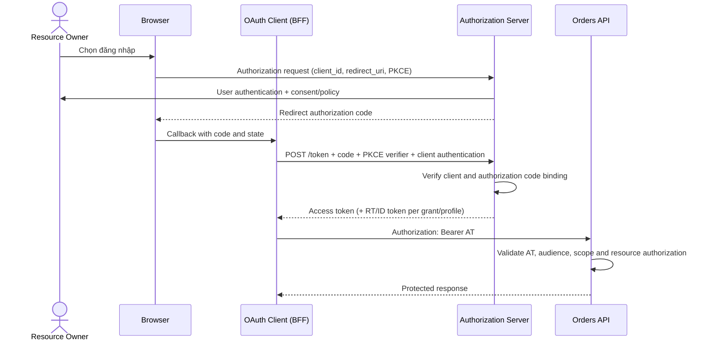
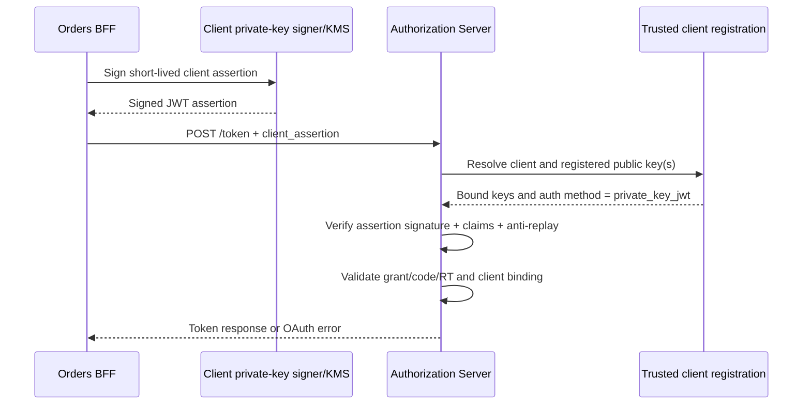
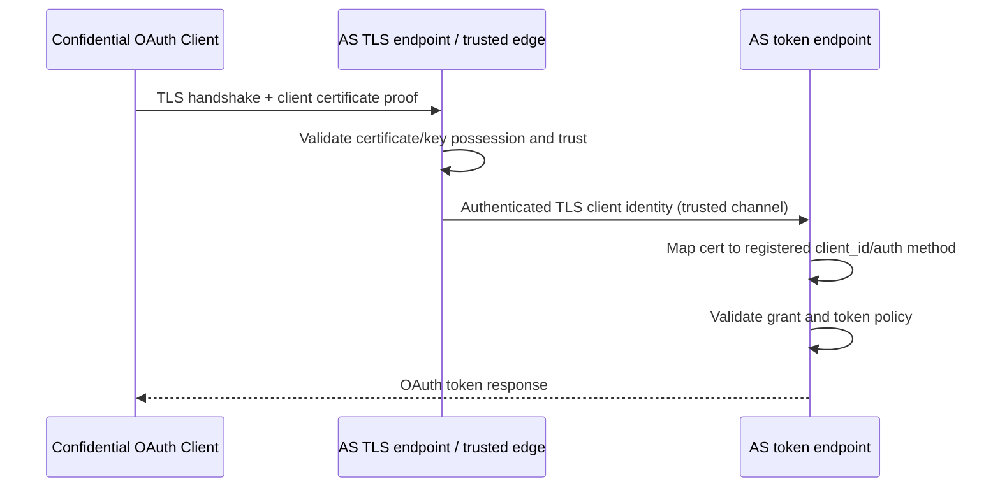
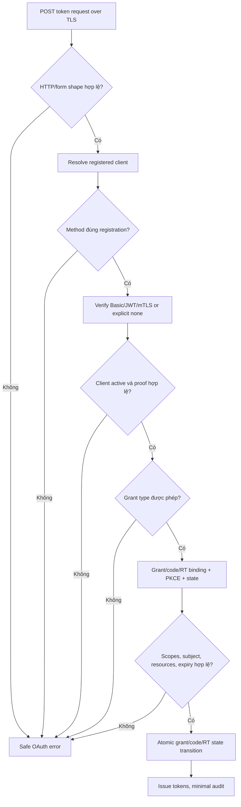

# Client authentication

## 1. Tình huống mở đầu: một chuỗi `client_id` có chứng minh được client không?

Một công ty triển khai OAuth 2.0 cho hệ thống Orders. Authorization Server (AS) cấp access token cho hai loại ứng dụng:

- **Orders BFF** chạy trên máy chủ của công ty, có thể bảo vệ secret/private key.
- **Orders SPA** chạy trong browser người dùng, mã JavaScript có thể tải và kiểm tra công khai.

Khi một client gửi đến token endpoint:

```http
POST /oauth2/token HTTP/1.1
Host: auth.example.com
Content-Type: application/x-www-form-urlencoded

grant_type=authorization_code&
code=<authorization_code>&
redirect_uri=https%3A%2F%2Fapp.example.com%2Fcallback&
client_id=orders-web
```

AS có thể xác định **request khai là từ client `orders-web`**, nhưng chưa có bằng chứng rằng caller thực sự giữ bí mật hoặc khóa của `orders-web`. `client_id` là **định danh**, không phải password hay bằng chứng sở hữu private key.

Nếu `orders-web` là **public client**, yêu cầu **không có client authentication** có thể hoàn toàn đúng theo registration. AS vẫn phải xác minh authorization code, redirect URI, PKCE `code_verifier`, client binding và các policy khác. Nếu `orders-web` là **confidential client** được đăng ký bắt buộc xác thực bằng `private_key_jwt`, request trên chưa đáp ứng yêu cầu.

Một kỹ sư đề nghị đưa `client_secret` của BFF vào bundle JavaScript để SPA “cũng thành confidential client”. Điều này là **lỗi thiết kế**: người dùng và attacker có thể tải/đọc bundle, vì vậy một secret tĩnh nhúng vào browser không thể chứng minh riêng danh tính ứng dụng.

Một kỹ sư khác nói: “Có PKCE nên khỏi cần xác thực client BFF nữa.” Đây cũng là **nhầm lẫn**: PKCE liên kết **authorization code** với bên có `code_verifier` theo transaction, còn client authentication chứng minh caller là **client đăng ký** theo phương thức được hỗ trợ. Với confidential client trong authorization code flow, hai cơ chế có thể được dùng **cùng nhau**.

> **Ý chính:** Client authentication trả lời: “Request này có bằng chứng được AS chấp nhận rằng caller đang hành động với danh tính OAuth client đã đăng ký hay không?” Nó **khác** user authentication, khác `client_id` identification, khác PKCE và khác việc xác minh access token ở Resource Server.

Bài **“Client authentication”** thuộc chương **Authorization server** của module `SECURITY_TOKEN_SECURITY_FUNDAMENTALS`. Trong phạm vi module, ta liên hệ việc xác thực client với **mô hình tin cậy/vòng đời security token**, JWT và opaque token, access/refresh token, OAuth 2.0/OpenID Connect, phát hành, kiểm tra claims/scope/audience, thu hồi và phòng chống token theft/replay.

## 2. Kết quả học tập

Sau bài này, bạn có thể:

1. Phân biệt OAuth **client identification, client authentication, user authentication, authorization grant** và resource-server token validation.
2. Giải thích khi nào client là **confidential** hoặc **public** dựa trên khả năng giữ credential bí mật ở môi trường thực thi.
3. Nhận biết `client_secret_basic`, `client_secret_post`, `client_secret_jwt`, `private_key_jwt`, `tls_client_auth`, `self_signed_tls_client_auth` và `none`.
4. Hiểu cách AS ràng buộc phương thức xác thực với **client registration** thay vì để request tự chọn phương thức yếu hơn.
5. Diễn giải HTTP Basic cho OAuth, cách biểu diễn form-urlencoded, TLS và hạn chế ghi log credential.
6. Hiểu JWT **client assertion**: `iss`, `sub`, `aud`, `exp`, `iat`, `jti`, header `alg/kid`, signature, replay protection.
7. Phân biệt **JWT dùng xác thực client** với ID token, JWT access token và JWT authorization grant assertion.
8. Hiểu OAuth **mutual TLS** gồm PKI-based và self-signed certificate authentication, cũng như certificate-bound access tokens.
9. Biết tại sao **PKCE, DPoP, redirect URI, CORS và `client_id`** không tự thay thế client authentication.
10. Thiết kế AS token endpoint có **authentication pipeline**, grant binding, atomic state và OAuth error handling.
11. Quản lý client secrets/keys: issuance, secure storage, rotation, revocation, credential compromise và multi-tenant isolation.
12. Kiểm thử impersonation, JWT assertion replay, key substitution, token/code theft, refresh-token use và cross-client grant confusion.

## 3. Bốn vai trò OAuth và ranh giới client authentication

OAuth 2.0 có các vai trò:

| Vai trò | Chức năng | Mối liên hệ với client authentication |
| --- | --- | --- |
| **Resource Owner** | Chủ thể có khả năng cấp quyền đối với tài nguyên | Thường là người dùng; **không phải** OAuth client |
| **Client** | Ứng dụng yêu cầu token/truy cập tài nguyên | Có thể cần chứng minh danh tính với AS |
| **Authorization Server (AS)** | Xác thực/cấp quyền theo grant và phát token | Xác minh client nếu method/endpoint yêu cầu |
| **Resource Server (RS)** | Cung cấp API/tài nguyên được bảo vệ | Xác minh access token/sender proof; không mặc nhiên dùng `client_secret` của client |



Trong sơ đồ, **người dùng đăng nhập** và **client xác thực với AS** là hai bước khác nhau. Một client có thể xác thực thành công nhưng không được cấp access token vì **authorization code sai, scope không được cấp, grant bị revoke hoặc resource owner từ chối**.

## 4. Năm câu hỏi khác nhau nhưng dễ bị nhầm

| Câu hỏi | Dữ liệu/cơ chế điển hình | Ai kiểm tra? |
| --- | --- | --- |
| **Client identification:** “Ứng dụng khai tên gì?” | `client_id` | AS |
| **Client authentication:** “Caller có chứng cứ cho client đó không?” | Secret, private-key JWT assertion, mTLS certificate | AS |
| **User authentication:** “Người dùng là ai?” | Login, passkey, MFA, OP session | AS/OP/IdP |
| **Authorization grant:** “Quyền nào được cấp bằng flow nào?” | Authorization code, refresh token, client credentials policy | AS |
| **Access-token validation:** “Request tới API có quyền gì?” | AT signature/introspection, `iss/aud/exp/scope/cnf` | RS |

### 4.1. Một client đã được xác thực chưa chắc có quyền

Giả sử client `orders-bff` xác thực thành công bằng private key, nhưng yêu cầu:

```text
grant_type=refresh_token
refresh_token=<refresh_token_of_a_different_client>
```

AS phải **từ chối** vì RT bị ràng buộc với **client/grant** khác, ngay cả khi `orders-bff` là confidential client thật.

**Client authentication là điều kiện cần ở nhiều flow, không phải giấy phép được xin mọi token.**

### 4.2. `client_id` được công khai theo thiết kế

Client IDs có thể xuất hiện trong authorization request:

```text
GET /authorize?
  response_type=code&
  client_id=orders-web&
  redirect_uri=https%3A%2F%2Fapp.example.com%2Fcallback&
  code_challenge=<challenge>&
  code_challenge_method=S256
```

Không thể dùng chính `client_id` làm shared secret. Một request khai `client_id=orders-web` không chứng minh app đó, tương tự việc một người tự khai tên trên biểu mẫu không phải xác minh danh tính.

### 4.3. Mỗi authentication method là một trust contract

Nếu một client đã đăng ký:

```text
client_id = orders-bff
token_endpoint_auth_method = private_key_jwt
allowed_jws_algorithms = [PS256]
registered_jwks = <trusted public signing key set>
```

thì request `client_id=orders-bff` kèm `client_secret_post` tự nghĩ ra **không được chấp nhận** chỉ vì server hỗ trợ method đó cho client khác. Để thay method, cần administrative/dynamic registration update có xác thực và kiểm soát.

## 5. Confidential và public clients: phân loại theo môi trường thực

OAuth 2.0 phân biệt:

- **Confidential client:** Có khả năng giữ client credentials bí mật với AS, hoặc sử dụng phương thức xác thực bảo đảm theo registration.
- **Public client:** Không thể giữ client credentials bí mật theo threat model thông thường của môi trường thực thi.

### 5.1. So sánh ví dụ

| Ứng dụng | Thường là loại gì? | Lý do |
| --- | --- | --- |
| Backend web app/BFF | **Confidential** | Secrets/private keys lưu phía server |
| Daemon/service-to-service | **Confidential** | Credential trong runtime được quản trị |
| Server-side batch job | **Confidential** nếu bảo vệ credential phù hợp | Không phát source/secret đến end user |
| Browser SPA thuần | **Public** | Mã JS và credentials nhúng có thể quan sát |
| Native mobile app cài trên máy người dùng | **Public** theo mô hình thông thường | Binary/config có thể bị trích xuất |
| Desktop CLI phát hành cho người dùng | **Public** nếu không có secret per installation được bảo vệ và được AS tin | Client code/secret có thể bị sao chép |
| TV/IoT thiết bị có phần cứng/đăng ký chứng chỉ riêng | **Phụ thuộc deployment/profile** | Có thể có bảo vệ key/hardware đáng tin, không tự suy từ loại thiết bị |

**Phân loại không chỉ dựa trên tên framework**. Một “web app” có thể vừa chứa **frontend public** vừa có **BFF confidential**; đó là hai trust boundaries cần phân biệt.

### 5.2. Vì sao secret nhúng trong SPA không dùng để xác thực client?

```js
// SAI: bất kỳ ai tải JS bundle đều có thể lấy giá trị này.
const clientId = "orders-spa";
const clientSecret = "my-super-secret-in-public-bundle";
```

Việc build minify/obfuscate hoặc mã hóa secret bằng key cũng nằm trong bundle **không biến nó thành confidential**. AS không thể phân biệt user hợp lệ và attacker đã sao chép cùng secret đó.

### 5.3. Native app với “một secret cho mọi bản cài”

Nếu APK/IPA có cùng client secret cho tất cả máy, attacker trích xuất một lần có thể mạo danh mọi bản cài. Một số môi trường sử dụng **per-instance keys, hardware-backed attestations hoặc dynamic registration** để tăng assurance; đây là thiết kế riêng với threat model/key lifecycle, **không phải lý do để gắn nhãn mọi mobile app là confidential**.

### 5.4. Public client vẫn phải được kiểm soát

Đối với public client, AS có thể chấp nhận `token_endpoint_auth_method=none`, nhưng vẫn cần:

- Đăng ký `client_id` và policy allowed grant types.
- Strict redirect URI matching cho Authorization Code.
- **PKCE S256** để ràng buộc authorization code với code verifier khi áp dụng.
- Authorization code single-use, expiration, client and redirect binding.
- RT rotation hoặc sender-constraining theo OAuth security BCP.
- Scope/resource/audience limits.
- User authentication/consent và risk policy.
- Rate limit, telemetry và revocation.

**Không client authentication ≠ không security checks.**

## 6. Các phương thức client authentication thường gặp

| Method | Chứng cứ | Phù hợp chủ yếu với | Đánh đổi/chú ý |
| --- | --- | --- | --- |
| `client_secret_basic` | Shared secret qua HTTP Basic Authorization | Confidential client | Dễ hỗ trợ; secret phải bảo vệ/TLS; header logging |
| `client_secret_post` | Shared secret trong form body | Confidential client | Hạn chế dùng nếu có lựa chọn tốt hơn; body logging/leak |
| `client_secret_jwt` | HMAC-signed JWT client assertion | Confidential client | Shared key; JWT `aud/exp/jti` và alg validation |
| `private_key_jwt` | Asymmetric-signed JWT client assertion | Confidential client | Public verification key đăng ký; private key rotation/replay checks |
| `tls_client_auth` | Client certificate được CA/trust chain và identity binding xác minh | Confidential/mTLS profile | Certificate PKI, TLS termination, cert lifecycle |
| `self_signed_tls_client_auth` | Client chứng minh sở hữu private key của cert đã đăng ký | Confidential/mTLS profile | Client cert registration/pinning, key rotation |
| `none` | Không có authentication proof; `client_id` chỉ identify | Public client | PKCE/grant checks vẫn cần; không dùng client_credentials grant mặc định |

Tập method được AS hỗ trợ phụ thuộc **server metadata, client registration, endpoint** và phiên bản OAuth/OIDC/profile. Bảng không tuyên bố mọi AS bắt buộc triển khai tất cả.

### 6.1. Secret-based và asymmetric authentication

```text
Shared secret:
   Client and AS both know secret.
   Either holder can create valid MAC/shared-secret proof.

Asymmetric:
   Client signs with its private key.
   AS verifies using a registered public key.
   AS does not need client's private signing key.
```

Asymmetric method giảm nhu cầu phân phối **client signing secret** đến AS. Tuy nhiên AS vẫn phải quản lý **registered key binding**, expiry/replay/key rotation và không được tự tin mọi key do request gửi đến.

### 6.2. Không gửi đồng thời nhiều phương thức

Một request token endpoint không nên cùng lúc:

```http
Authorization: Basic <client_credentials>
```

và:

```text
client_secret=<another_secret>
client_assertion=<jwt_assertion>
```

để server “thử method nào được thì dùng”. OAuth 2.0 hạn chế dùng **nhiều phương thức xác thực trong cùng request**. AS nên từ chối ambiguity và không tạo algorithm/method downgrade fallback.

### 6.3. Một client, nhiều credentials trong giai đoạn rotate

Một client có thể được AS cho phép **nhiều credential versions cùng một method** trong thời gian overlap. Ví dụ hai public signing keys `kid=old/new` thuộc client đã đăng ký. Điều này **khác** việc request tùy ý chuyển giữa `private_key_jwt` và `client_secret_post`.

## 7. `client_secret_basic` theo OAuth 2.0

**HTTP Basic authentication** dùng header:

```http
POST /oauth2/token HTTP/1.1
Host: auth.example.com
Authorization: Basic <base64-of-form-encoded-client-id-colon-secret>
Content-Type: application/x-www-form-urlencoded
Accept: application/json

grant_type=client_credentials&scope=orders.read
```

Đây là **mẫu định dạng**, không phải credential thật.

### 7.1. Dùng Basic khác gửi `client_id` trực tiếp

AS có `client_id` để tìm registration. Header Basic mang **bằng chứng shared secret**, nếu secret chưa lộ và đã được cấp đúng client. Đó là lý do khác với public-client request chỉ có `client_id`.

### 7.2. Encoding của OAuth client credentials trong Basic

Theo RFC 6749 §2.3.1, `client_id` và `client_secret` được **mã hóa riêng** theo `application/x-www-form-urlencoded` rồi nối bằng dấu `:`, sau đó encode **Base64 chuẩn HTTP Basic**, không phải Base64url.

```text
client_id_raw     = orders:bff
client_secret_raw = p@ss:word+1

id_encoded     = formEncode(client_id_raw)
secret_encoded = formEncode(client_secret_raw)

userpass = id_encoded + ":" + secret_encoded
Authorization = "Basic " + BASE64(UTF8(userpass))
```

Nếu ID/secret có dấu `:`, spaces hoặc ký tự đặc biệt, việc encode trước khi nối giúp tránh nhập nhằng. **Không tự code `Base64(client_id + ":" + client_secret)` rồi giả định luôn đúng**.

### 7.3. Secret qua Basic có được mã hóa không?

**Base64 không phải encryption.** Basic header chỉ là representation. Cần HTTPS/TLS xác thực endpoint AS, không log Authorization header, không gửi credential qua redirects/untrusted hosts.

### 7.4. Tránh client_secret ở URL

Sai:

```text
https://auth.example.com/token?client_id=orders-bff&client_secret=...
```

HTTP URI query có thể lộ trong logs/history/telemetry. Dùng POST và method theo registration.

### 7.5. Client secret không chứng minh user là ai

Client_credentials request:

```text
grant_type=client_credentials
client authentication: orders-worker
scope=orders.read
```

thường cấp token theo **client/service identity**, không tạo user authentication vì không có user đăng nhập. Với Authorization Code flow, user authentication là bước tại AS/OP riêng.

## 8. `client_secret_post`: có hỗ trợ nhưng cần cân nhắc

Một confidential client có thể gửi form body:

```http
POST /oauth2/token HTTP/1.1
Host: auth.example.com
Content-Type: application/x-www-form-urlencoded

grant_type=client_credentials&
client_id=orders-worker&
client_secret=<client_secret>&
scope=orders.read
```

### 8.1. Rủi ro vận hành

- Request body có thể được application/framework logs hoặc APM ghi lại.
- Form parsers/middleware dễ lưu raw payload để debug.
- Secret leak qua traces/crash dumps.
- Nếu proxy/cache/loggers cấu hình sai, body có thể bị lộ.

RFC 6749 cho phép body credentials trong một số trường hợp nhưng **không khuyến nghị phương thức này so với HTTP Basic khi Basic có thể dùng**. AS cần áp policy riêng, không coi method này an toàn hơn chỉ vì header không chứa secret.

### 8.2. Không nhầm form body với JWT client assertion

Hai form fields:

```text
client_id=orders-worker
client_secret=<secret>
```

là shared-secret POST authentication. Còn:

```text
client_assertion_type=urn:ietf:params:oauth:client-assertion-type:jwt-bearer
client_assertion=<signed_JWT>
```

là **JWT client assertion**; việc JWT được gửi trong form không làm nó trở thành `client_secret_post`.

## 9. `private_key_jwt`: dùng chữ ký bất đối xứng làm client assertion

Trong OAuth/OIDC, một confidential client có thể đăng ký **public signing key** (JWK/JWKS) với AS và dùng **private signing key** để tạo JWT client assertion mỗi lần gọi endpoint được hỗ trợ.



### 9.1. JWT client assertion trông như thế nào?

Protected header minh họa:

```json
{
  "alg": "PS256",
  "typ": "JWT",
  "kid": "orders-bff-signing-2026-01"
}
```

Claims minh họa (timestamps chỉ là dữ liệu giả):

```json
{
  "iss": "orders-bff",
  "sub": "orders-bff",
  "aud": "https://auth.example.com/oauth2/token",
  "iat": 1900000000,
  "exp": 1900000060,
  "jti": "assertion-unique-9fe2"
}
```

Các claim thường có ý nghĩa:

| Claim | Vai trò |
| --- | --- |
| `iss` | Issuer của assertion; trong profile client authentication này thường là **client ID** |
| `sub` | Subject; trong profile này thường là **client ID** |
| `aud` | AS/token endpoint audience theo profile/registration |
| `exp` | Thời hạn assertion; nên ngắn và được AS kiểm tra |
| `iat` | Thời điểm assertion phát hành; phục vụ freshness policy |
| `jti` | ID riêng để AS phát hiện assertion replay nếu profile/chính sách yêu cầu |
| `nbf` | “Không trước thời điểm” nếu có; AS phải kiểm tra |
| `alg/kid` | Thuật toán/ký hiệu chọn key theo registered trust config |

**Không dùng timestamps giả ở trên trong test thật** nếu chúng đã ở quá khứ/tương lai. Client cần tạo assertion ở thời điểm thực, với clock-skew policy phù hợp.

### 9.2. Gửi assertion đến token endpoint

```http
POST /oauth2/token HTTP/1.1
Host: auth.example.com
Content-Type: application/x-www-form-urlencoded
Accept: application/json

grant_type=client_credentials&
scope=orders.read&
client_id=orders-bff&
client_assertion_type=urn%3Aietf%3Aparams%3Aoauth%3Aclient-assertion-type%3Ajwt-bearer&
client_assertion=<signed_jwt>
```

Khi dùng `application/x-www-form-urlencoded`, giá trị phải được form-encode đúng; line breaks trong ví dụ chỉ để đọc dễ hơn.

### 9.3. Những gì AS phải kiểm tra

1. Client ID xác định một registration **có tồn tại, active và được phép method `private_key_jwt`**.
2. JWT assertion có đúng **JOSE profile** và allowed signing algorithm.
3. Key `kid` chỉ chọn trong **registered public keys của client đó**, không tự tải từ untrusted `jku/x5u`.
4. Signature hợp lệ theo **trusted registered key**, key type/use/alg đúng.
5. `iss` và `sub` khớp **client identity** theo RFC 7523/OIDC profile; không nhận assertion của client khác.
6. `aud` khớp **AS audience** được kỳ vọng theo profile; không cho token dùng ở AS khác hoặc endpoint khác nếu chưa thỏa registration rules.
7. `exp` chưa hết hạn, `iat/nbf` được xử lý theo clock/freshness policy.
8. `jti` uniqueness/replay policy khi được yêu cầu, kết hợp issuer/client identity và acceptance window.
9. JWT **client assertion** được dùng **chỉ để xác thực client**, không tự cấp resource owner grant hay scope.
10. Grant-specific checks: code/PKCE/redirect, RT/client binding, allowed grants/scopes/resources.

### 9.4. `kid` không tự chứng minh client identity

Sai:

```text
client_assertion.header.kid = "some-key"
AS downloads attacker-provided JWK URL
AS sees valid signature under attacker key
AS treats iss=orders-bff as authenticated
```

Đúng là chỉ dùng key **đã được client đăng ký qua kênh đáng tin**, với client ID, key IDs, alg allowlist và rotation status được ràng buộc.

### 9.5. JWT assertion không phải OAuth access token

Một client assertion được ký có thể có hình thức **JWS JWT ba phần**, giống JWT access token. Nhưng:

- `aud` của client assertion nhắm **AS/token endpoint** theo profile.
- `sub` thường là **client_id**, không phải user đang truy cập Orders.
- Nó không có semantics của access token/ID token.
- RS không nên chấp nhận assertion làm `Authorization: Bearer`.
- AS không nên chấp nhận ID token hay JWT AT làm client assertion.

Đây là ví dụ điển hình của **cross-JWT/token-type confusion**.

## 10. `client_secret_jwt`: JWT assertion ký bằng shared secret

`client_secret_jwt` cũng gửi JWT client assertion, nhưng chữ ký là **HMAC/MAC dựa trên client secret** được chia sẻ với AS.

```text
Confidential Client:
  client_id = orders-worker
  shared client secret = K
  client assertion JWS alg = HS256 (ví dụ)
  signature/MAC = HMAC(K, signing_input)

Authorization Server:
  look up registered client secret K
  verify JWS MAC
  verify iss/sub/aud/exp/jti and registered policy
```

### 10.1. Khác với `private_key_jwt` thế nào?

| Thuộc tính | `client_secret_jwt` | `private_key_jwt` |
| --- | --- | --- |
| Cryptographic method | HMAC/shared secret | Asymmetric signature |
| AS có gì? | Shared secret hoặc khả năng xác minh tương ứng | Registered public key |
| Client có gì? | Shared secret | Private signing key |
| AS có thể tạo assertion hợp lệ nếu giữ material ký? | Có, vì shared secret | Không cần/private key không ở AS |
| Key rollover | Rotate shared secrets | Rotate keypairs/registered JWKS |
| JWT claim checks | Cần | Cần |
| JWT replay defense | Cần theo profile/policy | Cần theo profile/policy |
| JS browser suitability | Không phải static secret an toàn | Không nhúng private signing key static trong JS bundle |

Dùng `client_secret_jwt` không làm secret tự an toàn hơn chỉ vì nó được bọc thành JWT. Nó mang ưu điểm short-lived assertion/audience binding nhưng vẫn dựa trên **secret phía client**.

### 10.2. Secret entropy và algorithm policy

Một HMAC client assertion chỉ an toàn nếu secret đủ entropy, được quản lý đúng và sử dụng thuật toán phù hợp. Không chọn secret ngắn như `password123` hay nhận `alg=none`. AS phải ràng buộc `alg` với registration, không thử tất cả thuật toán cho tới khi signature pass.

## 11. mTLS: xác thực client bằng certificate/private key

**Mutual TLS (mTLS)** là TLS nơi **cả server và client** tham gia certificate-based authentication theo profile. OAuth 2.0 mTLS client authentication được mô tả trong **RFC 8705**.



### 11.1. Hai phương thức OAuth mTLS

| Method | Nguồn tin cậy | Kiểm tra cốt lõi |
| --- | --- | --- |
| `tls_client_auth` | PKI/trusted CA/certificate subject binding | Chứng chỉ hợp lệ theo PKI và khớp identity/SAN được đăng ký |
| `self_signed_tls_client_auth` | Public certificate/key đã đăng ký cho client | Client chứng minh sở hữu private key của cert tương ứng; cert matches registration |

Không suy ra hai phương thức có cùng PKI validation rules. Chúng có cách **ràng buộc certificate vào OAuth registration** khác nhau.

### 11.2. Phân biệt client authentication với certificate-bound AT

RFC 8705 còn mô tả **certificate-bound access tokens**. Hai tính chất:

1. **mTLS client authentication tại AS**: client dùng TLS certificate để AS xác thực danh tính client khi xin token.
2. **mTLS-bound access token tại RS**: RS kiểm tra chứng chỉ TLS client khi dùng AT khớp token confirmation binding (chẳng hạn `cnf["x5t#S256"]`).

Một AS có thể cần hai bước riêng ở hai endpoints. **Xác thực client tại AS không tự chứng minh request tới RS giữ certificate đúng**, và một access token bearer không tự trở thành sender-constrained chỉ vì token từng được lấy bằng mTLS.

### 11.3. TLS termination qua gateway

Nếu client TLS terminate ở gateway:

- Gateway phải thực sự xác minh client certificate và holder proof.
- AS backend chỉ nhận verified identity từ **trusted authenticated internal channel**.
- Bỏ hoặc ghi đè header certificate identity do Internet caller tự gửi.
- Không coi `X-Client-Cert` hoặc `X-Forwarded-Client-Cert` do client tự khai là cryptographic authentication.
- Đảm bảo end-to-end issuer/client binding dù có reverse proxy và load balancer.
- Xử lý mTLS endpoint aliases/metadata theo RFC 8705 nếu AS công bố.

### 11.4. Certificate rollover

Client certificate có expiration/revocation/rotation riêng. Khi rotate:

- Đăng ký certificate/key mới trước khi gửi request bằng cert mới.
- Cấp quyền certificate identities chính xác cho client.
- Hỗ trợ overlap ngắn có kiểm soát nếu policy cho phép.
- Không để một cert hợp lệ cho client A xác thực thành client B.
- Theo dõi key/certificate compromise, TLS trust-chain changes và expiry.

## 12. DPoP không mặc định là client authentication

**DPoP (RFC 9449)** dùng proof-of-possession của một key để ràng buộc token và HTTP request.

Đặc biệt:

- DPoP proof có thể được trình ở token endpoint để AS gắn AT/RT với key.
- DPoP-bound AT phải kèm proof hợp lệ ở RS.
- DPoP proof có `htm/htu/iat/jti` và các claims bổ sung như `ath/nonce` theo endpoint/profile.

Nhưng **một proof DPoP tự tạo bởi public client với public JWK trong header không chứng minh caller là confidential client đã đăng ký**. Bất kỳ ai có thể tạo keypair và ký proof mới; chưa có ràng buộc **key ↔ client registration** theo phương thức xác thực OAuth.

```text
DPoP:
  "I can sign with this key for this HTTP request."

Client authentication:
  "This signing/secret/certificate proof is registered and trusted
   for THIS OAuth client identity."

These statements may be combined in certain profiles,
but one does not automatically imply the other.
```

Đừng tự lấy `jwk` từ một DPoP proof rồi coi nó là registered public key của `private_key_jwt` nếu không có **trusted registration/binding**.

## 13. PKCE là proof của authorization transaction, không là client secret

**PKCE (RFC 7636)** bảo vệ Authorization Code flow bằng `code_challenge/code_verifier`. Khách hàng tạo high-entropy verifier, gửi challenge trong authorization request rồi gửi verifier ở token endpoint.

```text
Authorization request:
  client_id=C
  code_challenge=BASE64URL(SHA256(code_verifier))
  code_challenge_method=S256

Token request:
  grant_type=authorization_code
  code=C0
  client_id=C (public client, if required)
  code_verifier=original_high_entropy_verifier
```

AS kiểm tra code/challenge/verifier và client/redirect/grant binding. PKCE chứng minh bên đổi code biết verifier **liên quan đến authorization request**; nó **không tự tạo một secret riêng cố định cho toàn bộ client identity**.

### 13.1. Confidential client vẫn có thể dùng PKCE

Ví dụ BFF:

```text
client_authentication = private_key_jwt
authorization_code_protection = PKCE S256

Both apply:
  client has registered private signing key
  request has code verifier for this login transaction
```

**Không loại bỏ PKCE chỉ vì confidential client có client secret**, nhất là khi security BCP/profile yêu cầu hoặc khuyến nghị PKCE.

### 13.2. Public client không có client secret không đồng nghĩa chỉ cần client_id

Authorization Code flow cho public clients phải có protections phù hợp:

- Correct client registration/redirect URI.
- PKCE S256.
- Code expiration/single use.
- State/issuer binding cho callback, OIDC nonce nếu cần.
- Token endpoint grant binding.
- No permissive fallback to Code-only token exchange when PKCE expected.

### 13.3. OAuth client authentication và OIDC user authentication

OIDC **ID token** dùng để chứng minh authentication event/user claims cho Relying Party theo profile. Nó **không dùng thay client assertion để xác thực confidential client** trừ khi một explicit extension/trust contract quy định khác — không tự chấp nhận token chỉ vì nó có chữ ký OP.

## 14. Client authentication diễn ra tại endpoint nào?

Không phải mọi endpoint của Authorization Server đều có cùng policy.

| Endpoint | Mục tiêu | Client authentication / identification |
| --- | --- | --- |
| **Authorization endpoint** `/authorize` | Người dùng/AS xử lý authorization request | Thường dùng `client_id` để **identify**; không gửi client secret qua browser |
| **Token endpoint** `/token` | Đổi code/refresh token hoặc xin token theo grant | Confidential client phải xác thực theo registered method; public client theo `none` + grant protections |
| **Token revocation** `/revoke` (RFC 7009) | Thu hồi token/grant | Confidential client auth theo policy; public client identification/binding |
| **Token introspection** `/introspect` (RFC 7662) | RS/caller có quyền hỏi trạng thái token | Endpoint **phải được bảo vệ/authorization**; dùng client auth hoặc cơ chế khác AS quy định |
| **Pushed Authorization Request (PAR)** `/par` (RFC 9126) | Client gửi authorization parameters trực tiếp đến AS | Xác thực client khi applicable/required theo registration/profile |
| **Device authorization endpoint** (RFC 8628) | Khởi tạo Device Authorization Grant | Public clients có thể identify; confidential clients xác thực khi được yêu cầu |
| **UserInfo** trong OIDC | Cung cấp thông tin người dùng đã xác thực | Thường bảo vệ bằng access token; **không phải token endpoint client authentication** |
| **JWKS/metadata endpoint** | Công bố public configuration/keys | Thường public; key trust dựa trusted issuer/config |

### 14.1. Vì sao không gửi client secret đến `/authorize`?

Authorization endpoint được truy cập qua **user agent/front-channel**:

```text
Browser URL:
  https://auth.example.com/authorize?
  response_type=code&
  client_id=orders-bff&
  redirect_uri=...&
  state=...&
  code_challenge=...
```

Nếu đặt `client_secret` vào URL, secret có thể xuất hiện trong browser history, proxies, logs, referrers và developer tools. Confidential clients giữ secret phía backend và dùng nó tại endpoint thích hợp.

### 14.2. Resource Server có cần biết client secret?

**Không.** RS chủ yếu xác minh **access token** bằng issuer trust, JWT public keys, introspection hoặc token proof (DPoP/mTLS). RS không nên thu thập `client_secret` của các OAuth clients để “kiểm tra AT”. AS signing key dùng ký access token khác **client private key** dùng tạo `private_key_jwt`.

### 14.3. Introspection authentication không nhất thiết là “client của token”

Một RS có thể xác thực bằng **credential của chính RS** tại AS introspection endpoint; credential này có thể khác OAuth client đã được cấp token. AS phải authorization introspection caller để tránh token existence/PII leakage.

### 14.4. Revocation và quyền thu hồi

Một client đã xác thực không được phép revoke token của client khác chỉ vì biết chuỗi token. AS phải áp token ownership, client/grant binding và RFC 7009 handling. Response 200 có thể được dùng cho token đã revoked/unknown nhằm không xác nhận sự tồn tại của token.

## 15. Đăng ký client là nguồn tin cậy của authentication policy

Một registration có thể gồm:

```json
{
  "client_id": "orders-bff",
  "client_type": "confidential",
  "token_endpoint_auth_method": "private_key_jwt",
  "token_endpoint_auth_signing_alg": "PS256",
  "redirect_uris": ["https://app.example.com/oauth/callback"],
  "grant_types": ["authorization_code", "refresh_token"],
  "jwks_uri": "https://app.example.com/oauth/client-jwks.json"
}
```

**Ví dụ minh họa**, không phải schema đầy đủ hoặc metadata phải có ở mọi AS. Trường `client_type` và các trường tùy registration standard/server. Các trường bắt buộc thực tế theo contract của AS.

### 15.1. Registration khác token-supplied claims

```text
Trusted client registration:
   method=private_key_jwt
   allowed_algs=[PS256]
   signing_key_set=<registered keys>
   allowed_grants=[authorization_code, refresh_token]

Untrusted token request:
   client_id=orders-bff
   assertion.header.alg=PS256
   assertion.header.kid=key-01
```

AS dùng request để **chọn candidate**, không để request **sửa policy**. Nếu JWT header ghi `alg=HS256` trong khi registration chỉ chấp nhận PS256, reject. Nếu untrusted `jku` trỏ JWKS attacker, không đổi key set theo đó.

### 15.2. Discovery metadata của AS

OAuth Authorization Server Metadata (RFC 8414) và OIDC Discovery có thể công bố:

```json
{
  "issuer": "https://auth.example.com",
  "token_endpoint": "https://auth.example.com/oauth2/token",
  "token_endpoint_auth_methods_supported": [
    "client_secret_basic",
    "private_key_jwt",
    "tls_client_auth"
  ],
  "token_endpoint_auth_signing_alg_values_supported": [
    "PS256",
    "RS256"
  ]
}
```

Metadata cho biết **server hỗ trợ method/algorithm nào**; không cho phép mỗi client tùy ý dùng tất cả. **Client registration** mới xác định phương thức, keys, permissions của client cụ thể.

### 15.3. Khi registration thiếu trường method

Một số registration standards có **giá trị mặc định** (ví dụ OAuth Dynamic Client Registration quy định default `token_endpoint_auth_method` theo phạm vi của tiêu chuẩn). AS phải áp dụng đúng default/profile tương ứng; không tự đoán method bằng cách thử secret, JWT, mTLS rồi `none`.

### 15.4. Public client `none` là một lựa chọn có chủ đích

```json
{
  "client_id": "orders-spa",
  "token_endpoint_auth_method": "none",
  "grant_types": ["authorization_code", "refresh_token"],
  "redirect_uris": ["https://app.example.com/callback"]
}
```

AS vẫn dùng `client_id` để tra registration và bind grant. **Không đưa shared secret của SPA vào request chỉ để client “trông an toàn hơn”**.

## 16. Client authentication và kiểm tra authorization code

Với Authorization Code Grant, secure token exchange cần:

1. Xác thực client **nếu là confidential client và method yêu cầu**.
2. Xác minh authorization code **đúng client** đã được cấp code.
3. Xác minh `redirect_uri` nếu ràng buộc trong authorization request/flow.
4. Xác minh PKCE `code_verifier` tương ứng `code_challenge` đã lưu.
5. Kiểm tra code **chưa hết hạn, chưa used, chưa revoked**.
6. Kiểm tra issuer/authorization transaction/grant state.
7. **Atomically consume code** để không có hai exchanges thành công.
8. Phát tokens với audience, scope, subject/client binding và expiration đúng policy.

### 16.1. Vì sao xác thực client không đủ chống code injection?

Attacker có thể cố đưa code thuộc transaction khác vào callback của client. Nếu AS chỉ kiểm tra private-key assertion mà không gắn code với client/redirect/PKCE, người dùng có thể bị session/account confusion.

```text
Correct boundary:
  registered client authentication
  + authorization code bound to same client
  + PKCE verifier for same authorization request
  + redirect URI / state / issuer checks
  + single-use issuance
```

### 16.2. Client A không đổi được code của client B

```text
code C_B issued for client B
client A authenticates successfully at token endpoint
client A submits C_B
AS rejects: grant belongs to another client
```

Dù hai clients do cùng công ty sở hữu, code grant binding không được bypass theo tên tổ chức/tenant.

### 16.3. Public client cũng phải ràng buộc code với client ID

Không có confidential proof không cho AS quyền bỏ qua code binding. Request `client_id=B` mà code được cấp cho A phải bị từ chối; PKCE cũng không làm code chuyển chủ sở hữu.

## 17. Client authentication và refresh-token lifecycle

Refresh token (RT) cho phép client xin AT mới, nên client impersonation ở token endpoint có thể kéo dài quyền sử dụng grant.

### 17.1. RT được ràng buộc với client

Một AS kiểm tra:

```text
refresh_token RT:
  grant_id = G
  client_id = orders-bff
  token_family_id = F
  subject = user-123
  allowed_scope = orders:read
  allowed_resource = orders-api
  state = ACTIVE
```

Khi nhận:

```text
authenticated_client_id = billing-worker
grant_type=refresh_token
refresh_token=RT
```

AS phải từ chối vì client B không sở hữu RT cấp cho A. Không có quyền “đổi RT bất kỳ” chỉ vì caller là một confidential client hợp lệ.

### 17.2. Shared client secret bị lộ có nghĩa gì?

Nếu attacker biết secret của `orders-bff`:

- Có thể xác thực như client đó ở endpoints cho phép nếu thiếu kiểm soát bổ sung.
- Có thể dùng RT/code bị đánh cắp cùng lúc để xin tokens nếu grant binding/phương thức khác không đủ ngăn.
- **Không tự động lấy được mọi token của mọi user**: vẫn cần code/grant/RT hoặc service grant tương ứng.
- `client_credentials` có thể bị lạm dụng trực tiếp nếu client được phép grant đó.

Đó là lý do **least-privilege grants/scopes, credential storage và rotation** quan trọng.

### 17.3. Refresh-token rotation không thay client authentication

```text
RT0 + correct confidential client authentication
  -> atomic consume RT0
  -> AT1 + RT1

RT0 reuse
  -> invalid_grant / reuse detection
  -> possible family revocation
```

AS cần cả **client identity** và **single-use RT/family state**. Chỉ verify JWT client assertion không ngăn RT0 dùng hai lần nếu rotation transaction lỗi.

### 17.4. Public RT cần replay protections

Public clients không có static secret. RFC 9700 quy định public-client refresh token protection bằng **sender-constraining hoặc rotation** theo điều kiện áp dụng. AS ràng buộc RT với client/grant và áp timeout/revocation.

## 18. Client Credentials Grant: không phải user login

OAuth `grant_type=client_credentials` dùng client authentication/authorization để cấp access token cho chính client hoặc theo service arrangement đã cấu hình.

```http
POST /oauth2/token HTTP/1.1
Host: auth.example.com
Authorization: Basic <registered-client-credential>
Content-Type: application/x-www-form-urlencoded

grant_type=client_credentials&scope=orders.read
```

### 18.1. Điều gì được cấp?

Access token có thể mang identity/capability của **service client**, ví dụ:

```json
{
  "iss": "https://auth.example.com",
  "sub": "orders-batch-worker",
  "aud": "https://orders-api.example.com",
  "scope": "orders.read",
  "exp": 1900003600
}
```

Claims/profile phụ thuộc AS. **Không tự coi `sub` luôn là người dùng thật** trong client-credentials token; RS cần phân biệt user-delegated vs service-to-service token semantics.

### 18.2. AS phải kiểm tra allowed grant

Một confidential client chỉ được đăng ký `authorization_code` không được gửi `grant_type=client_credentials` để lấy service token nếu chưa được cấp. AS phải check authenticated client, allowed grants/scopes/resources/audiences, tenant policy, quotas và token lifetime.

### 18.3. Không cấp RT nếu không cần

RFC 6749 về Client Credentials Grant nêu refresh token **SHOULD NOT** được bao gồm trong response. Confidential client có thể xác thực lại để xin AT, nên RT thường tạo rủi ro và độ phức tạp không cần thiết.

## 19. Chống phát lại JWT client assertion

Một `private_key_jwt` assertion có chữ ký hợp lệ vẫn có thể bị sao chép và trình lại trong thời gian `exp` chưa hết hạn. **Chữ ký chứng minh key holder ký message, không tự chứng minh message chỉ được dùng một lần.**

```text
T0  orders-bff ký assertion J0:
      iss=orders-bff, aud=AS, jti=abc, exp=T0+60s
T1  AS chấp nhận J0 để xác thực client.
T2  Kẻ tấn công lấy bản sao J0 và gửi lại.
T3  Nếu AS chỉ kiểm tra chữ ký + exp, assertion vẫn hợp lệ.
```

### 19.1. `jti` theo client và issuer

Nhiều AS yêu cầu client assertion có **unique `jti`** và dùng replay cache trong acceptance window. Yêu cầu cụ thể về `jti` phụ thuộc RFC/profile/AS policy; không khẳng định mọi client assertion của mọi profile đều có cùng một quy tắc.

Replay key logic:

```text
replay_key = HMAC(
  server_replay_key,
  lengthPrefix(as_issuer, client_id, assertion_jti)
)
```

Phải kiểm tra các claims, signature, key/algorithm trust **trước** khi đưa assertion vào cache để tránh attacker lấp cache bằng untrusted dữ liệu.

### 19.2. Atomic insert-if-absent

Sai:

```text
if not cache.exists(clientId, jti):
    issueToken()
    cache.put(clientId, jti)
```

Hai AS pods có thể đọc đồng thời và cùng cấp token. Đúng:

```text
verifySignatureAndClaims()
inserted = atomicInsertIfAbsent(replayKey, ttl)
if not inserted:
    reject("invalid_client")
validateGrantAndIssueToken()
```

Ví dụ Redis concept:

```text
SET client-assertion-replay:<keyed-digest> "1" NX EX 120
```

TTL 120 giây chỉ minh họa; phải bao phủ accepted lifetime cùng clock-skew margin. Redis timeout không phải `key absent` và không được dẫn tới fail-open.

### 19.3. Không áp single-use cho Basic secret

`client_secret_basic` dùng cùng secret để xác thực nhiều requests. Không chặn request thứ hai chỉ vì cùng secret: khác với JWT assertion `jti` và refresh-token single-use. Nếu secret bị lộ, cần rotate/revoke và kiểm soát risk, không chỉ lưu một key `seen:client_id`.

### 19.4. Retry client assertion khác retry grant

Khi response lỗi mạng, client có thể tạo assertion mới theo profile, nhưng authorization code hoặc RT cũ có thể **đã bị consumed**. Đừng retry mù quáng:

- JWT assertion J1 có thể mới và hợp lệ.
- Authorization code C0 được dùng một lần.
- RT rotation RT0 chỉ có một lần consume thành công.
- Client-credentials requests có thể cấp nhiều AT nếu client được phép.

Đây là **các ranh giới sử dụng một lần khác nhau**.

## 20. Audience của client assertion và cross-AS confusion

Client tích hợp nhiều AS:

```text
AS-A: https://auth.example.com/oauth2/token
AS-B: https://login.partner.example/oauth/token
```

AS-B không được nhận client assertion ký cho AS-A chỉ vì cùng public signing key.

- `aud` phải chứa **đối tượng được xác định theo profile/registration**.
- Không dùng substring/loose prefix comparison.
- Không lấy expected audience từ attacker-controlled `Host` hoặc forwarded headers.
- Nếu AS có issuer URLs/token endpoint aliases, quy tắc audience cần được cấu hình rõ.
- Không dùng key trust thay kiểm tra client/tenant/issuer binding.

**Lưu ý:** Có profile yêu cầu `aud` là token endpoint URL; có AS/profile cho phép issuer identifier. Tuân exact audience values theo agreed profile, không tự sửa thành một URL “có vẻ tương đương”.

## 21. Pipeline kiểm tra tại AS token endpoint



Một số implementation có thể đổi thứ tự parse/lookup, nhưng **không phát token** trước khi đã hoàn tất các kiểm tra bắt buộc.

### 21.1. Input validation

- HTTPS, POST và `Content-Type` đúng endpoint profile.
- Giới hạn body size, form field count, duplicate params và ambiguous credentials.
- JWT assertions bị giới hạn bytes, JSON depth và algorithm allowlist.
- `kid` chỉ là selector trong trusted key set, không là URL/path.
- Ngăn untrusted `jku/x5u` key substitution/SSRF.
- Rate limit repeated invalid-client attempts; key-cache/KMS timeouts.
- Atomic grant/code/refresh-token state operations.
- Token response `Cache-Control: no-store` khi thích hợp theo OAuth.
- Redact raw secret/assertion/token trong logs.

### 21.2. Client active khác signature hợp lệ

Một client bị **SUSPENDED**, hết quyền `client_credentials` hoặc signing key đã retired phải bị từ chối dù JWT cryptographically valid. Tương tự mTLS certificate valid theo PKI chưa đủ nếu certificate subject/key không khớp registered client.

## 22. Data model cho client credentials và grant binding

```text
ClientRegistration:
  issuer_id, client_id, tenant_id
  client_type, active_status
  token_endpoint_auth_method
  registered_secret_version(s)
  allowed_jws_algorithms, registered_public_jwks
  registered_tls_certificate_identity
  allowed_grants, scopes, audiences, resources
  redirect_uris, version

AuthorizationCode:
  code_digest, client_id, issuer_id
  redirect_uri, pkce_challenge
  grant_id, issued_at, expires_at, consumed_at

RefreshTokenFamily:
  family_id, client_id, issuer_id
  current_rt_digest, grant_id, sender_binding
  status, version, expiration

AssertionReplay:
  issuer_id, client_id, assertion_jti_keyed_digest
  accepted_until
```

Đây là logical model, không phải schema duy nhất. Tùy AS, secrets có thể nằm trong managed vault/HSM, registered public JWK nằm trong trusted client registry, replay keys nằm distributed cache có atomicity guarantees.

### 22.1. Không lấy identity từ untrusted JWT claim

Request:

```text
client_id=orders-bff
client_assertion.iss=billing-worker
client_assertion.sub=billing-worker
```

không thể xác thực thành `orders-bff` chỉ vì form `client_id` nói thế. Assertion claims, registered key, authenticated caller và client ID phải thống nhất.

### 22.2. Cập nhật `jwks_uri` là thao tác bảo mật

Nếu attacker có thể đổi client registration thành `jwks_uri=https://attacker.example/jwks`, họ có thể tạo assertion hợp lệ theo **key do chính họ đăng ký trái phép**. Hãy bảo vệ client registration management bằng authentication, ownership/tenant authorization, audit, review và change notifications.

## 23. Vòng đời credentials

### 23.1. Onboarding

1. Xác minh admin sở hữu client và tenant.
2. Phát `client_id` theo issuer namespace.
3. Chọn method đúng trust boundary, không dùng secret trong SPA.
4. Với shared secret: sinh entropy cao bằng CSPRNG.
5. Với private key: client giữ private key trong KMS/HSM/vault; AS nhận registered public key.
6. Với mTLS: đăng ký certificate identity/key theo RFC 8705 profile.
7. Cấu hình allowed grant types/scopes/audiences tối thiểu.
8. Đặt rotation/expiration và compromise-response policy.
9. Không đưa secret vào Git, frontend JS bundle, logs, support ticket.
10. Audit credential creation/updates bằng metadata tối thiểu.

### 23.2. Quản lý shared secret

`client_secret_basic/post` có thể verify qua server-side secret verifier/digest được thiết kế đúng. `client_secret_jwt` với HMAC lại đòi AS có key material/cryptographic verification capability tương ứng: **hash dùng cho Basic verification không đương nhiên là HMAC signing key**.

Không dùng cùng shared secret cho nhiều clients/tenants/environments.

### 23.3. Rotate có overlap

```text
K1 accepted
  |
Register K2 securely
  |
Deploy client nodes using K2
  |
Observe K2 success, K1 use declines
  |
Disable K1
  |
Retire/delete K1 and monitor
```

Trong incident **key compromise**, có thể phải disable K1 khẩn, chấp nhận tác động availability, đồng thời revoke tokens/grants theo threat model.

### 23.4. Distributed cache và emergency disable

Nếu AS node B còn cache public key cũ đã bị revoke, attacker có thể tiếp tục xác thực. Cần authoritative registration/key state, cache invalidation và TTL, monotonic versions, multi-region propagation security SLO và fail-closed behavior.

## 24. Bảng lỗi an ninh của client authentication

| Lỗi | Rủi ro | Biện pháp |
| --- | --- | --- |
| `client_id` được coi là secret | Client impersonation | ID là public identifier |
| Static secret trong SPA/mobile bundle | Dễ sao chép | Public client PKCE hoặc trusted per-installation mechanism |
| Confidential client được downgrade sang `none` | Bypass | Pin registration method |
| AS thử Basic→JWT→none khi một method fail | Authentication confusion | Reject method mismatch |
| Secret quá yếu | Brute force | Random high-entropy + rotation/rate limits |
| HTTP Basic header bị log | Secret leak | Redaction tại AS/gateway/proxy |
| `client_secret_post` body log | Secret leak | Không ghi credential form body |
| `client_secret_jwt` dùng HMAC key yếu | Forged assertion | Correct key entropy, alg policy |
| JWT `alg=none` | Unsigned assertion | Reject |
| HS256/RS256 confusion | Attacker có thể ký giả | Algorithm and key-type pinning |
| `jku/x5u` untrusted | Key substitution/SSRF | Only registered JWKS |
| `kid` dùng làm file path | Path/key injection | Bounded key selector |
| Assertion `aud` sai AS | Cross-AS replay | Exact expected audience |
| `jti` replay không atomic | Double acceptance | Atomic cache trong full scope |
| mTLS cert identity từ header Internet | Spoofing | Trusted TLS termination and channel |
| Self-signed cert bất kỳ được chấp nhận | Fake client | Registered cert/key comparison |
| Client auth pass, grant binding bỏ qua | Cross-client code/RT misuse | Bind code/RT to client |
| RT family revoked nhưng issuer vẫn refresh | Token issuance after logout | Authoritative family state |
| Client credentials grant cấp cho public client | Service impersonation | Confidential client and grant policy |
| DPoP proof được coi là registered client auth | Attacker tạo key tùy ý | Explicit binding/auth method |
| PKCE được coi là client secret | Confused security boundaries | PKCE transaction proof + client auth when needed |
| Secret leak chỉ xóa user session | Client vẫn bị mạo danh | Rotate client credential + assess grants |
| Credential registration update không authZ | Key/method takeover | Admin authZ, audit, alerts |

## 25. OAuth token endpoint errors

| Error | Ngữ nghĩa | Ví dụ |
| --- | --- | --- |
| `invalid_client` | Client authentication fail, thiếu hoặc method không được hỗ trợ | Basic secret sai, JWT signature fail |
| `invalid_request` | Request malformed, duplicate parameter/multiple credentials | Basic + client_secret cùng request |
| `unauthorized_client` | Client không được dùng grant | Client Credentials Grant không được cấp |
| `unsupported_grant_type` | AS không hỗ trợ grant type | Unknown custom grant |
| `invalid_grant` | Code/RT/grant invalid, expired, revoked, mismatch | RT thuộc client khác |
| `invalid_scope` | Requested scope invalid/excessive | Scope vượt quyền |
| `server_error`/`temporarily_unavailable` khi applicable | Sự cố AS/dependency | KMS, DB unavailable |

### 25.1. HTTP 401 và challenge

RFC 6749 cho phép `invalid_client` trả HTTP 401; khi client sử dụng HTTP `Authorization` header, phản hồi phải tuân HTTP authentication handling tương ứng.

Ví dụ Basic:

```http
HTTP/1.1 401 Unauthorized
Content-Type: application/json
Cache-Control: no-store
Pragma: no-cache
WWW-Authenticate: Basic realm="oauth-token-endpoint"

{"error":"invalid_client"}
```

JWT/mTLS không mặc định có challenge Basic giống ví dụ. Tránh error body tiết lộ client tồn tại, secret prefix, registered key details hoặc RT owner.

### 25.2. Phân biệt AS error và RS error

- `invalid_client`: client chưa được AS xác thực.
- `invalid_grant`: client có thể đã xác thực, nhưng code/RT/grant sai.
- `invalid_token`: thường lỗi AT trình tại RS theo bearer/DPoP scheme.
- `insufficient_scope`: token/API authorization không đủ.

Đừng biến mọi lỗi thành “người dùng hết phiên” nếu thực tế secret của service client bị rotate.

### 25.3. Failed KMS/replay cache không cho downgrade

Nếu private-key verification provider hoặc replay cache unavailable, AS **không được cấp token bằng cách bỏ qua xác thực**. Dùng controlled service error, alert, retry/backoff, KMS HA và incident policy.

## 26. Java 17: gọi token endpoint bằng `client_secret_basic`

Đây là ví dụ cho **confidential backend** có quyền `client_credentials` và đang dùng `client_secret_basic`. Nó **không dành cho JavaScript browser hoặc mobile binary**.

```java
import java.net.URI;
import java.net.URLEncoder;
import java.net.http.HttpClient;
import java.net.http.HttpRequest;
import java.net.http.HttpResponse;
import java.nio.charset.StandardCharsets;
import java.time.Duration;
import java.util.Base64;

public final class BasicClientCredentialsClient {
    private final URI tokenEndpoint;
    private final String clientId;
    private final String clientSecret;
    private final HttpClient http;

    public BasicClientCredentialsClient(
            URI trustedTokenEndpoint,
            String clientId,
            String clientSecret) {

        if (!"https".equalsIgnoreCase(
                trustedTokenEndpoint.getScheme())) {
            throw new IllegalArgumentException("HTTPS is required");
        }
        if (clientId == null || clientId.isBlank()
                || clientSecret == null || clientSecret.isBlank()) {
            throw new IllegalArgumentException("Missing client credential");
        }

        this.tokenEndpoint = trustedTokenEndpoint;
        this.clientId = clientId;
        this.clientSecret = clientSecret;
        this.http = HttpClient.newBuilder()
                .connectTimeout(Duration.ofSeconds(5))
                .followRedirects(HttpClient.Redirect.NEVER)
                .build();
    }

    private static String form(String value) {
        return URLEncoder.encode(value, StandardCharsets.UTF_8);
    }

    private String basicAuthorization() {
        // OAuth RFC 6749: form-encode both components separately.
        String userpass = form(clientId) + ":" + form(clientSecret);
        return "Basic " + Base64.getEncoder().encodeToString(
                userpass.getBytes(StandardCharsets.UTF_8));
    }

    public String requestServiceToken() throws Exception {
        // Only if THIS registered client is allowed this grant/scope.
        String formBody =
                "grant_type=client_credentials&scope=orders.read";

        HttpRequest request = HttpRequest.newBuilder(tokenEndpoint)
                .timeout(Duration.ofSeconds(10))
                .header("Authorization", basicAuthorization())
                .header("Content-Type",
                        "application/x-www-form-urlencoded")
                .header("Accept", "application/json")
                .POST(HttpRequest.BodyPublishers.ofString(
                        formBody, StandardCharsets.UTF_8))
                .build();

        HttpResponse<String> response = http.send(
                request, HttpResponse.BodyHandlers.ofString());

        if (response.statusCode() != 200) {
            // Do NOT include body, Basic header or secrets in logs.
            throw new IllegalStateException(
                    "Token endpoint error, HTTP "
                    + response.statusCode());
        }

        // Demonstration: parse/validate token response using
        // a vetted OAuth client library before storing/using it.
        return response.body();
    }
}
```

### 26.1. Ví dụ làm đúng gì?

- Không đặt credential vào URL.
- HTTP Basic dùng **Base64 chuẩn**, với `client_id` và `client_secret` được form-encode riêng.
- Gửi `POST` với form body.
- Bắt HTTPS scheme và không follow redirects.
- Không in raw secret/header/token response trong log.
- Phân biệt HTTP response status với việc request thành công.

### 26.2. Chưa phải production client

1. Chưa kiểm tra **trusted host/issuer allowlist** ngoài scheme HTTPS.
2. Chưa dùng secret manager/rotation/versioning.
3. Chưa hạn chế response bytes hoặc strict parse token response JSON.
4. Chưa xác minh `token_type/expires_in/scope` hoặc lưu AT an toàn.
5. Chưa có circuit breaker/rate-limit/retry/backoff.
6. Chưa phân biệt `invalid_client`, `unauthorized_client`, `temporarily_unavailable` một cách machine-readable.
7. Chưa có service-level authorization và JWT/opaque token validation tại RS.
8. Không có refresh-token state vì grant này thường không nên trả RT.
9. `String` giữ secret trong JVM có hạn chế zeroization.
10. Không phải code dùng được ở browser/public client.

**Trong ứng dụng thực, ưu tiên OAuth client library đã được kiểm chứng**, injection of secrets từ vault và endpoint discovery/config đã xác thực.

## 27. Java 17: tạo `private_key_jwt` client assertion để học

Ví dụ **minh họa thao tác ký JWS RS256** bằng Java Cryptography Architecture. Đây **không phải lời khuyên tự viết một JOSE library**. AS/client phải đăng ký và chấp nhận **RS256** nếu chọn thuật toán đó; nhiều deployment dùng **PS256** hoặc thuật toán được registration quy định.

### 27.1. Ví dụ ký assertion ngắn hạn

```java
import java.nio.charset.StandardCharsets;
import java.security.PrivateKey;
import java.security.Signature;
import java.time.Instant;
import java.util.Base64;
import java.util.UUID;

public final class ExamplePrivateKeyJwtAssertion {
    private ExamplePrivateKeyJwtAssertion() {}

    private static String base64url(String value) {
        return Base64.getUrlEncoder()
                .withoutPadding()
                .encodeToString(value.getBytes(StandardCharsets.UTF_8));
    }

    public static String signForTrustedTokenEndpoint(
            PrivateKey clientPrivateSigningKey) throws Exception {

        // Trusted, fixed values for this EDUCATIONAL example.
        // Production: use a vetted JOSE/JWT library and JSON encoder.
        // Never concatenate untrusted text into JWT JSON.
        String header =
                "{\"alg\":\"RS256\","
                + "\"typ\":\"JWT\","
                + "\"kid\":\"orders-bff-signing-01\"}";

        long now = Instant.now().getEpochSecond();
        String jti = UUID.randomUUID().toString();

        String claims =
                "{\"iss\":\"orders-bff\","
                + "\"sub\":\"orders-bff\","
                + "\"aud\":\"https://auth.example.com/oauth2/token\","
                + "\"iat\":" + now + ","
                + "\"exp\":" + (now + 60) + ","
                + "\"jti\":\"" + jti + "\"}";

        String signingInput = base64url(header) + "."
                + base64url(claims);

        Signature signer = Signature.getInstance("SHA256withRSA");
        signer.initSign(clientPrivateSigningKey);
        signer.update(signingInput.getBytes(
                StandardCharsets.US_ASCII));

        String signature = Base64.getUrlEncoder()
                .withoutPadding()
                .encodeToString(signer.sign());

        return signingInput + "." + signature;
    }
}
```

### 27.2. Gửi JWT assertion

Sau khi `signForTrustedTokenEndpoint` trả về compact JWS:

```http
POST /oauth2/token HTTP/1.1
Host: auth.example.com
Content-Type: application/x-www-form-urlencoded
Accept: application/json

grant_type=client_credentials&
client_id=orders-bff&
client_assertion_type=urn%3Aietf%3Aparams%3Aoauth%3Aclient-assertion-type%3Ajwt-bearer&
client_assertion=<url_form_encoded_signed_jwt>
```

Nếu server của client xác thực bằng `private_key_jwt`, AS kiểm tra public key đã đăng ký, assertion claims, audience, expiry/replay policy rồi mới xét `client_credentials` có được phép không.

### 27.3. Giới hạn quan trọng

- Demo chọn `alg=RS256`; không tự cho phép RS256 nếu registration chỉ cho PS256.
- `PrivateKey` phải được lấy từ **trusted key vault/HSM/KMS**, không nhúng trong source.
- Không có JSON serialization tổng quát, key loading, JWK handling hay JOSE header validation.
- `jti` bằng UUID v4 giúp tạo identifier có entropy hợp lý; replay store policy vẫn thuộc AS.
- `aud` là một URL **đã cấu hình tin cậy**, không lấy từ caller input.
- Assertion chỉ có hiệu lực ngắn theo accepted skew/lifetime policy.
- Không dùng JWT client assertion **làm access token**.
- Không log JWT assertion vì trong cửa sổ hợp lệ nó là **client credential**.
- Nếu response bị mất, tạo assertion mới **không** cho phép tái sử dụng code/RT consumed.
- Không triển khai mTLS, DPoP, OAuth token response parsing hoặc grant binding.

## 28. Java 17: AS policy abstraction cho client authentication

Một cách tổ chức server-side để tránh parser tự cấp quyền:

```java
import java.util.Set;

record RegisteredClient(
        String clientId,
        String issuerId,
        String tenantId,
        String authMethod,
        Set<String> allowedGrants,
        boolean active) {}

record AuthenticatedClient(
        String clientId,
        String issuerId,
        String tenantId,
        String authMethod) {}

interface ClientRegistrationStore {
    RegisteredClient findActiveById(
            String issuerId, String untrustedClientId);
}

interface ClientCredentialVerifier {
    // Verifies exactly the method registered for this client.
    // This is NOT a parser that trusts assertion claims.
    AuthenticatedClient authenticate(
            RegisteredClient registration,
            TokenRequestContext request);
}

interface TokenRequestContext {
    String issuerId();
    String declaredClientId();
    String requestedGrantType();

    // Other request accessors must be bounded and input-validated.
}
```

Đây là **kiến trúc interfaces**; một số declarations cần đặt file riêng trong Java thật. Implementation phải xử lý Basic/JWT/mTLS/none đúng registered policy, không tự tạo `AuthenticatedClient` từ `client_id` khi confidential auth thất bại.

### 28.1. Grant handler chỉ nhận identity đã xác thực/identified theo policy

```java
public final class ExampleGrantGuard {
    public void requireAllowedGrant(
            RegisteredClient registration,
            AuthenticatedClient caller,
            String grantType) {

        if (!registration.active()) {
            throw new SecurityException("Client disabled");
        }
        if (!registration.clientId().equals(caller.clientId())
                || !registration.issuerId().equals(caller.issuerId())
                || !registration.tenantId().equals(caller.tenantId())) {
            throw new SecurityException("Client identity mismatch");
        }
        if (!registration.allowedGrants().contains(grantType)) {
            throw new SecurityException("Grant not allowed");
        }
    }
}
```

**Không đủ để cấp token:** cần code/RT verification, PKCE, client/grant binding, scopes/resources, atomic transitions, signing/access token generation, logging và error mapping.

### 28.2. Tránh “một validator cho mọi JWT”

Không:

```text
parseJwt(client_assertion)
  -> claims.get("sub")
  -> assume authenticated
```

Đúng hơn:

```text
ClientAssertionValidator:
  verify signing key from registered client
  verify iss/sub/aud/time/alg/jti/replay
  return AuthenticatedClient

AccessTokenValidator at RS:
  verify AS-issued AT for RS audience/scope/token type

IdTokenValidator at RP:
  verify OP-issued ID token/nonce/authentication transaction
```

Một JWT có đúng chữ ký vẫn không được dùng sai role.

## 29. Tính nhất quán phân tán: nhiều AS nodes và key caches

### 29.1. JWT assertion replay cache

Nếu replay cache chỉ nằm trong pod:

```text
AS pod A: assertion J0 jti=abc -> first seen -> accept
AS pod B: assertion J0 jti=abc -> first seen -> accept
```

Hai instances cùng cho qua. Nếu security requirement là single-use client assertion toàn cluster, cần shared atomic store, deterministic routing có bảo đảm hoặc consistent coordination.

### 29.2. Key revocation và cache version

```text
T0 K1 is a registered public verification key
T1 Compromise reported; K1 disabled at registration store
T2 AS Pod A reads new status K1 DISABLED
T3 AS Pod B uses stale K1 ACTIVE cache for 10 minutes
```

AS-B có thể bị impersonate trong khoảng cache stale nếu không có invalidation/SLO. Thiết kế emergency disable phải bao gồm:

- Monotonic registration versions.
- Trusted key-store propagation.
- Short bounded cache TTL hoặc push invalidation.
- Node startup/refresh behavior.
- Alert khi signed assertion dùng retired key.
- Fail-closed nếu trạng thái khóa không thể xác minh theo threat model.

### 29.3. KMS/HSM availability

Nếu AS verify JWT bằng public key đã cache thì không nhất thiết cần HSM sign client assertion tại AS; **client signer** mới thường cần KMS/HSM private key. Tuy nhiên AS có thể dùng HSM/KMS cho secret MAC verification hoặc phát hành access/ID tokens.

Cần phân biệt outage:

- Client private-key signer down → client không tạo assertion mới.
- AS registered JWKS/key store down → AS không xác minh registration mới hoặc cập nhật key trust.
- AS token signer down → có thể đã xác thực client nhưng không phát AT được.
- AS replay store down → không thể bảo đảm anti-replay assertion theo policy.

**Không giảm xác thực client chỉ vì dependency outage.**

### 29.4. Global issuer/client namespace

Hai AS issuers có cùng `client_id="orders-bff"` không mặc nhiên có cùng registration/keys. Mọi cache/policy dùng khóa **(issuer, client_id)** hoặc internal unique identifier, không `client_id` đơn lẻ xuyên tenants/issuers.

## 30. Multi-tenant và service-to-service permissions

Một doanh nghiệp có:

```text
Issuer Corp-AS
  Tenant Alpha
    orders-worker
    billing-worker
  Tenant Beta
    orders-worker

Partner Issuer
  orders-worker
```

Một request `client_id=orders-worker` không xác định duy nhất tenant/issuer nếu AS architecture cho trùng tên. AS cần xác định trust context từ **endpoint/issuer registration và authenticated proof**, không từ một `tenant_id` attacker tự khai.

### 30.1. Không nhận scope chỉ vì client xác thực

```text
Client Alpha orders-worker:
  allowed_scopes = orders:read
  requested_scope = invoices:write
```

AS phải deny/downscope theo contract. **Authenticated identity ≠ allowed privileges**.

### 30.2. Service access token không tương đương user delegation

Một client-credentials token đại diện service identity không có nghĩa đã có consent của user U để đọc account của U. Resource-level policy cần quyết định:

- Client service được gọi endpoints nào?
- Có tenant/environment restrictions?
- Có resource-owner subject/delegation thực sự không?
- Có thể acting on behalf of user hay chỉ app-only?
- Có cần audit/approval cho sensitive operations?

### 30.3. Ngăn confused deputy qua downstream services

Nếu BFF A lấy AT cho Orders API, không forward nguyên token này sang Payments API khi aud không phù hợp. AS cần cấp **audience/resource-specific AT**; RS luôn kiểm tra token issuer/audience/type/authorization.

Client authentication tại AS chỉ bảo đảm caller theo client registration; nó không thay RS authorization.

## 31. Incident scenarios và cách ứng phó

### 31.1. Confidential client secret xuất hiện trong CI log

**Bối cảnh:** Pipeline deploy `orders-bff` in `client_secret` vào build logs. Một thành viên có quyền đọc logs sao chép secret.

**Phản ứng:**

1. Gỡ log exposure, hạn chế truy cập và retention.
2. Xác định client/environment/tenant sử dụng secret.
3. Register credential K2, triển khai thay K1 hoặc revoke K1 khẩn theo risk.
4. Kiểm tra token endpoint audit cho client impersonation.
5. Đánh giá tokens/grants đã phát trong exposure window.
6. Revoke suspicious tokens/grants và rotate thêm credentials nếu bị lộ.
7. Bảo đảm không có secret trong frontend bundle, screenshots hoặc tickets.
8. Không chỉ yêu cầu người dùng logout để “xóa client secret”.

### 31.2. Attacker đăng ký public key của họ cho client khác

**Bối cảnh:** Client registration update API thiếu authorization. Attacker đổi `jwks_uri` của `orders-bff` sang origin của mình, sau đó tạo `private_key_jwt` ký bằng key do mình nắm.

**Phân tích:** JWT signature verify có thể thành công vì **registration trust bị thay đổi trái phép**. Lỗi nằm ở **client registration management authorization**, không phải thuật toán JWT.

**Phòng vệ:** RBAC/ABAC trên client registration, approval/logging, key-change notification, allowlisted HTTPS key URL và emergency rollback.

### 31.3. Client assertion bị capture rồi replay

**Bối cảnh:** API gateway log `client_assertion`. Assertion có thời gian còn hiệu lực 90 giây; attacker gửi lại JWT đó.

**Phòng vệ:** Redact credential form fields, short assertion lifetime, correct `aud`, registered signature keys, `jti` uniqueness/replay cache khi policy yêu cầu, atomic store xuyên nodes, rate limits.

**Lưu ý:** Nếu token request dùng client credentials grant, attacker có thể dùng assertion còn hiệu lực để lấy AT nếu AS không có replay defense phù hợp.

### 31.4. mTLS proxy tin header giả

**Bối cảnh:** AS backend nhận `X-Client-Cert-Subject` từ network; gateway không strip header do caller tự điền. Attacker gửi header giả cho cert của `billing-worker`.

**Lỗi:** Một HTTP header không chứng minh private-key possession. Chỉ trusted TLS termination có authN mới được gắn client certificate identity trên internal authenticated channel; backend không tin Internet-supplied identity.

### 31.5. Public SPA bị buộc phải gửi client secret

**Bối cảnh:** AS legacy đòi `client_secret_post` cho SPA. Team hardcode secret vào JS.

**Đánh giá:** Không có confidential proof thực; attacker có thể lấy secret. Cần đăng ký public client `none` với Authorization Code + PKCE, hoặc chuyển token exchange sang BFF confidential. Không giải quyết bằng minify/obfuscation.

### 31.6. Rotation gây outage cho service clients

**Bối cảnh:** AS ngừng K1 ngay khi K2 được phát hành, nhưng một pod của `orders-worker` vẫn dùng K1.

**Khắc phục:** Key overlap rollout policy; kiểm tra toàn bộ pods/regions đã chuyển; monotonic registered versions; monitor `invalid_client`; có emergency disable khi compromise. Không bật anonymous grant để giảm outage.

## 32. Ma trận kiểm thử bảo mật client authentication

Giả định issuer `https://auth.example.com` với token endpoint `https://auth.example.com/oauth2/token`. Confidential client `orders-bff` dùng `private_key_jwt`, service client `orders-worker` dùng `client_secret_basic`; `orders-spa` là public client dùng `none` + Authorization Code + PKCE. Các ca JWT secret và mTLS dùng một client test riêng khi AS hỗ trợ các methods đó.

AS có trusted registration, allowed grants/scopes, RT family state, JWT assertion replay store và nhiều token endpoint nodes; RS kiểm tra access-token issuer/audience/type/scope/resource permissions. **Chỉ dùng test credentials/tokens trong môi trường được phép.** Nếu AS không triển khai một method, hành vi đúng là từ chối, không tự bật method cho bài test.

### 32.1. Định danh và đăng ký client

| # | Ca kiểm thử | Kết quả mong đợi |
| --- | --- | --- |
| 1 | Confidential client gửi chỉ `client_id` | Không coi là client authenticated |
| 2 | Public SPA `none` gửi đúng `client_id` | Chỉ tiếp tục grant/PKCE checks |
| 3 | SPA bundle chứa static `client_secret` | Security review coi secret không bí mật |
| 4 | Native app mọi installation dùng cùng client secret | Client proof không đáng tin cậy |
| 5 | BFF có private key registered | Client auth thành công nếu assertion/claims đúng |
| 6 | Client SUSPENDED ký assertion valid | AS từ chối |
| 7 | Client A dùng client_id của B cùng secret A | AS từ chối |
| 8 | Client đổi tenant bằng body parameter | AS không tin untrusted tenant claim |
| 9 | Issuer A/B có cùng client_id | Registration lookup tách issuer |
| 10 | Registered `private_key_jwt` nhưng gửi Basic | Từ chối method mismatch |
| 11 | Registered `client_secret_basic` nhưng gửi `none` | Từ chối downgrade |
| 12 | Hai client authentication methods trong request | Reject ambiguity |
| 13 | Duplicate client_id form params | Strict parser từ chối |
| 14 | Client xin scope vượt registration | Không cấp scope vượt quyền |
| 15 | Client xin grant ngoài registration | unauthorized_client theo policy |
| 16 | Thay client JWKS URL bằng unauthorized API call | Từ chối registration takeover |
| 17 | Authorized admin đổi method/keys | AuthZ và audit pass |
| 18 | Client secret trong authorization front-channel URL | Security test phát hiện leak |
| 19 | Client ID trong authorization URL | Không coi là secret leak |
| 20 | Hai clients có cùng key ID string | Key lookup riêng theo client |

### 32.2. Basic và client_secret_post

| # | Ca kiểm thử | Kết quả mong đợi |
| --- | --- | --- |
| 21 | Correct Basic header và TLS | Xác thực client thành công |
| 22 | Basic secret sai | invalid_client |
| 23 | Basic credential thiếu ở confidential method | invalid_client |
| 24 | Basic Base64url thay standard Base64 | Xử lý theo HTTP Basic standard |
| 25 | Client ID chứa colon | Form-encode ID trước khi nối dấu colon |
| 26 | Secret chứa space/plus/colon | Form-encode secret đúng |
| 27 | Secret trong URI query | Security test thất bại |
| 28 | Token endpoint không HTTPS | Từ chối |
| 29 | Proxy ghi raw Authorization | Redaction test fail |
| 30 | Client secret xuất hiện trong error | Privacy test fail |
| 31 | client_secret_post đúng method đăng ký | Verify secret và grant |
| 32 | client_secret_post khi chỉ cho Basic | Reject method mismatch |
| 33 | Duplicate client_secret body fields | Reject ambiguity |
| 34 | Basic và body client_secret cùng request | Reject multiple methods |
| 35 | Secret yếu kiểu password123 | Policy từ chối |
| 36 | K1 bị retired vẫn được gửi | AS từ chối sau cutoff |
| 37 | K2 active trong overlap | AS chấp nhận theo registration |
| 38 | Vault unavailable | Không tự fallback secret hardcode |
| 39 | Hai requests dùng cùng Basic secret | Được phép, không one-time secret |
| 40 | HTTP 401 Basic challenge | WWW-Authenticate theo RFC 6749 |

### 32.3. JWT client assertion, signature và replay

| # | Ca kiểm thử | Kết quả mong đợi |
| --- | --- | --- |
| 41 | private_key_jwt đúng registered public key | Signature pass trước grant checks |
| 42 | JWT assertion sai signature | invalid_client |
| 43 | JWT iss khác client ID | Reject |
| 44 | JWT sub khác client ID | Reject |
| 45 | JWT aud của AS khác | Reject cross-AS replay |
| 46 | JWT aud chỉ match prefix | Reject |
| 47 | JWT exp đã hết | Reject |
| 48 | JWT nbf tương lai vượt skew | Reject |
| 49 | JWT iat quá cũ so policy | Reject |
| 50 | JWT alg=none | Reject unsigned assertion |
| 51 | Registered PS256 nhưng assertion HS256 | Reject algorithm downgrade |
| 52 | RSA public bytes làm HMAC secret | Reject key-type confusion |
| 53 | Header jku trỏ attacker JWKS | Không trust unregistered key URL |
| 54 | Header x5u trỏ cloud metadata | Chặn SSRF/untrusted source |
| 55 | Header kid là filesystem path | Không load file từ kid |
| 56 | Retired registered key ký JWT | Reject theo key retirement |
| 57 | Same jti assertion hai lần | Replay gate từ chối khi policy yêu cầu |
| 58 | Same jti đồng thời hai AS pods | Một atomic registration thành công |
| 59 | Replay cache outage | Fail closed nếu policy bắt buộc |
| 60 | client_secret_jwt dùng HMAC key client khác | Reject |

### 32.4. mTLS, PKCE, DPoP và public clients

| # | Ca kiểm thử | Kết quả mong đợi |
| --- | --- | --- |
| 61 | tls_client_auth cert PKI hợp lệ và SAN đúng | AS xác thực đúng client |
| 62 | CA-trusted cert nhưng subject mismatch | Reject |
| 63 | self_signed_tls_client_auth registered cert | AS kiểm tra proof/key registration |
| 64 | Unregistered self-signed cert | Reject |
| 65 | Client cert expired/revoked | Reject theo certificate policy |
| 66 | Forged X-Client-Cert from Internet | Backend không tin header |
| 67 | Gateway không strip spoofed cert header | Security test fail |
| 68 | mTLS private key không khớp certificate | TLS auth fail |
| 69 | Certificate client A với client_id B | Reject |
| 70 | mTLS cert rotation có overlap | AS áp registered cert status |
| 71 | mTLS-bound AT dùng sai certificate tại RS | RS từ chối proof binding |
| 72 | AS mTLS auth nhưng AT bearer không cert-bound | Không coi AT tự sender-constrained |
| 73 | Public SPA dùng Code + PKCE S256 | Có thể đổi code nếu code/client binding đúng |
| 74 | Public SPA bỏ PKCE khi required | AS từ chối |
| 75 | PKCE verifier sai | invalid_grant theo profile |
| 76 | Confidential BFF auth đúng nhưng PKCE sai | Reject grant |
| 77 | DPoP key mới không registered làm client auth | Không được xem là private_key_jwt |
| 78 | DPoP public request đúng proof | Có thể sender-bind token, không tự thành confidential |
| 79 | SPA có client_secret dù dùng PKCE | Secret vẫn public |
| 80 | Device authorization public client | Client identification và policy, không static secret |

### 32.5. Grant/client binding và token validation

| # | Ca kiểm thử | Kết quả mong đợi |
| --- | --- | --- |
| 81 | Client auth đúng và code đúng client | Còn cần PKCE/redirect/one-use checks |
| 82 | Client A auth đúng nhưng code client B | Reject |
| 83 | Code expired dù client auth pass | Reject |
| 84 | Hai requests dùng cùng authorization code | Chỉ một atomic consume success |
| 85 | Redirect URI mismatch với code binding | Reject |
| 86 | PKCE mismatch với code đã cấp | Reject |
| 87 | OIDC callback state sai | RP không tạo login session |
| 88 | Client A dùng RT client B | AS từ chối |
| 89 | RT family REVOKED nhưng token signature đúng | AS từ chối |
| 90 | Hai refresh RT0 song song | Tối đa một rotation success |
| 91 | RT0 consumed lại được trình | Reuse detection |
| 92 | JWT assertion mới nhưng RT cũ | Không cấp successor thứ hai |
| 93 | Client Credentials Grant không trong allowed grants | Reject |
| 94 | Client Credentials AT đại diện service | Không tự coi subject là human user |
| 95 | Public client none xin client_credentials | Reject |
| 96 | Client Credentials Grant trả RT không lý do | Review SHOULD NOT |
| 97 | JWT client assertion gửi RS làm bearer | RS từ chối token type |
| 98 | OIDC ID token dùng làm client assertion | AS từ chối |
| 99 | AT signature hợp lệ nhưng aud sai | RS từ chối |
| 100 | AT đúng scope nhưng object khác tenant | RS từ chối business authorization |

### 32.6. Distributed operations, errors và incidents

| # | Ca kiểm thử | Kết quả mong đợi |
| --- | --- | --- |
| 101 | AS pod B cache retired K1 | Test phát hiện key revocation SLO breach |
| 102 | Key rotation K1 sang K2 phased | New credential works, old retired |
| 103 | Client registration SUSPENDED | Reject dù credential verify |
| 104 | Token signing KMS outage | Không cấp AT hoặc downgrade auth |
| 105 | Assertion replay store outage | Fail closed nếu bắt buộc |
| 106 | Unverified JWT flood replay cache | Verify before replay register |
| 107 | Repeated invalid_client attempts | Rate limit và abuse telemetry |
| 108 | Error response lộ secret prefix | Security test fail |
| 109 | Error response lộ RT owner | Privacy test fail |
| 110 | Wrong grant map thành “invalid client” trong audit | Diagnostic policy phân biệt nội bộ |
| 111 | Huge JWT/assertion | Bounded parser từ chối |
| 112 | Client Credentials retry sau timeout | Auth lại, không bypass grant policy |
| 113 | Authorization code retry consumed | Reject dù assertion mới |
| 114 | RT rotation retry consumed RT | Không bypass reuse detection |
| 115 | Revocation endpoint thiếu confidential client auth | Reject theo RFC7009 policy |
| 116 | Introspection caller thiếu quyền | Không tiết lộ token activity |
| 117 | CI logs có client secret | Incident response/rotation |
| 118 | Attacker đổi JWKS registration trái quyền | Registry authZ chặn |
| 119 | Shared cache gộp client ID giữa issuers | Namespace có issuer/tenant |
| 120 | Audit chứa raw client JWT assertion | Redaction test fail |

### 32.7. Integration test end-to-end

Một bộ kiểm thử đầy đủ nên chạy ở nhiều AS nodes, reverse proxies và client runtimes, không chỉ mock một validator:

```text
Phase A — confidential client
  Register orders-bff with private_key_jwt and a trusted public JWK.
  Sign a short-lived JWT client assertion using its private key.
  POST /token with assertion, authorization code and PKCE verifier.
  Verify signature/iss/sub/aud/exp plus code/client/redirect/PKCE.

Phase B — public client
  Register orders-spa with token_endpoint_auth_method=none.
  Use Authorization Code + PKCE S256 and correct redirect URI.
  Confirm valid flow works without shared secret.
  Confirm client_credentials is rejected for public client.

Phase C — client impersonation and replay
  Replay exact client JWT assertion concurrently across AS nodes.
  Assert replay policy prevents duplicate when required.
  Send assertion with wrong AS audience or unregistered key.
  Attempt jku/kid key injection and method downgrade.

Phase D — authorization grants
  Exchange code belonging to another client: reject.
  Refresh using RT owned by another client: reject.
  Rotate same RT twice concurrently: only one succeeds.
  Revoke grant during refresh: no successor after revoke cutoff.

Phase E — credential rotation and outages
  Rotate Basic secret, JWT signing key and mTLS cert in staging.
  Verify all AS nodes see new/retired credential status.
  Simulate registration store, replay cache and KMS outages.
  Verify no fail-open or fallback to method=none.

Phase F — gateway and observability
  Validate TLS and mTLS termination identity propagation.
  Inject spoofed certificate headers from untrusted origin.
  Inspect proxy/BFF/AS/APM logs for credential leakage.
  Verify invalid_client errors avoid client existence/PII disclosure.
```

**Các bất biến cốt lõi cần assert:** (1) chỉ đúng registered client method được dùng; (2) xác thực client không bỏ qua grant binding; (3) token issuance sau code/RT state transition phải atomic; (4) disabled/compromised keys không tiếp tục được chấp nhận ngoài revocation SLO; (5) raw secret/assertion không xuất hiện trong logs.

## 33. Checklist trước khi đưa Authorization Server vào production

1. **Client classification:** Public/confidential dựa runtime và khả năng bảo vệ credential?
2. **Client ID:** `client_id` chỉ là identifier, không phải secret?
3. **Registration:** Mỗi client có method, grant types, scopes, audiences, issuer/tenant và trạng thái active?
4. **Method pinning:** AS không downgrade từ method thất bại sang `none` hoặc method khác?
5. **Single mechanism:** Token request không chứa nhiều phương thức client authentication?
6. **HTTP Basic:** Form-encode ID/secret riêng, dùng standard Base64 và HTTPS?
7. **Client secret:** Sinh ngẫu nhiên đủ entropy, lưu trong vault và không ghi Git/CI logs?
8. **Public clients:** Không hardcode static client secret trong SPA/native app?
9. **Public flow:** Authorization Code + PKCE, code/redirect/client binding và state/issuer validation?
10. **JWT assertion:** `client_assertion_type`, JWT structure và claims theo profile đúng?
11. **JWT trust:** Key `alg/kty/kid/use` thuộc registered client, không tải `jku/x5u` attacker?
12. **JWT claims:** `iss/sub/aud/exp/iat/nbf` khớp registration/time/audience profile?
13. **JWT replay:** `jti` uniqueness và distributed atomic cache khi AS yêu cầu?
14. **HMAC:** `client_secret_jwt` dùng shared key entropy và allowlisted algorithm đúng?
15. **Asymmetric:** `private_key_jwt` private key client giữ kín; public key registered/trusted?
16. **mTLS:** `tls_client_auth/self_signed_tls_client_auth` mapped certificate identity đúng?
17. **TLS gateway:** Header certificate identity từ Internet bị strip, backend chỉ tin trusted channel?
18. **mTLS-bound AT:** RS xác minh certificate binding nếu AT theo sender-constrained profile?
19. **DPoP:** Không nhầm public DPoP proof với registered confidential client authentication?
20. **User separation:** Client authentication không bị coi là user login/consent?
21. **Code exchange:** Code thuộc authenticated/identified client, PKCE và redirect binding đúng?
22. **Code atomicity:** Authorization code chỉ đổi thành công một lần trên mọi AS nodes?
23. **RT binding:** RT thuộc client/grant/family, expiry/revocation/rotation/sender binding được kiểm tra?
24. **RT atomicity:** Concurrent refresh chỉ cho một successor hợp lệ?
25. **Grant policy:** Client credentials chỉ cho confidential clients đã được cấp grant; không mặc định trả RT?
26. **Scope/resource:** Client auth không tự cho scope cao hoặc access arbitrary audiences?
27. **Token type:** Client assertion, access token, ID token và refresh token không bị dùng lẫn?
28. **RS validation:** RS kiểm tra issuer, audience, type, scope, current object-level authorization?
29. **Registration API:** Cập nhật JWKS, secret và auth method có quyền admin, audit và rollback?
30. **Key lifecycle:** K1→K2 overlap/retirement có kiểm thử trên mọi nodes/regions?
31. **Emergency revoke:** Compromised secret/key/cert bị disable và cache invalidation theo SLO?
32. **Data isolation:** Key caches và policy phân biệt (issuer, client ID, tenant)?
33. **Secret redaction:** Authorization, client_secret, client_assertion, private keys không vào logs?
34. **Error mapping:** `invalid_client/invalid_request/invalid_grant/unauthorized_client` khác nhau đúng?
35. **No enumeration:** Public errors không tiết lộ client tồn tại, secret prefix hoặc grant owner?
36. **Rate limits:** Brute force và assertion-flood attempts được kiểm soát, không làm mất availability vô cớ?
37. **Fail closed:** KMS, key store và replay cache outage không được hạ bảo mật?
38. **Audit:** Security events chứa client refs/method/version/result mà không chứa raw secret?
39. **Compliance:** Kiểm tra method/profile theo RFC 6749, 7523, 8414, 8705 và deployment OIDC nếu có?
40. **Testing:** Ma trận 120 ca và integration tests chạy qua nhiều AS nodes/gateways?

## 34. Tổng kết

**Client authentication** là cơ chế để Authorization Server xác minh caller đang hành động với danh tính một OAuth client đã đăng ký, bằng **phương thức và credential mà AS tin cậy**. `client_id` là định danh công khai, **không phải chứng cứ xác thực**.

Một **confidential client** có thể được yêu cầu dùng `client_secret_basic`, `client_secret_post`, `client_secret_jwt`, `private_key_jwt` hoặc OAuth mTLS theo registration. Một **public client** như SPA thuần hoặc native app thông thường không thể bảo vệ secret tĩnh trong bundle; nó có thể được đăng ký `none` và vẫn phải tuân PKCE, client/code binding, replay/refresh-token rotation và grant policy.

Quan trọng nhất, hãy giữ bốn lớp kiểm soát tách biệt:

- **Client authentication:** secret, JWT assertion hoặc mTLS proof có thuộc đúng registered client không?
- **Grant validation:** authorization code/RT/grant có thuộc client đó, còn hạn, chưa dùng, chưa revoke và có PKCE binding đúng không?
- **Token issuance/validation:** AT/ID token được phát và xác minh đúng issuer, audience, purpose, scope, sender binding, expiration không?
- **Resource authorization:** user/client có quyền với resource, tenant và thao tác nghiệp vụ cụ thể không?

PKCE ràng buộc authorization transaction; DPoP/mTLS sender binding giảm replay theo profile; JWT client assertions chứng minh khóa/secret và cần audience/freshness/replay validation. **Không có một cơ chế nào tự thay thế tất cả**.

Một AS vận hành đáng tin cậy cần **pin client authentication method, kiểm tra registered key/alg/audience, ràng buộc code/RT với client, duy trì atomic state, bảo vệ secret, xoay khóa và từ chối fail-open**. Đây là nền tảng quan trọng cho hệ thống token OAuth 2.0/OIDC an toàn.

## Tài liệu chuẩn để tìm hiểu thêm

- **RFC 6749 — The OAuth 2.0 Authorization Framework:** client types, client authentication, token endpoint, authorization code và client-credentials grants.
- **RFC 9700 — Best Current Practice for OAuth 2.0 Security:** OAuth grants, refresh token rotation/sender binding, code interception và client security.
- **RFC 7523 — JSON Web Token (JWT) Profile for OAuth 2.0 Client Authentication and Authorization Grants:** JWT assertion issuer/subject/audience/signature và client auth.
- **RFC 7521 — Assertion Framework for OAuth 2.0 Client Authentication and Authorization Grants:** extension cho OAuth assertion.
- **RFC 7591 — OAuth 2.0 Dynamic Client Registration Protocol:** đăng ký OAuth clients và authentication metadata.
- **RFC 7592 — OAuth 2.0 Dynamic Client Registration Management Protocol:** bảo vệ thay đổi client registration/credentials.
- **RFC 8414 — OAuth 2.0 Authorization Server Metadata:** discovery, issuer, token endpoint và supported auth methods/algorithms.
- **RFC 8705 — OAuth 2.0 Mutual-TLS Client Authentication and Certificate-Bound Access Tokens:** client certificate auth và token confirmation binding.
- **RFC 9449 — OAuth 2.0 Demonstrating Proof of Possession (DPoP):** key proof per request và sender-constrained token semantics.
- **RFC 7636 — Proof Key for Code Exchange (PKCE):** code verifier/challenge, khác với client secret.
- **RFC 9126 — OAuth 2.0 Pushed Authorization Requests:** PAR endpoint và applicable client authentication.
- **RFC 8628 — OAuth 2.0 Device Authorization Grant:** public/confidential clients trong device flow.
- **RFC 7009 — OAuth 2.0 Token Revocation:** token/grant revocation endpoint và client handling.
- **RFC 7662 — OAuth 2.0 Token Introspection:** bảo vệ introspection endpoint và token-active data.
- **RFC 7515 — JSON Web Signature (JWS):** protected header, signature/MAC, key selection.
- **RFC 7517 — JSON Web Key (JWK):** registered public keys, `kid` và JWKS.
- **RFC 7519 — JSON Web Token (JWT):** `iss/sub/aud/exp/iat/nbf/jti` claims.
- **RFC 8725 — JSON Web Token Best Current Practices:** algorithm/key confusion, type substitution, strict validation.
- **OpenID Connect Core 1.0 — Client Authentication:** `client_secret_jwt/private_key_jwt` và phân biệt ID token.
- **OpenID Connect Discovery 1.0 / Dynamic Client Registration 1.0:** issuer metadata, token endpoint auth method và registered client keys.
- **OWASP OAuth2 Cheat Sheet / Secrets Management Cheat Sheet / REST Security Cheat Sheet:** credential storage, transport security, OAuth client controls và logs.
