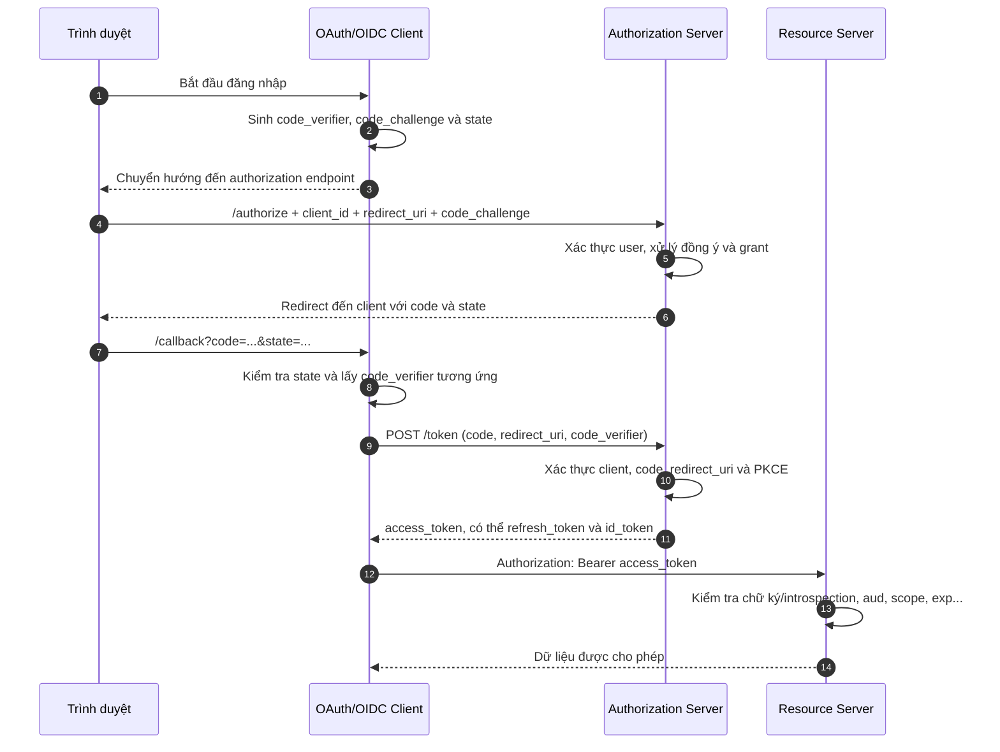
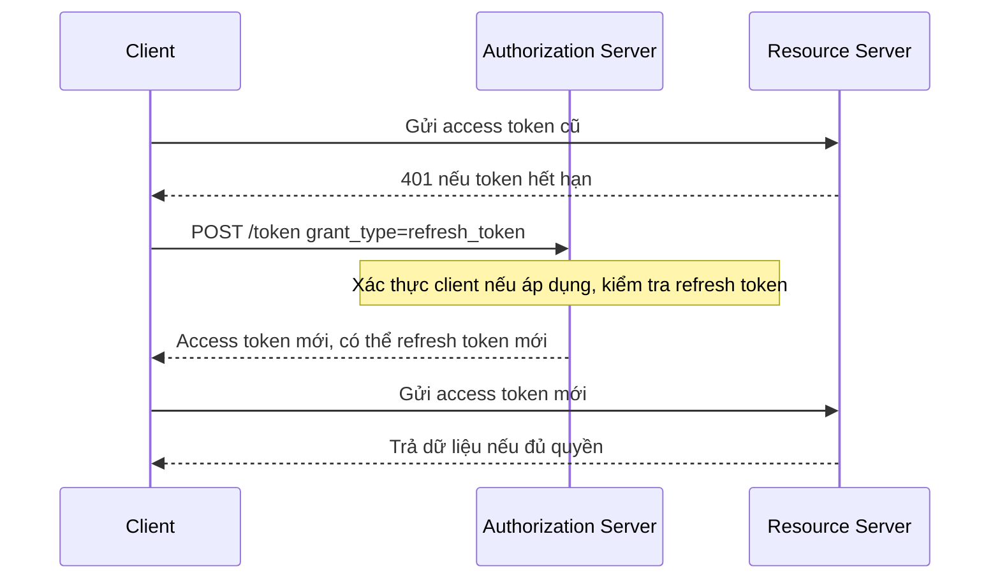
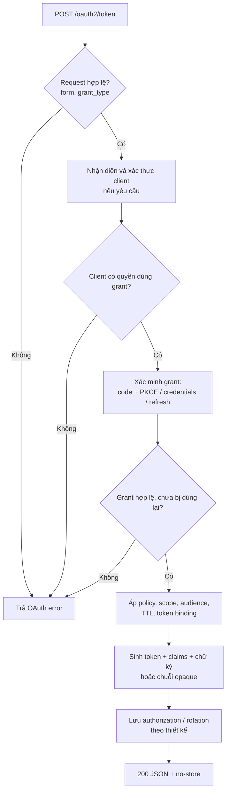

# Token endpoint trong OAuth 2.0 / OpenID Connect

## 1. Token endpoint là gì và nằm ở đâu trong mô hình tin cậy?

Trong OAuth 2.0, **token endpoint** là endpoint của **Authorization Server** mà client gửi yêu cầu để **nhận access token**, và khi được phép, nhận **refresh token**. Tùy grant type và hỗ trợ OpenID Connect (OIDC), phản hồi có thể chứa thêm **ID token**. Endpoint này là nơi Authorization Server kiểm tra quyền của client và tính hợp lệ của grant, quyết định scope, thời hạn, đối tượng nhận token, rồi phát hành credential để client truy cập Resource Server.

Ví dụ URL trong một triển khai Spring Authorization Server:

```text
POST https://auth.example.com/oauth2/token
```

Đường dẫn `/oauth2/token` là giá trị mặc định thường gặp của **Spring Authorization Server**, không phải đường dẫn bắt buộc của mọi nhà cung cấp OAuth/OIDC. Client phải đọc cấu hình của nhà cung cấp, chẳng hạn trường `token_endpoint` trong metadata, hoặc dùng endpoint được đăng ký rõ ràng.

Trong module **`SECURITY_TOKEN_SECURITY_FUNDAMENTALS`**, cần nhìn token endpoint qua toàn bộ vòng đời token: **cấp phát → kiểm tra claims/scope/audience → sử dụng ở Resource Server → hết hạn/làm mới → thu hồi hoặc vô hiệu hóa → phát hiện token bị đánh cắp/phát lại**. Token endpoint đảm nhiệm phần cấp phát và làm mới; nó liên kết với các thành phần khác để thực thi các quyết định bảo mật trong cả vòng đời.

### Kết quả học tập

Sau bài học, bạn cần có thể:

1. Mô tả đúng vai trò của token endpoint so với authorization, introspection, revocation và Resource Server.
2. Xây dựng và đọc request/response token theo `application/x-www-form-urlencoded` và JSON.
3. Giải thích các grant type `authorization_code`, `client_credentials`, `refresh_token` và vai trò của PKCE.
4. Phân biệt access token, refresh token, ID token, JWT và opaque token; hiểu scope, audience, issuer và claims.
5. Cấu hình token endpoint cơ bản bằng Spring Authorization Server và chỉ ra các bước kiểm tra/giới hạn cần có.
6. Phân tích lỗi, token replay, rò rỉ credential và những trường hợp không được cấp token.

## 2. Authorization Server, client và Resource Server trao đổi với nhau như thế nào?

Các vai trò cần phân biệt:

| Vai trò | Trách nhiệm | Ví dụ |
| --- | --- | --- |
| **Resource Owner** | Chủ thể có quyền cho phép truy cập tài nguyên; thường là người dùng. | Người dùng cấp quyền cho ứng dụng đọc đơn hàng. |
| **Client** | Ứng dụng xin quyền và sử dụng access token. | Ứng dụng web, ứng dụng di động, backend job. |
| **Authorization Server** | Xác thực/chấp thuận grant, quản lý client, phát hành và kiểm soát token. | `https://auth.example.com`. |
| **Resource Server** | Kiểm tra access token và áp dụng phân quyền để bảo vệ API. | `https://api.example.com`. |

Các endpoint thường gặp:

| Endpoint | Nhiệm vụ | Khác biệt với token endpoint |
| --- | --- | --- |
| `/oauth2/authorize` | Tạo authorization request, tương tác với người dùng và phát hành authorization code khi được phép. | Không phải nơi client trực tiếp đổi code lấy access token. |
| `/oauth2/token` | Xử lý grant, xác thực client khi cần, phát hành access token/refresh token/ID token tương ứng. | Chủ đề trọng tâm của bài. |
| `/oauth2/introspect` | Cho bên được phép kiểm tra trạng thái và thuộc tính của token. | Không phải endpoint làm mới token. |
| `/oauth2/revoke` | Nhận yêu cầu thu hồi token theo chính sách. | Thu hồi khác với refresh. |
| `/oauth2/jwks` | Công bố khóa công khai để bên xác minh JWT kiểm tra chữ ký. | Không phát hành token và không chứa khóa bí mật. |
| OIDC Discovery / OAuth metadata | Công bố địa chỉ endpoint, phương thức client authentication, khả năng hỗ trợ, v.v. | Cho client tìm `token_endpoint` chính xác. |

Tên đường dẫn trong bảng minh họa một cấu hình thông dụng; không nên ghép đường dẫn bằng suy đoán khi tích hợp với nhà cung cấp khác.

### Luồng Authorization Code + PKCE



**Điểm cần nhớ:** authorization code là credential tạm thời để đổi token, không phải access token. Người dùng không phải gửi username/password đến token endpoint trong luồng này. Token endpoint nhận **grant đã được cấp** và áp dụng điều kiện sử dụng grant đó.

## 3. Hợp đồng HTTP của token endpoint

### 3.1. Phương thức, Content-Type và HTTPS

Trong các grant type OAuth 2.0 thông dụng, client gọi token endpoint bằng **HTTP POST** qua **TLS (HTTPS)**. Tham số grant được truyền dưới dạng biểu mẫu:

```http
Content-Type: application/x-www-form-urlencoded
```

Đừng gửi JSON như `{"grant_type":"authorization_code"}` nếu endpoint chỉ hỗ trợ biểu mẫu OAuth tiêu chuẩn; `Accept: application/json` không thay đổi định dạng body mà server mong đợi.

Ví dụ request đổi authorization code của **confidential client**, có xác thực bằng HTTP Basic:

```http
POST /oauth2/token HTTP/1.1
Host: auth.example.com
Authorization: Basic <BASE64_CLIENT_ID_COLON_SECRET>
Content-Type: application/x-www-form-urlencoded
Accept: application/json

grant_type=authorization_code&
code=DEMO_CODE&
redirect_uri=https%3A%2F%2Fclient.example.com%2Fcallback&
code_verifier=DEMO_PKCE_VERIFIER
```

Ví dụ được ngắt dòng để đọc. Trong request thật, body là chuỗi form được mã hóa hợp lệ; credential `Basic` chứa Base64 của cặp `client_id:client_secret` theo cách mã hóa của giao thức, **Base64 không phải mã hóa bảo mật**. HTTPS bảo vệ credential trên đường truyền. Không ghi giá trị `Authorization` và các trường token vào log.

### 3.2. Phản hồi thành công

```http
HTTP/1.1 200 OK
Content-Type: application/json
Cache-Control: no-store
Pragma: no-cache

{
  "access_token": "ACCESS_TOKEN_SAMPLE",
  "token_type": "Bearer",
  "expires_in": 900,
  "refresh_token": "REFRESH_TOKEN_SAMPLE",
  "scope": "orders.read"
}
```

Ý nghĩa của từng trường:

| Trường | Ý nghĩa và lưu ý |
| --- | --- |
| `access_token` | Credential client dùng để gọi Resource Server. Có thể là JWT hoặc opaque token. |
| `token_type` | Cách sử dụng token; `Bearer` là kiểu thông dụng. Có bearer token có nghĩa ai nắm được chuỗi token có thể sử dụng nếu không có ràng buộc bổ sung. |
| `expires_in` | Số giây hiệu lực access token tính từ thời điểm phản hồi theo chính sách server. |
| `refresh_token` | Token có thể dùng để xin access token mới. **Không phải mọi grant/client đều được cấp** refresh token. |
| `scope` | Tập scope thực tế được cấp (có thể khác tập yêu cầu). Tùy giao thức, response có thể lược `scope` khi giống scope đã yêu cầu. |
| `id_token` | Có thể xuất hiện trong luồng OIDC phù hợp; là bằng chứng xác thực cho **OIDC client**, không thay access token gọi API. |

Phản hồi chứa credential phải có `Cache-Control: no-store` và `Pragma: no-cache` theo yêu cầu OAuth 2.0, tránh lưu cache phản hồi nhạy cảm. `access_token` không bắt buộc phải là JWT: client nên coi đây là chuỗi opaque để gửi đúng mục đích.

### 3.3. Xác thực client tại token endpoint

| Loại client | Khả năng giữ bí mật | Cách thường dùng tại token endpoint |
| --- | --- | --- |
| Backend/confidential client | Có thể giữ secret/private key ở môi trường server được bảo vệ. | `client_secret_basic`, `private_key_jwt` hoặc phương thức mạnh khác được server hỗ trợ. |
| SPA chạy trong trình duyệt | Không thể giữ client secret khỏi người sử dụng/trình duyệt. | Public client với `client_id`, Authorization Code + PKCE; không đặt secret cứng trong JavaScript. |
| Ứng dụng di động cài trên thiết bị người dùng | Không thể dựa vào embedded client secret như credential bí mật. | Public client + PKCE; áp dụng bảo vệ lưu trữ/redirect URI theo nền tảng. |
| Machine-to-machine | Backend chạy tự động, có cơ chế quản lý secret/khóa. | Confidential client xác thực tại token endpoint, thường qua `client_credentials`. |

**`client_id` chỉ là mã định danh**, không phải bằng chứng xác thực. Public client không có secret mạnh vẫn có thể tham gia Authorization Code Flow nhờ PKCE và các kiểm tra grant/redirect URI. Confidential client phải xác thực theo phương thức đã đăng ký; PKCE có thể được yêu cầu bổ sung.

Không chấp nhận đồng thời nhiều phương thức xác thực client trong cùng một request khi giao thức/phương thức không cho phép, và không coi một `client_secret` được ghi trong app mobile là bí mật an toàn.

## 4. Grant type `authorization_code` và PKCE

### 4.1. Tại sao code cần ràng buộc?

Authorization Server phát một `code` cho một client và redirect URI sau khi xử lý authorization request. Code:

- phải có thời hạn ngắn;
- phải chỉ được đổi **một lần**;
- phải gắn với đúng `client_id` và redirect URI đã được xác minh;
- phải gắn với PKCE `code_challenge` từ authorization request khi sử dụng PKCE;
- không được bị dùng để nhận scope ngoài grant đã cấp.

PKCE giúp giảm rủi ro **authorization code bị chặn bắt**: dù kẻ tấn công có code, họ thiếu `code_verifier` ban đầu để đổi token. PKCE không loại bỏ nhu cầu xác thực confidential client, kiểm tra redirect URI, ngăn CSRF hoặc bảo vệ token đã cấp.

### 4.2. Tạo `code_verifier` và `code_challenge`

Client tạo chuỗi `code_verifier` ngẫu nhiên đủ entropy, độ dài hợp lệ theo RFC 7636 (43–128 ký tự thuộc bảng ký tự cho phép). Với phương thức `S256`:

```text
code_challenge = BASE64URL(SHA256(ASCII(code_verifier)))
code_challenge_method = S256
```

Ví dụ Java tạo verifier và challenge:

```java
import java.security.MessageDigest;
import java.security.SecureRandom;
import java.nio.charset.StandardCharsets;
import java.util.Base64;

public final class PkceUtil {
    private static final SecureRandom RNG = new SecureRandom();

    public static String newVerifier() {
        byte[] bytes = new byte[32];
        RNG.nextBytes(bytes);
        return Base64.getUrlEncoder().withoutPadding()
                .encodeToString(bytes);
    }

    public static String challengeS256(String verifier) throws Exception {
        byte[] digest = MessageDigest.getInstance("SHA-256")
                .digest(verifier.getBytes(StandardCharsets.US_ASCII));
        return Base64.getUrlEncoder().withoutPadding()
                .encodeToString(digest);
    }
}
```

`newVerifier()` ở ví dụ sinh 32 byte ngẫu nhiên và mã Base64URL không padding thành 43 ký tự, đáp ứng độ dài tối thiểu. Client phải giữ `verifier` an toàn gắn với **một authorization request cụ thể**, không đưa verifier vào authorization URL.

### 4.3. Request ban đầu và request đổi code

Client tạo authorization request (được URL-encode khi gửi):

```text
GET /oauth2/authorize?
  response_type=code&
  client_id=web-client&
  redirect_uri=https%3A%2F%2Fclient.example.com%2Fcallback&
  scope=openid%20orders.read&
  state=STATE_RANDOM&
  code_challenge=CHALLENGE_S256&
  code_challenge_method=S256
```

Đối với OIDC, client có thể gửi `nonce` theo yêu cầu và đặc điểm luồng; nonce được kiểm tra khi xác minh ID token. Sau khi Authorization Server cho phép, client nhận:

```http
HTTP/1.1 302 Found
Location: https://client.example.com/callback?code=ONE_TIME_CODE&state=STATE_RANDOM
```

Client phải **kiểm tra `state`** với giá trị gắn với phiên yêu cầu trước khi đổi code. Sau đó gọi:

```bash
curl -i -X POST "https://auth.example.com/oauth2/token" \
  -H "Content-Type: application/x-www-form-urlencoded" \
  --data-urlencode "grant_type=authorization_code" \
  --data-urlencode "client_id=public-web-client" \
  --data-urlencode "code=ONE_TIME_CODE" \
  --data-urlencode "redirect_uri=https://client.example.com/callback" \
  --data-urlencode "code_verifier=ORIGINAL_VERIFIER"
```

Đoạn curl là ví dụ public client: nó **không** đưa client secret vào request. Trong hệ thống thật, `public-web-client` phải được đăng ký với phương thức `none` và PKCE. Với confidential client, thêm phương thức xác thực client đã đăng ký (chẳng hạn HTTP Basic); đừng tự bỏ xác thực vì có PKCE.

### 4.4. Token endpoint kiểm tra những gì?

1. `grant_type` có được Authorization Server và client hỗ trợ?
2. Client nào đang gọi? Nếu là confidential client, thông tin xác thực client có hợp lệ, đúng phương thức đã đăng ký?
3. Code có tồn tại, chưa hết hạn, **chưa dùng**, được phát hành cho đúng client?
4. `redirect_uri` trong token request có đúng ràng buộc của authorization request? Nếu đã có ở authorization request, phải kiểm tra tính khớp theo quy tắc giao thức.
5. `code_verifier` khi được yêu cầu có khớp `code_challenge` đã lưu, bao gồm `S256`?
6. Grant có còn hợp lệ, người dùng đã chấp thuận scope, và token được phát hành trong phạm vi đã cấp?
7. Trạng thái code có được đánh dấu đã dùng **một cách nguyên tử** để chặn request đồng thời đổi code hai lần?

Nếu bất kỳ điều kiện nào không đạt, không phát token. Lỗi điển hình cho code hết hạn, đã dùng lại hoặc sai verifier là `invalid_grant`.

> `state` và PKCE giải quyết hai việc khác nhau: `state` ràng buộc callback với yêu cầu do client khởi tạo (chống CSRF/mix-up trong thiết kế tương ứng); PKCE ràng buộc việc **đổi code** với client nắm verifier. Với OIDC, `nonce` ràng buộc ID token với ngữ cảnh yêu cầu. Không thể dùng một cơ chế để thay thế toàn bộ cơ chế khác.

## 5. Grant type `client_credentials`: dịch vụ gọi dịch vụ

Với machine-to-machine, client đại diện cho **chính ứng dụng/dịch vụ**; không có người dùng đăng nhập hoặc nhấn đồng ý trong từng request. Authorization Server xác thực confidential client và cấp access token theo các scope được phép cho client đó.

```http
POST /oauth2/token HTTP/1.1
Host: auth.example.com
Authorization: Basic <ENCODED_SERVICE_CLIENT_CREDENTIALS>
Content-Type: application/x-www-form-urlencoded

grant_type=client_credentials&scope=inventory.read
```

Phản hồi thường:

```json
{
  "access_token": "SERVICE_ACCESS_TOKEN",
  "token_type": "Bearer",
  "expires_in": 600,
  "scope": "inventory.read"
}
```

Theo OAuth 2.0, **refresh token thường không được cấp** trong `client_credentials`: khi hết hạn, service có thể xác thực lại client để nhận access token mới. Không nên giả định có `sub` là user hoặc cấp quyền người dùng cho token service. Resource Server cần phân biệt principal ứng dụng với principal người dùng nếu policy yêu cầu.

Ví dụ curl thử nghiệm (dùng giá trị giả; không đặt secret thật trong tài liệu hoặc log):

```bash
curl -i "https://auth.example.com/oauth2/token" \
  -u "inventory-service:DEMO_ONLY_SECRET" \
  -H "Content-Type: application/x-www-form-urlencoded" \
  --data-urlencode "grant_type=client_credentials" \
  --data-urlencode "scope=inventory.read"
```

Khi triển khai, hãy lấy secret từ secret manager hoặc cơ chế an toàn của môi trường chạy thay vì đưa vào command history.

## 6. Grant type `refresh_token`: làm mới mà không đăng nhập lại

Access token thường có thời hạn ngắn để giảm tác động khi bị đánh cắp. Refresh token là credential dùng tại **token endpoint** để xin access token mới mà không cần lặp lại toàn bộ luồng authorization.



Ví dụ request của confidential client:

```http
POST /oauth2/token HTTP/1.1
Host: auth.example.com
Authorization: Basic <ENCODED_CLIENT_CREDENTIALS>
Content-Type: application/x-www-form-urlencoded

grant_type=refresh_token&refresh_token=REFRESH_TOKEN_SAMPLE&scope=orders.read
```

Khi xử lý, token endpoint cần kiểm tra:

- Refresh token có do server phát hành, hợp lệ, chưa hết hạn, chưa bị thu hồi?
- Token có **gắn với đúng client** đang sử dụng nó không?
- Client authentication có bắt buộc và được xác thực đúng không?
- Scope xin cấp lại có là tập con của scope đã được phê duyệt? **Không được mở rộng quyền** chỉ bằng refresh.
- Có chính sách thu hồi, rotation, phát hiện reuse/replay hoặc ràng buộc token theo sender hay không?
- Chính sách phiên/người dùng/tenant có còn cho phép phát hành token mới không?

### Refresh-token rotation và replay

Với **rotation**, mỗi lần refresh thành công, Authorization Server cấp refresh token mới và vô hiệu hóa refresh token trước đó. Nếu refresh token cũ được dùng lại, hệ thống có thể coi đó là tín hiệu credential đã bị sao chép và xử lý theo chính sách, chẳng hạn thu hồi cả token family hoặc yêu cầu đăng nhập lại.

```text
Ban đầu: RT-1
  └── refresh hợp lệ → AT-2 + RT-2; RT-1 hết hiệu lực
        └── refresh hợp lệ → AT-3 + RT-3; RT-2 hết hiệu lực

Kẻ tấn công phát lại RT-1 → reject; kích hoạt xử lý nghi vấn nếu có thiết kế reuse detection
```

**Lưu ý:** Bật chế độ không dùng lại refresh token **không tự bảo đảm** toàn bộ cơ chế phát hiện reuse và thu hồi token family; cần kiểm tra hành vi thực tế của implementation, lưu trữ trạng thái và race condition. Với public client, OAuth Security BCP yêu cầu refresh token phải được **sender-constrained hoặc dùng rotation** để phát hiện replay, nếu server cấp refresh token cho loại client đó.

Refresh token không nên gửi đến Resource Server hoặc dùng thay access token. Cần bảo vệ lưu trữ ở client, hạn chế scope/thời hạn, chủ động thu hồi khi logout hoặc khi phát hiện rủi ro theo chính sách.

## 7. Một số grant và khả năng mở rộng khác

Token endpoint có thể hỗ trợ các grant bổ sung nếu **Authorization Server và client đã đăng ký** tương ứng.

| Grant / tính năng | Ý nghĩa | Lưu ý triển khai |
| --- | --- | --- |
| Device Authorization Grant (RFC 8628) | Thiết bị hạn chế giao diện dùng `device_code` để polling token endpoint sau khi người dùng xác nhận trên thiết bị khác. | Kiểm tra khoảng thời gian polling, `authorization_pending`, `slow_down` và expiry. |
| Token Exchange (RFC 8693) | Đổi một subject token (và có thể actor token) lấy token phù hợp hơn với resource/audience mới. | Phải kiểm soát rõ quan hệ delegation, audience và actor; không mở rộng quyền vô điều kiện. |
| JWT Bearer Authorization Grant (RFC 7523) | Dùng một JWT assertion làm grant trong các tích hợp phù hợp. | Không nhầm assertion grant với `private_key_jwt` dùng để xác thực client. |
| Extension grant do ứng dụng định nghĩa | Hỗ trợ nghiệp vụ riêng khi có yêu cầu thật sự. | Cần validator, policy, client allowlist và kiểm thử bảo mật tương đương. |

**Resource Owner Password Credentials** và **Implicit Flow** là những thiết kế lịch sử có nguy cơ bảo mật đáng kể; OAuth 2.0 Security BCP khuyến nghị không dùng ROPC và tránh cấp access token qua implicit response. Với ứng dụng đăng nhập người dùng hiện đại, ưu tiên Authorization Code + PKCE.

Không giả định mọi Spring Authorization Server đều hỗ trợ các grant mở rộng chỉ vì chúng có RFC. Phải kiểm tra phiên bản và cấu hình các provider tương ứng.

## 8. Access token, refresh token và ID token được phát hành như thế nào?

### 8.1. Phân biệt mục đích trước khi chọn định dạng

| Loại token | Bên sử dụng hợp lệ | Mục đích | Có nên dùng để gọi API nghiệp vụ? |
| --- | --- | --- | --- |
| **Access token** | Resource Server được chỉ định bởi audience/kiến trúc. | Ủy quyền truy cập tài nguyên với scope/quyền đã cấp. | **Có**, khi token được phát hành cho API đó. |
| **Refresh token** | Token endpoint / Authorization Server. | Xin cấp access token mới theo grant còn hiệu lực. | **Không.** |
| **ID token** (OIDC) | OIDC client (Relying Party). | Xác minh kết quả xác thực người dùng, các claims về phiên đăng nhập. | **Không mặc định**; không thay access token. |
| **Authorization code** | Token endpoint khi client đổi code hợp lệ. | Chứng nhận grant tạm thời trong Authorization Code Flow. | **Không.** |

**JWT và opaque** là **định dạng/chiến lược biểu diễn và kiểm chứng**, không đồng nghĩa với loại access/refresh/ID token. Một access token có thể là JWT tự chứa hoặc một chuỗi opaque. Việc token trông có ba phần phân tách bằng dấu chấm không phải bằng chứng nó đã được tin cậy.

### 8.2. Ví dụ JWT access token

JWT access token do Authorization Server phát hành có thể có payload minh họa:

```json
{
  "iss": "https://auth.example.com",
  "sub": "user-42",
  "aud": ["orders-api"],
  "exp": 1900000900,
  "iat": 1900000000,
  "jti": "token-id-123",
  "client_id": "web-client",
  "scope": "orders.read orders.write"
}
```

| Claim | Vì sao quan trọng? |
| --- | --- |
| `iss` | Resource Server kiểm tra token được phát hành bởi issuer đáng tin cậy. |
| `sub` | Chủ thể mà token đại diện; phải hiểu đây là user hay client/service theo grant. |
| `aud` | Token dành cho Resource Server nào; ngăn dùng token của API A tại API B. |
| `exp` / `nbf` / `iat` | Quản lý thời gian hiệu lực và điều kiện sử dụng token. |
| `scope` hoặc `scp` | Quyền đã được cấp; ánh xạ thành authorities theo chính sách Resource Server. |
| `client_id` | Client được cấp token; ý nghĩa và cách biểu diễn tùy profile/triển khai. |
| `jti` | Định danh token, có thể phục vụ giám sát/truy vết/denylist theo thiết kế. |

Resource Server phải xác minh **chữ ký và thuật toán cho phép**, khóa tin cậy, `iss`, `aud`, thời gian, scope và quyền đối với đối tượng nghiệp vụ. Client không được tự thêm scope/audience vào payload rồi coi đó là quyền; mọi claim trong token chỉ có giá trị sau khi được Authorization Server phát hành và Resource Server kiểm chứng.

JWT thường **không mã hóa** payload: Base64URL có thể giải mã để đọc claims. Tránh nhét password, refresh token, dữ liệu cá nhân không cần thiết hoặc secret vào JWT.

### 8.3. Opaque token

Opaque access token có thể là chuỗi ngẫu nhiên không thể tự giải nghĩa. Resource Server thường gọi introspection endpoint để biết token có `active=true` hay không, thông tin client/user, scope và thời hạn. Ưu điểm là Authorization Server có thể kiểm soát hiệu lực tập trung; đổi lại cần cân nhắc latency, availability và cache của introspection.

Không thể kết luận JWT là “không thu hồi được” hoặc opaque là “thu hồi tức thì” trong mọi hệ thống: JWT có thể có denylist/revocation hoặc thời hạn rất ngắn; opaque introspection có thể bị cache. **Mô hình phát hành, kiểm tra và thu hồi** mới quyết định mức độ bảo vệ thực tế.

### 8.4. Scope, audience và resource indicators

Một client được phép xin scope `orders.read` không có nghĩa token được dùng ở **mọi** Resource Server hiểu scope này. Token endpoint phải xác định đúng audience theo client, grant, chính sách và tài nguyên được xin truy cập.

Nếu sử dụng **Resource Indicators for OAuth 2.0** (RFC 8707), client có thể đưa `resource` vào authorization/token request theo giao thức hỗ trợ để thể hiện tài nguyên đích. Server phải xác thực và ràng buộc audience phù hợp; đây không phải tham số cho phép client tự chọn bất kỳ API nào.

```text
Client xin: scope=orders.read, resource=https://api.example.com/orders
Server kiểm tra: client + grant + consent + policy
Server phát hành: aud phù hợp với API orders, scope trong tập đã cấp
Resource Server orders: kiểm tra aud + scope + quyền dữ liệu
```

## 9. Các bước xử lý nội bộ của một token endpoint

Một Authorization Server có thể mô hình hóa xử lý như sau:



**Bảo đảm tính nguyên tử:** các bước đánh dấu authorization code “đã dùng” và xoay vòng refresh token phải bảo vệ khỏi request đồng thời. Nếu hai request cùng đổi được một code hoặc cùng refresh từ một token cũ, đó là lỗi thiết kế trạng thái, dù các phép kiểm tra đơn lẻ đều đúng.

Với OIDC, token endpoint có thể phát ID token khi grant phù hợp với `openid` scope. ID token cần có issuer, subject, audience của client, thời hạn, thời điểm xác thực và nonce nếu áp dụng; OIDC client phải **xác minh ID token** theo specification, không chỉ giải mã JSON.

## 10. Cấu hình Spring Authorization Server

Phần này minh họa **Spring Boot 3 + Spring Security 6 + Spring Authorization Server 1.x** ở ứng dụng Servlet. API cụ thể có thể thay đổi theo phiên bản; đây là các đoạn cấu hình học tập cần ghép với cấu hình đăng nhập người dùng, persistence, signing key và dependency thực tế.

### 10.1. SecurityFilterChain cho Authorization Server

Spring Authorization Server cung cấp các filter và authentication provider cho những endpoint của nó. Thông thường, bạn không cần tự viết controller `POST /oauth2/token` để xử lý những grant chuẩn.

```java
import org.springframework.context.annotation.Bean;
import org.springframework.context.annotation.Configuration;
import org.springframework.core.annotation.Order;
import org.springframework.security.config.Customizer;
import org.springframework.security.config.annotation.web.builders.HttpSecurity;
import org.springframework.security.oauth2.server.authorization.config.annotation.web.configurers.OAuth2AuthorizationServerConfigurer;
import org.springframework.security.web.SecurityFilterChain;

@Configuration
public class AuthorizationServerSecurityConfig {

    @Bean
    @Order(1)
    SecurityFilterChain authorizationServerFilterChain(
            HttpSecurity http) throws Exception {
        OAuth2AuthorizationServerConfigurer authorizationServer =
                OAuth2AuthorizationServerConfigurer.authorizationServer();

        http
            .securityMatcher(authorizationServer.getEndpointsMatcher())
            .with(authorizationServer, server ->
                server.oidc(Customizer.withDefaults())
            )
            .authorizeHttpRequests(authorize ->
                authorize.anyRequest().authenticated()
            );

        return http.build();
    }
}
```

Điều này đăng ký hạ tầng OAuth 2.0 Authorization Server (và bật OIDC trong ví dụ) trên filter chain thích hợp. Để Authorization Code Flow có thể yêu cầu đăng nhập người dùng, ứng dụng cần cấu hình **filter chain đăng nhập** và hệ thống lưu người dùng/phiên tương ứng. Khi chưa có client registry, signing key và authorization service thích hợp, đoạn trên **chưa phải ứng dụng chạy hoàn chỉnh**.

Trong production, cần cấu hình chính sách CSRF/cookie, redirect, session và login flow đúng ngữ cảnh, thay vì tắt CSRF trên toàn bộ ứng dụng chỉ vì token endpoint dùng POST.

### 10.2. Đặt issuer và đường dẫn token endpoint

```java
import org.springframework.context.annotation.Bean;
import org.springframework.security.oauth2.server.authorization.settings.AuthorizationServerSettings;

@Bean
AuthorizationServerSettings authorizationServerSettings() {
    return AuthorizationServerSettings.builder()
            .issuer("https://auth.example.com")
            .tokenEndpoint("/oauth2/token")
            .build();
}
```

`issuer` là danh tính của Authorization Server mà JWT và Resource Server cần đối chiếu. Trong hệ thống sau reverse proxy, phải đảm bảo issuer public được cấu hình **nhất quán** với URL mà client và API sử dụng. Không để issuer nội bộ vô tình xuất hiện thành issuer public khác nhau giữa các môi trường.

### 10.3. Đăng ký confidential client với Authorization Code + PKCE

```java
import java.time.Duration;
import java.util.UUID;
import org.springframework.context.annotation.Bean;
import org.springframework.security.crypto.password.PasswordEncoder;
import org.springframework.security.oauth2.core.AuthorizationGrantType;
import org.springframework.security.oauth2.core.ClientAuthenticationMethod;
import org.springframework.security.oauth2.core.oidc.OidcScopes;
import org.springframework.security.oauth2.server.authorization.client.InMemoryRegisteredClientRepository;
import org.springframework.security.oauth2.server.authorization.client.RegisteredClient;
import org.springframework.security.oauth2.server.authorization.client.RegisteredClientRepository;
import org.springframework.security.oauth2.server.authorization.settings.ClientSettings;
import org.springframework.security.oauth2.server.authorization.settings.TokenSettings;

@Bean
RegisteredClientRepository registeredClientRepository(
        PasswordEncoder encoder) {
    RegisteredClient webClient = RegisteredClient.withId(
                UUID.randomUUID().toString())
            .clientId("web-client")
            .clientSecret(encoder.encode("DEMO_CHANGE_ME"))
            .clientAuthenticationMethod(
                ClientAuthenticationMethod.CLIENT_SECRET_BASIC)
            .authorizationGrantType(
                AuthorizationGrantType.AUTHORIZATION_CODE)
            .authorizationGrantType(
                AuthorizationGrantType.REFRESH_TOKEN)
            .redirectUri("https://client.example.com/callback")
            .scope(OidcScopes.OPENID)
            .scope("orders.read")
            .clientSettings(ClientSettings.builder()
                .requireProofKey(true)
                .requireAuthorizationConsent(true)
                .build())
            .tokenSettings(TokenSettings.builder()
                .accessTokenTimeToLive(Duration.ofMinutes(15))
                .refreshTokenTimeToLive(Duration.ofDays(7))
                .reuseRefreshTokens(false)
                .build())
            .build();

    return new InMemoryRegisteredClientRepository(webClient);
}
```

Ý nghĩa:

- `client_secret_basic`: confidential client xác thực tại token endpoint bằng HTTP Basic; secret phải được quản lý an toàn, không cố định `DEMO_CHANGE_ME`.
- `requireProofKey(true)`: yêu cầu PKCE khi dùng Authorization Code Flow.
- `AUTHORIZATION_CODE` và `REFRESH_TOKEN`: client chỉ được dùng các grant đã đăng ký.
- `scope("orders.read")`: định nghĩa phạm vi có thể xin cấp; server vẫn phải xét grant/policy.
- `accessTokenTimeToLive` và `refreshTokenTimeToLive`: thời hạn theo mức rủi ro của hệ thống.
- `reuseRefreshTokens(false)`: cấu hình phát refresh token mới khi thực hiện refresh theo chính sách và hỗ trợ của implementation; **không khẳng định tự động có token-family reuse detection**.

`InMemoryRegisteredClientRepository` chỉ nên dùng để hiểu luồng hoặc thử nghiệm. Production cần lưu client và authorization/token state bền vững, quản lý secret bằng công cụ an toàn, cấu hình JWK/khóa ký, rotation và giám sát. Việc tạo `UUID` khi khởi động lại cũng không phù hợp cho cấu hình client cần ổn định lâu dài.

### 10.4. Public client và PKCE

Với SPA/mobile không thể cất giữ secret, tạo `RegisteredClient` với:

```java
RegisteredClient publicClient = RegisteredClient.withId(
            UUID.randomUUID().toString())
        .clientId("mobile-client")
        .clientAuthenticationMethod(ClientAuthenticationMethod.NONE)
        .authorizationGrantType(AuthorizationGrantType.AUTHORIZATION_CODE)
        .redirectUri("com.example.app:/oauth2redirect")
        .scope("orders.read")
        .clientSettings(ClientSettings.builder()
            .requireProofKey(true)
            .build())
        .build();
```

`ClientAuthenticationMethod.NONE` nghĩa là public client **không dùng client secret**, không có nghĩa Authorization Server bỏ kiểm tra grant. Redirect URI phải được kiểm tra chính xác, PKCE phải được áp dụng, và phải xác định kiến trúc lưu token và bảo vệ callback phù hợp với nền tảng. Cấp refresh token cho public client là quyết định riêng cần xét phiên bản thư viện và quy tắc bảo vệ rotation/sender constraint; không mặc nhiên trông đợi refresh token chỉ vì đã đăng ký grant.

### 10.5. JWT tự chứa, opaque và cấu hình access token

Spring Authorization Server cho phép lựa chọn định dạng access token theo RegisteredClient. Ví dụ:

```java
import org.springframework.security.oauth2.server.authorization.settings.TokenSettings;
import org.springframework.security.oauth2.server.authorization.settings.OAuth2TokenFormat;

TokenSettings jwtTokens = TokenSettings.builder()
        .accessTokenFormat(OAuth2TokenFormat.SELF_CONTAINED)
        .build();

TokenSettings opaqueTokens = TokenSettings.builder()
        .accessTokenFormat(OAuth2TokenFormat.REFERENCE)
        .build();
```

- `SELF_CONTAINED` là định dạng tự chứa thường được hiện thực bằng JWT có chữ ký; cần signing key và decoder phù hợp.
- `REFERENCE` dùng chuỗi token tham chiếu/opaque; Resource Server cần cơ chế kiểm tra phù hợp, thường qua introspection.

Đây là các **đối tượng TokenSettings minh họa**; chúng phải được gắn vào `RegisteredClient.tokenSettings(...)` tương ứng. Token endpoint vẫn trả `access_token` dưới dạng chuỗi JSON; Resource Server chọn cách kiểm tra dựa trên kiến trúc và thông tin tin cậy, không dựa vào nội dung chưa xác minh.

### 10.6. Gắn audience vào JWT access token

Với JWT access token, có thể dùng token customizer (chỉ áp dụng cho JWT encoding context) để đặt audience do server quyết định:

```java
import java.util.List;
import org.springframework.context.annotation.Bean;
import org.springframework.security.oauth2.core.OAuth2TokenType;
import org.springframework.security.oauth2.server.authorization.token.JwtEncodingContext;
import org.springframework.security.oauth2.server.authorization.token.OAuth2TokenCustomizer;

@Bean
OAuth2TokenCustomizer<JwtEncodingContext> jwtTokenCustomizer() {
    return context -> {
        if (OAuth2TokenType.ACCESS_TOKEN.equals(context.getTokenType())) {
            // Ví dụ: chỉ cấp audience đúng với policy đã duyệt.
            context.getClaims().audience(List.of("orders-api"));
        }
    };
}
```

Trong ứng dụng có **nhiều Resource Server**, không nên hard-code `orders-api` cho mọi client/token. Phải dựa trên chính sách đã đăng ký và grant hợp lệ để chọn audience (và scope). Có thể cần kiểm tra resource indicator hoặc cấu hình riêng của client. Resource Server sau đó phải yêu cầu chính audience đã phát hành.

**Không tùy ý ghi claims do request gửi lên** vào JWT mà không kiểm tra. Mọi `roles`, `tenant_id` hay `aud` phải được lấy từ nguồn đã xác minh và chính sách của Authorization Server.

### 10.7. Các thành phần quan trọng phía Spring Authorization Server

| Thành phần | Vai trò |
| --- | --- |
| `RegisteredClientRepository` | Lưu cấu hình client: cách xác thực, grant, redirect URI, scope, token/client settings. |
| `OAuth2AuthorizationService` | Lưu và truy xuất trạng thái authorization/code/token để kiểm tra grant, làm mới và thu hồi theo thiết kế. |
| `OAuth2AuthorizationConsentService` | Quản lý consent khi có tương tác đồng ý của người dùng. |
| `OAuth2TokenGenerator<?>` | Sinh token phù hợp; có thể kết hợp JWT generator và access/refresh token generator. |
| `OAuth2TokenCustomizer<JwtEncodingContext>` | Tùy chỉnh claims JWT khi sinh token. |
| `AuthorizationServerSettings` | Cấu hình issuer và endpoint public. |
| `OAuth2ClientAuthenticationFilter` | Xử lý xác thực OAuth client tại các endpoint cần client authentication. |
| `OAuth2TokenEndpointFilter` | Nhận token request và chuyển cho authentication provider phù hợp với grant. |

Thường nên tùy biến ở các điểm mở rộng được thư viện hỗ trợ, chẳng hạn `tokenEndpoint(...)` với authentication converter/provider hoặc success/error handler cho yêu cầu đặc thù. Nếu viết grant mới, phải thiết kế riêng token request converter, `AuthenticationProvider`, kiểm tra client/grant và lưu authorization; không tự thêm một controller phát token mà bỏ qua các lớp này.

## 11. Xử lý lỗi OAuth tại token endpoint

OAuth 2.0 định nghĩa phản hồi lỗi JSON qua các mã `error`. Một số ví dụ:

```http
HTTP/1.1 400 Bad Request
Content-Type: application/json
Cache-Control: no-store
Pragma: no-cache

{
  "error": "invalid_grant",
  "error_description": "Authorization grant is invalid"
}
```

| `error` | Nguyên nhân phổ biến | Status thường gặp |
| --- | --- | --- |
| `invalid_request` | Thiếu/trùng tham số không hợp lệ, body sai định dạng, request không đúng quy tắc. | 400 |
| `invalid_client` | Client không nhận diện được hoặc xác thực client thất bại. | 401 nếu qua HTTP authentication thích hợp; có thể 400 tùy phương thức. |
| `invalid_grant` | Code/refresh token hết hạn, thu hồi, đã dùng, sai client/redirect URI/PKCE. | 400 |
| `unauthorized_client` | Client không được phép dùng grant type đang yêu cầu. | 400 |
| `unsupported_grant_type` | Authorization Server không hỗ trợ grant được gửi. | 400 |
| `invalid_scope` | Scope được yêu cầu sai, không hợp lệ, vượt quyền được cấp. | 400 |

Không nên trả chi tiết nội bộ cho người gọi, chẳng hạn “refresh token của user A tồn tại nhưng bị thu hồi lúc 10:03”, vì có thể giúp kẻ tấn công suy đoán credential. Mã lỗi chuẩn kết hợp correlation ID và telemetry phía server thường đủ để chẩn đoán.

### Phân biệt lỗi ở Authorization Server và Resource Server

| Vấn đề | Endpoint thường trả lỗi | Điểm cần kiểm tra |
| --- | --- | --- |
| Code đã dùng hai lần | Token endpoint: `invalid_grant` | One-time code, giao dịch/atomic update. |
| Secret của confidential client sai | Token endpoint: `invalid_client` | Đăng ký client, credential, client authentication method. |
| Grant `client_credentials` chưa đăng ký | Token endpoint: `unauthorized_client` | Grant type của RegisteredClient. |
| Access token hết hạn khi gọi API | Resource Server: thường **401** | `exp`, introspection, decoder, clock skew. |
| Access token hợp lệ nhưng thiếu scope | Resource Server: thường **403** | Authority mapping và endpoint policy. |
| Token có audience của API khác | Resource Server: thường **401** | Token validation `aud`. |

**401/403 từ Resource Server không có nghĩa token endpoint phải tự động cấp lại quyền.** Client chỉ có thể refresh nếu có refresh token hợp lệ; các lỗi scope/authorization đòi hỏi điều chỉnh grant/consent hoặc chính sách, không thể giải quyết bằng cách lặp lại refresh vô hạn.

## 12. Bảo vệ token endpoint trước các rủi ro thực tế

### 12.1. Credential stuffing và brute force

Kẻ tấn công có thể thử client secret, authorization code hoặc refresh token hàng loạt. Cần:

- Rate limiting, cảnh báo và giám sát theo client, IP và dấu hiệu bất thường phù hợp.
- Secret mạnh, lưu ở secret manager; cân nhắc `private_key_jwt` hoặc mTLS theo yêu cầu rủi ro.
- Authorization code ngắn hạn và chỉ dùng một lần; kiểm tra PKCE, client và redirect URI.
- Error response không tiết lộ client/username/token tồn tại hay không.

### 12.2. Token theft và replay

Bearer access token bị đánh cắp có thể bị phát lại trong thời hạn còn hiệu lực. Các lớp giảm rủi ro:

- Access token TTL ngắn, scope nhỏ, audience hẹp và chỉ phát hành khi có nhu cầu.
- Refresh-token rotation hoặc sender-constrained refresh token theo yêu cầu đối với public client; xử lý reuse detection phù hợp.
- Có thể triển khai **sender-constrained access token** bằng mTLS hoặc DPoP khi hệ sinh thái hỗ trợ; Resource Server phải thực thi ràng buộc `cnf`/proof tương ứng.
- Hạn chế log token, URL query chứa credential, trình duyệt local storage thiếu kiểm soát, XSS và truyền token qua kênh không an toàn.
- Cơ chế thu hồi khi phát hiện rủi ro; lưu ý JWT đã phát có thể còn được chấp nhận đến khi hết hạn nếu Resource Server chỉ kiểm tra offline.

**DPoP** yêu cầu proof phù hợp ở các endpoint liên quan và kiểm soát replay (`jti`, `iat`, method/URL binding, v.v.) theo specification; việc thêm một claim vào JWT không tự động biến bearer token thành sender-constrained token.

### 12.3. Authorization Code Flow trên trình duyệt

Authorization code xuất hiện trong callback URL có thể lọt vào browser history, server log, telemetry hoặc request `Referer`. Nên:

- dùng `Referrer-Policy: no-referrer` tại callback nhạy cảm;
- xử lý code, kiểm tra state/PKCE và chuyển sớm đến URL sạch;
- tránh nhúng script/pixel bên thứ ba trên callback trước khi xử lý xong;
- không để access token/refresh token trong query URL;
- bảo vệ session/cookie và cấu hình redirect URI chính xác.

`Referrer-Policy` chỉ hạn chế URL nguồn bị gửi qua `Referer`; nó không xóa dữ liệu đã ghi trong log, và không thay thế PKCE hay chống XSS.

### 12.4. Quản lý khóa ký, issuer và audience

- Chỉ sử dụng thuật toán và khóa ký đã được duyệt; không chấp nhận thuật toán “none” hoặc lựa chọn khóa theo header JWT chưa được kiểm soát.
- Có quy trình JWK rotation, `kid` và công bố public keys; không công bố private key.
- Thiết lập issuer public ổn định, bao gồm đúng scheme/host/path; giữ metadata nhất quán.
- Ràng buộc audience theo API đích; không phát “universal access token” cho mọi Resource Server chỉ vì scope giống nhau.
- Resource Server phải tự kiểm tra chữ ký/claims hoặc introspection. Việc token endpoint trả 200 **không miễn** Resource Server khỏi kiểm tra token.

### 12.5. Lưu trữ và thu hồi

Authorization Server cần lưu thông tin đủ để quản lý grant, code, refresh token, consent và truy vết audit; cân nhắc hash/token reference thay vì lưu raw secret/token khi phù hợp với thư viện và khả năng kiểm chứng. Cần có quy trình logout/revocation, vô hiệu hóa client và người dùng, chính sách retention và bảo vệ dữ liệu nhạy cảm.

Trong hệ thống nhiều node, thao tác cấp/đổi/thu hồi token phải đồng bộ trạng thái cần thiết để không đổi cùng một code/refresh token nhiều lần. Nếu dùng cache cho introspection hoặc denylist, hãy xác định thời hạn stale chấp nhận được.

## 13. Quan sát, kiểm thử và xử lý sự cố

### 13.1. Kiểm tra metadata trước

Trước khi tự viết request, kiểm tra metadata nhà cung cấp:

```text
https://auth.example.com/.well-known/openid-configuration
```

Nếu Authorization Server hỗ trợ OIDC Discovery, JSON metadata thường chứa `issuer`, `authorization_endpoint`, `token_endpoint`, `jwks_uri` và các phương thức client authentication được hỗ trợ. Với OAuth metadata thuần, endpoint discovery có thể khác. Không suy đoán đường dẫn nếu provider đã công bố.

### 13.2. Các test case tối thiểu

| Test case | Request | Kết quả mong đợi |
| --- | --- | --- |
| Authorization code hợp lệ | Code mới, đúng client/redirect/PKCE | 200, token được phát trong phạm vi đã cấp. |
| Replay code | Đổi cùng code lần thứ hai | `invalid_grant`. |
| Sai PKCE verifier | Code đúng, verifier sai | `invalid_grant`, không phát token. |
| Sai redirect URI | Callback URI khác với giá trị đã ràng buộc | Từ chối grant. |
| Client credential sai | Basic secret/key không hợp lệ | `invalid_client`. |
| Grant không được đăng ký | Public client gọi `client_credentials` | `unauthorized_client`. |
| Scope vượt quyền | Xin thêm scope không được phép | Từ chối hoặc chỉ cấp phạm vi được cho phép theo giao thức/policy; tuyệt đối không mở rộng quyền trái phép. |
| Refresh token hết hạn | `grant_type=refresh_token` với token hết hạn | `invalid_grant`. |
| Refresh token của client khác | Client B dùng refresh token cấp cho A | Từ chối grant. |
| Replay refresh token đã rotate | Dùng lại refresh token cũ | Từ chối; xử lý reuse theo chính sách nếu hỗ trợ. |
| Access token sai audience | Dùng token phát cho API A ở API B | Resource Server B từ chối. |
| Token endpoint không dùng HTTPS | Thử cấu hình sai để truyền credential | Triển khai phải từ chối hoặc redirect đúng kiến trúc; không cho credential đi qua HTTP. |

### 13.3. Khả năng quan sát

Một log/metric an toàn có thể ghi: request ID, client ID (nếu đã xác định), grant type, kết quả thành công/thất bại, nhóm lỗi OAuth, latency, issuer, loại token và policy áp dụng (không bao gồm token). **Không ghi** `client_secret`, `code`, `code_verifier`, `refresh_token`, `access_token` hay đầy đủ HTTP `Authorization`.

Đối với vấn đề “token vừa cấp đã bị API từ chối”, kiểm tra tuần tự: `issuer` và audience thực tế, algorithm/JWKS, time claims, scope, mapping authority, cấu hình introspection và clock skew. Hệ thống không nên tự hạ mức xác thực để “chữa” 401.

## 14. Tình huống vận dụng

### Tình huống A — SPA có secret trong mã JavaScript

Nhóm frontend muốn gọi `/oauth2/token` bằng `client_secret_basic` nhưng đặt `client_secret` trong bundle JavaScript để giảm số thành phần backend.

**Phân tích:** Bất kỳ người dùng nào tải ứng dụng cũng có thể trích xuất secret; nó không còn là credential bí mật. Thiết kế public client + Authorization Code + PKCE, hoặc sử dụng backend-for-frontend (BFF) để giữ token/secret ở server theo kiến trúc thích hợp.

### Tình huống B — Code hết hạn nhưng muốn “cấp tạm”

Client gửi lại authorization code đã hết hạn sau khi mạng gián đoạn. Có nên token endpoint cấp access token nếu `state` vẫn đúng?

**Phân tích:** Không. `state` không phục hồi tính hợp lệ của code. Client phải khởi tạo luồng authorization mới khi cần, bảo vệ khả năng sử dụng lại code và tránh replay.

### Tình huống C — Token cấp cho một API bị dùng ở API khác

Service thanh toán gửi access token có `aud=["payments-api"]` đến `orders-api`. Cả hai API tin cậy cùng issuer và token chứa `scope=read`.

**Phân tích:** Resource Server orders phải từ chối vì audience không dành cho nó. Authorization Server cần cấp token có audience đúng cho orders khi client có quyền; token endpoint không được dựa vào scope “read” chung để cấp quyền xuyên API.

### Tình huống D — Refresh token bị sao chép

Client hợp lệ đổi RT-7 lấy AT-8 + RT-8, sau đó kẻ tấn công dùng lại RT-7.

**Phân tích:** Với rotation, RT-7 phải bị từ chối. Khi có reuse detection, server có thể đánh dấu nghi vấn và thu hồi token family, khóa phiên hoặc yêu cầu xác thực lại. Điều này cần trạng thái và chính sách rõ ràng; bản thân response JSON của token endpoint không tự giải quyết vấn đề.

### Tình huống E — Một client xin `client_credentials` nhưng nhận `id_token`

Hệ thống dùng service account gọi token endpoint. Đội phát triển muốn lấy `id_token` để gọi API vì “ID token cũng là JWT”.

**Phân tích:** `client_credentials` đại diện client, không phải phiên đăng nhập OIDC của người dùng. Resource Server phải nhận access token với audience/scope đúng; ID token là credential phục vụ OIDC client xác minh authentication, không phải bearer access token nghiệp vụ.

## 15. Tổng kết và checklist triển khai

1. Token endpoint xử lý **grant**, xác thực client khi thích hợp, phát hành **access token** và có thể **refresh token/ID token** tùy grant/protocol.
2. Request OAuth token thông dụng sử dụng **POST + `application/x-www-form-urlencoded` + HTTPS**; response chứa token là JSON và phải chống cache.
3. Authorization Code Flow cần ràng buộc code với client, redirect URI, thời hạn, dùng một lần và **PKCE**; kiểm tra `state` ở client và OIDC `nonce` khi áp dụng.
4. `client_credentials` dùng cho ứng dụng/dịch vụ, còn `refresh_token` làm mới quyền đã cấp, **không tự mở rộng scope**.
5. Access token có thể là **JWT hoặc opaque**; hai định dạng có cách kiểm chứng/thu hồi khác nhau. Refresh token và ID token có mục đích khác access token.
6. Authorization Server phải áp dụng **issuer, audience, scope, TTL, client policy, signing keys, rotation, revocation, replay protection** theo mô hình tin cậy.
7. Resource Server vẫn phải kiểm tra token và phân quyền trên tài nguyên; **token endpoint cấp token thành công không bảo đảm client được phép gọi mọi API**.
8. Kiểm thử token endpoint với code dùng lại, sai PKCE, issuer/client/grant không hợp lệ, refresh token bị thu hồi và audience/scope sai.

### Tài liệu tham khảo

- [RFC 6749 — The OAuth 2.0 Authorization Framework](https://www.rfc-editor.org/rfc/rfc6749.html): token endpoint, grant types, client authentication, token response và lỗi.
- [RFC 7636 — Proof Key for Code Exchange (PKCE)](https://www.rfc-editor.org/rfc/rfc7636.html): `code_verifier`, `S256` và ràng buộc authorization code.
- [RFC 9700 — Best Current Practice for OAuth 2.0 Security](https://www.rfc-editor.org/rfc/rfc9700.html): tránh luồng yếu, bảo vệ refresh token, giới hạn các rủi ro OAuth.
- [OpenID Connect Core 1.0](https://openid.net/specs/openid-connect-core-1_0.html): OIDC token response, ID token, nonce và xác minh.
- [RFC 7662 — OAuth 2.0 Token Introspection](https://www.rfc-editor.org/rfc/rfc7662.html): kiểm tra trạng thái token.
- [RFC 7009 — OAuth 2.0 Token Revocation](https://www.rfc-editor.org/rfc/rfc7009.html): thu hồi token.
- [RFC 8707 — Resource Indicators for OAuth 2.0](https://www.rfc-editor.org/rfc/rfc8707.html): chỉ định resource đích trong token/grant.
- [Spring Authorization Server — Protocol Endpoints](https://docs.spring.io/spring-authorization-server/reference/protocol-endpoints.html): cấu hình và mở rộng các endpoint trong Spring.
- [Spring Authorization Server — Core Model / RegisteredClient](https://docs.spring.io/spring-authorization-server/reference/core-model-components.html): cấu hình client, token settings, authorization service.
