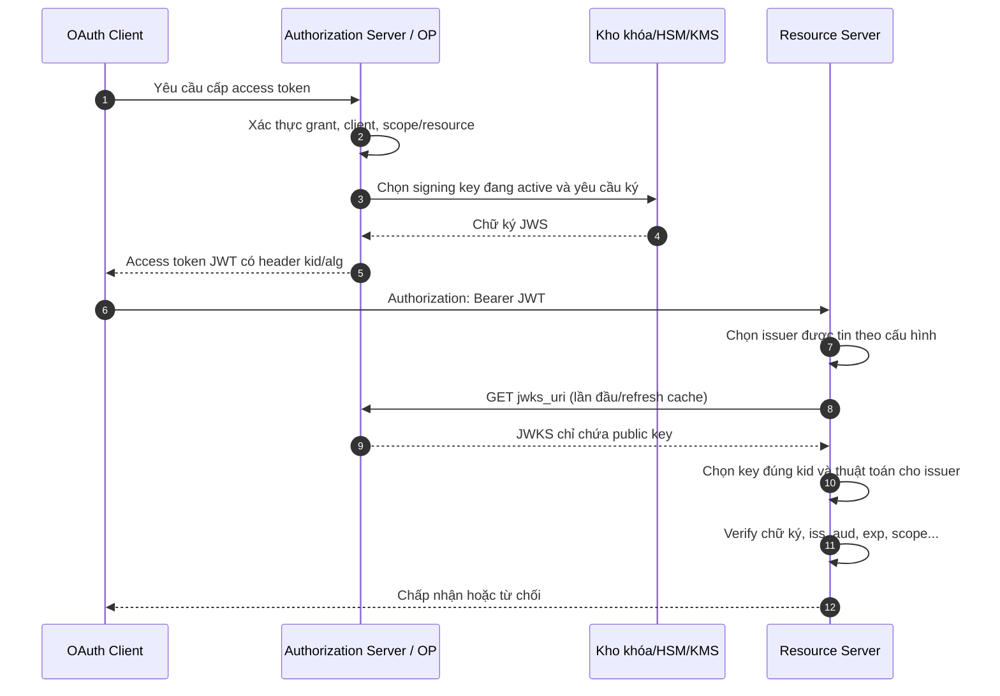
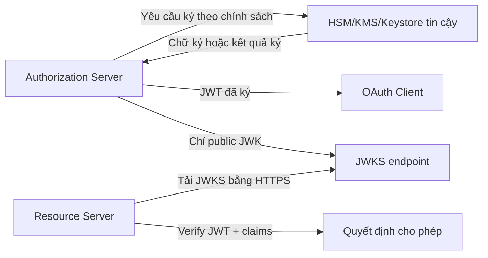
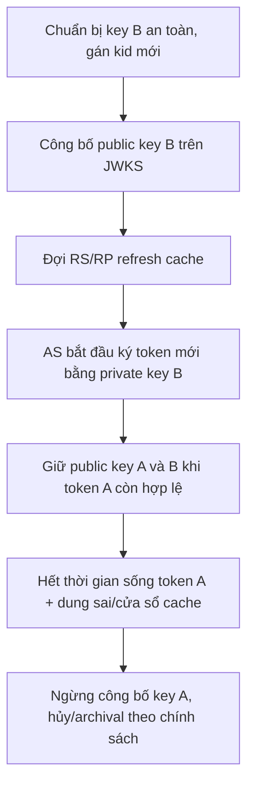

# Signing key và key endpoint trong Authorization Server

## 1. Vì sao Authorization Server cần khóa ký và key endpoint?

Trong OAuth 2.0/OpenID Connect (OIDC), **Authorization Server (AS)** phát hành các loại token cho client; **Resource Server (RS)** kiểm tra access token trước khi cho phép truy cập API, còn **OIDC client/Relying Party (RP)** kiểm tra ID Token để xác nhận kết quả đăng nhập. Với token định dạng **JWT được ký**, AS cần một **signing key** để tạo chữ ký, và bên xác minh cần biết **verification key** nào đáng tin.

Mô hình phổ biến sử dụng **mật mã bất đối xứng**:

- AS giữ **private key** và dùng nó ký JWS/JWT.
- AS công bố **public key** tương ứng thông qua một **JSON Web Key Set (JWKS) endpoint**, còn gọi là key endpoint trong nhiều nền tảng.
- RS/RP chỉ nhận public key từ issuer đáng tin, xác minh chữ ký rồi tiếp tục kiểm tra claims như `iss`, `aud`, `exp`, `nbf` và quyền `scope`/permission.
- Private key **không xuất hiện** trong JWKS công khai, không được đưa vào log, response, cấu hình frontend hoặc kho lưu trữ công khai.

Ví dụ: `https://auth.example.com` phát hành JWT access token cho `https://api.example.com/orders`. Orders API lấy bộ khóa công khai từ JWKS endpoint của AS, kiểm tra chữ ký và audience. Nếu kẻ tấn công tự sửa `scope` từ `orders:read` thành `orders:write`, chữ ký sẽ không còn hợp lệ. Nhưng nếu token bearer hợp lệ **bị đánh cắp**, chữ ký vẫn đúng; cần thêm giới hạn thời hạn, audience, quyền và biện pháp chống replay.

**Mục tiêu bài học:** hiểu khóa ký và khóa xác minh, định dạng JWS/JWK/JWKS, thiết lập endpoint an toàn, ràng buộc issuer và key, xoay vòng khóa không làm gián đoạn hệ thống, phân biệt token JWT và opaque, đồng thời kiểm thử các tình huống khóa bị lộ hoặc thay đổi.

## 2. Phân biệt signing key, JWS, JWK, JWKS và key endpoint

| Thuật ngữ | Bản chất | Trách nhiệm bảo mật |
| --- | --- | --- |
| **Signing key / private key** | Khóa bí mật mà AS dùng tạo chữ ký JWT | Giữ riêng tư, giới hạn ai được yêu cầu ký, luân chuyển và thu hồi |
| **Verification key / public key** | Khóa công khai khớp khóa ký, cho phép kiểm tra chữ ký | Phải đến từ issuer đã tin; không chấp nhận khóa do token tùy ý chỉ định |
| **JWS** | Cấu trúc chữ ký JSON Web Signature; JWT có thể được bảo vệ bằng JWS | Chữ ký đảm bảo tính toàn vẹn và xác thực nguồn phát hành theo khóa đã tin |
| **JWK** | Cách biểu diễn một khóa theo JSON, có thể là public hoặc private JWK | Chỉ công bố **thành phần public**; private JWK chứa trường bí mật cần được bảo vệ |
| **JWKS** | JSON object có mảng `keys` gồm các JWK | Xuất bản tập khóa xác minh đang có hiệu lực; không lộ khóa riêng |
| **`jwks_uri` / JWKS endpoint** | HTTPS URL mà AS công bố để bên xác minh lấy JWKS | Ổn định, đáng tin, quản lý cache/rotation và ngăn công bố dữ liệu private |
| **`kid`** | Key ID trong JWS header/JWK hỗ trợ chọn khóa | Chỉ là nhãn chọn khóa trong tập đã tin, **không phải bằng chứng tin cậy** |
| **`alg`** | Thuật toán JWS, ví dụ `RS256`/`ES256` | Bên xác minh áp dụng **allowlist do mình cấu hình** |
| **`use` / `key_ops`** | Mục đích sử dụng khóa: ký/xác minh hoặc mã hóa | Tránh dùng khóa không đúng mục đích |

**JWS không phải JWE.** JWS ký thông điệp để phát hiện sửa đổi; payload JWT thường có thể được giải mã Base64URL và **không được giữ bí mật nhờ chữ ký**. JWE mới cung cấp lớp mã hóa khi áp dụng đúng quy tắc. Đừng đặt mật khẩu hoặc dữ liệu nhạy cảm không cần thiết trong JWT với giả định rằng “JWT đã ký là đã mã hóa”.

**`kid` không phải secret.** Có thể xuất hiện trong header JWT và JWKS công khai. Nó chỉ giúp chọn một khóa đã được ràng buộc với issuer; một token mang `kid=production` không trở nên đáng tin nếu chữ ký hoặc issuer không hợp lệ.

## 3. Luồng phát hành và xác minh token



Trong thực tế, AS có thể ký trong chính ứng dụng thông qua khóa tại keystore hoặc gọi dịch vụ ký trong HSM/KMS. RS thường **cache JWKS** nên không tải lại mỗi lần nhận request.

Một JWT compact JWS thường có ba phần:

```text
base64url(protected-header).base64url(payload).base64url(signature)
```

Header ví dụ của access token JWT theo một profile cho phép:

```json
{
  "typ": "at+jwt",
  "alg": "RS256",
  "kid": "as-prod-rsa-2026-01"
}
```

Payload minh họa:

```json
{
  "iss": "https://auth.example.com",
  "sub": "user-42",
  "aud": "https://api.example.com/orders",
  "client_id": "web-client",
  "scope": "orders:read",
  "iat": 1893455400,
  "exp": 1893456000
}
```

Các timestamp chỉ là giá trị minh họa, không phải thời điểm hiện tại. JWT thực tế còn cần chữ ký được tạo từ private key. RS phải xác thực **cả chữ ký và các claims theo mục đích sử dụng**, không chỉ giải mã payload rồi tin dữ liệu.

### Phân biệt đường xác minh access token và ID Token

- **JWT access token** có thể được RS kiểm tra bằng khóa của AS; `aud` dành cho API/resource theo hợp đồng, `scope`/permission quyết định hành động. Nếu áp dụng RFC 9068, còn phải kiểm tra profile dành cho access token, bao gồm yêu cầu `typ`.
- **ID Token** là token OIDC để **client/RP** kiểm tra danh tính. `aud` thường chứa client ID; RP cần kiểm tra `iss`, `aud`, chữ ký, thời hạn và `nonce` khi được yêu cầu. API không được chấp nhận ID Token thay cho access token.
- **Opaque access token** không cần JWKS để RS tự xác minh nội dung; RS có thể gọi introspection endpoint được bảo vệ. AS vẫn có thể dùng signing key cho ID Token hoặc các token khác.
- **Refresh token** có thể là chuỗi opaque hoặc dạng khác tùy AS; không mặc định refresh token phải công khai xác minh được tại Resource Server. AS quản lý vòng đời, rotation, reuse detection và thu hồi của refresh token.

## 4. Signing key: thuật toán và mô hình tin cậy

### 4.1. Bất đối xứng hay đối xứng?

| Phương án | Ai cần giữ bí mật? | Đặc điểm |
| --- | --- | --- |
| **RSA `RS256` / `PS256`** | Chỉ AS giữ RSA private key | RS/RP dùng RSA public key từ JWKS đã tin |
| **ECDSA `ES256`** | Chỉ AS giữ private key đường cong P-256 | Chữ ký và khóa thường nhỏ hơn RSA; thư viện phải hỗ trợ đúng chuẩn JWS |
| **EdDSA** | Chỉ AS giữ private key phù hợp | Cần xác minh hỗ trợ thuật toán, JWK type và profile của AS/RS |
| **HMAC `HS256`** | AS và mọi bên xác minh đều phải biết cùng secret | Bên xác minh có secret về mặt kỹ thuật cũng có thể tạo chữ ký; không phù hợp để công khai qua JWKS |
| **Opaque token + introspection** | Không cần chia sẻ khóa ký token với RS | RS nhận trạng thái/quyền từ AS đã xác thực; phải kiểm soát độ trễ và cache introspection |

Với API của nhiều team/service, **chữ ký bất đối xứng** thường có lợi: RS chỉ cần public key, không có khả năng tạo JWT được AS tin. Nếu dùng HMAC, **không** xuất secret qua JWKS endpoint; bên sở hữu secret có khả năng giả mạo chữ ký nên ranh giới quyền khó kiểm soát hơn.

Việc chọn RSA, ECDSA hay EdDSA phải dựa trên profile giao thức, khả năng thư viện, chính sách mật mã và hạ tầng quản lý khóa. Không để token tự chọn thuật toán mà RS phải tin.

### 4.2. Một khóa có thể ký mọi loại token không?

Kỹ thuật có thể dùng chung một khóa cho nhiều loại JWT, nhưng cần đánh giá **cross-JWT confusion**. Một RS có thể vô tình chấp nhận ID Token hoặc loại JWT nội bộ khác nếu chỉ kiểm tra chữ ký cùng issuer.

Giảm rủi ro bằng:

- Chính sách **loại token** rõ ràng; nếu dùng RFC 9068, access token JWT có `typ=at+jwt` (hoặc media type tương ứng) và claims theo profile.
- Audience riêng cho API; ID Token dành cho OIDC client, không dùng thay access token.
- Đặt `iss`/`aud`/scope đúng nơi, tách luồng xác thực và phân quyền.
- Có thể tách signing key cho các họ token/tenant nếu mô hình đe dọa yêu cầu; vẫn phải giữ các quy tắc claim validation.

## 5. JSON Web Key và JWKS endpoint

### 5.1. Public JWK RSA

Một RSA public JWK có thể được biểu diễn như sau (giá trị `n`/`e` chỉ để minh họa, **không phải một khóa RSA dùng được**):

```json
{
  "kty": "RSA",
  "use": "sig",
  "alg": "RS256",
  "kid": "as-prod-rsa-2026-01",
  "n": "BASE64URL_RSA_MODULUS",
  "e": "AQAB"
}
```

- `kty=RSA`: loại khóa.
- `n`, `e`: modulus và public exponent được mã hóa Base64URL theo JWK.
- `use=sig`: khóa để ký/xác minh.
- `alg`: thuật toán khóa được công bố là thích hợp; RS vẫn cần allowlist độc lập.
- `kid`: nhãn chọn khóa.

**Không có** trường private key như `d`, `p`, `q`, `dp`, `dq` hoặc `qi` trong public JWKS. Với EC JWK, các trường công khai thường gồm `kty=EC`, `crv`, `x`, `y`; trường `d` là private material và không được công bố.

### 5.2. JWKS công khai và key endpoint

Một endpoint ví dụ:

```http
GET /oauth2/jwks HTTP/1.1
Host: auth.example.com
Accept: application/jwk-set+json
```

Phản hồi minh họa khi có hai public key để hỗ trợ rotation:

```http
HTTP/1.1 200 OK
Content-Type: application/jwk-set+json
Cache-Control: public, max-age=300
ETag: "jwks-v12"

{
  "keys": [
    {
      "kty": "RSA",
      "use": "sig",
      "alg": "RS256",
      "kid": "as-prod-rsa-2025-10",
      "n": "OLD_PUBLIC_MODULUS",
      "e": "AQAB"
    },
    {
      "kty": "RSA",
      "use": "sig",
      "alg": "RS256",
      "kid": "as-prod-rsa-2026-01",
      "n": "NEW_PUBLIC_MODULUS",
      "e": "AQAB"
    }
  ]
}
```

Dữ liệu trong phản hồi là ví dụ, không thể dùng để xác minh chữ ký thật. Đường dẫn `/oauth2/jwks` chỉ là một cấu hình phổ biến; **đường dẫn thực tế phải lấy từ metadata của AS tin cậy**, không đoán từ issuer bằng quy tắc tự tạo.

Phần `keys` có thể chứa nhiều khóa cùng lúc để các JWT đã ký trước đó tiếp tục được RS kiểm tra trong giai đoạn chuyển đổi. Một JWKS tổng quát có thể chứa khóa cho nhiều mục đích; RS phải chọn đúng loại, thuật toán và `use`/`key_ops` theo chính sách. Chỉ công bố khóa public thực sự cần thiết.

### 5.3. JWKS endpoint có cần xác thực người gọi?

Public key dùng xác minh chữ ký **được phép công khai**. Nhiều hệ thống cho phép lấy JWKS không cần bearer token để RS/RP tải khóa trước khi có phiên; bí mật nằm ở **private key**, không phải public key.

Dù endpoint công khai, vẫn cần:

1. HTTPS, chứng chỉ server hợp lệ, tên miền thuộc issuer đã tin.
2. Response chuẩn JSON/JWKS, không chứa khóa riêng hoặc token.
3. Chính sách cache, ETag/Last-Modified nếu phù hợp, khả năng phục vụ ổn định khi AS cấp token và khi RS cần làm mới cache.
4. Kiểm soát quyền thao tác **publish/thay khóa**, log/audit quản trị và giới hạn tốc độ hợp lý.
5. Không nhận `kid` tùy ý từ URL để trả về private key hoặc đọc file trên server.
6. Tách key endpoint **công khai** khỏi bảng điều khiển quản trị khóa/HSM/KMS và API tạo chữ ký.

Một endpoint JWKS ngừng hoạt động có thể làm RS không xác minh được token mang `kid` mới. Cần kết hợp cache, rollout khóa, khả năng dự phòng và chính sách từ chối an toàn; không bỏ qua chữ ký khi tải khóa thất bại.

## 6. Khám phá `jwks_uri` từ issuer đáng tin

OIDC Discovery và metadata OAuth Authorization Server có thể cung cấp `issuer` và `jwks_uri`. Ví dụ tài liệu discovery cho issuer:

```http
GET /.well-known/openid-configuration HTTP/1.1
Host: auth.example.com
Accept: application/json
```

```json
{
  "issuer": "https://auth.example.com",
  "authorization_endpoint": "https://auth.example.com/oauth2/authorize",
  "token_endpoint": "https://auth.example.com/oauth2/token",
  "jwks_uri": "https://auth.example.com/oauth2/jwks",
  "id_token_signing_alg_values_supported": ["RS256", "PS256"]
}
```

Các trường và đường dẫn thực tế tùy cấu hình/profile; OAuth metadata có quy ước `.well-known` khác OIDC trong một số trường hợp, đặc biệt khi issuer có path. Dùng **thư viện discovery phù hợp chuẩn** và issuer URI được cấu hình trước.

Quy tắc an toàn tại RS/RP:

1. Bắt đầu từ **issuer đã cho phép** (allowlist hoặc cấu hình tenant đã thẩm định).
2. Tải metadata qua HTTPS từ vị trí tương ứng với issuer đó.
3. Kiểm tra `issuer` trong metadata khớp **định danh issuer kỳ vọng**.
4. Lấy `jwks_uri` từ metadata hợp lệ, áp dụng giới hạn network/redirect và chính sách endpoint tin cậy.
5. Tải JWKS, cache và chọn public key, nhưng vẫn **xác minh claim `iss` trong chính token sau khi kiểm tra chữ ký**.

**Không làm ngược trình tự:** không đọc `iss` từ JWT chưa kiểm tra rồi **tự động tin** bất kỳ issuer URL nào và tự tải JWKS của họ. Kẻ tấn công có thể tạo AS/JWKS riêng, tự ký JWT với `aud` của API. Token chỉ đáng tin nếu khóa được ràng buộc với **issuer nằm trong chính sách RS**.

Tương tự, `jku` hoặc `x5u` có thể xuất hiện trong JOSE header nhưng **không nên tự động truy cập URL do token chỉ định**. Việc đó có thể mở cửa cho key substitution hoặc SSRF. Chọn khóa từ JWKS đã xác lập cho issuer tin cậy.

## 7. Lưu trữ private signing key an toàn

**Private key là một trong những bí mật quan trọng nhất của Authorization Server.** Nếu kẻ tấn công lấy được private key và hệ thống vẫn tin public key tương ứng, họ có thể ký JWT giả có `iss`, `aud`, `scope`, `sub` và `exp` theo ý mình (trong giới hạn RS kiểm tra).

Một mô hình lưu khóa:



Các phương án thường gặp:

| Cách lưu | Lợi ích | Điều cần thận trọng |
| --- | --- | --- |
| HSM/KMS với khóa không xuất được | Hạn chế khả năng trích xuất private key, audit hoạt động ký | Chủ thể được phép gọi API ký vẫn có thể **lạm dụng quyền ký** nếu bị chiếm |
| Keystore được bảo vệ, ví dụ PKCS#12 hoặc PKCS#11 provider | Tích hợp Java và quản trị khóa theo hạ tầng hiện có | Password, file quyền truy cập, backup, quyền tiến trình và rotation |
| Secret manager cung cấp khóa riêng cho tiến trình | Có chính sách đọc/rotation tập trung | Private key có thể hiện diện trong memory của ứng dụng; giới hạn quyền và log |
| File khóa nằm cùng source repo/container image | Dễ triển khai ban đầu | Nguy cơ cao: lộ qua Git, image registry, CI artifacts, backup; nên tránh |

Biện pháp quản trị:

- Tách quyền **ký**, **đọc public key**, **quản trị/rotate** và **xuất/backup private key**. Áp dụng least privilege và audit.
- Không generate key mới vào RAM mỗi lần restart production: RS đang cache JWKS/token cũ có thể lập tức hỏng xác minh.
- Dùng nguồn ngẫu nhiên bảo mật và độ dài khóa, thuật toán, thời hạn theo chính sách mật mã của tổ chức.
- Tách khóa giữa **dev/staging/prod**, issuer/tenant và miền tin cậy khi phù hợp. Không dùng khóa demo trong môi trường production.
- Đặt khóa ký trong hệ thống có backup/khôi phục được kiểm soát; kiểm thử chuyển vùng và thay đổi instance mà không sinh `kid` trùng hoặc khóa sai.
- Không log private JWK, PEM, password, access token, refresh token hoặc dữ liệu được ký nhạy cảm.

Lưu ý: khóa không thể xuất từ HSM không có nghĩa AS đã an toàn trước mọi hành vi giả mạo. Nếu attacker có quyền **yêu cầu HSM ký tùy ý**, họ vẫn có thể tạo token trái phép. Hệ thống ký phải kiểm soát **ai có quyền gọi ký và nội dung claims được phát hành**.

## 8. Chọn khóa ký và gán `kid`

AS thường có một khóa được chọn làm **active signing key** cho từng loại JWT/thuật toán/issuer. Các khóa cũ có thể chuyển sang trạng thái **verification-only** để RS tiếp tục xác minh token chưa hết hạn.

Ví dụ quản lý vòng đời:

| Key ID | Trạng thái | AS có ký token mới? | Có công bố public key? |
| --- | --- | --- | --- |
| `as-prod-2025-10` | Verify-only | Không | Có, trong thời gian còn token hợp lệ dùng key đó |
| `as-prod-2026-01` | Active | Có | Có |
| `as-prod-2026-04` | Prepared | Chưa | Có thể công bố trước khi đưa vào ký để cache lan truyền |
| `as-prod-2024-01` | Retired | Không | Không, khi mọi token liên quan hết hiệu lực hoặc bị xử lý |

Nguyên tắc chọn khóa:

1. `kid` phải định danh rõ từng phiên bản khóa trong tập của **một issuer**, không tái sử dụng cho vật liệu khóa khác trong giai đoạn có thể trùng.
2. Header JWT khai báo `kid` đúng với khóa AS đã dùng ký; `alg` tương thích với khóa và chính sách.
3. RS chọn `kid` **chỉ trong JWKS của issuer đã tin**, không tra khóa toàn hệ thống theo `kid` rồi gán issuer sau.
4. `kid` lạ: có thể làm mới JWKS từ **jwks_uri đã tin** theo chính sách throttling/cache; nếu vẫn không tìm được, từ chối token.
5. Không có `kid`: hành vi phải do profile và cấu hình RS quyết định; tránh thử bừa mọi khóa hoặc chấp nhận mơ hồ khi JWKS nhiều key.

## 9. Rotation: thay signing key không làm gián đoạn API

**Key rotation** là quá trình thay khóa ký cũ bằng khóa mới theo kế hoạch hoặc khi có sự cố. Rotation khác với **token refresh**: xoay signing key làm thay đổi vật liệu ký JWT; refresh token là credential để xin access token mới.

### 9.1. Rotation có kế hoạch



Các bước thực hành:

1. **Tạo key mới** trong kho bảo mật; chỉ công bố public JWK của key mới.
2. **Pre-publish** public key mới qua JWKS trước khi AS ký token dùng `kid` mới, để RS/RP có thời gian cập nhật cache.
3. **Đổi active signing key** cho token mới; AS phát header `kid` trỏ key mới.
4. **Giữ public key cũ** trong JWKS trong khoảng token cũ còn được chấp nhận: ít nhất xét tuổi thọ tối đa token liên quan, clock skew và hành vi cache của verifier.
5. **Retire public key cũ** khi bảo đảm không còn token hợp lệ cần khóa ấy, hoặc sau chính sách thu hồi rõ ràng. Hủy/đóng băng private key theo quy trình quản trị.

**Cửa sổ lưu khóa cũ** cần tính theo thời điểm token cuối cùng được ký bằng key cũ, không chỉ theo lúc tạo key mới. Nếu nhiều loại JWT có TTL khác nhau, phải xét loại còn sống lâu nhất hoặc tách key family.

### 9.2. Cache JWKS và chuyển đổi an toàn

RS thường cache JWKS theo HTTP headers, cấu hình thư viện hoặc cơ chế riêng. Nếu AS ngay lập tức ký bằng key B trước khi RS nhìn thấy B, RS có thể từ chối token mới với `kid` không biết.

Thiết kế cần:

- JWKS endpoint hoạt động ổn định và có thể scale; `Cache-Control`/`ETag` phản ánh chính sách rotation thực tế.
- RS có cơ chế refresh khi gặp `kid` mới từ issuer **đã tin**, có giới hạn tần suất để tránh DoS do token giả `kid` ngẫu nhiên.
- Không xóa key A trước khi thời hạn token A kết thúc, trừ khi có sự cố bắt buộc thu hồi.
- Dùng đồng hồ đồng bộ giữa AS/RS để tránh lỗi `iat`/`nbf`/`exp` không mong muốn.
- Kiểm thử nhiều instance, restart, deployment rolling và nhiều cluster cùng sử dụng **một trạng thái khóa có thẩm quyền**.

Không sửa `kid` của token cũ để trỏ khóa mới; chữ ký của token cũ vẫn được tạo bằng private key A và chỉ public key A tương ứng mới kiểm tra được.

## 10. Emergency rotation khi private key nghi bị lộ

**Khóa ký bị xâm phạm** nghiêm trọng hơn việc một bearer access token bị đánh cắp: attacker có thể tự tạo nhiều token giả cho tới khi public key của khóa đó không còn được RS/RP tin hoặc có biện pháp chặn khác.

Khác với rotation có kế hoạch, quá trình khẩn cấp ưu tiên **cắt quyền tin cậy đối với khóa bị lộ**:

1. Xác định issuer, `kid`, loại token, thuật toán, các RS/RP, thời gian, phạm vi và dấu hiệu key bị sử dụng trái phép.
2. Chặn khả năng attacker tiếp tục dùng API ký, khóa/quyền liên quan và nguồn rò rỉ. Bảo toàn chứng cứ an toàn, không đăng private key vào ticket/chat.
3. Tạo khóa thay thế từ môi trường sạch, công bố public key mới và bắt đầu ký token mới theo kế hoạch khẩn cấp.
4. **Loại khóa bị lộ khỏi tập tin cậy** ở RS/RP càng sớm càng tốt. Cần hiểu rằng RS có JWKS cache cũ vẫn có thể chấp nhận token giả cho tới khi cache invalidated/expired; có thể cần chủ động đẩy cập nhật hoặc áp dụng biện pháp chặn bổ sung.
5. Thu hồi phiên/grant/refresh token liên quan hoặc buộc đăng nhập lại theo tác động; nếu key cũng được dùng ký ID Token, phải xét client OIDC.
6. Kiểm tra truy cập API bất thường, claims mạo danh và hành vi token substitution; cập nhật quy trình rotation, quyền ký và hệ thống giám sát.

**Không xem việc gọi token revocation endpoint là đủ để vô hiệu mọi JWT có chữ ký từ khóa bị lộ.** JWT được RS kiểm tra offline có thể tiếp tục được chấp nhận nếu RS giữ khóa cũ và không kiểm tra trạng thái/denylist. Việc vô hiệu khóa có thể khiến token hợp lệ của người dùng cũng bị từ chối; đó là hệ quả vận hành phải chuẩn bị sẵn phương án khôi phục.

## 11. Java: tạo public JWKS mà không lộ private key

Ví dụ Java dùng thư viện **Nimbus JOSE + JWT** để tạo **bản public JWK** từ một `RSAPublicKey` đã tin. Mã phục vụ minh họa nguyên tắc xuất bản public key; không tự tạo key khi khởi động và không thay thế cấu hình Spring Authorization Server.

```java
import com.nimbusds.jose.JWSAlgorithm;
import com.nimbusds.jose.jwk.JWK;
import com.nimbusds.jose.jwk.JWKSet;
import com.nimbusds.jose.jwk.KeyUse;
import com.nimbusds.jose.jwk.RSAKey;

import java.security.interfaces.RSAPublicKey;
import java.util.List;

public final class PublicJwksBuilder {
    private PublicJwksBuilder() {}

    // PublicKeyRecord là DTO do ứng dụng quản lý: kid + public key.
    public record PublicKeyRecord(String kid, RSAPublicKey publicKey) {}

    public static JWKSet buildPublicJwks(List<PublicKeyRecord> records) {
        List<JWK> publicKeys = records.stream()
            .map(record -> new RSAKey.Builder(record.publicKey())
                .keyID(record.kid())
                .keyUse(KeyUse.SIGNATURE)
                .algorithm(JWSAlgorithm.RS256)
                .build())
            .map(key -> (JWK) key)
            .toList();

        return new JWKSet(publicKeys);
    }
}
```

Một lớp controller nếu **tự** xuất bản JWKS có thể trả `buildPublicJwks(records).toJSONObject()`, thêm `Content-Type: application/jwk-set+json`, HTTPS và cache policy. Nhưng nếu sử dụng Spring Authorization Server có JWKS endpoint tích hợp, hãy cấu hình nguồn khóa ký và để framework phục vụ endpoint theo chuẩn, tránh tạo **hai endpoint có tập khóa khác nhau**.

Điểm cần kiểm tra ở ví dụ:

- Đầu vào chỉ là `RSAPublicKey`, không phải `RSAPrivateKey`; JWKS được xây từ thành phần public.
- `kid` phản ánh đúng key mà AS thực sự dùng ký và tương ứng với `alg=RS256`.
- Không tạo public JWKS từ toàn bộ nội dung private keystore bằng cách serialize trực tiếp đối tượng hoặc biến cấu hình.
- Những key đã về trạng thái retired không xuất hiện, còn key verify-only vẫn xuất hiện nếu token cũ còn hợp lệ.
- Endpoint thực tế cần có kiểm thử để khẳng định `keys` không chứa private JWK members.

### 11.1. Luồng ký token trong AS (giả mã)

```text
Khi AS phát hành JWT access token:
  1. Xác thực client, grant và yêu cầu quyền/resource
  2. Tính chính xác iss, sub, aud, scope, exp, token type/profile
  3. Chọn signing key đang active cho issuer + token type
  4. Đặt header alg/kid phù hợp
  5. Ký JWS bằng private key từ keystore/HSM/KMS
  6. Trả token cho client; không trả private key
  7. Đảm bảo public key tương ứng đã được công bố qua JWKS

Ở RS:
  1. Cấu hình issuer và audience được tin
  2. Tải JWKS từ jwks_uri của issuer đó
  3. Chọn public key theo kid/alg và xác minh chữ ký
  4. Kiểm tra iss, aud, exp, scope, loại token và PoP nếu có
  5. Áp dụng phân quyền nghiệp vụ; từ chối khi bất kỳ bước nào lỗi
```

Giả mã không khuyến khích viết lại JOSE/JWT bằng tay. Dùng thư viện và middleware được bảo trì để xử lý Base64URL, chữ ký, thuật toán, key selection, thời gian và các profile token.

## 12. Kiểm thử key endpoint và xác minh chữ ký

Một bộ kiểm thử cần kiểm tra **nội dung JWKS, quy tắc tin cậy và hành vi rotation**, ngoài việc một token happy-path được xác minh.

| Ca kiểm thử | Kỳ vọng |
| --- | --- |
| `GET jwks_uri` qua HTTPS | Trả JSON Web Key Set đúng schema/định dạng và public keys |
| Public JWKS chứa `d`/`p`/`q` hoặc private EC `d` | **FAIL**: tuyệt đối không công bố private material |
| JWT được AS ký bằng active key, `kid` đúng | RS/RP xác minh được chữ ký và claims phù hợp |
| JWT bị sửa `aud`/`scope` mà không ký lại | RS từ chối vì signature invalid |
| JWT có chữ ký hợp lệ nhưng `iss` sai | RS từ chối dù cùng thuật toán |
| JWT hợp lệ nhưng `aud` không dành cho API | RS từ chối |
| JWT đã hết hạn hoặc sai `nbf` | RS từ chối |
| JWT khai báo `alg=none` hoặc thuật toán ngoài allowlist | RS từ chối |
| JWT khai báo `kid` lạ | RS có thể refresh JWKS **từ issuer tin cậy**, rồi từ chối nếu không có key |
| JWT khai báo `jku` trỏ host attacker | RS không tự đi tải khóa ngoài trust domain |
| JWT mang `typ` của ID Token nhưng gửi tới RS yêu cầu access token | RS từ chối theo token type/profile |
| AS bắt đầu ký B sau khi public B đã có trong JWKS | RS nhận cả JWT mới B lẫn JWT cũ A còn hợp lệ |
| AS retire key A khi còn JWT A hợp lệ (mô phỏng) | Test phát hiện gián đoạn; điều chỉnh kế hoạch rotation |
| Khóa A bị lộ và bị xóa khỏi trust | Sau cache invalidation, JWT ký A bị từ chối; kiểm tra cửa sổ cache |
| Hai instance AS có tập key không đồng nhất | Test triển khai phải phát hiện lỗi `kid`/signature giữa instance |
| JWKS endpoint tạm không sẵn sàng | RS dùng cache khóa đã tin theo chính sách; với khóa không xác minh được thì fail closed |
| Opaque access token | RS dùng introspection đúng AS; không cố giải mã nó như JWT |
| Access JWT sender-constrained | Ngoài chữ ký/claims phải kiểm tra DPoP/mTLS proof khớp `cnf` |

### 12.1. Kiểm tra không lộ private key bằng dữ liệu JSON

Ví dụ kiểm tra ở mức ý tưởng:

```java
// Sau khi gọi JWKS endpoint bằng HTTP client trong integration test:
Map<String, Object> jwks = /* parse JSON response */;
List<Map<String, Object>> keys = /* lấy keys array */;

for (Map<String, Object> key : keys) {
    assertFalse(key.containsKey("d"));
    assertFalse(key.containsKey("p"));
    assertFalse(key.containsKey("q"));
    assertFalse(key.containsKey("dp"));
    assertFalse(key.containsKey("dq"));
    assertFalse(key.containsKey("qi"));
}

// Test thêm: mỗi public key đã công bố phải khớp private key
// đang/đã được AS dùng ký theo kid, và chữ ký có thể verify thành công.
```

Đoạn trên là **giả mã test** (thiếu parser, biến assertion/import), không phải mã chạy độc lập. Khi triển khai, dùng parser JSON/JWK của thư viện và viết integration test qua đúng endpoint mà production sử dụng.

## 13. Vận hành: cache, quan sát và sự cố

### 13.1. Giám sát và metric

Nên theo dõi:

- JWKS endpoint availability, latency, lỗi HTTP, tỷ lệ cache hit và số lượng request tăng đột biến.
- Phân phối `kid` của JWT do AS phát hành (không ghi raw JWT), thời điểm bắt đầu dùng key mới và ngừng key cũ.
- RS verification failures: `unknown_kid`, `invalid_signature`, `invalid_issuer`, `invalid_audience`, `expired_token`, lỗi fetch JWKS.
- Khác biệt giữa các AS instance/cluster về active signing key và published JWKS.
- Thời điểm hiệu lực của rotation, thời gian phân phối metadata/JWKS, JWKS cache TTL và tình huống client cũ dùng key đã retired.

`kid` không phải secret nhưng vẫn là **dữ liệu từ token chưa xác minh** ở thời điểm đầu, nên phải giới hạn độ dài và encode trước khi log để tránh log injection. Tuyệt đối không log nguyên token, private JWK, nội dung private keystore, secret hay key-export response.

### 13.2. Phản ứng khi key endpoint có vấn đề

| Sự cố | Nguyên nhân khả dĩ | Hướng xử lý |
| --- | --- | --- |
| JWT mới bị RS báo `unknown kid` | AS ký trước khi RS cập nhật JWKS hoặc JWKS chưa có key mới | Pre-publish key, refresh cache tin cậy, kiểm tra rollout |
| Một số API nhận token, số khác từ chối | Cache TTL/issuer config/thuật toán khác nhau giữa RS | So sánh trusted issuer, `jwks_uri`, kid, alg policy, cache và đồng hồ |
| Sau restart AS, token cũ không xác minh được | Sinh key mới mỗi lần khởi động hoặc mất keystore | Dùng kho khóa bền, backup/khôi phục và chính sách rotate |
| JWKS công bố private key | Serialize nhầm JWK có `d`/secret | Ngừng endpoint, xử lý compromise, rotate khẩn cấp, kiểm tra bản sao/cache |
| JWKS endpoint bị tấn công DoS | RS refresh liên tục khi gặp `kid` ngẫu nhiên | Throttle refresh, cache, rate-limit, dự phòng; RS vẫn fail closed |
| JWT của issuer lạ được chấp nhận | RS tự động tin `iss`/`jku` chưa xác minh | Cố định allowlist issuer và JWKS trusted metadata |
| Signature đúng nhưng API nhận sai token | Bỏ qua `aud`/`typ`/scope hoặc ID Token confusion | Thêm validation theo resource/token profile và phân quyền |

Cần có playbook cho **key compromise**, **key rotation thất bại** và **mismatch JWKS giữa các cụm**. Phải phân biệt lỗi tạm thời tại endpoint công khai với tình trạng private key bị lộ; cách ứng phó và phạm vi thu hồi rất khác nhau.

## 14. Những quan niệm sai thường gặp

1. **“JWKS chứa khóa bí mật để RS tự ký/xác minh.”** Sai: JWKS công khai chỉ chứa **public verification key**, không có private signing material.
2. **“`kid` trong token đủ để chọn khóa đáng tin.”** Sai: chỉ chọn `kid` trong JWKS thuộc **issuer đã tin**.
3. **“Có chữ ký hợp lệ thì không cần `aud`/`iss`.”** Sai: phải kiểm tra issuer, audience, thời hạn, scope và loại token theo ngữ cảnh.
4. **“Chữ ký JWT mã hóa payload.”** Sai: JWS bảo vệ toàn vẹn và nguồn phát hành; payload có thể đọc được.
5. **“Mỗi lần AS restart sinh cặp khóa mới là an toàn hơn.”** Sai: làm hỏng token đang có hiệu lực và gây gián đoạn; phải có rotation có quản trị.
6. **“Chỉ cần thay private key là key cũ lập tức bị vô hiệu.”** Sai: RS có thể tiếp tục chấp nhận chữ ký với public key cũ đang cache.
7. **“Nếu `kid` không tìm thấy, hãy lấy `jku` trong JWT và tải khóa.”** Sai: JWKS URL phải đến từ issuer/metadata đáng tin để tránh key substitution và SSRF.
8. **“Opaque token cũng phải được RS verify bằng JWKS.”** Sai: opaque token thường được RS kiểm tra qua introspection hoặc cơ chế được AS thiết kế.
9. **“Có HSM thì attacker không thể tạo token giả.”** Sai: chiếm được quyền yêu cầu ký cũng có thể dẫn tới phát hành trái phép.
10. **“Đổi signing key tương đương refresh token rotation.”** Sai: đây là hai vòng đời và hai cơ chế bảo vệ khác nhau.

## 15. Câu hỏi tự kiểm tra

**Câu 1.** Tại sao RS có thể xác minh JWT của AS mà không giữ private key? Công bố trường `d` của RSA JWK ở `jwks_uri` sẽ gây hậu quả gì?

**Câu 2.** Token có `kid=as-prod-rsa-2026-01`, `alg=RS256` và chữ ký hợp lệ với một khóa công khai trên Internet. Vì sao RS vẫn phải kiểm tra issuer tin cậy và audience của API?

**Câu 3.** AS đã bắt đầu ký bằng key B nhưng JWKS vẫn chỉ công bố key A. Điều gì xảy ra tại RS đang cache key A, và quy trình rotation phải đổi ra sao?

**Câu 4.** JWKS đã xóa key A khi một số token ký bằng A còn hạn. Có nên tự bỏ qua chữ ký để tránh lỗi 401 không? Phương án an toàn là gì?

**Câu 5.** Khi private key bị lộ, vì sao chỉ gọi token revocation endpoint hoặc xóa private key khỏi server chưa chắc vô hiệu hóa ngay các JWT giả?

**Câu 6.** Nếu RS nhận một opaque access token, vì sao không thể đơn giản tìm `kid` trong token rồi tải JWKS như với JWT?

**Câu 7.** Vì sao ID Token do đúng AS ký không tự cấp quyền gọi API, ngay cả khi public key và chữ ký hợp lệ?

## 16. Ghi nhớ

- **Authorization Server giữ private signing key; JWKS endpoint công bố public verification keys** để RS/RP kiểm tra JWT.
- `kid` giúp chọn đúng key trong **tập khóa của issuer đã tin**; `alg` cần tuân thủ allowlist độc lập, không do token áp đặt.
- **Khóa ký chỉ bảo vệ chữ ký**. RS vẫn phải kiểm tra `iss`, `aud`, `exp`, `scope`/permission, token type/profile và PoP nếu có.
- **JWKS và discovery** phải gắn với issuer tin cậy; không tự động tin `iss`, `jku` hay `x5u` từ JWT chưa xác minh.
- **Rotation có kế hoạch**: công bố public key mới trước, chuyển AS sang ký bằng key mới, giữ key cũ đến khi token cũ hết hạn, rồi retire.
- **Key compromise**: cần cắt trust vào khóa bị lộ, quản lý cache/RS, thu hồi các phiên/token liên quan và điều tra hoạt động ký bất thường.
- JWT và opaque token có đường xác minh khác nhau. ID Token dành cho OIDC client; access token dành cho Resource Server; refresh token có vòng đời và chính sách bảo vệ riêng.

**Chuẩn tham khảo:** JSON Web Signature (RFC 7515); JSON Web Key (RFC 7517); JSON Web Algorithms (RFC 7518); JSON Web Token (RFC 7519); JWK Thumbprint (RFC 7638); OAuth 2.0 Authorization Server Metadata (RFC 8414); JSON Web Token Best Current Practices (RFC 8725); JWT Profile for OAuth 2.0 Access Tokens (RFC 9068); OAuth 2.0 Security Best Current Practice (RFC 9700); OpenID Connect Core 1.0 và OpenID Connect Discovery 1.0.

