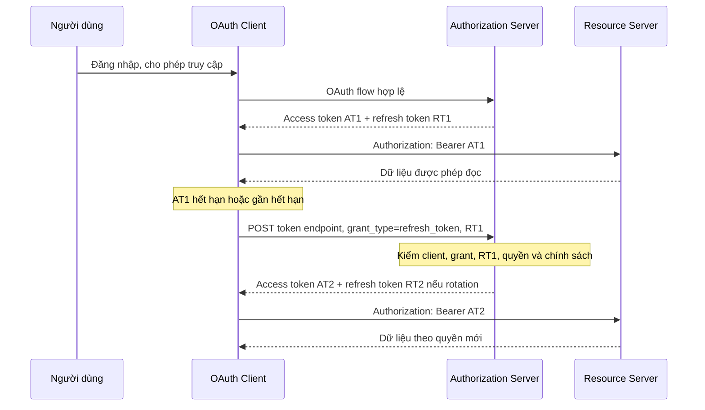
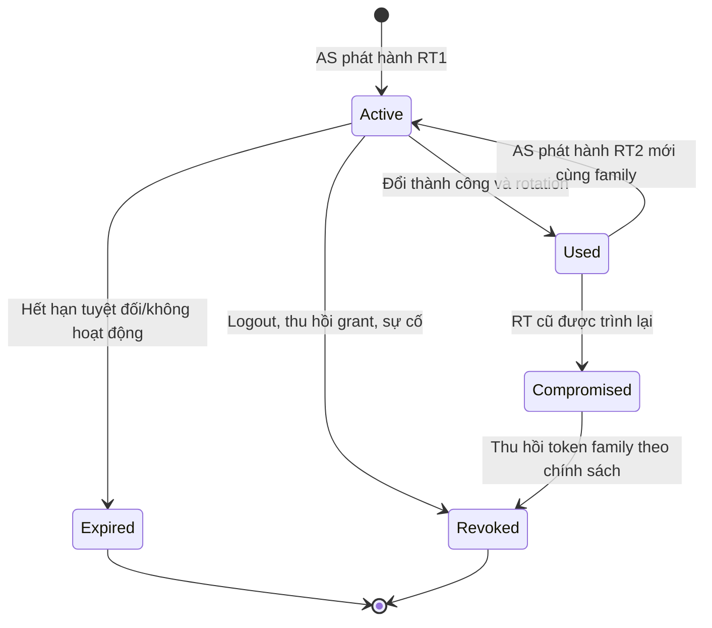

# Refresh token handling

## 1. Refresh token nằm ở đâu trong mô hình OAuth 2.0/OIDC?

Trong OAuth 2.0, **Authorization Server (AS)** phát hành **access token** để client gọi Resource Server (API) và có thể phát hành **refresh token** để client xin access token mới khi token cũ hết hạn hoặc sắp hết hạn. Refresh token là credential nhạy cảm đại diện cho một quyền ủy quyền đã được cấp; nó thường có giá trị sử dụng dài hơn một access token, nên quy trình phát hành, kiểm tra, làm mới và thu hồi phải chặt chẽ.

**Refresh token handling** là tập hợp các chính sách và thao tác của Authorization Server để quản lý refresh token trong suốt vòng đời của nó, không chỉ là endpoint trả về access token mới.

Bài thuộc chương **Authorization server** của module `SECURITY_TOKEN_SECURITY_FUNDAMENTALS`, tập trung vào mô hình tin cậy, phân biệt JWT/opaque token, access/refresh token, xác thực và phân quyền OAuth 2.0/OIDC, cùng việc phòng chống token bị đánh cắp hoặc phát lại.

| Loại token | Ai sử dụng, dùng ở đâu? | Mục đích | Cần nhớ |
| --- | --- | --- | --- |
| **Access token** | Client gửi đến **Resource Server**; API kiểm tra token và quyền | Truy cập tài nguyên trong `audience`, `scope`, thời hạn cho phép | JWT hoặc opaque đều có thể là bearer token và bị replay nếu bị lộ |
| **Refresh token** | Client gửi đến **token endpoint của Authorization Server** | Xin access token mới mà không bắt người dùng xác thực lại mỗi lần | Không gửi cho Resource Server; phải bảo vệ, ràng buộc và thu hồi phù hợp |
| **ID token** (OIDC) | Client/Relying Party kiểm tra kết quả xác thực với OpenID Provider | Cung cấp thông tin xác thực người dùng theo OIDC | Không phải access token; không dùng ID token để gọi API |
| **Authorization code** | Client đổi tại token endpoint trong một giao dịch ngắn hạn | Hoàn thành Authorization Code flow | Phải chỉ dùng một lần, gắn với client/redirect URI/PKCE theo luồng |

> **Phân biệt quan trọng:** Refresh token không phải quyền truy cập trực tiếp vào API. Nó là credential trình cho **Authorization Server** để AS đánh giá quyền tiếp tục phát hành token. Một refresh token vẫn còn hạn không bảo đảm yêu cầu làm mới sẽ được chấp nhận: AS có thể đã thu hồi grant, thay đổi chính sách, phát hiện reuse hoặc yêu cầu đăng nhập lại.

## 2. Ai quyết định cấp refresh token?

Authorization Server **không bắt buộc** phải cấp refresh token trong mọi OAuth flow. Việc cấp hay không phụ thuộc loại client, grant, chính sách, yêu cầu truy cập ngoại tuyến, mức độ tin cậy thiết bị và rủi ro.

- **Confidential client** (ví dụ backend có thể giữ client credential): AS thường yêu cầu client authentication tại token endpoint và ràng buộc refresh token với client đã được cấp.
- **Public client** (SPA chạy trong browser, ứng dụng native): không thể giữ `client_secret` thực sự bí mật chỉ bằng cách nhúng nó vào mã. AS phải đánh giá cơ chế bảo vệ refresh token, ví dụ **refresh token rotation** hoặc **sender-constrained refresh token** theo OAuth 2.0 Security Best Current Practice (RFC 9700).
- **OIDC:** Scope `offline_access` có các quy tắc xử lý và đồng ý trong OIDC Core để yêu cầu quyền truy cập khi người dùng không hiện diện. Việc thêm scope này **không tự bảo đảm** AS sẽ cấp refresh token; vẫn phụ thuộc chính sách và điều kiện của provider.
- **Ứng dụng máy chủ:** Có thể dùng grant khác như client credentials cho tác vụ máy với danh tính client, không nhất thiết cần refresh token. Refresh token gắn với ủy quyền cụ thể, không phải một loại mật khẩu vĩnh viễn.

Ở bước phát hành, AS nên chỉ cấp refresh token trong phạm vi `scope` và Resource Server được phê duyệt, gắn nó với **client và grant cụ thể**, thời hạn và các điều kiện phiên cần thiết. Client đăng nhập thành công một lần không đồng nghĩa có thể xin thêm bất kỳ `scope` hoặc `audience` nào về sau.

## 3. Luồng refresh token grant tại token endpoint

Client gọi token endpoint qua **HTTPS/TLS** bằng một HTTP POST dạng `application/x-www-form-urlencoded` với `grant_type=refresh_token`. Ví dụ minh họa cho một **confidential client**:

```http
POST /oauth2/token HTTP/1.1
Host: auth.example.test
Authorization: Basic <CLIENT_AUTHENTICATION_PLACEHOLDER>
Content-Type: application/x-www-form-urlencoded
Accept: application/json

grant_type=refresh_token&refresh_token=REFRESH_TOKEN_PLACEHOLDER
```

Các placeholder không phải credential thật. Ở đây `Authorization: Basic …` phục vụ **xác thực confidential client** tại token endpoint; nó **khác** với `Authorization: Bearer <access_token>` khi client gọi Resource Server. Cách xác thực client có thể là `client_secret_basic`, `private_key_jwt`, mTLS hoặc phương thức đã đăng ký khác. Public client không nên tự nhận mình là confidential client chỉ vì gửi một `client_secret` hard-code trong JavaScript.

AS có thể trả:

```http
HTTP/1.1 200 OK
Content-Type: application/json
Cache-Control: no-store
Pragma: no-cache

{
  "access_token": "NEW_ACCESS_TOKEN_PLACEHOLDER",
  "token_type": "Bearer",
  "expires_in": 300,
  "scope": "orders:read",
  "refresh_token": "NEW_REFRESH_TOKEN_PLACEHOLDER"
}
```

Phản hồi này **minh họa trường hợp rotation**: AS cấp refresh token mới để thay refresh token cũ. Theo OAuth 2.0, response refresh token grant **có thể có hoặc không có** `refresh_token` mới tùy cơ chế; với chính sách rotation, client phải thay token cũ sau lần đổi thành công. `scope` trong response không được mở rộng ngoài phạm vi được phép của grant cũ; AS có thể thu hẹp phạm vi khi chính sách thay đổi.



**Không gửi refresh token cho Resource Server**, không đặt refresh token trong query string, không dùng GET cho refresh request và không ghi token vào access log hoặc URL. RS chỉ nhận access token dành cho API và thực hiện kiểm tra `iss`, `aud`, thời hạn, `scope`/quyền.

## 4. AS phải xác minh điều gì trước khi cấp token mới?

Một request `grant_type=refresh_token` chỉ được chấp nhận khi tất cả điều kiện trong chính sách đều hợp lệ. Các nhóm kiểm tra quan trọng:

1. **Giao thức và request:** Token endpoint được bảo vệ bằng TLS; request đúng method, content type, trường bắt buộc, không có tham số mâu thuẫn hoặc cấu trúc bất thường; áp dụng giới hạn kích thước và tốc độ.
2. **Client:** Nếu là confidential client, xác thực bằng phương thức đã đăng ký; nếu là public client, áp dụng yêu cầu nhận diện client phù hợp và sender constraint/rotation. Token phải được cấp cho **đúng client hiện tại**.
3. **Trạng thái refresh token:** Token đã được phát hành bởi AS tin cậy, còn hiệu lực, chưa bị thu hồi, chưa bị tiêu thụ (nếu dùng rotation), chưa vượt giới hạn inactivity/absolute lifetime.
4. **Grant và phiên:** Authorization grant gốc vẫn còn hiệu lực; user/client chưa bị vô hiệu hóa, thu hồi quyền hoặc bị chính sách yêu cầu xác thực lại.
5. **Scope và tài nguyên:** Scope yêu cầu mới nếu có phải là tập con phạm vi đã được chấp thuận; audience/resource chỉ thuộc những nơi được grant cho phép. Không tự tăng quyền khi refresh.
6. **Ràng buộc người gửi:** Nếu refresh token gắn với chứng chỉ mTLS hoặc khóa DPoP, request phải chứng minh đúng khóa/chứng chỉ đã ràng buộc.
7. **Rủi ro và chính sách vận hành:** Đánh giá dấu hiệu reuse, hành vi bất thường, giới hạn thiết bị/phiên hoặc điều kiện nâng mức xác thực theo chính sách đã thiết kế.

Các kiểm tra có thể thực hiện tại nhiều lớp nhưng **không được dựa vào claims do client tự gửi** như `user_id`, `role` hay `scope` để gán quyền mà không đối chiếu với grant đã lưu/đã xác minh. Refresh token **không phải công cụ để cấp quyền cao hơn** quyền đã được người dùng/AS cho phép trước đó.

## 5. Vòng đời refresh token: từ phát hành đến vô hiệu hóa



Sơ đồ diễn đạt trạng thái tổng quát. Khi chuyển từ RT1 sang RT2, **RT1 vẫn ở trạng thái Used**, còn RT2 là token khác ở trạng thái Active; mũi tên từ Used sang Active biểu diễn hành động phát hành token kế tiếp, không phải hồi sinh RT1.

| Trạng thái | Ý nghĩa tại AS | Hành vi nhận request refresh |
| --- | --- | --- |
| **Active** | Refresh token còn hiệu lực và đáp ứng các điều kiện ràng buộc | Có thể đổi thành token mới nếu mọi kiểm tra đạt |
| **Used/Consumed** | Token cũ đã được đổi và bị vô hiệu hóa bởi rotation | Từ chối; nếu bị dùng lại, kích hoạt chính sách reuse detection |
| **Expired** | Quá hạn tuyệt đối hoặc quá thời gian không sử dụng | Từ chối; client thường phải đưa người dùng qua luồng xác thực/ủy quyền lại |
| **Revoked** | Grant/phiên/token đã bị thu hồi | Từ chối; không phát token mới |
| **Compromised/Suspected reuse** | AS quan sát dấu hiệu token cũ bị gửi lại hoặc rủi ro khác | Từ chối, ghi nhận sự kiện và thu hồi family/phiên theo chính sách |

### 5.1. Thời gian sống: absolute, idle và sliding

Không có một TTL refresh token đúng cho mọi ứng dụng. AS có thể dùng đồng thời:

- **Absolute expiration:** Mốc hết hạn tối đa tính từ khi cấp grant/refresh token; dù client refresh thường xuyên cũng không vượt ngưỡng này nếu chính sách giữ nguyên trần.
- **Inactivity expiration:** Token/phiên hết hạn nếu không được dùng trong một khoảng thời gian theo quy định.
- **Sliding expiration:** Mỗi lần refresh hợp lệ có thể kéo dài mốc không hoạt động, nhưng không nên vô tình làm mất trần absolute lifetime nếu hệ thống có yêu cầu về thời gian tối đa.
- **Event-driven invalidation:** Đăng xuất, người dùng hủy quyền ứng dụng, sự cố bảo mật, thay đổi quyền hoặc yêu cầu đăng nhập lại có thể khiến grant/refresh token bị vô hiệu hóa.

AS nên ràng buộc thời gian sống và phạm vi cấp token với loại client, độ nhạy của API, thiết bị, khả năng bảo vệ credential và chính sách người dùng. Đối với public client, hướng dẫn OAuth 2.0 Security BCP yêu cầu có biện pháp phát hiện replay nếu phát refresh token và khuyến nghị giới hạn tính hợp lệ khi token không được sử dụng trong một thời gian.

## 6. Refresh token rotation và reuse detection

**Refresh token rotation** là quy trình AS cấp một refresh token mới mỗi lần đổi thành công, đồng thời đánh dấu refresh token cũ **không còn sử dụng được**. Những token kế tiếp thuộc cùng một **token family** (hoặc grant lineage) để AS có thể truy vết và xử lý nếu token cũ xuất hiện lại.

Ví dụ:

```text
Ban đầu:       RT1 [ACTIVE]
Đổi thành công RT1:
               RT1 [USED] -> RT2 [ACTIVE]
Đổi thành công RT2:
               RT1 [USED] -> RT2 [USED] -> RT3 [ACTIVE]
Kẻ tấn công dùng RT1 lần nữa:
               REUSE DETECTED -> REVOKE FAMILY (theo chính sách)
```

### 6.1. Vì sao dùng lại token cũ là tín hiệu quan trọng?

Với bearer refresh token bị sao chép, cả client thật và kẻ tấn công có thể thử đổi token. **Rotation không tự bảo đảm kẻ tấn công không dùng trước**. Điểm mạnh của rotation là phát hiện tranh chấp: sau khi một bên dùng token thành công và AS cấp token kế tiếp, bên còn lại gửi lại token cũ sẽ tạo **reuse signal**.

AS có thể không xác định được ai là bên hợp pháp nếu chỉ nhìn hai lần dùng cùng một bearer refresh token. Do đó chính sách phổ biến là **vô hiệu hóa cả token family/authorization grant liên quan** và yêu cầu người dùng xác thực lại. Điều này cắt khả năng tiếp tục dùng chuỗi refresh token nhưng có thể làm gián đoạn phiên người dùng thật.

Không đánh đồng:

- **Reuse của refresh token đã tiêu thụ**: tín hiệu quan trọng của token theft/replay trong hệ thống rotation.
- **Dùng cùng access token cho nhiều request API**: hoạt động hợp lệ trong phần lớn hệ thống bearer token; không mặc định coi đây là reuse bất hợp pháp.
- **Retry do lỗi mạng**: có thể tạo reuse signal dù không có kẻ tấn công; cần thiết kế phản hồi và quan sát theo chính sách rõ ràng.

### 6.2. Phát hành và tiêu thụ phải nguyên tử

Hai request refresh có thể đến cùng lúc ở hai instance AS. Nếu cả hai cùng đọc RT1 là `ACTIVE` rồi độc lập phát hành RT2, RT3, hệ thống đã tạo nhiều nhánh hợp lệ từ một token dùng một lần.

Giải pháp cần **transaction hoặc thao tác compare-and-swap nguyên tử** trên trạng thái token, đồng thời bảo vệ ràng buộc token family. Mã giả:

```text
function refresh(grantType, clientIdentity, presentedRefreshToken, proof):
    require grantType == "refresh_token"
    verifyClientAuthenticationIfRequired(clientIdentity)
    require requestIsWellFormedAndUsesTLS()

    tokenHash = serverSideLookupDigest(presentedRefreshToken)
    BEGIN TRANSACTION
        record = lockRefreshTokenRow(tokenHash)       // SELECT ... FOR UPDATE
        require record belongsTo clientIdentity
        require grantIsActive(record.grantId)
        require tokenNotExpired(record)
        require senderBindingMatches(record, proof)

        if record.status == USED:
            revokeTokenFamily(record.familyId)
            COMMIT
            return invalid_grant                  // Reuse đã được phát hiện

        if record.status != ACTIVE:
            ROLLBACK
            return invalid_grant

        newRefreshToken = cryptographicallyRandomToken()
        markTokenUsed(record)
        saveNewRefreshTokenHash(
            newRefreshToken, familyId=record.familyId, status=ACTIVE)
        COMMIT

    newAccessToken = issueAccessTokenWithinApprovedGrant(record.grantId)
    return accessTokenResponse(newAccessToken, newRefreshToken)
```

Đây là **mã giả về nguyên tắc**, chưa phải thiết kế transaction hoàn chỉnh cho sản phẩm. Triển khai thực tế phải làm rõ **ranh giới giao dịch giữa phát hành access token và commit refresh token**, bảo vệ tính nhất quán khi crash/timeout, bảo đảm branch reuse được ghi nhận và rollback đúng; nên dùng thư viện và tầng lưu trữ được kiểm thử, tránh tự thiết kế logic an toàn chỉ từ một đoạn pseudocode.

**Một lưu ý về thứ tự kiểm tra:** Sau khi xác minh client/binding và định danh token hợp lệ, AS phải phân biệt token cũ **đã dùng** với token hoàn toàn không tồn tại. Không cho token từ client không liên quan gây thu hồi family của người khác chỉ bằng cách đoán ID, và không công khai trong lỗi chi tiết token có tồn tại hay không.

### 6.3. Race condition và retry hợp pháp

Một client có thể gửi hai yêu cầu refresh song song do nhiều tab, nhiều worker hoặc nhiều request API cùng nhận `401`. Cũng có thể response của yêu cầu thứ nhất bị mất trên đường truyền, khiến client thử lại bằng refresh token cũ. Để giảm false positive:

1. **Client dùng single-flight refresh:** Chỉ một tác vụ refresh đang chạy cho cùng phiên/grant; các request khác chờ kết quả rồi dùng access token mới.
2. **Cập nhật token kế tiếp an toàn:** Lưu refresh token mới theo cơ chế nguyên tử phù hợp nền tảng; tránh tab A ghi RT2 rồi tab B đè lại RT1.
3. **AS bảo vệ bằng transaction:** Chỉ một request được tiêu thụ RT hiện hành; request còn lại không thể cùng đổi thành công.
4. **Chọn chính sách xử lý reuse rõ ràng:** Từ chối và revoke family hoặc cơ chế chống false positive đã được phân tích kỹ. Một *grace window* tùy tiện cho phép dùng lại RT cũ sẽ **làm yếu khả năng phát hiện replay**; nếu triển khai phải có thiết kế kiểm soát chặt và đánh đổi được chấp nhận.
5. **Ghi nhận sự kiện không lộ token:** Dùng family ID, client ID, request ID, loại lỗi, timestamp; không log refresh token thô.

## 7. Mô hình lưu trữ refresh token ở Authorization Server

**Opaque refresh token** dạng chuỗi ngẫu nhiên mật mã là lựa chọn thuận tiện khi AS cần quản lý trạng thái rotation, thu hồi, family và lịch sử dùng. AS có thể phát refresh token dạng JWT hoặc cấu trúc khác, nhưng việc ký JWT **không tự thay thế trạng thái server** nếu muốn kiểm tra token đã bị tiêu thụ, thu hồi hay phát lại.

Một bản ghi lưu trữ tối thiểu có thể có:

| Trường | Mục đích |
| --- | --- |
| `token_hash` | Giá trị hash/HMAC để tra cứu, tránh lưu nguyên văn refresh token |
| `client_id` | Ràng buộc token với client được cấp |
| `subject_id` / `grant_id` | Liên hệ người dùng và authorization grant |
| `family_id` / `parent_id` | Theo dõi chuỗi rotation và thu hồi cả family |
| `status` | `ACTIVE`, `USED`, `REVOKED` hoặc trạng thái theo thiết kế |
| `issued_at`, `expires_at`, `last_used_at` | Kiểm thời gian sống tuyệt đối/inactivity và điều tra |
| `approved_scopes`, `resource_ids` | Giữ quyền và audience trong phạm vi đã chấp thuận |
| `binding_method`, `binding_key_id` | Ràng buộc DPoP/mTLS nếu được dùng |

Token tạo bởi **CSPRNG** cần có entropy đủ mạnh để không thể đoán. Hash tra cứu có thể dùng SHA-256 cho token ngẫu nhiên entropy cao, nhưng HMAC với secret phía server có thể bổ sung bảo vệ trong một số threat model; cần quản lý khóa và xử lý tra cứu/thay khóa nhất quán. Với token tự chứa có cấu trúc, phải đánh giá thêm nguy cơ lộ metadata và cách giữ bí mật, không mặc định chỉ cần hash là đủ.

Thiết kế nên có chỉ mục cho token hash, khóa và constraint bảo đảm tại mỗi thời điểm chỉ có **một nhánh Active hợp lệ** theo lineage; các bản ghi Used cần được giữ đủ lâu để phát hiện reuse trong cửa sổ rủi ro, rồi dọn theo chính sách lưu trữ dữ liệu. Không lưu token thô trong log, queue retry, analytics, tracing hoặc hệ thống giám sát.

## 8. Sender-constrained refresh token: DPoP và mTLS

**Refresh token rotation** là một cơ chế phát hiện sử dụng lại. **Sender-constrained token** là hướng khác: token chỉ được dùng nếu client còn chứng minh được quyền sở hữu khóa hoặc chứng chỉ đã được ràng buộc khi phát hành.

### 8.1. DPoP

Với **Demonstrating Proof of Possession (DPoP, RFC 9449)**, client tạo khóa và gửi proof JWT được ký bằng khóa riêng cho request phù hợp. AS liên kết refresh token với khóa đó; khi xử lý refresh, AS phải xác minh binding và các thuộc tính proof như `htm`, `htu`, `iat`/nonce, `jti` chống replay; các trường bắt buộc cụ thể phụ thuộc ngữ cảnh request DPoP. Không dùng `ath` một cách máy móc cho mọi request token endpoint: `ath` đặc biệt liên quan proof gắn với **access token** khi gọi Resource Server.

Nếu kẻ tấn công chỉ sao chép refresh token nhưng không thể sử dụng khóa đã ràng buộc, họ khó đổi token tại AS. Tuy nhiên nếu mã độc chạy **ngay trên client** và có thể điều khiển chức năng ký/gửi request, DPoP không tự loại bỏ nguy cơ lạm dụng phiên; cần phòng vệ ở môi trường client và AS.

### 8.2. Mutual TLS

Với **mTLS-bound refresh token**, AS ràng buộc token với chứng chỉ client phù hợp và yêu cầu chứng minh chứng chỉ trên kết nối TLS khi refresh. Bản sao token riêng lẻ không đủ để đổi nếu attacker không có chứng chỉ/khóa riêng. mTLS thích hợp với confidential client hoặc môi trường có khả năng quản lý chứng chỉ; cần bảo đảm proxy/TLS termination không làm mất hoặc giả mạo thông tin binding.

**Không nhầm sender constraint với client authentication:** Chúng có thể bổ sung nhau. Client authentication chứng minh client theo phương thức đăng ký; sender constraint ràng buộc credential cụ thể với khóa/chứng chỉ ở phía người gửi. Tùy kiến trúc, cùng cơ chế mTLS có thể tham gia cả hai nhưng các điều kiện kiểm tra vẫn phải rõ ràng.

## 9. Lưu refresh token an toàn ở phía client

| Môi trường | Cách tiếp cận thường phù hợp | Rủi ro cần xử lý |
| --- | --- | --- |
| **Confidential server-side client** | Lưu credential/token ở server, mã hóa hoặc dùng secret store, hạn chế quyền truy cập | Rò token từ log, database, backup, developer tooling; bảo vệ client credential |
| **SPA/browser-based client** | Ưu tiên cân nhắc **Backend-for-Frontend (BFF)** giữ access/refresh token ở backend và cung cấp cookie phiên `HttpOnly; Secure; SameSite` | XSS vẫn có thể gọi hành động trong phiên; cookie auth cần chống CSRF |
| **Public SPA giữ token trong JavaScript** | Nếu provider cho phép cấp refresh token, phải có rotation hoặc sender constraint và chính sách lưu trữ/thời gian phù hợp | `localStorage`, `sessionStorage`, IndexedDB và bộ nhớ JavaScript đều có rủi ro trước XSS |
| **Ứng dụng native/mobile** | Kho credential của hệ điều hành (Keychain/Keystore), bảo vệ thiết bị/khóa phù hợp | Thiết bị bị xâm nhập, backup không an toàn, token trong log/crash report |

`HttpOnly` ngăn JavaScript đọc trực tiếp cookie, **không ngăn mã XSS thực hiện request bằng phiên đang mở**. Nếu ứng dụng đặt refresh token trong cookie `HttpOnly` nhưng endpoint refresh lại trả access token trực tiếp cho JavaScript, XSS có thể gọi endpoint và đọc access token trong response. Cần đánh giá **đường đi thực tế** của token, không chỉ vị trí lưu ban đầu.

Không gửi refresh token qua Resource Server, URL, tham số truy vấn, referrer, frontend analytics hay nhật ký lỗi. Với backend và ứng dụng mobile, cân nhắc phân tách quyền đọc token, audit các lần truy cập credential và chính sách xóa khi logout/thu hồi.

## 10. Xử lý lỗi và phản hồi từ token endpoint

AS nên từ chối request không hợp lệ bằng lỗi OAuth phù hợp và **không làm lộ token hay tình trạng chi tiết của phiên** qua response. Một số lỗi thông dụng theo RFC 6749:

| Lỗi | Tình huống | Xử lý phía client |
| --- | --- | --- |
| `invalid_request` | Thiếu tham số, cấu trúc request sai, tham số trùng không hợp lệ | Sửa request; không retry mù quáng |
| `invalid_client` | Confidential client authentication thất bại hoặc không phù hợp | Kiểm tra cấu hình xác thực client; không gửi client secret vào log |
| `invalid_grant` | Refresh token hết hạn, bị thu hồi, sai client hoặc đã tiêu thụ theo rotation | Không tiếp tục dùng token cũ; chuyển sang luồng xác thực/ủy quyền mới |
| `unauthorized_client` | Client không được phép dùng refresh token grant | Kiểm tra đăng ký/quyền của client |
| `invalid_scope` | Request xin scope không hợp lệ hoặc vượt phạm vi cho phép | Không mở rộng quyền, yêu cầu quy trình ủy quyền thích hợp |
| `server_error` / `temporarily_unavailable` | AS gặp lỗi dịch vụ/không sẵn sàng | Áp dụng retry có kiểm soát, tránh nhân nhiều request refresh song song |

Ví dụ trường hợp refresh token không còn hợp lệ:

```http
HTTP/1.1 400 Bad Request
Content-Type: application/json
Cache-Control: no-store
Pragma: no-cache

{"error":"invalid_grant"}
```

Với lỗi `invalid_client`, HTTP status và `WWW-Authenticate` phụ thuộc phương thức xác thực client được dùng; ví dụ client dùng HTTP `Authorization` header có quy tắc phản hồi riêng. **Không ánh xạ mọi lỗi refresh thành HTTP 401 của Resource Server.** Refresh endpoint thuộc AS và sử dụng bộ mã lỗi OAuth tại **token endpoint**.

Khi reuse bị phát hiện, response công khai có thể chỉ trả `invalid_grant`, trong khi telemetry nội bộ ghi nhận loại sự kiện, family ID và quyết định thu hồi. Không phản hồi thông tin có thể giúp kẻ tấn công suy luận token hợp lệ hay grant của người khác.

## 11. Thu hồi, logout và vòng đời access token đã cấp

**Token revocation** (RFC 7009) cho phép client yêu cầu AS vô hiệu hóa token theo cơ chế và chính sách được hỗ trợ. AS cũng có thể thu hồi do logout, đổi mật khẩu, rút quyền ứng dụng, reuse detection hoặc hoạt động bất thường. Khi refresh token/authorization grant bị thu hồi:

1. AS dừng chấp nhận refresh token liên quan để **không phát access token mới**.
2. Nếu có rotation, AS xác định family/grant và vô hiệu hóa các refresh token kế tiếp liên quan theo chính sách.
3. AS và RS phải có chính sách rõ về **access token đã phát hành**. Thu hồi refresh token **không bảo đảm** các JWT access token đang được RS xác minh offline lập tức mất hiệu lực.
4. Cơ chế RS có thể dùng token TTL ngắn, introspection, denylist hoặc session/version check để có hiệu lực thu hồi mong muốn.
5. Client xóa hoặc vô hiệu hóa credential lưu cục bộ và xử lý trạng thái đăng xuất; cookie/session trên trình duyệt cần cấu hình và cơ chế CSRF phù hợp.

Ví dụ: RT1 đã bị phát hiện reuse và cả token family bị thu hồi. Client không còn xin được AT2, nhưng AT1 trước đó vẫn có thể dùng tới `exp` nếu RS chỉ kiểm chữ ký và thời gian. Vì vậy mức rủi ro của token theft phụ thuộc **cả AS lẫn RS**.

AS cần giữ audit về **ai/yêu cầu nào** đã kích hoạt revoke, ảnh hưởng tới grant nào, các phiên còn hiệu lực hay không; không lưu bản sao token trong audit.

## 12. Tình huống thực tế và cách quyết định

**Tình huống A — Client gửi RT1 hai lần rất nhanh.** Lần đầu AS cấp AT2/RT2, lần thứ hai bị từ chối. Nếu rotation ghi trạng thái nguyên tử, AS nhận ra RT1 đã dùng. **Kết luận:** Đây là reuse signal cần xử lý theo chính sách; client phải dùng single-flight và không giả định hai request đều được cấp token.

**Tình huống B — Access token hết hạn nhưng refresh token bị thu hồi.** Client cố gọi token endpoint và nhận `invalid_grant`. **Kết luận:** Client phải chuyển sang xác thực/ủy quyền lại. Không dùng token hết hạn, không gửi refresh token cho API.

**Tình huống C — Một SPA public client gửi `client_secret` hard-code.** Mọi người dùng đều có thể trích xuất cùng secret từ bundle. **Kết luận:** Đây không phải bảo vệ client credential đáng tin; AS cần đúng cơ chế public client và các biện pháp bảo vệ refresh token.

**Tình huống D — RT hợp lệ nhưng client xin thêm `payments:write`.** Grant gốc chỉ có `orders:read`. **Kết luận:** Từ chối mở rộng quyền; muốn quyền mới phải có quy trình ủy quyền tương ứng.

**Tình huống E — Kẻ tấn công sao chép RT gắn DPoP nhưng không có khóa.** **Kết luận:** AS từ chối yêu cầu thiếu proof hợp lệ hoặc sai binding. Nếu kẻ tấn công điều khiển được khóa/luồng ký ở client, vẫn có rủi ro.

**Tình huống F — Đã revoke refresh token, JWT access token vẫn hoạt động vài phút.** **Kết luận:** Hành vi có thể phù hợp kiến trúc RS xác minh offline; muốn thu hồi nhanh phải thiết kế thêm kiểm tra trạng thái hoặc TTL ngắn hơn.

**Tình huống G — Client mất response chứa RT2 do timeout.** Client chỉ còn RT1 đã bị tiêu thụ và retry có thể bị coi là reuse. **Kết luận:** Đây là tradeoff vận hành quan trọng; thiết kế client, retry và chính sách AS phải dự liệu, không mở grace period thiếu kiểm soát làm vô hiệu khả năng phát hiện replay.

### Checklist phát hành và làm mới token

- [ ] AS chỉ cấp refresh token khi loại client, grant, chính sách và rủi ro cho phép.
- [ ] Token endpoint dùng TLS, POST form-encoded và xác thực confidential client theo phương thức đã đăng ký.
- [ ] Refresh token được liên kết với đúng client, grant, subject, phạm vi quyền và resource được phép.
- [ ] Không cấp access token có scope/audience vượt quyền đã phê duyệt khi refresh.
- [ ] Có absolute/inactivity expiration và chính sách logout, revoke hoặc yêu cầu xác thực lại phù hợp.
- [ ] Public client được bảo vệ bằng rotation kèm reuse detection **hoặc** sender-constrained refresh token theo RFC 9700.
- [ ] Rotation tiêu thụ token cũ và phát hành token mới bằng giao dịch/cơ chế nguyên tử; có phương án xử lý race và retry.
- [ ] AS giữ trạng thái token/family cần thiết và có thể vô hiệu hóa grant khi phát hiện reuse.
- [ ] RT được tạo bằng CSPRNG, lưu dưới dạng hash/HMAC khi phù hợp, không rò qua log, URL, trace hoặc backup.
- [ ] Client lưu refresh token bằng cơ chế thích hợp với nền tảng; BFF/cookie có CSRF và XSS protection nếu áp dụng.
- [ ] RS chỉ nhận access token, kiểm issuer/audience/scope/expiry; không nhận refresh token hay ID token thay access token.
- [ ] AS có lỗi `invalid_grant`/client errors đúng ngữ cảnh và telemetry nội bộ không chứa token thô.
- [ ] Kiểm thử token hết hạn, token đã revoke, reuse, hai request đồng thời, binding sai, xin quyền vượt scope và mất response khi refresh.

## 13. Ghi nhớ

**Refresh token handling** là trách nhiệm quan trọng của Authorization Server: AS quyết định có cấp refresh token hay không, bảo vệ và ràng buộc token với grant/client, kiểm tra từng yêu cầu làm mới, cấp access token trong phạm vi được phép, phát hiện sử dụng lại và thu hồi khi cần.

Khác biệt **JWT hay opaque** không làm thay đổi nguyên tắc này: một refresh token tự chứa có chữ ký vẫn cần cơ chế thu hồi và phát hiện sử dụng lại nếu triển khai rotation. **Refresh token rotation** giúp phát hiện replay nhưng đòi hỏi trạng thái và thao tác nguyên tử; **DPoP/mTLS** có thể hạn chế việc dùng bản sao token mà không sở hữu khóa. Kết hợp lưu trữ an toàn, TTL, giới hạn scope/audience và phối hợp với Resource Server sẽ giảm hậu quả khi credential bị đánh cắp.

### Tài liệu tham khảo

- [RFC 6749 — OAuth 2.0 Authorization Framework](https://www.rfc-editor.org/rfc/rfc6749): refresh token grant, token endpoint và mã lỗi OAuth.
- [RFC 9700 — Best Current Practice for OAuth 2.0 Security](https://www.rfc-editor.org/rfc/rfc9700): bảo vệ refresh token, rotation, phát hiện replay và sender constraint.
- [RFC 7009 — OAuth 2.0 Token Revocation](https://www.rfc-editor.org/rfc/rfc7009): endpoint thu hồi token.
- [RFC 7662 — OAuth 2.0 Token Introspection](https://www.rfc-editor.org/rfc/rfc7662): kiểm tra token đã được AS phát hành theo trạng thái.
- [RFC 9449 — OAuth 2.0 Demonstrating Proof of Possession (DPoP)](https://www.rfc-editor.org/rfc/rfc9449) và [RFC 8705 — OAuth 2.0 Mutual-TLS](https://www.rfc-editor.org/rfc/rfc8705): ràng buộc token với bên gửi.
- [OpenID Connect Core 1.0](https://openid.net/specs/openid-connect-core-1_0.html): refresh token grant trong OIDC, `offline_access` và ID token khi áp dụng.
