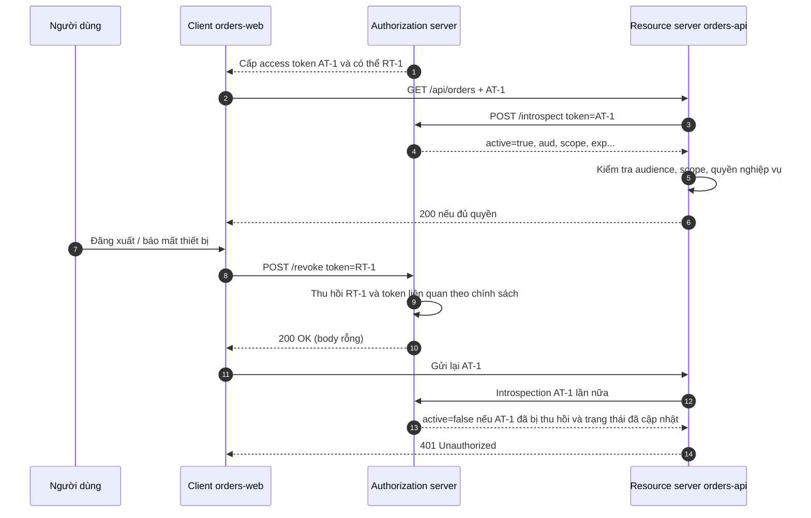
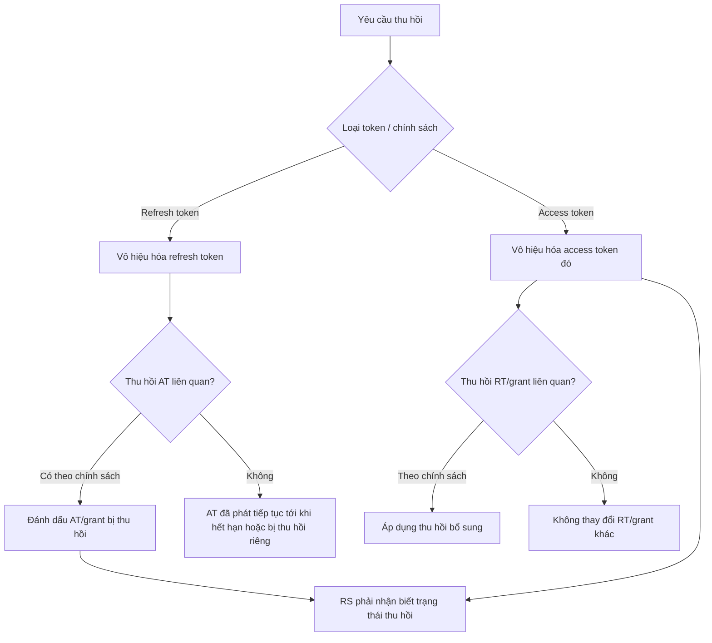
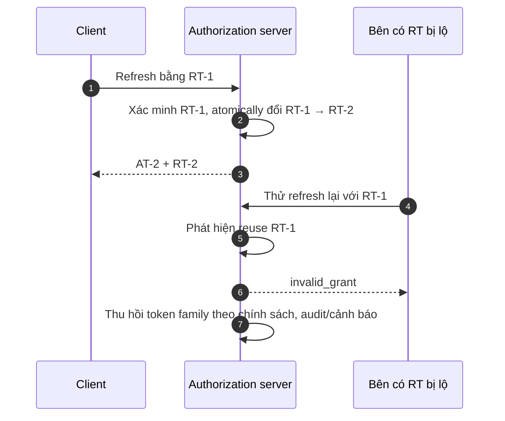

# Revocation và introspection

## 1. Mục tiêu bài học

Trong hệ thống OAuth 2.0/OIDC, **authorization server** phát hành token nhưng cũng phải giúp hệ thống kiểm soát **token còn được phép sử dụng hay đã bị vô hiệu hóa**. Hai cơ chế quan trọng là:

- **Token revocation (thu hồi token):** một bên được phép yêu cầu authorization server (AS) vô hiệu hóa token đã cấp, thường theo RFC 7009.
- **Token introspection (kiểm tra trạng thái token):** một resource server (RS) hoặc bên được ủy quyền hỏi AS về trạng thái và metadata của token, theo RFC 7662.

Sau khi học, bạn có thể phân biệt revocation và introspection, mô tả quy trình HTTP, giải thích tác động đối với JWT/opaque access token, thiết kế chính sách thu hồi refresh token, hiểu giới hạn của cache và xây dựng các tình huống kiểm thử khi token bị đánh cắp hoặc phát lại.

Bối cảnh xuyên suốt: `auth.example.test` là authorization server, `orders-web` là client và `orders-api` là resource server. Một người dùng đã cho phép `orders-web` đọc đơn hàng với scope `orders:read`. Sau đó người dùng đăng xuất hoặc phát hiện thiết bị bị mất. Câu hỏi là: **làm thế nào chặn sử dụng token cũ và chứng minh rằng API thực sự từ chối chúng?**

## 2. Phân biệt revocation, introspection, expiration và logout

| Khái niệm | Hành động chính | Thực hiện ở đâu? | Tác động cần nhớ |
| --- | --- | --- | --- |
| **Expiration** | Token tự hết hiệu lực khi quá `exp` hoặc TTL tương ứng. | AS đặt thời hạn; RS kiểm tra thời hạn khi dùng token. | Không cần yêu cầu thu hồi, nhưng token có thể được dùng trước khi hết hạn. |
| **Revocation** | AS thay đổi trạng thái token/grant thành không còn hợp lệ. | Thường tại revocation endpoint; cũng có thể do sự kiện bảo mật nội bộ. | Chỉ có tác dụng tại nơi **thực sự kiểm tra** trạng thái đó. |
| **Introspection** | Bên được phép hỏi AS token có `active` không và metadata nào được cung cấp. | AS cung cấp endpoint; RS gọi để quyết định xác thực. | Không tự thu hồi token; là một cách nhận biết trạng thái mới nhất theo chính sách và cache. |
| **Logout** | Chấm dứt phiên đăng nhập ở client/AS theo giao thức ứng dụng hoặc OIDC. | Client, AS và cơ chế OIDC liên quan. | Không tự bảo đảm mọi access token đang lưu hành bị từ chối ngay. |
| **Refresh token rotation** | Phát refresh token mới và vô hiệu hóa refresh token cũ khi refresh thành công. | AS/token endpoint. | Giảm cơ hội dùng lại refresh token bị lấy cắp; cần phát hiện reuse. |
| **Denylist/blacklist** | Lưu định danh hoặc dấu vết token bị chặn và kiểm tra khi nhận token. | AS, RS, gateway hoặc tầng kiểm tra tập trung. | Có thể bổ sung cho JWT, nhưng kéo theo trạng thái, phân phối và độ trễ. |

**Revocation là thay đổi trạng thái; introspection là cách truy vấn trạng thái.** Ví dụ, AS đánh dấu refresh token `RT-1` đã bị thu hồi; từ đó những yêu cầu đổi `RT-1` lấy access token mới phải thất bại. Một access token JWT đã phát từ trước có thể vẫn qua kiểm tra chữ ký tại RS nếu RS chỉ kiểm tra chữ ký/`exp` và không biết có lệnh thu hồi.

Hai giao thức chuẩn có vai trò riêng:

- **RFC 7009 — OAuth 2.0 Token Revocation:** quy định cách client gửi yêu cầu thu hồi token đến AS.
- **RFC 7662 — OAuth 2.0 Token Introspection:** quy định cách bên được phép lấy trạng thái `active` và thông tin liên quan của token từ AS.

Hai endpoint trên là phần mở rộng của OAuth 2.0. Một deployment có thể có cách thu hồi nội bộ hoặc đẩy sự kiện trạng thái khác, nhưng các bên phải có **hợp đồng rõ ràng** về cách resource server nhận biết việc thu hồi.

## 3. Mô hình tin cậy và luồng tổng quát

Ba bên có quyền và trách nhiệm khác nhau:

1. **Client** có thể yêu cầu AS thu hồi token thuộc quyền của mình. Nếu là confidential client, nó xác thực theo phương thức đã đăng ký; nếu là public client, AS cần nhận diện và áp dụng chính sách phù hợp, không xem `client_id` là secret.
2. **Authorization server** xác thực bên gọi revocation/introspection, kiểm tra quyền đối với token, thay đổi trạng thái token/grant một cách an toàn và chỉ công bố metadata cần thiết.
3. **Resource server** nhận access token, xác minh hoặc introspect nó, sau đó kiểm tra audience, scope và quyền trên dữ liệu. RS không cho phép truy cập chỉ vì client nói token đã được cấp.



Luồng này mô tả trường hợp **AS đồng thời thu hồi AT-1 theo chính sách** và RS introspect sau khi trạng thái mới có hiệu lực. Nếu chỉ RT-1 bị thu hồi, AT-1 có thể tiếp tục hợp lệ đến `exp`; nếu RS dùng cache introspection, AT-1 có thể được xem là `active` trong khoảng thời gian cache còn hiệu lực. Đây là các giới hạn cần xác định trước khi hứa rằng “logout có hiệu lực ngay”.

## 4. Token revocation: client yêu cầu AS thu hồi

### 4.1. Revocation endpoint và HTTP request

Theo RFC 7009, client gửi HTTP `POST` với body `application/x-www-form-urlencoded` qua HTTPS. Endpoint thường có tên `/oauth2/revoke` hoặc `/revoke` tùy triển khai; client phải lấy địa chỉ thật từ cấu hình/metadata đáng tin cậy.

Ví dụ client xác thực bằng HTTP Basic:

```http
POST /oauth2/revoke HTTP/1.1
Host: auth.example.test
Authorization: Basic <BASE64_CLIENT_ID_COLON_SECRET>
Content-Type: application/x-www-form-urlencoded

token=<REFRESH_TOKEN>&token_type_hint=refresh_token
```

Các trường quan trọng:

| Trường | Bắt buộc? | Ý nghĩa |
| --- | --- | --- |
| `token` | Có | Giá trị access token hoặc refresh token muốn thu hồi. |
| `token_type_hint` | Không | Gợi ý loại token, thường là `access_token` hoặc `refresh_token`, giúp AS tra cứu hiệu quả hơn. Đây không phải bằng chứng token thuộc loại đó. |
| Xác thực client | Theo loại client/phương thức đã đăng ký | AS kiểm soát ai có quyền yêu cầu thu hồi. Confidential client thường xác thực bằng secret, private key JWT hoặc mTLS. |

Trong hệ thống có public client, có thể cần `client_id` trong body theo quy trình AS triển khai. `client_id` đơn lẻ không phải bí mật; chính sách của AS phải hạn chế việc một client thu hồi token của client khác. Đừng đưa client secret, refresh token hoặc access token vào query string, URL trong log, analytics hay trang được tải từ nguồn không tin cậy.

### 4.2. AS xử lý thu hồi như thế nào?

Một cách triển khai chặt chẽ gồm các bước:

1. Kiểm tra HTTPS, phương thức POST, request hợp lệ, chống lạm dụng và xác thực client theo cơ chế được hỗ trợ.
2. Xác định token được yêu cầu thu hồi và kiểm tra **nó có được cấp cho client đang gọi**, hoặc client có quyền thu hồi theo cơ chế được thiết kế. Không cho một client tùy ý thu hồi grant/token của client khác.
3. Xác định loại token và liên kết của nó với authorization grant, phiên, người dùng, client, scope, audience và các token khác nếu hệ thống lưu quan hệ đó.
4. Đánh dấu token không còn hợp lệ bằng thao tác trạng thái **nguyên tử và idempotent**; nếu cần, thu hồi các token có liên quan theo chính sách.
5. Đảm bảo lần refresh tiếp theo hoặc introspection tiếp theo quan sát trạng thái mới. Nếu có cache hoặc nhiều nút AS/RS, cơ chế lan truyền thu hồi và thời gian trễ phải được quy định.
6. Ghi audit an toàn theo client/grant, lý do, thời điểm và correlation ID; **không ghi chuỗi token đầy đủ**.

RFC 7009 yêu cầu phản hồi thành công với HTTP `200 OK` và body rỗng. Với token không hợp lệ hoặc không tồn tại, endpoint cũng trả `200` để tránh biến revocation thành công cụ dò token, miễn là request/client vượt qua các kiểm tra cần thiết.

```http
HTTP/1.1 200 OK
Cache-Control: no-store
```

**200 OK nghĩa là yêu cầu revocation đã được xử lý theo giao thức, không có nghĩa mọi resource server đã ngừng nhận mọi access token liên quan ngay lập tức.** Client muốn khẳng định việc chặn truy cập cần kiểm chứng các đường sử dụng token và chính sách đồng bộ trạng thái.

### 4.3. Khi nào revocation có thể trả lỗi?

| Tình huống | Xử lý thường gặp |
| --- | --- |
| Token không tồn tại, sai hoặc đã bị thu hồi | `200 OK` body rỗng, không tiết lộ trạng thái tồn tại. |
| Request thiếu tham số bắt buộc/sai cú pháp | OAuth error như `invalid_request`; thường `400`. |
| Client confidential xác thực sai | `invalid_client` với HTTP/challenge phù hợp; không chấp nhận thay đổi trạng thái. |
| AS không hỗ trợ thu hồi loại token được yêu cầu | Có thể trả `unsupported_token_type` theo RFC 7009; `token_type_hint` tự nó chỉ là gợi ý. |
| Dịch vụ lưu trạng thái không khả dụng | Trả lỗi hệ thống/phù hợp, không báo thành công giả khi chưa xác nhận trạng thái cần lưu. |

AS không tiết lộ “token này thuộc client khác” hoặc “token này tồn tại nhưng là refresh token” trong lỗi gửi cho bên gọi không có quyền. Cần kiểm soát mức thông tin trong log và telemetry tương tự.

### 4.4. Thu hồi access token và refresh token có giống nhau?

Không hoàn toàn.

**Khi thu hồi refresh token:** AS phải ngăn token đó tiếp tục cấp access token mới. Tùy chính sách và liên kết token, AS có thể đồng thời thu hồi các access token dựa trên cùng authorization grant. Nếu yêu cầu cắt toàn bộ quyền trong một phiên, chỉ ngừng refresh là chưa đủ khi access token đã phát vẫn còn hiệu lực.

**Khi thu hồi access token:** token cụ thể cần bị từ chối theo cơ chế xác minh đã triển khai. Việc có thu hồi cả refresh token của grant đó hay không là quyết định chính sách; không nên mặc định mọi AS đều làm giống nhau.

**Khi phát hiện refresh token bị dùng lại (reuse):** rotation và phát hiện reuse có thể dẫn đến thu hồi **toàn bộ token family/authorization grant**. Đây là phản ứng với rủi ro đánh cắp, rộng hơn yêu cầu thu hồi một token đơn lẻ.



## 5. Token introspection: resource server hỏi AS

### 5.1. Khi nào cần introspection?

Một opaque access token thường chỉ là chuỗi ngẫu nhiên, không có claims mà RS có thể tự kiểm chứng. RS cần nhận thông tin từ AS hoặc dịch vụ xác minh đáng tin cậy. Introspection phù hợp để xác định token đang `active` và nhận metadata phục vụ kiểm tra quyền.

JWT access token có thể được RS xác minh chữ ký và claims tại chỗ. Tuy nhiên JWT cũng **có thể** được introspect nếu kiến trúc cần kiểm tra trạng thái động, miễn AS hỗ trợ. “JWT thì không introspect” hoặc “opaque bắt buộc gọi AS cho mọi request” đều là khẳng định quá tuyệt đối: caching và cơ chế xác minh cụ thể ảnh hưởng cách vận hành.

### 5.2. Gọi introspection endpoint

Một RS được đăng ký và cho phép có thể gọi:

```http
POST /oauth2/introspect HTTP/1.1
Host: auth.example.test
Authorization: Basic <BASE64_RS_CLIENT_ID_COLON_SECRET>
Content-Type: application/x-www-form-urlencoded

token=<ACCESS_TOKEN>&token_type_hint=access_token
```

Các đặc điểm cần tuân thủ:

- Introspection dùng `POST`, gửi giá trị token trong body qua HTTPS.
- AS phải yêu cầu **xác thực và/hoặc ủy quyền** cho caller thích hợp. Trong thực tế RS thường dùng credential riêng được AS cấp. Không để trình duyệt bất kỳ gọi trực tiếp endpoint để thử token.
- `token_type_hint` là gợi ý tùy chọn, không cho phép bỏ bước xác minh token thật.
- AS hạn chế metadata theo danh tính caller và quyền của resource server. Một RS không nên lấy thông tin về token dành riêng cho RS khác nếu không được chính sách cho phép.

### 5.3. Phản hồi khi token còn hiệu lực

Ví dụ response JSON cho access token còn hạn, được cấp cho `orders-api`:

```http
HTTP/1.1 200 OK
Content-Type: application/json
Cache-Control: no-store

{
  "active": true,
  "client_id": "orders-web",
  "token_type": "Bearer",
  "scope": "orders:read",
  "sub": "user-42",
  "aud": ["orders-api"],
  "iss": "https://auth.example.test",
  "iat": 1893452400,
  "nbf": 1893452400,
  "exp": 1893453000,
  "jti": "at-42c81"
}
```

Đây chỉ là response minh họa; các giá trị số không đại diện thời gian hiện tại. **RFC 7662 chỉ bắt buộc trường `active`** trong phản hồi introspection chuẩn; các trường khác tùy loại token, hệ thống và quyền của caller. Resource server phải có hợp đồng rõ ràng với AS về metadata bắt buộc cho chính sách của API.

| Trường | RS sử dụng để làm gì? | Điều cần chú ý |
| --- | --- | --- |
| `active` | Xác định AS xem token còn hiệu lực tại thời điểm kiểm tra hay không. | `true` là điều kiện cần, không tự chứng minh có quyền đọc mọi tài nguyên. |
| `iss` | Đối chiếu issuer tin cậy nếu được cung cấp/hợp đồng yêu cầu. | Không nhận issuer tùy ý do client khai. |
| `aud` | Bảo đảm token dành cho `orders-api`. | Nếu audience là điều kiện bắt buộc mà metadata thiếu, không tự suy rằng audience đúng. |
| `sub` | Xác định chủ thể được AS công bố. | Có thể là user hoặc service tùy grant/profile. |
| `client_id` | Biết client đã nhận token. | Không đồng nhất client với resource owner. |
| `scope` | Xác định các thao tác API được cấp. | Phải áp thêm phân quyền theo tài nguyên/tenant. |
| `exp`, `nbf`, `iat` | Kiểm tra thời gian sống và chính sách sử dụng. | Không dùng cache sau `exp`; xử lý clock skew có giới hạn. |
| `cnf` (khi có) | Metadata ràng buộc bên gửi theo profile. | RS phải kiểm proof DPoP/mTLS tương ứng, không chỉ kiểm claim. |

Khi RS nhận `active: true`, nó vẫn phải kiểm tra audience, scope, loại token, chính sách endpoint, chủ sở hữu đơn hàng và tenant. Introspection không thay thế phân quyền nghiệp vụ.

### 5.4. Phản hồi khi token không hoạt động

Khi token không tồn tại, không hợp lệ, hết hạn hoặc đã bị thu hồi, AS thường trả:

```http
HTTP/1.1 200 OK
Content-Type: application/json

{
  "active": false
}
```

**HTTP 200 của introspection không có nghĩa token hợp lệ**; đó chỉ là thành công của HTTP request đến endpoint. Trường `active` mới thể hiện kết quả trạng thái token.

AS không nên trả thêm claims nhạy cảm khi `active: false`. Theo RFC 7662, trường hợp token không hoạt động thường chỉ trả `{"active": false}` để tránh lộ sự tồn tại và metadata token.

Nếu RS xác thực không đúng khi gọi introspection, AS có thể trả `401 Unauthorized` hoặc lỗi phù hợp. Khi có timeout, lỗi mạng hay `5xx`, resource server **không được suy diễn thành `active: true`**. Tùy khả năng phục vụ và hợp đồng cache, RS có thể từ chối xác thực hoặc thông báo lỗi dịch vụ, nhưng không cấp quyền dựa vào kết quả chưa xác minh.

## 6. Revocation thực sự tác động đến JWT và opaque token như thế nào?

| Tiêu chí | Opaque access token | JWT access token |
| --- | --- | --- |
| Cách RS thường xác minh | Introspection tra trạng thái từ AS. | Xác minh chữ ký JWT, `iss`, `aud`, `exp` và claims tại RS. |
| Sau revocation | Introspection mới có thể trả `active: false` nếu AS đã đổi trạng thái. | JWT cũ vẫn có chữ ký hợp lệ; RS cần cơ chế kiểm trạng thái ngoài xác minh cục bộ nếu muốn chặn ngay. |
| Tác động của cache | RS có thể chấp nhận trạng thái `active: true` cũ cho đến khi cache hết hạn. | JWKS cache không phải cache trạng thái thu hồi; denylist/introspection có thể có cache riêng. |
| Điểm mạnh | Trạng thái có thể được AS kiểm soát tập trung. | RS tự xác minh được ngay cả khi AS không khả dụng (nếu có khóa tin cậy và token còn hạn). |
| Chi phí | Tải endpoint introspection, độ trễ và nhu cầu tính sẵn sàng cao. | Cần quản lý khóa, validation và thêm trạng thái nếu yêu cầu thu hồi nhanh. |

Ví dụ:

- `12:00:00` — AS phát JWT access token `AT-1` có hạn đến `12:10:00`.
- `12:02:00` — client gọi revocation; AS đánh dấu `AT-1` đã bị thu hồi.
- `12:03:00` — RS chỉ kiểm tra chữ ký, issuer, audience và `exp`: `AT-1` **có thể vẫn được chấp nhận** đến `12:10:00`.
- Nếu RS kiểm tra denylist hoặc introspection và đã nhận trạng thái mới, `AT-1` phải bị từ chối từ thời điểm đó.

Đây là khác biệt giữa **AS biết token đã bị thu hồi** và **mọi RS thực thi thu hồi**. Quyết định chọn JWT hay opaque phải đi kèm cam kết về thời gian tối đa token bị lộ vẫn có thể được sử dụng.

Một số chiến lược:

1. **Access token TTL ngắn:** đơn giản, hạn chế cửa sổ rủi ro nhưng không đáp ứng yêu cầu chặn ngay.
2. **Introspection mỗi request:** trạng thái gần AS nhất, đổi lại độ trễ, mạng và tải AS; vẫn có cạnh tranh thời điểm và hệ thống phân tán.
3. **Introspection với cache ngắn:** cân bằng hiệu năng và tốc độ thu hồi; cần công bố TTL chấp nhận được.
4. **Denylist hoặc phiên bản phiên/grant:** RS kiểm trạng thái bổ sung trước khi cấp quyền; cần kho trạng thái, invalidation và đồng bộ.
5. **Push sự kiện revocation:** đẩy thay đổi đến RS/gateway để xóa cache hoặc cập nhật denylist; cần xử lý mất event, retry và đồng bộ sau khi phục hồi.

Không phương án nào tự loại bỏ nguy cơ token bị đánh cắp khi còn hạn. Token ràng buộc bên gửi (sender-constrained) và xác thực bằng chứng sở hữu khóa có thể giảm tác hại đó.

## 7. Introspection caching: hiệu năng và độ trễ thu hồi

Gọi AS cho mọi request tạo một phụ thuộc mạng. Cache kết quả introspection có thể giảm độ trễ, nhưng cần giới hạn rõ.

Giả sử AS trả `active: true` và `exp = 12:10` tại thời điểm `12:00`. RS có chính sách tối đa cache kết quả là **30 giây**. Khi cache được lưu `12:00:00`, thời điểm hết hạn phải không muộn hơn `12:00:30`, đồng thời không được vượt `exp`. Nếu AS thu hồi token lúc `12:00:10` mà không có invalidation, RS có thể chấp nhận kết quả cũ đến `12:00:30`.

Cách xác định TTL an toàn về nguyên tắc:

```text
cache_ttl = min(
    policy_max_introspection_cache_ttl,
    token_expiration - now,
    other_applicable_cache_limits
)
```

Nếu `exp` không được trả hoặc kết quả không đáng tin cậy, chỉ cache theo chính sách đã thống nhất chặt chẽ hoặc không cache. Thực thi phải ngăn cache `active: true` vượt quá thời gian token được phép sử dụng và phải phản ứng phù hợp với sự kiện thu hồi.

Các nguyên tắc triển khai:

- **Cache key:** gắn với giá trị token một cách không làm rò secret, đồng thời cân nhắc issuer, resource server và các điều kiện ràng buộc bên gửi nếu cùng token được dùng trong nhiều ngữ cảnh. Không ghi token plaintext vào logs/metrics.
- **Giới hạn thời gian:** không cache `active: true` sau `exp`; TTL phải dựa trên yêu cầu bảo mật và SLA thu hồi.
- **Phân tách audience:** không lấy kết quả được cho phép cho `profile-api` để tự cấp quyền tại `orders-api`.
- **Làm mới/invalidation:** nếu cần chặn nhanh, thiết kế cách xóa cache khi AS thu hồi token và cơ chế phục hồi nếu bỏ lỡ sự kiện.
- **Lỗi mạng:** tránh “fail open”. Khi không đủ bằng chứng xác minh trạng thái, RS không cấp quyền mới chỉ vì endpoint tạm lỗi.
- **Tải và chống lạm dụng:** timeout ngắn, connection pooling, rate limit, backoff và giám sát lỗi nội bộ; không để cache trở thành kho bí mật thiếu kiểm soát.

**Lưu ý:** AS có thể yêu cầu RS không cache hoặc giới hạn cache; chính sách RS phải tuân thủ điều kiện được công bố và mức độ nhạy cảm của API.

## 8. Vòng đời refresh token, rotation và phát hiện replay

Refresh token cho phép client lấy access token mới mà không cần người dùng đăng nhập lại mỗi lần. Vì refresh token có thể sống lâu, nó là mục tiêu có giá trị khi attacker chiếm được thiết bị, log hoặc kho lưu trữ client.

Với **refresh token rotation**, mỗi lần refresh thành công:

1. AS kiểm tra refresh token cũ `RT-1` còn hiệu lực và có quyền được sử dụng bởi client tương ứng.
2. AS phát access token mới `AT-2`; nếu có rotation, phát thêm refresh token mới `RT-2`.
3. AS làm mất hiệu lực `RT-1` **trong cùng một thao tác trạng thái nhất quán** với việc ghi nhận `RT-2`, tránh hai lượt dùng đồng thời cùng thành công.
4. Nếu `RT-1` được trình lại sau đó, AS đánh giá là token reuse theo chính sách; có thể thu hồi cả token family, yêu cầu xác thực lại và phát cảnh báo.



Không phải mọi request lặp là bằng chứng chắc chắn bị tấn công: race giữa nhiều tab/worker hoặc retry sau khi response mất cũng có thể tạo reuse. Thiết kế client nên chỉ có một tiến trình refresh hợp lệ mỗi phiên; AS cần quyết định rõ cách xử lý concurrency, retry và nghi ngờ compromise, đồng thời không cho phép hai bên sở hữu cùng token cùng duy trì phiên lâu dài.

**Phân biệt rõ:** revocation endpoint được client gọi có thể thu hồi refresh token theo yêu cầu; detection reuse là cơ chế AS tự nhận diện hành vi và thực hiện revocation như phản ứng rủi ro.

## 9. Logout OIDC và revocation: liên quan nhưng không đồng nhất

Trong OIDC, ứng dụng có thể thực hiện logout ở client, chấm dứt phiên tại OpenID Provider và (nếu triển khai) phối hợp front-channel/back-channel logout. Các cơ chế này liên quan đến **phiên đăng nhập**, trong khi RFC 7009 xử lý **token**.

Ví dụ người dùng bấm “Đăng xuất” ở `orders-web`:

1. Client xóa phiên ứng dụng và dừng sử dụng token đang giữ.
2. Nếu có refresh token được lưu theo cách cho phép, client yêu cầu AS thu hồi nó hoặc AS thực hiện thu hồi theo chính sách logout.
3. Client kích hoạt OIDC logout nếu cần chấm dứt phiên ở OpenID Provider và thông báo các relying party có liên quan.
4. AS và RS thực thi cơ chế cắt quyền còn lại cho access token chưa hết hạn theo mức đảm bảo hệ thống yêu cầu.

Nếu chỉ xóa cookie tại client, access token Bearer bị lộ trước đó có thể vẫn dùng được. Nếu chỉ logout tại AS, một JWT access token RS xác minh cục bộ cũng không tự biến thành invalid.

**Mục tiêu an toàn phải được viết thành yêu cầu có thể đo:** chẳng hạn “access token bị thu hồi phải bị từ chối trên các API nhạy cảm trong tối đa N giây khi hệ thống khỏe mạnh”. Chỉ khi có cơ chế kiểm tra trạng thái, invalidation và giám sát độ trễ mới có thể bảo đảm yêu cầu đó.

## 10. Thiết kế dữ liệu phía authorization server

Để revocation và introspection có ý nghĩa, AS cần biết token thuộc về ai, gắn với grant nào, dành cho resource nào và đang ở trạng thái gì. Tùy định dạng token, dữ liệu có thể là bản ghi token hoặc bản ghi authorization/grant liên quan.

Mô hình logic minh họa:

| Thuộc tính | Mục đích |
| --- | --- |
| `token_hash` hoặc định danh tra cứu an toàn | Tìm bản ghi mà không cần giữ token plaintext khi có thể. |
| `token_type` | Phân biệt access/refresh và cách xử lý tương ứng. |
| `client_id` | Kiểm tra ràng buộc client tại revocation/refresh. |
| `subject_id` / `grant_id` | Liên kết với người dùng, phiên hoặc authorization grant. |
| `audience`, `scope` | Cung cấp chính sách và metadata cho resource server. |
| `issued_at`, `expires_at`, `not_before` | Xác định vòng đời. |
| `revoked_at`, `revocation_reason` | Trạng thái thu hồi, điều tra sự cố. |
| `token_family_id`, `parent_token_id` | Theo dõi rotation và phát hiện reuse refresh token. |
| `confirmation/binding metadata` | Hỗ trợ cơ chế ràng buộc sender nếu triển khai. |

Ví dụ pseudo-logic cho AS, dùng để hiểu các bất biến (không phải mã sản xuất):

```text
revoke(request):
    authenticate_or_identify_client_according_to_policy(request)
    validate_request_shape(request)

    tokenRecord = find_token_safely(request.token, request.token_type_hint)
    if tokenRecord is absent or not authorized_for_this_client(tokenRecord):
        return HTTP 200 with empty body  # không lộ sự tồn tại

    transaction:
        mark_revoked(tokenRecord)
        if policy_requires_cascade(tokenRecord):
            revoke_related_tokens_or_grant(tokenRecord)
        append_safe_audit_event()
    publish_invalidation_event_if_configured()
    return HTTP 200 with empty body

introspect(request):
    authenticate_and_authorize_introspecting_party(request)
    tokenRecord = find_token_safely(request.token, request.token_type_hint)
    if tokenRecord is absent or expired or revoked or not_visible_to_caller:
        return HTTP 200 with {"active": false}

    return HTTP 200 with least_privilege_metadata(tokenRecord, caller)
```

Đây là một mô hình xử lý, không có nghĩa mọi trường hợp lỗi xác thực client đều được trả `200`. Việc AS trả `active: false` cho token không thuộc phạm vi nhìn thấy của RS là cách tránh lộ thông tin phù hợp trong nhiều triển khai; chính sách thực tế vẫn phải tuân thủ khả năng và giao thức đã chọn.

Ba điểm dễ sai trong hệ thống phân tán:

- **Tính nguyên tử:** cập nhật refresh token family và trạng thái token không thể là chuỗi thao tác rời rạc không có kiểm soát race.
- **Tính nhất quán giữa nút:** đọc introspection từ replica quá chậm có thể chưa thấy revocation mới. Cần chọn consistency, replication và giới hạn cache theo yêu cầu thu hồi.
- **Quyền xem metadata:** không để một client/RS tùy ý introspect token để thu thập `sub`, scope hoặc token existence của hệ thống khác.

Khi tạo opaque token, dùng nguồn ngẫu nhiên mật mã đủ mạnh, lưu trữ token hoặc hash với chính sách phù hợp, bảo vệ kết nối và credential của AS. Việc hash token có entropy cao để tra cứu giúp giảm thiểu rò token từ kho dữ liệu; nhưng giải pháp lưu trữ thực tế phải tương thích thư viện AS và nhu cầu truy vấn.

## 11. Triển khai với Java/Spring Security

### 11.1. Phía resource server: introspection opaque access token

Với Spring Boot 3 và Spring Security 6, resource server thường dùng dependency `spring-boot-starter-oauth2-resource-server`. Cấu hình ví dụ:

```yaml
spring:
  security:
    oauth2:
      resourceserver:
        opaque-token:
          introspection-uri: https://auth.example.test/oauth2/introspect
          client-id: orders-resource-server
          client-secret: ${RS_INTROSPECTION_SECRET}
```

Credential `RS_INTROSPECTION_SECRET` phải được cấu hình ở backend/secret manager. Resource server không gửi credential cho trình duyệt, không log full token và không lưu secret trong mã nguồn.

Security chain minh họa:

```java
@Configuration
public class ApiSecurityConfiguration {

    @Bean
    SecurityFilterChain apiSecurity(HttpSecurity http) throws Exception {
        http.authorizeHttpRequests(auth -> auth
                .requestMatchers(HttpMethod.GET, "/api/orders/**")
                    .hasAuthority("SCOPE_orders:read")
                .anyRequest().authenticated()
            )
            .oauth2ResourceServer(oauth2 ->
                oauth2.opaqueToken(Customizer.withDefaults())
            );

        return http.build();
    }
}
```

Ví dụ rút gọn các `import` để làm rõ ý chính. Spring Security có thể ánh xạ scope từ introspection thành authority tiền tố `SCOPE_`. Tuy nhiên, cấu hình mặc định **không thay thế** yêu cầu kiểm tra chính sách riêng như audience phải chứa `orders-api`, owner/tenant của đơn hàng, xác thực proof cho sender-constrained token nếu áp dụng. Với yêu cầu audience bắt buộc, cần bảo đảm metadata từ AS và một bước kiểm tra tường minh trước khi cấp quyền.

**Phân biệt hai lỗi:**

- Token hết hạn/`active: false`/không thể xác thực hợp lệ: RS từ chối xác thực (thường `401 Unauthorized` khi token không hợp lệ).
- Token hợp lệ nhưng thiếu `orders:read` hoặc không được phép đọc đơn hàng cụ thể: RS từ chối phân quyền (thường `403 Forbidden`; một số API dùng `404` để tránh lộ sự tồn tại tài nguyên).

Nếu AS introspection gặp lỗi mạng, RS phải áp dụng chính sách **fail closed**. Cách ánh xạ lỗi hạ tầng thành HTTP response có thể phụ thuộc framework; điều quan trọng là không cho yêu cầu chưa xác thực đi qua.

### 11.2. Phía authorization server: revocation và introspection

Spring Authorization Server có hỗ trợ các endpoint OAuth 2.0 token revocation và token introspection khi được cấu hình. Khi triển khai thực tế, cần:

1. Đăng ký client và resource server được phép dùng các endpoint, với cơ chế xác thực phù hợp (`client_secret_basic`, private key JWT, mTLS...).
2. Thiết lập `OAuth2AuthorizationService` hoặc kho authorization tương ứng có khả năng lưu và đọc trạng thái token, không chỉ giữ in-memory cho môi trường production nhiều nút.
3. Cấu hình token generator/format, signing keys, issuer, lifetime và refresh token rotation phù hợp.
4. Thiết kế cascade revocation theo grant/token family và bảo đảm RS nhận trạng thái qua introspection, denylist hoặc cơ chế khác.
5. Gắn metrics cho tần suất lỗi token, độ trễ introspection, revocation, reuse và hiệu quả cache.

Ví dụ cấu hình **định hướng**:

```text
Issuer:                 https://auth.example.test
Revocation endpoint:    https://auth.example.test/oauth2/revoke
Introspection endpoint: https://auth.example.test/oauth2/introspect
orders-web:             client authorization_code + PKCE (+ refresh theo chính sách)
orders-resource-server: confidential caller được phép introspect token cho orders-api
Access token TTL:       10 phút (ví dụ)
Introspection cache:    tối đa 15 giây tại orders-api (ví dụ)
Revocation:             thu hồi refresh token; xử lý AT liên quan theo mức bảo đảm của hệ thống
```

Các đường dẫn và thông số thời gian trên là giả định minh họa. Không nên copy thành cấu hình production khi chưa xác định cấu hình endpoint thực tế, chiến lược token lưu trong DB và SLA thu hồi.

## 12. Kịch bản kiểm thử revocation và introspection

Kiểm thử cả endpoint của AS, resource server và sự thay đổi trạng thái. Chỉ gọi revocation thành công là chưa đủ để chứng minh token không còn dùng được.

| Tình huống | Kết quả cần kiểm |
| --- | --- |
| Introspection token opaque hợp lệ | HTTP 200, `active: true` và metadata đúng cho RS được phép; RS vẫn kiểm scope/audience. |
| Introspection token lạ/hết hạn/đã thu hồi | HTTP 200 với `active: false`; RS từ chối token. |
| Caller không có quyền introspect | AS từ chối, không lộ metadata token. |
| Introspection trả `active: true` nhưng `aud` khác API | RS từ chối, không cấp quyền. |
| Token có `orders:read` nhưng không sở hữu đơn hàng | RS từ chối theo chính sách đối tượng dù token active. |
| Client revocation refresh token hợp lệ | AS trả `200` body rỗng; refresh tiếp theo thất bại. |
| Thu hồi token đã hết hạn/không tồn tại | AS trả `200` body rỗng theo RFC 7009, không lộ token existence. |
| Client cố thu hồi token thuộc client khác | Không làm thay đổi quyền của token đó; response không lộ thông tin bên khác. |
| Thu hồi access token opaque và introspect lại | Theo chính sách, introspection mới cho `active: false`; RS từ chối. |
| Thu hồi JWT nhưng RS chỉ xác minh chữ ký | Kiểm thử thể hiện khả năng JWT vẫn qua validation đến `exp`; từ đó xác nhận giới hạn thiết kế. |
| Thu hồi JWT với denylist/introspection | Sau khi trạng thái lan truyền, RS từ chối theo giới hạn thời gian đã cam kết. |
| Introspection có cache dương tính | Đo thời gian trễ thu hồi tối đa và kiểm cache không vượt `exp`. |
| AS introspection timeout hoặc `5xx` | RS không cấp quyền dựa trên trạng thái chưa được xác minh. |
| Rotation `RT-1` → `RT-2` rồi dùng lại `RT-1` | AS từ chối, phát hiện reuse và thực thi chính sách token family. |
| Hai refresh request song song với cùng RT | Chỉ kết quả hợp lệ theo chính sách atomic/retry; không tạo hai nhánh RT cùng hiệu lực ngoài thiết kế. |
| Logout client/AS | Xác nhận đồng thời việc ngăn refresh và chính sách còn hiệu lực của AT đã phát. |
| Access token có binding DPoP/mTLS | RS từ chối nếu thiếu proof/chứng thư hoặc bằng chứng không khớp token. |

Để kiểm thử đúng thực tế, nên mô phỏng ít nhất hai resource server, hai client, AS nhiều nút hoặc replica và trường hợp mất kết nối; đo độ trễ từ lúc revocation được ghi nhận đến lúc RS cuối cùng từ chối. Không dùng access token, refresh token hay credential production trong test report/CI logs.

## 13. Các lỗi thiết kế thường gặp

| Lỗi | Vì sao nguy hiểm | Cách khắc phục |
| --- | --- | --- |
| Nghĩ `200` từ revocation là mọi API đã chặn token | JWT hoặc cache introspection có thể tiếp tục chấp nhận token. | Xác định mức bảo đảm và kiểm tra ở RS; đo thời gian lan truyền. |
| Nghĩ `200` từ introspection là token hợp lệ | Token không hợp lệ cũng trả HTTP 200 với `active: false`. | Luôn kiểm trường `active` và metadata cần thiết. |
| Dùng introspection nhưng bỏ qua `aud` | Token cho API khác có thể được nhận nhầm. | Kiểm audience theo danh tính RS và hợp đồng AS. |
| Không giới hạn quyền gọi introspection | Rò metadata người dùng và trạng thái token. | Xác thực/ủy quyền caller, chỉ trả thông tin tối thiểu. |
| Cache `active: true` quá lâu | Kéo dài thời gian dùng token đã bị thu hồi. | TTL ngắn, không vượt `exp`, invalidation khi cần. |
| Cho mọi client thu hồi mọi token | Tạo khả năng từ chối dịch vụ hoặc can thiệp phiên người khác. | Ràng buộc token với client/quyền thu hồi; phản hồi không lộ tồn tại token. |
| Chỉ thu hồi RT khi yêu cầu cắt mọi truy cập ngay | AT đã phát vẫn có thể được dùng. | Thu hồi/giám sát AT cùng cơ chế RS nhận trạng thái. |
| Dùng JWT ký mà không thiết kế trạng thái thu hồi | Không đáp ứng được SLA “khóa ngay”. | TTL phù hợp, denylist/introspection/event, sender constraint nếu cần. |
| Chỉ đọc claim `cnf` mà không kiểm proof | Token bị đánh cắp vẫn có thể dùng như Bearer. | Thực thi ràng buộc DPoP/mTLS ở RS và chống replay proof. |
| Lưu token/credential đầy đủ trong log | Kẻ có quyền đọc log có thể sử dụng token còn hạn. | Redact, log định danh an toàn và correlation ID. |

## 14. Bài tập tình huống

Một ứng dụng bán hàng dùng authorization server phát hành:

- `AT-1`: opaque access token dành cho `orders-api`, còn hạn 8 phút.
- `RT-1`: refresh token dành cho `orders-web`, còn hạn 7 ngày.
- `orders-api` cache introspection `active: true` trong 20 giây.

Lúc `10:00:00`, người dùng báo mất thiết bị. Hệ thống chỉ thu hồi `RT-1`, không thu hồi `AT-1`.

**Câu hỏi 1:** Thiết bị bị mất có thể tiếp tục dùng `AT-1` không?

**Trả lời:** Có thể. Thu hồi `RT-1` ngăn cấp access token mới từ refresh token đó, nhưng `AT-1` chưa bị thu hồi và vẫn còn hạn. API có thể tiếp tục chấp nhận `AT-1` nếu các điều kiện khác đúng.

**Câu hỏi 2:** Nếu AS cũng thu hồi `AT-1` tại `10:00:05`, API có từ chối ngay tại `10:00:06` không?

**Trả lời:** Chưa chắc. Nếu cache `active: true` được tạo ở `10:00:00` và không được invalidation, API có thể tiếp tục chấp nhận đến khi cache hết hạn gần `10:00:20`. Tốc độ thu hồi thực tế phụ thuộc TTL cache, cơ chế invalidation và độ trễ đồng bộ dữ liệu.

**Câu hỏi 3:** Nếu `AT-1` thay bằng JWT, RS chỉ kiểm chữ ký và `exp` thì sao?

**Trả lời:** RS có thể tiếp tục chấp nhận JWT đến `exp`, dù AS đã ghi trạng thái thu hồi. Muốn chặn trước `exp`, cần thiết kế RS kiểm trạng thái động như introspection, denylist hoặc thông tin phiên/grant đáng tin cậy.

**Câu hỏi 4:** AS introspection trả `active: true` và `scope: orders:read`; API có thể trả mọi đơn hàng không?

**Trả lời:** Không. Resource server vẫn phải kiểm audience là `orders-api`, quyền `orders:read` trên endpoint, rồi kiểm chủ sở hữu và tenant của từng đơn hàng. Một token active và có scope không tự cấp quyền trên mọi bản ghi.

**Ghi nhớ:** Revocation quyết định **token/grant không còn hợp lệ tại AS**; introspection cho RS **nhìn thấy trạng thái và metadata**; còn mức độ chặn truy cập thực sự phụ thuộc cách RS xác minh, cache, kiểm audience/scope và chính sách vòng đời token. Cần thiết kế cả ba phần nhất quán để bảo vệ trước token bị đánh cắp và phát lại.
