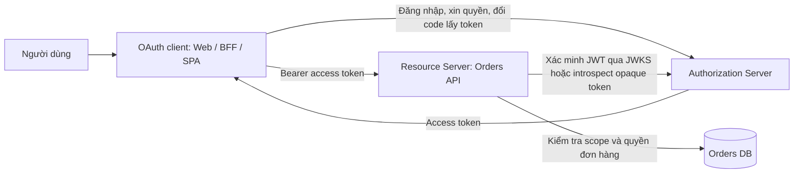
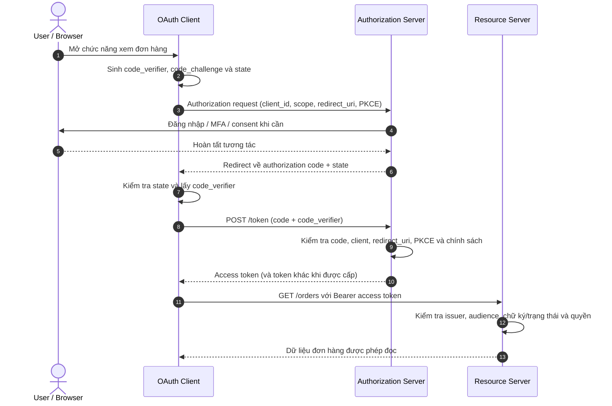
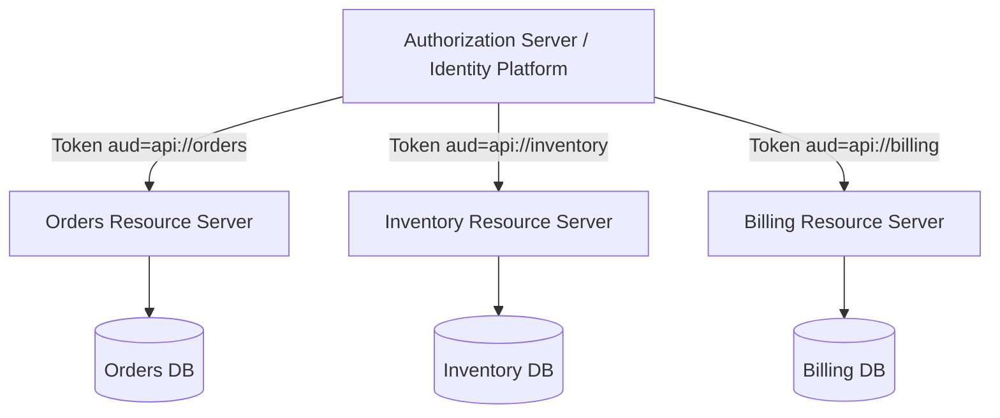
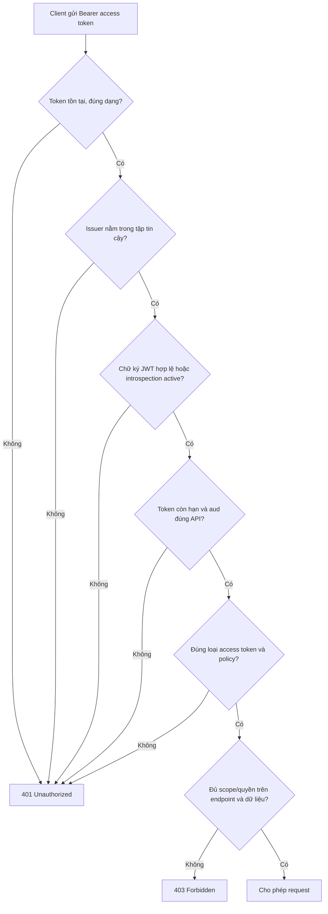
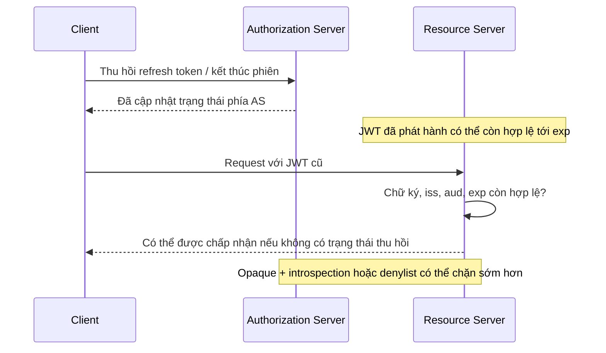

# Phân tách authorization server với resource server

> **Chương:** Authorization server
> **Module:** `SECURITY_TOKEN_SECURITY_FUNDAMENTALS`
> **Bối cảnh:** Bảo mật token trong OAuth 2.0/OIDC: mô hình tin cậy, JWT và opaque token, access/refresh token, kiểm tra claims, issuer, audience, scope, lưu trữ, thu hồi và phòng chống đánh cắp hoặc phát lại.

## 1. Mục tiêu học tập

Sau bài này, bạn có thể:

1. Phân biệt **authorization server (AS)**, **resource server (RS)**, **OAuth client** và **resource owner/end user** theo trách nhiệm bảo mật.
2. Diễn giải luồng phát hành và sử dụng token khi AS và RS là hai thành phần riêng biệt, gồm Authorization Code + PKCE, truy cập API và refresh token.
3. Giải thích vì sao **phát hành token, xác minh token và phân quyền trên tài nguyên** là ba bước khác nhau.
4. Thiết kế ranh giới tin cậy dựa trên `iss`, `aud`, chữ ký hoặc introspection, thời hạn, `scope` và quyền nghiệp vụ.
5. Chọn JWT access token hoặc opaque access token dựa trên yêu cầu vận hành, thu hồi, hiệu năng và rủi ro.
6. Xây dựng cấu hình RS đơn giản với Spring Security, chỉ ra các lỗi cần kiểm thử trước khi triển khai.

## 2. Bài toán: một API có cần tự đăng nhập và cấp token không?

Giả sử hệ thống bán hàng có ba thành phần:

- **Ứng dụng web** mà nhân viên sử dụng.
- **Identity service** chuyên xử lý đăng nhập, xác thực đa yếu tố, đồng ý cấp quyền, cấp token.
- **Orders API** quản lý dữ liệu đơn hàng.

Khi người dùng bấm “Xem đơn hàng”, ứng dụng cần một bằng chứng truy cập API. Nhưng **Orders API không nhất thiết phải biết mật khẩu, thực hiện luồng đăng nhập hay tự phát hành token**. Những chức năng đó thuộc vai trò AS. Orders API chỉ cần nhận một access token phù hợp, xác minh và quyết định người yêu cầu được phép xem đơn hàng nào.



Mũi tên từ RS về AS là **quan hệ tin cậy hoặc kiểm tra token tùy cách triển khai**, không nhất thiết có cuộc gọi mạng cho mỗi request: với JWT, RS thường xác minh chữ ký và claims **cục bộ** bằng khóa công khai đã lấy/cache từ AS; với opaque token, RS có thể cần gọi introspection endpoint.

**Ý tưởng cốt lõi:** AS quyết định *có phát hành token nào* theo cơ chế và chính sách ủy quyền; RS quyết định *token đó có được chấp nhận cho request API cụ thể hay không*. AS và RS có thể do cùng nhóm vận hành, nhưng trách nhiệm của chúng là khác nhau.

## 3. Các vai trò theo OAuth 2.0/OIDC

| Vai trò | Trách nhiệm chính | Không nên mặc định làm |
| --- | --- | --- |
| **Resource owner** | Chủ thể có quyền cho phép truy cập tài nguyên (thường là người dùng) | Tự phát hành access token |
| **OAuth client** | Yêu cầu quyền, thực hiện flow phù hợp, lấy và sử dụng access token | Tự khẳng định token của mình đáng tin cậy |
| **Authorization server (AS)** | Xác thực chủ thể khi flow yêu cầu; quản lý client và authorization grant; phát hành access token, có thể refresh token và ID token theo OIDC | Quyết định thay RS quyền trên từng bản ghi nghiệp vụ |
| **Resource server (RS)** | Bảo vệ API; xác minh access token; kiểm tra scope, audience, tenant, quyền trên tài nguyên | Thu thập mật khẩu người dùng hoặc phát hành refresh token thay AS |

**Authorization server không đồng nghĩa hoàn toàn với hệ thống lưu user.** Nó có thể ủy thác đăng nhập cho identity provider khác, sử dụng user directory bên ngoài hoặc thực hiện federation. OIDC mở rộng OAuth 2.0 để hỗ trợ xác thực người dùng và **ID token**, nhưng API vẫn dựa trên access token phù hợp để bảo vệ tài nguyên.

### Ba câu hỏi không thể đánh đồng

1. **Người dùng là ai?** AS/IdP xác thực người dùng theo chính sách và có thể đưa thông tin nhận dạng vào các token/claims phù hợp.
2. **Ứng dụng được cấp quyền gì?** AS đánh giá client, flow, scope được yêu cầu/cấp, consent và phát hành access token theo chính sách.
3. **Request có được truy cập đơn hàng này không?** RS xác minh token, sau đó kiểm tra scope, tenant, vai trò, quan hệ sở hữu và dữ liệu thực tế.

Một access token có chữ ký hợp lệ không tự chứng minh người dùng được xem *mọi* đơn hàng của hệ thống.

## 4. Luồng chuẩn khi AS và RS được tách vai trò

### 4.1. Authorization Code + PKCE để lấy access token

Xét SPA public client sử dụng Authorization Code Flow với PKCE. Nếu ứng dụng có BFF thì backend giữ session và thực hiện token exchange theo mô hình confidential client tương ứng.



Ở mô hình này:

- **`/authorize` và `/token` thuộc AS.** Chúng không phải endpoint của Orders API.
- **`GET /orders` thuộc RS.** RS không cần xử lý authorization code hay PKCE; nó nhận access token đã phát hành.
- **PKCE bảo vệ việc đổi authorization code**; nó không thay thế kiểm tra token tại RS.
- Đăng nhập/MFA là chính sách ở AS/IdP. RS có thể yêu cầu các đặc tính xác thực cụ thể khi nghiệp vụ cần, nhưng không nên tự triển khai lại luồng đăng nhập trong mỗi API.
- Trình duyệt là public client, không thể bảo vệ `client_secret`. Confidential client có thể xác thực với AS bằng secret hoặc phương thức mạnh hơn từ backend đáng tin cậy.

### 4.2. Một request gọi API trông như thế nào?

Client nhận **access token** do AS cấp. Ví dụ gọi Orders API:

```http
GET /api/orders/ord-001 HTTP/1.1
Host: orders.example.test
Authorization: Bearer <access-token>
Accept: application/json
```

API chỉ được trả đơn hàng khi token vượt qua xác thực **và** người dùng được phép truy cập `ord-001`. Việc RS gửi dữ liệu trả về không tạo ra access token mới.

Một JWT access token minh họa có payload sau (đây là claims mẫu, **không phải token đã được ký**):

```json
{
  "iss": "https://identity.example.test",
  "sub": "user-123",
  "aud": ["api://orders"],
  "scope": "orders.read",
  "iat": 1760000000,
  "exp": 1760000900,
  "jti": "token-abc123"
}
```

RS kiểm tra `iss`, `aud`, thời hạn, chữ ký và scope. Nếu `sub=user-123` chỉ có quyền trong tenant A, RS phải kiểm tra đơn `ord-001` thuộc tenant A và người đó có quyền đọc đơn. Không dùng `sub` đơn lẻ làm giấy phép truy cập mọi tài nguyên.

### 4.3. Refresh token đi về AS, không gửi cho API

Khi access token hết hạn, client có thể sử dụng refresh token (nếu AS cấp) tại **token endpoint của AS**:

```http
POST /oauth2/token HTTP/1.1
Host: identity.example.test
Content-Type: application/x-www-form-urlencoded

grant_type=refresh_token&refresh_token=<refresh-token>&client_id=orders-web
```

Đây là ví dụ public client: việc cần xác thực confidential client phụ thuộc loại client và chính sách AS. Refresh token là credential rất nhạy cảm; trong hệ thống có backend/BFF, ưu tiên giữ nó phía server. Với browser-based client được cấp refresh token, AS phải áp dụng bảo vệ phù hợp như **rotation hoặc sender-constraining** và giới hạn vòng đời theo chính sách bảo mật.

**RS không chấp nhận refresh token như Bearer access token.** RS cũng không dùng refresh token để “tự gia hạn” request đang xử lý; đó là trách nhiệm của OAuth client và AS.

## 5. Khi nào cần tách AS và RS?

Đây trước hết là **sự phân tách trách nhiệm logic**. Hai vai trò có thể nằm trong hai tiến trình khác nhau hoặc cùng một hệ thống nhỏ, miễn là phân quyền, khóa, endpoint và chính sách vẫn được tổ chức tách biệt. Khi kiến trúc mở rộng, tách tiến trình/dịch vụ thường đem lại lợi ích vận hành.

| Tiêu chí | AS chịu trách nhiệm | RS chịu trách nhiệm |
| --- | --- | --- |
| Người dùng / phiên đăng nhập | Xác thực, MFA, federated login, consent khi thích hợp | Sử dụng danh tính sau khi token đã xác thực |
| OAuth client | Đăng ký `client_id`, redirect URI, grant và phương thức xác thực client | Có thể kiểm tra client/claim nếu chính sách API yêu cầu |
| Phát hành token | Cấp token, xác định token type, scope, audience, thời hạn | Không phát hành token OAuth |
| Chữ ký/JWKS | Bảo vệ **private signing key**, công bố public keys trong JWKS | Chỉ dùng public key tin cậy để xác minh JWT |
| Opaque token | Quản lý trạng thái token; cung cấp introspection khi hỗ trợ | Gọi introspection tin cậy và kiểm tra kết quả |
| Quyền trên dữ liệu | Chính sách cấp quyền tổng quát, scope được cấp | Phân quyền chi tiết theo endpoint, tenant, bản ghi |
| Thu hồi | Revoke token/refresh token, vô hiệu session theo cơ chế AS | Ngừng chấp nhận token theo cơ chế kiểm tra trạng thái, TTL hoặc denylist |
| Khả năng mở rộng | Tải đăng nhập/đổi token/refresh | Tải request API và truy vấn dữ liệu |

### Ví dụ nhiều RS dùng chung một AS

Một công ty có `orders-api`, `inventory-api` và `billing-api`. Cả ba tin một AS nhưng **mỗi API phải xác nhận audience của riêng mình**:



Nếu billing token bị lấy cắp và được gửi sang orders API, orders API phải từ chối khi `aud` không dành cho orders, dù cả hai token đều có cùng `iss` và chữ ký AS hợp lệ. Đây là **token substitution/cross-resource replay** nếu không ràng buộc audience.

### Tách ở đâu để giảm rủi ro?

- Khóa ký token nên được quản lý ở AS bằng secret manager/KMS/HSM hoặc phương án tương đương. RS chỉ cần khóa công khai hoặc credential introspection, tùy token format.
- Database đơn hàng không cần nằm trong cùng quyền truy cập với kho mật khẩu/credential OAuth.
- AS có thể được điều hành bởi nhóm chuyên trách identity, trong khi từng RS có team nghiệp vụ tự quyết định quy tắc phân quyền.
- AS cần bảo vệ đặc biệt cho login, token issuance, key rotation và anti-abuse; RS cần bảo vệ API, rate limit, object authorization và giám sát truy vấn.
- Tách dịch vụ không đảm bảo an toàn tự động: cấu hình sai `aud`, JWKS, CORS, redirect URI hoặc phân quyền vẫn tạo lỗ hổng.

## 6. Thiết lập quan hệ tin cậy giữa hai phía

Một RS không “tin token” chỉ vì request mang header `Authorization`. Nó phải tin **nguồn phát hành và các điều kiện cụ thể**.

### 6.1. Các lớp xác minh bắt buộc



**Kiểm tra issuer (`iss`)**: chính xác giá trị issuer đã đăng ký; không suy diễn bằng cách kiểm tra `contains` hoặc phần đuôi domain. Nếu có nhiều issuer, dùng allowlist và xác minh từng issuer bằng khóa/chính sách tương ứng.

**Kiểm tra audience (`aud`)**: token phải được cấp cho RS hiện tại. Nếu không có audience hoặc không chứa định danh API mong đợi, từ chối theo hợp đồng token. Khả năng API có chung audience phải là lựa chọn thiết kế rõ ràng.

**Kiểm tra chữ ký JWT**: chỉ dùng khóa công khai và thuật toán cho phép do issuer tin cậy cấu hình; không tải khóa từ `jku`/`x5u` do token tự khai nếu chưa được ràng buộc chính sách. `kid` giúp tìm khóa trong tập JWKS tin cậy, không chứng minh issuer.

**Kiểm tra thời gian**: `exp` phải hợp lệ, `nbf` không ở tương lai ngoài clock skew cho phép; xem `iat` và giới hạn tuổi token nếu hợp đồng yêu cầu. Không dùng client clock không kiểm soát để nới hạn.

**Kiểm tra loại token**: ID token được cấp để client OIDC xác minh đăng nhập; refresh token dùng xin token mới; cả hai không được chấp nhận thay access token ở RS. Trong hệ thống JWT, có thể kiểm tra `typ`, claim bắt buộc và JWT access token profile (nếu AS áp dụng) để giảm nguy cơ nhầm loại token.

**Phân quyền**: scope/role chỉ là dữ liệu đầu vào. RS quyết định người dùng có quyền trên bản ghi thực tế và tenant tương ứng hay không. Ví dụ: `orders.read` không tự cho phép đọc đơn của mọi khách hàng.

### 6.2. Phân biệt thông tin đã xác minh với dữ liệu do client gửi

Địa chỉ AS, JWKS URI, introspection endpoint và client credentials dùng xác thực RS phải do **cấu hình server đáng tin cậy** quản lý.

Tránh cách làm sau:

```java
// PSEUDOCODE SAI: URL issuer tự khai không chứng minh nguồn token.
String issuer = parseJwtWithoutVerification(bearerToken).getIssuer();
String jwks = issuer + "/.well-known/jwks.json";
JwtDecoder decoder = buildDecoderFromArbitraryUrl(jwks);
return decoder.decode(bearerToken);
```

Dù decoder kiểm tra chữ ký, nó có thể đang kiểm tra token bằng khóa do attacker tự phát hành, gây **issuer confusion**; việc tải metadata/JWKS từ URL tùy ý còn có thể gây **SSRF**. Trong multi-issuer, giá trị `iss` chưa được xác minh chỉ có thể dùng để **tra cứu một issuer đã có trong allowlist**, sau đó phải kiểm tra lại chữ ký và `iss` chính xác.

## 7. JWT hay opaque access token?

AS chịu trách nhiệm phát hành định dạng phù hợp; RS phải biết cách xác minh token ấy. Không phải token OAuth nào cũng là JWT.

| Khía cạnh | JWT access token | Opaque access token |
| --- | --- | --- |
| Hình thức | Token tự chứa claims có thể giải mã phần header/payload | Chuỗi không cần có cấu trúc công khai |
| Phía AS | Ký token, phát hành JWKS hoặc cung cấp khóa công khai phù hợp | Lưu/tra trạng thái và cung cấp introspection khi hỗ trợ |
| Phía RS | Kiểm tra chữ ký, `iss`, `aud`, thời gian, quyền | Gọi endpoint introspection tin cậy hoặc tra trạng thái qua cơ chế server-side |
| Phụ thuộc mạng mỗi request | Thường không cần gọi AS mỗi lần; có thể cache JWKS | Thường cần AS/introspection; có thể cache có giới hạn theo chính sách |
| Thu hồi sớm | JWT offline có thể còn hiệu lực đến `exp` nếu không có denylist/introspection | Introspection có thể phản ánh token revoked gần như ngay, tùy cache |
| Rủi ro cần kiểm soát | Nhầm khóa/issuer, `aud`, thuật toán, TTL quá dài | Endpoint introspection, credential RS, timeout và tính sẵn sàng của AS |

### 7.1. JWT: tin chữ ký nhưng vẫn cần policy

JWT access token có thể được RS kiểm tra ngoại tuyến bằng JWKS của AS, giúp giảm độ trễ và tải lên AS. Nhưng nếu AS thu hồi session thì JWT đã cấp vẫn có thể được RS chấp nhận **đến khi hết hạn** nếu RS chỉ xác minh chữ ký và thời gian.

Để giảm cửa sổ tấn công, cân nhắc access token ngắn hạn, giới hạn quyền, sender-constraining (ví dụ mTLS hoặc DPoP khi có hỗ trợ), revoke/denylist hoặc kiểm tra trạng thái bổ sung đối với tác vụ rủi ro cao. Đây là lựa chọn bảo mật và vận hành cần thống nhất giữa AS và RS.

### 7.2. Opaque token: introspection là quan hệ máy chủ với máy chủ

Với opaque token, RS có thể gọi endpoint theo chuẩn token introspection (ví dụ `POST /oauth2/introspect`) bằng credential được AS cấp riêng cho RS:

```http
POST /oauth2/introspect HTTP/1.1
Host: identity.example.test
Authorization: Basic <server-side-introspection-client-credentials>
Content-Type: application/x-www-form-urlencoded

token=<opaque-access-token>
```

Response minh họa của introspection:

```json
{
  "active": true,
  "client_id": "orders-web",
  "sub": "user-123",
  "aud": ["api://orders"],
  "scope": "orders.read",
  "exp": 1760000900
}
```

`active=true` chưa thay thế việc RS kiểm tra `aud`, scope và quyền nghiệp vụ. Nếu AS không trả đủ dữ liệu cần xác minh, phải thiết kế hợp đồng introspection/token rõ ràng. **Không gửi cùng opaque token đến hàng loạt AS không liên quan** để thử xem nơi nào trả `active=true`; hành vi này làm rò bearer token cho hệ thống không cần biết.

RS chỉ giữ credential introspection ở **server**, không đưa credential đó vào JavaScript hay ứng dụng mobile.

## 8. Ví dụ triển khai với Spring Security

### 8.1. Phía AS: hợp đồng cần cung cấp

Đây là **mô tả cấu hình**, không phải tệp Spring Authorization Server có thể chạy trực tiếp. Một AS điển hình cần:

```yaml
# PSEUDOCONFIG: hợp đồng cấu hình Authorization Server
issuer: https://identity.example.test
clients:
  - client_id: orders-web
    type: public
    grant_types: [authorization_code]
    require_pkce_s256: true
    redirect_uris: [https://app.example.test/callback]
    allowed_scopes: [orders.read]
  - client_id: orders-bff
    type: confidential
    grant_types: [authorization_code, refresh_token]
    secret_source: server-side-secret-manager
    redirect_uris: [https://bff.example.test/login/oauth2/code/orders]
    allowed_scopes: [orders.read, orders.write]
resource_indicators_or_audiences:
  - api://orders
signing_keys:
  private_key: protected-server-side
  public_jwks: https://identity.example.test/oauth2/jwks
token_policy:
  access_token_lifetime: short-and-risk-based
  refresh_token: rotation-and-revocation-policy
```

Tùy sản phẩm AS, cách khai báo **audience/resource indicator**, token claims và PKCE có thể rất khác. Không được giả định chỉ thêm một khóa YAML sẽ tự làm AS phát `aud=api://orders`. Cần kiểm tra **token thật** và chính sách đăng ký client.

AS chịu trách nhiệm quản lý authorization endpoint, token endpoint, key signing, client registration, refresh/revocation/introspection nếu cung cấp; có thể công bố discovery metadata. Cần bảo vệ private key và credential của confidential clients.

### 8.2. Phía RS: Spring Boot 3 / Spring Security 6

Ví dụ Orders API chỉ xác minh **JWT access token** do `https://identity.example.test` phát hành, yêu cầu `aud=api://orders` và scope cho từng API. Code minh họa cho servlet stack.

```yaml
# application.yml: cấu hình resource server
spring:
  security:
    oauth2:
      resourceserver:
        jwt:
          issuer-uri: https://identity.example.test
```

```java
package example.orders.security;

import org.springframework.context.annotation.Bean;
import org.springframework.context.annotation.Configuration;
import org.springframework.http.HttpMethod;
import org.springframework.security.config.Customizer;
import org.springframework.security.config.annotation.web.builders.HttpSecurity;
import org.springframework.security.oauth2.core.DelegatingOAuth2TokenValidator;
import org.springframework.security.oauth2.core.OAuth2Error;
import org.springframework.security.oauth2.core.OAuth2TokenValidator;
import org.springframework.security.oauth2.core.OAuth2TokenValidatorResult;
import org.springframework.security.oauth2.jwt.Jwt;
import org.springframework.security.oauth2.jwt.JwtValidators;
import org.springframework.security.oauth2.jwt.NimbusJwtDecoder;
import org.springframework.security.oauth2.server.resource.authentication.JwtAuthenticationConverter;
import org.springframework.security.web.SecurityFilterChain;

@Configuration
public class OrdersApiSecurity {

    private static final String ISSUER =
        "https://identity.example.test";
    private static final String AUDIENCE = "api://orders";

    @Bean
    SecurityFilterChain apiSecurity(HttpSecurity http) throws Exception {
        http.authorizeHttpRequests(auth -> auth
            .requestMatchers(HttpMethod.GET, "/api/orders/**")
                .hasAuthority("SCOPE_orders.read")
            .requestMatchers(HttpMethod.POST, "/api/orders/**")
                .hasAuthority("SCOPE_orders.write")
            .anyRequest().authenticated()
        );

        // RS chỉ xác minh bearer access token; không tạo token ở đây.
        http.oauth2ResourceServer(oauth -> oauth.jwt(Customizer.withDefaults()));
        return http.build();
    }

    @Bean
    org.springframework.security.oauth2.jwt.JwtDecoder jwtDecoder() {
        NimbusJwtDecoder decoder =
            NimbusJwtDecoder.withIssuerLocation(ISSUER).build();

        OAuth2TokenValidator<Jwt> base =
            JwtValidators.createDefaultWithIssuer(ISSUER);

        OAuth2TokenValidator<Jwt> audience = jwt ->
            jwt.getAudience() != null && jwt.getAudience().contains(AUDIENCE)
                ? OAuth2TokenValidatorResult.success()
                : OAuth2TokenValidatorResult.failure(
                    new OAuth2Error(
                        "invalid_token",
                        "Access token khong danh cho Orders API",
                        null
                    )
                );

        decoder.setJwtValidator(
            new DelegatingOAuth2TokenValidator<>(base, audience)
        );
        return decoder;
    }
}
```

**Điều kiện và giới hạn của ví dụ:**

- AS phải phát hành JWT access token phù hợp với yêu cầu RS. Tham số `issuer-uri` và decoder tự tạo đều chỉ tới issuer tin cậy.
- `JwtValidators.createDefaultWithIssuer(ISSUER)` và validator `audience` kiểm tra **issuer, thời hạn và audience** (cùng validation mặc định theo phiên bản thư viện). Signature được `NimbusJwtDecoder` kiểm tra; chỉ dùng thuật toán và JWKS đáp ứng chính sách hệ thống.
- Spring Security thường ánh xạ scope trong `scope`/`scp` thành `SCOPE_orders.read`; nếu AS dùng `roles` hoặc tên scope khác, cần cấu hình authority converter đã kiểm duyệt.
- `hasAuthority` là kiểm tra theo endpoint, **không thay thế kiểm tra tenant/object-level** trong service hoặc database. Hãy truy vấn đơn hàng kèm điều kiện tenant và ownership sau khi principal đã xác thực.
- Để ngăn **ID token bị sử dụng làm access token**, RS phải có hợp đồng phân biệt token type/profile với AS (ví dụ token type/header/claims bắt buộc). Chỉ kiểm tra `iss`, `aud` và chữ ký chưa chắc đủ nếu AS có thể phát ID token với cùng audience.
- Với API dựa hoàn toàn vào bearer header và không dùng cookie session, CSRF được xử lý khác ứng dụng web dùng cookie. Không tắt CSRF một cách tổng quát nếu ứng dụng vẫn dùng xác thực dựa trên cookie.
- Khi deploy, cần xác định cách RS lấy JWKS (cache, timeout, key rotation, fail-closed) và không mở endpoint cấu hình token/secret của AS qua API.
- Ví dụ không mô phỏng toàn bộ bảo mật production, đặc biệt rate limiting, auditing, replay controls và object authorization.

### 8.3. Phân quyền bản ghi: bước thường bị bỏ sót

Đoạn kiểm tra nghiệp vụ nên tương đương:

```text
principal = authenticatedAccessToken()
require(principal.hasScope("orders.read"))
tenant = resolveTenantFromTrustedMembership(principal.issuer, principal.subject)
order = orderRepository.findByIdAndTenantId(orderId, tenant)
if (order == null || !canView(principal, order)) {
    denyAccess()
}
return order
```

Đừng dùng `sub` làm khóa người dùng toàn cục nếu hỗ trợ nhiều issuer; thường cần định danh theo **`(iss, sub)`**. Đừng tin tenant ID do client đưa lên nếu không kiểm tra membership.

## 9. Vòng đời và quyền sở hữu từng loại token

| Đối tượng | Được cấp/làm mới bởi | Được dùng ở | Chính sách cần áp dụng |
| --- | --- | --- | --- |
| **Authorization code** | AS sau bước authorize | OAuth client đổi tại `/token` | Một lần, TTL ngắn, ràng buộc redirect URI, PKCE |
| **Access token** | AS | RS/API qua Bearer hoặc cơ chế sender-constrained phù hợp | `iss`, `aud`, `exp`, scope, bảo mật truyền/lưu và thu hồi |
| **Refresh token** | AS khi policy cho phép | OAuth client tại token endpoint của AS | Bảo mật cao, rotation/sender constraining, revoke |
| **ID token (OIDC)** | OpenID Provider / AS | OIDC client xác minh đăng nhập | `iss`, `aud`, `nonce` khi có yêu cầu, chữ ký, thời hạn |
| **Session cookie của BFF** | Backend/BFF | Browser gọi backend | `HttpOnly`, `Secure`, `SameSite`, CSRF, session timeout |

Đừng đánh đồng **session logout** với **revoke mọi access token đã được RS chấp nhận**. Tùy token format và cách RS kiểm tra, access token có thể còn dùng được trong một khoảng thời gian sau logout.

### Tác động của thu hồi lên AS và RS



Nếu yêu cầu “thu hồi ngay”, kiến trúc cần một cơ chế cụ thể: introspection token, denylist phân tán, token ngắn hạn kết hợp kiểm tra bổ sung, hoặc sender-constrained token khi phù hợp. Nói “AS đã revoke” chưa đủ nếu RS chỉ tự kiểm tra JWT offline.

## 10. Các anti-pattern khi không phân tách rõ

### 10.1. Orders API tự phát JWT bằng khóa riêng, rồi tất cả API đều tin

Một API nghiệp vụ vô tình trở thành một AS thứ hai mà không có quản trị issuer, audience, client registration hoặc key rotation. Nếu khóa này bị lộ, phạm vi sự cố có thể lan sang API khác.

**Cách làm:** xác định AS chính thức, issuer và JWKS tin cậy; chỉ cho phép những hệ thống được phân quyền phát hành token. Nếu service thật sự cần phát token nội bộ, phải thiết kế nó như một issuer được quản trị với audience, thời hạn và ranh giới tin cậy rõ ràng.

### 10.2. RS gọi database user để kiểm tra mật khẩu mỗi request

Biến RS thành hệ thống đăng nhập làm tăng bề mặt lưu credential, coupling và tải không cần thiết. RS nên kiểm tra **access token**, rồi thực hiện quyền nghiệp vụ. Nếu cần kiểm tra rủi ro theo thời gian thực, dùng dịch vụ/chính sách được thiết kế riêng.

### 10.3. AS quyết định toàn bộ phân quyền đơn hàng

AS phát `orders.read` nhưng không nhất thiết biết đơn thuộc tenant nào, đã được chuyển giao cho ai hoặc trạng thái có cho phép xem không. Gán quá nhiều quyền nghiệp vụ động vào token cũng gây token cũ chứa quyền lỗi thời.

**Cách làm:** AS cấp quyền tổng quan; RS kiểm tra dữ liệu/quan hệ sở hữu hiện hành. AS có thể bổ sung claims được quản trị, nhưng RS phải quyết định trên tài nguyên thực tế.

### 10.4. RS chỉ kiểm tra token “có chữ ký đúng”

Một token của inventory API do cùng AS ký có thể được gửi tới billing API. Nếu bỏ `aud`, billing có thể chấp nhận nhầm token. Nếu bỏ `scope`, người chỉ có quyền đọc có thể ghi dữ liệu.

### 10.5. Công khai private key hoặc `client_secret` trong frontend

AS giữ private signing key; confidential client giữ secret tại backend. SPA chạy trong browser là **public client**, nên dùng Authorization Code + PKCE mà không nhúng client secret vào JavaScript. Một file `.env` dành cho build frontend không bảo vệ secret khi giá trị đã được đưa vào bundle.

### 10.6. RS tin JWKS/issuer từ header tự khai

Token header hoặc claim chưa xác minh có thể bị attacker sửa. RS phải chọn issuer đã đăng ký, không tải khóa từ URL tùy ý. Đây là ranh giới chống issuer confusion, key confusion và SSRF.

### 10.7. Gộp refresh token với access token

Refresh token không phải giấy phép gọi Orders API. Nếu RS chấp nhận refresh token, kẻ tấn công có thể lợi dụng credential sống lâu để truy cập dữ liệu trực tiếp, làm vô hiệu phân tách vòng đời.

## 11. Quyết định triển khai: tách vật lý hay chỉ tách logic?

Không phải hệ thống nào cũng cần một cụm máy chủ AS riêng ngay từ ngày đầu. Quyết định dựa vào phạm vi, tải và trách nhiệm.

**Ứng dụng nhỏ với một team:** có thể dùng sản phẩm identity/AS sẵn có và một API; ngay cả khi chúng cùng chạy trong một môi trường, hãy đặt riêng endpoint, khóa, cấu hình token và quyền nghiệp vụ.

**Nhiều API, nhiều nhóm:** một AS tập trung giúp thống nhất đăng nhập, quản lý client, refresh, revoke và key rotation. Mỗi RS có audience, scope và quyền dữ liệu riêng, cho phép scale request độc lập.

**Nhiều miền tin cậy hoặc đối tác:** cần hợp đồng về issuer, signing keys, audiences, token formats, tenant mappings và quy trình xử lý sự cố. Multi-issuer là một bài toán quản lý tin cậy có kiểm soát, không phải tin bất kỳ issuer mà JWT tự khai.

**Hệ thống cần revoke gần thời gian thực:** cân nhắc opaque token + introspection hoặc access token ngắn hạn và kiểm tra trạng thái bổ sung. Cần thiết kế tính sẵn sàng của AS vì introspection tạo phụ thuộc mạng từ RS.

Về vận hành, xác định **ai sở hữu** token contract, ai duyệt scope mới, cách cập nhật audience khi có API mới, cách xoay khóa và cách rollback sau thay đổi AS.

## 12. Checklist kiểm tra kiến trúc

- [ ] Vai trò AS, RS, OAuth client và IdP (nếu tách biệt) được mô tả rõ.
- [ ] Client dùng flow OAuth/OIDC phù hợp; browser-based client dùng Authorization Code + PKCE; confidential client giữ secret ở server.
- [ ] AS phát token có **issuer, audience, scope và thời hạn** theo hợp đồng API; private signing key chỉ nằm ở hạ tầng tin cậy.
- [ ] RS chỉ tin issuer/JWKS hoặc introspection endpoint đã cấu hình; không học URL khóa từ token hoặc request tùy ý.
- [ ] RS kiểm tra access token: chữ ký hoặc introspection, `iss`, `aud`, expiry, token type/profile theo hợp đồng.
- [ ] RS kiểm tra quyền trên endpoint **và** tenant/bản ghi; không nhầm `sub` hoặc `email` giữa các issuer.
- [ ] ID token và refresh token không được RS chấp nhận như access token.
- [ ] Access token không xuất hiện trong URL, log hoặc analytics; dùng HTTPS và giới hạn nơi lưu token.
- [ ] Key rotation, refresh token revocation, logout và hành vi của JWT offline sau revoke đã được kiểm thử.
- [ ] Có quan sát lỗi `invalid_token`, `invalid_scope`/thiếu quyền, lỗi key retrieval/introspection mà không ghi raw token.

## 13. Kiểm thử ranh giới AS/RS

| Test | Tác động / kết quả mong đợi | Lớp bảo vệ |
| --- | --- | --- |
| Client đổi authorization code thiếu `code_verifier` khi AS bắt buộc PKCE | AS từ chối token exchange | AS / PKCE |
| Client dùng authorization code sai `redirect_uri` | AS từ chối | AS / client validation |
| RS nhận access token có chữ ký sai | **401** | RS / signature |
| RS nhận token của issuer không tin cậy | **401** | RS / issuer |
| RS nhận token hợp lệ nhưng `aud=api://inventory` | **401** | RS / audience |
| RS nhận token hết hạn | **401** | RS / lifecycle |
| RS nhận ID token dùng làm bearer token | **401** | RS / token type |
| RS nhận refresh token dùng làm bearer token | **401** | RS / token type |
| RS nhận token đúng `aud` nhưng thiếu `orders.write` ở POST | **403** | RS / scope |
| RS nhận token có `orders.read` nhưng truy cập đơn của tenant khác | **403** hoặc 404 theo chính sách che giấu tài nguyên | RS / object authorization |
| AS revoke refresh token, client thử refresh lại | AS từ chối | AS / revocation |
| JWT đã phát hành được dùng sau khi AS revoke session | Kết quả phụ thuộc chiến lược RS; phải xác minh thực tế | AS–RS / revocation contract |
| AS thay khóa ký, RS dùng JWKS cache | RS nhận khóa mới hợp lệ theo chính sách; không bỏ kiểm tra chữ ký | AS–RS / key rotation |
| Opaque token không introspect được do AS mất kết nối | RS từ chối hoặc trả lỗi dịch vụ phù hợp; **không fail-open** | RS / availability |

**Lưu ý mã lỗi:** `401 Unauthorized` phù hợp khi không có hoặc không thể xác thực token; `403 Forbidden` khi token đã xác thực nhưng không đủ quyền. AS có các lỗi token/authorization endpoint theo OAuth (`invalid_grant`, `invalid_client`, ...), không nên gộp vào cùng luồng phản hồi của API.

## 14. Bài tập tình huống

Một công ty xây dựng `orders-api` và `billing-api`. Lúc đầu, `orders-api` có endpoint `/login` kiểm tra mật khẩu rồi tự ký JWT. `billing-api` sao chép khóa ký đó và chấp nhận mọi JWT chưa hết hạn. Không API nào kiểm tra audience; cả hai chỉ kiểm tra claim `role=USER`.

Hãy thực hiện các yêu cầu:

1. Phân vai AS, RS, OAuth client và nơi quản lý người dùng. Mô tả luồng Authorization Code + PKCE khi nhân viên đăng nhập qua web.
2. Đề xuất token contract: `iss`, `aud=api://orders` hoặc `api://billing`, scope đọc/ghi, TTL và những claim tối thiểu.
3. Thiết kế lại xác minh tại từng RS: khóa công khai của issuer, chữ ký, audience, token type, thời hạn, scope và quyền trên đối tượng.
4. Mô tả cách giữ refresh token, xử lý logout và trường hợp JWT access token đã cấp vẫn còn hiệu lực sau revoke.
5. Lập kế hoạch migration từ khóa ký dùng chung sang AS quản trị tập trung, gồm thời gian tin token cũ có giới hạn, đo lường lỗi và điều kiện tắt issuer cũ.
6. Viết các ca test ngăn dùng access token của billing để gọi orders và ngăn người có scope đọc chỉnh sửa hóa đơn.

**Gợi ý:** AS mới phát token cho đúng audience và scope; mỗi API làm RS riêng, chỉ giữ public key/JWKS (hoặc introspection credential nếu opaque), kiểm tra scope và quan hệ chủ thể–đối tượng. Quy trình chuyển đổi phải nêu rõ khoảng thời gian chấp nhận token cũ và thời điểm thu hồi niềm tin, không duy trì khóa ký chung vô hạn.

## 15. Câu hỏi tự kiểm tra

**1. Vì sao Orders API không nên yêu cầu mật khẩu người dùng cho mỗi request?**

Vì OAuth tách phát hành chứng cứ truy cập ở AS khỏi việc bảo vệ dữ liệu tại RS. RS xác thực access token và kiểm tra quyền, giảm việc phân tán credential người dùng tới nhiều dịch vụ.

**2. AS đã cấp scope `orders.read`, RS có được bỏ kiểm tra owner/tenant?**

Không. Scope giới hạn lớp thao tác; RS vẫn phải thực thi quyền trên từng dữ liệu và tenant.

**3. Token JWT do đúng AS ký nhưng `aud` của billing có thể gọi orders không?**

Không. RS cần từ chối vì token không được phát hành cho mình.

**4. AS revoke refresh token rồi, có chắc mọi JWT access token đã cấp bị RS từ chối ngay?**

Không. JWT xác minh offline có thể còn dùng đến `exp` nếu RS không kiểm tra trạng thái hoặc có denylist. Đây là điểm phải thống nhất trong hợp đồng vận hành.

**5. RS có thể tự chọn JWKS URI từ JWT header không?**

Không. Chỉ dùng issuer và khóa đã tin cậy theo cấu hình; header chưa được xác minh chỉ là dữ liệu đầu vào.

**6. Tách AS và RS có bắt buộc là hai máy chủ vật lý không?**

Không. Đây là phân tách **trách nhiệm và ranh giới bảo mật**; có thể triển khai cùng hạ tầng khi có lý do, nhưng không nên trộn khóa, endpoint và chính sách.

---

**Ghi nhớ:** **AS cấp và quản lý quyền truy cập được thể hiện bằng token; RS chỉ chấp nhận access token hợp lệ và quyết định quyền trên tài nguyên thực tế.** Phân tách đúng hai vai trò giúp kiểm soát khóa ký, issuer, audience, scope, vòng đời/thu hồi token và giới hạn ảnh hưởng khi một thành phần gặp sự cố.
