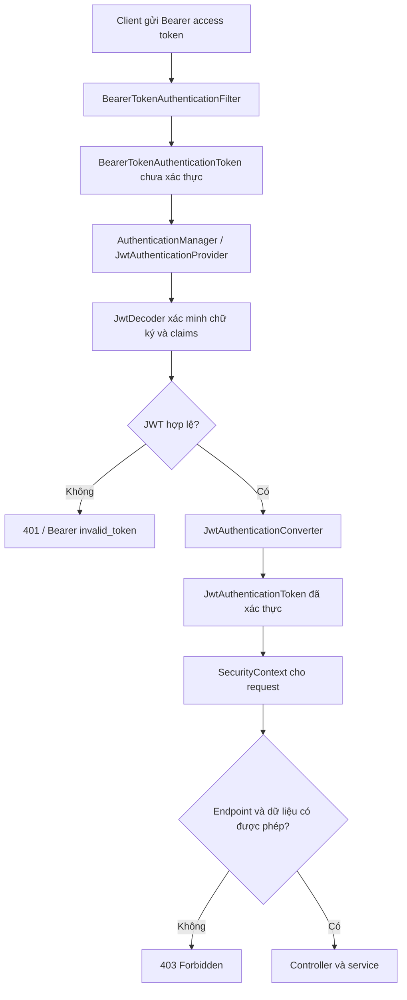

# JwtAuthenticationToken

## 1. JwtAuthenticationToken là gì?

Trong **Spring Security**, `JwtAuthenticationToken` là một triển khai của giao diện `Authentication` đại diện cho **ngữ cảnh xác thực được tạo từ JWT đã được Resource Server xác minh**. Nó mang JWT, danh tính (*principal*) và tập quyền (*authorities*) để Spring Security có thể quyết định request có được gọi endpoint hay không.

Tên đầy đủ của lớp:

```java
org.springframework.security.oauth2.server.resource.authentication.JwtAuthenticationToken
```

Bài thuộc chương **Spring Security authorities**, trong module `SECURITY_TOKEN_SECURITY_FUNDAMENTALS`. Bối cảnh là mô hình OAuth 2.0/OIDC: **Authorization Server (AS)** phát hành access token; **OAuth client** gửi token đến **Resource Server (RS)**; RS kiểm tra chữ ký, claims, audience, scope và quyền; các thành phần khác quản lý refresh, lưu trữ và thu hồi token.

Trong một API Java dùng **JWT access token**, `JwtAuthenticationToken` chính là cầu nối giữa **danh tính/quyền đã được xác minh từ token** với cơ chế **authorization** của Spring Security như `hasAuthority`, `hasRole`, `@PreAuthorize` và `SecurityContext`.

**Cần phân biệt ngay:**

- **`Jwt`** là đối tượng chứa giá trị token, headers và claims JWT đã được decoder tạo ra.
- **`JwtAuthenticationToken`** là đối tượng `Authentication` chứa `Jwt` **cùng authorities và thông tin principal** để Spring Security sử dụng.
- **`JwtDecoder`** kiểm tra chữ ký và các ràng buộc JWT theo cấu hình, **không tự động phân quyền mọi endpoint**.
- **`JwtAuthenticationConverter`** chuyển JWT đã xác minh thành `JwtAuthenticationToken` và quyết định cách lấy authorities.
- **`GrantedAuthority`** là một quyền dạng chuỗi, chẳng hạn `SCOPE_orders:read`; nó không phải bằng chứng mật mã riêng biệt.

> **Tư duy an toàn:** `JwtAuthenticationToken` chỉ đáng tin khi được tạo **sau** quá trình xác minh JWT bằng issuer, khóa và validator đáng tin. Tự decode payload rồi tạo một `JwtAuthenticationToken` và đánh dấu authenticated là một lỗi nghiêm trọng nếu dữ liệu xuất phát từ request chưa được xác thực.

## 2. Từ Authorization: Bearer đến JwtAuthenticationToken

Client thường gửi access token cho Resource Server bằng HTTP header:

```http
GET /api/orders/123 HTTP/1.1
Host: api.example.test
Authorization: Bearer <ACCESS_TOKEN>
Accept: application/json
```

`<ACCESS_TOKEN>` chỉ là placeholder. Header này trình **bearer access token**; nó không dùng để gửi refresh token hoặc OIDC ID token cho API.

Trong Spring Security Servlet Resource Server, luồng điển hình:



Diễn giải:

1. `BearerTokenAuthenticationFilter` nhận bearer credential bằng resolver được cấu hình. **Đọc header không đồng nghĩa token đã hợp lệ.**
2. Framework tạo `BearerTokenAuthenticationToken` như một **yêu cầu xác thực chưa được tin cậy** rồi chuyển cho authentication manager/provider.
3. `JwtAuthenticationProvider` sử dụng `JwtDecoder` để xác minh JWT bằng khóa tin cậy và validator (ví dụ issuer, `exp`, `nbf`, và audience khi được cấu hình).
4. Sau khi xác minh, `JwtAuthenticationConverter` xây `JwtAuthenticationToken`; bộ chuyển đổi authority thường đọc `scope` hoặc `scp`.
5. Framework đặt `Authentication` vào `SecurityContext` theo cơ chế quản lý của request. Quy tắc endpoint/method xét **authorities** và kiểm tra quyền với đối tượng nghiệp vụ.
6. Request kết thúc thì ứng dụng API stateless không cần ghi ngữ cảnh đó vào `HttpSession` để dùng cho request tiếp theo.

Với API dùng **opaque access token**, Spring Security có thể xây `BearerTokenAuthentication` từ kết quả introspection thay vì `JwtAuthenticationToken`. Vì vậy không được mặc định rằng mọi request OAuth2 Resource Server đều có principal kiểu `Jwt`.

## 3. Các thành phần bên trong JwtAuthenticationToken

| Thành phần / API | Ý nghĩa | Lưu ý sử dụng |
| --- | --- | --- |
| `authentication.getToken()` | Trả về `Jwt` được xác thực | Truy cập claims qua `jwt.getClaimAsString(...)`, `getSubject()`, `getAudience()`… |
| `authentication.getPrincipal()` | Principal trong cách triển khai JWT thông thường là đối tượng `Jwt` | Không đánh đồng với đối tượng `UserDetails` của đăng nhập form |
| `authentication.getAuthorities()` | `Collection<? extends GrantedAuthority>` | Các authority do converter tạo; thường có tiền tố `SCOPE_` |
| `authentication.getName()` | Tên principal; mặc định thường lấy `sub` | Có thể tùy biến qua `JwtAuthenticationConverter.setPrincipalClaimName` |
| `authentication.isAuthenticated()` | Cho biết `Authentication` đã được xác thực trong flow | Đừng dựa vào flag từ một đối tượng do code không tin cậy tự tạo |
| `authentication.getTokenAttributes()` | Map chứa token claims | Claims được tin cậy **trong phạm vi validator và issuer đã thiết lập**, không phải cấp quyền tự động |
| `authentication.getCredentials()` | Credential liên quan tới authentication, có thể chứa đối tượng JWT | Không ghi token/credentials nguyên văn vào log hoặc response |

Lớp có các constructor nhận `Jwt` và tùy chọn `authorities`, `name`. Tuy nhiên khi triển khai một Resource Server thông thường, **không cần tự gọi constructor từ HTTP request**: để framework và `JwtAuthenticationConverter` tạo đối tượng sau xác minh.

### 3.1. Ví dụ JWT và kết quả authorities

Giả sử AS phát JWT access token với payload minh họa:

```json
{
  "iss": "https://auth.example.test",
  "sub": "user-42",
  "aud": ["orders-api"],
  "scope": "orders:read orders:write",
  "roles": ["ADMIN"],
  "iat": 1795400000,
  "exp": 1795400300,
  "jti": "at-42"
}
```

Đây là **JSON mô tả claims**, không phải một JWT được ký. Nếu đã xác minh đúng issuer và audience, với cách chuyển đổi scope mặc định, Spring Security thường tạo:

```text
JwtAuthenticationToken
  name:        "user-42"          (từ sub, theo cấu hình mặc định)
  principal:   Jwt
  authorities: ["SCOPE_orders:read", "SCOPE_orders:write"]
```

**Không tự có `ROLE_ADMIN`** chỉ vì JWT chứa `roles: ["ADMIN"]`: converter mặc định của Spring Security OAuth2 Resource Server thường tìm `scope` hoặc `scp`, **không tự động biến mọi claim `roles` thành role Spring Security**.

Việc xác minh chữ ký giúp RS tin rằng claims đến từ issuer đã cấu hình. Nhưng RS vẫn phải xác minh **`aud` dành cho API này**, loại token đúng, thời hạn và quyền thực tế của endpoint. Một JWT cấp cho client khác hoặc API khác không được chấp nhận chỉ vì chữ ký hợp lệ.

## 4. Scope, authority và role khác nhau ra sao?

Trong OAuth 2.0, **scope** thể hiện phạm vi quyền mà authorization grant/access token được cấp, chẳng hạn `orders:read`. Trong Spring Security, **authority** là chuỗi quyền mà các kiểm tra authorization sử dụng. **Role** thường là một cách đặt tên authority theo convention `ROLE_`.

| Đầu vào / cấu hình | Authority trong Spring Security | Biểu thức kiểm tra |
| --- | --- | --- |
| Claim `scope: "orders:read orders:write"` (mặc định) | `SCOPE_orders:read`, `SCOPE_orders:write` | `hasAuthority("SCOPE_orders:read")` |
| Claim `scp: ["orders:read"]` (khi hỗ trợ dạng array) | `SCOPE_orders:read` | `hasAuthority("SCOPE_orders:read")` |
| Claim `roles: ["ADMIN"]` **chưa cấu hình converter riêng** | Không mặc định có `ROLE_ADMIN` | `hasRole("ADMIN")` thường **không khớp** |
| Claim `roles: ["ADMIN"]` với converter tự định nghĩa tiền tố `ROLE_` | `ROLE_ADMIN` | `hasRole("ADMIN")` hoặc `hasAuthority("ROLE_ADMIN")` |
| Claim `permissions: ["orders:approve"]` với prefix `PERM_` tự định nghĩa | `PERM_orders:approve` | `hasAuthority("PERM_orders:approve")` |

Trong cấu hình mặc định, `hasRole("ADMIN")` thường là cách viết rút gọn cho kiểm tra authority `ROLE_ADMIN`. Ngược lại, `hasAuthority(...)` so sánh với chuỗi authority yêu cầu theo đúng cấu hình. Vì vậy, **`hasRole("orders:read")` không thay thế `hasAuthority("SCOPE_orders:read")`**.

Không có chuẩn OAuth 2.0 bắt buộc mọi AS phát `roles` theo cấu trúc giống nhau. Nếu muốn biến claim riêng thành authority, RS phải thỏa thuận rõ với issuer tin cậy về ý nghĩa, tên claim, kiểu dữ liệu, namespace, prefix và cách tránh xung đột.

## 5. Cấu hình Spring Security Resource Server cho JWT

Ví dụ dưới đây minh họa **Spring Boot với Spring Security Servlet theo DSL hiện đại**, cho API chỉ nhận bearer token qua header, không dùng cookie phiên để xác thực. Tên endpoint, issuer và chính sách đều là dữ liệu minh họa.

### 5.1. Cấu hình issuer

```yaml
# application.yml — ví dụ cho JWT access token
spring:
  security:
    oauth2:
      resourceserver:
        jwt:
          issuer-uri: https://auth.example.test
```

Resource Server cần dependency Spring Security OAuth2 Resource Server và cơ chế giải mã/xác minh JWT tương ứng. `issuer-uri` cho phép framework dùng metadata/JWKS tin cậy theo cấu hình để xác minh chữ ký và issuer. **Đừng mặc định rằng chỉ cấu hình issuer đã kiểm tra `aud` dành riêng cho API**, vì cách cấu hình audience phụ thuộc phiên bản Spring Security/Boot và chính sách hiện hành.

### 5.2. SecurityFilterChain kiểm authority

```java
import org.springframework.context.annotation.Bean;
import org.springframework.context.annotation.Configuration;
import org.springframework.http.HttpMethod;
import org.springframework.security.config.Customizer;
import org.springframework.security.config.annotation.web.builders.HttpSecurity;
import org.springframework.security.config.annotation.web.configurers.AbstractHttpConfigurer;
import org.springframework.security.config.http.SessionCreationPolicy;
import org.springframework.security.web.SecurityFilterChain;

@Configuration
public class ApiSecurityConfig {
    @Bean
    SecurityFilterChain apiSecurity(HttpSecurity http) throws Exception {
        http
            .sessionManagement(session ->
                session.sessionCreationPolicy(SessionCreationPolicy.STATELESS))
            // Chỉ phù hợp với API Bearer-only, không có cookie auth tự gửi.
            .csrf(AbstractHttpConfigurer::disable)
            .authorizeHttpRequests(auth -> auth
                .requestMatchers("/actuator/health").permitAll()
                .requestMatchers(HttpMethod.GET, "/api/me").authenticated()
                .requestMatchers(HttpMethod.GET, "/api/orders/**")
                    .hasAuthority("SCOPE_orders:read")
                .requestMatchers(HttpMethod.POST, "/api/orders/**")
                    .hasAuthority("SCOPE_orders:write")
                .anyRequest().denyAll()
            )
            .oauth2ResourceServer(oauth2 ->
                oauth2.jwt(Customizer.withDefaults())
            );
        return http.build();
    }
}
```

Ý nghĩa:

1. **`STATELESS`** làm cho Spring Security không dùng `HttpSession` để lấy `SecurityContext` cho request; không liên quan tới việc có/không có JWT signature verification.
2. **`oauth2ResourceServer().jwt()`** bật filter/provider/decoder tạo `JwtAuthenticationToken` cho bearer JWT hợp lệ.
3. **`hasAuthority("SCOPE_orders:read")`** kiểm chính xác authority đã map từ scope. Không cần ghi thủ công `SecurityContext` trong controller.
4. **`anyRequest().denyAll()`** từ chối những route chưa cấu hình; không vô tình mở quyền chỉ vì request có JWT.
5. **CSRF:** Việc tắt CSRF trong mẫu chỉ phù hợp khi ứng dụng thực sự không dựa vào credential được browser tự đính kèm. Nếu dùng cookie, session, form login hoặc BFF cùng filter chain, phải đánh giá và áp dụng chống CSRF phù hợp.

Một token hợp lệ có scope `orders:read` vẫn **không tự được xem mọi đơn hàng**. Controller/service phải kiểm quyền theo **owner/tenant/tổ chức** của bản ghi, chống broken object-level authorization (BOLA/IDOR).

### 5.3. Lấy principal và authorities trong controller

Sau khi framework xác minh JWT, có thể lấy `JwtAuthenticationToken` qua `Authentication`, hoặc lấy riêng JWT từ `@AuthenticationPrincipal`:

```java
import java.util.List;
import java.util.Map;
import org.springframework.security.core.Authentication;
import org.springframework.security.core.GrantedAuthority;
import org.springframework.security.oauth2.server.resource.authentication.JwtAuthenticationToken;
import org.springframework.web.bind.annotation.GetMapping;
import org.springframework.web.bind.annotation.RestController;

@RestController
class ProfileController {
    @GetMapping("/api/me")
    Map<String, Object> me(Authentication authentication) {
        if (!(authentication instanceof JwtAuthenticationToken jwtAuth)) {
            throw new IllegalStateException(
                "Endpoint này yêu cầu JWT Resource Server authentication");
        }

        String subject = jwtAuth.getToken().getSubject();
        List<String> authorities = jwtAuth.getAuthorities().stream()
            .map(GrantedAuthority::getAuthority)
            .toList();

        return Map.of(
            "subject", subject,
            "name", jwtAuth.getName(),
            "authorities", authorities
        );
    }
}
```

Ví dụ dùng Java hỗ trợ `instanceof` pattern matching và `Stream.toList()`. Trong API thật, chỉ trả thông tin quyền cần thiết; không trả `jwtAuth.getToken().getTokenValue()` hoặc toàn bộ claims nhạy cảm ra response. `getName()` có thể khác `sub` nếu converter được cấu hình principal claim riêng.

Một lựa chọn gọn hơn:

```java
import org.springframework.security.core.annotation.AuthenticationPrincipal;
import org.springframework.security.oauth2.jwt.Jwt;

// Chỉ là một chữ ký method minh họa.
String subject(@AuthenticationPrincipal Jwt jwt) {
    return jwt.getSubject();
}
```

Đoạn thứ hai chỉ lấy JWT principal và không cung cấp toàn bộ authorities. Với opaque token, principal có thể không phải `Jwt`; không ép kiểu tùy tiện nếu ứng dụng chấp nhận nhiều loại access token.

## 6. Tùy chỉnh JwtAuthenticationConverter

Nhiều Authorization Server không dùng `scope`/ `scp` theo định dạng mặc định, hoặc phát thêm roles/permissions của ứng dụng. Spring Security cho phép tùy biến converter nhưng cần bảo đảm **chỉ đọc claims sau verify và từ issuer đáng tin**.

### 6.1. Đổi tên claim chứa authority

Nếu AS phát JWT với:

```json
{
  "sub": "user-42",
  "permissions": ["orders:read", "orders:approve"]
}
```

Có thể dùng `JwtGrantedAuthoritiesConverter`:

```java
import org.springframework.context.annotation.Bean;
import org.springframework.security.oauth2.server.resource.authentication.JwtAuthenticationConverter;
import org.springframework.security.oauth2.server.resource.authentication.JwtGrantedAuthoritiesConverter;

@Bean
JwtAuthenticationConverter jwtAuthenticationConverter() {
    JwtGrantedAuthoritiesConverter granted = new JwtGrantedAuthoritiesConverter();
    granted.setAuthoritiesClaimName("permissions");
    granted.setAuthorityPrefix("PERM_");

    JwtAuthenticationConverter converter = new JwtAuthenticationConverter();
    converter.setJwtGrantedAuthoritiesConverter(granted);
    return converter;
}
```

Khi đó `permissions: ["orders:approve"]` có thể tạo authority `PERM_orders:approve`. **Lưu ý:** converter trên **thay thế cách ánh xạ mặc định**, không tự cộng thêm các authority `SCOPE_` từ `scope`. Nếu vừa cần scope vừa cần permissions, phải **hợp nhất hai nguồn rõ ràng**.

### 6.2. Gộp scope mặc định với roles của ứng dụng

Ví dụ AS phát `scope: "orders:read"` và `roles: ["ADMIN"]`. Bản cấu hình sau giữ authority từ scope và thêm role đã được issuer ký:

```java
import java.util.Collection;
import java.util.LinkedHashSet;
import java.util.Set;
import org.springframework.context.annotation.Bean;
import org.springframework.security.core.GrantedAuthority;
import org.springframework.security.oauth2.server.resource.authentication.JwtAuthenticationConverter;
import org.springframework.security.oauth2.server.resource.authentication.JwtGrantedAuthoritiesConverter;

@Bean
JwtAuthenticationConverter jwtAuthenticationConverter() {
    JwtGrantedAuthoritiesConverter scopes = new JwtGrantedAuthoritiesConverter();

    JwtGrantedAuthoritiesConverter roles = new JwtGrantedAuthoritiesConverter();
    roles.setAuthoritiesClaimName("roles");
    roles.setAuthorityPrefix("ROLE_");

    JwtAuthenticationConverter converter = new JwtAuthenticationConverter();
    converter.setJwtGrantedAuthoritiesConverter(jwt -> {
        Set<GrantedAuthority> authorities =
            new LinkedHashSet<>(scopes.convert(jwt));
        authorities.addAll(roles.convert(jwt));
        return authorities;
    });

    // Mặc định nên dùng sub làm identity ổn định.
    // converter.setPrincipalClaimName("preferred_username");
    return converter;
}
```

Đây là ví dụ minh họa một `JwtAuthenticationConverter` **thay thế** ví dụ ở mục 6.1, không phải bean trùng tên cần khai báo cùng lúc. Nếu có custom converter, phải gắn nó vào Resource Server:

```java
.oauth2ResourceServer(oauth2 ->
    oauth2.jwt(jwt -> jwt.jwtAuthenticationConverter(jwtAuthenticationConverter()))
)
```

Đoạn trên là **một phần DSL của `HttpSecurity`**, không phải lời gọi độc lập. Trong dự án thực tế, nên inject bean `JwtAuthenticationConverter` vào method cấu hình `SecurityFilterChain`, thay vì tạo nhiều bean cùng tên hoặc vô tình dùng converter không được đăng ký.

**Về `getName()`:** `converter.setPrincipalClaimName("preferred_username")` có thể làm `getName()` trả tên hiển thị từ claim đó. Nhưng `preferred_username` có thể thay đổi hoặc không duy nhất; để gắn chủ sở hữu dữ liệu, audit và tenant, thường nên dùng định danh bền vững như cặp **`iss` + `sub`**, không chỉ tên hiển thị.

**Về tính toàn vẹn quyền:** Không được tự đọc một claim không rõ nguồn như `role: ADMIN` rồi nâng quyền mà không có hợp đồng dữ liệu với AS. Đặc biệt, nếu AS phát JWT cho nhiều audience, RS phải kiểm `aud` và phân biệt token dành cho API với ID token nhằm ngăn **token confusion**.

## 7. JwtAuthenticationToken không thay thế JwtDecoder và phân quyền nghiệp vụ

### 7.1. Những điều JwtDecoder và Resource Server phải kiểm tra

Giả sử JWT có chữ ký hợp lệ và chứa `scope: orders:read`. RS **vẫn chưa đủ cơ sở** để xử lý yêu cầu cho tới khi đánh giá:

- **Chữ ký và thuật toán:** Token do AS tin cậy ký, sử dụng thuật toán phù hợp; không chấp nhận `alg=none` hoặc chọn khóa theo URL bất kỳ do JWT chưa được tin cậy chỉ định.
- **Issuer (`iss`):** Đúng Authorization Server đã được cấu hình.
- **Audience (`aud`):** Chứa định danh của RS, ví dụ `orders-api`; token dành cho API khác không hợp lệ ở đây.
- **Thời gian (`exp`, `nbf`, `iat` theo chính sách):** Token còn hiệu lực; sai lệch đồng hồ có giới hạn và có chủ đích.
- **Loại token (`typ`, cấu trúc/profile):** Không chấp nhận ID token hoặc refresh token thay access token; nếu AS dùng JWT Access Token Profile (RFC 9068), kiểm tra các yêu cầu profile tương ứng.
- **Quyền (`scope`, authorities):** Các quyền phải phù hợp với operation, tenant, đối tượng dữ liệu và trạng thái nghiệp vụ hiện thời.
- **Revocation/sender constraints nếu áp dụng:** JWT tự xác minh không tự thu hồi khi user logout; DPoP/mTLS có thêm bước xác minh bằng chứng ràng buộc người gửi.

`JwtAuthenticationToken.getAuthorities()` **không trả lời** câu hỏi `GET /orders/123` có thuộc user/tenant này hay không. Authorities kiểm soát khả năng thực hiện **loại hành động**; tầng service hoặc authorization manager cần kiểm tra **quyền với đối tượng cụ thể**.

### 7.2. Ví dụ audience validator

Trong môi trường có nhiều API, một RS có thể bổ sung validator yêu cầu `aud` chứa `orders-api`. Ví dụ khi đã xác định chính xác JWKS URI của AS:

```java
import org.springframework.context.annotation.Bean;
import org.springframework.security.oauth2.core.OAuth2Error;
import org.springframework.security.oauth2.core.OAuth2TokenValidator;
import org.springframework.security.oauth2.core.OAuth2TokenValidatorResult;
import org.springframework.security.oauth2.core.DelegatingOAuth2TokenValidator;
import org.springframework.security.oauth2.jwt.Jwt;
import org.springframework.security.oauth2.jwt.JwtDecoder;
import org.springframework.security.oauth2.jwt.JwtValidators;
import org.springframework.security.oauth2.jwt.NimbusJwtDecoder;

@Bean
JwtDecoder jwtDecoder() {
    String issuer = "https://auth.example.test";
    NimbusJwtDecoder decoder = NimbusJwtDecoder
        .withJwkSetUri("https://auth.example.test/oauth2/jwks")
        .build();

    OAuth2TokenValidator<Jwt> audienceValidator = jwt ->
        jwt.getAudience().contains("orders-api")
            ? OAuth2TokenValidatorResult.success()
            : OAuth2TokenValidatorResult.failure(
                new OAuth2Error("invalid_token", "Invalid audience", null));

    decoder.setJwtValidator(new DelegatingOAuth2TokenValidator<>(
        JwtValidators.createDefaultWithIssuer(issuer),
        audienceValidator));
    return decoder;
}
```

Ví dụ trên phải được điều chỉnh theo Spring Security/AS đang dùng, đặc biệt về thuật toán, loại access token, JWKS URI và khả năng key rotation. Không gỡ validator chuẩn chỉ để thêm audience. Một số phiên bản framework có thuộc tính cấu hình audience trực tiếp; chọn cách phù hợp với phiên bản triển khai.

### 7.3. Method security và quyền dữ liệu

Có thể kích hoạt method security bằng `@EnableMethodSecurity` rồi:

```java
import org.springframework.security.access.prepost.PreAuthorize;

@PreAuthorize("hasAuthority('SCOPE_orders:read')")
public OrderDto findOrder(String orderId) {
    // Ngoài kiểm scope, truy vấn nghiệp vụ PHẢI giới hạn owner/tenant.
    return orderService.findVisibleOrderForCurrentPrincipal(orderId);
}
```

Đây là **mã giả ở phần nghiệp vụ**, không phải method độc lập đầy đủ. `OrderDto` và `orderService` là thành phần giả định. Một thiết kế tốt thường kết hợp kiểm tra quyền qua `@PreAuthorize` với truy vấn có điều kiện owner/tenant hoặc authorization service để tránh BOLA/IDOR.

## 8. 401, 403 và khi nào có JwtAuthenticationToken

| Tình huống | Kết quả thông thường | `JwtAuthenticationToken` hợp lệ có mặt? |
| --- | --- | --- |
| Không gửi `Authorization` cho endpoint bảo vệ | **401 Unauthorized**, Bearer challenge | **Không** |
| Bearer JWT sai chữ ký, hết hạn, sai issuer/audience | **401**, thường `invalid_token` | **Không** |
| Request có malformed bearer credential | Có thể **400** `invalid_request` theo trường hợp | **Không** |
| JWT hợp lệ, thiếu `SCOPE_orders:read` | **403 Forbidden**, có thể `insufficient_scope` | **Có**, nhưng không đủ authority |
| JWT hợp lệ, đủ scope, nhưng bản ghi không thuộc quyền | **403** hoặc phản hồi che giấu tài nguyên theo chính sách | **Có**, nhưng không được truy cập đối tượng |
| JWT hợp lệ, scope và quyền dữ liệu đủ | **2xx** tùy nghiệp vụ | **Có** |

Một `JwtAuthenticationToken` đã xác thực chỉ chứng minh token và claims đáp ứng **chính sách xác thực đã cấu hình**; không chứng minh toàn bộ thao tác nghiệp vụ an toàn.

Với OIDC, AS/OP có thể cấp **ID token** để client xác nhận việc đăng nhập và **access token** cho RS. RS cần từ chối ID token dùng sai mục đích, kể cả nó là JWT có chữ ký hợp lệ. Refresh token chỉ được trình đến **AS token endpoint**, không phải header Bearer của RS.

## 9. Những vấn đề dễ gây lỗi trong thực tế

| Biểu hiện | Nguyên nhân thường gặp | Hướng kiểm tra |
| --- | --- | --- |
| Token hợp lệ nhưng API luôn 403 | Authority thực tế là `SCOPE_orders:read`, rule lại kiểm `ROLE_orders:read` hoặc `orders:read` | Kiểm converter và chuỗi authority chính xác |
| `roles: ["ADMIN"]` nhưng `hasRole("ADMIN")` thất bại | Converter mặc định không map `roles` | Chỉ map claim được AS cam kết, với prefix `ROLE_` nếu cần |
| Cấu hình converter nhưng authority không thay đổi | Bean không được gắn vào `oauth2ResourceServer().jwt()` hoặc có nhiều cấu hình chain | Kiểm `SecurityFilterChain` thật được chọn cho request |
| Dùng `jwt.getClaimAsString("scope")` làm phân quyền trực tiếp | Bỏ qua quy ước mapping, quyền dữ liệu và test | Đưa quyền vào `GrantedAuthority`, dùng authorization rules nhất quán |
| `getName()` khác `sub` | Đã cấu hình `principalClaimName` hoặc converter riêng | Phân biệt tên hiển thị với định danh ổn định `iss` + `sub` |
| API nhận JWT dành cho service khác | RS thiếu audience validator | Thêm kiểm `aud` bắt buộc |
| Token đã logout vẫn được chấp nhận | JWT offline chưa hết `exp`, không có revocation check | TTL ngắn, introspection/denylist hoặc cơ chế session-version phù hợp |
| Dùng cùng access token nhiều lần bị cho là replay | Logic chống replay sai tầng | Access token thường được dùng hợp lệ nhiều lần; chống replay DPoP proof/refresh token bằng cơ chế riêng |
| `ClassCastException` khi ép `Authentication` sang `JwtAuthenticationToken` | API dùng opaque token, phương thức auth khác hoặc endpoint chưa xác thực | Xem loại `Authentication` thực tế, dùng interface/annotation phù hợp |
| Thử `@WithMockUser` rồi kỳ vọng có `JwtAuthenticationToken` | Mock user tạo loại `Authentication` khác | Dùng test support cho JWT và test riêng bước decoder/validator |

## 10. Kiểm thử mapping authorities và đường đi bảo mật

### 10.1. Test endpoint bằng Spring Security test support

Với Spring MVC MockMvc và `spring-security-test`, request post-processor `jwt()` có thể mô phỏng một request đã có JWT authentication để **kiểm thử endpoint authorization**:

```java
import static org.springframework.security.test.web.servlet.request.SecurityMockMvcRequestPostProcessors.jwt;
import static org.springframework.test.web.servlet.request.MockMvcRequestBuilders.get;
import static org.springframework.test.web.servlet.result.MockMvcResultMatchers.status;
import org.springframework.security.core.authority.SimpleGrantedAuthority;

// Trong một test class có mockMvc và route tương ứng:
mockMvc.perform(get("/api/orders/123").with(jwt().authorities(
        new SimpleGrantedAuthority("SCOPE_orders:read"))))
    .andExpect(status().isOk());
```

Đoạn minh họa giả định endpoint tồn tại và bản ghi `123` có thể đọc trong fixture. Nếu service còn kiểm quyền theo owner/tenant, test phải dựng đúng dữ liệu. **Lưu ý bảo mật:** `jwt()` trong MockMvc test chủ yếu mô phỏng authentication, **không chứng minh chữ ký JWT hay cấu hình `JwtDecoder` thực sự được kiểm**. Khi dùng `.authorities(...)`, test còn có thể bỏ qua chính bộ converter đang dùng trong sản phẩm.

Vì vậy nên tách ít nhất ba lớp kiểm thử:

1. **Converter unit test:** Tạo `Jwt` test có claims phù hợp, gọi `JwtAuthenticationConverter` và kiểm `getAuthorities()`, `getName()`; thử claim rỗng, thiếu, sai kiểu, tiền tố và role trùng.
2. **Authorization test:** Dùng `MockMvc` với `jwt()` kiểm request đủ/thiếu authority và quyền owner/tenant trên các endpoint; bao gồm cả 401/403 theo setup.
3. **Decoder/integration test:** Dùng token test được ký bằng khóa test/JWKS phù hợp hoặc môi trường AS thử nghiệm, xác minh RS từ chối chữ ký sai, `iss`, `aud`, `exp`, `nbf`, loại token sai và trường hợp thay khóa. Không dùng token sản xuất trong test.

### 10.2. Các trường hợp cần có trong bộ test

| Tình huống | Điều cần xác nhận |
| --- | --- |
| Scope có dấu cách: `orders:read orders:write` | Converter tạo đúng hai authority `SCOPE_` |
| Claim `scp` ở dạng danh sách | Converter xử lý đúng định dạng issuer đã cam kết |
| Claim `roles` nhưng chưa cấu hình | Không tự có `ROLE_ADMIN` |
| Claim `roles` với converter riêng | Authority `ROLE_ADMIN` chỉ được sinh khi quy tắc đáng tin cho phép |
| JWT đúng chữ ký nhưng sai audience | Không tạo principal được chấp nhận |
| Access token hết hạn | Trả 401 thay vì tạo `JwtAuthenticationToken` hợp lệ |
| JWT hợp lệ nhưng thiếu scope | Trả 403 đối với endpoint bảo vệ |
| User có scope nhưng bản ghi thuộc tenant khác | Phân quyền đối tượng từ chối |
| Nhiều request liên tiếp tới các instance | Không bị lẫn `SecurityContext` giữa người dùng |
| Refresh token/ID token được đưa vào API | Bị từ chối theo ràng buộc loại token và audience |

## 11. Bảo vệ token, lưu trữ và chống phát lại

`JwtAuthenticationToken` không phải công cụ phòng chống token theft. Nó biểu diễn **kết quả xác thực của một request**. Với bearer JWT, người đánh cắp token còn hiệu lực có thể cố tái sử dụng nó; chữ ký hợp lệ, `jti`, `aud` và `scope` không tự chứng minh người đang gửi request là chủ token hợp pháp.

- **Bảo vệ vận chuyển:** Dùng HTTPS; nhận access token qua header `Authorization`, tránh URL/query string và các hệ thống lưu request thô.
- **Bảo vệ client:** Tránh đặt bearer token lâu dài trong vùng JavaScript đọc được như `localStorage` khi kiến trúc cho phép; giảm XSS bằng output encoding, CSP, Trusted Types và kiểm soát script bên thứ ba. Cân nhắc BFF giữ token ở backend và cookie phiên `HttpOnly; Secure; SameSite`, đồng thời chống CSRF.
- **Giới hạn đặc quyền:** AS phát token ngắn hạn với `aud` đúng RS và `scope` tối thiểu; RS kiểm lại mọi request và quyền đối tượng.
- **Thu hồi:** JWT offline chưa hết hạn có thể vẫn được RS chấp nhận sau logout. Tùy nhu cầu dùng TTL ngắn, denylist/token hash, kiểm version phiên hoặc introspection.
- **Sender-constrained token:** DPoP (RFC 9449) và mTLS (RFC 8705) làm khó việc sử dụng bản sao token từ môi trường không có khóa/chứng chỉ. RS phải triển khai kiểm tra proof/binding thực sự; **`JwtAuthenticationToken` một mình không làm thay bước đó**.
- **Không log credential:** Không ghi `Authorization`, `Jwt.getTokenValue()`, `getCredentials()` hay toàn bộ `JwtAuthenticationToken` vào trace/analytics. Có thể log request ID, issuer đã xác minh, định danh nội bộ phù hợp và quyết định quyền đã làm sạch.

**Đừng dùng `jti` của access token như cờ "chỉ được dùng một lần" trên mọi request**: nhiều request hợp pháp thường dùng cùng bearer access token. Cơ chế chống phát lại theo từng request áp dụng riêng cho proof DPoP (kiểm `jti`/thời gian/nonce) hoặc các credential dùng một lần khác như authorization code và refresh token rotation.

## 12. Tình huống tự đánh giá

**Tình huống A — JWT có scope `orders:read`, rule `hasAuthority("orders:read")`:** Controller trả 403 dù chữ ký JWT hợp lệ. **Giải thích:** Spring Security mặc định tạo `SCOPE_orders:read`, không phải `orders:read`. Cần sửa rule hoặc converter sao cho nhất quán.

**Tình huống B — Token có `roles: ["ADMIN"]`, `hasRole("ADMIN")` không khớp:** **Giải thích:** Converter mặc định không nhất thiết đọc `roles`. Cần xác định hợp đồng với AS và cấu hình mapping `ROLE_ADMIN` nếu chính sách API thực sự yêu cầu.

**Tình huống C — Dev dùng decoder Base64URL tự viết rồi `new JwtAuthenticationToken(...)`:** **Nguy cơ:** Chưa có xác minh chữ ký, issuer, audience và thời gian. **Cách sửa:** Dùng `JwtDecoder` và flow của Spring Security Resource Server.

**Tình huống D — JWT đã verify và có `SCOPE_orders:read`, nhưng đơn hàng thuộc user khác:** **Giải thích:** Authority không thay object-level authorization. API phải từ chối truy cập dữ liệu ngoài quyền.

**Tình huống E — ID token dùng làm Bearer tại Resource Server:** **Giải thích:** ID token được phát cho client OIDC, không phải access token dành cho RS; phải áp dụng validation loại token và audience, không chấp nhận chỉ vì JWT ký hợp lệ.

**Tình huống F — API dùng opaque token nhưng controller ép sang `JwtAuthenticationToken`:** **Giải thích:** Loại `Authentication` sẽ khác; cần kiểm kiểu hiện có hoặc thiết kế controller chỉ dựa trên thông tin principal/authority phù hợp.

**Tình huống G — Client đã logout nhưng JWT vẫn xác thực thành công:** **Giải thích:** `JwtAuthenticationToken` phản ánh kết quả xác minh hiện tại; nếu RS không kiểm revocation, JWT còn hiệu lực tới `exp`. Phải thiết kế cơ chế thu hồi theo yêu cầu bảo mật.

### Checklist triển khai

- [ ] Phân biệt `Jwt`, `JwtDecoder`, `JwtAuthenticationConverter`, `JwtAuthenticationToken` và `GrantedAuthority`.
- [ ] Chỉ tin `JwtAuthenticationToken` do authentication pipeline tạo sau bước verify.
- [ ] RS kiểm chữ ký/thuật toán, issuer, audience, thời hạn, loại token và các ràng buộc theo hợp đồng với AS.
- [ ] `scope`/`scp` được map sang authority đúng prefix; không nhầm `SCOPE_` với `ROLE_`.
- [ ] Custom converter được đăng ký thật sự vào SecurityFilterChain; không vô tình bỏ scope khi thêm roles.
- [ ] `hasAuthority`/ `hasRole`/ `@PreAuthorize` kiểm đúng quyền và có kiểm owner/tenant ở tầng nghiệp vụ.
- [ ] Không dùng ID token, refresh token thay access token trong Resource Server.
- [ ] API stateless không dựa vào `HttpSession` cho mỗi request; vẫn xử lý CSRF nếu có cookie auth.
- [ ] Lỗi 401/403 được phân loại đúng; không lộ claims, token hoặc khóa ký trong lỗi/log.
- [ ] Test riêng converter, authorization và decoder/integration; không coi MockMvc `jwt()` là kiểm chứng chữ ký.
- [ ] Có kế hoạch TTL, revocation và phòng chống token theft/replay; ràng buộc DPoP/mTLS nếu hệ thống yêu cầu.

## 13. Ghi nhớ

**`JwtAuthenticationToken` là đối tượng `Authentication` được Spring Security dùng sau khi JWT access token đã được xác minh**. Nó cung cấp principal, `Jwt` và danh sách `GrantedAuthority` để các rule bảo mật ra quyết định. Theo mặc định thông thường, scope của OAuth access token được ánh xạ thành `SCOPE_...`; roles/permissions riêng phải được cấu hình có chủ đích.

Để an toàn trong OAuth 2.0/OIDC, phải đi trọn chuỗi: **đúng loại access token → xác minh issuer/chữ ký/audience/hạn dùng → chuyển claims sang authority → kiểm quyền endpoint và đối tượng → bảo vệ vòng đời token và thu hồi khi cần**. Một JWT có chữ ký hợp lệ hay một `JwtAuthenticationToken` đã tạo không tự giải quyết vấn đề quyền nghiệp vụ, token theft hoặc replay.

### Tài liệu tham khảo

- [Spring Security — OAuth 2.0 Resource Server JWT](https://docs.spring.io/spring-security/reference/servlet/oauth2/resource-server/jwt.html): JWT decoder, mapping scopes/authorities và converter.
- [Spring Security — Authorization Architecture](https://docs.spring.io/spring-security/reference/servlet/authorization/architecture.html): `Authentication`, `GrantedAuthority`, `hasRole` và authorization.
- [Spring Security — Method Security](https://docs.spring.io/spring-security/reference/servlet/authorization/method-security.html): `@EnableMethodSecurity`, `@PreAuthorize`.
- [RFC 6750 — Bearer Token Usage](https://www.rfc-editor.org/rfc/rfc6750): cách truyền bearer token và xử lý lỗi HTTP.
- [RFC 9068 — JWT Profile for OAuth 2.0 Access Tokens](https://www.rfc-editor.org/rfc/rfc9068): định dạng JWT access token dành cho Resource Server.
- [RFC 8725 — JSON Web Token Best Current Practices](https://www.rfc-editor.org/rfc/rfc8725): bảo vệ JWT, chống nhầm thuật toán/loại token.
- [RFC 9700 — Best Current Practice for OAuth 2.0 Security](https://www.rfc-editor.org/rfc/rfc9700): quản lý vòng đời, token theft và replay.
