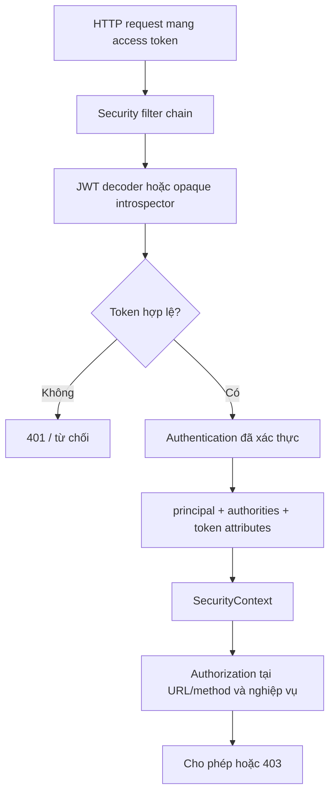

# Principal và subject trong Spring Security

## 1. Vấn đề: ai đang gọi API và API đang tin điều gì?

Trong hệ thống xác thực và phân quyền bằng OAuth 2.0/OpenID Connect (OIDC), **Authorization Server (AS)** phát hành access token; **Resource Server (RS)** xác minh access token rồi quyết định có cho phép yêu cầu hay không. Với ứng dụng Java sử dụng **Spring Security**, thông tin xác thực thành công thường được biểu diễn bằng đối tượng `Authentication`, chứa **principal**, **authorities** và những thuộc tính khác của quá trình xác thực.

Hai khái niệm dễ bị dùng lẫn nhau:

- **Principal** là biểu diễn *chủ thể đã xác thực trong ngữ cảnh Spring Security*. Đó có thể là đối tượng `Jwt`, `OAuth2AuthenticatedPrincipal`, `UserDetails` hoặc `OidcUser` tùy loại đăng nhập và cấu hình.
- **Subject** thường là giá trị claim `sub` trong JWT hoặc thuộc tính tương ứng từ AS. Nó cho biết *chủ thể mà token nói đến* theo quy tắc định danh của issuer. `sub` không phải toàn bộ đối tượng principal.
- **GrantedAuthority** là quyền/nhãn quyền mà Spring Security dùng khi kiểm tra `hasAuthority`, `hasRole` và method security. Subject không tự động là quyền.

Ví dụ access token được AS tin cậy phát hành:

```json
{
  "iss": "https://id.example.com/realms/customers",
  "sub": "usr-7c9f",
  "aud": "https://api.example.com/orders",
  "client_id": "shopping-web",
  "scope": "orders:read orders:create",
  "exp": 1893456000
}
```

Ở Orders API, sau khi xác thực JWT thành công:

- `sub=usr-7c9f` giúp xác định **subject bên trong issuer đã được xác minh**.
- `client_id=shopping-web` xác định **OAuth client** được cấp token, không nhất thiết là user.
- `scope=orders:read orders:create` có thể được ánh xạ sang `SCOPE_orders:read` và `SCOPE_orders:create`.
- `aud` và `iss` quyết định token có đúng bên phát hành và dành cho API này không.
- Quyền đọc **đơn hàng cụ thể** còn phải kiểm tra trong hệ thống nghiệp vụ, chẳng hạn đơn hàng thuộc user hoặc tổ chức nào.

**Mục tiêu của bài:** dùng đúng `principal` và `sub` trong Spring Security, tránh nhầm định danh user với client/role, xây khóa định danh an toàn giữa nhiều issuer/tenant và kết nối token validation với authorization ở mức bản ghi.

## 2. Mô hình `Authentication` của Spring Security

Một đối tượng `Authentication` đại diện kết quả hoặc yêu cầu xác thực trong ngữ cảnh bảo mật hiện tại. Các phương thức thường gặp:

| API | Ý nghĩa | Điều không được suy luận |
| --- | --- | --- |
| `getPrincipal()` | Đối tượng biểu diễn danh tính/chủ thể theo cơ chế xác thực | Không mặc định là `String`, email, hoặc claim `sub` |
| `getName()` | Tên thuận tiện do loại `Authentication` quyết định | Không mặc định là định danh nghiệp vụ bất biến và duy nhất toàn hệ thống |
| `getAuthorities()` | Tập `GrantedAuthority` được cung cấp sau xác thực | Không phải mọi authority đều do AS cấp trực tiếp; mapping có thể do ứng dụng cấu hình |
| `getCredentials()` | Credential của quá trình xác thực, tùy implementation | Không dùng làm API truy xuất bearer token để ghi log hoặc lưu lâu |
| `getDetails()` | Chi tiết request/ngữ cảnh, tùy implementation | Không phải một nguồn định danh đáng tin tự động |
| `isAuthenticated()` | Cờ biểu thị trạng thái của implementation | Không thay thế xác minh token, kiểm tra phiên và phân quyền |

Trong mô hình servlet, Spring Security thường đặt `Authentication` vào `SecurityContext` cho request đã đi qua security filter chain:



**Không tạo principal đáng tin bằng cách chỉ parse payload JWT.** Claims có thể đọc được trước khi xác minh chữ ký, nhưng chỉ nên trở thành dữ liệu đáng tin khi đã kiểm tra nguồn phát hành, chữ ký/introspection, thời gian, audience và profile token thích hợp.

### `SecurityContextHolder` và vòng đời request

Trong ứng dụng Servlet thông thường:

```java
Authentication authentication =
    SecurityContextHolder.getContext().getAuthentication();
```

Cách này có thể hữu ích tại code hạ tầng, nhưng controller/service thường nên **nhận `Authentication` hoặc principal đã xác minh qua dependency/method argument** để tránh phụ thuộc ngầm vào thread-local. `SecurityContextHolder` mặc định sử dụng một chiến lược gắn với thread trong servlet; với xử lý bất đồng bộ, hàng đợi, scheduled job hoặc reactive pipeline phải sử dụng cơ chế truyền context phù hợp, **không tự giả định context có mặt ở mọi thread**.

Đặc biệt, `AnonymousAuthenticationToken` có thể có `isAuthenticated() = true` theo implementation. Không viết logic “có authentication và isAuthenticated là user thật” mà bỏ qua loại anonymous hoặc security policy của framework. Các endpoint yêu cầu đăng nhập cần được chặn bởi quy tắc `authenticated()`/method security đúng cấu hình và xác thực chủ thể theo loại token mong đợi.

## 3. Claim `sub` là gì, và tại sao phải gắn với issuer?

Theo JWT (RFC 7519), claim **subject – `sub`** là một chuỗi dùng để định danh chủ thể mà claims của JWT nói đến. Tính duy nhất có thể là **trong phạm vi issuer** hoặc trên phạm vi toàn cục tùy nhà phát hành; ứng dụng không nên mặc định hai AS không liên quan sẽ cấp `sub` khác nhau.

Hai token sau có cùng `sub` nhưng **không nhất thiết cùng một người**:

```json
{
  "iss": "https://id.example.com/realms/customers",
  "sub": "12345"
}
```

```json
{
  "iss": "https://id.partner.example/tenant-a",
  "sub": "12345"
}
```

Vì vậy với nhiều issuer, nên dùng khóa định danh ngoại bộ như:

```text
ExternalSubjectKey = (verified_issuer, subject)
```

Nếu cùng issuer phục vụ nhiều không gian tenant có quy tắc subject khác nhau, có thể cần thêm **tenant đã được AS xác thực** hoặc dùng mapping do hệ thống định nghĩa:

```text
ExternalSubjectKey = (verified_issuer, verified_tenant, subject)
```

Không thêm tenant từ `?tenant=...` mà client tự gửi rồi mặc định tin cậy. Tập issuer/tenant hợp lệ và quan hệ phát hành token phải được kiểm tra qua policy của RS.

### `sub` không nên được thay bằng email hay tên hiển thị

| Dữ liệu | Mục đích điển hình | Có nên làm khóa owner/user? |
| --- | --- | --- |
| `sub` cùng issuer đã xác minh | Định danh chủ thể ổn định theo AS | **Có**, khi hợp đồng định danh của AS và ánh xạ nội bộ được kiểm soát |
| `email` | Liên hệ/hiển thị | **Không**: có thể đổi, tái cấp, chưa được xác thực; email_verified còn tùy nguồn |
| `preferred_username` | Tên đăng nhập hoặc hiển thị | **Không**: có thể đổi và không duy nhất trên mọi issuer |
| `name` | Tên hiển thị | Không |
| `client_id` | Định danh OAuth client | Không thay user ID; có thể dùng trong chính sách dành cho client |
| `jti` | ID của **token**, không phải user | Không |
| `sid` trong OIDC | Định danh phiên cho một số tính năng OIDC | Không thay `sub` |
| `scope`/`roles` | Quyền được biểu diễn bằng claims | Không; không phải định danh chủ thể |

Cũng không nên ép `sub` thành số nguyên hoặc UUID khi issuer chỉ cam kết đó là một **chuỗi**. Ví dụ `sub="00123"` và `sub="123"` có thể là hai định danh khác nhau.

## 4. Principal thay đổi theo kiểu xác thực

Spring Security có các đối tượng principal khác nhau theo pipeline thực sự được dùng.

| Kiểu ứng dụng / cơ chế | `Authentication` thường gặp | `getPrincipal()` thường chứa | Lấy subject ở đâu? |
| --- | --- | --- | --- |
| OAuth2 Resource Server, JWT access token | `JwtAuthenticationToken` | `Jwt` đã xác minh | `Jwt.getSubject()` / claim `sub` |
| OAuth2 Resource Server, opaque access token | `BearerTokenAuthentication` | `OAuth2AuthenticatedPrincipal` từ introspection | Thuộc tính `sub` nếu AS cung cấp và hợp đồng yêu cầu |
| Web app `oauth2Login()` với OIDC | `OAuth2AuthenticationToken` | `OidcUser` hoặc implementation của nó | `OidcUser.getSubject()` từ **ID Token được xác minh** |
| Web app `oauth2Login()` OAuth2 không OIDC | `OAuth2AuthenticationToken` | `OAuth2User` | Thuộc tính tên user do provider cấu hình; không mặc định có OIDC `sub` |
| Username/password + session | Thường `UsernamePasswordAuthenticationToken` | `UserDetails` hoặc principal khác | ID nội bộ trong user model, không nhất thiết là JWT `sub` |
| Đường dẫn anonymous hoặc request chưa xác thực | Có thể có anonymous principal/không có authentication | Không đại diện một user đã được xác thực | Không được tự gán user ID tin cậy |

Kết luận: khi viết mã nhận `Object principal = authentication.getPrincipal()`, phải biết **SecurityFilterChain nào đã xác thực request**. Không cast bừa `(UserDetails) principal` trong API dùng JWT, cũng không áp dụng `@AuthenticationPrincipal Jwt` vào controller dùng OAuth2 Login/session nếu pipeline khác.

### 4.1. JWT Resource Server

Với `oauth2ResourceServer().jwt()`, mặc định principal của một `JwtAuthenticationToken` là `Jwt`. Tên từ `authentication.getName()` thường lấy `sub`, trừ khi ứng dụng cấu hình khác. `getAuthorities()` mặc định thường trích xuất từ `scope` hoặc `scp` và tạo các authority có tiền tố `SCOPE_`.

```java
@GetMapping("/api/me")
public Map<String, String> me(@AuthenticationPrincipal Jwt jwt) {
    if (jwt == null || jwt.getSubject() == null) {
        throw new AccessDeniedException("Verified JWT subject required");
    }

    return Map.of(
        "subject", jwt.getSubject(),
        "issuer", jwt.getIssuer().toString()
    );
}
```

Ví dụ chỉ dùng cho endpoint JWT-only với issuer đã được validator xác nhận. Không nên trả issuer/subject công khai nếu sản phẩm không cần hiển thị; dùng `/me` ở đây để minh họa API truy cập principal.

### 4.2. Opaque Resource Server

Trong opaque token flow, RS gọi introspection tới AS **đã cấu hình và xác thực**, rồi Spring Security có thể tạo `BearerTokenAuthentication`. Principal có thể chứa các attribute do AS trả, nhưng RFC 7662 không bắt buộc mọi introspection response đều có `iss` hoặc `sub`.

```java
// Chỉ là đoạn xử lý trong service/controller đã được bảo vệ bằng opaque token:
if (!(authentication instanceof BearerTokenAuthentication bearer)) {
    throw new AccessDeniedException("Opaque bearer authentication required");
}

OAuth2AuthenticatedPrincipal principal = bearer.getPrincipal();
String subject = principal.getAttribute("sub");
if (subject == null || subject.isBlank()) {
    throw new AccessDeniedException("Opaque token has no subject");
}

// Issuer tin cậy lấy từ cấu hình introspector/tenant đã chọn đúng,
// không suy từ chuỗi opaque token hoặc query param do client cung cấp.
String trustedIssuer = configuredIssuerForThisIntrospector;
SubjectKey key = new SubjectKey(trustedIssuer, subject);
```

Đây là ví dụ lõi, không phải một file Java độc lập. Nếu hệ thống dùng **client credentials** mà token có subject là định danh dịch vụ, hãy dùng **service-principal policy** riêng thay vì yêu cầu subject bắt buộc là một tài khoản người dùng.

### 4.3. OIDC login ở web application

`oauth2Login()` là cơ chế đăng nhập người dùng vào ứng dụng, **khác** với API `oauth2ResourceServer()` xác minh access token. Với OIDC:

```java
@GetMapping("/account")
public String account(@AuthenticationPrincipal OidcUser user) {
    if (user == null) {
        throw new AccessDeniedException("OIDC login required");
    }

    String subject = user.getSubject();
    String issuer = user.getIdToken().getIssuer().toString();

    // Dùng cặp (issuer, subject) ánh xạ tới user nội bộ.
    return "account";
}
```

`OidcUser` nhận ID Token để xác thực kết quả đăng nhập tại RP. **Không dùng ID Token để gọi API như một access token.** Nếu web backend/BFF gọi RS, backend phải dùng **access token** với audience/scope thích hợp.

## 5. Luồng dữ liệu từ token tới owner trong database

Ví dụ Orders API phục vụ user của hai tenant. Một request hợp lệ có thể đi qua:

```mermaid
sequenceDiagram
    autonumber
    participant C as OAuth Client
    participant R as Spring Resource Server
    participant A as AS/JWKS hoặc introspection
    participant D as Database
    C->>R: GET /api/orders/900, Bearer token
    R->>A: Xác minh qua nguồn đã tin khi cần
    A-->>R: Key/claims hoặc introspection response
    R->>R: Kiểm tra signature, iss, aud, exp, type, scope
    R->>R: Tạo Authentication với principal + authorities
    R->>D: Tìm owner theo (verified issuer, subject)
    D-->>R: Subject nội bộ và quyền đối với order 900
    R-->>C: 200 nếu có quyền; 403/404 nếu không
```

Điều cần phân tách:

1. **Authentication:** token còn hợp lệ và được đúng AS phát hành cho RS này hay không?
2. **Identity resolution:** subject ở AS có ánh xạ đến user/service account nội bộ nào?
3. **Authorization:** principal này có quyền với **đơn hàng 900** không? Kiểm tra scope/role chưa đủ nếu yêu cầu cần quyền sở hữu bản ghi.
4. **Session/revocation:** user nội bộ bị vô hiệu hóa, grant bị thu hồi hay token hết hạn có tác động thế nào đến request kế tiếp?

Một token có `sub=user-7`, `scope=orders:read` mà user không sở hữu đơn hàng 900 phải **bị từ chối** dù token hợp lệ. Đây là biện pháp quan trọng chống **IDOR/BOLA (Broken Object Level Authorization)**.

## 6. Spring Security: cấu hình JWT và ánh xạ principal

Ví dụ Spring Security 6+ cho **Orders Resource Server**. Giá trị URL là dữ liệu minh họa. Để tránh ghi nhầm issuer/audience trong deployment, hãy đưa chúng vào cấu hình đã kiểm soát; không lấy từ request.

```java
import org.springframework.context.annotation.Bean;
import org.springframework.context.annotation.Configuration;
import org.springframework.http.HttpMethod;
import org.springframework.security.config.annotation.method.configuration.EnableMethodSecurity;
import org.springframework.security.config.annotation.web.builders.HttpSecurity;
import org.springframework.security.oauth2.core.OAuth2Error;
import org.springframework.security.oauth2.core.OAuth2TokenValidator;
import org.springframework.security.oauth2.core.OAuth2TokenValidatorResult;
import org.springframework.security.oauth2.core.DelegatingOAuth2TokenValidator;
import org.springframework.security.oauth2.jwt.Jwt;
import org.springframework.security.oauth2.jwt.JwtDecoder;
import org.springframework.security.oauth2.jwt.JwtValidators;
import org.springframework.security.oauth2.jwt.NimbusJwtDecoder;
import org.springframework.security.oauth2.server.resource.authentication.JwtAuthenticationConverter;
import org.springframework.security.web.SecurityFilterChain;

@Configuration
@EnableMethodSecurity
public class OrdersApiSecurity {

    private static final String ISSUER =
        "https://id.example.com/realms/customers";
    private static final String AUDIENCE =
        "https://api.example.com/orders";
    private static final String JWKS_URI =
        "https://id.example.com/realms/customers/keys";

    @Bean
    JwtDecoder jwtDecoder() {
        // jwks_uri đã được lấy từ metadata/cấu hình issuer tin cậy,
        // KHÔNG lấy từ header jku hoặc iss chưa xác minh trong JWT.
        NimbusJwtDecoder decoder = NimbusJwtDecoder
            .withJwkSetUri(JWKS_URI)
            .build();

        OAuth2TokenValidator<Jwt> audienceValidator = jwt ->
            jwt.getAudience().contains(AUDIENCE)
                ? OAuth2TokenValidatorResult.success()
                : OAuth2TokenValidatorResult.failure(
                    new OAuth2Error("invalid_token", "Wrong audience", null)
                );

        decoder.setJwtValidator(new DelegatingOAuth2TokenValidator<>(
            JwtValidators.createDefaultWithIssuer(ISSUER),
            audienceValidator
        ));
        return decoder;
    }

    @Bean
    JwtAuthenticationConverter jwtAuthenticationConverter() {
        JwtAuthenticationConverter converter = new JwtAuthenticationConverter();
        converter.setPrincipalClaimName("sub");
        // Scope/scp -> SCOPE_... theo converter mặc định của Spring Security.
        return converter;
    }

    @Bean
    SecurityFilterChain filterChain(HttpSecurity http) throws Exception {
        http
            .authorizeHttpRequests(auth -> auth
                .requestMatchers(HttpMethod.GET, "/api/orders/**")
                    .hasAuthority("SCOPE_orders:read")
                .requestMatchers(HttpMethod.POST, "/api/orders/**")
                    .hasAuthority("SCOPE_orders:create")
                .anyRequest().authenticated()
            )
            .oauth2ResourceServer(oauth2 -> oauth2.jwt(jwt ->
                jwt.jwtAuthenticationConverter(jwtAuthenticationConverter())
            ));
        return http.build();
    }
}
```

**Giới hạn của ví dụ:**

- Đã thêm issuer và audience validation; trong production cần kiểm tra cả **JWT access-token profile**, loại token (ví dụ `typ=at+jwt` khi dùng RFC 9068), thuật toán chữ ký allowlist, quản lý khóa và các quy tắc AS đã cam kết.
- Cấu hình `NimbusJwtDecoder` cần giới hạn thuật toán và nguồn JWKS theo policy của tổ chức; ví dụ tập trung vào subject và authorities, không thay thế hardening đầy đủ.
- Điều kiện `hasAuthority` ở URL chỉ là một lớp. `GET /api/orders/900` vẫn cần kiểm tra owner/tenant ở service. `anyRequest().authenticated()` không đủ cho endpoint nhạy cảm khác; phải thêm rule khi phát triển API.
- API chỉ dùng bearer header có mô hình CSRF khác với endpoint dùng cookie auth. Không vô hiệu CSRF toàn cục nếu cùng ứng dụng còn phiên/cookie.
- Cấu hình `setPrincipalClaimName("sub")` tác động **`Authentication.getName()`**, còn `getPrincipal()` với JWT vẫn là đối tượng `Jwt`. Nó không thay thế bước ánh xạ user nội bộ.

### 6.1. Khi nào nên đổi tên principal?

`JwtAuthenticationConverter` có thể nhận một principal claim name khác:

```java
JwtAuthenticationConverter converter = new JwtAuthenticationConverter();
converter.setPrincipalClaimName("preferred_username");
```

Lúc này `authentication.getName()` có thể trả tên hiển thị hoặc username từ claim đó, **không còn là `sub`**. Việc thay đổi này hữu ích cho trình bày hoặc tích hợp kỹ thuật đặc thù nhưng **không nên dùng `getName()` làm khóa sở hữu dữ liệu**. Cần lấy `Jwt.getSubject()` từ principal đã được xác minh, cùng issuer, để quyết định identity mapping.

Nếu claim tên được chọn thiếu trong token, cần định nghĩa hành vi rõ ràng theo contract; không tự lấy email/username từ request để thay thế.

## 7. Java: chuẩn hóa khóa identity và ánh xạ tới user nội bộ

Đây là một mẫu sử dụng `(iss, sub)` làm **khóa định danh ngoài**; ứng dụng dùng khóa đó để tra một ID nội bộ không phụ thuộc giá trị token.

```java
import java.net.URI;
import org.springframework.security.access.AccessDeniedException;
import org.springframework.security.core.Authentication;
import org.springframework.security.oauth2.jwt.Jwt;
import org.springframework.security.oauth2.server.resource.authentication.JwtAuthenticationToken;

// Đặt record này và SubjectKeyResolver trong cùng package;
// ở ví dụ một file, chỉ SubjectKeyResolver là public.
record SubjectKey(String issuer, String subject) {
    public SubjectKey {
        if (issuer == null || issuer.isBlank() ||
            subject == null || subject.isBlank()) {
            throw new IllegalArgumentException("Issuer and subject required");
        }
    }
}

public final class SubjectKeyResolver {
    private SubjectKeyResolver() {}

    public static SubjectKey fromVerifiedJwt(Authentication authentication) {
        if (!(authentication instanceof JwtAuthenticationToken jwtAuth) ||
            !authentication.isAuthenticated()) {
            throw new AccessDeniedException("Verified JWT required");
        }

        Jwt jwt = jwtAuth.getToken();
        URI issuer = jwt.getIssuer();
        String subject = jwt.getSubject();

        if (issuer == null || subject == null || subject.isBlank()) {
            throw new AccessDeniedException("Missing verified issuer/subject");
        }
        return new SubjectKey(issuer.toString(), subject);
    }
}
```

**Điểm mấu chốt:** class resolver chỉ được gọi khi request đi qua **SecurityFilterChain với `JwtDecoder` thực thi đầy đủ validator**. Resolver không có chức năng tự xác minh chữ ký/issuer/audience; tên `fromVerifiedJwt` mô tả tiền điều kiện, không phải bằng chứng độc lập.

Một bảng ánh xạ nội bộ có thể là:

| internal_user_id | external_issuer | external_subject | status |
| --- | --- | --- | --- |
| `u-812` | `https://id.example.com/realms/customers` | `usr-7c9f` | ACTIVE |
| `u-913` | `https://id.partner.example/tenant-a` | `usr-7c9f` | ACTIVE |

Hàng thứ nhất và hàng thứ hai có `sub` giống nhau nhưng là **hai danh tính ngoài khác nhau**. Database nên đặt unique constraint trên bộ trường biểu diễn **trust domain + subject** theo chính sách, không chỉ trên `external_subject`.

### 7.1. Ánh xạ danh tính không đồng nghĩa tự động tạo quyền

Sau khi tìm user nội bộ, API cần:

- Xác minh user còn hoạt động, không bị khóa, có thuộc tenant đang được truy cập hay không.
- Kiểm tra tổ chức/quyền của user và quyền trên resource cụ thể (ví dụ user sở hữu đơn hàng).
- Không lấy `internal_user_id` trực tiếp từ request rồi gán vào principal nếu không có xác minh ánh xạ.
- Nếu hệ thống hỗ trợ account linking giữa nhiều issuer, yêu cầu một quy trình liên kết đã xác thực hai phía; **không nối hai tài khoản chỉ vì email bằng nhau**.
- Với những thao tác nhạy cảm, xác định chính sách refresh quyền và tính hiệu lực khi user bị vô hiệu hóa. JWT cũ có thể vẫn còn hạn nếu RS chỉ xác minh offline.

## 8. Subject không phải authorities, scope không phải chủ sở hữu dữ liệu

Spring Security dùng **`GrantedAuthority`** để biểu diễn các quyền thuận tiện cho kiểm tra cấp URL/method. Với JWT Resource Server, `JwtGrantedAuthoritiesConverter` mặc định thường đọc claim `scope`/`scp`, thêm tiền tố `SCOPE_`.

Ví dụ:

```json
{
  "iss": "https://id.example.com/realms/customers",
  "sub": "usr-7c9f",
  "aud": "https://api.example.com/orders",
  "scope": "orders:read orders:create"
}
```

Có thể được ánh xạ sang:

```text
principal  = Jwt (sub = "usr-7c9f")
name       = "usr-7c9f" (nếu converter dùng sub)
authorities:
  SCOPE_orders:read
  SCOPE_orders:create
```

| Câu hỏi | Cơ chế trả lời |
| --- | --- |
| Token do ai cấp, dành cho API nào? | Kiểm tra chữ ký/introspection, `iss`, `aud` |
| Chủ thể nào được token nói tới? | `sub` gắn issuer/tenant đã tin |
| Token cấp những phạm vi nào? | `scope`/`scp` và policy của AS/RS |
| Spring có cho gọi phương thức này không? | `hasAuthority(...)`, `@PreAuthorize(...)` hoặc policy |
| Có được đọc **đơn hàng cụ thể** không? | Kiểm tra owner/tenant/quyền trên bản ghi |
| Subject có phải người dùng hay một ứng dụng? | Grant type, hồ sơ token, client identity và hợp đồng AS |

### `hasAuthority` và `hasRole` không thay thế nhau

- `hasAuthority("SCOPE_orders:read")` kiểm tra authority đúng chuỗi.
- `hasRole("ADMIN")` theo convention mặc định kiểm tra `ROLE_ADMIN` (tiền tố có thể cấu hình).
- Claim `roles=["ADMIN"]` **không tự động** trở thành `ROLE_ADMIN` trong mọi cấu hình JWT Resource Server.
- Không coi một claim `roles` xuất hiện trong token là đáng tin nếu chưa xác minh token và thống nhất issuer được phép phát hành role đó.
- Không map mọi `scope` thành role có quyền cao hơn chỉ vì tên giống nhau. Role là mô hình của ứng dụng/tổ chức; scope là phần quyền trong OAuth token.

### Nếu cần mapping role tùy chỉnh

Có thể dùng `JwtGrantedAuthoritiesConverter` với claim name và prefix được kiểm soát:

```java
JwtGrantedAuthoritiesConverter scopes = new JwtGrantedAuthoritiesConverter();
scopes.setAuthoritiesClaimName("scope");
scopes.setAuthorityPrefix("SCOPE_");

JwtAuthenticationConverter converter = new JwtAuthenticationConverter();
converter.setJwtGrantedAuthoritiesConverter(scopes);
```

Chỉ nên dùng claim `roles` hoặc metadata của AS để tạo `ROLE_` khi có **hợp đồng phát hành, kiểm tra issuer/audience và mapping role rõ ràng**. Với nhiều issuer, cùng một tên role có thể mang ý nghĩa khác nhau; không gom role của tất cả issuer thành quyền toàn cục nếu không có chủ đích.

## 9. Phân quyền ở mức bản ghi: nối principal với owner thực tế

Ví dụ endpoint đọc chi tiết đơn hàng. Một thiết kế không an toàn là chỉ kiểm tra `SCOPE_orders:read` rồi trả đơn hàng theo ID do client chọn:

```java
// KHÔNG ĐỦ AN TOÀN: thiếu kiểm tra ownership/tenant.
@GetMapping("/api/orders/{id}")
@PreAuthorize("hasAuthority('SCOPE_orders:read')")
public OrderDto getOrder(@PathVariable long id) {
    return orderRepository.findDtoById(id); // Bỏ qua owner.
}
```

Mẫu tốt hơn: kết hợp scope với kiểm tra ownership/tenant tại service:

```java
import org.springframework.security.access.prepost.PreAuthorize;
import org.springframework.security.core.Authentication;

@GetMapping("/api/orders/{id}")
@PreAuthorize("hasAuthority('SCOPE_orders:read')")
public OrderDto getOrder(
        @PathVariable long id,
        Authentication authentication) {

    SubjectKey key = SubjectKeyResolver.fromVerifiedJwt(authentication);

    // Repository phải thực hiện policy theo issuer + subject/tenant.
    // Method bên dưới do dự án định nghĩa, chỉ để minh họa.
    return orderService.loadVisibleOrder(id, key);
}
```

Bên trong `loadVisibleOrder`, cần query có điều kiện owner/tenant, kiểm tra user đang hoạt động và chính sách tổ chức; không chỉ lấy đơn hàng rồi so text `sub` một cách tùy tiện. Nếu người dùng có quyền quản trị xem đơn của người khác, nhánh đó phải được mô tả bằng **chính sách explicit**, tránh "ADMIN" ngầm vượt tenant.

**Lưu ý về thứ tự:** xác thực token trước, kiểm tra scope, sau đó kiểm tra quyền nghiệp vụ. Không để dữ liệu trong URL/header tự chọn principal hoặc issuer mới.

## 10. Subject trong client credentials và delegation

Không phải access token nào cũng biểu diễn một **con người**.

### 10.1. Client Credentials Flow

Trong `client_credentials`, ứng dụng/dịch vụ tự đại diện cho chính nó. Token có thể mang `client_id` và một `sub` biểu diễn client hoặc service account theo profile của AS; không thể coi nó là ID user đã đăng nhập.

Ví dụ minh họa:

```json
{
  "iss": "https://id.example.com/realms/services",
  "sub": "billing-batch-job",
  "client_id": "billing-batch-job",
  "aud": "https://api.example.com/payments",
  "scope": "settlement:submit"
}
```

Payment API phải có chính sách dành cho **machine identity**: ứng dụng nào được phép chạy batch, có quyền trên tài khoản tổ chức nào, mức giới hạn giao dịch bao nhiêu. Không truy tìm bản ghi "user profile" chỉ dựa vào `sub` của machine token.

### 10.2. Delegated / on-behalf-of và token exchange

Trong luồng có người dùng ủy quyền cho client gọi API, `sub` thường mô tả user, còn `client_id` xác định OAuth client; một số profile còn có claim actor như `act` để biểu diễn chuỗi ủy quyền. Ý nghĩa chính xác phải theo profile và hợp đồng AS.

Không đánh đồng:

- **User subject**: ai là chủ thể tài nguyên hoặc người dùng được xác thực.
- **OAuth client**: ứng dụng đang giữ và sử dụng quyền được cấp.
- **Actor/delegating service**: bên thực tế đang thực hiện thao tác thay người dùng khi profile có cung cấp.
- **Resource owner trong DB**: người/tổ chức có quyền sở hữu bản ghi; phải được xác định qua policy nghiệp vụ.

Cùng một `sub` không chứng minh cùng quyền trên mọi client, resource, tenant hay thời điểm.

## 11. Multi-issuer, multi-tenant và nguy cơ identity confusion

Nếu RS chấp nhận token từ nhiều issuer, cần có ánh xạ **issuer → decoder/introspection endpoint → audience/tenant policy**. Không tin `iss` trong payload chưa xác minh để tự động tải JWKS từ URL bất kỳ. Với opaque token, không tự đoán introspection endpoint từ chuỗi token.

Ví dụ policy:

```text
issuer Customers:
  trusted jwks_uri: cấu hình riêng
  allowed audience: orders-api
  subject type: human customer
  allowed tenant namespace: customer tenants

issuer Services:
  trusted jwks_uri: cấu hình riêng
  allowed audience: orders-api, billing-api theo service policy
  subject type: machine/client credential
  allowed roles: tập quyền máy đã cấu hình
```

Nếu một chuỗi `"user-7"` xuất hiện ở cả hai issuer, RS không được gộp chúng thành cùng user. Nếu issuer chung cho nhiều tenant, phải xác thực quan hệ tenant–subject và token–tenant, không tin client chọn tenant qua path hoặc header nếu không được đối chiếu.

Các rủi ro liên quan:

| Lỗi | Hậu quả |
| --- | --- |
| Dùng riêng `sub` làm khóa user toàn hệ thống | Subject collision giữa issuer/tenant |
| Dùng `email` để tự link account | Chiếm tài khoản khi email thay đổi, tái cấp hoặc chưa verified |
| Tin `tenant_id` từ request mà không đối chiếu token/DB | Truy cập chéo tenant |
| Map mọi `ROLE_ADMIN` từ issuer bất kỳ thành admin toàn hệ thống | Leo thang đặc quyền giữa trust domain |
| Tự chọn JWKS theo `iss` chưa được cho phép | Chấp nhận token tự ký từ issuer giả hoặc dẫn tới SSRF |
| Bỏ qua `aud` vì `sub` đã đúng | Token được cấp cho API khác vẫn truy cập RS |
| Không xử lý disabled user ở DB | Người dùng bị khóa vẫn có thể dùng access JWT còn hạn theo chính sách hiện tại |

**Ghi nhớ:** identity resolution và authorization đều phải dùng ngữ cảnh **issuer + audience + subject + tenant + client + scope**, nhưng mỗi thành phần có vai trò riêng; không nhất thiết đưa tất cả thành một khóa DB duy nhất.

## 12. OAuth2 Login, phiên web và Resource Server: đừng trộn principal

Một ứng dụng Spring Boot có thể đồng thời dùng:

- `oauth2Login()` để người dùng đăng nhập trên web bằng OIDC;
- cookie phiên ứng dụng do server quản lý;
- `oauth2ResourceServer()` để một số endpoint API nhận bearer access token.

Lúc này **principal phụ thuộc security filter chain và kiểu request**:

```text
Trình duyệt /admin:
  Cookie session → OAuth2AuthenticationToken / OidcUser
  ID Token (đã xác minh) phản ánh lần đăng nhập của RP

API /api/**:
  Authorization: Bearer access-token
  → JwtAuthenticationToken / Jwt
    hoặc BearerTokenAuthentication / OAuth2AuthenticatedPrincipal

Service nội bộ:
  Client credentials → Authentication mang subject dịch vụ
```

**Không dùng ID Token của phiên login như access token cho API.** ID Token dành cho OIDC client; RS cần access token đúng issuer/audience và token type/profile. Nếu BFF gọi downstream API, BFF phải quản lý access token tương ứng và thực hiện phân quyền server-side.

Với API hỗ trợ cả bearer và cookie, phải thiết kế rõ cơ chế **chọn Authentication và thứ tự security chains**. Không lấy `sub` từ ID Token để lách kiểm tra access token hoặc cấp quyền API mà AS chưa cho phép. Các endpoint dùng cookie xác thực còn có bề mặt **CSRF**, khác với bearer header chỉ gửi khi client chủ động tạo.

## 13. Cập nhật quyền, thu hồi token và thời điểm áp dụng policy

Subject thường ổn định lâu hơn một lần đăng nhập; nhưng **authorities có thể thay đổi theo thời gian**:

- Người dùng bị khóa hoặc rời tổ chức.
- Role hoặc quyền sở hữu đơn hàng thay đổi.
- Scope của access token hết hạn và được cấp lại theo grant mới.
- Refresh token bị rotate hoặc thu hồi.
- Access token bị đánh cắp, hoặc thiết bị không còn tin cậy.

Nếu JWT được RS xác minh **offline**, claim `scope`/role trong JWT có thể tiếp tục được chấp nhận đến `exp` trừ khi có kiểm tra thêm như denylist, phiên bản quyền, lookup trạng thái user hoặc introspection theo kiến trúc. Kiểm tra DB cho hành động nhạy cảm giúp phản ánh quyền trên bản ghi hiện tại, nhưng có chi phí truy vấn cần thiết kế.

**Không ghi lại một principal được tạo từ token cũ và dùng vô hạn cho request mới.** Mỗi request phải đi qua cơ chế xác thực phù hợp; với session web cần quản trị TTL, session fixation protection và logout/revocation.

Đối với **refresh token**, việc đổi token là trách nhiệm token endpoint của AS, không phải Resource Server. Không chấp nhận refresh token để đọc dữ liệu API.

## 14. Ghi log và xử lý lỗi mà không lộ định danh/token

Dữ liệu xác thực và danh tính là thông tin nhạy cảm. Logging nên ghi:

- Request/correlation ID, API, kết quả 401/403 và nhóm nguyên nhân.
- `issuer` chỉ sau khi đã xác minh; đối với chuỗi chưa kiểm chứng, đánh dấu untrusted và sanitize.
- ID người dùng **nội bộ hoặc fingerprint có kiểm soát** khi thực sự cần điều tra; cân nhắc quyền riêng tư và thời hạn lưu.
- Sự kiện như `invalid_audience`, `invalid_issuer`, `missing_subject`, `user_disabled`, `insufficient_scope`, `forbidden_object`.

Không log raw access token, refresh token, ID Token, Authorization header, cookie phiên hoặc private key. Tránh xuất toàn bộ `Authentication`/`Jwt` trong `toString()` vào log vì có thể chứa nhiều claims hoặc thông tin người dùng hơn mức cần thiết.

Phân biệt:

| Tình huống | Kết quả thường dùng |
| --- | --- |
| Token không có, hết hạn, sai issuer/audience/chữ ký | **401 Unauthorized** với `WWW-Authenticate` phù hợp |
| Token hợp lệ nhưng thiếu scope/role được yêu cầu | **403 Forbidden** |
| User không được phép truy cập bản ghi cụ thể | **403** hoặc **404** theo chính sách không tiết lộ tài nguyên |
| Opaque token không có `sub` nhưng endpoint yêu cầu human user | Từ chối theo policy, không tự tạo user từ thông tin request |
| Token machine gửi tới endpoint chỉ hỗ trợ human user | Từ chối, dù token có chữ ký hợp lệ |

## 15. Kiểm thử principal, subject và authorities

Một bộ test tốt không chỉ chứng minh “có token thì vào được”, mà phải xác minh **chủ thể được ràng buộc đúng với issuer và quyền nghiệp vụ**.

| Trường hợp | Kỳ vọng |
| --- | --- |
| JWT hợp lệ từ issuer A, `sub=user-1`, aud đúng, scope đủ | Principal là `Jwt`, subject từ claim đã xác minh; cấp quyền theo rule |
| JWT có chữ ký đúng nhưng `aud` dành cho API khác | RS từ chối 401, không tạo phiên được phép vào API |
| JWT có `sub=user-1` nhưng issuer B khác | Không ánh xạ thành user của issuer A |
| JWT không có `sub` trong endpoint yêu cầu human subject | Từ chối theo policy |
| JWT có `preferred_username` giống user khác | Không thay khóa định danh `(iss, sub)` |
| JWT có `scope=orders:read` nhưng không có `orders:write` | Endpoint ghi bị từ chối 403 |
| JWT có scope đọc nhưng không sở hữu đơn hàng được chỉ định | 403/404, không trả dữ liệu |
| JWT có `roles=ADMIN` từ issuer không được cấp admin | Không tự chuyển thành quyền `ROLE_ADMIN` |
| OAuth2 Login với OIDC | Principal dạng `OidcUser`; không cast sang `Jwt` |
| Opaque introspection `active=true`, `sub` hợp lệ | Principal dạng `OAuth2AuthenticatedPrincipal` nếu cấu hình mặc định phù hợp |
| Opaque introspection không có `iss` | Identity được gắn issuer từ trust configuration, không lấy từ request |
| Client credentials với `sub` đại diện service | Không tự tìm customer user profile; dùng service policy |
| `Authentication.getName()` đổi sang username | Quyền sở hữu vẫn tra từ verified `sub`, không từ name |
| User nội bộ bị disabled sau khi JWT được cấp | Endpoint nhạy cảm kiểm tra trạng thái theo chính sách hiện hành |
| Access token hết hạn hoặc bị thu hồi theo cơ chế hệ thống | RS từ chối theo validation/revocation policy |

### Test Spring Security: hiểu đúng phạm vi của `jwt()`

Thư viện `spring-security-test` có request post-processor `jwt()` để tạo **Authentication giả** trong test MockMvc. Ví dụ:

```java
import static org.springframework.security.test.web.servlet.request.SecurityMockMvcRequestPostProcessors.jwt;
import static org.springframework.test.web.servlet.request.MockMvcRequestBuilders.get;
import static org.springframework.test.web.servlet.result.MockMvcResultMatchers.status;

mockMvc.perform(get("/api/orders/900")
        .with(jwt()
            .jwt(token -> token
                .claim("iss", "https://id.example.com/realms/customers")
                .claim("sub", "usr-7c9f")
                .claim("aud", "https://api.example.com/orders"))
            .authorities(new SimpleGrantedAuthority("SCOPE_orders:read"))))
    .andExpect(status().isOk());
```

Đoạn trên là minh họa test policy, **giả định đơn hàng 900 thuộc subject và các dependency test đã được cấu hình**; cần thêm imports như `SimpleGrantedAuthority`, khởi tạo MockMvc và dữ liệu DB giả. `jwt()` trong MockMvc **không chứng minh JWT ngoài đời có chữ ký hợp lệ hoặc decoder đã kiểm tra issuer/audience**, vì nó chủ động cung cấp authentication cho test.

Do đó phải có thêm integration test đi qua **JwtDecoder/opaque introspector thật hoặc mô phỏng đáng tin** để xác minh chữ ký, issuer, audience, thời hạn và token type. Với business authorization, luôn kiểm tra cả trạng thái dữ liệu **không đổi** khi request bị từ chối.

## 16. Những lỗi thiết kế hay gặp

1. **Ép `(UserDetails) authentication.getPrincipal()` trong JWT API.** Principal ở pipeline đó thường là `Jwt`.
2. **Đồng nhất `getName()` với `sub` trong mọi cơ chế.** Tên có thể được cấu hình lấy `preferred_username` hoặc implementation khác.
3. **Dùng `sub` làm user ID toàn cục, không kèm issuer.** Có thể đụng độ subject giữa AS/tenant.
4. **Dùng email để gộp tài khoản khác issuer.** Email có thể không duy nhất/bền vững và cần xác minh trước khi liên kết.
5. **Coi `sub` là quyền.** Danh tính không trả lời được phép đọc tài nguyên nào.
6. **Chỉ dùng `hasAuthority` mà bỏ kiểm tra bản ghi.** Dẫn tới IDOR/BOLA.
7. **Tin role có trong JWT bất kỳ.** Phải giới hạn issuer, audience, claim mapping và role namespace.
8. **Tin claims của JWT mới decode nhưng chưa verify.** Payload không phải nguồn tin cậy trước validation.
9. **Chỉ kiểm tra signature mà bỏ issuer/audience.** Có thể nhận token đúng chữ ký nhưng cấp cho resource/issuer sai.
10. **Giả định `sub` luôn là user.** Client credentials có thể đại diện machine/client.
11. **Dùng ID Token thay access token.** Sai mục đích và thường sai audience của RS.
12. **Dùng JWT roles cũ mãi mãi** dù user đã bị vô hiệu hóa hoặc quyền sở hữu tài nguyên thay đổi.
13. **Tin `AnonymousAuthenticationToken.isAuthenticated()` làm bằng chứng user đã login.** Phải dùng authorization policy/loại auth đúng.
14. **Cho nhiều issuer truy cập chung principal store mà không phân tách trust domain.** Tăng nguy cơ account confusion.
15. **Ghi toàn bộ `Authentication`/JWT ra log.** Có thể làm lộ token/claims và dữ liệu cá nhân.

## 17. Câu hỏi tự kiểm tra

**Câu 1.** Trong `JwtAuthenticationToken`, khác biệt giữa `authentication.getPrincipal()`, `authentication.getName()` và `jwt.getSubject()` là gì? Điều gì xảy ra khi cấu hình principal claim name sang `preferred_username`?

**Câu 2.** Hai issuer khác nhau cùng phát hành `sub=12345`. Vì sao hệ thống không được mặc định đó là cùng một user? Khi nào cần thêm tenant vào khóa danh tính?

**Câu 3.** Một JWT được xác minh có `scope=orders:read` nhưng user không sở hữu order 900. Vì sao `hasAuthority("SCOPE_orders:read")` không đủ để trả dữ liệu?

**Câu 4.** Ở endpoint dùng opaque token, AS introspection trả `active=true` và `sub` nhưng không có `iss`. RS phải lấy trust domain/issuer từ đâu?

**Câu 5.** Client Credentials Flow mang `sub=billing-batch-job`. Vì sao không nên tự tạo human user profile từ subject này? Chính sách nào dành cho service identity?

**Câu 6.** Test MockMvc dùng `jwt()` trả 200. Bài test có chứng minh JWT bất kỳ với audience sai sẽ bị `JwtDecoder` từ chối không? Cần thêm loại test nào?

**Câu 7.** Tại sao đổi JWT signing key hay đổi `getName()` không tự giải quyết quyền truy cập khi user bị disable hoặc khi dữ liệu đổi owner?

## 18. Ghi nhớ

- **Principal** là đối tượng danh tính theo cơ chế xác thực Spring Security; **subject `sub`** là một định danh do AS phát hành trong token. **Authorities** là biểu diễn quyền để Spring kiểm tra.
- Trong JWT Resource Server, principal thường là `Jwt`; trong opaque Resource Server, là `OAuth2AuthenticatedPrincipal`; trong OIDC Login, là `OidcUser`. Không cast một kiểu cho mọi luồng.
- `authentication.getName()` là giá trị thuận tiện và có thể thay đổi theo converter; khóa phân quyền nghiệp vụ nên dựa vào **verified issuer + subject**, cộng tenant đã xác thực khi cần.
- Cần kiểm tra **chữ ký/introspection, issuer, audience, thời hạn, loại token, scope/role và quyền trên bản ghi**. Một claim `sub` hợp lệ không tự cấp quyền.
- Đối với client credentials, subject có thể là một **machine identity**, không phải người dùng. Không dùng ID Token thay access token tại Resource Server.
- Test policy bằng MockMvc `jwt()` phải được bổ sung test thực qua decoder/introspection. Bảo vệ dữ liệu, tránh token theft/replay và kiểm tra quyền thay đổi là trách nhiệm xuyên suốt hệ thống.

**Chuẩn và tài liệu tham khảo:** JWT (RFC 7519); JSON Web Token Best Current Practices (RFC 8725); OAuth 2.0 (RFC 6749); OAuth 2.0 Bearer Token Usage (RFC 6750); OAuth 2.0 Token Introspection (RFC 7662); JWT Profile for OAuth 2.0 Access Tokens (RFC 9068); OAuth 2.0 Security Best Current Practice (RFC 9700); OpenID Connect Core 1.0; Spring Security Reference — Servlet Authentication Architecture, OAuth 2.0 Resource Server (JWT/Opaque Token), OAuth2 Login, Method Security và Testing OAuth 2.0.

