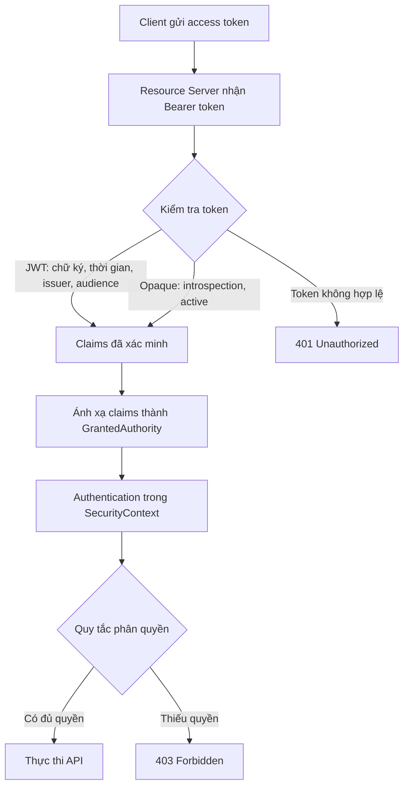

# Custom authorities converter trong Spring Security

## 1. Bài toán: token hợp lệ chưa có nghĩa là đủ quyền

Trong một API dùng Spring Security làm **OAuth 2.0 Resource Server**, xác thực trả lời câu hỏi *access token này có được chấp nhận không?*, còn phân quyền trả lời *chủ thể của token được thực hiện hành động nào?*. Hai câu hỏi liên quan nhưng được xử lý ở những bước khác nhau.

Sau khi một JWT được kiểm tra chữ ký và các điều kiện hiệu lực, Spring Security thường trích `scope` hoặc `scp` thành các `GrantedAuthority`. Tuy nhiên, nhà cung cấp danh tính (IdP) có thể ghi quyền vào `roles`, `app_roles`, `realm_access.roles` hoặc một claim riêng của ứng dụng. Khi đó, **custom authorities converter** là thành phần biến các claim đã được xác minh thành tên quyền mà ứng dụng hiểu.

Mục tiêu của bài:

- Giải thích vị trí của converter trong chuỗi xác thực và phân quyền access token.
- Phân biệt `SCOPE_...`, `ROLE_...` và tên authority nội bộ; cấu hình các biểu thức `hasAuthority`, `hasRole` tương ứng.
- Cấu hình converter cho claim đơn giản và kết hợp nhiều claim qua `DelegatingJwtGrantedAuthoritiesConverter`.
- Ánh xạ role theo danh sách cho phép, xử lý claim thiếu/sai kiểu, tránh vô tình mở rộng quyền.
- Nhận biết điểm khác nhau khi resource server dùng opaque access token và introspection.
- Kiểm thử quy tắc ánh xạ, đồng thời bảo vệ hệ thống trước token hết hạn, bị đánh cắp hoặc phát lại.

### Converter nằm ở đâu?



Với JWT Resource Server, `JwtDecoder` thực hiện xác minh/validation, `JwtAuthenticationConverter` tạo `Authentication` và converter con tạo tập `GrantedAuthority`. Converter **không** xác minh chữ ký, không tự kiểm tra token bị thu hồi và không quyết định quyền truy cập vào một bản ghi cụ thể. Vì vậy, không được lấy payload JWT tự decode ở controller rồi coi giá trị trong đó là authority.

Trong OAuth 2.0/OIDC, đầu vào cho API thông thường là **access token** có audience phù hợp. **ID token** dùng để chứng minh việc đăng nhập cho client, còn **refresh token** dùng với authorization server để xin access token mới; không đưa hai loại token đó vào quy trình ánh xạ authority cho API.

## 2. Mô hình authorities và cách mặc định hoạt động

`GrantedAuthority` là một quyền mà Spring Security thể hiện bằng một chuỗi, thường qua `SimpleGrantedAuthority`. Ví dụ:

| Dữ liệu đã được xác minh | Authority trong Spring Security | Cách kiểm tra |
| --- | --- | --- |
| Scope `orders.read` | `SCOPE_orders.read` | `hasAuthority("SCOPE_orders.read")` |
| Scope `orders.write` | `SCOPE_orders.write` | `hasAuthority("SCOPE_orders.write")` |
| App role `order_reader` | `ROLE_ORDER_READER` (quy ước của ứng dụng) | `hasRole("ORDER_READER")` |
| App role `order_admin` | `ROLE_ORDER_ADMIN` (quy ước của ứng dụng) | `hasAuthority("ROLE_ORDER_ADMIN")` |

Hai lưu ý dễ gây lỗi:

1. `hasAuthority("ROLE_ORDER_ADMIN")` so khớp nguyên chuỗi. `hasRole("ORDER_ADMIN")` thường thêm tiền tố mặc định `ROLE_` trước khi so khớp; không truyền `ROLE_ORDER_ADMIN` vào `hasRole` nếu đang dùng quy ước mặc định.
2. `SCOPE_orders.write` không tự suy ra `ROLE_ORDER_ADMIN`, và `ROLE_ORDER_ADMIN` cũng không tự suy ra `SCOPE_orders.write`. Nếu thao tác cần **cả hai**, biểu thức phân quyền phải thể hiện phép AND.

Trong cấu hình JWT mặc định, Spring Security thường đọc `scope` (chuỗi phân cách bằng khoảng trắng) hoặc `scp` (thường là danh sách) rồi thêm `SCOPE_`. Ví dụ:

```json
{
  "sub": "user-42",
  "scope": "orders.read orders.write"
}
```

Các authority tương ứng là `SCOPE_orders.read` và `SCOPE_orders.write`. Nếu JWT có thêm `app_roles`, mặc định Spring Security **không** tự hiểu vai trò nghiệp vụ trong claim đó. Đây là lý do cần custom converter.

> **Nguyên tắc thiết kế:** Định nghĩa rõ *nguồn claim*, *định dạng claim*, *ai được phép phát hành claim*, *danh sách giá trị được công nhận* và *authority đích*. Một claim có tên giống `roles` không mặc nhiên đáng tin để cấp quyền quản trị.

## 3. Trường hợp đơn giản: thay claim hoặc tiền tố

Nếu IdP phát hành claim phẳng như `roles: ["READER", "ADMIN"]` và toàn bộ giá trị đã được phê duyệt cho đúng API, `JwtGrantedAuthoritiesConverter` có thể được cấu hình trực tiếp:

```java
JwtGrantedAuthoritiesConverter roles = new JwtGrantedAuthoritiesConverter();
roles.setAuthoritiesClaimName("roles");
roles.setAuthorityPrefix("ROLE_");

JwtAuthenticationConverter authenticationConverter =
        new JwtAuthenticationConverter();
authenticationConverter.setJwtGrantedAuthoritiesConverter(roles);
```

Khi đó, `READER` thành `ROLE_READER`. Nhưng cách thay thế trên chỉ đọc claim `roles`; các scope mặc định có thể không còn được thêm vào `Authentication`. Ngoài ra, mã này chấp nhận mọi chuỗi role mà IdP đưa ra. Khi role nhạy cảm, nhiều claim cần kết hợp hoặc tên role cần ánh xạ sang quyền nội bộ, nên viết converter chuyên biệt và áp dụng **allowlist**.

## 4. Ví dụ hoàn chỉnh: kết hợp scopes và role của API

Giả sử một dịch vụ `orders-api` chỉ chấp nhận access token từ `https://idp.example.org`. IdP đã thống nhất phát hành claim `app_roles` dành riêng cho dịch vụ này:

```json
{
  "iss": "https://idp.example.org",
  "sub": "user-42",
  "aud": ["orders-api"],
  "exp": 1810000000,
  "scope": "orders.read orders.write",
  "app_roles": ["order_reader", "order_admin", "unknown_role"]
}
```

Đây là **payload minh họa**; một access token thực tế còn có header, chữ ký và các claim khác theo hợp đồng với IdP. Trong ví dụ:

- `orders.read` → `SCOPE_orders.read`.
- `orders.write` → `SCOPE_orders.write`.
- `order_reader` → `ROLE_ORDER_READER`.
- `order_admin` → `ROLE_ORDER_ADMIN`.
- `unknown_role` bị bỏ qua; không phát sinh authority tùy ý.

### 4.1. Khai báo resource server và audience

Với Spring Boot, có thể dùng các starter `spring-boot-starter-security` và `spring-boot-starter-oauth2-resource-server`. Cấu hình minh họa:

```yaml
spring:
  security:
    oauth2:
      resourceserver:
        jwt:
          issuer-uri: https://idp.example.org
          audiences:
            - orders-api
```

`issuer-uri` giúp xác minh bên phát hành và lấy cấu hình xác minh chữ ký. `audiences` yêu cầu JWT hướng tới API này. Spring Security xử lý chữ ký và các điều kiện thời gian như `exp`, `nbf` trong quy trình JWT validation; cấu hình audience cần được khai báo rõ theo hợp đồng token. Converter bên dưới **chỉ chạy trên JWT đã được decoder chấp nhận**.

### 4.2. Viết converter có danh sách role được phép

Ví dụ Java 17+, Spring Security 6/7 (Servlet stack):

```java
import java.util.Collection;
import java.util.LinkedHashSet;
import java.util.Set;

import org.springframework.context.annotation.Bean;
import org.springframework.context.annotation.Configuration;
import org.springframework.core.convert.converter.Converter;
import org.springframework.http.HttpMethod;
import org.springframework.security.access.prepost.PreAuthorize;
import org.springframework.security.config.annotation.method.configuration.EnableMethodSecurity;
import org.springframework.security.config.annotation.web.builders.HttpSecurity;
import org.springframework.security.core.GrantedAuthority;
import org.springframework.security.core.authority.SimpleGrantedAuthority;
import org.springframework.security.oauth2.jwt.Jwt;
import org.springframework.security.oauth2.server.resource.authentication.DelegatingJwtGrantedAuthoritiesConverter;
import org.springframework.security.oauth2.server.resource.authentication.JwtAuthenticationConverter;
import org.springframework.security.oauth2.server.resource.authentication.JwtGrantedAuthoritiesConverter;
import org.springframework.security.web.SecurityFilterChain;

@Configuration
@EnableMethodSecurity
public class ApiSecurityConfig {

    @Bean
    Converter<Jwt, Collection<GrantedAuthority>> jwtAuthoritiesConverter() {
        JwtGrantedAuthoritiesConverter scopes = new JwtGrantedAuthoritiesConverter();
        scopes.setAuthoritiesClaimName("scope");
        scopes.setAuthorityPrefix("SCOPE_");

        Converter<Jwt, Collection<GrantedAuthority>> appRoles = jwt -> {
            Set<GrantedAuthority> mapped = new LinkedHashSet<>();
            Object raw = jwt.getClaim("app_roles");

            // Thiếu claim hoặc kiểu sai: không cấp thêm role.
            if (!(raw instanceof Collection<?> values)) {
                return mapped;
            }

            for (Object value : values) {
                if (!(value instanceof String role)) {
                    continue;
                }
                // Chỉ công nhận role được thoả thuận với IdP cho orders-api.
                switch (role) {
                    case "order_reader" ->
                            mapped.add(new SimpleGrantedAuthority("ROLE_ORDER_READER"));
                    case "order_admin" ->
                            mapped.add(new SimpleGrantedAuthority("ROLE_ORDER_ADMIN"));
                    default -> {
                        // Ignore unknown roles; không tự tạo ROLE_<giá trị token>.
                    }
                }
            }
            return mapped;
        };

        // Kết hợp quyền từ nhiều claim và loại bỏ giá trị trùng nhau.
        return new DelegatingJwtGrantedAuthoritiesConverter(scopes, appRoles);
    }

    @Bean
    JwtAuthenticationConverter jwtAuthenticationConverter(
            Converter<Jwt, Collection<GrantedAuthority>> jwtAuthoritiesConverter) {
        JwtAuthenticationConverter converter = new JwtAuthenticationConverter();
        converter.setJwtGrantedAuthoritiesConverter(jwtAuthoritiesConverter);
        return converter;
    }

    @Bean
    SecurityFilterChain apiSecurityFilterChain(
            HttpSecurity http, JwtAuthenticationConverter converter) throws Exception {
        http
            .authorizeHttpRequests(auth -> auth
                .requestMatchers(HttpMethod.GET, "/api/orders/**")
                    .hasAuthority("SCOPE_orders.read")
                .requestMatchers(HttpMethod.POST, "/api/orders/**")
                    .hasAuthority("SCOPE_orders.write")
                .requestMatchers("/api/admin/**")
                    .hasRole("ORDER_ADMIN")
                .anyRequest().denyAll()
            )
            .oauth2ResourceServer(oauth2 -> oauth2
                .jwt(jwt -> jwt.jwtAuthenticationConverter(converter))
            );
        return http.build();
    }
}
```

Ở đây:

- Converter `scopes` đọc chuỗi `scope`. Vì đã chỉ định tên claim là `scope`, nếu hệ thống thực tế chỉ phát hành `scp` thì phải sửa cấu hình tương ứng hoặc thiết kế converter đọc cả hai; không tự giả định `scp` vẫn được xử lý.
- Converter `appRoles` đọc đúng kiểu collection, chỉ ánh xạ hai giá trị cho phép. Sai kiểu, thiếu claim, phần tử không phải chuỗi hoặc role ngoài allowlist đều **không được cấp thêm quyền**.
- `DelegatingJwtGrantedAuthoritiesConverter` gọi lần lượt các converter thành phần rồi hợp nhất kết quả. Nhờ đó việc thêm role không làm mất các scope đã có.
- `JwtAuthenticationConverter` tạo `JwtAuthenticationToken` cho request, bao gồm authority được ánh xạ. `SecurityFilterChain` dùng authority để quyết định có cho qua HTTP endpoint hay không.
- `anyRequest().denyAll()` là lựa chọn minh họa theo hướng đóng mặc định; ứng dụng thực tế cần khai báo những endpoint được phép phục vụ.

Lưu ý: luật HTTP cho `POST /api/orders/**` kiểm tra scope ghi, còn luật `/api/admin/**` kiểm tra role quản trị. Nếu một hành động cần đồng thời cả hai, phải kiểm tra đủ hai điều kiện, chẳng hạn ở service:

```java
import org.springframework.security.access.prepost.PreAuthorize;
import org.springframework.stereotype.Service;

@Service
public class OrderApprovalService {

    @PreAuthorize("hasAuthority('SCOPE_orders.write') and hasRole('ORDER_ADMIN')")
    public void approve(String orderId) {
        // Nghiệp vụ phê duyệt đơn hàng.
    }
}
```

`@EnableMethodSecurity` ở cấu hình trước đó bật xử lý `@PreAuthorize`. Việc có đúng quyền *phê duyệt* cũng chưa chứng minh người dùng được thao tác **mọi** đơn hàng: kiểm tra tenant, chủ sở hữu hoặc trạng thái đơn hàng vẫn thuộc chính sách nghiệp vụ.

## 5. Khi claim phức tạp: nested roles và chuẩn hóa tên

Một số IdP đặt role theo cấu trúc lồng nhau, chẳng hạn:

```json
{
  "resource_access": {
    "orders-api": {
      "roles": ["order_reader", "order_admin"]
    },
    "billing-api": {
      "roles": ["billing_admin"]
    }
  }
}
```

Chỉ nên đọc role của **đúng client/resource** mà API tin cậy. Có thể lấy collection từ cấu trúc này bằng kiểm tra kiểu tường minh:

```java
Object raw = jwt.getClaim("resource_access");
if (raw instanceof java.util.Map<?, ?> resources
        && resources.get("orders-api") instanceof java.util.Map<?, ?> app
        && app.get("roles") instanceof Collection<?> values) {
    // Duyệt values và ánh xạ bằng allowlist tương tự phần 4.
}
```

Không nên biến mọi role ở `realm_access.roles` hoặc mọi role thuộc tất cả client thành `ROLE_ADMIN` của ứng dụng. Một "admin" ở hệ thống khác không đồng nghĩa có quyền admin của `orders-api`.

Quy tắc chuẩn hóa nên được viết thành một bảng hợp đồng rõ ràng, ví dụ `order_reader -> ROLE_ORDER_READER`. Tránh dùng cách nối chuỗi `"ROLE_" + role.toUpperCase()` trên dữ liệu không được giới hạn; cách này có thể mở quyền mới khi IdP bổ sung role mà API chưa xem xét. Không tự xóa dấu cách, đổi chữ hoa/chữ thường hoặc suy diễn role lạ nếu chưa có yêu cầu và test tương ứng.

Nếu chỉ cần đổi tên claim hay tiền tố, hãy ưu tiên `JwtGrantedAuthoritiesConverter` có sẵn; nếu cần kết hợp các claim, dùng `DelegatingJwtGrantedAuthoritiesConverter`; nếu phải kiểm tra cấu trúc/chuẩn hóa phức tạp, thêm một `Converter<Jwt, Collection<GrantedAuthority>>` riêng theo hợp đồng đã chốt.

## 6. Opaque token dùng cách mở rộng khác

**JWT** thường được resource server xác minh cục bộ bằng public key rồi chuyển các claim đã xác minh. **Opaque access token** là chuỗi không được resource server tự diễn giải; resource server gọi **introspection endpoint** của authorization server để biết token còn `active` hay không và nhận thuộc tính/scopes.

Với opaque token, `JwtAuthenticationConverter` **không tự chạy** vì đầu vào không phải `Jwt`. Muốn thay đổi authorities, thường bọc `OpaqueTokenIntrospector`: gọi delegate để kiểm tra token, lấy `OAuth2AuthenticatedPrincipal` đã được xác thực, rồi tạo principal mới với authorities được ánh xạ.

Ý tưởng xử lý:

```java
OAuth2AuthenticatedPrincipal verified = delegate.introspect(token);

Set<GrantedAuthority> authorities =
        new LinkedHashSet<>(verified.getAuthorities());
// Đọc thuộc tính riêng của verified.getAttributes(), lọc allowlist,
// rồi thêm các SimpleGrantedAuthority cần thiết.

return new DefaultOAuth2AuthenticatedPrincipal(
        verified.getName(), verified.getAttributes(), authorities);
```

Đoạn trên nằm **bên trong một `OpaqueTokenIntrospector` tùy chỉnh** với `delegate` được cấu hình trước; không phải toàn bộ class chạy độc lập. Không bỏ qua `delegate.introspect(token)` hoặc tự tin các claim client gửi. Khi introspection xác nhận token không hoạt động, request phải thất bại trước bước ánh xạ authority.

Việc chọn JWT hay opaque token liên quan tới chiến lược thu hồi: JWT tự xác minh thường có độ trễ thu hồi tới khi token hết hạn nếu không triển khai thêm cơ chế kiểm tra; opaque introspection có thể phản ánh trạng thái thu hồi phía authorization server gần thời điểm request (tùy cache và triển khai). Converter **không giải quyết bài toán thu hồi** cho bất kỳ loại token nào.

## 7. Kiểm thử quy tắc ánh xạ

Vì converter là hàm biến đổi dữ liệu, có thể test trực tiếp mà không cần dựng server HTTP. Ví dụ JUnit 5:

```java
import static org.junit.jupiter.api.Assertions.assertEquals;

import java.util.List;
import java.util.Set;
import java.util.stream.Collectors;

import org.junit.jupiter.api.Test;
import org.springframework.security.core.GrantedAuthority;
import org.springframework.security.oauth2.jwt.Jwt;

class ApiSecurityConfigTest {

    @Test
    void mapsScopeAndOnlyAllowedAppRoles() {
        Jwt jwt = Jwt.withTokenValue("unit-test-token")
                .header("alg", "RS256")
                .claim("sub", "user-42")
                .claim("scope", "orders.read orders.write")
                .claim("app_roles", List.of("order_reader", "unknown_role"))
                .build();

        Set<String> authorities = new ApiSecurityConfig()
                .jwtAuthoritiesConverter()
                .convert(jwt)
                .stream()
                .map(GrantedAuthority::getAuthority)
                .collect(Collectors.toSet());

        assertEquals(Set.of(
                "SCOPE_orders.read",
                "SCOPE_orders.write",
                "ROLE_ORDER_READER"), authorities);
    }
}
```

`Jwt.withTokenValue(...)` trong unit test chỉ tạo đối tượng `Jwt` để test hàm chuyển đổi; **không chứng minh chữ ký hợp lệ**. Chữ ký, issuer, audience, thời gian hết hạn và luồng 401/403 cần được kiểm tra ở mức tích hợp với `JwtDecoder`/resource server.

Bộ tình huống tối thiểu:

| Đầu vào/điều kiện | Kỳ vọng |
| --- | --- |
| `scope` và `app_roles` đều đúng | Gộp scope và role hợp lệ, không mất quyền scope |
| Không có `app_roles` | Không thêm role, các scope vẫn giữ |
| `app_roles` là chuỗi thay vì danh sách | Không thêm role; ứng dụng không lỗi 500 vì ép kiểu |
| Có role ngoài allowlist | Bỏ qua role đó |
| Có `order_admin` nhưng thiếu `orders.write` | Phương thức yêu cầu cả hai điều kiện bị từ chối |
| JWT sai chữ ký, sai `aud`, hết hạn | Bị từ chối ở bước validation (thường 401), trước converter |
| JWT hợp lệ nhưng thiếu quyền đích | Thường 403 |

Khi chẩn đoán lỗi phân quyền, kiểm tra theo thứ tự: token có được validator chấp nhận không; ứng dụng thực sự nhận claim nào và kiểu dữ liệu gì; converter đã tạo authority nào; biểu thức `hasRole`/`hasAuthority` đang mong đợi chính xác chuỗi nào. Chỉ ghi log tên authority cần thiết trong môi trường an toàn; không ghi access token hoặc refresh token nguyên văn.

## 8. Các ranh giới bảo mật phải giữ

1. **Nguồn tin cậy:** Chỉ ánh xạ claim từ access token đã qua xác minh chữ ký/issuer/audience hoặc kết quả introspection hợp lệ. Không tin các header tùy ý như `X-Roles` hoặc nội dung JWT do client tự gửi mà chưa được kiểm chứng.
2. **Tối thiểu quyền:** Dùng allowlist và quy ước namespace theo API. Không tự động cấp mọi role lạ; không coi một nhóm danh tính là quyền quản trị hệ thống nếu chưa có chính sách rõ ràng.
3. **Scopes và roles có ý nghĩa khác nhau:** Scope thường mô tả quyền mà client được cấp trong một ngữ cảnh OAuth 2.0; role mô tả vai trò nghiệp vụ. Đối với thao tác nhạy cảm, có thể cần đồng thời scope, role và kiểm tra quyền với tài nguyên cụ thể.
4. **Vòng đời token:** Ưu tiên access token sống ngắn, kết nối TLS, bảo vệ vị trí lưu token, tránh rò rỉ trong log và URL. Token bị đánh cắp có thể được phát lại khi còn hiệu lực; dùng chiến lược thu hồi/introspection hoặc sender-constrained tokens (ví dụ DPoP, mTLS) khi mô hình đe dọa đòi hỏi. Refresh token rotation do authorization server quản lý, ngoài trách nhiệm converter.
5. **Không nhầm xác thực với phân quyền:** Converter chỉ tạo thông tin để `AuthorizationManager` hoặc method security quyết định. Không tự cấp quyền dựa trên `sub`, email domain, hoặc tên người dùng nếu chưa có chính sách được xét duyệt.

### Ghi nhớ

Custom authorities converter là **bộ thích nghi giữa hợp đồng claim của IdP và ngôn ngữ phân quyền của Spring Security**. Thiết kế đúng là: xác minh token trước; ánh xạ scope/role một cách tường minh, có allowlist; áp dụng quy tắc phân quyền ở endpoint và nghiệp vụ; kiểm thử cả dữ liệu hợp lệ lẫn dữ liệu bất thường.

### Tài liệu tham khảo

- [Spring Security — OAuth 2.0 Resource Server JWT](https://docs.spring.io/spring-security/reference/servlet/oauth2/resource-server/jwt.html)
- [JwtGrantedAuthoritiesConverter — API](https://docs.spring.io/spring-security/reference/api/java/org/springframework/security/oauth2/server/resource/authentication/JwtGrantedAuthoritiesConverter.html)
- [DelegatingJwtGrantedAuthoritiesConverter — API](https://docs.spring.io/spring-security/reference/api/java/org/springframework/security/oauth2/server/resource/authentication/DelegatingJwtGrantedAuthoritiesConverter.html)
- [Spring Security — Method Security](https://docs.spring.io/spring-security/reference/servlet/authorization/method-security.html)
- [Spring Security — OAuth 2.0 Resource Server Opaque Token](https://docs.spring.io/spring-security/reference/servlet/oauth2/resource-server/opaque-token.html)
