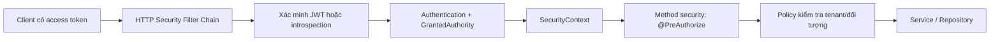

# Method security với token authority

> **Chương:** Spring Security authorities
> **Module:** `SECURITY_TOKEN_SECURITY_FUNDAMENTALS`
> **Phạm vi:** Mô hình tin cậy và vòng đời access token trong OAuth 2.0/OIDC, xác minh JWT/opaque token, issuer, audience, scope, claims, thu hồi và phòng chống token bị sử dụng sai quyền.

## 1. Mục tiêu học tập

Sau bài này, bạn có thể:

1. Phân biệt **JWT claim**, **OAuth scope**, **Spring Security `GrantedAuthority`** và **role**.
2. Giải thích cách một **access token đã được resource server xác minh** trở thành đối tượng `Authentication` trong `SecurityContext`.
3. Bật và sử dụng **method security** với `@EnableMethodSecurity`, `@PreAuthorize`, `@PostAuthorize` và các biểu thức SpEL phù hợp.
4. Thiết kế kiểm tra cả **quyền thao tác** và **quyền trên đối tượng/tenant**, tránh chỉ tin một authority có tên chung.
5. Nhận biết các giới hạn của Spring AOP proxy, self-invocation, tham số SpEL và những thời điểm không nên dùng hậu kiểm.
6. Kiểm thử các luồng thiếu token, token sai, thiếu scope, sai tenant, và phân biệt kiểm thử method authorization với kiểm thử chữ ký JWT thực.

## 2. Vì sao đã có token mà vẫn cần method security?

Giả sử `orders-api` chấp nhận access token do authorization server phát hành. Một nhân viên có thể có quyền `orders.read` nhưng không được sửa đơn hàng; một đối tác cũng có `orders.read` nhưng chỉ được đọc đơn trong tenant của họ.

**Xác thực** token trả lời: “Request này mang một credential hợp lệ của ai, từ issuer nào, dành cho API nào?” **Phân quyền** trả lời: “Chủ thể đó có được thực hiện thao tác này trên dữ liệu cụ thể này không?”



Trong Spring Security, kiểm tra endpoint qua `authorizeHttpRequests` bảo vệ đường vào HTTP, còn **method security** bảo vệ các lời gọi phương thức đã được Spring quản lý, đặc biệt là service có thể được nhiều controller hoặc luồng nghiệp vụ sử dụng.

Một token có scope `orders.read` chưa tự động cho phép:

- đọc đơn hàng của tenant khác;
- sửa đơn hàng, dù endpoint xử lý ghi dùng cùng controller;
- dùng token cấp cho API khác khi `aud` không phù hợp;
- dùng **ID token** hoặc **refresh token** như access token.

Method security bổ sung một lớp quyết định gần với hành vi nghiệp vụ; nó **không thay thế** xác minh issuer, audience, chữ ký/trạng thái và thời hạn token trước đó.

## 3. Từ token claim đến GrantedAuthority

### 3.1. Thuật ngữ cần hiểu đúng

| Khái niệm | Nơi xuất hiện | Ý nghĩa |
| --- | --- | --- |
| **Claim** | JWT payload hoặc thông tin introspection | Dữ liệu được issuer xác nhận trong token, chẳng hạn `sub`, `iss`, `aud`, `scope`, `tenant_id`. |
| **Scope** | `scope` hoặc `scp` theo hợp đồng AS | Quyền được cấp cho access token, ví dụ `orders.read`. |
| **GrantedAuthority** | `Authentication.getAuthorities()` ở Spring Security | Chuỗi quyền Spring dùng để đánh giá `hasAuthority(...)`. |
| **Role** | Cấu trúc quyền nghiệp vụ, thường ánh xạ thành `ROLE_...` | Nhóm quyền như `ADMIN`, `SUPPORT`; không mặc nhiên giống OAuth scope. |
| **Principal/Authentication** | `SecurityContext` | Chủ thể và trạng thái xác thực hiện hành, cùng authorities đã được chuyển đổi. |

Ví dụ payload **JWT access token đã phát hành cho `orders-api`**:

```json
{
  "iss": "https://id.example.test",
  "sub": "employee-42",
  "aud": ["api://orders"],
  "scope": "orders.read orders.create",
  "tenant_id": "tenant-07",
  "iat": 1760000000,
  "exp": 1760000900
}
```

Trong cấu hình JWT Resource Server mặc định của Spring Security 6, `JwtGrantedAuthoritiesConverter` thường đọc claim `scope` hoặc `scp` và tạo authorities với tiền tố **`SCOPE_`**. Ví dụ:

```text
JWT scope="orders.read orders.create"
             |
             v
Authentication.getAuthorities():
  SCOPE_orders.read
  SCOPE_orders.create
```

Đây là **quy tắc ánh xạ**; `scope` trong token không phải một đối tượng `GrantedAuthority` sẵn có. Token phải được xác minh hợp lệ trước khi Spring tin các claims và tạo `JwtAuthenticationToken`.

### 3.2. `hasAuthority` khác `hasRole` thế nào?

| Biểu thức | Điều kiện cần ở `Authentication` |
| --- | --- |
| `hasAuthority('SCOPE_orders.read')` | Có authority chính xác `SCOPE_orders.read` |
| `hasAnyAuthority('SCOPE_orders.read', 'SCOPE_orders.write')` | Có ít nhất một authority được liệt kê |
| `hasRole('ADMIN')` | Mặc định yêu cầu authority `ROLE_ADMIN` |
| `hasAuthority('ROLE_ADMIN')` | Có authority chính xác `ROLE_ADMIN` |
| `isAuthenticated()` | Đã được xác thực; **không tự mang quyền nghiệp vụ** |

**Lỗi thường gặp:** token có `scope=orders.read`, rồi viết `@PreAuthorize("hasRole('orders.read')")`. `hasRole` kiểm tra một role với tiền tố `ROLE_` theo quy ước mặc định, do đó không khớp `SCOPE_orders.read`.

Nếu AS chứa roles trong claim tùy chỉnh như `app_roles`, Spring **không mặc nhiên biến mọi role này thành authority phù hợp**. Phải khai báo cách ánh xạ, xác định issuer nào được phép gán role nào và tránh lấy chuỗi `ROLE_ADMIN` từ một request header do client tự khai.

### 3.3. Tại sao authority không đủ để quyết định dữ liệu?

`SCOPE_orders.read` có thể được cấp cho cả nhân viên lẫn đối tác. Authority diễn tả *một thao tác được phép về mặt tổng quát*. Chính sách dữ liệu còn cần xác định:

- `iss` và `sub` của chủ thể đã xác thực;
- tenant mà chủ thể được gắn vào theo dữ liệu tin cậy phía server;
- đơn hàng thực tế thuộc tenant nào và người dùng có quan hệ gì với đơn hàng;
- các hạn chế nghiệp vụ như trạng thái đơn, phê duyệt hoặc thời điểm hiệu lực.

Hai issuer khác nhau có thể cùng phát `sub=42`. Khi nhận dạng người dùng trên nhiều issuer, hãy dùng khóa logic **`(iss, sub)`**, hoặc một định danh nội bộ đã được liên kết bằng quy trình xác minh. Đừng dùng `sub` hay `email` đơn lẻ để cấp quyền xuyên issuer.

## 4. Bật method security trong Spring Security

Giả định ứng dụng chạy **Spring Boot 3 / Spring Security 6**, dùng OAuth 2.0 Resource Server với JWT access token. Cấu hình sau cho thấy một ví dụ hoàn chỉnh của phần xác thực JWT và ánh xạ scope. Mã cần ghép vào ứng dụng có controller/service/repository tương ứng.

```yaml
# application.yml
spring:
  security:
    oauth2:
      resourceserver:
        jwt:
          issuer-uri: https://id.example.test
```

```java
package example.orders.security;

import org.springframework.context.annotation.Bean;
import org.springframework.context.annotation.Configuration;
import org.springframework.security.config.annotation.method.configuration.EnableMethodSecurity;
import org.springframework.security.config.annotation.web.builders.HttpSecurity;
import org.springframework.security.config.http.SessionCreationPolicy;
import org.springframework.security.oauth2.core.DelegatingOAuth2TokenValidator;
import org.springframework.security.oauth2.core.OAuth2Error;
import org.springframework.security.oauth2.core.OAuth2TokenValidator;
import org.springframework.security.oauth2.core.OAuth2TokenValidatorResult;
import org.springframework.security.oauth2.jwt.Jwt;
import org.springframework.security.oauth2.jwt.JwtDecoder;
import org.springframework.security.oauth2.jwt.JwtValidators;
import org.springframework.security.oauth2.jwt.NimbusJwtDecoder;
import org.springframework.security.oauth2.server.resource.authentication.JwtAuthenticationConverter;
import org.springframework.security.oauth2.server.resource.authentication.JwtGrantedAuthoritiesConverter;
import org.springframework.security.web.SecurityFilterChain;

@Configuration
@EnableMethodSecurity // Bật @PreAuthorize/@PostAuthorize (mặc định).
public class OrdersSecurityConfig {

    private static final String ISSUER = "https://id.example.test";
    private static final String AUDIENCE = "api://orders";

    @Bean
    SecurityFilterChain filterChain(
        HttpSecurity http,
        JwtAuthenticationConverter authorityConverter
    ) throws Exception {
        http
            // Chỉ phù hợp khi ứng dụng là API stateless dùng Bearer token,
            // không có luồng xác thực dựa trên cookie.
            .csrf(csrf -> csrf.disable())
            .sessionManagement(session ->
                session.sessionCreationPolicy(SessionCreationPolicy.STATELESS)
            )
            .authorizeHttpRequests(auth -> auth
                .anyRequest().authenticated()
            )
            .oauth2ResourceServer(oauth -> oauth.jwt(jwt ->
                jwt.jwtAuthenticationConverter(authorityConverter)
            ));

        return http.build();
    }

    @Bean
    JwtAuthenticationConverter authorityConverter() {
        JwtGrantedAuthoritiesConverter scopes =
            new JwtGrantedAuthoritiesConverter();

        // Hợp đồng AS trong ví dụ sử dụng "scope" ngăn cách bằng dấu cách.
        scopes.setAuthoritiesClaimName("scope");
        scopes.setAuthorityPrefix("SCOPE_");

        JwtAuthenticationConverter converter =
            new JwtAuthenticationConverter();
        converter.setJwtGrantedAuthoritiesConverter(scopes);
        return converter;
    }

    @Bean
    JwtDecoder jwtDecoder() {
        NimbusJwtDecoder decoder =
            NimbusJwtDecoder.withIssuerLocation(ISSUER).build();

        OAuth2TokenValidator<Jwt> base =
            JwtValidators.createDefaultWithIssuer(ISSUER);

        OAuth2TokenValidator<Jwt> audience = token ->
            token.getAudience() != null
                && token.getAudience().contains(AUDIENCE)
                ? OAuth2TokenValidatorResult.success()
                : OAuth2TokenValidatorResult.failure(
                    new OAuth2Error(
                        "invalid_token",
                        "Access token khong danh cho Orders API",
                        null
                    )
                );

        decoder.setJwtValidator(
            new DelegatingOAuth2TokenValidator<>(base, audience)
        );
        return decoder;
    }
}
```

**Các tầng kiểm tra trong ví dụ:**

1. **`JwtDecoder`** xác minh JWT, issuer, thời gian và audience với chính sách của `orders-api`. Chữ ký phải được kiểm tra bằng JWKS/khóa của issuer tin cậy và thuật toán cho phép.
2. **`JwtAuthenticationConverter`** chuyển `scope` từ JWT *đã xác thực* thành các authority dạng `SCOPE_...`.
3. **HTTP security** yêu cầu request đã xác thực; **method security** mới quyết định method nào cần scope nào và chính sách dữ liệu bổ sung.
4. `@EnableMethodSecurity` kích hoạt kiểm tra method dựa trên Spring AOP; không cần bật `@EnableGlobalMethodSecurity` cũ.

**Lưu ý về CSRF:** chỉ cấu hình vô hiệu hóa CSRF như ví dụ cho API thực sự stateless, xác thực bằng Bearer token và **không** nhận phiên đăng nhập bằng cookie. Nếu ứng dụng cũng dùng cookie/session cho trình duyệt, phải giữ hoặc thiết kế bảo vệ CSRF phù hợp với phần ứng dụng đó.

**Lưu ý về token type:** `iss`, `aud` và chữ ký đúng vẫn chưa đủ nếu authorization server có thể phát cả **ID token** với cùng audience. Cần hợp đồng AS phân biệt access token với ID token (chẳng hạn token profile/`typ` và claims bắt buộc theo định dạng AS phát hành). Tương tự, API không nhận refresh token như access token.

## 5. Dùng `@PreAuthorize` để bảo vệ service method

`@PreAuthorize` đánh giá biểu thức **trước khi Spring gọi phần thân phương thức**. Nếu quyền không đủ, phương thức không được thực thi.

Ví dụ một `OrderService` có ba thao tác:

```java
package example.orders.service;

import java.util.UUID;
import org.springframework.security.access.prepost.PreAuthorize;
import org.springframework.stereotype.Service;

@Service
public class OrderService {

    private final OrderRepository orders;

    public OrderService(OrderRepository orders) {
        this.orders = orders;
    }

    @PreAuthorize(
        "hasAuthority('SCOPE_orders.read') " +
        "and @orderPolicy.canRead(authentication, #orderId)"
    )
    public OrderView getOrder(UUID orderId) {
        return orders.loadView(orderId);
    }

    @PreAuthorize(
        "hasAuthority('SCOPE_orders.create') " +
        "and @orderPolicy.canCreate(authentication, #tenantId)"
    )
    public OrderView createOrder(UUID tenantId, CreateOrderInput input) {
        return orders.create(tenantId, input);
    }

    @PreAuthorize(
        "hasAuthority('SCOPE_orders.write') " +
        "and @orderPolicy.canEdit(authentication, #orderId)"
    )
    public OrderView updateOrder(UUID orderId, UpdateOrderInput input) {
        return orders.update(orderId, input);
    }
}
```

Các kiểu `OrderRepository`, `OrderView`, `CreateOrderInput` và `UpdateOrderInput` ở đây đại diện cho tầng nghiệp vụ riêng của ứng dụng; cần định nghĩa chúng khi triển khai thực tế.

Biểu thức có hai điều kiện:

- **Scope**: token có quyền đọc/tạo/sửa theo hợp đồng OAuth.
- **Policy đối tượng**: chủ thể đã xác thực thực sự được phép tác động lên tenant hoặc đơn hàng được yêu cầu.

Với toán tử `and`, biểu thức không cho phép thao tác nếu thiếu một trong hai điều kiện. Khi service được gọi từ controller khác, security interceptor vẫn kiểm tra miễn là lời gọi đi **qua Spring proxy**.

### 5.1. Truy cập tham số trong SpEL

Trong `@PreAuthorize`, `#orderId` và `#tenantId` là tham số của method. Khi build, cần giữ tên tham số cho Spring có thể phát hiện, chẳng hạn Java compiler option `-parameters`, hoặc khai báo tên rõ bằng `@P` theo API phiên bản đang dùng.

Nếu môi trường không bảo toàn tên tham số, có thể dùng dạng vị trí `#p0`, `#p1`, nhưng cách này kém rõ ràng khi thay đổi chữ ký method.

Lưu ý: `authentication` trong expression là một `Authentication` đã được SecurityContext cung cấp, **không phải** object do client gửi trong request body.

## 6. Viết policy kiểm tra quyền theo đối tượng

`@orderPolicy.canRead(authentication, #orderId)` tham chiếu bean có tên `orderPolicy`. Bean này đưa quyết định cho tầng nghiệp vụ với thông tin danh tính đã xác thực.

```java
package example.orders.security;

import java.util.UUID;
import org.springframework.security.core.Authentication;
import org.springframework.security.oauth2.jwt.Jwt;
import org.springframework.security.oauth2.server.resource.authentication.JwtAuthenticationToken;
import org.springframework.stereotype.Component;

@Component("orderPolicy")
public class OrderPolicy {

    private final OrderAccessRepository access;

    public OrderPolicy(OrderAccessRepository access) {
        this.access = access;
    }

    public boolean canRead(Authentication authentication, UUID orderId) {
        Jwt jwt = verifiedJwt(authentication);
        if (jwt == null || orderId == null) return false;

        return access.hasReadAccess(
            orderId,
            jwt.getIssuer().toString(),
            jwt.getSubject()
        );
    }

    public boolean canEdit(Authentication authentication, UUID orderId) {
        Jwt jwt = verifiedJwt(authentication);
        if (jwt == null || orderId == null) return false;

        return access.hasEditAccess(
            orderId,
            jwt.getIssuer().toString(),
            jwt.getSubject()
        );
    }

    public boolean canCreate(Authentication authentication, UUID tenantId) {
        Jwt jwt = verifiedJwt(authentication);
        if (jwt == null || tenantId == null) return false;

        return access.canCreateWithinTenant(
            tenantId,
            jwt.getIssuer().toString(),
            jwt.getSubject()
        );
    }

    private Jwt verifiedJwt(Authentication authentication) {
        if (!(authentication instanceof JwtAuthenticationToken jwtAuth)
            || !jwtAuth.isAuthenticated()) {
            return null;
        }

        Jwt jwt = jwtAuth.getToken();
        return jwt.getIssuer() != null && jwt.getSubject() != null
            ? jwt : null;
    }
}
```

`OrderAccessRepository` là **hợp đồng truy vấn quyền nghiệp vụ** cần hiện thực theo database và luật truy cập của sản phẩm. Ví dụ đối với kiểm tra đọc đơn:

```sql
-- SQL minh họa: membership được quản lý phía server,
-- cùng tenant với đơn hàng và đang có quyền đọc.
SELECT EXISTS (
    SELECT 1
    FROM orders o
    JOIN tenant_memberships m ON m.tenant_id = o.tenant_id
    WHERE o.id = :order_id
      AND m.issuer = :issuer
      AND m.subject = :subject
      AND m.active = TRUE
      AND m.can_read_orders = TRUE
);
```

Trong hệ thống thực tế, `canEdit` có thể còn kiểm tra vai trò trên đơn, trạng thái đơn, điều kiện phê duyệt và quyền ghi. `canCreateWithinTenant` phải xác nhận tenant mục tiêu thuộc phạm vi hoạt động của chủ thể.

**Điểm bảo mật quan trọng:**

- `JwtAuthenticationToken` chỉ được tạo từ JWT **đã được resource server xác thực** trên luồng Bearer phù hợp; việc tự tạo `Authentication` trong test hoặc mã ứng dụng khác không tự mang bảo đảm chữ ký.
- Nếu cần hỗ trợ opaque token, `Authentication` thường không phải `JwtAuthenticationToken`; cần policy trừu tượng hóa identity/scope từ `BearerTokenAuthentication` hoặc principal đã chuẩn hóa. Không ép cast JWT khi API chấp nhận opaque.
- `tenant_id` do AS ký có thể là một **gợi ý đã được xác nhận tại thời điểm cấp token**, nhưng membership hoặc quyền trên bản ghi có thể đã thay đổi. Nếu nghiệp vụ yêu cầu quyền hiện tại, kiểm tra dữ liệu phía server thay vì tin hoàn toàn claim cũ.
- Nếu dữ liệu có thể thay đổi giữa lúc policy kiểm tra và lúc service thực thi (**TOCTOU**), bảo vệ bằng truy vấn có ràng buộc tenant/owner, transaction/locking hoặc cơ chế bảo đảm nhất quán phù hợp. Không chỉ kiểm tra một lần rồi truy vấn bản ghi không giới hạn.
- Nếu support nhiều issuer, `(iss, sub)` phải giữ nguyên ranh giới danh tính; khi liên kết tài khoản, cần quy trình xác minh đáng tin cậy.

## 7. `@PostAuthorize`, `@PreFilter`, `@PostFilter` và annotation khác

Ngoài `@PreAuthorize`, method security có các kiểu kiểm tra khác. Chọn theo mục đích thay vì đặt tất cả ở mọi method.

| Cơ chế | Thời điểm | Tình huống hợp lý | Rủi ro/giới hạn |
| --- | --- | --- | --- |
| `@PreAuthorize` | Trước khi chạy method | Chặn sớm thao tác theo scope và input | Phải có policy đủ thông tin, tránh proxy bị bypass |
| `@PostAuthorize` | Sau khi method trả kết quả | Xác minh quyền theo đối tượng kết quả của **hàm đọc** | Phần thân đã chạy; không phù hợp để chặn side effect của thao tác ghi |
| `@PreFilter` | Lọc collection đầu vào theo biểu thức | Lọc input có kiểm soát trong trường hợp đặc biệt | Không thay thế kiểm tra số lượng, membership hoặc validation server-side |
| `@PostFilter` | Lọc collection kết quả sau khi đã tải | Dữ liệu nhỏ, bộ lọc phụ trợ | Đã truy vấn/khởi tạo các bản ghi; tốn tài nguyên, dễ hỏng phân trang |
| `@Secured` | Kiểm tra quyền theo metadata | Quy tắc role/authority đơn giản | Cần bật `securedEnabled = true`, kém linh hoạt hơn SpEL |
| `@RolesAllowed` | Kiểm tra role | Tích hợp chuẩn Jakarta Security | Cần bật `jsr250Enabled = true`, theo quy ước role đã cấu hình |

Ví dụ một hàm **chỉ đọc**, không có side effect, có thể dùng hậu kiểm:

```java
@PostAuthorize(
    "returnObject != null and @orderPolicy.canViewResult(authentication, returnObject)"
)
public OrderView loadOrderSummary(UUID id) {
    return repository.loadSummary(id);
}
```

Ví dụ cần hiện thực `canViewResult` theo chính sách. Nếu tài liệu hoặc dữ liệu nhạy cảm có thể bị phát tán qua log, cache, event hoặc side effect trong method, hậu kiểm **không bảo vệ được phần đã diễn ra**. Với danh sách nhiều đơn hàng, ưu tiên **truy vấn database đã lọc quyền/tenant** thay vì dùng `@PostFilter` để xóa phần tử sau khi tải tất cả.

Để dùng annotation khác, có thể khai báo:

```java
@EnableMethodSecurity(
    prePostEnabled = true,
    securedEnabled = true,
    jsr250Enabled = true
)
```

Nhưng việc bật thêm annotation không tự tạo authority hoặc ánh xạ roles. Hãy chọn một phong cách chính và thống nhất cách diễn giải quyền giữa các service.

## 8. Ánh xạ custom role từ JWT: cẩn trọng với nguồn tin cậy

Nhiều AS phát roles ở các claim riêng, ví dụ `app_roles: ["SUPPORT"]`. Nếu nghiệp vụ cần `hasRole('SUPPORT')`, resource server phải có **authority converter** được kiểm soát:

```text
JWT đã xác minh:
  iss = https://id.example.test
  aud = api://orders
  scope = "orders.read"
  app_roles = ["SUPPORT"]

Converter được quản trị:
  SCOPE_orders.read
  ROLE_SUPPORT

@PreAuthorize("hasRole('SUPPORT') and hasAuthority('SCOPE_orders.read')")
```

**Không nên tự động thêm `ROLE_ADMIN` từ mọi chuỗi `roles` của mọi issuer.** Một issuer đối tác có thể định nghĩa role `ADMIN` với phạm vi **chỉ trong hệ thống đối tác**, hoàn toàn khác quản trị viên nội bộ.

Khi cần roles:

1. Chỉ nhận từ **issuer/audience tin cậy** và claim có hợp đồng rõ ràng.
2. Ánh xạ theo **allowlist các vai trò mà RS chấp nhận**, ưu tiên namespace riêng như `ROLE_PARTNER_MANAGER` nếu nhiều miền tin cậy.
3. Phân biệt **role của user** với quyền của **client credentials**. Token máy chủ không tự nhiên là một người dùng có quyền quản lý tenant.
4. Không quên các kiểm tra object-level ngay cả khi role cao hơn. Tài khoản support có thể cần quy trình phê duyệt, audit và giới hạn tenant khi truy cập dữ liệu khách hàng.

Một claim JWT đã được ký là claim có nguồn xác định và chưa bị chỉnh sửa trên đường truyền; nó **không chứng minh rằng mọi giá trị bên trong đều nên biến thành quyền tương đương trong ứng dụng**.

## 9. Những lỗi thường gặp của method security

### 9.1. Self-invocation bỏ qua Spring proxy

```java
@Service
public class OrderJobService {

    public void run() {
        // Có thể không đi qua proxy của chính bean này.
        this.deleteOrder("ord-123");
    }

    @PreAuthorize("hasAuthority('SCOPE_orders.delete')")
    public void deleteOrder(String id) {
        // Phần thân có thao tác nhạy cảm.
    }
}
```

Method security trong cấu hình proxy điển hình được áp dụng khi lời gọi **đi qua Spring-managed proxy**. Lời gọi nội bộ `this.deleteOrder(...)` có thể bỏ qua security interceptor, dù method được gắn annotation.

**Khắc phục:** đặt phương thức cần bảo vệ trong một Spring bean riêng, gọi qua bean được injection; hoặc sắp xếp service boundary sao cho các entry point được kiểm soát. Không đặt annotation lên private/final method rồi mặc định kỳ vọng AOP proxy sẽ chặn mọi lời gọi. Nếu ứng dụng sử dụng AspectJ weaving, cơ chế có thể khác và cần kiểm tra riêng.

### 9.2. Chỉ bảo vệ controller, bỏ qua service

Một controller có `@PreAuthorize` nhưng service được gọi từ controller khác, message listener, job hoặc GraphQL endpoint không được kiểm soát. Hãy đặt chính sách trọng yếu ở **service boundary** và áp dụng thêm bảo vệ HTTP/endpoint khi phù hợp.

Tuy nhiên, job nội bộ không mang user SecurityContext sẽ cần **cơ chế phân quyền hệ thống rõ ràng**, như service principal được cấp riêng hoặc business service khác có nhiệm vụ đặc biệt; không tự tạo một user `ADMIN` giả để vượt qua annotation.

### 9.3. Dùng sai tiền tố authority

```java
// SAI nếu token chỉ được convert thành SCOPE_orders.read:
@PreAuthorize("hasRole('orders.read')")

// ĐÚNG với default scope mapping:
@PreAuthorize("hasAuthority('SCOPE_orders.read')")
```

Mọi tên quyền ở `@PreAuthorize` phải khớp **đúng chuỗi** trong `Authentication.getAuthorities()`. Khi tùy chỉnh `JwtGrantedAuthoritiesConverter`, nên có test chứng minh ánh xạ thực tế, kể cả trường hợp claim `scope` vắng hoặc sai kiểu.

### 9.4. Tin route hoặc tenantId do client tự khai

```java
// SAI: token có scope read chưa cho quyền trên tenant đang yêu cầu.
@PreAuthorize("hasAuthority('SCOPE_orders.read')")
public List<OrderView> getTenantOrders(UUID tenantId) {
    return orders.findAllByTenantId(tenantId);
}
```

Phải kiểm tra membership/ownership theo principal và tenant, đồng thời giới hạn truy vấn dữ liệu. Không coi `X-Tenant-Id` hay `tenantId` trong URL là bằng chứng người dùng có quyền ở tenant đó.

### 9.5. Chỉ dùng `authentication.name` làm khóa sở hữu

Spring JWT authentication thường lấy `sub` làm tên principal mặc định. Trong multi-issuer, `sub` có thể trùng nhau. `@PreAuthorize("#ownerId == authentication.name")` có thể không đủ; cần thêm issuer hoặc ánh xạ sang user ID nội bộ đã xác minh.

### 9.6. Hậu kiểm một method có tác dụng phụ

`@PostAuthorize` chạy sau phần thân method. Nếu method đã chuyển tiền, gửi email, ghi file hoặc cập nhật đơn thì một kết quả bị từ chối **không bảo đảm side effect được hoàn tác**. Dùng `@PreAuthorize` và kiểm tra quyền nghiệp vụ trước khi thực hiện hành động.

### 9.7. Dựa vào scope trong token để bỏ qua validator

`SCOPE_orders.write` chỉ đáng tin khi token đã được RS xác thực. Không giải mã Base64 payload thủ công để lấy `scope`, không tạo `UsernamePasswordAuthenticationToken` từ claim của request header và không cho phép `JwtAuthenticationToken` tự xây từ dữ liệu client chưa kiểm tra chữ ký.

### 9.8. Không kiểm tra phiên bản quyền trong suốt vòng đời token

Access token có thể sống lâu hơn việc thu hồi membership. Với JWT offline, RS vẫn có thể tin claim/scope đến lúc `exp` nếu không kiểm tra trạng thái hoặc policy mới. Cân nhắc access token ngắn hạn, token introspection, denylist/versioning hoặc truy vấn quyền hiện tại cho thao tác nhạy cảm.

## 10. JWT và opaque token ảnh hưởng thế nào đến method security?

`@PreAuthorize` làm việc với **`Authentication` và `GrantedAuthority`**, không cần biết token ban đầu là JWT hay opaque. Sự khác biệt nằm ở **cách tạo Authentication**:

| Bước | JWT access token | Opaque access token |
| --- | --- | --- |
| Xác thực token | JWT decoder xác minh chữ ký và claims | Introspector xác minh token tại AS hoặc cơ chế tin cậy tương đương |
| Lấy quyền | Converter đọc `scope`/`scp` hoặc claims theo policy | Introspection attributes được ánh xạ thành authorities |
| Đối tượng Authentication | Thường `JwtAuthenticationToken` | Thường `BearerTokenAuthentication` |
| Method security | `hasAuthority(...)`, bean policy | Tương tự nếu authority mapping nhất quán |
| Ràng buộc bổ sung | `iss`, `aud`, TTL, token type và chính sách RS | `active`, issuer/introspection endpoint, audience, scope, token type |

Nếu API cho phép cả hai loại, viết policy dựa trên một **principal nội bộ được chuẩn hóa** sau xác thực, hoặc chủ động xử lý từng Authentication type. Đừng dựa vào `JwtAuthenticationToken` nếu hệ thống có thể nhận opaque token.

**Access token khác ID token và refresh token:** OIDC ID token chủ yếu dành cho client xác minh phiên đăng nhập; refresh token dùng tại token endpoint của AS. Method security không được sử dụng để “hợp thức hóa” việc nhận nhầm token type. Kiểm tra loại token phải diễn ra trong xác thực tại RS.

## 11. Kiểm thử theo từng lớp

Có ít nhất ba cấp kiểm thử khác nhau, mỗi cấp cho bằng chứng khác nhau.

### 11.1. Unit test policy với identity hợp lệ

Kiểm thử logic `OrderPolicy` hoặc `OrderAccessRepository`: một chủ thể `(iss, sub)` có/không có membership; đơn hàng ở tenant nào; quyền đọc/ghi; membership bị khóa; trường hợp `null` và subject trùng ở issuer khác. Kiểm thử này không cần token ký thật nhưng phải chứng minh logic đối tượng.

### 11.2. Method/HTTP test với authentication giả lập

Spring Security Test hỗ trợ `jwt()` trong MockMvc. Ví dụ minh họa khi ứng dụng đã có endpoint `POST /api/orders/{id}` gọi `OrderService.updateOrder(...)`:

```java
import static org.springframework.security.test.web.servlet.request.SecurityMockMvcRequestPostProcessors.jwt;
import static org.springframework.test.web.servlet.request.MockMvcRequestBuilders.post;
import static org.springframework.test.web.servlet.result.MockMvcResultMatchers.status;

import org.junit.jupiter.api.Test;
import org.springframework.beans.factory.annotation.Autowired;
import org.springframework.boot.test.autoconfigure.web.servlet.AutoConfigureMockMvc;
import org.springframework.boot.test.context.SpringBootTest;
import org.springframework.security.core.authority.SimpleGrantedAuthority;
import org.springframework.test.web.servlet.MockMvc;

@SpringBootTest
@AutoConfigureMockMvc
class OrderAuthorizationTest {

    @Autowired MockMvc mvc;

    @Test
    void readOnlyScopeCannotUpdateOrder() throws Exception {
        mvc.perform(
            post("/api/orders/123")
                .with(jwt().authorities(
                    new SimpleGrantedAuthority("SCOPE_orders.read")
                ))
        ).andExpect(status().isForbidden());
    }
}
```

Đoạn test là cấu trúc minh họa; cần sửa request, JSON body, CSRF và path theo controller thực tế. Vì `jwt()` tự đặt SecurityContext giả lập, nó **không chứng minh RS đã xác minh chữ ký hoặc issuer/audience**. Test này phù hợp để kiểm tra một token *được giả định đã xác thực* nhưng chỉ có `SCOPE_orders.read` không được ghi. Nếu method policy phụ thuộc issuer, subject hoặc tenant, cần cấu hình những claims đó và dữ liệu kiểm thử tương ứng.

`@WithMockUser(authorities = "SCOPE_orders.read")` cũng giúp test phân quyền dạng chuỗi nhưng không tạo `JwtAuthenticationToken`; policy cần `Jwt` có thể từ chối. Chọn phương pháp mock khớp kiểu principal thực.

### 11.3. Integration test với token thực được ký

Để kiểm tra **trust boundary**, tạo JWT ký bằng khóa kiểm thử, phục vụ JWKS của issuer mô phỏng và gửi Bearer token qua HTTP filter thật. Xác minh cả decoder, converter và method guard:

| Tình huống | Mong đợi | Điều cần chứng minh |
| --- | --- | --- |
| Không có token gọi API được bảo vệ | **401** | Entry point HTTP |
| JWT tự ký nhưng khai `iss` đúng | **401** | Chữ ký không hợp lệ |
| JWT từ issuer không tin cậy | **401** | Allowlist/issuer validation |
| JWT hợp lệ nhưng `aud` của API khác | **401** | Audience validation |
| JWT hết hạn hoặc chưa đến `nbf` | **401** | Vòng đời token |
| JWT hợp lệ có `scope=orders.read` | Có `SCOPE_orders.read` | Authority conversion |
| JWT hợp lệ thiếu `orders.write`, gọi update | **403** | `@PreAuthorize` |
| JWT có read scope và cùng tenant | Có thể đọc theo nghiệp vụ | Object authorization |
| JWT có read scope nhưng tenant khác | **403** hoặc 404 theo policy | Tenant isolation |
| Token hợp lệ có `sub` trùng giữa hai issuer | Không trộn danh tính | Issuer + subject |
| ID token được dùng làm Bearer access token | **401** | Token type |
| Refresh token được gửi tới API | **401** | Phân biệt token |
| Membership bị thu hồi sau khi token được cấp | Bị từ chối theo policy hiện hành | Quyền động |
| Self-invocation gọi method được gắn annotation | Kiểm thử để phát hiện bypass | Method proxy boundary |

Không cần viết test chỉ lặp lại implementation. Hãy ưu tiên những lỗi mà một cấu hình sai sẽ thật sự gây lộ dữ liệu hoặc cho phép ghi trái phép.

**Lưu ý mã trạng thái:** thường `401 Unauthorized` khi chưa xác thực hoặc token không hợp lệ; `403 Forbidden` khi đã xác thực nhưng không đủ quyền. API có thể trả 404 theo chính sách ẩn sự tồn tại của bản ghi, nhưng quyết định đó phải nhất quán và được test.

## 12. Theo dõi, thu hồi và chống đánh cắp token

Method security là **lớp phân quyền tại thời điểm thực thi**, không phải giải pháp toàn diện trước token bị đánh cắp. Bearer access token bị lộ có thể bị phát lại trong thời hạn còn hiệu lực, trừ khi có biện pháp sender-constraining hoặc chính sách trạng thái bổ sung.

- **Giảm nguy cơ lộ token:** dùng HTTPS; không ghi nguyên `Authorization` header hay access token vào log, analytics, URL hoặc stack trace; bảo vệ frontend khỏi XSS, bảo vệ token phía BFF nếu dùng mô hình đó.
- **Quyền tối thiểu:** AS cấp scope phù hợp; RS chỉ chuyển thành authority được công nhận; mỗi method kiểm tra quyền vừa đủ và policy trên đối tượng.
- **Hạn chế thời gian bị lợi dụng:** access token ngắn hạn, refresh token được bảo vệ/rotation/revocation theo chính sách; kiểm tra quyền động cho thao tác nhạy cảm.
- **Chống replay bổ sung:** DPoP/mTLS hoặc sender-constrained token khi kiến trúc hỗ trợ, giám sát hành vi bất thường và phát hiện token reuse.
- **Thu hồi:** nếu RS chỉ xác minh JWT offline, token có thể còn hiệu lực đến `exp` dù AS đã thu hồi phiên. Opaque token với introspection hoặc denylist có thể phản ánh trạng thái thu hồi nhanh hơn, tùy cache và hợp đồng.
- **Quan sát an toàn:** log issuer đã xác thực, subject ID dạng đã kiểm soát, action, resource ID, quyết định allow/deny và mã nguyên nhân; hạn chế dữ liệu cá nhân, không log raw token.

Nếu cần phân biệt quyền **người dùng** và **dịch vụ** (Client Credentials), tạo policy rõ loại chủ thể, audience và quyền. Không tự cho mọi token có `ROLE_ADMIN` truy cập dữ liệu chỉ vì một issuer nào đó đã đưa claim này vào token.

## 13. Checklist code review

- [ ] API xác thực JWT/opaque token bằng issuer đáng tin cậy, chữ ký/introspection, audience, expiry và token type đúng.
- [ ] `@EnableMethodSecurity` đã được bật; các method nhạy cảm được gọi qua Spring proxy.
- [ ] `scope`/`scp` được converter ánh xạ đúng `SCOPE_...`; chỉ `hasRole` khi thực sự có `ROLE_...`.
- [ ] Scope và role có ý nghĩa rõ theo AS/issuer; không import role lạ thành quyền admin.
- [ ] Method ghi được bảo vệ bằng `@PreAuthorize` và policy nghiệp vụ **trước** side effect.
- [ ] Kiểm tra owner/tenant ngay tại service/repository; không chỉ dựa vào `tenantId` client cung cấp.
- [ ] Multi-issuer không trộn `sub` hoặc `email`; dùng `(iss, sub)` hay identity đã liên kết hợp lệ.
- [ ] `@PostFilter` không thay thế truy vấn đã giới hạn quyền cho danh sách lớn.
- [ ] CSRF được cấu hình phù hợp cơ chế xác thực thực tế; không tắt CSRF ở phần sử dụng cookie.
- [ ] Có test scope sai, tenant sai, token sai audience, missing token, tự ký token, method proxy và hành vi sau revoke.
- [ ] Không log Bearer token, không nhúng client secret vào JavaScript; thu hồi/quyền động đã có chính sách.

## 14. Câu hỏi tự kiểm tra

**1. `scope=orders.read` có thể dùng trực tiếp với `hasRole('orders.read')` không?**

Không. Mapping scope mặc định tạo authority `SCOPE_orders.read`; dùng `hasAuthority('SCOPE_orders.read')` hoặc cấu hình rõ converter khác nếu thật sự cần.

**2. `@PreAuthorize` có tự xác minh chữ ký JWT không?**

Không. Chữ ký, issuer, audience, thời hạn và token type được xử lý ở lớp resource-server authentication. Method security đọc Authentication/authorities đã được thiết lập sau bước xác thực.

**3. Vì sao có `SCOPE_orders.read` vẫn chưa được đọc mọi đơn hàng?**

Scope chỉ nói loại thao tác tổng quát. Quyền trên đơn phụ thuộc tenant, membership, ownership và trạng thái nghiệp vụ hiện hành.

**4. Vì sao gọi `this.securedMethod()` có thể nguy hiểm?**

Trong cấu hình Spring AOP proxy, self-invocation có thể bypass interceptor áp dụng `@PreAuthorize`. Cần gọi qua bean proxy hoặc tổ chức lại service boundary.

**5. Tại sao `@PostAuthorize` không phù hợp để bảo vệ method chuyển tiền?**

Nó kiểm tra sau khi method đã chạy; side effect có thể đã xảy ra, kể cả khi cuối cùng nhận AccessDeniedException.

**6. MockMvc `with(jwt())` đã chứng minh hệ thống chống JWT giả mạo chưa?**

Chưa. Nó đưa Authentication giả vào test, giúp kiểm tra quyền/method. Kiểm tra chữ ký, issuer/audience thực cần integration test đi qua decoder và khóa ký/JWKS kiểm thử.

**7. Nếu một user bị gỡ khỏi tenant nhưng JWT chưa hết hạn thì sao?**

Nếu policy dùng membership hiện tại trong database, method có thể từ chối ngay. Nếu chỉ tin `tenant_id` và roles trong JWT cũ, quyền có thể vẫn có hiệu lực đến khi token hết hạn hoặc có cơ chế thu hồi.

## 15. Bài tập thực hành

Một `orders-api` chấp nhận JWT access token do `https://id.example.test` phát hành, `aud=api://orders`. Token của nhân viên có `scope="orders.read orders.create orders.write"`; token đối tác có `scope="orders.read"`. Dữ liệu lưu theo tenant. Có các endpoint:

```text
GET   /api/tenants/{tenantId}/orders/{orderId}
POST  /api/tenants/{tenantId}/orders
PATCH /api/tenants/{tenantId}/orders/{orderId}
```

Hãy thực hiện:

1. Tạo `@EnableMethodSecurity` và converter để scope thành `SCOPE_...`.
2. Đặt `@PreAuthorize` cho ba service methods: đọc, tạo, sửa; phân biệt quyền tổng quát và policy tenant/object.
3. Thiết kế `OrderPolicy` tra membership bằng `(iss, sub)` và điều kiện tenant, trạng thái đơn.
4. Viết test: token thiếu `orders.write` không sửa được; token đối tác có read scope không đọc tenant nội bộ; token sai audience bị từ chối; cùng `sub` từ hai issuer không được nhập chung danh tính.
5. Giải thích vì sao `@PostFilter` không nên dùng để lọc toàn bộ bảng đơn hàng sau khi đã `SELECT *`, và cách giới hạn kết quả trong truy vấn.
6. Đề xuất cách xử lý token đã cấp khi quyền tenant bị thu hồi giữa phiên.

**Gợi ý đáp án:** JWT phải được xác thực trước khi converter tạo authorities. `GET` yêu cầu `SCOPE_orders.read`, `POST` yêu cầu `SCOPE_orders.create` hoặc quyền tương ứng theo hợp đồng AS, `PATCH` yêu cầu `SCOPE_orders.write`. Mỗi method kết hợp `@orderPolicy` và kiểm tra quyền trong truy vấn. Không trộn danh tính giữa các issuer, không dùng `@PostAuthorize` để chặn thao tác ghi.

---

**Ghi nhớ:** `GrantedAuthority` là **biểu diễn quyền bên trong Spring Security**, thường được ánh xạ từ access token **đã xác thực**. `@PreAuthorize` bảo vệ hành vi service theo scope/role, nhưng an toàn dữ liệu đòi hỏi **kiểm tra quyền trên tenant và đối tượng thực tế**. Tin cậy token đúng, converter đúng, proxy đúng và policy nghiệp vụ đúng là bốn điều kiện riêng cần cùng được đáp ứng.
