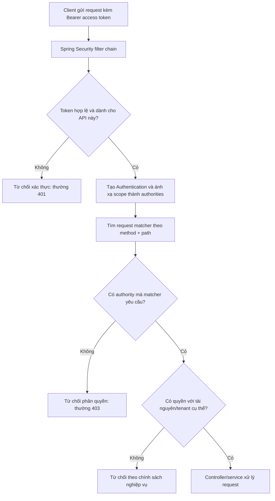

# Request matcher theo scope

## 1. Mục tiêu bài học

Một API dùng **Spring Security OAuth2 Resource Server** để nhận access token do authorization server cấp. Khi access token mang scope `orders:read`, `orders:write` và `orders:delete`, resource server cần biết yêu cầu HTTP nào được thực hiện với từng scope. Cơ chế `authorizeHttpRequests` kết hợp `requestMatchers` và `hasAuthority` là một cách khai báo chính sách như vậy.

Sau bài này, bạn có thể:

- Giải thích luồng từ **access token** đến **GrantedAuthority**, phân biệt scope, authority và role.
- Viết request matcher theo **HTTP method + đường dẫn** cho API đọc, tạo, sửa và xóa.
- Hiểu thứ tự áp dụng matcher, nguyên tắc mặc định từ chối, cách yêu cầu một hoặc nhiều scope và sự khác biệt giữa `401` và `403`.
- Bảo đảm issuer, audience, thời hạn và chữ ký/trạng thái token được xác minh **trước** khi tin vào authority.
- Phối hợp bảo vệ HTTP endpoint với phân quyền trên từng tài nguyên, chủ sở hữu và tenant.
- Kiểm thử policy, nhận diện lỗi cấu hình thường gặp và giới hạn của scope khi access token bị đánh cắp hoặc phát lại.

Bài viết nằm trong nhóm **Spring Security authorities** của chương trình về mô hình tin cậy và vòng đời token bảo mật. Trọng tâm là quyết định phân quyền ở **resource server**; authorization server chịu trách nhiệm cấp token và những scope được chấp thuận.

## 2. Scope đi vào Spring Security như thế nào?

Giả sử một client `orders-web` dùng OAuth 2.0 để nhận access token có quyền đọc đơn hàng. Nó gọi:

```http
GET /api/orders/123 HTTP/1.1
Host: orders.example.test
Authorization: Bearer <ACCESS_TOKEN>
Accept: application/json
```

Resource server xử lý theo chuỗi:



Quá trình có ba quyết định riêng:

1. **Xác thực token:** nó có chữ ký/trạng thái hợp lệ, chưa hết hạn, issuer đáng tin cậy và audience của API hay không?
2. **Phân quyền request:** endpoint mà client gọi đòi hỏi authority nào, ví dụ `SCOPE_orders:read`?
3. **Phân quyền đối tượng:** người dùng hoặc service trong token có được xem **đơn hàng 123** không?

Không được tự giải mã JWT rồi tin vào trường `scope`: payload JWT có thể đọc/sửa trước khi chữ ký được xác minh. Với opaque token, phải kiểm tra bằng introspection hoặc bộ xác minh đáng tin cậy theo hợp đồng với authorization server.

### 2.1. Scope là phạm vi do authorization server cấp

Payload JWT access token **minh họa**:

```json
{
  "iss": "https://auth.example.test",
  "sub": "user-42",
  "aud": ["orders-api"],
  "client_id": "orders-web",
  "scope": "orders:read orders:write",
  "iat": 1893452400,
  "exp": 1893453000
}
```

Đây không phải token ký hoàn chỉnh và các thời điểm chỉ để minh họa. Authorization server quyết định scope thực sự dựa trên client, grant, quyền của người dùng và chính sách. Client không được tự nâng scope qua request parameter hoặc header tự tạo.

Một số authorization server dùng claim `scp` dạng mảng:

```json
{
  "scp": ["orders:read", "orders:write"]
}
```

Cần có hợp đồng AS–RS về claim chứa scope, ý nghĩa từng scope và định dạng dữ liệu. Không giả định mọi token từ mọi issuer đều có cùng ngữ nghĩa.

### 2.2. Scope được đổi thành GrantedAuthority

Trong Spring Security Resource Server cho JWT, `JwtGrantedAuthoritiesConverter` mặc định nhận diện các claim scope thông dụng như `scope` và `scp`, rồi thêm tiền tố `SCOPE_` cho mỗi giá trị.

| Scope đã cấp | Authority mặc định |
| --- | --- |
| `orders:read` | `SCOPE_orders:read` |
| `orders:write` | `SCOPE_orders:write` |
| `orders:delete` | `SCOPE_orders:delete` |
| `reports:export` | `SCOPE_reports:export` |

Vì thế, điều kiện thông dụng là:

```java
.hasAuthority("SCOPE_orders:read")
```

| Điều kiện Spring Security | Ý nghĩa |
| --- | --- |
| `hasAuthority("SCOPE_orders:read")` | Tập authorities chứa đúng chuỗi `SCOPE_orders:read`. |
| `hasAnyAuthority("SCOPE_orders:read", "SCOPE_orders:admin")` | Có ít nhất một authority được liệt kê (**OR**). |
| `hasRole("ADMIN")` | Theo quy ước mặc định, yêu cầu authority `ROLE_ADMIN`. |
| `authenticated()` | Request có Authentication hợp lệ, chưa đòi hỏi scope cụ thể. |
| `permitAll()` | Cho qua request khớp rule đó; chỉ nên dùng cho endpoint chủ đích public. |
| `denyAll()` | Từ chối request khớp rule đó. |

**Scope không phải role.** `hasRole("orders:read")` mặc định sẽ tìm `ROLE_orders:read`, không tương đương `SCOPE_orders:read`. `hasAuthority("orders:read")` cũng không khớp khi converter đang thêm tiền tố `SCOPE_`.

Nếu dự án tự đổi prefix hoặc claim qua converter, request matcher phải dùng đúng tên authority sau chuyển đổi. Spring Security không tự suy ra rằng `orders:write` bao hàm `orders:read` hay `orders:admin` bao hàm mọi scope.

### 2.3. Authentication khác nhau giữa JWT và opaque token

Với JWT, framework thường tạo `JwtAuthenticationToken` sau khi kiểm chữ ký và claims. Với opaque access token, framework có thể tạo `BearerTokenAuthentication` dựa trên kết quả introspection hợp lệ. Mỗi Authentication chứa tập `GrantedAuthority` để `hasAuthority` kiểm tra.

Hai định dạng token có thể dùng **cùng rule** `SCOPE_orders:read` nếu chuyển đổi scope thành authority nhất quán. Nhưng AS và resource server phải thống nhất metadata, audience và kiểu token được chấp nhận; `active: true` của introspection không tự chứng minh client được truy cập API hoặc bản ghi cụ thể.

## 3. Request matcher quyết định trên method và path

Trong DSL `authorizeHttpRequests`, `requestMatchers` chọn nhóm request dựa trên HTTP method, đường dẫn hoặc matcher tường minh. Khi khớp một rule, Spring Security áp điều kiện `hasAuthority`, `hasAnyAuthority`, `authenticated`, `permitAll` hoặc điều kiện khác được khai báo.

Ví dụ chính sách:

| Request | Scope cần có |
| --- | --- |
| `GET /api/orders` | `orders:read` |
| `GET /api/orders/{id}` | `orders:read` |
| `POST /api/orders` | `orders:write` |
| `PUT /api/orders/{id}` | `orders:write` |
| `PATCH /api/orders/{id}` | `orders:write` |
| `DELETE /api/orders/{id}` | `orders:delete` |
| `GET /actuator/health` | Public nếu cố ý công khai |
| Request khác chưa khai báo | Mặc định từ chối |

### 3.1. Thứ tự matcher: rule đầu tiên khớp

`authorizeHttpRequests` áp rule đầu tiên khớp với request. Vì thế, cấu hình sau nguy hiểm:

```java
.requestMatchers("/api/**").authenticated()
.requestMatchers(HttpMethod.DELETE, "/api/orders/**")
    .hasAuthority("SCOPE_orders:delete")
```

Rule `/api/**` khớp trước, nên rule DELETE phía sau không được đánh giá. Token có xác thực nhưng không mang `orders:delete` có thể qua bước request authorization.

Sửa bằng cách đặt rule cụ thể trước và chọn fallback an toàn:

```java
.requestMatchers(HttpMethod.DELETE, "/api/orders/**")
    .hasAuthority("SCOPE_orders:delete")
.anyRequest().denyAll()
```

Khi API cần scope cụ thể, `denyAll` là fallback hữu ích: endpoint mới sẽ không tự mở quyền chỉ vì người gọi có một token bất kỳ.

### 3.2. Đặt HTTP method vào matcher

Rule chỉ theo đường dẫn:

```java
.requestMatchers("/api/orders/**")
    .hasAuthority("SCOPE_orders:read")
```

có thể khớp cả `GET`, `PUT` và `DELETE` trên những đường dẫn đó. Nó không phân biệt đọc với sửa/xóa.

Rule có method:

```java
.requestMatchers(HttpMethod.GET, "/api/orders/**")
    .hasAuthority("SCOPE_orders:read")
.requestMatchers(HttpMethod.DELETE, "/api/orders/**")
    .hasAuthority("SCOPE_orders:delete")
```

sẽ kiểm hai nhóm hành động khác nhau. Hãy lập bảng đầy đủ cho `POST`, `PUT`, `PATCH`, `DELETE`, `HEAD` và `OPTIONS` theo yêu cầu thực tế. Đừng tự giả định mọi matcher đều tự áp GET cho HEAD, hoặc cho phép `OPTIONS /**` tùy tiện để sửa CORS; preflight phải được xử lý bằng cấu hình CORS nhất quán với chính sách nguồn gốc.

### 3.3. Chú ý ngữ nghĩa đường dẫn

`/api/orders`, `/api/orders/` và `/api/orders/123` có thể có cách khớp khác nhau tùy cấu hình Spring MVC/Security và phiên bản. Kiểm thử dấu slash cuối, segment được encode, context path, servlet path và URL không thuộc API nhưng có tiền tố gần giống.

Tránh tự viết so sánh như:

```java
request.getRequestURI().startsWith("/api/orders")
```

Nó có thể khớp nhầm `/api/orders-export`. Ưu tiên matcher phù hợp với cơ chế routing của ứng dụng; nếu hệ thống có nhiều `SecurityFilterChain`, xem xét cả thứ tự chain và các `securityMatcher`. Một request đi qua chain khác có thể không chịu rule bạn nghĩ là đang bảo vệ nó.

## 4. Cấu hình Resource Server nhận JWT và áp scope

Giả định API `orders-api` nhận JWT access token từ `https://auth.example.test`. Token phải có audience `orders-api` và được kiểm tra thời hạn/chữ ký.

Trong Spring Boot 3 / Spring Security 6, dự án cần `spring-boot-starter-oauth2-resource-server`. Ví dụ `application.yml`:

```yaml
spring:
  security:
    oauth2:
      resourceserver:
        jwt:
          issuer-uri: https://auth.example.test
          audiences: orders-api
```

Thuộc tính `audiences` được hỗ trợ trong các phiên bản Spring Boot tương ứng để kiểm tra `aud`. Nếu phiên bản dùng không hỗ trợ, cấu hình `JwtDecoder` và một `OAuth2TokenValidator<Jwt>` riêng để **bắt buộc** kiểm audience. Cấu hình issuer **không thay thế** audience validation.

### 4.1. Ví dụ SecurityFilterChain cho API đơn hàng

```java
import org.springframework.context.annotation.Bean;
import org.springframework.context.annotation.Configuration;
import org.springframework.http.HttpMethod;
import org.springframework.security.config.Customizer;
import org.springframework.security.config.annotation.method.configuration.EnableMethodSecurity;
import org.springframework.security.config.annotation.web.builders.HttpSecurity;
import org.springframework.security.config.annotation.web.configurers.AbstractHttpConfigurer;
import org.springframework.security.config.http.SessionCreationPolicy;
import org.springframework.security.web.SecurityFilterChain;

@Configuration
@EnableMethodSecurity
public class OrdersApiSecurityConfig {

    @Bean
    SecurityFilterChain apiSecurity(HttpSecurity http) throws Exception {
        http
            .csrf(AbstractHttpConfigurer::disable)
            .sessionManagement(session ->
                session.sessionCreationPolicy(SessionCreationPolicy.STATELESS))
            .authorizeHttpRequests(auth -> auth
                .requestMatchers(HttpMethod.GET, "/actuator/health")
                    .permitAll()

                .requestMatchers(HttpMethod.GET,
                    "/api/orders", "/api/orders/**")
                    .hasAuthority("SCOPE_orders:read")

                .requestMatchers(HttpMethod.POST, "/api/orders")
                    .hasAuthority("SCOPE_orders:write")
                .requestMatchers(HttpMethod.PUT, "/api/orders/**")
                    .hasAuthority("SCOPE_orders:write")
                .requestMatchers(HttpMethod.PATCH, "/api/orders/**")
                    .hasAuthority("SCOPE_orders:write")

                .requestMatchers(HttpMethod.DELETE, "/api/orders/**")
                    .hasAuthority("SCOPE_orders:delete")

                .anyRequest().denyAll()
            )
            .oauth2ResourceServer(oauth2 ->
                oauth2.jwt(Customizer.withDefaults())
            );

        return http.build();
    }
}
```

Cách cấu hình này có các đặc tính:

1. **GET** chỉ được qua bước kiểm scope nếu Authentication có `SCOPE_orders:read`.
2. **POST/PUT/PATCH** cần `SCOPE_orders:write`, còn **DELETE** cần `SCOPE_orders:delete`.
3. Health check GET được khai báo public; các HTTP request khác không được cho phép ngầm.
4. Mỗi matcher được đọc **theo thứ tự**, từ chuyên biệt đến fallback.
5. `oauth2ResourceServer(...jwt(...))` xác thực Bearer JWT trước khi tạo Authentication và authorities.
6. `@EnableMethodSecurity` cho phép bảo vệ service bằng `@PreAuthorize`, bổ sung kiểm tra nghiệp vụ.

`STATELESS` là lựa chọn cho API không duy trì HTTP session xác thực. Trong ví dụ, `csrf(...disable)` chỉ hợp lý vì API được giả định **chỉ xác thực bằng Bearer token trong header Authorization**, không dùng cookie tự động đính kèm để xác thực thao tác ghi. Nếu cùng ứng dụng dùng session/cookie authentication, cần giữ hoặc cấu hình CSRF protection phù hợp; không sao chép lệnh tắt CSRF sang mọi ứng dụng.

### 4.2. Request nào đi qua?

Giả sử JWT đã xác thực hợp lệ với:

```json
{
  "sub": "user-42",
  "aud": ["orders-api"],
  "scope": "orders:read"
}
```

Sau chuyển đổi mặc định, Authentication có `SCOPE_orders:read`.

| HTTP request | Kết quả kiểm tra request | Giải thích |
| --- | --- | --- |
| `GET /api/orders` | Qua bước kiểm scope | Có `SCOPE_orders:read`. |
| `GET /api/orders/123` | Qua bước kiểm scope | Phải kiểm chủ sở hữu đơn hàng tiếp. |
| `POST /api/orders` | Từ chối phân quyền, thường `403` | Thiếu `SCOPE_orders:write`. |
| `PATCH /api/orders/123` | Từ chối phân quyền, thường `403` | Thiếu `SCOPE_orders:write`. |
| `DELETE /api/orders/123` | Từ chối phân quyền, thường `403` | Thiếu `SCOPE_orders:delete`. |
| `GET /api/admin/audit` | Bị `denyAll` từ chối | Chưa được khai báo. |
| `GET /actuator/health` | Cho qua theo `permitAll` | Đã chủ động công khai. |

Bảng chỉ nói về **lớp phân quyền HTTP**. Controller/service vẫn có thể trả `404` nếu bản ghi không tồn tại, `409` khi xung đột nghiệp vụ hoặc từ chối theo chính sách đối tượng.

### 4.3. Nếu phải tự kiểm tra audience

Có thể dùng một JWT decoder tường minh trong ứng dụng cần kiểm soát validator. Ví dụ sau lược bỏ import và dùng URL giả định:

```java
@Bean
JwtDecoder jwtDecoder() {
    String issuer = "https://auth.example.test";

    NimbusJwtDecoder decoder = NimbusJwtDecoder
        .withJwkSetUri("https://auth.example.test/oauth2/jwks")
        .build();

    OAuth2TokenValidator<Jwt> defaultChecks =
        JwtValidators.createDefaultWithIssuer(issuer);

    OAuth2TokenValidator<Jwt> audienceCheck = jwt ->
        jwt.getAudience().contains("orders-api")
            ? OAuth2TokenValidatorResult.success()
            : OAuth2TokenValidatorResult.failure(
                new OAuth2Error("invalid_token", "Sai audience", null));

    decoder.setJwtValidator(
        new DelegatingOAuth2TokenValidator<>(defaultChecks, audienceCheck));

    return decoder;
}
```

Khóa JWKS phải đến từ **issuer đáng tin cậy** đã cấu hình, không phải URL lấy từ token chưa được xác thực. Đối với access-token JWT profile cụ thể, có thể cần kiểm thêm loại token, `typ` và các điều kiện profile phù hợp. Không nhận một JWT có chữ ký hợp lệ của issuer đúng nhưng dành cho resource server khác.

## 5. Yêu cầu một hoặc nhiều scope

### 5.1. OR: một trong nhiều authority

Ví dụ endpoint báo cáo cho phép `reports:read` hoặc `reports:admin`:

```java
.requestMatchers(HttpMethod.GET, "/api/reports/**")
    .hasAnyAuthority("SCOPE_reports:read", "SCOPE_reports:admin")
```

`hasAnyAuthority` yêu cầu **ít nhất một** authority trong danh sách. Nó không đòi hỏi đồng thời cả hai. Tên `admin` ở đây chỉ là scope do AS phát hành và API công nhận; Spring không tự cấp quyền dựa vào từ “admin” trong tên.

### 5.2. AND: bắt buộc cả hai scope

Giả sử một dịch vụ xuất dữ liệu nhạy cảm đòi hỏi `reports:read` **và** `personal-data:export`. Với `@EnableMethodSecurity`, có thể viết:

```java
@PreAuthorize(
    "hasAuthority('SCOPE_reports:read') and " +
    "hasAuthority('SCOPE_personal-data:export')")
public byte[] exportPersonalReport(UUID reportId) {
    // Đọc dữ liệu, kiểm quyền trên reportId và tạo báo cáo.
    // ...
}
```

Cần nhớ dấu `and` trong SpEL là **AND**, còn `hasAnyAuthority` là **OR**. Nếu muốn điều kiện kết hợp ngay tại lớp request, có thể dùng các `AuthorizationManager` kết hợp theo API được phiên bản Spring Security hỗ trợ và kiểm thử hành vi.

### 5.3. Scope ghi không mặc nhiên có quyền đọc

Spring Security không mặc định suy ra `orders:write` bao hàm `orders:read`. Nếu chính sách muốn người có quyền ghi được đọc, bạn cần quyết định rõ:

- AS cấp thêm `orders:read` cho các client/người dùng được phép.
- Hoặc rule GET cho phép `hasAnyAuthority("SCOPE_orders:read", "SCOPE_orders:write")`.

Không tự tạo quy tắc ngầm khác nhau giữa request matcher, controller và service.

## 6. Scope không đủ để bảo vệ từng đơn hàng

Xét token JWT đã xác thực:

```json
{
  "sub": "user-42",
  "aud": ["orders-api"],
  "scope": "orders:read"
}
```

Token này có thể qua matcher `GET /api/orders/**`. Nhưng request `GET /api/orders/999` phải bị từ chối nếu đơn hàng `999` thuộc `user-99` và `user-42` không có quyền được ủy quyền phù hợp.

Đây là ranh giới giữa:

- **Scope/authority:** có quyền gọi loại thao tác “đọc đơn hàng”.
- **Object-level authorization:** có quyền đọc **đơn hàng cụ thể** này hay không.
- **Tenant isolation:** dữ liệu có thuộc đúng tổ chức/tenant được phép hay không.

Một cách dùng method security:

```java
@Service
public class OrderQueryService {
    private final OrderRepository repository;

    public OrderQueryService(OrderRepository repository) {
        this.repository = repository;
    }

    @PreAuthorize(
        "hasAuthority('SCOPE_orders:read') and " +
        "@orderAccess.canRead(authentication, #orderId)")
    public OrderDto getOrder(UUID orderId) {
        Order order = repository.findById(orderId)
            .orElseThrow(OrderNotFoundException::new);
        return OrderDto.from(order);
    }
}
```

Bean `orderAccess` có thể kiểm quyền ở database:

```java
@Component("orderAccess")
public class OrderAccess {
    private final OrderRepository repository;

    public OrderAccess(OrderRepository repository) {
        this.repository = repository;
    }

    public boolean canRead(Authentication authentication, UUID orderId) {
        if (authentication == null || !authentication.isAuthenticated()) {
            return false;
        }

        String subject = authentication.getName();

        return repository.findById(orderId)
            .map(order -> subject.equals(order.getOwnerSubject()))
            .orElse(false);
    }
}
```

Ví dụ giả định `authentication.getName()` được ánh xạ từ `sub` đã xác thực. Với JWT converter tùy chỉnh, opaque token hoặc token machine-to-machine, cần xác nhận principal đại diện cho user hay service và có nên kết hợp issuer/tenant để định danh duy nhất không. Không tin `userId`/`tenantId` do client tự gửi để quyết định ai được phép.

**Lưu ý:** `@PreAuthorize` chỉ có hiệu lực khi method security được bật và lời gọi đi qua Spring proxy. Các cuộc gọi trực tiếp giữa phương thức trong cùng bean (*self-invocation*) có thể bỏ qua interception. Hãy kiểm thử luồng controller → service thật, tránh chỉ test gọi method trực tiếp.

## 7. HTTP 401 và 403 khi kiểm tra scope

| Tình huống | HTTP điển hình | Lý do |
| --- | --- | --- |
| Không có Bearer token ở endpoint được bảo vệ | `401 Unauthorized` | Chưa xác thực. |
| JWT hết hạn, chữ ký sai, issuer sai, audience sai | `401 Unauthorized` | Không tạo Authentication được tin cậy. |
| Opaque token có `active: false` | `401 Unauthorized` | AS không xác nhận token còn hiệu lực. |
| Token hợp lệ, thiếu scope cần cho method/path | `403 Forbidden` | Đã xác thực nhưng chưa đủ quyền. |
| Token đủ scope nhưng không sở hữu đối tượng | `403` hoặc `404` theo chính sách | Đã qua request matcher nhưng không có quyền trên tài nguyên. |
| Introspection timeout hoặc AS không khả dụng | Lỗi xác thực/dịch vụ phù hợp triển khai; không cấp quyền | Không đủ bằng chứng để tin token. |

Ví dụ thiếu token:

```http
HTTP/1.1 401 Unauthorized
WWW-Authenticate: Bearer realm="orders-api"
```

Ví dụ token hợp lệ nhưng thiếu `orders:delete`:

```http
HTTP/1.1 403 Forbidden
WWW-Authenticate: Bearer error="insufficient_scope", scope="orders:delete"
```

Header thực tế phụ thuộc `AuthenticationEntryPoint`, `AccessDeniedHandler` và cấu hình framework. Không trả full token, thông tin khóa, stack trace, claims nhạy cảm hoặc secret introspection trong response; log an toàn chỉ nên chứa correlation ID, loại lỗi và thông tin cần thiết đã được lọc.

## 8. Opaque token và request matcher

Nếu authorization server phát hành **opaque access token**, API có thể dùng introspection. Ví dụ `application.yml`:

```yaml
spring:
  security:
    oauth2:
      resourceserver:
        opaque-token:
          introspection-uri: https://auth.example.test/oauth2/introspect
          client-id: orders-resource-server
          client-secret: ${RS_INTROSPECTION_SECRET}
```

Trong `SecurityFilterChain`, thay cấu hình xác minh JWT bằng:

```java
.oauth2ResourceServer(oauth2 ->
    oauth2.opaqueToken(Customizer.withDefaults())
)
```

Ví dụ AS có thể trả metadata introspection:

```json
{
  "active": true,
  "iss": "https://auth.example.test",
  "sub": "user-42",
  "aud": ["orders-api"],
  "client_id": "orders-web",
  "scope": "orders:read",
  "exp": 1893453000
}
```

Spring Security có thể chuyển scope thành `SCOPE_orders:read` và áp **cùng** matcher. Nhưng `active: true` không đủ để kết luận API được cấp quyền: RS cần xác minh issuer/audience, token type, scope, chủ thể và những điều kiện khác theo hợp đồng. Nếu metadata bắt buộc thiếu, không mặc định chấp nhận token.

Revocation và lưu trữ token ảnh hưởng thời gian token bị lộ còn dùng được. Khi AS thu hồi opaque token, introspection mới có thể trả `active: false`; cache introspection có thể kéo dài thời gian nhận biết. Khi AS thu hồi JWT đã ký, RS chỉ kiểm chữ ký và `exp` có thể vẫn chấp nhận token đến lúc hết hạn. Nếu yêu cầu cắt quyền nhanh, cần TTL ngắn, introspection/denylist hoặc cơ chế đồng bộ trạng thái thu hồi phù hợp. Scope matcher chỉ giới hạn thao tác của Bearer token, **không tự chống replay**.

## 9. Khi cần converter authority tùy chỉnh

Nếu authorization server dùng claim `permissions` thay vì `scope`:

```json
{
  "permissions": ["orders:read", "orders:write"]
}
```

Bạn có thể tạo converter cho JWT:

```java
@Bean
JwtAuthenticationConverter jwtAuthenticationConverter() {
    JwtGrantedAuthoritiesConverter granted =
        new JwtGrantedAuthoritiesConverter();

    granted.setAuthoritiesClaimName("permissions");
    granted.setAuthorityPrefix("SCOPE_");

    JwtAuthenticationConverter converter = new JwtAuthenticationConverter();
    converter.setJwtGrantedAuthoritiesConverter(granted);
    return converter;
}
```

Và nối nó vào JWT authentication:

```java
.oauth2ResourceServer(oauth2 ->
    oauth2.jwt(jwt ->
        jwt.jwtAuthenticationConverter(jwtAuthenticationConverter()))
)
```

Lúc đó `permissions = ["orders:read"]` trở thành `SCOPE_orders:read`. Tuy nhiên claim `permissions` **không mặc nhiên là OAuth scope**. Chỉ áp cách ánh xạ này khi AS/RS đã định nghĩa cùng ngữ nghĩa; nếu là quyền nội bộ khác, có thể chọn prefix khác như `PERM_` và sửa matcher. Tránh gộp `scope`, `permissions` và `roles` không kiểm soát từ nhiều issuer, vì có thể nâng quyền ngoài dự kiến.

Converter cho JWT và opaque token có cách cấu hình khác nhau. Khi hệ thống chấp nhận cả hai định dạng, test thực tế để bảo đảm authorities thống nhất và không lấy scope từ dữ liệu không đáng tin cậy.

## 10. Kiểm thử request matcher theo scope

Một bộ kiểm thử cần kiểm **chính sách HTTP**, **token validation** và **phân quyền đối tượng** riêng biệt.

| Kiểm thử | Kết quả mong đợi |
| --- | --- |
| `GET /api/orders` với token đúng audience và scope `orders:read` | Qua kiểm tra scope. |
| `POST /api/orders` chỉ với `orders:read` | `403` do thiếu `orders:write`. |
| `DELETE /api/orders/123` chỉ với `orders:write` | `403` do thiếu `orders:delete`. |
| `DELETE /api/orders/123` với `orders:delete` | Qua scope, vẫn kiểm quyền trên đơn hàng. |
| `GET /api/orders/123` chỉ với `orders:write` | Bị từ chối nếu không khai báo quan hệ bao hàm. |
| `GET /api/admin/audit` với token hợp lệ bất kỳ | Bị fallback `denyAll` từ chối. |
| `GET /actuator/health` không có token | `permitAll` khi route public đã cấu hình đúng. |
| Thiếu Bearer token ở API cần bảo vệ | Thường `401`. |
| JWT sai chữ ký hoặc hết hạn | Thường `401` trước khi đến matcher. |
| JWT scope đúng nhưng `aud = profile-api` | Bị từ chối do audience sai. |
| Opaque token `active: false` | Bị từ chối xác thực. |
| Token đúng scope nhưng `sub` không có quyền với đơn hàng | Bị từ chối ở chính sách đối tượng. |
| URL `/api/orders-export` hoặc trailing slash/encoded path | Không bị khớp nhầm quyền của endpoint khác. |
| CORS preflight từ frontend | Được xử lý có kiểm soát, không mở quyền API ngoài ý muốn. |

### 10.1. Test lớp request authorization với MockMvc

Với `spring-security-test`, `jwt()` tạo Authentication thử nghiệm và chỉ định authorities, giúp xác minh luật matcher mà không cần gọi issuer. Ví dụ sau cần controller cùng cấu hình test thích hợp:

```java
import static org.springframework.security.test.web.servlet.request
    .SecurityMockMvcRequestPostProcessors.jwt;
import static org.springframework.test.web.servlet.request
    .MockMvcRequestBuilders.post;
import static org.springframework.test.web.servlet.result
    .MockMvcResultMatchers.status;

import org.junit.jupiter.api.Test;
import org.springframework.beans.factory.annotation.Autowired;
import org.springframework.security.core.authority.SimpleGrantedAuthority;
import org.springframework.test.web.servlet.MockMvc;

class OrdersScopeSecurityTest {

    @Autowired
    MockMvc mvc;

    @Test
    void readScopeCannotCreateOrder() throws Exception {
        mvc.perform(post("/api/orders")
                .with(jwt().authorities(
                    new SimpleGrantedAuthority("SCOPE_orders:read"))))
            .andExpect(status().isForbidden());
    }
}
```

Đoạn kiểm thử minh họa cần nằm trong lớp test có cấu hình `@SpringBootTest` + `@AutoConfigureMockMvc` hoặc test slice tương ứng, controller và dependencies phù hợp. **`jwt()` mock bỏ qua việc xác minh chữ ký, issuer, audience và expiration**, nên cần thêm integration test thật với JWT ký của môi trường test hoặc mock JWKS/introspection endpoint.

### 10.2. Kiểm thứ tự matcher bằng thử nghiệm âm tính

Gửi `DELETE /api/orders/123` với Authentication có `SCOPE_orders:read` nhưng không có `SCOPE_orders:delete`. Kết quả **phải bị từ chối** ở request authorization. Nếu được cho qua, hãy kiểm xem một rule rộng như `/api/**.authenticated()` có đứng trước matcher DELETE hoặc matcher thiếu method hay không.

Sau khi thêm endpoint hoặc đổi routing, kiểm lại cả fallback `denyAll` và các trường hợp `HEAD`, `OPTIONS` nếu ứng dụng hỗ trợ. Request matcher là một phần của hợp đồng bảo mật API, cần thay đổi đồng bộ với controller mappings.

## 11. Sai sót thường gặp

| Sai lầm | Hậu quả | Cách sửa |
| --- | --- | --- |
| Dùng `hasAuthority("orders:read")` với converter mặc định | Không khớp `SCOPE_orders:read`, gây từ chối không mong muốn. | Dùng đúng authority, test converter. |
| Dùng `hasRole("orders:read")` | Tự thêm tiền tố `ROLE_`, không đúng scope. | Dùng `hasAuthority("SCOPE_orders:read")`. |
| Matcher chỉ theo path cho cả GET/DELETE | Token chỉ đọc có thể vượt qua bước kiểm scope thao tác ghi. | Phân biệt rõ HTTP method. |
| Rule `/api/**` quá rộng đứng trước rule cụ thể | Rule cụ thể không được đánh giá. | Sắp xếp rule cụ thể trước. |
| Dùng `authenticated()` làm fallback vô điều kiện | API mới có thể chỉ cần bất kỳ token hợp lệ. | Cân nhắc `denyAll` cho API yêu cầu scope. |
| Decode JWT rồi tin scope | Kẻ tấn công sửa claim có thể lấy quyền nếu không verify. | Bắt buộc kiểm chữ ký, issuer, audience, time. |
| Không kiểm `aud` | Token cho API khác bị dùng sai. | Chặn token không dành cho resource server này. |
| Có scope `orders:read` thì xem được mọi đơn hàng | Lộ dữ liệu người khác hoặc tenant khác. | Kiểm quyền ở service/domain theo từng bản ghi. |
| Mặc định `write` bao hàm `read` | Quy tắc phân quyền không nhất quán. | Khai báo OR/AND hoặc cấp đủ scope rõ ràng. |
| Bật `@PreAuthorize` nhưng không bật method security | Bỏ qua bước kiểm quyền dịch vụ. | Dùng `@EnableMethodSecurity`, test qua proxy. |
| Tắt CSRF trong ứng dụng dùng cookie auth | Rủi ro CSRF với thao tác thay đổi trạng thái. | Áp CSRF theo mô hình xác thực thực tế. |
| Token bị thu hồi nhưng RS chỉ kiểm JWT cục bộ | Token còn hạn có thể tiếp tục dùng. | TTL ngắn và cơ chế kiểm trạng thái bổ sung khi cần. |
| Log access token khi debug lỗi 403 | Token bị đọc trộm và phát lại. | Redact token; log dữ liệu tối thiểu. |

## 12. Bài tập tình huống

API hóa đơn có:

- `GET /api/invoices/{id}` đòi hỏi `invoices:read`.
- `POST /api/invoices` đòi hỏi `invoices:write`.
- `DELETE /api/invoices/{id}` đòi hỏi `invoices:delete`.

Authorization server cấp access token có `aud = invoices-api`, `sub = user-7` và `scope = "invoices:read invoices:write"`. Hóa đơn `invoice-12` thuộc `user-9`.

**Câu hỏi 1: Matcher bảo vệ đọc hóa đơn?**

```java
.requestMatchers(HttpMethod.GET, "/api/invoices/**")
    .hasAuthority("SCOPE_invoices:read")
```

Nếu API có route `GET /api/invoices`, thêm route đó vào matcher tương ứng.

**Câu hỏi 2: Có thể DELETE invoice-12 không?** Không. Token không chứa `SCOPE_invoices:delete`.

**Câu hỏi 3: Có thể GET invoice-12 không?** Token đủ scope đọc nên qua bước request matcher, nhưng subject `user-7` không sở hữu `invoice-12`. Service phải từ chối nếu không có chính sách ủy quyền khác.

**Câu hỏi 4: Nếu token có audience `orders-api` thì sao?** API `invoices-api` phải từ chối token trước khi thực hiện request authorization, dù scope có chữ `invoices:read`.

**Câu hỏi 5: Scope matcher có chặn token bị đánh cắp và replay không?** Không tự làm được. Nó chỉ giới hạn thao tác của ai đang nắm Bearer token. Muốn giảm rủi ro cần HTTPS, bảo vệ lưu trữ token, TTL phù hợp, thu hồi và cơ chế ràng buộc bên gửi (DPoP/mTLS) khi hệ thống hỗ trợ.

**Ghi nhớ:** `requestMatchers(HttpMethod, path).hasAuthority("SCOPE_...")` biến scope **đã được xác minh** thành quy tắc HTTP cụ thể. Hãy kiểm tra đúng method/path, xếp rule theo thứ tự, chặn route chưa khai báo và luôn phân quyền trên từng tài nguyên ngoài scope.
