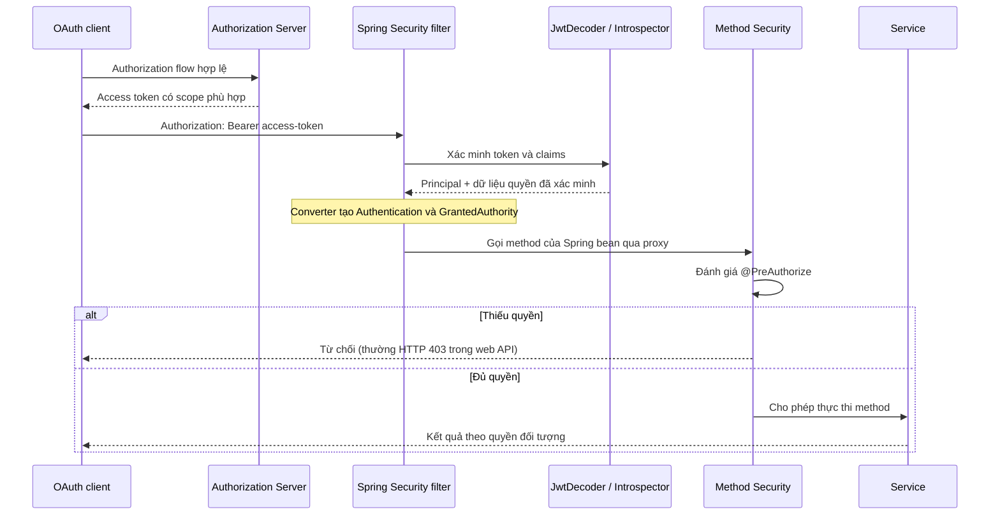

# @PreAuthorize với token authority

## 1. Tại sao cần kiểm tra quyền ở cấp phương thức?

Trong ứng dụng Java dùng Spring Security, việc xác thực thành công một **access token** chỉ trả lời câu hỏi: *Credential này có hợp lệ theo chính sách của Resource Server không?* Một API còn phải trả lời: *Người gọi có được thực hiện thao tác cụ thể và truy cập bản ghi cụ thể không?*

`@PreAuthorize` là annotation của Spring Security dùng **method security** để đánh giá một biểu thức phân quyền **trước khi gọi thân phương thức**. Ví dụ:

```java
@PreAuthorize("hasAuthority('SCOPE_orders:read')")
public OrderDto getOrder(String orderId) {
    return orderQueries.loadOrder(orderId);
}
```

Ví dụ này minh họa ý tưởng; `OrderDto` và `orderQueries` là các thành phần nghiệp vụ giả định. Khi method security hoạt động đúng, phương thức chỉ được thực thi nếu `Authentication` hiện tại có authority `SCOPE_orders:read`. Tuy nhiên, kiểm tra một scope như vậy **chưa chứng minh** người gọi được xem **đơn hàng có ID cụ thể**. Bài học sẽ bổ sung kiểm tra owner/tenant để tránh truy cập chéo dữ liệu.

Chủ đề thuộc chương **Method security** trong module `SECURITY_TOKEN_SECURITY_FUNDAMENTALS`, tập trung vào mô hình tin cậy và vòng đời access/refresh token, JWT/opaque token, claims, `scope`, `audience`, xác minh OAuth 2.0/OIDC và phòng vệ khi bearer token bị đánh cắp hoặc phát lại.

Sau bài này, bạn có thể:

- Bật `@EnableMethodSecurity` và sử dụng `@PreAuthorize` trên các Spring-managed service.
- Hiểu đường đi **Authorization header → token verifier → Authentication → GrantedAuthority → biểu thức SpEL**.
- Phân biệt `hasAuthority('SCOPE_…')` với `hasRole('…')`, tránh ánh xạ quyền sai từ claims.
- Kết hợp authority với quyền **owner/tenant/đối tượng nghiệp vụ** và chọn cách kiểm tra ít rủi ro.
- Nhận biết bẫy proxy/self-invocation, phản hồi 401/403, kiểm thử MockMvc và giới hạn của method security trước token theft/replay.

## 2. Mô hình tin cậy: authority đến từ đâu?

Trong OAuth 2.0, **Authorization Server (AS)** phát hành access token cho client theo grant và chính sách đã cho phép. Client trình token tới **Resource Server (RS)** qua một phương thức phù hợp, phổ biến là:

```http
GET /api/orders/123 HTTP/1.1
Host: api.example.test
Authorization: Bearer <ACCESS_TOKEN>
```

Chuỗi `<ACCESS_TOKEN>` chỉ là ký hiệu minh họa. Nếu token là **JWT**, RS kiểm chữ ký, issuer, audience, hạn dùng và các điều kiện token; nếu token là **opaque**, RS thường xác minh bằng introspection hoặc cơ chế trạng thái tin cậy. Sau khi xác thực, Spring Security tạo một `Authentication` chứa danh tính và `GrantedAuthority`.



**Ba lớp quyết định phải phân biệt:**

| Lớp | Câu hỏi | Thành phần chịu trách nhiệm |
| --- | --- | --- |
| **Authentication** | Token có hợp lệ, do đúng issuer cấp, dành cho API này, còn hạn và đúng loại không? | `JwtDecoder` hoặc opaque token introspector/validator |
| **Authority mapping** | Những quyền nào từ token hợp lệ được biến thành `GrantedAuthority`? | `JwtAuthenticationConverter`, `JwtGrantedAuthoritiesConverter` hoặc converter riêng |
| **Authorization** | Method này, với tham số và tài nguyên cụ thể, có được phép gọi không? | `@PreAuthorize`, policy bean, tầng service/repository |

**Không lấy quyền từ payload JWT chưa xác minh.** Việc Base64URL-decode JWT thành JSON không chứng minh chữ ký hợp lệ; một token có `"role": "ADMIN"` chưa được xác minh không thể trở thành authority đáng tin. Ngay cả token có chữ ký hợp lệ cũng phải có `aud` dành cho Resource Server và đúng mục đích (access token, không phải OIDC ID token).

## 3. Spring Security diễn giải scope thành authority thế nào?

Giả sử AS phát một JWT **access token** có payload minh họa:

```json
{
  "iss": "https://auth.example.test",
  "sub": "user-42",
  "aud": ["orders-api"],
  "scope": "orders:read orders:write",
  "tenant_id": "tenant-a",
  "iat": 1795400000,
  "exp": 1795400300
}
```

Đây là JSON **chưa phải JWT có chữ ký**. Sau khi RS xác minh token và converter mặc định hoạt động, hai scope thường trở thành:

```text
scope: "orders:read orders:write"
     |
     v
GrantedAuthority("SCOPE_orders:read")
GrantedAuthority("SCOPE_orders:write")
```

Spring Security Resource Server thường đọc `scope` (chuỗi phân tách bằng dấu cách) hoặc `scp` (tùy định dạng), rồi thêm tiền tố mặc định **`SCOPE_`**. Quy ước thực tế cần được kiểm tra theo phiên bản framework và hợp đồng token của AS.

| Điều kiện muốn kiểm tra | Biểu thức phù hợp | Giải thích |
| --- | --- | --- |
| Đọc đơn hàng | `hasAuthority('SCOPE_orders:read')` | So khớp chuỗi authority tương ứng scope |
| Viết đơn hàng | `hasAuthority('SCOPE_orders:write')` | Không đồng nghĩa với quyền xem/sửa mọi đơn hàng |
| Có một trong hai quyền | `hasAnyAuthority('SCOPE_orders:read', 'SCOPE_orders:admin')` | Chấp nhận một trong các authority được liệt kê |
| Có cả hai quyền | `hasAuthority('SCOPE_orders:read') and hasAuthority('SCOPE_orders:write')` | Biểu thức `and` cần cả hai điều kiện đúng |
| Có role ADMIN được ánh xạ thành `ROLE_ADMIN` | `hasRole('ADMIN')` | Spring thường thêm tiền tố `ROLE_` cho role |
| Có authority literal `ROLE_ADMIN` | `hasAuthority('ROLE_ADMIN')` | So sánh trực tiếp chuỗi authority |
| Chỉ cần đã xác thực | `isAuthenticated()` | Không yêu cầu scope cụ thể; thường **chưa đủ** cho nghiệp vụ nhạy cảm |

**Sai lầm phổ biến:** Dùng `hasRole('orders:read')` để kiểm một OAuth scope. Trong cấu hình mặc định, `hasRole` sẽ tìm authority `ROLE_orders:read`, trong khi converter thường tạo `SCOPE_orders:read`. Kết quả có thể là 403 ngay cả khi token hợp lệ.

Nếu AS phát `roles: ["ADMIN"]` hoặc `permissions: ["orders:approve"]`, Spring Security **không mặc định** biến mọi claim tùy biến thành authority. Để tránh cấp quyền quá mức, Resource Server chỉ nên ánh xạ các claims có cấu trúc và ý nghĩa **đã được thỏa thuận với issuer đáng tin**.

## 4. Bật method security trong Spring Boot

Với Spring Security Servlet theo DSL hiện đại, kích hoạt phương thức có annotation:

```java
import org.springframework.context.annotation.Configuration;
import org.springframework.security.config.annotation.method.configuration.EnableMethodSecurity;

@Configuration
@EnableMethodSecurity
public class MethodSecurityConfig {
    // pre/post method authorization được bật theo mặc định.
}
```

`@EnableMethodSecurity` kích hoạt cơ chế method-level authorization, bao gồm `@PreAuthorize` theo cấu hình mặc định. Cách dùng thuộc hệ Spring Security hiện đại; ứng dụng cũ có thể sử dụng API khác, nên kiểm tra phiên bản dự án trước khi sao chép.

### 4.1. Cấu hình Resource Server nhận JWT

```yaml
# application.yml: URL chỉ là ví dụ
spring:
  security:
    oauth2:
      resourceserver:
        jwt:
          issuer-uri: https://auth.example.test
```

Ứng dụng cần dependency Spring Security OAuth2 Resource Server và JWT support phù hợp. `issuer-uri` thiết lập trust cho issuer/JWKS theo cách framework hỗ trợ; **không nên mặc định** điều này tự kiểm `aud` của mọi phiên bản Spring Security/Boot. RS cần cấu hình audience validator hoặc thuộc tính audience phù hợp để chỉ chấp nhận access token dành cho `orders-api`.

Cấu hình bảo vệ HTTP và method security có thể kết hợp:

```java
import org.springframework.context.annotation.Bean;
import org.springframework.context.annotation.Configuration;
import org.springframework.http.HttpMethod;
import org.springframework.security.config.Customizer;
import org.springframework.security.config.annotation.web.builders.HttpSecurity;
import org.springframework.security.config.annotation.web.configurers.AbstractHttpConfigurer;
import org.springframework.security.config.http.SessionCreationPolicy;
import org.springframework.security.web.SecurityFilterChain;

@Configuration
public class ResourceServerConfig {
    @Bean
    SecurityFilterChain apiSecurity(HttpSecurity http) throws Exception {
        http
            .sessionManagement(session ->
                session.sessionCreationPolicy(SessionCreationPolicy.STATELESS))
            // Chỉ cân nhắc tắt CSRF với API thuần Bearer header, không có cookie auth.
            .csrf(AbstractHttpConfigurer::disable)
            .authorizeHttpRequests(auth -> auth
                .requestMatchers("/actuator/health").permitAll()
                .requestMatchers(HttpMethod.GET, "/api/orders/**")
                    .hasAuthority("SCOPE_orders:read")
                .requestMatchers(HttpMethod.POST, "/api/orders/**")
                    .hasAuthority("SCOPE_orders:write")
                .anyRequest().denyAll()
            )
            .oauth2ResourceServer(oauth2 ->
                oauth2.jwt(Customizer.withDefaults())
            );
        return http.build();
    }
}
```

Giải thích:

1. `oauth2ResourceServer().jwt()` xử lý bearer JWT, tạo `JwtAuthenticationToken` và authorities từ token đã xác minh.
2. Quy tắc HTTP là **vòng bảo vệ đầu tiên**; `@PreAuthorize` bổ sung một điểm kiểm tra trước khi gọi method, nhất là khi method được dùng qua nhiều đường vào.
3. `SessionCreationPolicy.STATELESS` không lưu `SecurityContext` như phiên xác thực của RS; không loại bỏ trách nhiệm xác thực từng request.
4. `anyRequest().denyAll()` đóng các route chưa được cho phép; thêm route và quyền theo thiết kế thật.
5. Việc tắt CSRF ở đây chỉ áp dụng khi API thực sự **không dùng cookie credential tự đính kèm**. Nếu có cookie/BFF/session, cần thiết kế chống CSRF thích hợp.

**Chỉ mở HTTP route không đủ.** Nếu một service method có thể được gọi từ controller khác, scheduled task, message handler hoặc code nội bộ, method security có thể cung cấp bảo vệ nhất quán **khi lời gọi đi qua Spring proxy và có Authentication thích hợp**. Với tác vụ hệ thống không có người dùng, nên thiết kế service boundary và chính sách riêng, không tự giả mạo `Authentication` để vượt qua annotation.

## 5. Dùng @PreAuthorize trong service và controller

Một ví dụ service đơn giản:

```java
import org.springframework.security.access.prepost.PreAuthorize;
import org.springframework.stereotype.Service;

@Service
public class OrderService {

    @PreAuthorize("hasAuthority('SCOPE_orders:read')")
    public OrderDto read(String orderId) {
        return orderQueries.read(orderId);
    }

    @PreAuthorize("hasAuthority('SCOPE_orders:write')")
    public OrderDto update(String orderId, UpdateOrderRequest request) {
        return orderCommands.update(orderId, request);
    }
}
```

`OrderDto`, `UpdateOrderRequest`, `orderQueries` và `orderCommands` là các thành phần minh họa, cần được khai báo/inject trong dự án. Ví dụ minh họa **scope gate**, chưa đầy đủ kiểm tra owner, tenant, giới hạn trường dữ liệu và trạng thái nghiệp vụ.

Với các endpoint hoặc service chỉ cần authentication, có thể dùng:

```java
@PreAuthorize("isAuthenticated()")
public ProfileDto viewMyProfile() {
    return profileService.currentProfile();
}
```

Song trong API đa người dùng, biểu thức `isAuthenticated()` không bảo đảm người dùng có quyền xem hồ sơ người khác nếu phương thức nhận một ID tùy ý. Cần thiết kế API theo `/me` hoặc kiểm quyền đối tượng ở service/repository.

### 5.1. @PreAuthorize được đánh giá khi nào?

`@PreAuthorize` sử dụng biểu thức của Spring Security dựa trên SpEL, với **`Authentication` trong `SecurityContext`** tại thời điểm method được gọi. Một method interceptor thông qua Spring AOP proxy đánh giá điều kiện **trước khi chạy thân phương thức**:

```text
Controller
   |
   v
Spring bean proxy
   |
   +-- @PreAuthorize expression -> false -> AccessDeniedException
   |
   +-- @PreAuthorize expression -> true  -> gọi service method
```

Điều kiện hoạt động: method security đã được bật; phương thức được Spring quản lý và lời gọi thực sự đi qua proxy/interceptor; context xác thực phù hợp đã được thiết lập. Một lời gọi trực tiếp từ method này sang method khác của **cùng instance** (`this.otherMethod()`) thường **không đi qua Spring proxy**, do đó annotation trên `otherMethod` có thể không được áp dụng. Tương tự, cần cẩn trọng với các method không thể được proxy/intercept, bean tự tạo bằng `new`, hoặc các đường thực thi async không mang theo `SecurityContext`.

**Nguyên tắc thiết kế:** Đặt `@PreAuthorize` ở các public service boundary được gọi qua Spring bean; kiểm thử bằng cách gọi bean đã inject, không chỉ gọi trực tiếp method trong test unit không có proxy.

## 6. Token authority và quyền trên từng bản ghi: chống BOLA/IDOR

Giả sử người dùng có token hợp lệ với `scope=orders:read`. Nếu service chỉ kiểm scope rồi chạy `findById(orderId)`, họ có thể đoán ID đơn hàng của tenant khác. Đây là lỗi **Broken Object Level Authorization (BOLA)** hoặc IDOR.

Một biểu thức mạnh hơn cần **kết hợp scope và ràng buộc dữ liệu**:

```java
@PreAuthorize(
    "hasAuthority('SCOPE_orders:read') " +
    "and @orderAccessPolicy.canRead(authentication, #orderId)"
)
public OrderDto readOrder(@P("orderId") String orderId) {
    return orderQueries.readVisibleOrderForCurrentPrincipal(orderId);
}
```

`@P` là `org.springframework.security.access.method.P`; nó hỗ trợ đặt tên tham số cho SpEL khi không dựa vào metadata tên tham số của compiler. `OrderDto` và `orderQueries` là ví dụ nghiệp vụ giả định. `readVisibleOrderForCurrentPrincipal` **phải tự giới hạn dữ liệu theo principal/tenant đã xác minh**, không phải truy vấn rộng theo ID rồi tin hoàn toàn vào kiểm tra trước đó.

Một policy bean minh họa:

```java
import org.springframework.security.core.Authentication;
import org.springframework.security.oauth2.jwt.Jwt;
import org.springframework.security.oauth2.server.resource.authentication.JwtAuthenticationToken;
import org.springframework.stereotype.Component;

@Component("orderAccessPolicy")
public class OrderAccessPolicy {
    private final OrderRepository orders;

    public OrderAccessPolicy(OrderRepository orders) {
        this.orders = orders;
    }

    public boolean canRead(Authentication authentication, String orderId) {
        if (!(authentication instanceof JwtAuthenticationToken jwtAuth)) {
            return false;
        }

        Jwt jwt = jwtAuth.getToken();
        String subject = jwt.getSubject();
        String tenantId = jwt.getClaimAsString("tenant_id");
        if (orderId == null || orderId.isBlank() ||
            subject == null || subject.isBlank() ||
            tenantId == null || tenantId.isBlank()) {
            return false;
        }

        return orders.existsByIdAndTenantIdAndOwnerSubject(
            orderId, tenantId, subject);
    }
}
```

`OrderRepository` và `existsByIdAndTenantIdAndOwnerSubject` là ví dụ về repository có các thuộc tính ID, tenant và owner tương ứng; tên method phải khớp entity thực tế. Kiểm tra quyền theo cặp `iss` + `sub` có thể cần thiết trong hệ thống đa issuer; ví dụ này giả định **RS chỉ tin một issuer**, subject ổn định và claim `tenant_id` đã có hợp đồng rõ ràng với AS.

**Vì sao vẫn cần truy vấn có điều kiện bên trong service?** Nếu quyền hoặc chủ sở hữu thay đổi giữa lúc `canRead` kiểm tra và lúc service lấy dữ liệu, kiểm tra-đến-sử-dụng (*TOCTOU*) có thể tạo khe hở. Hãy đọc/sửa bản ghi qua repository có điều kiện owner/tenant, hoặc áp dụng transaction/locking/authorization phù hợp tính nhất quán yêu cầu. `@PreAuthorize` bổ sung điểm kiểm soát, không tự thay thế data-level enforcement.

### 6.1. Không lấy owner hoặc tenant từ input client để tự cấp quyền

Mẫu sai:

```java
// SAI về thiết kế khi tenantId đến từ request do client tự chọn:
@PreAuthorize("hasAuthority('SCOPE_orders:read')")
public OrderDto read(String orderId, String tenantId) {
    return orders.findByIdAndTenantId(orderId, tenantId);
}
```

Nếu `tenantId` tùy ý đến từ request, kẻ tấn công có thể thay bằng tenant khác. Cần so sánh với **danh tính và context đã xác minh**, với quyền truy cập tenant được AS hoặc dịch vụ phân quyền nội bộ cho phép. Cũng không được mặc nhiên cho rằng một JWT chứa tenant claim là quyền truy cập mọi bản ghi trong tenant đó.

### 6.2. Khi nào dùng hasPermission?

Spring Security có biểu thức `hasPermission(...)` khi ứng dụng cấu hình **`PermissionEvaluator`** tương ứng. Nó có thể giúp kiểm tra quyền trên đối tượng, nhưng **không mặc định có logic ACL cho domain nghiệp vụ**. Với hệ thống vừa và nhỏ, một policy bean `@orderAccessPolicy.canRead(...)` thường dễ đọc, kiểm thử và kiểm soát truy vấn hơn; với yêu cầu phức tạp, có thể dùng một dịch vụ authorization thống nhất, kiểm tenant/owner/quyền động.

## 7. Tùy chỉnh ánh xạ authorities từ JWT

Nếu AS dùng `permissions` hoặc `roles` thay vì `scope`, Resource Server phải chọn cách ánh xạ đúng với hợp đồng token, sau **bước xác minh**.

Ví dụ một JWT hợp lệ có:

```json
{
  "iss": "https://auth.example.test",
  "sub": "user-42",
  "aud": ["orders-api"],
  "scope": "orders:read",
  "roles": ["MANAGER"]
}
```

`JwtGrantedAuthoritiesConverter` mặc định đọc scope, không tự tạo `ROLE_MANAGER`. Nếu thật sự cần cả `SCOPE_orders:read` và `ROLE_MANAGER`, có thể kết hợp hai converter:

```java
import java.util.LinkedHashSet;
import java.util.Set;
import org.springframework.context.annotation.Bean;
import org.springframework.security.core.GrantedAuthority;
import org.springframework.security.oauth2.server.resource.authentication.JwtAuthenticationConverter;
import org.springframework.security.oauth2.server.resource.authentication.JwtGrantedAuthoritiesConverter;

@Bean
JwtAuthenticationConverter jwtAuthenticationConverter() {
    JwtGrantedAuthoritiesConverter scopes = new JwtGrantedAuthoritiesConverter();

    JwtGrantedAuthoritiesConverter roles = new JwtGrantedAuthoritiesConverter();
    roles.setAuthoritiesClaimName("roles");
    roles.setAuthorityPrefix("ROLE_");

    JwtAuthenticationConverter converter = new JwtAuthenticationConverter();
    converter.setJwtGrantedAuthoritiesConverter(jwt -> {
        Set<GrantedAuthority> combined = new LinkedHashSet<>(scopes.convert(jwt));
        combined.addAll(roles.convert(jwt));
        return combined;
    });
    return converter;
}
```

Đoạn code là một bean ví dụ. **Một custom `JwtAuthenticationConverter` không tự được áp dụng chỉ vì tồn tại trong Spring context ở mọi cấu hình**; phải liên kết nó với Resource Server:

```java
.oauth2ResourceServer(oauth2 ->
    oauth2.jwt(jwt ->
        jwt.jwtAuthenticationConverter(jwtAuthenticationConverter())
    )
)
```

Đây là một **đoạn DSL**, không phải method Java độc lập. Trong ứng dụng thật nên inject bean vào cấu hình `SecurityFilterChain` để tránh tạo bản converter khác nhau. Nếu một converter tùy chỉnh **thay thế** nguồn authorities mặc định mà không gộp scope, `@PreAuthorize("hasAuthority('SCOPE_orders:read')")` có thể bất ngờ trả 403.

**Đừng coi mọi claim `roles` là đáng tin mặc định:** AS có thể phát token cho nhiều client/audience; RS phải kiểm `aud`, `iss`, loại token và quy tắc danh tính. Nếu có nhiều issuer, authority `ROLE_MANAGER` từ issuer A có thể không cùng ý nghĩa với issuer B; cần ánh xạ theo đúng trust domain và chính sách riêng.

## 8. Kiểm soát lỗi 401 và 403

| Tình huống | Kết quả thường gặp ở web API có cấu hình chuẩn | Giải thích |
| --- | --- | --- |
| Không có access token ở endpoint bảo vệ | `401 Unauthorized` và `WWW-Authenticate: Bearer` | Chưa cung cấp credential |
| Bearer JWT sai chữ ký, hết hạn, sai `iss` hoặc `aud` | `401`, có thể `invalid_token` | Không tạo authentication hợp lệ |
| Token hợp lệ nhưng thiếu `SCOPE_orders:read` | `403 Forbidden`, có thể `insufficient_scope` | Có danh tính nhưng thiếu authority |
| Token có scope nhưng policy bean từ chối owner/tenant | `403 Forbidden` (hoặc phản hồi che giấu tài nguyên được thiết kế riêng) | Không đủ quyền với đối tượng cụ thể |
| Method được gọi ngoài HTTP mà không có `Authentication` | Exception phân quyền/xác thực tùy bối cảnh | Không tự giả định mọi exception đều tự thành HTTP 401 |
| Introspection/JWKS tạm không sẵn sàng | Lỗi hạ tầng phù hợp, có thể `5xx` | Không nhận token chưa xác minh được |

Ở tầng web, Spring Security có các thành phần chuyển đổi lỗi xác thực và truy cập thành response HTTP. `@PreAuthorize` tự nó **không quyết định trực tiếp toàn bộ HTTP status**: kết quả còn phụ thuộc filter chain, authentication entry point, access denied handler và cách application xử lý exception.

Không đưa access token, refresh token, toàn bộ JWT claims, nội dung `Authorization` hay stack trace nhạy cảm vào response lỗi. Client chỉ nên biết cần đăng nhập lại, làm mới access token theo luồng của AS, hoặc không đủ quyền.

## 9. Các bẫy AOP và vận hành thường gặp

| Hiện tượng | Nguyên nhân khả dĩ | Cách xử lý |
| --- | --- | --- |
| `@PreAuthorize` hoàn toàn không có tác dụng | Chưa bật `@EnableMethodSecurity`; bean không do Spring quản lý | Bật method security, dùng bean trong container và kiểm thử gọi qua proxy |
| Method A gọi `this.methodB()` và methodB không bị kiểm quyền | **Self-invocation** bỏ qua Spring proxy | Đưa methodB ra bean riêng, gọi qua proxy đúng cách hoặc di chuyển kiểm soát quyền vào service boundary |
| Kiểm tra `#orderId` sai hoặc null | Parameter name không hiện diện tại runtime | Bật `-parameters` hoặc dùng `@P("orderId")`; kiểm thử biểu thức |
| JWT có `scope=orders:read` nhưng method trả 403 | Rule kiểm `orders:read` hoặc `ROLE_orders:read` | Sửa thành `SCOPE_orders:read` theo converter thực tế |
| JWT có `roles` nhưng `hasRole` không khớp | Chưa map `roles` thành `ROLE_` | Đăng ký converter phù hợp với hợp đồng AS |
| Token đúng chữ ký nhưng cấp cho API khác vẫn được nhận | Thiếu validator `aud` | Bắt buộc audience đúng RS |
| Method async mất Authentication | `SecurityContext` không tự đi qua mọi thread/executor | Thiết kế context propagation đúng, không dùng thread-local cũ hay quyền mặc định |
| Service gọi từ batch job bị chặn dù URL đã cho phép | Method security áp dụng ngoài HTTP | Thiết kế policy/cổng hệ thống riêng, không xóa kiểm soát một cách mù quáng |
| `@PreAuthorize` chỉ kiểm scope nhưng người dùng đọc được đơn khác | Thiếu kiểm object/tenant | Kết hợp policy bean và truy vấn dữ liệu có điều kiện |
| Dùng annotation trên method không proxy được | Giới hạn Spring AOP (ví dụ final/private tùy proxy) | Đặt annotation ở public Spring bean boundary, xác minh bằng integration test |

Trường hợp một service thực hiện nhiều bước thay đổi dữ liệu, kiểm tra quyền chỉ tại controller có thể bị bỏ qua từ một đường gọi khác. Ngược lại, đặt annotation sâu trên một method mà request không đi qua proxy cũng tạo cảm giác an toàn giả. Kiến trúc nên chọn **điểm kiểm tra quyền ổn định, được thực thi thật**.

## 10. Kiểm thử @PreAuthorize với token authorities

### 10.1. MockMvc test cho endpoint có scope phù hợp

Nếu dùng `spring-security-test`, request post-processor `jwt()` giúp tạo authentication mô phỏng khi thử Spring MVC:

```java
import static org.springframework.security.test.web.servlet.request.SecurityMockMvcRequestPostProcessors.jwt;
import static org.springframework.test.web.servlet.request.MockMvcRequestBuilders.get;
import static org.springframework.test.web.servlet.result.MockMvcResultMatchers.status;
import org.springframework.security.core.authority.SimpleGrantedAuthority;

// Trong test đã cấu hình mockMvc, service và dữ liệu mẫu:
mockMvc.perform(get("/api/orders/123").with(
        jwt().authorities(
            new SimpleGrantedAuthority("SCOPE_orders:read"))))
    .andExpect(status().isOk());
```

Ví dụ kỳ vọng `200 OK` chỉ đúng khi endpoint tồn tại **và** policy owner/tenant, dữ liệu fixture đều cho phép. Với token không có authority cần thiết, request phải bị từ chối theo cấu hình, thường `403`.

**Giới hạn quan trọng:** `jwt()` trong MockMvc tạo authentication cho test và thường **không xác minh chữ ký JWT thật**. Khi gọi `.authorities(...)`, test có thể **bỏ qua chính converter** đang được ứng dụng sử dụng. Nó phù hợp để kiểm tra logic authorization, không đủ để chứng minh parser, decoder, issuer/audience validation hoặc key rotation an toàn.

### 10.2. Ba cấp kiểm thử nên có

1. **Converter unit test:** Tạo một `Jwt` test với `scope`/`roles`, gọi converter và xác minh danh sách `GrantedAuthority` đúng; kiểm trường thiếu, kiểu dữ liệu sai, scope phân tách, prefix và nhiều issuer.
2. **Method security integration test:** Inject **Spring bean qua proxy** có `@PreAuthorize`, chạy với authentication test đủ/thiếu quyền, gọi các method liên quan và kiểm tra cả trường hợp self-invocation hoặc no-auth.
3. **JWT Resource Server integration test:** Gửi JWT test được ký bằng khóa thử nghiệm qua `Authorization`, xác nhận từ chối token sai chữ ký, sai `iss`, sai `aud`, hết hạn, ID token dùng nhầm mục đích và scope thiếu; không dùng token sản xuất.

| Ca kiểm thử | Kỳ vọng |
| --- | --- |
| Có `SCOPE_orders:read`, đúng tenant và đúng owner | Service được chạy, dữ liệu được trả theo policy |
| Có `SCOPE_orders:read` nhưng đơn thuộc tenant khác | Method bị từ chối hoặc truy vấn có điều kiện không trả bản ghi |
| Có `SCOPE_orders:write` nhưng thiếu `SCOPE_orders:read` | Không tự cho phép đọc nếu policy yêu cầu quyền đọc |
| Token hợp lệ, scope thiếu | 403 tại HTTP hoặc access denied ở method |
| Access token hết hạn hoặc audience sai | Xác thực bị từ chối trước khi tạo authorities đáng tin |
| Claim `roles` có nhưng converter chưa đọc | `ROLE_…` không tự xuất hiện |
| Controller gọi service qua Spring proxy | `@PreAuthorize` phải được áp dụng |
| Một service gọi nội bộ method khác có annotation | Test cho thấy self-invocation có thể bỏ qua interceptor; sửa thiết kế |
| JWT của user A, request sau là user B | Không được tái sử dụng `SecurityContext` hay quyền của A |
| ID token/refresh token đưa vào API | Bị từ chối theo token-type/issuer/audience profile của RS |

## 11. @PreAuthorize không chống token theft hoặc replay

`@PreAuthorize` chỉ dựa trên `Authentication` và authority **được cấp cho request hiện tại**. Nếu kẻ tấn công sao chép một **bearer access token** vẫn hợp lệ và RS chấp nhận bản sao, `@PreAuthorize` có thể thấy đúng `SCOPE_orders:read` như khi người dùng hợp pháp gọi. Bản thân biểu thức quyền không chứng minh **người đang giữ token** là chủ thể được cấp token.

Cần phòng thủ nhiều lớp:

- **AS phát hành hạn chế:** Access token ngắn hạn, `aud` chỉ đúng API, `scope` tối thiểu; refresh token có cơ chế bảo vệ thích hợp (rotation/reuse detection hoặc sender constraint theo bối cảnh).
- **RS xác minh đầy đủ:** Chữ ký/thuật toán cho phép hoặc opaque introspection, `iss`, `aud`, `exp`, `nbf`, loại access token, claims và quyền dữ liệu; không dùng ID token/refresh token như access token.
- **Client bảo vệ credential:** TLS, tránh URL/log, giảm XSS bằng output encoding và CSP; cân nhắc BFF giữ token ở backend, cookie `HttpOnly; Secure; SameSite`, kết hợp chống CSRF nếu dùng cookie.
- **Thu hồi:** JWT tự xác minh offline thường không tự mất hiệu lực khi logout; áp dụng TTL ngắn, denylist, session-version hoặc cơ chế trạng thái phù hợp. Với opaque token, cache introspection cần được cân đối với hiệu lực thu hồi.
- **Chống dùng bản sao token khi cần:** DPoP hoặc mTLS-bound access token bổ sung bằng chứng sở hữu khóa/chứng chỉ; Resource Server phải thực thi kiểm tra proof/binding ngoài `@PreAuthorize`.
- **Audit và giám sát:** Log quyết định quyền, request ID và dữ liệu đã làm sạch; không log raw access/refresh token hoặc toàn bộ `Authentication`.

**Không chặn mọi request lặp lại cùng `jti` của access token:** Một access token hợp lệ thường được sử dụng trên nhiều request. Cơ chế chống phát lại theo request thích hợp với **DPoP proof `jti`**, còn refresh token rotation xử lý *reuse* của refresh token đã tiêu thụ.

## 12. Tình huống tự đánh giá

**Tình huống A — API báo 403 dù JWT có scope `orders:read`:** Rule đang dùng `hasRole('orders:read')`. **Kết luận:** Kiểm `SCOPE_orders:read` qua `hasAuthority` hoặc chỉnh converter có chủ đích; không đổi role convention tùy tiện.

**Tình huống B — User A xem được đơn của user B:** Method chỉ có `@PreAuthorize("hasAuthority('SCOPE_orders:read')")` và service lấy bản ghi theo ID. **Kết luận:** Phải kiểm owner/tenant và giới hạn truy vấn dữ liệu.

**Tình huống C — Service có annotation nhưng gọi `this.readOrder(id)` vẫn chạy dù không đủ scope:** **Kết luận:** Lời gọi nội bộ không qua Spring proxy nên có thể bỏ qua method security. Cần sửa service boundary.

**Tình huống D — API kiểm chữ ký JWT nhưng không kiểm `aud`:** Token từ cùng issuer nhưng dành cho service khác có quyền trùng tên được chấp nhận. **Kết luận:** Đây là vấn đề token confusion; bắt buộc kiểm `aud`/loại token trước mapping.

**Tình huống E — Client logout nhưng bearer token bị đánh cắp vẫn dùng được:** JWT chưa hết hạn, RS không có revocation check. **Kết luận:** Method security có thể vẫn cho phép theo authority cũ; cần cơ chế thu hồi/TTL/sender constraint phù hợp.

**Tình huống F — Test MockMvc `jwt().authorities(...)` pass nhưng token thật bị từ chối:** **Kết luận:** Test mock không chứng minh decoder và converter; bổ sung JWT integration test và kiểm cấu hình issuer/audience.

### Checklist triển khai

- [ ] `@EnableMethodSecurity` hoạt động và policy được gọi qua Spring-managed proxy.
- [ ] Biểu thức `@PreAuthorize` dùng đúng `SCOPE_`, `ROLE_` hoặc prefix custom đã cấu hình.
- [ ] `JwtDecoder`/introspection kiểm đúng issuer, audience, hiệu lực và loại token trước khi authorities được tin cậy.
- [ ] Converter tùy chỉnh được gắn vào `SecurityFilterChain`; không làm mất quyền scope mặc định ngoài ý muốn.
- [ ] Phương thức nghiệp vụ kiểm thêm owner/tenant/object-level authorization.
- [ ] Lời gọi nội bộ, method final/private, async và non-Spring bean đã được rà soát giới hạn AOP.
- [ ] Tham số SpEL có tên ổn định qua compiler `-parameters` hoặc `@P`.
- [ ] Quy tắc URL và method hỗ trợ nhau; các route không sử dụng phải bị từ chối.
- [ ] Đã phân biệt lỗi xác thực (thường 401) với thiếu quyền (thường 403).
- [ ] Bộ test bao gồm converter, proxy/method security và decoder end-to-end.
- [ ] Có kế hoạch bảo vệ token, TTL, thu hồi và chống replay ngoài lớp method security.

## 13. Ghi nhớ

**`@PreAuthorize` là lớp phân quyền trước khi thực thi method**, sử dụng các `GrantedAuthority` từ `Authentication` đã được Spring Security tạo cho request. Với JWT access token của OAuth 2.0, `scope` thường được ánh xạ thành `SCOPE_…`; vì thế `hasAuthority('SCOPE_orders:read')` khác `hasRole('orders:read')`.

Thiết kế an toàn không dừng ở việc một method kiểm đúng scope. Cần **xác minh token và audience trước, ánh xạ authority có kiểm soát, bảo vệ bean/proxy boundary, kiểm owner/tenant trong dữ liệu, và quản lý vòng đời access/refresh token** để giảm rủi ro token theft hoặc replay.

### Tài liệu tham khảo

- [Spring Security — Method Security](https://docs.spring.io/spring-security/reference/servlet/authorization/method-security.html): `@EnableMethodSecurity`, `@PreAuthorize`, biểu thức và cơ chế interceptor.
- [Spring Security — Authorize HTTP Requests](https://docs.spring.io/spring-security/reference/servlet/authorization/authorize-http-requests.html): khác biệt giữa URL-level và method-level authorization.
- [Spring Security — OAuth2 Resource Server JWT](https://docs.spring.io/spring-security/reference/servlet/oauth2/resource-server/jwt.html): ánh xạ `scope`/`scp` sang authorities, `JwtAuthenticationConverter`.
- [Spring Security — Test Method Security](https://docs.spring.io/spring-security/reference/servlet/test/method.html): kiểm thử bảo vệ phương thức.
- [RFC 6750 — Bearer Token Usage](https://www.rfc-editor.org/rfc/rfc6750): sử dụng bearer access token và HTTP challenge.
- [RFC 9068 — JWT Profile for OAuth 2.0 Access Tokens](https://www.rfc-editor.org/rfc/rfc9068): JWT access token profile và kiểm tra Resource Server.
- [RFC 9700 — Best Current Practice for OAuth 2.0 Security](https://www.rfc-editor.org/rfc/rfc9700): bảo vệ OAuth, token theft, refresh token và chống phát lại.
