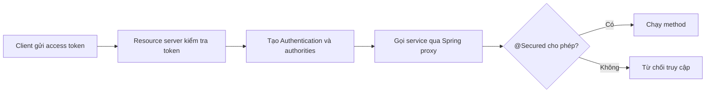

# @Secured và role mapping

Trong module **SECURITY_TOKEN_SECURITY_FUNDAMENTALS**, token bảo mật là bằng chứng để API xác định **ai đang gọi** và **được phép làm gì**. Bài này tập trung vào cách Spring Security bảo vệ phương thức Java bằng `@Secured`, cách ánh xạ vai trò (role) trong access token thành `GrantedAuthority` và những ranh giới tin cậy cần giữ khi xác thực, phân quyền bằng JWT, opaque token và OAuth 2.0/OIDC.

## 1. Mục tiêu học tập

Sau bài học, bạn có thể:

- Giải thích vai trò của `@Secured` trong **method security** và phân biệt nó với cơ chế xác thực access token.
- Phân biệt `role`, `authority`, `scope` và `claim`; biết vì sao `ROLE_ADMIN` và `SCOPE_orders.read` không thể tự động thay thế nhau.
- Cấu hình `@EnableMethodSecurity(securedEnabled = true)`, bảo vệ một phương thức và chuyển claim vai trò từ access token đã được xác minh sang `GrantedAuthority`.
- Xác định các tình huống trả về 401/403, nguy cơ gán quyền sai, vấn đề self-invocation và giới hạn của phân quyền theo role.

## 2. Đặt `@Secured` vào đúng vị trí trong luồng bảo mật

Một hệ thống dùng bearer access token thường có các bước:



Đây là **hai quyết định khác nhau**:

1. **Authentication:** Token có hợp lệ, còn hạn và dành cho API này không? Với JWT, resource server xác minh chữ ký và các claim cần thiết như `iss`, `exp`, `nbf` và **phải bảo đảm kiểm tra `aud` theo yêu cầu của API**. Với opaque token, API thường yêu cầu authorization server introspect token và kiểm tra trạng thái/thuộc tính trả về.
2. **Authorization:** Đối tượng `Authentication` sau khi xác thực có quyền cần thiết cho phương thức hay không? `@Secured` chủ yếu xét danh sách `GrantedAuthority`, không tự đọc hoặc tự xác minh token.

**Nguyên tắc:** Không được chuyển một claim tùy ý từ request thành quyền trước khi token được kiểm chứng. Không tin header như `X-Role: ADMIN` do client tự gửi.

### Phân biệt các khái niệm

| Khái niệm | Ý nghĩa | Ví dụ |
|---|---|---|
| **Claim** | Thuộc tính do bên phát hành token đưa vào | `sub`, `aud`, `roles`, `scope` |
| **Scope** | Phạm vi quyền được cấp cho access token/client trong một ngữ cảnh OAuth 2.0 | `orders.read` |
| **Role** | Nhóm trách nhiệm nghiệp vụ của người dùng hoặc tài khoản dịch vụ | `ADMIN`, `SUPPORT` |
| **GrantedAuthority** | Chuỗi quyền Spring Security sử dụng khi ra quyết định | `ROLE_ADMIN`, `SCOPE_orders.read` |
| **`@Secured`** | Ràng buộc quyền truy cập phương thức dựa trên các chuỗi authority | `@Secured("ROLE_ADMIN")` |

Quy ước thông dụng trong Spring Security: role nội bộ `ADMIN` được biểu diễn thành authority `ROLE_ADMIN`; scope OAuth 2.0 `orders.read` thường thành `SCOPE_orders.read`. Đây là **quy ước ánh xạ**, không có nghĩa IdP nào cũng phát hành token theo các tên đó.

**Access token** là loại token thích hợp để resource server ra quyết định truy cập API. **Refresh token** dùng để xin access token mới, không phải chứng từ để gọi API nghiệp vụ. **ID token** trong OIDC mô tả phiên xác thực cho client, không nên sử dụng thay access token để phân quyền API. Dù JWT và opaque token khác về cách kiểm chứng, `@Secured` vẫn nhìn vào `Authentication.getAuthorities()` sau bước xác thực.

## 3. Bật method security và sử dụng `@Secured`

Với Spring Security hiện đại sử dụng `@EnableMethodSecurity`, hỗ trợ `@PreAuthorize` thường được bật mặc định nhưng **`@Secured` phải được bật riêng**:

```java
import org.springframework.context.annotation.Configuration;
import org.springframework.security.config.annotation.method.configuration.EnableMethodSecurity;

@Configuration
@EnableMethodSecurity(securedEnabled = true)
public class MethodSecurityConfig {
}
```

Annotate service bằng `org.springframework.security.access.annotation.Secured`:

```java
import org.springframework.security.access.annotation.Secured;
import org.springframework.stereotype.Service;

@Service
public class MaintenanceService {

    @Secured("ROLE_ADMIN")
    public String adminReport() {
        return "Báo cáo quản trị";
    }

    @Secured({"ROLE_ADMIN", "ROLE_AUDITOR"})
    public String auditSummary() {
        return "Tóm tắt kiểm toán";
    }
}
```

- `adminReport()` yêu cầu authority **chính xác** `ROLE_ADMIN`.
- `auditSummary()` cho phép **một trong hai** authority `ROLE_ADMIN` **hoặc** `ROLE_AUDITOR` (logic OR).
- `@Secured("ADMIN")` không tương đương `@Secured("ROLE_ADMIN")` nếu `Authentication` chỉ có `ROLE_ADMIN`. Hãy thống nhất quy ước tên authority.
- Có thể đặt `@Secured` ở mức lớp để áp dụng cho nhiều phương thức, sau đó đặt annotation cụ thể ở phương thức cần quy tắc riêng.
- Hỗ trợ `@Secured` dựa vào Spring AOP/proxy ở cấu hình mặc định. Phương thức phải được gọi **qua bean do Spring quản lý** để kiểm tra quyền chạy.

Ví dụ service `MaintenanceService` chỉ minh họa ranh giới phân quyền; trong dự án thực, logic nghiệp vụ bên trong phương thức cần kiểm soát lỗi, giao dịch và quyền dữ liệu phù hợp.

### `@Secured` khác gì `@PreAuthorize`?

| Nhu cầu | `@Secured` | `@PreAuthorize` |
|---|---|---|
| Chỉ ADMIN được gọi | `@Secured("ROLE_ADMIN")` | `@PreAuthorize("hasRole('ADMIN')")` |
| ADMIN **hoặc** AUDITOR | `@Secured({"ROLE_ADMIN", "ROLE_AUDITOR"})` | `@PreAuthorize("hasAnyRole('ADMIN', 'AUDITOR')")` |
| ADMIN **và** có scope cụ thể | Không diễn đạt trực tiếp logic AND | `@PreAuthorize("hasRole('ADMIN') and hasAuthority('SCOPE_reports.export')")` |
| Kiểm tra chủ sở hữu bản ghi | Không phù hợp | `@PreAuthorize("@documentPolicy.canRead(authentication, #id)")` |

`@Secured` nhận danh sách tên authority, **không phân tích biểu thức SpEL** như `@PreAuthorize`. Cần phối hợp role, scope, tenant, ownership hoặc điều kiện trên tham số thì chọn cơ chế biểu thức/chính sách chi tiết hơn.

## 4. Role mapping từ JWT sang `GrantedAuthority`

Giả sử authorization server phát hành một **access token** đã được kiểm chứng với payload minh họa:

```json
{
  "iss": "https://idp.example.test/realms/acme",
  "aud": ["orders-api"],
  "sub": "user-123",
  "scope": "orders.read orders.write",
  "roles": ["SUPPORT"]
}
```

Ví dụ chỉ mô tả các claim liên quan; một JWT thực còn có header, chữ ký và các claim thời gian cần thiết. Token này **không tự có** `ROLE_SUPPORT` trong Spring. Ứng dụng cần thực hiện ánh xạ:

| Dữ liệu đầu vào đã tin cậy | Mapping | Authority cuối cùng |
|---|---|---|
| `scope: "orders.read orders.write"` | `JwtGrantedAuthoritiesConverter` mặc định | `SCOPE_orders.read`, `SCOPE_orders.write` |
| `roles: ["SUPPORT"]` | Converter do ứng dụng định nghĩa | `ROLE_SUPPORT` |
| `roles: ["ADMIN"]` | Converter với chính sách role được phép | `ROLE_ADMIN` |
| Không có `roles` | Không tự suy ra role | Chỉ có các authority khác đã được cấp |

### Ví dụ cấu hình Spring Resource Server

Đoạn cấu hình sau giữ mapping scope mặc định và chỉ ánh xạ **role đã được ứng dụng cho phép**. Ví dụ giả định claim `roles` là mảng chuỗi thuộc access token do **issuer tin cậy** phát hành, với `aud` phù hợp resource server:

```java
import java.util.HashSet;
import java.util.List;
import java.util.Set;

import org.springframework.context.annotation.Bean;
import org.springframework.context.annotation.Configuration;
import org.springframework.core.convert.converter.Converter;
import org.springframework.security.authentication.AbstractAuthenticationToken;
import org.springframework.security.config.annotation.method.configuration.EnableMethodSecurity;
import org.springframework.security.config.annotation.web.builders.HttpSecurity;
import org.springframework.security.core.GrantedAuthority;
import org.springframework.security.core.authority.SimpleGrantedAuthority;
import org.springframework.security.oauth2.jwt.Jwt;
import org.springframework.security.oauth2.server.resource.authentication.JwtAuthenticationToken;
import org.springframework.security.oauth2.server.resource.authentication.JwtGrantedAuthoritiesConverter;
import org.springframework.security.web.SecurityFilterChain;

@Configuration
@EnableMethodSecurity(securedEnabled = true)
public class SecurityConfig {

    @Bean
    SecurityFilterChain securityFilterChain(
            HttpSecurity http,
            Converter<Jwt, ? extends AbstractAuthenticationToken> jwtConverter
    ) throws Exception {
        http.authorizeHttpRequests(requests -> requests
                .anyRequest().authenticated()
        ).oauth2ResourceServer(resourceServer -> resourceServer
                .jwt(jwt -> jwt.jwtAuthenticationConverter(jwtConverter))
        );
        return http.build();
    }

    @Bean
    Converter<Jwt, AbstractAuthenticationToken> jwtConverter() {
        JwtGrantedAuthoritiesConverter scopeConverter =
                new JwtGrantedAuthoritiesConverter();
        Set<String> supportedRoles = Set.of("ADMIN", "SUPPORT", "AUDITOR");

        return jwt -> {
            Set<GrantedAuthority> authorities =
                    new HashSet<>(scopeConverter.convert(jwt));

            List<String> roles = jwt.getClaimAsStringList("roles");
            if (roles != null) {
                roles.stream()
                        .filter(supportedRoles::contains)
                        .map(role -> new SimpleGrantedAuthority("ROLE_" + role))
                        .forEach(authorities::add);
            }

            return new JwtAuthenticationToken(jwt, authorities);
        };
    }
}
```

Cấu hình decoder có thể bắt đầu bằng issuer tin cậy:

```yaml
spring:
  security:
    oauth2:
      resourceserver:
        jwt:
          issuer-uri: https://idp.example.test/realms/acme
```

**Còn một bước bắt buộc trong hệ thống thực:** cấu hình **audience validation** để chỉ chấp nhận access token dành cho API này, chẳng hạn `orders-api`. Chỉ cấu hình `issuer-uri` không nên được xem là đã đủ ràng buộc audience. Cách khai báo audience phụ thuộc phiên bản Spring Boot/Spring Security; có thể dùng cấu hình hỗ trợ sẵn hoặc thêm `OAuth2TokenValidator<Jwt>` cho `aud`.

Lưu ý về ví dụ:

- `scopeConverter.convert(jwt)` giữ lại `SCOPE_*`; nếu thay toàn bộ danh sách bằng roles sẽ vô tình làm mất kiểm soát theo scope.
- Tập `supportedRoles` là danh sách vai trò **được hệ thống chấp nhận**, không phải cơ chế xác thực. Nguồn quyền thực tế vẫn phải do issuer tin cậy quyết định. Tránh biến mọi chuỗi trong token thành vai trò đặc quyền mà không có quy tắc.
- Việc chuyển `SUPPORT` thành `ROLE_SUPPORT` xảy ra **một lần tại ranh giới authentication**, giúp mọi service dùng cùng tên quyền.
- Nếu hệ thống có nhiều issuer, tenant hoặc client, cần chính sách mapping riêng theo ngữ cảnh tin cậy; cùng chữ `ADMIN` từ hai nơi không mặc nhiên có cùng phạm vi quyền.
- Trước khi triển khai, đảm bảo dependency resource-server, JWT và method-security tương thích phiên bản Spring đang dùng.

### Từ token đến method: một tình huống cụ thể

Giả sử request `GET /audits/summary` đã được xác thực bằng JWT có `roles: ["SUPPORT"]` và `scope: "orders.read"`. Converter sinh:

```text
Authentication
  principal  = Jwt(sub=user-123)
  authorities:
    - ROLE_SUPPORT
    - SCOPE_orders.read
```

Nếu endpoint gọi `MaintenanceService.auditSummary()`, `@Secured({"ROLE_ADMIN", "ROLE_AUDITOR"})` **từ chối** vì không có role nào khớp. Có `SCOPE_orders.read` không giúp vượt qua yêu cầu `ROLE_ADMIN` hoặc `ROLE_AUDITOR`. Tương tự, role quản trị không tự động cấp scope ghi đơn hàng nếu hệ thống còn kiểm tra scope ở lớp khác.

## 5. Role mapping với OAuth 2.0/OIDC và opaque token

**Không có chuẩn chung bắt buộc mọi provider đặt roles vào claim `roles`.** Trong thực tế:

- Một IdP có thể phát hành claim `roles`, `groups` hoặc `permissions`.
- Một số provider dùng cấu trúc lồng nhau, ví dụ `realm_access.roles` hoặc `resource_access.<client>.roles`. Cần đọc đúng cấu trúc do provider cam kết, kiểm tra kiểu dữ liệu và xác định role thuộc realm hay ứng dụng nào.
- Đăng nhập OIDC trên ứng dụng client có thể tạo `OidcUser` và authority từ `OidcUserService`/`GrantedAuthoritiesMapper`. Đó là luồng khác với **resource server nhận bearer JWT** và dùng `JwtAuthenticationConverter`; đừng áp dụng nhầm converter của bên này cho bên kia.
- Với **opaque access token**, resource server nhận kết quả introspection từ authorization server. Nếu cần `ROLE_*`, hãy ánh xạ các thuộc tính introspection đáng tin cậy sang authorities ở bước tạo `Authentication` (chẳng hạn thông qua `OpaqueTokenIntrospector` hoặc lớp adapter thích hợp với phiên bản). `@Secured` không cần biết token ban đầu là JWT hay opaque.

Ví dụ chính sách mapping được đội bảo mật và nghiệp vụ thống nhất:

| Thuộc tính từ nguồn tin cậy | Vai trò của ứng dụng | Quyền service |
|---|---|---|
| `roles = ["support_agent"]` | `ROLE_SUPPORT` | Xem các màn hình hỗ trợ được phép |
| `roles = ["security_auditor"]` | `ROLE_AUDITOR` | Xem báo cáo kiểm toán |
| `roles = ["platform_admin"]` | `ROLE_ADMIN` | Thực hiện chức năng quản trị đã chỉ định |

Tên claim và mapping trong bảng chỉ là ví dụ thiết kế. Tránh tự động viết hoa tên nhóm ngoài hệ thống rồi thêm `ROLE_` nếu chưa có chính sách chuyển đổi rõ ràng.

## 6. Kết hợp method security với bảo vệ token và dữ liệu

`@Secured` là một lớp kiểm soát hữu ích, nhưng quyết định cho phép gọi method có ý nghĩa **chỉ sau khi token đã đi qua đúng chuỗi kiểm chứng**.

**Ở lớp token/resource server:**

1. Dùng HTTPS và xác nhận bearer token đến qua kênh được hỗ trợ.
2. Với JWT, xác minh chữ ký, thuật toán/khóa hợp lệ, issuer, thời hạn và audience; không chấp nhận thuật toán hoặc issuer tùy tiện từ token.
3. Với opaque token, introspect qua kênh tin cậy và chỉ chấp nhận token đang active, đúng mục đích/API theo chính sách.
4. Tránh lưu access token trong log, URL, exception hoặc nơi không bảo vệ; có chiến lược thời hạn ngắn, thu hồi và xử lý token bị đánh cắp. Thu hồi refresh token **không tự động vô hiệu hóa** mọi JWT access token còn hạn nếu không có cơ chế bổ sung.

**Ở lớp method và dữ liệu:**

1. Chuyển role/scope từ nguồn tin cậy thành authority theo mapping tường minh.
2. Dùng `@Secured` cho cổng quyền theo vai trò, ví dụ chỉ bộ phận kiểm toán được gọi chức năng lấy báo cáo.
3. Kiểm tra quyền trên **tài nguyên cụ thể** ở policy/domain layer: người dùng có được xem đơn hàng `orderId` thuộc tenant đó không? `ROLE_SUPPORT` tự nó không chứng minh quyền với mọi bản ghi.
4. Giữ logic phân quyền ở server, không dựa vào việc nút giao diện bị ẩn hay frontend tự nhận vai trò.

### Vì sao cần kiểm tra tenant và ownership?

Giả sử hai người cùng có `ROLE_SUPPORT` nhưng thuộc hai tenant A và B. Nếu method chỉ dùng:

```java
@Secured("ROLE_SUPPORT")
public String getTicket(String ticketId) {
    // Đọc dữ liệu ticket ...
    return ticketId;
}
```

thì cả hai đều vượt qua **kiểm tra role**, dù một người có thể không được phép xem ticket của tenant còn lại. Cần thêm policy kiểm tra tenant/ownership trong service hoặc dùng `@PreAuthorize` với policy bean:

```java
@PreAuthorize("hasRole('SUPPORT') and @ticketPolicy.canRead(authentication, #ticketId)")
public TicketDto readTicket(String ticketId) {
    return ticketService.read(ticketId);
}
```

`TicketPolicy` và `TicketService` ở ví dụ này là thành phần nghiệp vụ giả định; quy tắc phải dựa trên dữ liệu và chủ thể đã xác thực.

## 7. Các lỗi hay gặp

| Hiện tượng | Nguyên nhân thường gặp | Cách xử lý |
|---|---|---|
| Có claim `roles: ["ADMIN"]` nhưng `@Secured("ROLE_ADMIN")` trả 403 | Chưa chuyển claim thành `GrantedAuthority("ROLE_ADMIN")` | Kiểm tra converter và `Authentication.getAuthorities()` |
| Dùng `@Secured("ADMIN")` nhưng authorities là `ROLE_ADMIN` | Không thống nhất prefix | Dùng tên authority khớp chính xác |
| Annotation không có tác dụng | Chưa bật `securedEnabled` hoặc method không chạy qua Spring proxy | Bật cấu hình, gọi qua bean được quản lý |
| `this.adminReport()` trong cùng service không bị chặn như mong đợi | **Self-invocation** bỏ qua proxy trong cấu hình AOP thông thường | Tách chức năng có bảo vệ sang bean riêng và gọi qua bean đó |
| Token có scope đúng nhưng thiếu role | Scope và role là hai authority khác nhau | Xem lại yêu cầu nghiệp vụ, không tự động coi scope là role |
| User vừa bị gỡ role nhưng JWT cũ vẫn còn quyền | JWT đã phát hành chứa claim cũ, chưa hết hạn/chưa bị vô hiệu hóa | Access token ngắn hạn, chiến lược revocation hoặc kiểm tra quyền hiện thời cho thao tác nhạy cảm |
| Role đúng nhưng truy cập nhầm tenant | Chỉ kiểm tra role, chưa kiểm tra đối tượng dữ liệu | Thêm kiểm soát ownership/tenant ở domain policy |

**401 và 403:** Với API dùng bearer token, request thiếu token hoặc token không hợp lệ thường nhận **401 Unauthorized**. Request đã xác thực nhưng thiếu authority cần thiết thường nhận **403 Forbidden**. Giá trị status cuối cùng còn phụ thuộc cấu hình entry point, exception handling và vị trí từ chối truy cập.

**Phạm vi proxy:** Đừng dựa vào `@Secured` trên phương thức `private` hoặc những lời gọi nội bộ không đi qua proxy; với `final` cũng cần hiểu giới hạn kiểu proxy. Đặt kiểm soát tại ranh giới method có thể được Spring intercept và kiểm tra đường gọi thực tế.

## 8. Kiểm thử cả mapping lẫn quyết định phân quyền

Một test chỉ gán sẵn `ROLE_ADMIN` bằng `@WithMockUser(roles = "ADMIN")` xác nhận method security, **chưa chứng minh** converter đọc JWT đúng. Hãy kiểm thử hai lớp độc lập và thêm kiểm thử tích hợp nếu luồng token quan trọng.

| Dữ liệu/điều kiện | Phương thức | Kết quả mong đợi |
|---|---|---|
| Authorities chứa `ROLE_ADMIN` | `adminReport()` | Cho phép |
| Chỉ chứa `ROLE_AUDITOR` | `adminReport()` | Từ chối |
| Chỉ chứa `ROLE_AUDITOR` | `auditSummary()` | Cho phép |
| Chỉ chứa `SCOPE_orders.read` | `auditSummary()` | Từ chối |
| JWT hợp lệ với `roles: ["ADMIN"]` | Qua converter rồi `adminReport()` | Authority có `ROLE_ADMIN`, cho phép |
| JWT có `roles` sai kiểu hoặc role không được hỗ trợ | Qua converter | Không phát sinh role đặc quyền |
| JWT sai issuer/audience/hết hạn | Gọi API được bảo vệ | Bị chặn ở lớp xác thực token |

Ví dụ test cấp service cho method security (giả định test context nạp `SecurityConfig` và dependency `spring-security-test`):

```java
@SpringBootTest
class MaintenanceSecurityTest {

    @Autowired
    MaintenanceService service;

    @Test
    @WithMockUser(roles = "ADMIN")
    void adminCanViewAdminReport() {
        assertThat(service.adminReport()).isEqualTo("Báo cáo quản trị");
    }

    @Test
    @WithMockUser(roles = "AUDITOR")
    void auditorCannotViewAdminReport() {
        assertThatThrownBy(() -> service.adminReport())
                .isInstanceOf(AccessDeniedException.class);
    }
}
```

Các import kiểm thử tương ứng gồm `@Test` (JUnit Jupiter), `@Autowired`, `@SpringBootTest`, `@WithMockUser`, `AccessDeniedException` và các assertion AssertJ. Đây là bài kiểm tra *quy tắc method*, không thay thế test decoder hoặc kiểm tra chữ ký/audience của JWT. Nếu dùng MockMvc với token mock, cần phân biệt authorities do test tự gán với authorities do **converter thật** tạo.

## 9. Những nguyên tắc thiết kế cần ghi nhớ

- **Issuer chịu trách nhiệm cấp quyền**, resource server chịu trách nhiệm kiểm chứng token và áp dụng chính sách. Client không được quyết định role bằng dữ liệu tự nhập.
- **Mapping nhất quán:** Các service dùng cùng khái niệm role cần thỏa thuận tên, prefix và nguồn claim. Map rõ ràng giúp tránh một claim có nhiều nghĩa.
- **Tối thiểu quyền:** Không biến mọi nhóm bên IdP thành `ROLE_ADMIN`; không cho phép token của API khác qua audience sai; không suy role từ scope theo cách làm rộng quyền ngoài chính sách.
- **Chọn đúng loại ràng buộc:** `@Secured` phù hợp kiểm tra đơn giản theo authority; `@PreAuthorize` hoặc domain policy phù hợp điều kiện AND, scope, ownership, tenant và dữ liệu động.
- **Kiểm tra tại điểm sử dụng:** Ẩn chức năng trên UI và chặn URL là hữu ích, nhưng method chứa hành động nhạy cảm vẫn phải có kiểm soát phù hợp với đường gọi của nó.
- **Xét vòng đời token:** Khi đổi hoặc thu hồi quyền, xác định thời điểm quyền mới có hiệu lực đối với token còn hạn, và biện pháp giảm thiểu access token bị đánh cắp hoặc phát lại.

## 10. Tự luyện tập

1. Cho access token có `scope: "reports.read"` và `roles: ["AUDITOR"]`. Hãy liệt kê authorities sau converter ở mục 4 và xác định người gọi có qua được `@Secured("ROLE_ADMIN")` hay `@Secured({"ROLE_ADMIN", "ROLE_AUDITOR"})` không.
2. Thay payload thành `roles: ["admin"]` (chữ thường). Giải thích vì sao converter ví dụ **không** tự cấp `ROLE_ADMIN` và cách xây chính sách mapping rõ ràng nếu IdP thật sự quy ước `admin`.
3. Một controller gọi `ticketService.readTicket(ticketId)` và người dùng có `ROLE_SUPPORT`. Hãy mô tả chính sách bổ sung để ngăn đọc ticket của tenant khác.
4. Viết test chứng minh: (a) user có `ROLE_AUDITOR` được gọi `auditSummary()`; (b) user chỉ có `SCOPE_orders.read` bị từ chối; (c) JWT có audience sai không thể tới bước gọi service.

**Tự kiểm tra:** Nếu bạn giải thích được đường đi **access token được kiểm chứng → claims được ánh xạ có kiểm soát → `GrantedAuthority` → `@Secured` → policy dữ liệu**, bạn đã nắm được vị trí của method security trong mô hình tin cậy của token.
