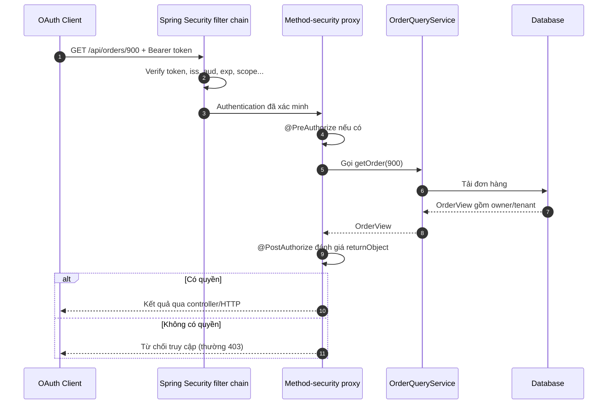

# @PostAuthorize: kiểm tra quyền sau khi phương thức trả kết quả

## 1. Vấn đề mà `@PostAuthorize` giải quyết

Trong Spring Security, một HTTP request có thể đã vượt qua bước **xác thực access token** nhưng người gọi vẫn không được phép xem một đối tượng cụ thể. Ví dụ: access token JWT mang scope `orders:read`, đúng issuer (`iss`) và audience (`aud`) của Orders API; tuy nhiên đơn hàng được yêu cầu lại thuộc một khách hàng khác.

Một bộ kiểm tra `hasAuthority('SCOPE_orders:read')` cho biết token có quyền đọc đơn hàng **theo chức năng**, chứ chưa chứng minh quyền đọc **đơn hàng số 900**. Khi quyết định phụ thuộc dữ liệu do phương thức trả về, Spring Security cung cấp annotation **`@PostAuthorize`** để kiểm tra quyền **sau khi phương thức thực thi thành công nhưng trước khi kết quả được trao cho bên gọi qua proxy bảo mật**.

Ví dụ ý tưởng:

```java
@PostAuthorize("returnObject.ownerSubject == authentication.name")
public OrderView getOrder(long id) {
    return repository.findViewById(id)
        .orElseThrow(() -> new OrderNotFoundException(id));
}
```

Chú ý: biểu thức trên **chỉ nhằm giới thiệu cú pháp**, không nên sao chép làm chính sách production khi hệ thống có nhiều issuer/tenant hoặc `Authentication.getName()` không phải verified `sub`. Phần sau sẽ xây một policy đối chiếu **issuer + subject + tenant** và kết hợp kiểm tra scope.

Mục tiêu bài học:

- Nắm thời điểm thực thi `@PostAuthorize` và giá trị đặc biệt `returnObject` trong SpEL.
- Phân biệt `@PostAuthorize` với `@PreAuthorize`, `@PostFilter` và quyền ở URL.
- Hiểu sự liên hệ giữa `Authentication`, principal, `sub`, authorities, JWT/opaque token và quyền sở hữu đối tượng.
- Biết khi nào **không nên** dùng hậu kiểm, nhất là phương thức ghi dữ liệu hoặc có side effect.
- Triển khai, kiểm thử và vận hành method security trong Spring Security 6+ theo nguyên tắc fail closed.

## 2. Luồng xác thực và phân quyền trong Resource Server

`@PostAuthorize` **không xác minh chữ ký token**. Nó chạy trên `Authentication` mà hệ thống bảo mật đã tạo sau khi kiểm tra token hoặc phiên theo cấu hình.

Với một OAuth 2.0 Resource Server:

1. Client gửi access token qua `Authorization: Bearer ...` trên HTTPS.
2. Spring Security Resource Server xác minh JWT bằng khóa công khai đáng tin hoặc kiểm tra opaque token qua introspection.
3. RS phải kiểm tra **`iss`, `aud`, thời hạn, loại token/profile** và sender constraint như DPoP/mTLS nếu được áp dụng.
4. Spring tạo `Authentication` và ánh xạ scope/claims sang `GrantedAuthority`.
5. Khi bean service được gọi qua Spring AOP proxy, method security có thể kiểm tra **trước** khi chạy (`@PreAuthorize`) và **sau** khi trả về (`@PostAuthorize`).
6. Nếu hậu kiểm từ chối, method security ném lỗi truy cập, không trao kết quả cho caller bình thường.



**Phân biệt 401 và 403:** thiếu/sai/hết hạn access token thường dẫn tới **401 Unauthorized**; đã xác thực thành công nhưng không đủ quyền thường dẫn tới **403 Forbidden**. Với kiểm tra owner, ứng dụng có thể dùng **404 Not Found** để hạn chế tiết lộ sự tồn tại tài nguyên, nhưng phải thiết kế có chủ đích; `@PostAuthorize` mặc định không tự biến từ chối thành 404.

## 3. Cú pháp và ngữ nghĩa của `@PostAuthorize`

`@PostAuthorize` nhận một **Spring Expression Language (SpEL)** expression. Khi expression đánh giá thành true, kết quả được phép trả về; nếu false, quyền bị từ chối theo cơ chế method security.

```java
import org.springframework.security.access.prepost.PostAuthorize;

@PostAuthorize("returnObject != null and returnObject.published")
public DocumentView readPublishedDocument(long documentId) {
    return documentService.load(documentId);
}
```

Ở đây `returnObject` là đối tượng mà phương thức trả về sau khi thực thi. Các thuộc tính trong expression phải phù hợp với kiểu object thật và cách Spring Expression truy cập property.

### Các biến và hàm thường gặp

| Biểu thức / biến | Ý nghĩa | Cạm bẫy |
| --- | --- | --- |
| `returnObject` | Kết quả của phương thức được bảo vệ | Có thể `null`; kiểu có thể là DTO, entity, `Optional`, `ResponseEntity`… |
| `authentication` | `Authentication` hiện tại trong security context | `getName()` không mặc nhiên là subject chuẩn để lưu DB |
| `principal` | Đối tượng principal của authentication | Với JWT thường là `Jwt`, nhưng ở opaque/session/OIDC login có kiểu khác |
| `hasAuthority('SCOPE_orders:read')` | Kiểm tra chính xác một authority | Chỉ kiểm tra phạm vi chức năng, chưa kiểm tra owner/tenant |
| `hasRole('ADMIN')` | Theo convention thường kiểm tra `ROLE_ADMIN` | `ROLE_ADMIN` không tự sinh từ mọi claim `roles` |
| `@beanName.method(...)` | Gọi bean policy trong Spring container | Bean phải thực hiện quyết định đáng tin, tránh nhận bừa ID từ request |
| `#orderId` | Tham số phương thức nếu Spring tìm được tên tham số | Tên tham số cần được giữ qua compiler metadata hoặc dùng `@P` |
| `hasPermission(...)` | Gọi `PermissionEvaluator` hoặc cơ chế được cấu hình | Không tự có ACL của nghiệp vụ nếu chưa triển khai |

SpEL cho phép kết hợp điều kiện với `and`, `or`, `!`, so sánh và truy cập property. Với logic phân quyền phức tạp, **ưu tiên bean policy Java có kiểu dữ liệu rõ ràng** thay vì viết một chuỗi SpEL dài chứa nhiều so sánh nhạy cảm.

### Hậu kiểm với giá trị null

Nếu service có thể trả `null`, biểu thức như `returnObject.ownerId` có thể gây lỗi biểu thức hoặc hành vi không mong muốn. Đặt quy tắc **fail closed**:

```java
@PostAuthorize("returnObject != null and returnObject.ownerId == authentication.name")
public OrderView findOrder(long id) {
    // Chỉ minh họa cú pháp trong hệ thống một issuer,
    // khi authentication.name đã được xác định rõ là owner ID.
    return repository.findViewById(id).orElse(null);
}
```

Trong thiết kế REST thông thường, trường hợp không có bản ghi nên được xử lý nhất quán (`404`) trong service/controller; không nên tùy tiện dùng `null` để đại diện “không có quyền”.

## 4. `@PostAuthorize` khác `@PreAuthorize` và `@PostFilter` như thế nào?

| Cơ chế | Thời điểm | Dữ liệu có thể xét | Trường hợp phù hợp |
| --- | --- | --- | --- |
| `@PreAuthorize` | **Trước** khi gọi method | Authentication và tham số gọi | Kiểm tra scope, role, tenant/request ID trước khi truy vấn hoặc cập nhật |
| `@PostAuthorize` | **Sau** khi method trả về thành công | Authentication, tham số và `returnObject` | Xem dữ liệu trả về có thuộc người gọi không, với method đọc không có side effect |
| `@PreFilter` | Trước gọi, lọc một tập tham số có hỗ trợ | `filterObject` và cấu hình filter target | Trường hợp đặc thù cần loại phần tử đầu vào, không phải thay validation nghiệp vụ |
| `@PostFilter` | Sau gọi, lọc từng phần tử trong collection có hỗ trợ | `filterObject` | Chỉ thích hợp cho collection nhỏ, không thay việc lọc quyền trong DB |
| HTTP `authorizeHttpRequests` | Trong security filter chain | URL, HTTP method, Authentication | Chặn trước các endpoint API nhưng không nhìn thấy DTO được trả về từ service |

Ví dụ kết hợp hai pha:

```java
@PreAuthorize("hasAuthority('SCOPE_orders:read')")
@PostAuthorize("@orderAccess.canRead(authentication, returnObject)")
public OrderView getOrder(UUID id) {
    return orderRepository.findViewById(id)
        .orElseThrow(() -> new OrderNotFoundException(id));
}
```

- Không có `SCOPE_orders:read` → **không gọi** method.
- Có scope nhưng không có quyền với record → method đọc được gọi, **kết quả bị chặn** bởi `@PostAuthorize`.
- Có scope và đúng owner/tenant → trả về kết quả.

**Không dùng `@PostFilter` để che thiếu kiểm tra tại database:** lọc sau khi tải hàng nghìn record sẽ tốn tài nguyên; còn có nguy cơ lộ thông tin qua tổng số record, phân trang, sắp xếp, cache hoặc log. Với danh sách lớn, truy vấn database phải được giới hạn theo principal/tenant **ngay từ đầu**.

## 5. Kích hoạt method security trong Spring Security 6+

Trong Spring Security 6+, cấu hình phổ biến là `@EnableMethodSecurity`. Đây là bước **riêng** so với việc cấu hình `SecurityFilterChain`.

```java
import org.springframework.context.annotation.Configuration;
import org.springframework.security.config.annotation.method.configuration.EnableMethodSecurity;

@Configuration
@EnableMethodSecurity(prePostEnabled = true)
public class MethodSecurityConfig {
}
```

Trong `@EnableMethodSecurity`, hỗ trợ pre/post annotations thường đã bật theo mặc định; khai báo `prePostEnabled = true` ở đây để làm rõ ý đồ.

Ví dụ filter chain của Resource Server JWT:

```java
import org.springframework.context.annotation.Bean;
import org.springframework.context.annotation.Configuration;
import org.springframework.http.HttpMethod;
import org.springframework.security.config.annotation.web.builders.HttpSecurity;
import org.springframework.security.web.SecurityFilterChain;

@Configuration
public class ApiSecurity {
    @Bean
    SecurityFilterChain filterChain(HttpSecurity http) throws Exception {
        http
            .authorizeHttpRequests(auth -> auth
                .requestMatchers(HttpMethod.GET, "/api/orders/**").authenticated()
                .anyRequest().denyAll()
            )
            .oauth2ResourceServer(oauth2 -> oauth2.jwt(jwt -> {}));

        return http.build();
    }
}
```

**Điều chưa có trong ví dụ:** issuer/JWKS, audience, JWT access-token type/profile, token lifetime và các quyền API khác cần được cấu hình đầy đủ ở decoder/validator. `@PostAuthorize` **không bù được** lỗ hổng ở bước xác minh token. Trong production, thường đặt quy tắc scope ngay ở method `@PreAuthorize` hoặc cả URL và method để tránh một đường gọi nội bộ bỏ qua URL policy.

### Spring AOP proxy là điều kiện thực thi

Method security thường triển khai qua **AOP proxy**:

- Method được gọi qua bean do Spring quản lý và proxy bảo mật thì annotation mới được đánh giá.
- Gọi nội bộ **`this.getOrder(...)`** từ một method khác trong cùng object (**self-invocation**) thường bỏ qua proxy; `@PostAuthorize` có thể không chạy.
- Không trông đợi bảo vệ proxy trên private/final/static method hoặc object tạo trực tiếp bằng `new` mà không qua container. Chi tiết proxy tùy cấu hình JDK proxy/CGLIB và phiên bản Spring.
- Annotation trên method của service cần được đặt tại nơi Spring có thể phát hiện và proxy; không chỉ đặt trên một helper bị gọi trực tiếp.
- Với bất đồng bộ, reactive, hoặc method trả wrapper khác, phải kiểm tra chính xác **kiểu kết quả** mà advice đánh giá. Ví dụ trong bài giả định **Spring MVC/Servlet và method đồng bộ trả một đối tượng**.

Đối với luồng đặc biệt, cần dùng cách tích hợp method-security phù hợp thay vì tự suy luận rằng một annotation luôn được thực thi trên mọi lời gọi Java.

## 6. Kịch bản thực tế: đọc đơn hàng theo issuer, subject và tenant

Trong hệ thống nhiều tenant, `sub` không được xem là user ID toàn cầu. Hai Authorization Server khác nhau có thể phát cùng `sub="123"` cho hai chủ thể khác nhau. Vì vậy quyết định quyền đọc đơn hàng nên xét:

1. Token đã được **RS xác thực** với `iss`, `aud` và các điều kiện JWT/opaque token cần thiết.
2. Chủ thể của token là human user hợp lệ, không phải một machine token dùng nhầm.
3. Người gọi có `SCOPE_orders:read`.
4. Bản ghi được gắn với **issuer và subject** đúng.
5. Tenant trong token thuộc chính sách AS/RS và khớp tenant của bản ghi, hoặc có quyền quản trị cross-tenant được định nghĩa riêng.

Ví dụ read model sau được tạo từ dữ liệu database đáng tin:

```java
import java.math.BigDecimal;
import java.util.UUID;

public record OrderView(
    UUID id,
    String ownerIssuer,
    String ownerSubject,
    String tenantId,
    BigDecimal total
) {}
```

Đây là **read model nội bộ để hậu kiểm**. Không nhất thiết trả toàn bộ các trường owner/tenant ra response JSON cho khách hàng. Controller có thể map `OrderView` đã được authorize thành public DTO ít dữ liệu hơn.

### 6.1. Bean kiểm tra quyền trên đối tượng

```java
import org.springframework.security.core.Authentication;
import org.springframework.security.oauth2.server.resource.authentication.JwtAuthenticationToken;
import org.springframework.stereotype.Component;

@Component("orderAccess")
public class OrderAccessPolicy {

    public boolean canRead(Authentication authentication, OrderView order) {
        if (order == null ||
            !(authentication instanceof JwtAuthenticationToken token) ||
            !token.isAuthenticated()) {
            return false;
        }

        var jwt = token.getToken();

        if (jwt.getIssuer() == null ||
            jwt.getSubject() == null ||
            jwt.getSubject().isBlank()) {
            return false;
        }

        String tenant = jwt.getClaimAsString("tenant_id");
        if (tenant == null || tenant.isBlank()) {
            return false;
        }

        // jwt đã đi qua JwtDecoder và các validator đáng tin.
        // ownerIssuer/ownerSubject/tenantId lấy từ DB, không từ request.
        return jwt.getIssuer().toString().equals(order.ownerIssuer())
            && jwt.getSubject().equals(order.ownerSubject())
            && tenant.equals(order.tenantId());
    }
}
```

Điểm cần lưu ý:

- Bean policy này là ví dụ dành cho **JWT access token với human subject**. Nếu hệ thống nhận opaque token hoặc session `OidcUser`, cần có adapter chính sách riêng đọc chủ thể từ nguồn xác thực tương ứng.
- `JwtAuthenticationToken` trong ví dụ được giả định tạo bởi **Spring Resource Server đã xác minh đúng issuer, audience, thời hạn, token type và signature**; bản thân `canRead` không xác minh lại chữ ký.
- Claim `tenant_id` chỉ được tin khi AS có hợp đồng phát hành, RS kiểm tra issuer/tenant và mapping tenant hợp lệ. Nếu chưa có claim này, lấy tenant từ mapping subject nội bộ **đã xác thực**, không lấy từ query/header tự khai.
- Với người dùng quản trị được phép xem record của người khác, cần nhánh policy riêng kiểm tra scope, role, tenant và audit. Không thêm ngoại lệ `return true` chỉ vì client truyền `admin=true`.
- Có thể thay đối chiếu text trực tiếp bằng khóa user nội bộ `(verified issuer, subject)` và relationship từ database để phản ánh account disable hoặc ownership change.

### 6.2. Service query được bảo vệ bằng hai annotation

```java
import java.util.UUID;
import org.springframework.security.access.prepost.PostAuthorize;
import org.springframework.security.access.prepost.PreAuthorize;
import org.springframework.stereotype.Service;
import org.springframework.transaction.annotation.Transactional;

@Service
public class OrderQueryService {

    private final OrderRepository orderRepository;

    public OrderQueryService(OrderRepository orderRepository) {
        this.orderRepository = orderRepository;
    }

    @PreAuthorize("hasAuthority('SCOPE_orders:read')")
    @PostAuthorize("@orderAccess.canRead(authentication, returnObject)")
    @Transactional(readOnly = true)
    public OrderView getOrder(UUID id) {
        return orderRepository.findViewById(id)
            .orElseThrow(() -> new OrderNotFoundException(id));
    }
}
```

`OrderRepository` và `OrderNotFoundException` là thành phần của ứng dụng, không phải các type mặc định của Spring Security. Điều kiện URL và bean service cần được triển khai nhất quán; không tạo đường bypass khác để gọi repository rồi trả dữ liệu mà không qua method-security proxy.

**Hạn chế:** ở đây method đọc record **trước** khi hậu kiểm. Vì vậy truy vấn có thể vẫn tốn tài nguyên và tác động tới log/metrics. Với API nhiều tenant hoặc dữ liệu nhạy cảm, mẫu tốt hơn là query được lọc bằng tenant và owner **ngay trong database**, sau đó dùng `@PostAuthorize` như *defense in depth*, chứ không làm tuyến phòng thủ duy nhất.

## 7. Vì sao chỉ so `authentication.name` với owner là chưa đủ?

Ví dụ quen thuộc:

```java
@PostAuthorize("returnObject.ownerId == authentication.name")
public OrderView getOrder(long id) {
    return service.load(id);
}
```

Nó chỉ chính xác khi đã có hợp đồng rõ ràng:

- `authentication.getName()` thực sự bằng **ID owner** cùng định dạng trong DB, không phải email/username hiển thị;
- dữ liệu chỉ thuộc **một issuer/namespace** và không có subject collision;
- phương thức trả một object không null với `ownerId` do DB tin cậy cung cấp;
- không có trường hợp machine token/impersonation/delegation.

Trong Spring Security, `JwtAuthenticationConverter.setPrincipalClaimName(...)` có thể làm `getName()` dựa trên `preferred_username` thay vì `sub`, còn `getPrincipal()` vẫn là `Jwt`. Tên đăng nhập hoặc email có thể đổi và không duy nhất giữa issuer.

**Khuyến nghị:** đặt logic business identity vào `@orderAccess.canRead(authentication, returnObject)`, ánh xạ `(iss, sub)` đã xác minh sang user/tenant nội bộ, rồi kiểm tra ownership tại repository hoặc service.

Đừng coi `client_id` là user ID: access token cấp theo **Client Credentials Flow** có thể đại diện service account, không có con người đứng sau. Đừng dùng **ID Token** ở API chỉ vì claim `sub` trông giống ID của người dùng.

## 8. Khi nào `@PostAuthorize` là lựa chọn phù hợp?

Các trường hợp phù hợp:

- **Truy vấn đơn** trả đúng một DTO hoặc entity đã tải, trong đó owner/tenant chỉ biết chắc sau khi đọc dữ liệu.
- **Đọc tài liệu** với thuộc tính visibility/publication hoặc ACL gắn với document.
- **Đọc resource phụ thuộc quan hệ động** mà policy cần một số thuộc tính của kết quả.
- **Lớp phòng vệ bổ sung** cho repository query đã lọc quyền, giúp phát hiện bug ở tầng truy vấn.

Các trường hợp cần cân nhắc cách khác:

| Trường hợp | Vì sao `@PostAuthorize` có thể không phù hợp | Phương án chính |
| --- | --- | --- |
| `create/update/delete` | Hành động đã chạy trước khi kiểm tra hậu điều kiện | `@PreAuthorize`, policy service trước khi mutate và transaction/database constraints |
| Gửi email, publish event, gọi API ngoài | Side effect không thể “thu hồi” bằng một lỗi 403 sau method | Authorize **trước** khi gửi; outbox/transaction khi áp dụng |
| Truy vấn collection lớn | Hậu kiểm một object collection không cho per-element filtering; `@PostFilter` tốn memory | Query có ràng buộc tenant/owner trong DB |
| Stream, lazy result, pagination | Dữ liệu có thể được tạo/truy cập sau lúc method trả về; số lượng hoặc metadata có thể lộ | Kiểm soát ở data access layer, chọn projection an toàn |
| `Optional` hoặc `ResponseEntity` | `returnObject` là wrapper, không phải entity trực tiếp | Tách method read trả domain object hoặc viết policy rõ kiểu |
| `CompletableFuture`, `Mono`, `Flux` | Thời điểm tạo dữ liệu và tích hợp method-security khác luồng đồng bộ | Dùng biến thể method-security/reactive phù hợp, test đúng framework |
| Có nhiều caller không qua Spring proxy | Self-invocation hoặc object tự khởi tạo bỏ qua advice | Refactor thành bean được proxy, kiểm thử đường gọi thực |

Đối với phương thức đọc đơn, hậu kiểm có thể là một lớp an toàn hiệu quả. Đối với **mutation**, coi `@PostAuthorize` là **không đủ**.

## 9. Cảnh báo quan trọng: side effect đã xảy ra trước khi bị từ chối

Giả sử:

```java
// KHÔNG AN TOÀN: hậu kiểm không ngăn hành động ghi đã chạy.
@PostAuthorize("@orderAccess.canEdit(authentication, returnObject)")
public OrderView transferOrder(UUID id, String newOwner) {
    Order order = repository.findById(id).orElseThrow();
    order.setOwner(newOwner);              // Side effect
    repository.save(order);                // Có thể ghi DB
    notificationService.sendChanged(id);  // Có thể gửi thông báo
    return mapper.toView(order);
}
```

Nếu `@PostAuthorize` sau đó từ chối, việc thay chủ sở hữu hoặc gửi thông báo **có thể đã xảy ra**. Với `@Transactional`, hành vi rollback phụ thuộc thứ tự proxy advice/transaction boundary và thời điểm commit; không thể mặc định mọi side effect sẽ được hoàn tác. Dịch vụ ngoài, email, message broker và audit event đặc biệt không thể tự rollback chỉ bằng exception Java.

Mẫu an toàn hơn:

```java
@PreAuthorize("hasAuthority('SCOPE_orders:write') and " +
              "@orderMutationPolicy.canTransfer(authentication, #id, #newOwner)")
@Transactional
public void transferOrder(UUID id, String newOwner) {
    orderCommandService.performAuthorizedTransfer(id, newOwner);
}
```

**Tiền điều kiện trong ví dụ vẫn cần kiểm tra lại tính nhất quán khi dữ liệu thay đổi**: nếu owner/tenant hoặc trạng thái bản ghi có thể biến đổi giữa check và update (TOCTOU), dùng query update có điều kiện, lock/version hoặc transaction phù hợp. Không coi `@PreAuthorize` là lời giải duy nhất cho race condition.

Với các lệnh nhạy cảm, policy nên được thực thi tại boundary của business operation trước khi side effect không thể đảo ngược; database constraints và logic transaction là các lớp bổ sung.

## 10. `returnObject` với nhiều kiểu trả về

### Trả entity/DTO

```java
@PostAuthorize("returnObject != null and " +
               "@documentAccess.canRead(authentication, returnObject)")
public DocumentView getDocument(long id) {
    return repository.loadView(id);
}
```

Policy có thể truy cập thuộc tính đã load. Tránh kéo lazy association ngay trong SpEL nếu session JPA đóng hoặc nếu truy vấn phát sinh tốn kém. Thay vào đó, tạo read model/projection đủ thông tin cho kiểm tra.

### Trả `Optional<T>`

```java
@PostAuthorize("@orderAccess.canReadOptional(authentication, returnObject)")
public Optional<OrderView> findOrder(UUID id) {
    return repository.findViewById(id);
}
```

Ở đây `returnObject` là **`Optional<OrderView>`**, vì vậy policy phải xử lý đúng `isPresent`/`get` (sau khi kiểm tra tồn tại). Không viết `returnObject.ownerSubject` vì property đó không nằm trên `Optional`. Với REST endpoint, đơn giản hơn thường là service trả `OrderView` hoặc ném not-found exception.

### Trả `ResponseEntity<T>`

Nếu annotate method trả `ResponseEntity<OrderDto>`, `returnObject` là response wrapper, không phải body. Hạn chế đặt authorization trên transport wrapper; chọn service method trả domain/read model và controller chỉ tạo HTTP response **sau khi service authorization thành công**.

### Trả collection

`@PostAuthorize` quyết định **toàn bộ kết quả**, không tự lọc từng item:

```java
@PostAuthorize("@reportAccess.canReadFullReport(authentication, returnObject)")
public List<ReportRow> getReport() {
    return repository.readFullReport();
}
```

Nếu chỉ được xem một phần record, hãy lọc ở query database thay vì trả list rồi trông chờ `@PostAuthorize` xử lý từng phần tử. `@PostFilter` là công cụ khác nhưng không nên là chiến lược chính cho dataset lớn hoặc có phân trang.

## 11. Exceptions, transaction, cache và các đường rò rỉ phụ

`@PostAuthorize` thường ngăn object bị từ chối **được trả qua method proxy**, nhưng không xóa mọi dấu vết của việc method đã thực thi.

- **Query/log:** dữ liệu có thể đã xuất hiện trong SQL log, debug log, trace, metric hoặc exception. Tránh log PII, raw JWT và object nhạy cảm trước khi kiểm tra quyền.
- **Cache:** `@Cacheable`, application cache và HTTP cache là các lớp độc lập. Advice ordering và cache key theo user/tenant cần kiểm thử; không để kết quả chưa được authorize nằm trong cache chia sẻ rồi được trả cho người khác.
- **Transaction:** method có thể kết thúc transaction trước khi hậu kiểm chạy. Không dựa vào `AccessDeniedException` để rollback một write đã commit.
- **Method exception:** nếu method ném exception trước khi có return value, hậu kiểm trên `returnObject` không chạy như với luồng thành công. Xử lý not-found/permission lỗi nhất quán, tránh tiết lộ record existence qua thông điệp khác nhau.
- **Timing:** người gọi có thể đo thời gian khác nhau giữa record tồn tại và không tồn tại. Với dữ liệu cực kỳ nhạy cảm, ưu tiên query giới hạn quyền ngay ở database.
- **Serialization:** chỉ serialize result sau khi method proxy cho phép; không gửi response streaming/flush dữ liệu từng phần rồi mới kiểm tra quyền.
- **Đa tenant:** cache key và truy vấn nên bao gồm tenant/resource/user policy khi cần, không chỉ `id` trùng giữa namespace.

Nếu một service có nhiều entrypoint (REST, scheduler, message consumer), cần rõ ràng **entrypoint nào tạo Authentication và enforcement tại service**. Đối với tác vụ hệ thống, không giả định `SecurityContext` của user tự truyền sang thread bất đồng bộ.

## 12. Principal, subject, authorities và sự khác biệt JWT/opaque token

Phân quyền sau phương thức phải sử dụng thông tin **đã xác minh**:

| Loại request | Principal thường gặp | Định danh nên sử dụng | Kiểm soát bổ sung |
| --- | --- | --- | --- |
| JWT access token với Spring Resource Server | `Jwt` trong `JwtAuthenticationToken` | `(verified iss, sub)` + tenant đã kiểm chứng | JWT signature/JWKS, `aud`, `exp`, token type, scopes |
| Opaque access token | `OAuth2AuthenticatedPrincipal` trong `BearerTokenAuthentication` | `sub` introspection theo issuer/AS đã cấu hình, hoặc service client identity | `active`, audience/resource theo hợp đồng, scopes, cache introspection |
| OAuth2 Login/OIDC web app | `OidcUser` trong `OAuth2AuthenticationToken` | `sub` của ID Token và issuer đã xác minh | Session, CSRF, OIDC login flow; không dùng ID Token tại API |
| Client Credentials | Principal/service identity theo AS và grant profile | Service account/client ID và tenant policy riêng | Không giả định `sub` đại diện con người |
| Bearer token với DPoP/mTLS | Cùng loại auth hoặc converter riêng sau khi xác minh | Subject + bằng chứng sender constraint | Xác minh `cnf`, proof/key/mTLS binding tại lớp phù hợp |

**Không** đưa JWT chưa xác minh vào `SecurityContext` rồi sử dụng `@PostAuthorize` như thể claims đáng tin. Claims `sub`, `scope` và `tenant_id` đều có thể bị người gửi tự viết nếu không xác minh signature/issuer/audience.

**Không** lấy `id` hay owner của request làm subject. Giá trị `#id` có thể dùng để chọn record, nhưng không phải nguồn xác thực ai là người gọi.

Một Resource Server cần vẫn bảo vệ token khỏi theft/replay bằng HTTPS, access token lifetime phù hợp, scope/audience tối thiểu, refresh token rotation/reuse detection ở AS, và sender constraint nếu áp dụng. `@PostAuthorize` chỉ là **một lớp authorization**, không phải biện pháp ngăn sao chép bearer token.

## 13. Kiểm thử method security đúng cách

Một test có giá trị cần xác minh cả **quyết định từ chối** và **không lộ dữ liệu/không side effect**.

| Ca kiểm thử | Token/principal | Dữ liệu trả về | Kỳ vọng |
| --- | --- | --- | --- |
| Đọc record của chính user | Issuer A, sub U1, tenant T1, scope read | Owner A/U1/T1 | Cho phép |
| Đúng subject, **sai issuer** | Issuer B, sub U1 | Owner A/U1/T1 | 403 |
| Đúng issuer/subject, sai tenant | A/U1/T2 | Owner A/U1/T1 | 403 |
| Đúng owner nhưng thiếu scope | A/U1/T1, không có read | Owner A/U1/T1 | 403 **trước khi query** nhờ `@PreAuthorize` |
| Không có Authentication hợp lệ | Anonymous hoặc không có auth | Bất kỳ | Chặn theo security policy, thường 401/403 tùy đường đi |
| Machine token ở endpoint chỉ cho human | Client credentials | Owner user | Từ chối |
| Method trả `null` | Auth bất kỳ | `null` | Fail closed, không NPE không kiểm soát |
| Method trả `Optional.empty()` | Auth hợp lệ | Không có record | 404/empty theo contract, không đọc sai field |
| Record không tồn tại | Auth hợp lệ | Ném not-found | 404 nhất quán, không tiết lộ metadata |
| Hai user cùng `sub` nhưng khác issuer | A/U1 vs B/U1 | Record A/U1 | Chỉ A/U1 được phép |
| GET đúng scope nhưng không owner | JWT hợp lệ | Owner khác | 403/404, không trả DTO |
| Self-invocation trong service | Gọi `this.getOrder()` | Bất kỳ | Test phải phát hiện bypass và refactor |
| Phương thức ghi có hậu kiểm từ chối | Auth không đủ | Có side effect | Không được dựa vào hậu kiểm; sửa thành precheck |
| Decoder bỏ qua audience | JWT đúng chữ ký sai aud | Bất kỳ | 401 tại token validation, không tới service |
| JWT hết hạn hoặc ký sai khóa | Token không hợp lệ | Bất kỳ | 401 trước method |

### 13.1. Test `@PostAuthorize` ở Spring-managed bean

Với JUnit và Spring Test, cần lấy **bean từ application context** để gọi qua proxy:

```java
@SpringBootTest
class OrderQueryMethodSecurityTest {

    @Autowired
    OrderQueryService orderQueryService; // Spring-managed, có proxy

    @Test
    void rejectsOrderOwnedByAnotherSubject() {
        Jwt jwt = Jwt.withTokenValue("test-only")
            .header("alg", "RS256")
            .claim("iss", "https://id.example.com/realms/customers")
            .claim("sub", "usr-attacker")
            .claim("aud", "https://api.example.com/orders")
            .claim("tenant_id", "tenant-a")
            .build();

        var auth = new JwtAuthenticationToken(
            jwt,
            List.of(new SimpleGrantedAuthority("SCOPE_orders:read"))
        );

        var context = SecurityContextHolder.createEmptyContext();
        context.setAuthentication(auth);
        SecurityContextHolder.setContext(context);

        try {
            // Test fixture: Order ID này thuộc usr-owner, không phải usr-attacker.
            assertThrows(
                AccessDeniedException.class,
                () -> orderQueryService.getOrder(ORDER_ID_OWNED_BY_OTHER)
            );
        } finally {
            SecurityContextHolder.clearContext();
        }
    }
}
```

Các import, `ORDER_ID_OWNED_BY_OTHER` và repository fixture được lược bỏ để nhấn mạnh logic test. `JwtAuthenticationToken` ở đây được **tạo giả thủ công**, không kiểm tra chữ ký. Test có giá trị để đánh giá `@PreAuthorize`/`@PostAuthorize` và bean policy nhưng **không chứng minh JwtDecoder thực đã xác minh issuer/audience**.

Cần thêm integration test gửi Bearer JWT thử nghiệm qua endpoint/decoder đã cấu hình (hoặc fake JWKS/introspection server đáng tin trong test), xác minh token sai issuer/audience/signature/expiry bị chặn.

### 13.2. Khi dùng `@WithMockUser` hoặc MockMvc `jwt()`

- `@WithMockUser(username = "alice", authorities = {"SCOPE_orders:read"})` tạo mock authentication dạng user; **không giống `JwtAuthenticationToken`**. Bean policy JWT-only sẽ từ chối đúng theo thiết kế. Dùng helper này cho policy không phụ thuộc claim JWT hoặc bổ sung custom security context trong test.
- `SecurityMockMvcRequestPostProcessors.jwt()` đưa `Authentication` giả vào MockMvc cho test request authorization; thông thường **bỏ qua bước xác minh chữ ký/issuer/audience của decoder thực**.
- Dùng cả **test service proxy**, **test HTTP response/status**, **test DB không đổi** và **test decoder/opaque introspector** để bao phủ đầy đủ ranh giới.
- Kiểm thử một bean bằng `new OrderQueryService(...)` sẽ không kích hoạt Spring method-security advice, nên dễ tạo kết luận sai về `@PostAuthorize`.

## 14. Debug và xử lý khi hậu kiểm không chạy

Khi annotation có vẻ “không hoạt động”, hãy kiểm tra theo thứ tự:

1. `@EnableMethodSecurity` có bật trong application context thực tế không?
2. Object gọi method có phải Spring-managed bean được proxy không, hay được tạo bằng `new`?
3. Có **self-invocation** (`this.method()`), method private/final hoặc đường gọi tránh proxy không?
4. Method trả object có đúng kiểu mà SpEL/policy mong đợi không? `returnObject` có null/wrapper khác không?
5. `Authentication` trong context là Jwt, opaque, OidcUser hay anonymous? `authentication.name` lấy từ claim nào?
6. JWT decoder/introspection đã kiểm tra `iss`/`aud`/thời hạn/token type chưa? Không debug bằng cách tắt validation.
7. Authority đúng là `SCOPE_orders:read` hay một chuỗi khác do converter tạo?
8. Bean name trong SpEL (`@orderAccess`) có khớp `@Component("orderAccess")` không?
9. Có nhiều security filter chains, proxy order, transaction/cache advice hoặc async boundary làm thay đổi luồng không?
10. Test có gọi đúng entrypoint đã được bảo vệ và xác minh **403/401** cùng điều kiện dữ liệu không bị lộ không?

Để điều tra, log các giá trị **không nhạy cảm**: request ID, resource type, kết quả allow/deny, reason code, issuer đã xác minh và loại principal. Không log raw JWT, opaque token, refresh token, DPoP proof, session cookie hoặc toàn bộ `returnObject` nếu chứa thông tin người dùng.

## 15. Những lỗi thiết kế thường gặp

1. **Dùng `@PostAuthorize` cho mutation.** Quyền bị từ chối sau khi thao tác đã xảy ra, không bảo đảm rollback.
2. **Xem `returnObject.ownerId == authentication.name` là quy tắc vạn năng.** Name không nhất thiết là `sub`, và subject có thể trùng giữa issuer.
3. **Không kích hoạt `@EnableMethodSecurity`.** Annotation tồn tại nhưng không được advice xử lý.
4. **Gọi method nội bộ qua `this`.** Bỏ qua AOP proxy, dẫn đến bỏ qua hậu kiểm.
5. **Chỉ kiểm tra role/scope mà bỏ owner/tenant.** Tạo IDOR/BOLA trên từng bản ghi.
6. **Cho rằng `@PostAuthorize` xác minh JWT.** Token validation phải được RS thực hiện trước khi tạo Authentication.
7. **Tin ID Token như access token.** Không đúng đối tượng nhận `aud` và mục đích API.
8. **Để unauthorized object vào cache chung rồi mới kiểm tra quyền.** Dễ lộ qua cache hoặc các code path khác.
9. **Quên trường hợp `null`, Optional và wrapper.** SpEL nhận kiểu khác dự kiến hoặc lỗi runtime.
10. **Dùng `@PostFilter` cho collection lớn.** Tốn tài nguyên và có thể lộ metadata phân trang.
11. **Coi `@WithMockUser`/MockMvc `jwt()` đã kiểm thử token signature.** Chúng là test authentication giả cho policy.
12. **Không kiểm tra side effect và exception path.** Kết quả có thể bị chặn nhưng email/event/DB đã thay đổi.
13. **Hardcode tenant từ request hoặc map role của issuer lạ.** Bỏ qua trust domain của token.
14. **Tự đặt SecurityContext trong thread khác mà không có quản lý vòng đời.** Dẫn đến nhầm principal hoặc không có auth.
15. **Log toàn bộ `returnObject` hoặc bearer header khi access denied.** Biến công cụ quan sát thành đường lộ dữ liệu.

## 16. Tình huống ôn tập

**Tình huống 1.** Orders API xác thực JWT thành công với `iss=A`, `aud=orders`, `sub=U1`, scope `orders:read`. Service trả record có owner `issuer=A, subject=U2`. `@PreAuthorize` và `@PostAuthorize` phải quyết định thế nào?

**Gợi ý:** scope có thể vượt tiền kiểm; hậu kiểm phải từ chối vì owner khác. Không gửi DTO ra response.

**Tình huống 2.** Service cập nhật trạng thái đơn rồi gửi email; `@PostAuthorize` từ chối vì user không sở hữu đơn. Có thể khẳng định transaction sẽ tự rollback mọi hành động không?

**Gợi ý:** Không. Email/external side effect có thể đã thực hiện; transaction/proxy ordering còn ảnh hưởng DB commit. Phải phân quyền trước khi mutate.

**Tình huống 3.** Hai issuer phát cùng `sub=123`. Team dùng `authentication.name == returnObject.ownerSub` để kiểm tra. Thiếu điều kiện gì?

**Gợi ý:** Cần issuer đã xác minh, mapping tenant và nguồn dữ liệu owner tin cậy; name còn có thể không phải `sub`.

**Tình huống 4.** Test gọi `new OrderQueryService(repository).getOrder(...)` và thấy record của user khác được trả về. Có kết luận method security lỗi không?

**Gợi ý:** Phương thức không được gọi qua Spring proxy nên advice không chạy. Test cần lấy bean từ context và kiểm tra policy.

**Tình huống 5.** API nhận opaque token, introspection có subject nhưng không có issuer trong JSON. Có được lấy issuer từ query `?issuer=...` để so owner không?

**Gợi ý:** Không. Issuer/trust domain phải đến từ introspector/AS đã cấu hình và lựa chọn theo policy tin cậy, không do client tự khai.

## 17. Tổng kết

- **`@PostAuthorize`** là hậu kiểm của Spring Security, đánh giá biểu thức sau khi method trả về và trước khi trao kết quả cho caller qua method-security proxy; có thể tham chiếu `returnObject`.
- Kết hợp **`@PreAuthorize` cho scope/quyền trước thực thi** và **`@PostAuthorize` cho ownership trên đối tượng trả về** khi method đọc và không có side effect.
- **Không dùng hậu kiểm làm lớp bảo vệ duy nhất cho phương thức ghi dữ liệu**; các side effect có thể đã diễn ra và không thể mặc định rollback.
- Với OAuth 2.0 Resource Server, token phải được xác thực **chữ ký hoặc introspection, `iss`, `aud`, hạn dùng, token type và quyền** trước khi claims trở thành principal/authorities đáng tin.
- Dùng **issuer + subject + tenant đã xác thực** hoặc user mapping nội bộ để kiểm tra quyền theo bản ghi, tránh nhầm `Authentication.getName()` với user ID toàn cục.
- Phân quyền ở database và service business vẫn quan trọng; `@PostAuthorize` là lớp **defense in depth**, không thay thế kiểm tra tại data-access boundary.
- Kiểm thử cả method-security proxy, trường hợp từ chối, dữ liệu không đổi và validation token thật; tránh đánh đồng mock principal với một JWT đã được kiểm chứng.

**Tài liệu tham khảo:** Spring Security Reference — Method Security, Authorize HTTP Requests, OAuth2 Resource Server JWT and Opaque Token, Method Security Testing; Spring Framework Reference — AOP Proxies, Transaction Management; OAuth 2.0 (RFC 6749), Bearer Token Usage (RFC 6750), Token Introspection (RFC 7662), JWT (RFC 7519), JWT Access Token Profile (RFC 9068), OAuth 2.0 Security Best Current Practice (RFC 9700); OWASP API Security Top 10 — Broken Object Level Authorization.

