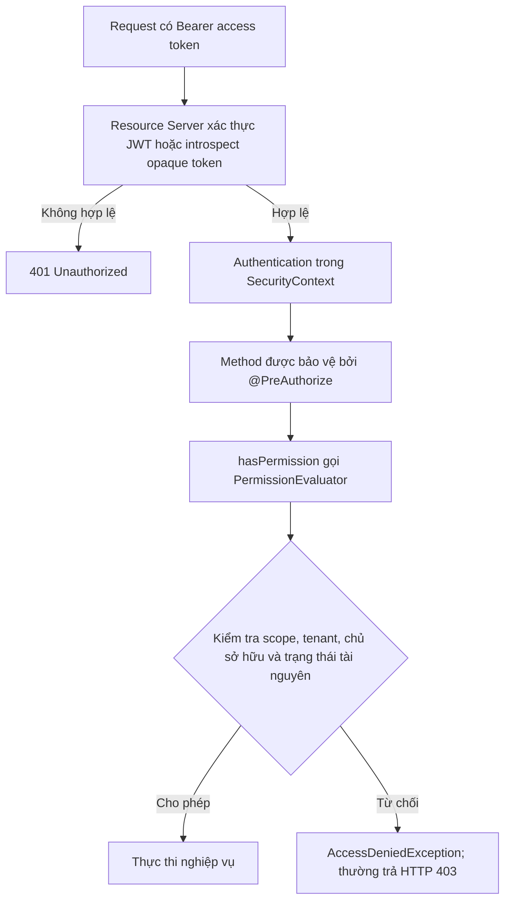

# PermissionEvaluator trong Spring Method Security

## 1. Mục tiêu bài học

Sau bài này, bạn có thể:

- Giải thích vì sao **token hợp lệ** và **có scope** vẫn chưa đủ để được thao tác trên một tài nguyên cụ thể.
- Hiểu hai biến thể `hasPermission(...)` trong Spring Security và cách `PermissionEvaluator` được gọi từ `@PreAuthorize`.
- Tự xây dựng chính sách phân quyền theo **người dùng – hành động – tài nguyên – tenant**, sử dụng thông tin danh tính đã xác thực từ access token.
- Cấu hình, kiểm thử và nhận diện các lỗi thường gặp như IDOR/BOLA, bỏ sót kiểm tra tenant, self-invocation và cache quyết định phân quyền đã lỗi thời.

**Bối cảnh module:** Trong bảo mật token, access token (JWT hoặc opaque token) giúp hệ thống xác minh danh tính và các quyền ở mức khái quát như `scope`. `PermissionEvaluator` bổ sung việc kiểm tra quyền trên **đúng đối tượng nghiệp vụ** tại tầng method. Nó không phát hành, giải mã hoặc thay thế bước kiểm tra token.

## 2. Từ token đến quyền trên tài nguyên

Giả sử một API nhận request:

```http
GET /api/documents/4b2517b4-81eb-456a-98f8-884ba4e340a2
Authorization: Bearer <access-token>
```

Access token được xác thực thành công và chứa scope `documents.read`. Điều đó thường chỉ nói rằng client/người dùng **có thể yêu cầu đọc tài liệu**. Nó không chứng minh người dùng được đọc **tài liệu có ID cụ thể** trong URL. Tài liệu có thể thuộc tenant khác, chưa công bố, hoặc đã bị chuyển quyền sở hữu.

Ta phân biệt ba lớp quyết định:

| Lớp | Câu hỏi | Ví dụ |
| --- | --- | --- |
| **Authentication** | Request có danh tính đáng tin cậy không? | JWT có chữ ký hợp lệ, chưa hết hạn, đúng issuer/audience; hoặc opaque token được introspect thành công. |
| **Quyền khái quát** | Danh tính này được phép gọi nhóm chức năng nào? | Authority `SCOPE_documents.read` được ánh xạ từ scope đã xác minh. |
| **Quyền trên tài nguyên** | Danh tính này có được thực hiện hành động `read` lên **document X** không? | Người dùng thuộc tenant của X và là chủ sở hữu, hoặc X đã được công bố trong tenant. |



> **Nguyên tắc cốt lõi:** `scope` trong access token là điều kiện cần theo chính sách, không mặc nhiên là quyền truy cập mọi bản ghi. Đừng dùng `refresh token` làm token gọi API; refresh token phục vụ việc lấy access token mới.

## 3. PermissionEvaluator là gì?

`org.springframework.security.access.PermissionEvaluator` là interface để biểu diễn câu hỏi: **principal đang được xác thực có quyền `permission` trên `target` hay không?** Spring Method Security gọi nó khi biểu thức SpEL chứa `hasPermission(...)`.

```java
public interface PermissionEvaluator {
    boolean hasPermission(
        Authentication authentication,
        Object targetDomainObject,
        Object permission
    );

    boolean hasPermission(
        Authentication authentication,
        Serializable targetId,
        String targetType,
        Object permission
    );
}
```

Hai dạng tương ứng với hai cách viết ở method:

| Biểu thức trong `@PreAuthorize` | Overload được gọi | Khi nên dùng |
| --- | --- | --- |
| `hasPermission(#document, 'edit')` | `(authentication, targetDomainObject, permission)` | Đã có đối tượng `Document` đáng tin cậy để kiểm tra. |
| `hasPermission(#documentId, 'Document', 'read')` | `(authentication, targetId, targetType, permission)` | Method chỉ nhận ID; evaluator phải tải tài nguyên và kiểm tra. |

`authentication` lấy từ ngữ cảnh bảo mật của Spring. `permission` có kiểu `Object`, nhưng ứng dụng nên chuẩn hóa thành tập hành động hữu hạn như `read`, `edit`, `delete`. `targetType` là chuỗi do **chính sách ứng dụng** quy ước, không phải tên bảng hoặc class được Spring tự động suy ra.

`PermissionEvaluator` là **điểm mở rộng**, không tự tạo hệ thống cấp quyền, kiểm tra quyền sở hữu hoặc truy vấn database. Khi chưa đăng ký evaluator phù hợp, `hasPermission` không thể tự biết một người có quyền trên bản ghi nào; cấu hình mặc định thường từ chối. Trả về `false` cho hành động, loại tài nguyên hoặc đối tượng không hỗ trợ để tuân theo nguyên tắc *deny by default*.

### So sánh với các biểu thức khác

```java
@PreAuthorize("isAuthenticated()")
@PreAuthorize("hasAuthority('SCOPE_documents.read')")
@PreAuthorize("hasRole('ADMIN')")
@PreAuthorize("hasPermission(#id, 'Document', 'read')")
```

- `isAuthenticated()` kiểm tra trạng thái xác thực.
- `hasAuthority(...)` đối chiếu một authority như scope đã được ánh xạ từ token. Tên `SCOPE_...` là quy ước ánh xạ thường gặp trong Spring Resource Server; converter tùy chỉnh có thể dùng tên khác.
- `hasRole('ADMIN')` thường kiểm tra authority `ROLE_ADMIN`; chỉ phù hợp nếu role được cấp và kiểm tra đáng tin cậy.
- `hasPermission(...)` gọi chính sách tùy chỉnh cho **tài nguyên cụ thể**. Bạn có thể kiểm tra cả scope lẫn quyền tài nguyên bên trong evaluator để không vô tình bỏ sót một trong hai.

## 4. Thiết kế một chính sách cụ thể

Ví dụ ứng dụng quản lý tài liệu nhiều tenant có dữ liệu:

```java
public record Document(
    UUID id,
    String tenantId,
    String ownerSubject,
    boolean published
) {}

public interface DocumentRepository {
    Optional<Document> findById(UUID id);
}

public interface TenantMembershipService {
    boolean isMember(String subject, String tenantId);
}
```

Ở đây `subject` là ID ổn định của người dùng, không phải email có thể thay đổi. Ví dụ giả định hệ thống chỉ chấp nhận **một issuer đáng tin cậy**, và `Authentication.getName()` được cấu hình khớp với `sub`. Nếu chấp nhận nhiều issuer, khóa danh tính cần phân biệt cả `iss` và `sub` để tránh trùng ID giữa các nhà cung cấp.

Quy tắc mẫu:

| Hành động | Điều kiện bắt buộc | Điều kiện bổ sung |
| --- | --- | --- |
| `read` | Đã xác thực, có `SCOPE_documents.read` và là thành viên tenant chứa tài liệu. | Là chủ sở hữu **hoặc** tài liệu đã `published`. |
| `edit` | Đã xác thực, có `SCOPE_documents.write` và là thành viên tenant chứa tài liệu. | Chính người dùng là chủ sở hữu. |
| Hành động khác | Không có quy tắc cho phép. | Từ chối. |

Chú ý: tài liệu `published` chỉ công khai **trong tenant** theo ví dụ này; nó không trở thành tài liệu toàn hệ thống. Membership được tra cứu từ nguồn dữ liệu phía server. Không coi `tenantId` trong URL/body hay tenant do client tự gửi là bằng chứng quyền truy cập.

## 5. Triển khai PermissionEvaluator

Ví dụ sau sử dụng Spring Security Method Security và Java hiện đại. Giả sử `DocumentRepository` và `TenantMembershipService` đã có implementation gọi database hoặc dịch vụ nội bộ.

```java
import java.io.Serializable;
import java.util.UUID;
import org.springframework.security.access.PermissionEvaluator;
import org.springframework.security.authentication.AnonymousAuthenticationToken;
import org.springframework.security.core.Authentication;
import org.springframework.stereotype.Component;

@Component
public final class DocumentPermissionEvaluator implements PermissionEvaluator {
    private final DocumentRepository documents;
    private final TenantMembershipService memberships;

    public DocumentPermissionEvaluator(
            DocumentRepository documents,
            TenantMembershipService memberships) {
        this.documents = documents;
        this.memberships = memberships;
    }

    @Override
    public boolean hasPermission(
            Authentication authentication,
            Object targetDomainObject,
            Object permission) {
        if (!(targetDomainObject instanceof Document document)) {
            return false;
        }
        return isAllowed(authentication, document, permission);
    }

    @Override
    public boolean hasPermission(
            Authentication authentication,
            Serializable targetId,
            String targetType,
            Object permission) {
        if (!"Document".equals(targetType) || !(targetId instanceof UUID id)) {
            return false;
        }

        return documents.findById(id)
                .map(document -> isAllowed(authentication, document, permission))
                .orElse(false);
    }

    private boolean isAllowed(
            Authentication authentication,
            Document document,
            Object permission) {
        if (authentication == null
                || !authentication.isAuthenticated()
                || authentication instanceof AnonymousAuthenticationToken) {
            return false;
        }

        String subject = authentication.getName();
        if (subject == null || !memberships.isMember(subject, document.tenantId())) {
            return false;
        }

        boolean isOwner = subject.equals(document.ownerSubject());
        return switch (String.valueOf(permission)) {
            case "read" -> hasAuthority(authentication, "SCOPE_documents.read")
                    && (isOwner || document.published());
            case "edit" -> hasAuthority(authentication, "SCOPE_documents.write")
                    && isOwner;
            default -> false;
        };
    }

    private boolean hasAuthority(Authentication authentication, String expected) {
        return authentication.getAuthorities().stream()
                .anyMatch(authority -> expected.equals(authority.getAuthority()));
    }
}
```

Điểm cần chú ý trong cách viết trên:

1. **Fail closed:** ID sai kiểu, loại tài nguyên không hỗ trợ, tài liệu không tồn tại, permission lạ và authentication không hợp lệ đều dẫn đến `false`.
2. **Không tin ID đơn lẻ:** evaluator tải tài liệu thật từ server, sau đó lấy tenant và owner từ bản ghi đó. Không suy owner hoặc tenant từ ID hay dữ liệu request.
3. **Scope và quyền bản ghi kết hợp:** có scope nhưng thuộc tenant khác vẫn bị từ chối; là owner nhưng thiếu scope tương ứng cũng bị từ chối.
4. **Không phụ thuộc định dạng token:** evaluator đọc `Authentication` đã được Resource Server tạo ra. JWT có thể đã được kiểm tra chữ ký và claims; opaque token có thể đã được introspect. Logic phân quyền không cần đọc chuỗi bearer token.
5. **Chi phí truy vấn:** overload dùng ID có thể đọc database trước khi method nghiệp vụ lại đọc cùng bản ghi. Cần cân nhắc transaction, truy vấn hiệu quả và tính nhất quán khi ứng dụng có tải lớn.

Ví dụ này coi `Document` là đối tượng đã tải từ nguồn tin cậy. **Không dùng trực tiếp đối tượng tự tạo từ JSON request** với `hasPermission(#document, ...)`: client có thể sửa `ownerSubject`, `tenantId` hoặc `published` và làm sai quyết định. Với input chưa tin cậy, dùng overload nhận ID rồi tải bản ghi thật.

## 6. Đăng ký evaluator và bảo vệ service

Với cấu hình Spring Security dùng `@EnableMethodSecurity`, tạo `MethodSecurityExpressionHandler` để đăng ký evaluator:

```java
import org.springframework.context.annotation.Bean;
import org.springframework.context.annotation.Configuration;
import org.springframework.security.access.PermissionEvaluator;
import org.springframework.security.access.expression.method.DefaultMethodSecurityExpressionHandler;
import org.springframework.security.access.expression.method.MethodSecurityExpressionHandler;
import org.springframework.security.config.annotation.method.configuration.EnableMethodSecurity;

@Configuration
@EnableMethodSecurity
public class MethodSecurityConfig {

    @Bean
    static MethodSecurityExpressionHandler methodSecurityExpressionHandler(
            PermissionEvaluator permissionEvaluator) {
        var handler = new DefaultMethodSecurityExpressionHandler();
        handler.setPermissionEvaluator(permissionEvaluator);
        return handler;
    }
}
```

Trong ví dụ, ứng dụng chỉ có **một** bean `PermissionEvaluator` phù hợp. Nếu có nhiều evaluator, cần tổ chức bộ định tuyến theo loại tài nguyên và chỉ định bean rõ ràng để tránh lỗi injection mơ hồ. Bean `MethodSecurityExpressionHandler` được khai báo `static` để Spring có thể xuất bản nó đủ sớm cho cấu hình method security.

Áp dụng ở lớp service:

```java
import java.util.UUID;
import org.springframework.security.access.prepost.PreAuthorize;
import org.springframework.stereotype.Service;

@Service
public class DocumentService {
    private final DocumentRepository documents;

    public DocumentService(DocumentRepository documents) {
        this.documents = documents;
    }

    @PreAuthorize("hasPermission(#documentId, 'Document', 'read')")
    public Document getDocument(UUID documentId) {
        return documents.findById(documentId).orElseThrow();
    }
}
```

Khi gọi `getDocument(id)` **qua Spring bean đã được proxy**, Spring đánh giá biểu thức trước khi chạy thân method. Nếu evaluator trả về `false`, Spring chặn lời gọi bằng `AccessDeniedException`. Trong ứng dụng web có xử lý ngoại lệ bảo mật phù hợp, trường hợp đã xác thực nhưng không đủ quyền thường được biểu diễn bằng HTTP `403 Forbidden`. Token thiếu, sai hoặc hết hạn thường dẫn đến `401 Unauthorized` ở lớp xác thực trước đó.

Nếu dự án không giữ được tên tham số Java khi biên dịch, `#documentId` có thể không được resolve; hãy bật `-parameters`, sử dụng cơ chế đặt tên tham số được Spring Security hỗ trợ, hoặc dùng `#p0` cho tham số thứ nhất. Nên xác minh bằng integration test trên **bean Spring thực**.

> `@PreAuthorize` đặt trên method được Spring AOP chặn. Gọi từ một method khác của **cùng đối tượng** qua `this.getDocument(...)`, tự `new DocumentService(...)`, hoặc gọi không đi qua proxy có thể bỏ qua advice method security. Đặt ranh giới phân quyền ở public service entry point và kiểm thử đường gọi thực tế.

### Có thể kết hợp kiểm tra ở nhiều tầng

```java
@PreAuthorize(
    "hasAuthority('SCOPE_documents.read') " +
    "and hasPermission(#documentId, 'Document', 'read')"
)
public Document getDocument(UUID documentId) { /* ... */ }
```

Với chính sách ví dụ, evaluator đã kiểm tra scope nên biểu thức `hasAuthority(...)` bên ngoài là kiểm tra lặp có chủ đích. Trong hệ thống thực, cần chọn **một nơi chịu trách nhiệm rõ ràng** cho từng điều kiện; nếu thay đổi chính sách, tránh để hai nơi lệch nhau. `and` có thể ngừng đánh giá khi điều kiện đầu tiên sai, giúp tránh truy vấn tài nguyên không cần thiết.

## 7. Token, claims, audience và giới hạn tin cậy

`PermissionEvaluator` phải đứng **sau** bước xác minh access token. Trước khi thông tin từ token trở thành `Authentication`, Resource Server cần thiết lập đúng các điều kiện tin cậy của hệ thống:

| Dữ liệu / cơ chế | Dùng đúng cách | Rủi ro khi hiểu sai |
| --- | --- | --- |
| JWT | Xác minh chữ ký bằng khóa/thuật toán được tin cậy; kiểm tra `iss`, `aud`, `exp`, `nbf` theo yêu cầu. | Chỉ decode payload rồi tin `sub`, `scope`, `tenant` có thể cho phép token giả hoặc token dành cho API khác. |
| Opaque access token | Introspection với authorization server đáng tin cậy; xác minh token đang active và các thuộc tính phù hợp. | Tự coi một chuỗi opaque là dữ liệu có thể giải mã tại resource server. |
| `scope` / `scp` | Ánh xạ thành authority thống nhất theo hợp đồng giữa authorization server và resource server. | Scope rộng như `documents.read` bị coi là quyền đọc mọi document. |
| `sub` và `iss` | Xác định danh tính người gọi; đối chiếu với chủ sở hữu/membership phía server. | Trùng `sub` giữa các issuer hoặc dùng email không ổn định làm khóa phân quyền. |
| `aud` | Giới hạn access token cho đúng resource server/API. | API A chấp nhận token phát hành cho API B. |
| `tenant`, `role` custom claims | Chỉ sử dụng sau xác minh và khi nguồn cấp claim có thẩm quyền; có thể cần đối chiếu DB. | Tin tenant/role do client tự chọn hoặc dữ liệu chưa được kiểm chứng. |

**Mô hình tin cậy:** Authorization Server cấp token và khẳng định các claim đã được bảo vệ; Resource Server xác minh token và tạo `Authentication`; ứng dụng quyết định quyền nghiệp vụ tại thời điểm thực thi. Các thông tin dễ thay đổi như tư cách thành viên tenant, chủ sở hữu, trạng thái tài liệu thường phải tra cứu từ nguồn có thẩm quyền thay vì phụ thuộc hoàn toàn vào claim cũ trong JWT.

Việc thu hồi token không đồng nghĩa mọi JWT đã phát hành lập tức ngừng hoạt động: JWT thường tiếp tục hợp lệ đến `exp` nếu Resource Server chỉ kiểm tra chữ ký và thời hạn. Với yêu cầu thu hồi tức thời, cân nhắc introspection, danh sách từ chối theo token, phiên bản quyền hoặc cơ chế kiểm tra trạng thái phù hợp. Access token ngắn hạn, bảo vệ nơi lưu token, rotation cho refresh token khi phù hợp và cơ chế chống phát lại như DPoP/mTLS ở hệ thống hỗ trợ giúp giảm thiểu tác hại khi token bị đánh cắp. Tuy nhiên, các biện pháp đó **không thay thế** kiểm tra quyền từng tài nguyên.

## 8. Các lỗi thiết kế thường gặp

| Lỗi | Hậu quả | Cách xử lý |
| --- | --- | --- |
| `@PreAuthorize("hasAuthority('SCOPE_documents.read')")` là rào chắn duy nhất cho `/documents/{id}`. | Người có scope đọc có thể đổi ID để truy cập tài liệu người khác (**IDOR/BOLA**). | Kiểm tra quyền với đúng `id` và đối tượng từ database. |
| Chỉ so `document.ownerSubject == authentication.name`. | Chủ sở hữu cũ, sai tenant, hoặc account rời tenant có thể còn được truy cập. | Kết hợp kiểm tra membership, trạng thái và scope theo chính sách. |
| Dùng `hasPermission(#request.document, 'edit')` trên JSON client gửi. | Người dùng có thể giả mạo `ownerSubject`/`tenantId`. | Tải dữ liệu server theo ID; không lấy các trường phân quyền từ request. |
| Gọi method được bảo vệ qua `this.method(...)`. | Spring proxy không chạy `@PreAuthorize`. | Bảo vệ entry point và tránh self-invocation; kiểm thử lời gọi qua bean. |
| Cache kết quả `hasPermission` chỉ theo `documentId`. | Quyền của người A có thể được tái dùng cho người B. | Nếu cache, khóa theo principal/issuer, tenant, tài nguyên, hành động và phiên bản chính sách; có chiến lược invalidation. |
| Quyền thay đổi giữa bước `hasPermission` và thao tác ghi. | Có thể phát sinh race condition/TOCTOU. | Với cập nhật nhạy cảm, kiểm tra và cập nhật nhất quán trong transaction hoặc dùng câu lệnh update có điều kiện về owner/tenant. |
| Log nguyên văn `Authorization` header/token. | Rò rỉ credential, tăng nguy cơ token replay. | Che/mask token; log hành động, resource ID, quyết định và correlation ID với quy tắc bảo vệ dữ liệu. |

`@PostAuthorize` có thể kiểm tra giá trị trả về sau khi method chạy, nhưng **không thích hợp làm rào chắn duy nhất cho lệnh ghi có side effect**: side effect có thể đã xảy ra trước khi quyền bị từ chối. Với thao tác quan trọng, kiểm tra trước và dùng cơ chế nhất quán ở tầng lưu trữ.

## 9. Kiểm thử chính sách: happy path và hành vi từ chối

Một unit test tối thiểu cho lỗi BOLA dùng JUnit 5 và Mockito:

```java
@Test
void cannotReadDocumentInAnotherTenantEvenWithScope() {
    UUID id = UUID.randomUUID();
    Authentication auth = new UsernamePasswordAuthenticationToken(
        "user-7",
        "n/a",
        List.of(new SimpleGrantedAuthority("SCOPE_documents.read"))
    );
    Document document = new Document(id, "tenant-b", "user-7", true);

    when(documents.findById(id)).thenReturn(Optional.of(document));
    when(memberships.isMember("user-7", "tenant-b")).thenReturn(false);

    assertFalse(evaluator.hasPermission(auth, id, "Document", "read"));
}
```

Các biến `documents`, `memberships` và `evaluator` là mock/đối tượng đã khởi tạo trong test fixture. Để kiểm chứng end-to-end, còn cần test chạy qua Spring bean có `@EnableMethodSecurity` và cấu hình Resource Server thực tế hoặc cấu hình test đại diện.

Ma trận kiểm thử nên bao phủ ít nhất:

| Danh tính và tài nguyên | Permission | Kết quả mong đợi |
| --- | --- | --- |
| Có scope đọc, cùng tenant, là owner. | `read` | Cho phép. |
| Có scope đọc, cùng tenant, không phải owner, đã published. | `read` | Cho phép. |
| Có scope đọc, cùng tenant, không phải owner, chưa published. | `read` | Từ chối. |
| Có scope đọc, khác tenant, dù là owner theo dữ liệu hoặc đã published. | `read` | Từ chối. |
| Là owner, cùng tenant nhưng thiếu scope ghi. | `edit` | Từ chối. |
| Có scope ghi, cùng tenant nhưng không là owner. | `edit` | Từ chối. |
| Có scope ghi, cùng tenant, là owner. | `edit` | Cho phép. |
| ID không tồn tại, type sai, permission lạ hoặc authentication anonymous. | Bất kỳ | Từ chối. |
| Token có chữ ký sai, hết hạn hoặc sai audience. | Bất kỳ | Bị chặn **trước** evaluator. |

Ngoài unit test, cần xác minh phân biệt `401` (không xác thực được) và `403` (đã xác thực nhưng không được phép) theo cấu hình HTTP của ứng dụng. Khi evaluator trả về `false` cho tài nguyên không tồn tại, method được chặn trước khi chạy nên API có thể trả `403` thay vì `404`; hãy thiết kế chính sách phản hồi nhất quán để hạn chế lộ sự tồn tại của tài nguyên.

## 10. Ghi nhớ và tự kiểm tra

`PermissionEvaluator` biến câu hỏi “token này có scope gì?” thành câu hỏi đầy đủ hơn: **“danh tính được xác minh có được làm hành động này trên đúng tài nguyên này, trong bối cảnh hiện tại không?”**. Tính đúng đắn phụ thuộc vào ranh giới tin cậy: access token được xác thực đúng, claims/authorities được ánh xạ đúng, tài nguyên được đọc từ nguồn tin cậy và chính sách được thực thi qua Spring proxy hoặc tại điểm nghiệp vụ tương đương.

Hãy tự trả lời ba câu hỏi:

1. Vì sao `SCOPE_documents.read` không đủ để cho phép `GET /documents/{id}`, ngay cả khi JWT có chữ ký hợp lệ?
2. Nếu frontend gửi `tenantId` và `ownerSubject`, có nên dùng hai giá trị ấy trực tiếp trong `PermissionEvaluator` không? Phải lấy sự thật về tenant và owner từ đâu?
3. Nếu user bị xóa khỏi tenant sau khi JWT được cấp nhưng trước khi token hết hạn, điều gì trong thiết kế evaluator sẽ ngăn quyền truy cập tiếp tục?

**Gợi ý:** Câu trả lời phải xét đến quyền trên đối tượng cụ thể, nguồn dữ liệu có thẩm quyền và khả năng quyền thay đổi trong suốt vòng đời access token.
