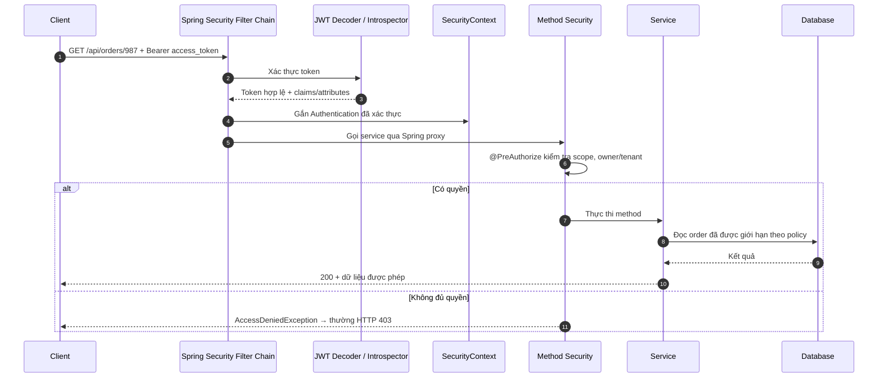

# Method security sau authentication: phân quyền đến từng phương thức và tài nguyên

## 1. Vì sao authentication thành công vẫn chưa đủ?

Trong một hệ thống OAuth 2.0/OpenID Connect (OIDC), **Resource Server** nhận access token và kiểm tra token trước khi xử lý nghiệp vụ. Sau khi một token được xác thực thành công, Spring Security có thể biết token thuộc về ai, được phát hành bởi bên nào, có những scope nào và còn hiệu lực hay không. Nhưng một access token hợp lệ **không đồng nghĩa** người gọi được phép thực hiện mọi thao tác hoặc đọc mọi bản ghi.

Ví dụ:

- JWT access token của người dùng A hợp lệ, có `scope=orders.read`.
- Người dùng A gọi `GET /api/orders/987`.
- Order 987 thuộc người dùng B của tenant khác.

Spring Security có thể cho phép người dùng A đi qua bước **authentication**, nhưng ứng dụng phải từ chối hành động đọc order 987 tại bước **authorization**. Cơ chế **method security** giúp đặt các quy tắc phân quyền ngay trên các phương thức service/controller, gần nơi thực thi nghiệp vụ.

Trong module **`SECURITY_TOKEN_SECURITY_FUNDAMENTALS`**, chủ đề này nằm ở giai đoạn **sử dụng và kiểm chứng quyền của access token** trong vòng đời token: Authorization Server phát hành token, Resource Server kiểm tra JWT hoặc opaque token, sau đó method security dùng principal và authorities đã xác thực để quyết định hành động nào được phép. Các cơ chế phát hành, kiểm tra `iss`/`aud`/`exp`, scope, lưu trữ, thu hồi và chống token bị đánh cắp/phát lại vẫn phải phối hợp với nhau.

> **Nguyên tắc cốt lõi:** Authentication trả lời “đây là ai hoặc client nào?”, còn authorization trả lời “chủ thể đó được làm gì trên tài nguyên cụ thể nào?”. `@PreAuthorize`, `@PostAuthorize` và các cơ chế method security thuộc nhóm thứ hai.

### Mục tiêu học tập

Sau bài học, bạn có thể:

1. Giải thích vị trí của method security **sau** bước bearer token authentication.
2. Cấu hình `@EnableMethodSecurity` và sử dụng `@PreAuthorize`, `@PostAuthorize`, `@Secured`, `@RolesAllowed` khi phù hợp.
3. Phân biệt scope của token, `GrantedAuthority`, role và quyền truy cập từng đối tượng.
4. Viết kiểm tra quyền theo `authentication`, tham số phương thức và repository của domain.
5. Nhận diện self-invocation, principal sai ngữ cảnh, thiếu `SecurityContext`, lỗi 401/403, race condition và token substitution.
6. Kiểm thử method security độc lập và kiểm thử tích hợp JWT/opaque token.

## 2. Method security nằm ở đâu trong request pipeline?

Một request được bảo vệ bằng Spring Security Servlet thường đi qua các bước:



Trong chuỗi này, **method security không tự xác minh chữ ký JWT hay gọi introspection endpoint**. Nó làm việc với đối tượng `Authentication` mà các cơ chế xác thực trước đó đã tạo ra. Khi gọi service từ background job hoặc một lối vào không đi qua HTTP filter, ứng dụng cần cung cấp ngữ cảnh bảo mật thích hợp; không được giả định token đã được kiểm tra.

### Các đối tượng cần phân biệt

| Thành phần | Vai trò trong hệ thống | Ví dụ |
| --- | --- | --- |
| `SecurityFilterChain` | Xác thực request và áp dụng authorization tại HTTP layer. | `requestMatchers("/api/**").authenticated()` |
| `JwtDecoder` | Kiểm tra chữ ký, issuer, thời gian và các validator của JWT access token. | `JwtAuthenticationProvider` sử dụng decoder. |
| `OpaqueTokenIntrospector` | Hỏi Authorization Server xem access token có active và thuộc tính gì. | `OpaqueTokenAuthenticationProvider` sử dụng introspector. |
| `Authentication` | Đại diện principal và authorities đã xác thực. | `JwtAuthenticationToken` hoặc `BearerTokenAuthentication`. |
| `SecurityContextHolder` | Giữ `SecurityContext` của luồng thực thi hiện tại theo chiến lược cấu hình. | `getContext().getAuthentication()` |
| `GrantedAuthority` | Một quyền mà expression phân quyền có thể kiểm tra. | `SCOPE_orders.read`, `ROLE_ADMIN` |
| Method security interceptor | Chạy chính sách trước/sau phương thức thông qua cơ chế Spring AOP. | `@PreAuthorize`, `@PostAuthorize` |
| Domain authorization policy | Đánh giá owner, tenant, trạng thái order và điều kiện nghiệp vụ. | `orderAccess.canRead(authentication, orderId)` |

Không nên xem `SecurityContextHolder` là nguồn thông tin xác thực vĩnh viễn: ngữ cảnh phụ thuộc cách request/thread được thực thi và có thể vắng mặt ngoài đường đi chuẩn.

### Kết quả xác thực JWT và opaque token

| Access token được kiểm chứng bằng | `Authentication` thường gặp (Servlet) | Nguồn quyền |
| --- | --- | --- |
| JWT validation | `JwtAuthenticationToken`, principal thường là `Jwt`. | Claims đã được decoder xác minh, chuyển thành authorities. |
| Introspection | `BearerTokenAuthentication`, principal thường là `OAuth2AuthenticatedPrincipal`. | Attributes/`scope` từ introspection của Authorization Server. |

Hai chiến lược khác nhau ở khâu **authentication**, nhưng method security có thể kiểm tra cùng một authority như `SCOPE_orders.read`. Điều kiện là Resource Server phải ánh xạ quyền một cách nhất quán và không tin claims chưa được xác minh.

## 3. Bật method security trong Spring Boot / Spring Security

### 3.1. Dùng `@EnableMethodSecurity`

Với Spring Security hiện đại trên Servlet stack:

```java
import org.springframework.context.annotation.Configuration;
import org.springframework.security.config.annotation.method.configuration.EnableMethodSecurity;

@Configuration
@EnableMethodSecurity
public class MethodSecurityConfig {
}
```

`@EnableMethodSecurity` kích hoạt các interceptor bảo vệ method trong Spring application context. Mặc định, hỗ trợ pre/post authorization bằng `@PreAuthorize` và `@PostAuthorize` được bật. Đây là cách thường dùng cho Spring Security 6+; với dự án đời cũ có thể gặp `@EnableGlobalMethodSecurity`, nhưng không nên sao chép cấu hình cũ mà chưa đối chiếu phiên bản.

### 3.2. Xác thực HTTP bằng JWT Resource Server

```java
import org.springframework.context.annotation.Bean;
import org.springframework.context.annotation.Configuration;
import org.springframework.security.config.Customizer;
import org.springframework.security.config.annotation.web.builders.HttpSecurity;
import org.springframework.security.web.SecurityFilterChain;

@Configuration
public class ApiSecurityConfig {

    @Bean
    SecurityFilterChain apiSecurity(HttpSecurity http) throws Exception {
        http
            .authorizeHttpRequests(auth -> auth
                .requestMatchers("/health").permitAll()
                .requestMatchers("/api/**").authenticated()
                .anyRequest().denyAll()
            )
            .oauth2ResourceServer(oauth2 ->
                oauth2.jwt(Customizer.withDefaults())
            );

        return http.build();
    }
}
```

Đây là **phần cấu hình HTTP** để xác thực bearer access token. Ứng dụng thực phải có cấu hình `JwtDecoder`/`issuer-uri` thích hợp và validator cho **`audience` của API**, bên cạnh chữ ký, issuer, thời gian hiệu lực, thuật toán được phép. Dòng `authenticated()` chỉ đảm bảo request đi qua authentication; **phương thức service** sẽ kiểm tra scope và quyền trên order.

Nếu hệ thống sử dụng opaque access token, phần khai báo phương thức xác thực có thể thay bằng:

```java
.oauth2ResourceServer(oauth2 ->
    oauth2.opaqueToken(Customizer.withDefaults())
)
```

Khi đó phải cấu hình introspection URI và credential ở backend, đồng thời kiểm tra `active`, audience/loại token và scope theo mô hình tin cậy. Hai snippet là **các lựa chọn triển khai riêng**, không hàm ý bật đồng thời mà không có cơ chế chọn manager phù hợp.

Với ứng dụng có cookie/session và browser, CSRF/CORS/`SameSite` cần được thiết kế theo từng luồng; không mặc định tắt bảo vệ CSRF trên mọi tuyến chỉ vì API khác dùng bearer token.

### 3.3. Ví dụ method đầu tiên

```java
import org.springframework.security.access.prepost.PreAuthorize;
import org.springframework.stereotype.Service;

@Service
public class ReportService {

    @PreAuthorize("hasAuthority('SCOPE_reports.read')")
    public String getReport() {
        return "Nội dung báo cáo";
    }
}
```

Đối tượng `Authentication` từ token đã xác thực cần có `SCOPE_reports.read` thì lời gọi phương thức qua Spring proxy mới được thực thi. Nếu không đủ quyền, method security thường ném `AccessDeniedException` trước khi vào method. Trong request HTTP, Spring Security thường chuyển lỗi này thành **403 Forbidden** đối với chủ thể đã xác thực.

**Không phụ thuộc controller:** Service có thể được gọi từ REST controller, GraphQL resolver, handler nội bộ hoặc luồng khác; method security giúp đặt quy tắc ngay ở biên nghiệp vụ. Tuy nhiên, lời gọi phải thực sự đi qua cơ chế AOP mà Spring Security áp dụng.

## 4. Scope, authority, role và claim sau authentication

### 4.1. Scope của access token

Giả sử access token đã được Resource Server xác minh có dữ liệu tương đương:

```json
{
  "iss": "https://auth.example.com",
  "sub": "user-42",
  "aud": ["orders-api"],
  "scope": "orders.read orders.write",
  "exp": 1900000900
}
```

Thông qua converter mặc định/phù hợp, Spring Security thường tạo:

```text
SCOPE_orders.read
SCOPE_orders.write
```

Đây là các `GrantedAuthority` mà method expression có thể đánh giá:

```java
@PreAuthorize("hasAuthority('SCOPE_orders.read')")
public OrderDto findOrder(String id) { /* ... */ }
```

Chỉ những claims đã được JWT decoder xác thực hoặc introspection tin cậy trả về mới được xem là dữ liệu phù hợp để cấp authority. **Giải mã Base64URL của JWT mà chưa kiểm tra chữ ký không phải authentication.**

### 4.2. Scope khác role

| Thuật ngữ | Ví dụ | Ý nghĩa trong method security |
| --- | --- | --- |
| OAuth scope | `orders.read` | Phạm vi đã được Authorization Server cấp cho token. |
| Spring authority từ scope | `SCOPE_orders.read` | `hasAuthority("SCOPE_orders.read")` |
| Role nghiệp vụ | `ADMIN` | Có thể ánh xạ sang `ROLE_ADMIN` khi policy cho phép. |
| Authority theo convention của role | `ROLE_ADMIN` | `hasRole("ADMIN")` theo prefix mặc định. |
| Quyền trên tài nguyên | Chỉ đọc order của tenant A | Phải kiểm tra owner/tenant/object state. |

Ví dụ hai expression có ý nghĩa khác:

```java
@PreAuthorize("hasAuthority('SCOPE_admin')")
public void performScopedOperation() { /* ... */ }

@PreAuthorize("hasRole('ADMIN')")
public void performRoleBasedOperation() { /* ... */ }
```

`hasRole("ADMIN")` thường tương đương việc tìm authority `ROLE_ADMIN`, **không tự động** nhận `SCOPE_admin`. Nếu dự án tùy chỉnh role prefix, cần dùng quy tắc thực tế của dự án. Không ánh xạ mọi scope chứa chữ “admin” thành quyền quản trị.

### 4.3. Kiểm tra `authentication` và `principal`

Expression method security có thể truy cập các giá trị như:

```text
authentication             Authentication trong SecurityContext
authentication.name        Tên principal theo cấu hình
authentication.authorities Các GrantedAuthority
principal                  Principal của Authentication
hasAuthority('SCOPE_x')   Kiểm tra authority chính xác
hasAnyAuthority('A','B')   Có ít nhất một trong các authority
hasRole('ADMIN')           Kiểm tra role theo prefix mặc định
isAuthenticated()          Đã xác thực theo rule tương ứng
```

Tên `authentication.name` có thể là `sub` của user, client ID hoặc giá trị tùy converter/introspection. Với hệ thống đa issuer, hai issuer có thể phát cùng `sub=user-42`. Khi kiểm tra quyền trên dữ liệu, danh tính nên được ràng buộc bằng **issuer + subject + tenant/client** theo kiến trúc, tránh dùng subject đơn lẻ làm khóa toàn cục.

Token dạng `refresh_token` và OIDC `id_token` **không nên được dùng thay access token** để gọi API. Việc token đó có định dạng JWT hoặc còn tồn tại trong Authorization Server không khiến nó trở thành credential phù hợp cho Resource Server.

## 5. `@PreAuthorize`: kiểm tra trước khi chạy nghiệp vụ

`@PreAuthorize` là công cụ trọng tâm khi cần chặn truy cập **trước khi** đọc, sửa hoặc gửi dữ liệu. Có thể dùng scope, role, tham số method và bean đánh giá domain policy.

### 5.1. Kiểm tra scope và tham số

```java
import org.springframework.security.access.method.P;
import org.springframework.security.access.prepost.PreAuthorize;

@PreAuthorize(
    "hasAuthority('SCOPE_orders.read') and #orderId != null"
)
public OrderDto getOrder(@P("orderId") String orderId) {
    // Dữ liệu chỉ được đọc nếu expression cho phép.
    return repository.getRequired(orderId);
}
```

`#orderId` là tham số method được đặt tên trong expression. `@P("orderId")` giúp tên tham số được xác định rõ khi build không giữ metadata `-parameters`. Không phụ thuộc tên do bytecode suy ra khi công cụ build hoặc proxy có thể làm việc theo cách khác.

Điều kiện `orderId != null` ở đây chỉ minh họa cách truy cập tham số; nó **không** chứng minh user sở hữu order. Với dữ liệu nhạy cảm, phải kiểm tra ownership/tenant ở domain layer.

### 5.2. Đưa policy kiểm tra owner vào bean riêng

Một thiết kế hữu ích là giữ expression ngắn và giao logic truy cập dữ liệu cho một bean:

```java
import org.springframework.security.authentication.AnonymousAuthenticationToken;
import org.springframework.security.core.Authentication;
import org.springframework.stereotype.Component;

@Component("orderAccess")
public class OrderAccessPolicy {
    private final OrderOwnershipRepository ownershipRepository;

    public OrderAccessPolicy(OrderOwnershipRepository ownershipRepository) {
        this.ownershipRepository = ownershipRepository;
    }

    public boolean canRead(Authentication auth, String orderId) {
        if (auth == null || !auth.isAuthenticated()
                || auth instanceof AnonymousAuthenticationToken
                || orderId == null || orderId.isBlank()) {
            return false;
        }

        // Ví dụ chỉ áp dụng khi subject là duy nhất trong trust domain này.
        return ownershipRepository.existsByIdAndOwnerSubject(
                orderId, auth.getName());
    }
}
```

Interface dữ liệu giả định của ví dụ:

```java
public interface OrderOwnershipRepository {
    boolean existsByIdAndOwnerSubject(String orderId, String ownerSubject);
}
```

Service sử dụng cả scope và domain policy:

```java
import org.springframework.security.access.method.P;
import org.springframework.security.access.prepost.PreAuthorize;
import org.springframework.stereotype.Service;

@Service
public class OrderQueryService {
    private final OrderRepository orders;

    public OrderQueryService(OrderRepository orders) {
        this.orders = orders;
    }

    @PreAuthorize(
        "hasAuthority('SCOPE_orders.read') and " +
        "@orderAccess.canRead(authentication, #orderId)"
    )
    public OrderDto getOrder(@P("orderId") String orderId) {
        return orders.getRequired(orderId);
    }
}
```

`OrderRepository`, `OrderDto` và `OrderOwnershipRepository` là các type **minh họa của domain**; triển khai thực phải cung cấp chúng. Ví dụ này chỉ giả định **một trust domain có subject duy nhất**. Với đa issuer/tenant, không dùng `auth.getName()` làm đủ căn cứ ownership: cần lấy issuer, subject và tenant **đã xác thực** rồi truy vấn bằng khóa tổng hợp, hoặc dùng một định danh nội bộ được ánh xạ an toàn.

Không cho client tự gửi `X-User-Id`, `X-Tenant-Id` hoặc `ownerId` rồi xem đó là bằng chứng quyền. Những dữ liệu client cung cấp có thể đóng vai trò tham số tìm tài nguyên, nhưng phải **so sánh với danh tính đã được xác thực**.

### 5.3. Vì sao đưa domain policy vào bean?

- **Dễ kiểm thử** logic ownership theo các trường hợp thật.
- Có thể sử dụng cùng quy tắc ở nhiều service.
- Expression gọn và tách quyền OAuth `SCOPE_*` khỏi chính sách nghiệp vụ.
- Không cần nhúng SQL hoặc quy tắc phức tạp vào annotation.
- Có thể đánh giá đầy đủ `Authentication` của JWT hoặc opaque token, miễn dữ liệu được đọc sau authentication và từ nguồn tin cậy.

Tuy nhiên, kiểm tra quyền trong bean riêng thường tạo **một truy vấn kiểm tra rồi một truy vấn tải dữ liệu**. Nếu quyền hoặc ownership thay đổi giữa hai truy vấn, có thể phát sinh race condition (**time-of-check/time-of-use**). Với thao tác nhạy cảm, ưu tiên ràng buộc policy trong chính truy vấn hoặc thao tác cập nhật, dùng transaction/locking thích hợp.

## 6. Phân quyền tại tầng dữ liệu: chống truy cập chéo tenant

### 6.1. Bảo vệ ở query thay vì chỉ ở controller

Giả sử URL chứa:

```http
GET /api/tenants/tenant-b/orders/987
Authorization: Bearer <ACCESS_TOKEN_CUA_TENANT_A>
```

Chỉ kiểm tra `hasAuthority("SCOPE_orders.read")` không chặn user tenant A đọc order tenant B nếu repository tìm bằng `id` không giới hạn tenant. Một truy vấn domain nên ràng buộc cả order ID và tenant:

```sql
SELECT id, tenant_id, owner_subject, summary
FROM orders
WHERE id = :orderId
  AND tenant_id = :authenticatedTenantId
  AND owner_subject = :authenticatedSubject;
```

`authenticatedTenantId` và `authenticatedSubject` phải được lấy từ **principal/claims đã xác thực** hoặc mapping danh tính nội bộ tin cậy, **không** chép trực tiếp từ path/query/header của request.

Nếu phục vụ nhiều issuer, cùng `sub` có thể tồn tại ở các trust domain khác nhau; mô hình dữ liệu cần ràng buộc `issuer` hoặc map về subject ID toàn cục do hệ thống cấp.

### 6.2. Với thao tác thay đổi dữ liệu

Thay vì:

```text
1. Kiểm tra order thuộc tenant A.
2. Có request khác chuyển order sang tenant B.
3. UPDATE order theo id, không kiểm tra tenant lần nữa.
```

Nên cân nhắc thao tác có ràng buộc quyền ngay trong điều kiện cập nhật:

```sql
UPDATE orders
SET status = :newStatus
WHERE id = :orderId
  AND tenant_id = :authenticatedTenantId
  AND owner_subject = :authenticatedSubject;
```

Ứng dụng phải kiểm tra số dòng bị thay đổi và những điều kiện trạng thái/transaction liên quan. Method security là hàng rào ở lớp service; query có ràng buộc tenant/owner là lớp bổ sung quan trọng để bảo vệ dữ liệu.

### 6.3. Không cho scope tự biến thành quyền sở hữu

Scope `orders.write` chỉ nên có ý nghĩa như “token được phép thực hiện loại thao tác ghi nếu các điều kiện khác thỏa mãn”. Nó không đủ để đổi trạng thái order của tenant khác. Quyền cuối cùng phụ thuộc ít nhất vào **subject/client, tenant, loại thao tác, object, trạng thái business** và policy đã được phê duyệt.

## 7. `@PostAuthorize`, `@PreFilter` và `@PostFilter`

### 7.1. `@PostAuthorize`: kiểm tra sau khi method trả về

`@PostAuthorize` đánh giá `returnObject` **sau khi phương thức chạy**, trước khi kết quả được trả qua proxy cho caller:

```java
import org.springframework.security.access.prepost.PostAuthorize;

@PostAuthorize(
    "returnObject != null and " +
    "returnObject.ownerSubject == authentication.name"
)
public OrderDto findForCurrentUser(String orderId) {
    return repository.getRequired(orderId);
}
```

Ví dụ giả định `OrderDto` có property/getter `ownerSubject` và subject duy nhất trong trust domain. `@PostAuthorize` thuận tiện khi kiểm tra dữ liệu của **kết quả**; nếu expression sai, method security từ chối kết quả.

**Giới hạn quan trọng:** Method đã chạy xong khi expression được kiểm tra. Không dùng `@PostAuthorize` để “bảo vệ” một phương thức đã gửi tiền, gửi email, cập nhật DB hoặc tạo side effect, vì việc từ chối kết quả không tự hoàn tác side effect. Với thao tác ghi và dữ liệu nhạy cảm, ưu tiên `@PreAuthorize` cùng truy vấn bị ràng buộc quyền.

### 7.2. `@PreFilter`

`@PreFilter` có thể lọc collection hoặc các dạng đầu vào được framework hỗ trợ trước khi method chạy, sử dụng biến `filterObject`:

```java
@PreFilter("filterObject.ownerSubject == authentication.name")
public void processOrders(List<OrderCommand> commands) {
    // Ví dụ minh họa điều kiện lọc đầu vào.
}
```

**Cảnh báo:** Lọc bỏ phần tử không được phép có thể khiến caller không nhận ra một số yêu cầu đã bị loại. Với cập nhật hàng loạt hoặc nghiệp vụ cần tính nguyên tử, thường nên **từ chối toàn bộ request** nếu có phần tử trái quyền, thay vì âm thầm bỏ đi. Loại đầu vào, khả năng thay đổi collection và ngữ nghĩa `@PreFilter` cần kiểm tra theo phiên bản Spring.

### 7.3. `@PostFilter`

`@PostFilter` có thể lọc collection kết quả dựa trên `filterObject`:

```java
@PostFilter("filterObject.ownerSubject == authentication.name")
public List<OrderDto> findRecentOrders() {
    return repository.findRecent();
}
```

Đây là ví dụ chức năng. Trong hệ thống có nhiều dữ liệu, **không nên tải toàn bộ order từ mọi tenant rồi mới lọc trong bộ nhớ**: dễ tốn tài nguyên, làm sai pagination/count và tăng nguy cơ lộ dữ liệu ở logging/caching trước khi lọc. Tốt hơn là áp dụng tenant/owner constraint ngay ở database query.

### Chọn annotation nào?

| Cơ chế | Thời điểm thực thi | Thích hợp | Cẩn trọng |
| --- | --- | --- | --- |
| `@PreAuthorize` | Trước khi method chạy. | Ngăn truy cập, mutation, thao tác có side effect. | Phải lấy đúng tham số/identity và tránh race condition dữ liệu. |
| `@PostAuthorize` | Sau khi method trả kết quả. | Kiểm tra quyền dựa trên đối tượng trả về. | Method đã chạy; không tự rollback side effect. |
| `@PreFilter` | Trước method, trên dữ liệu đầu vào. | Một số xử lý tập hợp. | Tránh âm thầm bỏ các phần tử trái quyền. |
| `@PostFilter` | Sau method, trên collection kết quả. | Bộ dữ liệu nhỏ, quy tắc lọc rõ. | Không thay query-level tenant filtering/pagination. |

## 8. Các annotation khác: `@Secured` và `@RolesAllowed`

Trong Spring Security 6+, có thể bật thêm:

```java
import org.springframework.context.annotation.Configuration;
import org.springframework.security.config.annotation.method.configuration.EnableMethodSecurity;

@Configuration
@EnableMethodSecurity(
    prePostEnabled = true,
    securedEnabled = true,
    jsr250Enabled = true
)
public class ExtendedMethodSecurityConfig {
}
```

Ví dụ:

```java
import jakarta.annotation.security.RolesAllowed;
import org.springframework.security.access.annotation.Secured;

@Secured("ROLE_ADMIN")
public void rotateSystemKeys() {
    // Chỉ thực thi với policy role tương ứng.
}

@RolesAllowed("ADMIN")
public void viewAdminDashboard() {
    // Role được diễn giải theo cấu hình JSR-250/Spring Security.
}
```

`@Secured` thường khai báo các authority dạng chuỗi (ví dụ `ROLE_ADMIN`), còn `@RolesAllowed` diễn đạt role theo mô hình JSR-250. Chúng ít linh hoạt hơn `@PreAuthorize` khi cần kiểm tra `#orderId`, tenant hoặc logic domain policy. **Đừng bật song song nhiều annotation có ý nghĩa mâu thuẫn** mà không kiểm tra chính xác cách interceptor áp dụng; ưu tiên một quy ước nhất quán cho nhóm.

Nếu dự án chỉ cần `@PreAuthorize`/`@PostAuthorize`, `@EnableMethodSecurity` mặc định đã đủ; không cần bật các tùy chọn phụ.

## 9. Spring AOP proxy, self-invocation và transaction

### 9.1. Self-invocation có thể đi vòng qua method security

Ở chế độ proxy phổ biến, method security chỉ chạy khi lời gọi đến phương thức được **định tuyến qua Spring proxy**:

```java
import org.springframework.security.access.prepost.PreAuthorize;
import org.springframework.stereotype.Service;

@Service
public class ExportService {

    public byte[] exportWithoutGuard() {
        // Gọi nội bộ qua this không đi qua security proxy của method đích.
        return this.generateSensitiveExport();
    }

    @PreAuthorize("hasAuthority('SCOPE_exports.read')")
    public byte[] generateSensitiveExport() {
        return new byte[] {1, 2, 3};
    }
}
```

Nếu `exportWithoutGuard()` được phép gọi và bên trong dùng `this.generateSensitiveExport()`, `@PreAuthorize` trên method đích có thể **không được chạy**. Đây là lỗi nguy hiểm khi tưởng method đã được bảo vệ.

Giải pháp:

- Đặt guard ở **entrypoint public** hoặc chuyển method nhạy cảm sang **một Spring bean riêng**, gọi qua dependency được inject.
- Hạn chế phụ thuộc method security trên `private`/`final` method hoặc đối tượng tự tạo bằng `new` không thuộc Spring context, vì proxy có giới hạn.
- Dùng integration test gọi đúng đường đi thực, kể cả lời gọi service-to-service.
- Xem xét AspectJ weaving chỉ khi dự án thực sự cần và có khả năng vận hành nó; không tự thay đổi cơ chế AOP vì một ví dụ đơn lẻ.

### 9.2. `@Transactional` và thứ tự interceptor

Ví dụ một method:

```java
@PreAuthorize("hasAuthority('SCOPE_orders.write') and " +
              "@orderAccess.canEdit(authentication, #orderId)")
@Transactional
public void updateOrder(String orderId, OrderCommand command) {
    // Thực thi mutation được bảo vệ.
}
```

Đây là **trích đoạn minh họa**; `OrderCommand` và `canEdit` phải được triển khai trong domain. Thứ tự các interceptor bảo mật và transaction có thể được cấu hình và ảnh hưởng việc kiểm tra quyền có nằm trong transaction hay không. Đừng mặc định mọi `@PreAuthorize` luôn chạy trong cùng transaction với lệnh cập nhật.

Với thao tác nhạy cảm, bảo đảm dữ liệu owner/tenant và trạng thái nghiệp vụ được kiểm tra nhất quán bằng **truy vấn/transaction/locking** phù hợp. Một check quyền trước transaction không đủ khi quyền có thể đổi trước lúc commit.

## 10. SecurityContext ở async, scheduled job và lời gọi ngoài HTTP

### 10.1. Ngữ cảnh bảo mật theo luồng thực thi

`SecurityContextHolder` mặc định dùng chiến lược gắn với thread. Những tác vụ sử dụng thread khác (`@Async`, `ExecutorService`, scheduler, message queue) **không mặc nhiên** có `Authentication` của request ban đầu.

Ví dụ không nên giả định:

```java
@Async
public void asyncGenerateReport() {
    // Không thể tự cho rằng SecurityContext của HTTP thread có ở đây.
}
```

Có thể sử dụng các wrapper như `DelegatingSecurityContextExecutor` hoặc cơ chế propagation được Spring Security hỗ trợ **khi chủ đích bảo mật cho phép**. Không truyền toàn bộ bearer token/`SecurityContext` vào job dài hạn một cách vô điều kiện, vì token có thể hết hạn hoặc bị thu hồi trước khi job chạy.

Với scheduled job hoặc service event, nên xác định rõ **service principal và quyền hạn riêng**; kiểm tra authorization thích hợp cho tác vụ đó. Nếu một service được gọi từ nhiều loại entrypoint, method security cần được kiểm thử ở từng entrypoint thực tế.

### 10.2. Không tự “đánh dấu authenticated” bằng dữ liệu request

Đoạn pseudo-code dưới đây là **phản ví dụ**, không được đưa vào production:

```text
subject = request.header("X-User-Id")
authentication = "đã xác thực" với subject tự khai
callSecureMethod(authentication)
```

Method security tin vào `Authentication` mà hệ thống cung cấp. Nếu một lớp tự dựng authentication từ dữ liệu không được kiểm chứng, kiểm tra `hasAuthority` về sau không thể sửa lại lỗi ranh giới tin cậy. Chỉ đưa principal/authority vào context sau khi đã thực hiện xác thực đáng tin cậy theo mô hình đã thiết kế.

## 11. Multi-issuer, JWT/opaque và token lifecycle

### 11.1. Issuer và audience phải được kiểm tra trước

Giả sử API chấp nhận JWT của issuer A và B. Cả hai token có thể có:

```json
{
  "sub": "user-42",
  "scope": "orders.read",
  "aud": ["orders-api"]
}
```

Subject giống nhau **không nhất thiết** là cùng người dùng ở hai issuer. Resource Server phải kiểm tra `iss`, chữ ký, `aud`, thời gian và nguồn khóa; method security/domain policy sau đó nên dùng danh tính tổng hợp hoặc identity mapping đã được tin cậy.

Một token có `scope=orders.read` nhưng `aud=["billing-api"]` phải bị **từ chối ở authentication/validation**, ngay cả khi method security có `@PreAuthorize("hasAuthority('SCOPE_orders.read')")`. Scope không biến token của API khác thành token hợp lệ.

### 11.2. Opaque token và introspection

Khi Resource Server dùng opaque token:

1. Đọc bearer token từ request.
2. Gọi Authorization Server introspection với credential của Resource Server.
3. Yêu cầu token `active=true` và thỏa policy về audience, token type, scope và nguồn tin cậy.
4. Ánh xạ scope thành `SCOPE_*`, roles thành `ROLE_*` nếu được phép.
5. Method security áp dụng các authorities đã có, sau đó domain policy kiểm tra owner/tenant.

HTTP 200 của introspection **không đồng nghĩa** `active=true`; một token đã thu hồi có thể được AS trả `{"active":false}` với HTTP 200. Method security không thay thế bước này.

### 11.3. Refresh token và ID token không dành cho method security API

| Credential | Mục đích | Có dùng gọi Resource Server API? |
| --- | --- | --- |
| Access token | Cấp quyền truy cập Resource Server theo audience/scope. | Có, nếu token hợp lệ cho API đó. |
| Refresh token | Xin access token mới tại token endpoint. | Không. |
| ID token (OIDC) | Cho OIDC client kiểm tra phiên xác thực. | Không thay access token. |
| Authorization code | Dùng một lần để đổi token theo grant. | Không. |

Việc refresh token có định dạng JWT hay ID token có chữ ký hợp lệ **không** cho phép Resource Server dùng chúng làm access token. Phải ràng buộc đúng loại credential, issuer, audience và policy.

### 11.4. Thu hồi và token bị đánh cắp

`@PreAuthorize` không tự phát hiện bearer token bị sao chép. Nếu kẻ tấn công có access token còn hợp lệ và đủ scope, method security có thể thấy cùng principal/authorities như client thật.

Các lớp phòng vệ bổ sung gồm:

- TTL ngắn, `aud` hẹp, scope tối thiểu và kiểm soát object/tenant.
- Giám sát lạm dụng, phát hiện bất thường và thu hồi token/client khi cần.
- Refresh-token rotation/reuse detection hoặc sender constraint theo kiến trúc.
- Cơ chế kiểm tra thu hồi/denylist cho JWT khi yêu cầu vô hiệu hóa sớm; introspection `active` cho opaque token, với hiểu biết về độ trễ cache.
- mTLS/DPoP cho sender-constrained access token khi các bên hỗ trợ và Resource Server kiểm tra proof đúng chuẩn.

**Phân quyền theo method là một lớp bảo vệ**, không thay thế thiết kế vòng đời token và kiểm chứng credential.

## 12. Chẩn đoán 401, 403 và AccessDeniedException

| Tình huống | Lớp thường xử lý | Kết quả điển hình |
| --- | --- | --- |
| Không có access token ở API yêu cầu authentication. | HTTP authentication/filter. | 401 Unauthorized. |
| JWT sai chữ ký, `iss`/`aud` sai, `exp` hết hạn. | Decoder/validator. | 401 Unauthorized. |
| Opaque token `active=false`. | Introspector/provider. | 401 Unauthorized. |
| Token hợp lệ nhưng không có `SCOPE_orders.read`. | Method security. | 403 Forbidden. |
| Scope đúng nhưng order khác tenant/owner. | Domain policy trong `@PreAuthorize` hoặc service. | 403 hoặc 404 theo thiết kế API. |
| `@PostAuthorize` từ chối kết quả. | After-method authorization. | Truyền `AccessDeniedException`, HTTP thường 403. |
| Service được gọi trong job không có SecurityContext hợp lệ. | Method security/entrypoint riêng. | Access denied hoặc lỗi khác tùy cách xử lý; không tự suy ra 401 HTTP. |

**401** thường nói về authentication, **403** thường nói về authorization. Trạng thái cuối cùng còn phụ thuộc `AuthenticationEntryPoint`, `AccessDeniedHandler`, anonymous authentication và exception translation. Một method được gọi ngoài HTTP sẽ không tự sinh response HTTP 403; nó có thể ném ngoại lệ cho caller xử lý.

### Thứ tự kiểm tra khi gặp lỗi

1. Client có gửi access token trong `Authorization: Bearer ...` không?
2. Resource Server xác minh đúng issuer, signature/introspection, token type, expiry và audience chưa?
3. `Authentication` thực sự chứa những `GrantedAuthority` nào? Có tiền tố `SCOPE_`/`ROLE_` đúng không?
4. `@EnableMethodSecurity` đã bật và service có được gọi qua Spring proxy không?
5. Expression có thấy đúng `#orderId`, `authentication` và bean domain policy không?
6. Owner/tenant trong domain có được so với danh tính **đã xác thực** không?
7. Có self-invocation, async mất context hoặc filtering ở tầng dữ liệu không?

Khi điều tra, không ghi raw access token, refresh token, HTTP `Authorization` hoặc toàn bộ JWT chứa dữ liệu nhạy cảm vào log. Có thể ghi request ID, client ID đã xác thực, tên policy, scope cần thiết, trạng thái 401/403 và mã lỗi nội bộ đã được loại bỏ thông tin nhạy cảm.

## 13. Kiểm thử method security và đường đi thực

### 13.1. Test nhanh bằng `@WithMockUser`

Spring Security Test cho phép dựng `Authentication` có authorities giả lập để kiểm tra method interceptor:

```java
import static org.junit.jupiter.api.Assertions.assertEquals;
import static org.junit.jupiter.api.Assertions.assertThrows;

import org.junit.jupiter.api.Test;
import org.springframework.beans.factory.annotation.Autowired;
import org.springframework.boot.test.context.SpringBootTest;
import org.springframework.security.access.AccessDeniedException;
import org.springframework.security.test.context.support.WithMockUser;

@SpringBootTest
class ReportServiceSecurityTest {
    @Autowired
    ReportService service;

    @Test
    @WithMockUser(authorities = "SCOPE_reports.read")
    void userWithReadScopeCanRead() {
        assertEquals("Nội dung báo cáo", service.getReport());
    }

    @Test
    @WithMockUser(authorities = "SCOPE_reports.write")
    void userWithoutReadScopeIsDenied() {
        assertThrows(
            AccessDeniedException.class,
            () -> service.getReport()
        );
    }
}
```

Test giả định bean `ReportService` từ phần 3.3 đã nằm trong Spring context và method security được bật. `@WithMockUser` **không** kiểm tra JWT signature hoặc introspection; nó chỉ xác minh rằng method interceptor đánh giá authority đúng.

### 13.2. MockMvc với JWT hoặc opaque token

Spring Security Test cũng cung cấp các request post-processors:

```java
import static org.springframework.security.test.web.servlet.request.SecurityMockMvcRequestPostProcessors.jwt;
import static org.springframework.test.web.servlet.request.MockMvcRequestBuilders.get;
import static org.springframework.test.web.servlet.result.MockMvcResultMatchers.status;

import org.springframework.security.core.authority.SimpleGrantedAuthority;

// Trích đoạn trong một MockMvc test có endpoint và fixture phù hợp:
mvc.perform(get("/api/reports").with(
        jwt().authorities(
            new SimpleGrantedAuthority("SCOPE_reports.read")
        )
    ))
   .andExpect(status().isOk());
```

Đối với opaque token, dùng `opaqueToken()` thay `jwt()` trong test tương ứng. Hai tiện ích test có thể dựng authentication giả và **bỏ qua bước xác minh token thực tế**, nên không thể dùng chúng để khẳng định decoder/issuer/introspection đang được cấu hình đúng.

### 13.3. Integration test với Resource Server thật hoặc stub AS

Để kiểm chứng ranh giới end-to-end, bổ sung test cho:

- JWT hợp lệ đúng issuer và audience; JWT sai chữ ký, sai issuer, sai audience, hết hạn.
- Opaque token `active=true` và `active=false`; AS introspection bị lỗi hoặc credential Resource Server sai.
- Scope đủ/thiếu, prefix authority sai, role map sai.
- Client có scope đọc nhưng gửi order ID của tenant khác.
- Self-invocation gọi method nhạy cảm từ method chưa được bảo vệ.
- Method chạy trong async job mà không có `SecurityContext` hợp lệ.
- Thu hồi token và độ trễ chấp nhận token cũ khi có cache.

Một số test MockMvc chỉ kiểm tra request/response của HTTP controller; với quyền trên service, cần đảm bảo controller **thực sự gọi bean có annotation** để kiểm tra proxy/interceptor.

### Ma trận kiểm thử tối thiểu

| Test | Token / Authentication | Quyền trên method/object | Kỳ vọng |
| --- | --- | --- | --- |
| Access token hợp lệ | `aud=orders-api`, scope `orders.read` | Owner cùng user/tenant | Được phép. |
| Sai issuer/audience | Token không dành cho API | Method có thể yêu cầu scope đúng | Bị chặn tại authentication. |
| Hết hạn hoặc bị revoke | Token không còn hợp lệ | Bất kỳ method | Bị chặn trước khi thực thi nghiệp vụ. |
| Thiếu scope | Token đã xác thực, chỉ có `orders.write` | Cần `orders.read` | Access denied. |
| Sai tenant | Token có `orders.read` | Order thuộc tenant khác | Access denied ở domain policy. |
| Subject trùng giữa hai issuer | Cùng `sub`, khác `iss` | Data thuộc issuer khác | Không nhận diện nhầm owner. |
| Role mapping đúng | Authority `ROLE_ADMIN` đã được xác thực | `hasRole('ADMIN')` | Cho phép theo policy. |
| Scope giả từ client | Client gửi `X-Scope: admin` | Token không chứa authority đó | Không cấp thêm quyền. |
| Self-invocation | Authentication hợp lệ nhưng thiếu quyền | Method nhạy cảm bị gọi nội bộ | Test phát hiện đường bỏ qua proxy; sửa thiết kế. |
| Background task | Không có context hợp lệ | Method yêu cầu authority | Không tự được phép. |

## 14. Những lỗi triển khai thường gặp

**Lỗi 1 — Chỉ kiểm tra `authenticated()` ở HTTP và cho rằng đã có phân quyền.** Token hợp lệ không đồng nghĩa có scope hay quyền với object.

**Lỗi 2 — Thêm `@PreAuthorize` nhưng quên `@EnableMethodSecurity`.** Annotation có thể không được thực thi nếu hạ tầng interceptor chưa được kích hoạt.

**Lỗi 3 — Gọi method nhạy cảm qua `this.someMethod()`.** Self-invocation có thể bỏ qua Spring proxy, làm mất kiểm tra quyền của method đích.

**Lỗi 4 — Dùng `@PostAuthorize` cho thao tác có side effect.** Kiểm tra xảy ra sau method, không tự hoàn tác thay đổi dữ liệu hay lời gọi ra ngoài.

**Lỗi 5 — Coi `hasRole('ADMIN')` tương đương `SCOPE_admin`.** Scope và role có namespace khác nhau; mapping phải có nguồn tin cậy.

**Lỗi 6 — Dùng `authentication.name` làm owner toàn cục trong multi-issuer.** Hai issuer có thể phát cùng subject; cần khóa danh tính được ràng buộc issuer/tenant.

**Lỗi 7 — Tin client gửi `X-Tenant-Id` hoặc `X-Role`.** Header và request params chưa được kiểm chứng không phải bằng chứng quyền.

**Lỗi 8 — Chỉ lọc tenant sau khi đã tải toàn bộ dữ liệu.** `@PostFilter` không thay database row-level policy và có thể gây rò rỉ qua log/cache hoặc sai pagination.

**Lỗi 9 — Dùng refresh token hoặc ID token làm access token.** Mục đích của credential khác nhau dù cùng ở dạng JWT; Resource Server cần xác minh đúng loại và audience.

**Lỗi 10 — Giả định method security chống token replay.** Nếu bearer token bị lấy cắp, nó vẫn có thể mang quyền hợp lệ. Phải phối hợp TTL, thu hồi, detection và sender constraint.

## 15. Tình huống vận dụng

### Tình huống A — Scope đúng nhưng order sai owner

Người dùng A có JWT hợp lệ chứa `SCOPE_orders.read`. A gọi `getOrder("order-b")`, bản ghi thuộc B. Method có `@PreAuthorize("hasAuthority('SCOPE_orders.read')")`.

**Phân tích:** Token qua authentication và scope check, nhưng method vẫn có thể tải order của B. Cần domain check theo owner/tenant hoặc query giới hạn tài nguyên. Scope chỉ xác định loại thao tác.

### Tình huống B — Method security “không hoạt động”

`ExportService.exportWithoutGuard()` gọi `this.generateSensitiveExport()`; phương thức đích có `@PreAuthorize` nhưng thiếu quyền vẫn chạy.

**Phân tích:** Lời gọi nội bộ không đi qua Spring proxy. Bảo vệ entrypoint hoặc tách phương thức nhạy cảm sang bean khác, thêm integration test.

### Tình huống C — Cùng sub ở hai issuer

Issuer A và issuer B đều phát `sub=user-42`. Dữ liệu order gắn với tài khoản của issuer A; token từ B có scope đọc hợp lệ.

**Phân tích:** Không được xem hai subject là cùng danh tính. Kiểm tra và sử dụng `issuer + subject + tenant` hoặc identity mapping tin cậy tại domain layer.

### Tình huống D — Job nền gọi service cần quyền

Một scheduler gọi `ReportService.getReport()`, không có HTTP request và không có `Authentication` trong context.

**Phân tích:** Không nên tắt `@PreAuthorize` để job hoạt động. Xác định principal/service authority được phép và cách cấp ngữ cảnh cho job nếu kiến trúc yêu cầu, đồng thời kiểm tra token/ủy quyền tương ứng khi có.

### Tình huống E — JWT hợp lệ nhưng audience sai

JWT được ký bởi Authorization Server tin cậy, có `scope=orders.read`, nhưng `aud=["billing-api"]`. API orders có `@PreAuthorize("hasAuthority('SCOPE_orders.read')")`.

**Phân tích:** API orders phải từ chối **trước method** vì access token không dành cho Resource Server này. Không để method annotation trở thành lớp kiểm tra audience duy nhất.

### Tình huống F — PostAuthorize che dữ liệu sau truy vấn

Repository tải hàng nghìn order từ nhiều tenant; method dùng `@PostFilter` để loại order không thuộc user.

**Phân tích:** Dù response cuối chỉ chứa order được phép, toàn bộ dữ liệu đã được tải vào service. Cần chuyển điều kiện owner/tenant xuống SQL/query để giới hạn ngay từ nguồn và đảm bảo pagination/caching đúng.

## 16. Checklist áp dụng

1. Resource Server phải **xác thực access token trước**: kiểm tra issuer, chữ ký hoặc introspection, audience, thời gian và trạng thái token.
2. Bật `@EnableMethodSecurity` và chắc chắn lời gọi service đi qua Spring proxy.
3. Ánh xạ `scope` → `SCOPE_*`, role → `ROLE_*` theo quy tắc được kiểm soát; tránh cấp quyền từ claims chưa xác thực.
4. Dùng `@PreAuthorize` cho hành động nhạy cảm, đặc biệt khi có mutation/side effect.
5. Áp dụng domain policy theo **issuer + subject + tenant + object + action** khi mô hình đa tenant/issuer cần.
6. Giới hạn dữ liệu ngay trong query/transaction để giảm race condition và rò rỉ chéo tenant.
7. Chỉ dùng `@PostAuthorize`/`@PostFilter` khi hiểu thời điểm đánh giá và chi phí.
8. Kiểm thử cả method security với `@WithMockUser` lẫn HTTP path thực với JWT/opaque validation, lỗi 401/403, ownership và async/self-invocation.
9. Bảo vệ vòng đời access/refresh token, revoke, TTL, replay detection và sender constraints; method security chỉ xử lý **authorization**.

### Tài liệu tham khảo

- [Spring Security — Method Security](https://docs.spring.io/spring-security/reference/servlet/authorization/method-security.html): `@EnableMethodSecurity`, `@PreAuthorize`, `@PostAuthorize`, proxy và tùy biến authorization.
- [Spring Security — Authorize HTTP Requests](https://docs.spring.io/spring-security/reference/servlet/authorization/authorize-http-requests.html): request-level authorization trước khi gọi controller/service.
- [Spring Security — OAuth 2.0 Resource Server JWT](https://docs.spring.io/spring-security/reference/servlet/oauth2/resource-server/jwt.html): xác thực JWT access token, issuer và ánh xạ authority.
- [Spring Security — OAuth 2.0 Resource Server Opaque Token](https://docs.spring.io/spring-security/reference/servlet/oauth2/resource-server/opaque-token.html): introspection và `SCOPE_*`.
- [Spring Security — Test Method Security](https://docs.spring.io/spring-security/reference/servlet/test/method.html): kiểm thử `@WithMockUser` và method authorization.
- [RFC 6750 — OAuth 2.0 Bearer Token Usage](https://www.rfc-editor.org/rfc/rfc6750.html): cách truyền bearer token và mô hình rủi ro khi token bị lấy cắp.
- [RFC 7662 — OAuth 2.0 Token Introspection](https://www.rfc-editor.org/rfc/rfc7662.html): xác minh trạng thái access token opaque.
- [RFC 9700 — Best Current Practice for OAuth 2.0 Security](https://www.rfc-editor.org/rfc/rfc9700.html): kiểm soát token lifecycle, replay và các luồng OAuth 2.0.
