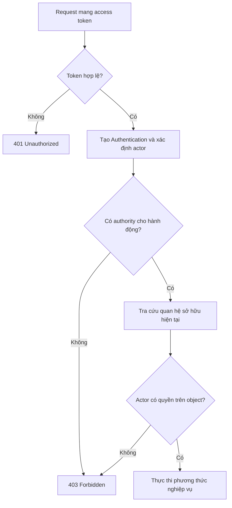

# Kiểm tra object ownership

Khi một người dùng đã đăng nhập và có quyền gọi một API, họ vẫn chưa đương nhiên được phép thao tác trên mọi dữ liệu mà API đó quản lý. Hệ thống còn phải xác định người dùng có quyền trên **đúng đối tượng** được yêu cầu hay không. Kiểm tra quan hệ sở hữu đối tượng (*object ownership check*) là một cách phổ biến để thực hiện bước phân quyền này.

Ví dụ, hai người dùng đều có scope `documents:read`. Người dùng A được đọc tài liệu của A; người dùng B được đọc tài liệu của B. Scope cho biết cả hai có thể thực hiện hành động đọc tài liệu, còn quan hệ sở hữu xác định tài liệu cụ thể nào mỗi người được đọc. Nếu chỉ kiểm tra đăng nhập hoặc scope, B có thể đổi `documentId` trong URL để thử đọc tài liệu của A. Đây là một dạng lỗi **Broken Object Level Authorization (BOLA)**, thường được khai thác thông qua IDOR (*Insecure Direct Object Reference*).

## 1. Object ownership nằm ở đâu trong mô hình bảo mật token?

Một quyết định phân quyền cho tài nguyên thường cần kết hợp danh tính, hành động và đối tượng:

| Thành phần | Câu hỏi cần trả lời | Nguồn dữ liệu thường dùng |
|---|---|---|
| Danh tính (*subject/actor*) | Ai đang gửi yêu cầu? | `sub` của access token đã được xác minh và ánh xạ sang tài khoản nội bộ |
| Quyền hành động | Người đó có được đọc, sửa hay xóa loại tài nguyên này không? | `scope`, authority hoặc role |
| Đối tượng (*resource*) | Yêu cầu đang nhắm tới bản ghi nào? | ID trong route hoặc tham số đã được kiểm tra định dạng |
| Quan hệ sở hữu | Đối tượng có thuộc về người đó không? | Quan hệ hiện tại trong cơ sở dữ liệu hoặc dịch vụ quản lý quyền |

JWT và opaque token cung cấp cách mang hoặc tra cứu thông tin xác thực khác nhau, nhưng cả hai đều phải tạo ra một danh tính đã được xác minh trước khi ứng dụng dùng danh tính đó để phân quyền. Với JWT, resource server kiểm tra chữ ký, issuer (`iss`), audience (`aud`), thời hạn (`exp`, `nbf`) và thuật toán được phép. Với opaque token, resource server thường kiểm tra trạng thái token qua introspection hoặc cơ chế xác minh tương ứng. Không được lấy payload JWT chỉ bằng cách decode rồi coi các claim là đáng tin cậy.

Sau bước xác thực, `sub` nhận diện chủ thể của token. Ứng dụng nên ánh xạ cặp issuer và subject sang một ID tài khoản nội bộ ổn định nếu hệ thống có nhiều identity provider. Không nên dùng email hoặc tên hiển thị làm khóa sở hữu nếu các giá trị đó có thể thay đổi hoặc không duy nhất.

`scope` và role biểu diễn quyền ở mức hành động hoặc nhóm chức năng. Chẳng hạn, `documents:read` cho biết chủ thể có thể yêu cầu đọc tài liệu. Nó không có nghĩa chủ thể được đọc mọi tài liệu trong hệ thống. Quyền sở hữu phải được kiểm tra riêng cho từng đối tượng. Với Spring Security Resource Server, scope thường được chuyển thành authority có tiền tố `SCOPE_`, ví dụ `SCOPE_documents:read`.

Access token được gửi đến resource server để truy cập API. Refresh token được dùng tại token endpoint để xin access token mới; không dùng refresh token làm bearer token cho API nghiệp vụ. Dù access token là JWT hay opaque token, ứng dụng vẫn cần kiểm tra quyền đối với đối tượng ở phía máy chủ.

**Quan hệ sở hữu có thể thay đổi theo thời gian.** Vì vậy, với dữ liệu có thể chuyển chủ sở hữu, thành viên nhóm hoặc tenant, cơ sở dữ liệu hay dịch vụ phân quyền hiện tại nên là nguồn quyết định. Một claim `owner_id` nằm trong JWT có thể đã cũ nếu tài liệu được chuyển cho người khác sau khi token được phát hành. Chỉ dùng claim đó làm căn cứ khi mô hình nghiệp vụ bảo đảm quan hệ bất biến trong suốt thời hạn token và rủi ro đã được đánh giá rõ.

## 2. Xác định chính sách sở hữu

Một quy tắc sở hữu cơ bản có dạng:

```text
actor.accountId == resource.ownerId
```

Quy tắc này phải được kết hợp với quyền thực hiện hành động. Ví dụ, để đổi tên tài liệu, người gọi cần có quyền `documents:write` và phải là chủ sở hữu tài liệu. Việc là chủ sở hữu không tự động cấp mọi quyền nếu nghiệp vụ còn giới hạn theo trạng thái tài liệu, loại thao tác hoặc tenant.

Trong ứng dụng nhiều tenant, kiểm tra thường cần bao gồm cả tenant và chủ sở hữu:

```text
actor.tenantId == resource.tenantId
AND actor.accountId == resource.ownerId
```

Nếu ứng dụng hỗ trợ chia sẻ, cộng tác viên hoặc quản trị viên, hãy mô tả các nhánh đó thành chính sách riêng, ví dụ `owner OR activeCollaborator OR tenantAdminWithPermission`. Không nên biến mọi người có role `USER` thành chủ sở hữu, hoặc cấp quyền quản trị toàn cục chỉ để xử lý một trường hợp ngoại lệ.

Mặc định nên từ chối khi không xác định được danh tính nội bộ, không tìm thấy quan hệ sở hữu hoặc dịch vụ phân quyền gặp lỗi. Đây là nguyên tắc *fail closed*: lỗi kiểm tra quyền không được biến thành quyền truy cập.

## 3. Thực hiện bằng Spring Security Method Security

Method security đặt kiểm tra quyền tại ranh giới phương thức nghiệp vụ. Nhờ vậy, quy tắc có thể được áp dụng khi phương thức được gọi từ controller hoặc từ một thành phần Spring khác, miễn là lời gọi đi qua security proxy.

### Bật method security

```java
@Configuration
@EnableMethodSecurity
public class MethodSecurityConfig {
}
```

`@EnableMethodSecurity` bật các annotation như `@PreAuthorize` và `@PostAuthorize`. Cần bảo đảm cấu hình này nằm trong application context đang chạy ứng dụng.

### Chuẩn hóa danh tính thành tài khoản nội bộ

Ví dụ dưới đây giả định bước xác thực đã chuyển JWT hoặc opaque token hợp lệ thành principal chứa ID tài khoản nội bộ. Cách chuẩn hóa này giúp chính sách sở hữu không phụ thuộc vào định dạng token.

```java
public record AccountPrincipal(UUID accountId) {
}
```

Một resolver lấy ID tài khoản từ `Authentication` và từ chối principal không hợp lệ:

```java
@Component
public class CurrentActorResolver {

    public Optional<UUID> accountId(Authentication authentication) {
        if (authentication == null
                || !authentication.isAuthenticated()
                || authentication instanceof AnonymousAuthenticationToken) {
            return Optional.empty();
        }

        Object principal = authentication.getPrincipal();
        if (principal instanceof AccountPrincipal accountPrincipal) {
            return Optional.of(accountPrincipal.accountId());
        }

        return Optional.empty();
    }
}
```

Ứng dụng phải cấu hình JWT authentication converter hoặc opaque-token authentication provider để tạo principal này sau khi xác minh token và ánh xạ identity. Nếu đang dùng `JwtAuthenticationToken` mặc định, resolver có thể đọc issuer và subject từ JWT rồi tra cứu tài khoản nội bộ; không được tự tin vào `ownerId` do client gửi lên.

### Kiểm tra quan hệ sở hữu

Repository nên cung cấp truy vấn thể hiện trực tiếp điều kiện sở hữu:

```java
public interface DocumentRepository extends JpaRepository<Document, UUID> {

    boolean existsByIdAndOwnerId(UUID documentId, UUID ownerId);

    Optional<Document> findByIdAndOwnerId(UUID documentId, UUID ownerId);
}
```

Bean phân quyền kết hợp danh tính đã xác thực với dữ liệu sở hữu hiện tại:

```java
@Component("documentAuthorization")
@RequiredArgsConstructor
public class DocumentAuthorization {

    private final CurrentActorResolver actors;
    private final DocumentRepository documents;

    public boolean isOwner(
            Authentication authentication,
            UUID documentId) {
        return actors.accountId(authentication)
                .filter(ownerId -> documents.existsByIdAndOwnerId(documentId, ownerId))
                .isPresent();
    }
}
```

Sau đó gắn chính sách vào phương thức nghiệp vụ:

```java
@Service
@RequiredArgsConstructor
public class DocumentService {

    private final DocumentRepository documents;
    private final CurrentActorService currentActor;

    @PreAuthorize("hasAuthority('SCOPE_documents:read') "
            + "and @documentAuthorization.isOwner(authentication, #documentId)")
    public DocumentView get(@P("documentId") UUID documentId) {
        UUID actorId = currentActor.requireAccountId();

        Document document = documents.findByIdAndOwnerId(documentId, actorId)
                .orElseThrow(DocumentNotFoundException::new);

        return DocumentView.from(document);
    }
}
```

Trong ví dụ, `CurrentActorService` là adapter của ứng dụng để lấy cùng ID tài khoản nội bộ từ security context. `@P("documentId")` giúp Spring Security tham chiếu tham số ổn định trong SpEL; nếu dùng `#documentId` mà không có annotation, cần cấu hình biên dịch giữ tên tham số bằng `-parameters` và bảo đảm Spring có thể khám phá tên đó.

`@PreAuthorize` thực hiện hai kiểm tra trước khi vào thân phương thức: authority cho phép đọc tài liệu và bean `documentAuthorization` xác nhận người gọi sở hữu tài liệu. Khi một trong hai điều kiện sai, phương thức bị từ chối. Với phương thức ghi, dùng authority tương ứng như `SCOPE_documents:write` và kiểm tra quyền sở hữu trước khi cập nhật hoặc xóa.

Nếu có quyền ngoại lệ, hãy thể hiện tường minh trong biểu thức, ví dụ:

```java
@PreAuthorize("hasAuthority('SCOPE_documents:read') and "
        + "(@documentAuthorization.isOwner(authentication, #documentId) "
        + "or hasAuthority('documents:read:any'))")
```

Authority `documents:read:any` phải được cấp bởi chính sách quản trị đã xác minh, có phạm vi phù hợp với tenant và nghiệp vụ. Không suy ra quyền này chỉ từ một trường do client truyền lên.

### Luồng quyết định



## 4. Giữ kiểm tra quyền nhất quán với thao tác dữ liệu

Kiểm tra ở annotation là một lớp bảo vệ quan trọng, nhưng thao tác đọc hoặc ghi vẫn nên ràng buộc với actor ở truy vấn dữ liệu. Ví dụ `findByIdAndOwnerId` chỉ trả về bản ghi khi ID và chủ sở hữu cùng khớp. Điều này giảm nguy cơ một đoạn code khác vô tình tải bản ghi chỉ bằng ID rồi trả dữ liệu ra ngoài.

Với cập nhật nhạy cảm, kiểm tra quyền và thao tác ghi có thể bị tách thành hai thời điểm. Nếu quyền sở hữu thay đổi giữa hai thời điểm, một kiểm tra trước đó có thể không còn đúng (*time-of-check to time-of-use*, TOCTOU). Có thể giảm rủi ro bằng cách dùng transaction phù hợp và câu lệnh cập nhật có điều kiện sở hữu:

```sql
UPDATE document
SET title = :title
WHERE id = :documentId
  AND owner_id = :actorId;
```

Ứng dụng kiểm tra số hàng bị tác động. Nếu không có hàng nào được cập nhật, tài liệu không tồn tại hoặc actor không còn là chủ sở hữu theo điều kiện truy vấn. Với dữ liệu có yêu cầu đồng thời cao, cân nhắc thêm optimistic locking hoặc cơ chế khóa phù hợp với nghiệp vụ.

Không nên tải bản ghi theo ID, trả nó về controller rồi mới kiểm tra quyền ở giao diện. Kiểm tra phải diễn ra ở server-side service hoặc tầng truy cập dữ liệu có kiểm soát. Nếu cùng tài nguyên có nhiều lối vào như REST, GraphQL, tác vụ nền, batch hoặc message consumer, mọi lối vào đều phải đi qua chính sách tương ứng.

## 5. Những lỗi triển khai thường gặp

| Cách làm sai | Vì sao nguy hiểm | Cách xử lý |
|---|---|---|
| Chỉ kiểm tra người dùng đã đăng nhập | Người dùng hợp lệ vẫn có thể truy cập object của người khác | Kết hợp quyền hành động với kiểm tra object-level |
| Chỉ kiểm tra role hoặc scope | Quyền chức năng không xác định quyền trên từng bản ghi | Tra cứu quan hệ sở hữu hoặc quyền chia sẻ hiện tại |
| Dùng `ownerId` trong request body làm actor | Client có thể thay giá trị để giả làm chủ sở hữu | Lấy actor từ `Authentication` đã được xác minh |
| Tin claim `owner_id` trong token có thể thay đổi theo thời gian | Claim có thể cũ sau khi chuyển quyền sở hữu | Đọc quan hệ hiện tại từ nguồn dữ liệu có thẩm quyền |
| Decode JWT nhưng bỏ qua xác minh chữ ký và claims | Kẻ tấn công có thể tự tạo payload giả | Dùng resource server hoặc thư viện xác minh token đúng chuẩn |
| Chỉ kiểm tra ở controller | Đường gọi khác có thể bỏ qua controller | Đặt chính sách ở method/service hoặc tầng dữ liệu dùng chung |
| Dùng `@PostAuthorize` cho thao tác ghi | Phương thức có thể đã tạo side effect trước khi bị từ chối | Ưu tiên `@PreAuthorize` cho hành động có side effect |
| Gọi phương thức được bảo vệ bằng `this.someMethod()` trong cùng bean | Lời gọi nội bộ có thể không đi qua proxy method security | Tách bean hoặc gọi qua proxy Spring phù hợp |
| Cho phép truy cập khi dịch vụ phân quyền lỗi | Lỗi hạ tầng biến thành quyền truy cập ngoài ý muốn | Fail closed và ghi log phục vụ điều tra |

`@PostAuthorize` vẫn có ích cho một số phương thức chỉ đọc khi cần kiểm tra object trả về qua `returnObject`, nhưng phương thức đã phải tải đối tượng trước khi kiểm tra. Không dùng cách này để bảo vệ thao tác ghi hoặc hành động có side effect.

## 6. Phản hồi lỗi và chống dò tìm tài nguyên

Thông thường, token thiếu, sai chữ ký, hết hạn hoặc không dành cho API hiện tại dẫn đến `401 Unauthorized`. Khi danh tính đã xác thực nhưng thiếu scope hoặc không có quyền trên object, ứng dụng trả `403 Forbidden`.

Một số hệ thống chọn trả `404 Not Found` khi object không tồn tại **hoặc** người gọi không được phép nhìn thấy nó. Cách này giảm khả năng kẻ tấn công dò ID để xác nhận tài nguyên của người khác. Dù chọn `403` hay `404`, hãy áp dụng nhất quán cho các endpoint tương đương và tránh làm lộ dữ liệu qua nội dung lỗi, log trả về client hoặc khác biệt xử lý không cần thiết.

Không trả entity nội bộ hoặc thông tin chủ sở hữu trong thông báo lỗi. Log phía server nên ghi actor nội bộ, hành động, resource ID, kết quả quyết định và correlation ID theo chính sách bảo vệ dữ liệu; không ghi access token, refresh token hay bí mật xác thực.

## 7. Object ownership và token bị đánh cắp

Object ownership giới hạn tài nguyên mà một danh tính có thể truy cập, nhưng **không tự ngăn được việc sử dụng token bị đánh cắp**. Nếu kẻ tấn công lấy được access token hợp lệ của chủ sở hữu, resource server vẫn nhìn thấy cùng subject và có thể cho phép các thao tác thuộc quyền của chủ sở hữu.

Vì vậy, cần kết hợp kiểm tra ownership với các biện pháp bảo vệ vòng đời token:

- Chỉ truyền token qua TLS; tránh đưa token vào URL, log, telemetry hoặc thông báo lỗi.
- Lưu access token và đặc biệt refresh token trong nơi lưu trữ phù hợp với nền tảng; hạn chế JavaScript truy cập token trong ứng dụng web khi có thể dùng cookie `HttpOnly`, `Secure`, `SameSite` và cơ chế chống CSRF phù hợp.
- Giữ access token có thời hạn ngắn hợp lý; xoay vòng refresh token, phát hiện việc tái sử dụng refresh token và thu hồi phiên khi có dấu hiệu xâm nhập.
- Dùng introspection hoặc cơ chế thu hồi phù hợp khi cần vô hiệu hóa token trước thời điểm hết hạn. Với JWT tự chứa, cân nhắc thời hạn ngắn và chiến lược thu hồi như denylist theo `jti` khi yêu cầu nghiệp vụ đòi hỏi.
- Với hệ thống có rủi ro cao, cân nhắc sender-constrained token như DPoP hoặc mTLS để giảm khả năng bearer token bị dùng lại từ thiết bị khác.
- Không cache quyết định ownership quá lâu nếu quyền có thể thay đổi; vô hiệu hóa cache khi chuyển chủ sở hữu, thay đổi membership hoặc thu hồi quyền.

Khi tài liệu được chuyển từ A sang B, truy vấn ownership hiện tại phải từ chối A và cho phép B ngay theo chính sách mới, kể cả access token của A chưa hết hạn. Đây là lý do quan hệ sở hữu thay đổi nên được kiểm tra từ dữ liệu nghiệp vụ hiện tại thay vì chỉ dựa trên claim được phát hành trước đó.

## 8. Kiểm thử chính sách ownership

Nên kiểm thử cả lớp method security và truy vấn dữ liệu, dùng token hoặc `Authentication` giả lập có danh tính rõ ràng. Ma trận tối thiểu:

| Tình huống | Kết quả mong đợi |
|---|---|
| Token hợp lệ, có scope phù hợp, actor là owner | Cho phép |
| Token hợp lệ, có scope nhưng actor không phải owner | Từ chối |
| Actor là owner nhưng thiếu scope của hành động | Từ chối |
| Không có xác thực hoặc principal không ánh xạ được tài khoản | Từ chối; lớp HTTP xác thực thường trả 401 |
| Client sửa `ownerId` trong request body | Không thay đổi actor; từ chối nếu actor thật không có quyền |
| Tài liệu đã chuyển từ A sang B | A bị từ chối, B được phép theo policy hiện tại |
| Tài liệu thuộc tenant khác | Từ chối nếu actor không có quyền trong tenant đó |
| Collaborator hoặc administrator được cấp quyền rõ ràng | Chỉ cho phép đúng hành động và phạm vi đã cấp |
| Repository hoặc dịch vụ kiểm tra quyền gặp lỗi | Từ chối an toàn, không mặc định cho phép |

Với Spring Security Test, có thể dùng `@WithMockUser` cho kiểm thử role/authority đơn giản, hoặc dựng JWT authentication/principal phù hợp để kiểm tra ánh xạ `issuer + subject` sang tài khoản nội bộ. Cần có integration test gọi qua Spring proxy để chứng minh `@PreAuthorize` thực sự được áp dụng; unit test gọi trực tiếp bean phân quyền không thay thế được kiểm thử đó.

## 9. Checklist khi triển khai

- [ ] Token được xác minh đầy đủ trước khi tạo `Authentication`: chữ ký hoặc introspection, issuer, audience, thời hạn và trạng thái.
- [ ] Actor được lấy từ principal đã xác thực và ánh xạ sang ID tài khoản nội bộ ổn định.
- [ ] Scope/authority kiểm soát hành động; ownership kiểm soát đối tượng cụ thể.
- [ ] Quan hệ sở hữu, tenant và quyền chia sẻ được kiểm tra từ nguồn dữ liệu có thẩm quyền.
- [ ] Method security được bật; phương thức được gọi qua Spring proxy và không bị bỏ qua do self-invocation.
- [ ] Truy vấn đọc/ghi ràng buộc với actor để giảm lỗi IDOR và rủi ro TOCTOU.
- [ ] Mọi đường vào của cùng nghiệp vụ đều áp dụng chính sách nhất quán.
- [ ] Kiểm thử owner, non-owner, thiếu scope, chuyển quyền, tenant khác và lỗi dịch vụ phân quyền.
- [ ] Token không xuất hiện trong log; cơ chế lưu trữ, hết hạn, refresh, thu hồi và chống replay phù hợp với rủi ro.

Object ownership là lớp phân quyền ở cấp tài nguyên. Khi kết hợp danh tính token đã được xác minh, quyền hành động phù hợp và quan hệ sở hữu hiện tại, ứng dụng có thể ngăn người dùng hợp lệ truy cập dữ liệu của người khác ngay cả khi họ biết hoặc đoán được ID của đối tượng.
