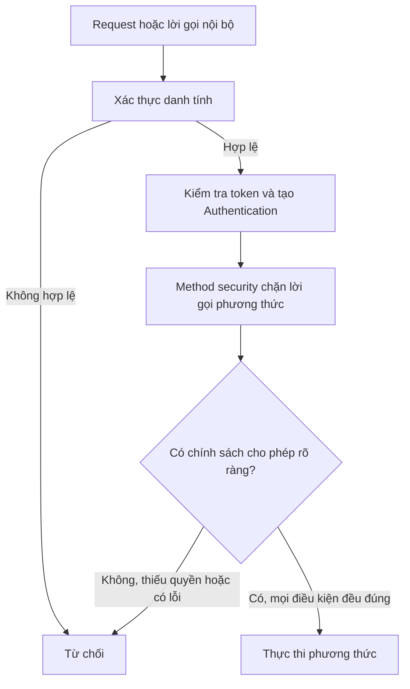

# Deny by default trong method security

**Deny by default** (mặc định từ chối) là nguyên tắc thiết kế trong đó một thao tác chỉ được phép khi hệ thống tìm thấy chính sách cấp quyền rõ ràng và xác minh được mọi điều kiện cần thiết. Nếu không có quy tắc phù hợp, danh tính chưa được xác thực, thiếu quyền, thiếu dữ liệu cần kiểm tra hoặc thành phần quyết định quyền gặp lỗi, kết quả phải là từ chối.

Trong ứng dụng Java, method security áp dụng nguyên tắc này tại ranh giới của phương thức nghiệp vụ. Một API có thể được bảo vệ ở tầng HTTP, nhưng cùng một service vẫn có thể được gọi từ một controller khác, một message listener, một tác vụ nền hoặc một thành phần nội bộ. Bảo vệ phương thức giúp kiểm tra quyền ngay tại nơi thực hiện hành động quan trọng, bất kể lời gọi đến từ đâu.

Chủ đề này liên quan trực tiếp đến vòng đời token bảo mật. Access token cung cấp danh tính và các quyền đã được cấp; method security sử dụng những thông tin đã được xác thực đó để quyết định người gọi có được thực hiện hành động cụ thể hay không. Token hợp lệ không đồng nghĩa với việc người sở hữu token được phép gọi mọi phương thức.

## 1. Vì sao cần mặc định từ chối?

Xác thực (authentication) trả lời câu hỏi **người gọi là ai**. Phân quyền (authorization) trả lời câu hỏi **người gọi được phép làm gì**. Hai bước này có liên quan nhưng không thay thế nhau.

Ví dụ, một access token có chữ ký hợp lệ, chưa hết hạn và được phát hành bởi đúng authorization server có thể xác định người gọi là `user-42`. Điều đó chưa chứng minh `user-42` được xem mọi đơn hàng, thay đổi trạng thái thanh toán hay truy cập dữ liệu thuộc tenant khác. Những quyết định đó cần chính sách phân quyền phù hợp với hành động và tài nguyên.

Nếu hệ thống mặc định cho phép, một phương thức mới có thể vô tình trở thành đường truy cập không được bảo vệ. Điều này thường xảy ra khi:

- Một developer thêm phương thức nghiệp vụ nhưng quên khai báo quyền.
- Một controller mới gọi lại service vốn chỉ được gọi từ một luồng đã có kiểm tra quyền.
- Một phương thức được dùng bởi cả HTTP request và message consumer, trong khi chỉ tầng HTTP có quy tắc bảo vệ.
- Một quyền hoặc claim không xuất hiện trong token nhưng mã xử lý lại coi giá trị thiếu là quyền mặc định.
- Một dịch vụ kiểm tra quyền bị lỗi và ứng dụng tiếp tục xử lý như thể đã được cấp quyền.

Với deny by default, những tình huống chưa có chính sách rõ ràng sẽ không tự mở quyền. Developer phải chủ động xác định hành động nào được phép và điều kiện nào cần thỏa mãn.

## 2. Mô hình quyết định quyền tại ranh giới phương thức

Một quyết định phân quyền thường cần kết hợp các yếu tố sau:

| Yếu tố | Câu hỏi cần trả lời | Ví dụ |
| --- | --- | --- |
| Principal | Ai đang gọi? | `user-42`, service account hoặc người dùng đã đăng nhập |
| Action | Người gọi muốn làm gì? | `orders.read`, `orders.update`, `payments.refund` |
| Resource | Hành động áp dụng lên dữ liệu nào? | Đơn hàng `order-91` |
| Authority | Token hoặc identity có quyền gì? | `SCOPE_orders.read`, `ROLE_SUPPORT` |
| Context | Điều kiện bổ sung có thỏa mãn không? | Đúng tenant, là chủ sở hữu, đơn hàng đang ở trạng thái cho phép |
| Default | Không đủ bằng chứng thì xử lý thế nào? | Từ chối |

Luồng xử lý tổng quát:



Ở tầng web, request chưa được xác thực thường nhận phản hồi `401 Unauthorized`. Người gọi đã xác thực nhưng không đủ quyền thường nhận `403 Forbidden`. Ở tầng method security, framework có thể ném ngoại lệ phân quyền; tầng xử lý bảo mật của ứng dụng chuyển ngoại lệ đó thành phản hồi phù hợp nếu lời gọi đến từ HTTP.

Điểm cốt lõi là quyết định phải **fail closed**: không có bằng chứng cấp quyền thì không thực thi hành động. Không được biến claim bị thiếu, kết quả kiểm tra không xác định hoặc lỗi kết nối tới dịch vụ chính sách thành một lần cho phép.

## 3. Method security trong Spring Security

Spring Security hỗ trợ bảo vệ lời gọi phương thức bằng các annotation như `@PreAuthorize` và `@PostAuthorize`. Cấu hình `@EnableMethodSecurity` bật method security; mặc định tính năng pre/post authorization được bật.

```java
@Configuration
@EnableMethodSecurity
public class MethodSecurityConfiguration {
}
```

`@PreAuthorize` kiểm tra biểu thức trước khi thân phương thức chạy. Đây thường là lựa chọn phù hợp cho các thao tác đọc, cập nhật, xóa hoặc thực hiện nghiệp vụ có tác động dữ liệu.

Ví dụ sau đặt chính sách từ chối ở cấp lớp làm mặc định. Mỗi phương thức được phép sử dụng phải khai báo một chính sách `@PreAuthorize` cụ thể:

```java
@Service
@PreAuthorize("denyAll()")
public class OrderService {

    @PreAuthorize("hasAuthority('SCOPE_orders.read')")
    public Order getOrder(UUID orderId) {
        return orderRepository.findById(orderId)
            .orElseThrow(() -> new OrderNotFoundException(orderId));
    }

    @PreAuthorize("@orderAuthorization.canUpdate(authentication, #orderId)")
    public Order updateOrder(UUID orderId, UpdateOrderCommand command) {
        Order order = orderRepository.findById(orderId)
            .orElseThrow(() -> new OrderNotFoundException(orderId));

        order.update(command);
        return orderRepository.save(order);
    }

    // Không có chính sách cho phép riêng nên kế thừa mặc định denyAll().
    public void rebuildInternalProjection() {
        // Công việc nội bộ cần được cấp quyền rõ ràng trước khi mở cho caller.
    }
}
```

Trong ví dụ, phương thức có `@PreAuthorize` riêng được đánh giá theo biểu thức của chính phương thức đó. Phương thức chưa khai báo chính sách riêng tiếp tục chịu quy tắc `denyAll()` ở cấp lớp. Cách tổ chức này khiến việc thêm một phương thức mới không tự tạo ra quyền truy cập mới.

Biểu thức `hasAuthority('SCOPE_orders.read')` kiểm tra authority có tên chính xác. Với OAuth 2.0 resource server, Spring Security thường ánh xạ scope thành authority có tiền tố `SCOPE_`, vì vậy scope `orders.read` được kiểm tra bằng `SCOPE_orders.read`. Nếu ứng dụng tự ánh xạ claim hoặc dùng một quy ước khác, biểu thức phải khớp với authority thực tế trong `Authentication`.

`#orderId` tham chiếu tham số phương thức. Để Spring phân giải được tên tham số, cần cấu hình biên dịch và metadata tham số phù hợp, hoặc dùng cơ chế đặt tên tham số được Spring Security hỗ trợ. Không nên viết biểu thức dựa trên một tên tham số mà runtime không thể phân giải.

### 3.1. Quyền ở cấp lớp và cấp phương thức

Quy tắc ở cấp lớp hữu ích để thiết lập mặc định cho toàn bộ service. Quy tắc ở cấp phương thức mô tả chính xác hành động được phép. Mỗi phương thức mở quyền nên dùng điều kiện hẹp nhất đáp ứng nghiệp vụ.

Một số nguyên tắc khi tổ chức annotation:

- Đặt mặc định `denyAll()` ở service chứa các thao tác nhạy cảm.
- Thêm `@PreAuthorize` cho từng phương thức thực sự cần được gọi.
- Tránh biểu thức quá rộng như cho phép mọi người dùng đã đăng nhập thực hiện mọi thao tác.
- Không dựa vào tên phương thức, URL hoặc giao diện người dùng để thay thế một chính sách phân quyền.
- Khi thay đổi hoặc ghi dữ liệu, kiểm tra quyền trước khi thực hiện side effect.

Method security của Spring hoạt động thông qua cơ chế proxy/interceptor. Lời gọi phải đi qua proxy bảo mật để interceptor có thể kiểm tra quyền. Vì vậy, lời gọi nội bộ từ một phương thức sang phương thức khác trên cùng đối tượng (`this.someMethod()`) có thể bỏ qua proxy và không kích hoạt kiểm tra như mong đợi. Nên tổ chức phương thức được bảo vệ ở một bean có ranh giới gọi rõ ràng, hoặc thiết kế luồng gọi để đi qua proxy.

## 4. Phân biệt role, scope và quyền trên tài nguyên

Role, scope và quyền truy cập tài nguyên giải quyết các câu hỏi khác nhau. Không nên dùng một role rộng để thay thế mọi điều kiện phân quyền.

| Loại quyền | Mục đích | Ví dụ |
| --- | --- | --- |
| Role | Nhóm chức năng hoặc trách nhiệm của người dùng | `ROLE_SUPPORT`, `ROLE_ADMIN` |
| OAuth scope | Phạm vi mà client được cấp để gọi resource server | `orders.read`, `orders.write` |
| Quyền trên tài nguyên | Kiểm tra người gọi có thể thao tác trên một đối tượng cụ thể hay không | Chủ sở hữu đơn hàng, đúng tenant, được phân công xử lý |

Một nhân viên hỗ trợ có thể có role `ROLE_SUPPORT`, nhưng điều đó không nhất thiết cho phép họ đọc mọi dữ liệu khách hàng. Một access token có scope `orders.read` có thể cho phép gọi chức năng đọc đơn hàng, nhưng vẫn cần kiểm tra đơn hàng thuộc tenant hoặc phạm vi mà principal được phép truy cập.

Có thể đặt logic kiểm tra tài nguyên trong một bean chuyên trách:

```java
@Component("orderAuthorization")
public class OrderAuthorization {

    private final OrderRepository orderRepository;

    public OrderAuthorization(OrderRepository orderRepository) {
        this.orderRepository = orderRepository;
    }

    public boolean canUpdate(Authentication authentication, UUID orderId) {
        if (authentication == null
            || !authentication.isAuthenticated()
            || authentication instanceof AnonymousAuthenticationToken) {
            return false;
        }

        return orderRepository.findById(orderId)
            .filter(order -> order.getTenantId().equals(currentTenant(authentication)))
            .filter(order -> order.getOwnerId().equals(authentication.getName())
                || hasSupportAuthority(authentication))
            .isPresent();
    }

    private String currentTenant(Authentication authentication) {
        // Lấy tenant từ context đã được xác thực và kiểm soát của ứng dụng.
        // Không lấy tenant tùy ý từ request body để quyết định quyền.
        return TenantContext.requireTenantId();
    }

    private boolean hasSupportAuthority(Authentication authentication) {
        return authentication.getAuthorities().stream()
            .anyMatch(authority -> authority.getAuthority().equals("ROLE_SUPPORT"));
    }
}
```

Đây là ví dụ minh họa cách tách chính sách ra khỏi service. Trong hệ thống thực tế, cần thống nhất nguồn tenant, cách biểu diễn principal và quy tắc truy cập của bộ phận hỗ trợ. Nếu không tìm thấy tài nguyên, không xác định được tenant hoặc không chứng minh được quan hệ sở hữu, phương thức phải trả về `false` để từ chối.

Không nên chỉ dựa vào `@PostAuthorize` để bảo vệ một thao tác có side effect. `@PostAuthorize` chạy sau khi phương thức đã thực thi; nếu thân phương thức đã ghi dữ liệu hoặc gửi lệnh ra hệ thống khác thì việc từ chối sau đó không thể tự hoàn tác tác động. Dùng `@PreAuthorize` cho kiểm tra quyền cần hoàn tất trước hành động. `@PostAuthorize` có thể hữu ích để kiểm tra kết quả trả về, nhưng không thay thế kiểm tra trước khi thay đổi trạng thái.

## 5. Kết nối method security với access token

Method security không tự xác minh chữ ký JWT hoặc gọi introspection endpoint. Nó sử dụng `Authentication` đã được cơ chế xác thực của ứng dụng tạo ra. Vì vậy, chất lượng quyết định phân quyền phụ thuộc vào việc token được kiểm tra và ánh xạ đúng trước đó.

### 5.1. JWT access token

Với JWT, resource server cần xác minh chữ ký theo cấu hình tin cậy và kiểm tra các thuộc tính cần thiết, thường gồm:

- `iss` (issuer): token được phát hành bởi authorization server được tin cậy.
- `aud` (audience): token được phát hành cho resource server hoặc API đang xử lý.
- `exp` và `nbf`: token còn trong khoảng thời gian hiệu lực.
- Thuật toán ký: chỉ chấp nhận thuật toán phù hợp với cấu hình tin cậy; không để header do token cung cấp tự quyết định một thuật toán yếu hoặc ngoài chính sách.
- Các claim dùng để ánh xạ quyền: chỉ sử dụng sau khi token đã vượt qua các bước xác minh.

Sau xác minh, resource server chuyển scope hoặc claim quyền thành authorities trong `Authentication`. Method security kiểm tra những authorities này và có thể kết hợp chúng với thông tin tài nguyên được lấy từ hệ thống dữ liệu.

Một JWT hợp lệ chỉ chứng minh token đáp ứng điều kiện xác thực đã cấu hình. Nó không chứng minh người gọi có quyền với mọi đối tượng. Ví dụ, `SCOPE_orders.read` có thể cho phép gọi chức năng đọc đơn hàng, nhưng `OrderAuthorization` vẫn phải kiểm tra tenant và quan hệ sở hữu của `orderId`.

### 5.2. Opaque access token

Opaque token không chứa bộ claim tự mô tả có thể được resource server tự xác minh như JWT. Resource server thường kiểm tra token qua introspection endpoint hoặc cơ chế xác minh tập trung tương đương. Kết quả xác minh cung cấp trạng thái token và các thông tin như subject, scope, audience hoặc thời hạn theo hợp đồng của authorization server.

Sau khi có `Authentication` và authorities đáng tin cậy, cách dùng method security vẫn tương tự. Sự khác biệt nằm ở cơ chế xác minh token và cập nhật trạng thái thu hồi, không nằm ở nguyên tắc cấp quyền tại phương thức.

### 5.3. Access token và refresh token

Access token được gửi tới resource server để truy cập API trong phạm vi được cấp. Refresh token được gửi tới authorization server để xin access token mới theo quy trình cấp token. Refresh token không nên được chấp nhận như access token tại các API nghiệp vụ.

Method security phải chạy trên danh tính và authorities của access token đã được xác thực. Không dùng sự hiện diện của refresh token, một chuỗi token bất kỳ hoặc dữ liệu do client tự gửi làm bằng chứng cấp quyền.

### 5.4. Thu hồi token và thời hạn quyền

Với JWT access token tự chứa, việc thu hồi ở authorization server không nhất thiết làm mọi resource server lập tức ngừng chấp nhận token đã phát hành. Token có thể tiếp tục hợp lệ đến khi hết hạn nếu hệ thống không có cơ chế kiểm tra trạng thái bổ sung. Opaque token introspection có thể phản ánh trạng thái thu hồi theo thời điểm introspection và chính sách cache.

Method security quyết định một lời gọi có được phép dựa trên `Authentication` hiện tại; nó không tự biến một JWT còn hợp lệ thành token đã bị thu hồi. Với nghiệp vụ cần thu hồi nhanh, cần thiết kế thêm cơ chế phù hợp như access token có thời hạn ngắn, introspection, denylist theo `jti`, phiên bản quyền hoặc kiểm tra trạng thái tập trung. Cơ chế được chọn phải cân bằng yêu cầu độ trễ, khả năng sẵn sàng và thời gian thu hồi tối đa chấp nhận được.

## 6. Kết hợp bảo vệ ở tầng HTTP và tầng method

Hai tầng bảo vệ giải quyết hai ranh giới khác nhau:

- HTTP authorization kiểm soát request đi vào ứng dụng theo endpoint, method HTTP hoặc nhóm route.
- Method security kiểm soát việc gọi các phương thức nghiệp vụ, kể cả khi caller không đi qua một endpoint HTTP.

Có thể thiết lập mặc định từ chối ở tầng HTTP bằng `anyRequest().denyAll()` sau khi khai báo tường minh các route được phép:

```java
@Bean
SecurityFilterChain applicationSecurity(HttpSecurity http) throws Exception {
    return http
        .authorizeHttpRequests(authorize -> authorize
            .requestMatchers("/actuator/health").permitAll()
            .requestMatchers("/api/orders/**").authenticated()
            .anyRequest().denyAll()
        )
        .oauth2ResourceServer(resourceServer -> resourceServer.jwt(Customizer.withDefaults()))
        .build();
}
```

Trong ví dụ này, health endpoint được công khai, route đơn hàng yêu cầu danh tính đã xác thực, còn route chưa được khai báo bị từ chối. Các quyền chi tiết theo thao tác và tài nguyên tiếp tục được kiểm tra trong service bằng method security.

Không nên hiểu việc route đã yêu cầu xác thực là mọi thao tác phía sau đều được phép. Ví dụ, `GET /api/orders/{id}` và `DELETE /api/orders/{id}` có thể cần scope khác nhau; việc đọc một đơn hàng cũng có thể cần kiểm tra tenant hoặc chủ sở hữu. Những điều kiện đó thuộc chính sách cụ thể của phương thức nghiệp vụ.

## 7. Xử lý lỗi theo hướng fail closed

Một hệ thống deny by default cần giữ hành vi từ chối trong cả những trường hợp không bình thường:

1. **Không có `Authentication`:** từ chối. Không tự tạo principal mặc định có quyền.
2. **Không có authority cần thiết:** từ chối. Không thay giá trị thiếu bằng role quản trị hoặc scope rộng.
3. **Không tìm thấy tài nguyên hoặc quan hệ sở hữu:** từ chối theo chính sách. Tránh trả về dữ liệu trước khi hoàn tất kiểm tra.
4. **Không xác định được tenant:** từ chối. Không suy ra tenant từ dữ liệu không đáng tin cậy.
5. **Dịch vụ kiểm tra quyền không sẵn sàng:** từ chối hoặc trả lỗi vận hành phù hợp; không bỏ qua bước kiểm tra.
6. **Có ngoại lệ khi đánh giá chính sách:** không bắt ngoại lệ rồi mặc định trả `true`.

Với các tác vụ nền hoặc message consumer không có người dùng tương tác, cần dùng service identity hoặc principal kỹ thuật được cấp quyền tối thiểu. Không nên tắt method security chỉ vì caller không phải HTTP request. Nếu một tác vụ được phép thực hiện thao tác quản trị, hãy biểu diễn quyền đó bằng danh tính máy và authority riêng có thể kiểm toán.

Log bảo mật nên ghi nhận principal, hành động, tài nguyên ở mức phù hợp, kết quả cho phép/từ chối và mã tương quan. Không ghi access token, refresh token, secret hoặc toàn bộ header `Authorization` vào log. Thông tin log cũng cần tránh làm lộ dữ liệu nhạy cảm hoặc xác nhận sự tồn tại của tài nguyên cho người không có quyền.

## 8. Những lỗi triển khai thường gặp

| Lỗi | Hậu quả | Cách khắc phục |
| --- | --- | --- |
| Nghĩ rằng bật `@EnableMethodSecurity` sẽ tự từ chối mọi phương thức chưa có annotation | Phương thức không có chính sách có thể không bị method interceptor kiểm tra | Thiết lập fallback `denyAll()` ở cấp lớp hoặc cơ chế mặc định tương đương; kiểm thử phương thức mới |
| Chỉ bảo vệ controller | Service có thể được gọi qua message listener, scheduler hoặc bean khác | Bảo vệ tại service chứa hành động nghiệp vụ |
| Chỉ kiểm tra role hoặc scope | Người có quyền chức năng có thể truy cập dữ liệu ngoài tenant hoặc không thuộc sở hữu | Bổ sung kiểm tra quyền trên từng tài nguyên |
| Tin claim trước khi xác minh token | Kẻ tấn công có thể giả mạo danh tính hoặc authority | Xác minh chữ ký, issuer, audience, thời hạn và chính sách thuật toán trước khi ánh xạ claim |
| Dùng `@PostAuthorize` làm kiểm tra duy nhất cho thao tác ghi | Side effect có thể đã xảy ra trước khi quyết định từ chối | Dùng kiểm tra trước hành động bằng `@PreAuthorize` hoặc kiểm tra nghiệp vụ tương đương |
| Gọi phương thức được bảo vệ qua `this` trong cùng bean | Lời gọi có thể bỏ qua proxy/interceptor | Tổ chức bean và luồng gọi để lời gọi đi qua proxy bảo mật |
| Cho phép khi dịch vụ kiểm tra quyền bị lỗi | Lỗi hạ tầng trở thành đường vượt quyền | Fail closed và quan sát lỗi để xử lý vận hành |
| Dùng refresh token để gọi API nghiệp vụ | Làm sai mục đích và ranh giới của hai loại token | Chỉ chấp nhận access token tại resource server; refresh token chỉ dùng với authorization server theo flow được phép |

## 9. Kiểm thử deny by default

Kiểm thử cần chứng minh cả trường hợp được phép lẫn trường hợp bị từ chối. Một bài test chỉ xác nhận người dùng hợp lệ gọi được phương thức chưa đủ để chứng minh chính sách an toàn.

Với một service có mặc định `denyAll()`, nên có các nhóm kiểm thử sau:

- Người chưa xác thực gọi phương thức được bảo vệ: bị từ chối.
- Người đã xác thực nhưng thiếu scope: bị từ chối.
- Người có scope phù hợp và đúng tenant/chủ sở hữu: được phép.
- Người có scope phù hợp nhưng sai tenant hoặc không sở hữu tài nguyên: bị từ chối.
- Phương thức mới hoặc phương thức chưa có annotation riêng: bị từ chối theo fallback.
- Dịch vụ kiểm tra quyền ném lỗi hoặc không xác định được dữ liệu: không được chuyển thành cho phép.
- Lời gọi đi qua đúng proxy bảo mật; kiểm tra riêng những đường gọi nội bộ có nguy cơ self-invocation.
- Message listener hoặc tác vụ nền sử dụng service identity với quyền tối thiểu được cấp rõ ràng.

Ví dụ minh họa với Spring Security Test:

```java
@Test
@WithMockUser(authorities = "SCOPE_orders.read")
void getOrder_allowsCallerWithReadScope() {
    assertThat(orderService.getOrder(existingOrderId)).isNotNull();
}

@Test
@WithMockUser(authorities = "SCOPE_profile.read")
void getOrder_deniesCallerWithoutReadScope() {
    assertThatThrownBy(() -> orderService.getOrder(existingOrderId))
        .isInstanceOf(AccessDeniedException.class);
}

@Test
@WithMockUser(authorities = "SCOPE_orders.read")
void unannotatedMethodIsDeniedByClassFallback() {
    assertThatThrownBy(orderService::rebuildInternalProjection)
        .isInstanceOf(AccessDeniedException.class);
}
```

Đây là ví dụ cấu trúc; test thực tế cần khởi tạo service qua Spring context để method security proxy được áp dụng. Nếu tự tạo đối tượng bằng `new OrderService(...)`, test có thể không đi qua proxy và không xác minh được hành vi của interceptor. Khi test biểu thức dùng bean hoặc truy cập dữ liệu, cần cấu hình fixture và mock tương ứng để kiểm tra cả kết quả chính sách.

Ngoài unit test, nên có integration test cho resource server để xác minh token sai chữ ký, sai issuer, sai audience, hết hạn hoặc thiếu scope đều không thể truy cập thao tác tương ứng. Các test này kiểm tra toàn bộ đường đi từ xác thực token đến quyết định tại phương thức.

## 10. Checklist thiết kế

Trước khi đưa một service có dữ liệu hoặc hành động nhạy cảm vào vận hành, hãy xác nhận:

- Service có chính sách mặc định từ chối cho phương thức chưa được cấp quyền rõ ràng.
- Mỗi phương thức được mở đều có điều kiện phân quyền cụ thể và có chủ sở hữu nghiệp vụ chịu trách nhiệm.
- Token được xác minh trước khi claim được ánh xạ thành authority.
- Scope giới hạn đúng API/hành động; role không thay thế kiểm tra tenant hoặc quyền trên tài nguyên.
- Access token và refresh token được dùng đúng mục đích.
- Lời gọi HTTP, message, scheduler và lời gọi nội bộ đều đi qua ranh giới kiểm tra phù hợp.
- Lỗi khi xác minh danh tính hoặc kiểm tra quyền không tạo ra trạng thái cho phép.
- Có test cho thiếu quyền, sai tenant, phương thức chưa khai báo và lỗi dịch vụ chính sách.
- Log đủ để điều tra quyết định nhưng không làm lộ token hoặc secret.

Deny by default biến việc cấp quyền thành một quyết định có chủ đích: phương thức chỉ chạy khi danh tính đã được xác thực, quyền phù hợp và các điều kiện trên tài nguyên đều được chứng minh. Khi kết hợp xác minh access token đúng cách với method security ở ranh giới service, ứng dụng giữ được chính sách nhất quán qua nhiều kiểu caller và giảm nguy cơ một phương thức mới vô tình mở rộng quyền truy cập.
