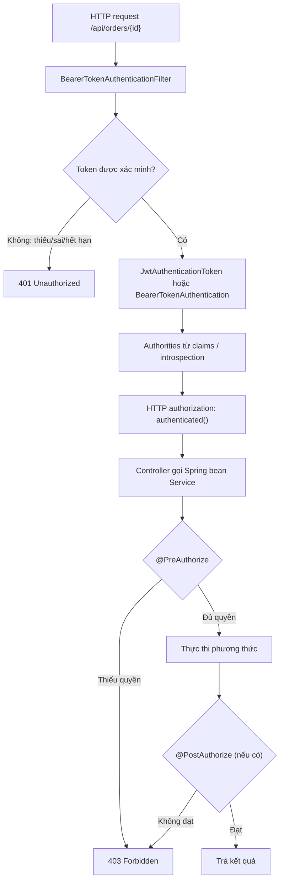

# Kiểm thử bảo vệ method bằng token trong Spring Security

## 1. Vì sao kiểm thử endpoint thành công vẫn chưa đủ?

Trong Spring Security, bảo vệ ở tầng HTTP (`SecurityFilterChain`) kiểm soát request đi vào ứng dụng, còn **method security** kiểm soát quyền trước hoặc sau khi gọi một phương thức Java. Với OAuth 2.0 Resource Server, client gửi **access token**, hệ thống xác minh token, lấy các claim (`sub`, `scope`/`scp`, `aud`, …), chuyển chúng thành các `GrantedAuthority` rồi áp dụng các biểu thức như `@PreAuthorize` và `@PostAuthorize`.

Ví dụ, một access token có scope `orders.write` có thể cho phép truy cập route POST. Nhưng nghiệp vụ phê duyệt đơn hàng còn đòi hỏi role `ORDER_APPROVER` và quyền trên chính đơn hàng đó. Nếu chỉ kiểm tra kết quả HTTP mà không chủ động kiểm tra trường hợp thiếu quyền, một thay đổi sau này có thể vô tình cho phép gọi trực tiếp service mà không có lớp bảo vệ phù hợp.

Bài học này tập trung vào cách **kiểm thử bảo vệ method bằng token**, nằm trong module `SECURITY_TOKEN_SECURITY_FUNDAMENTALS`: hiểu chuỗi tin cậy của JWT/opaque token, access token/refresh token, scope, audience, thời gian hiệu lực, thu hồi và những giới hạn của kỹ thuật mock khi kiểm thử phân quyền.

Sau bài học, bạn có thể:

- Viết test cho `@PreAuthorize`, `@PostAuthorize` và biểu thức kiểm tra `hasAuthority`/`hasRole`.
- Dùng `spring-security-test` với `MockMvc` và `jwt()` để mô phỏng người dùng được xác thực bằng access token JWT.
- Kiểm thử ánh xạ claim thành `GrantedAuthority`, bảo đảm claim/role lạ không được mở rộng quyền.
- Phân biệt kiểm thử method với kiểm thử quy trình **thẩm định chữ ký, issuer, audience, thời gian hiệu lực** của một Bearer token thật.
- Thiết kế các ca âm tính: thiếu token (401), token không hợp lệ (401), token hợp lệ nhưng thiếu quyền (403), sai chủ sở hữu và sai tenant.
- Biết cách mở rộng kiểm thử cho opaque token qua introspection và rủi ro token bị đánh cắp hoặc phát lại.

## 2. Hai lớp bảo vệ cần kiểm thử



Sơ đồ thể hiện luồng cơ bản; trên thực tế `@PreAuthorize` và `@PostAuthorize` hoạt động thông qua interceptor/proxy của Spring AOP. **Phải gọi service qua bean do Spring quản lý** thì các interceptor mới được áp dụng. Tạo thủ công bằng `new OrderService()` rồi gọi method sẽ không chứng minh được method security hoạt động.

| Lớp kiểm thử | Mục tiêu | Công cụ hay dùng | Có tự kiểm tra chữ ký JWT? |
| --- | --- | --- | --- |
| Method-level | Biểu thức `@PreAuthorize`, `@PostAuthorize`, đối tượng được phép truy cập | Spring bean + `@WithMockUser` hoặc `SecurityContext` | Không |
| HTTP + mock JWT | Controller gọi service có proxy; scope/role và mã phản hồi 401/403 | `MockMvc` + `jwt()` | Không |
| HTTP + Bearer JWT thật | Bearer header, `JwtDecoder`, ký số, `iss`, `aud`, `exp`, authority converter, method security | `MockMvc` + JWT được ký bởi test key | Có, nếu decoder thật được cấu hình đúng |
| HTTP + opaque token thật | `OpaqueTokenIntrospector`, `active`, scope, phân quyền method | HTTP request + introspection test server | Không có chữ ký JWT để kiểm tra; dựa vào introspection |

> `jwt()` trong `spring-security-test` tạo `Authentication` phục vụ kiểm thử. Nó **không** gửi token qua luồng xác minh JWT của resource server. Vì vậy test dùng `jwt()` có thể đạt 200 ngay cả khi claim `exp` nằm trong quá khứ, `iss` sai hoặc token thực tế không có chữ ký hợp lệ.

## 3. Tình huống xuyên suốt: đọc và phê duyệt đơn hàng

Giả sử API `orders-api` có hai thao tác:

| Nghiệp vụ | Điều kiện method security |
| --- | --- |
| `GET /api/orders/{id}` | Access token có `SCOPE_orders.read` **và** `sub` là chủ sở hữu đơn |
| `POST /api/orders/{id}/approve` | Có cả `SCOPE_orders.write` **và** `ROLE_ORDER_APPROVER` |

JWT hợp lệ được IdP phát hành có thể chứa:

```json
{
  "iss": "https://idp.example.org",
  "sub": "user-42",
  "aud": ["orders-api"],
  "scope": "orders.read orders.write",
  "app_roles": ["approver"],
  "exp": 1810000000
}
```

Đây là **payload minh họa**, không phải JWT có thể gửi trực tiếp. API chỉ tin nội dung sau khi `JwtDecoder` đã xác minh chữ ký, issuer, audience và các điều kiện thời gian; sau đó custom authorities converter ánh xạ `app_roles: ["approver"]` thành `ROLE_ORDER_APPROVER`. Hợp đồng này phải được IdP và API thống nhất, không dựa vào tên role tự suy đoán.

### 3.1. Bật method security và định nghĩa quy tắc

Giả sử dự án có `spring-boot-starter-security`, `spring-boot-starter-oauth2-resource-server` và cấu hình `JwtDecoder` theo IdP. Bổ sung `spring-security-test` và `spring-boot-starter-test` trong phạm vi `test`. Ví dụ Maven:

```xml
<dependency>
    <groupId>org.springframework.boot</groupId>
    <artifactId>spring-boot-starter-test</artifactId>
    <scope>test</scope>
</dependency>
<dependency>
    <groupId>org.springframework.security</groupId>
    <artifactId>spring-security-test</artifactId>
    <scope>test</scope>
</dependency>
```

Cấu hình Servlet Security dùng Spring Security 6+:

```java
import java.util.Collection;
import java.util.LinkedHashSet;
import java.util.Set;

import org.springframework.context.annotation.Bean;
import org.springframework.context.annotation.Configuration;
import org.springframework.core.convert.converter.Converter;
import org.springframework.security.config.annotation.method.configuration.EnableMethodSecurity;
import org.springframework.security.config.annotation.web.builders.HttpSecurity;
import org.springframework.security.core.GrantedAuthority;
import org.springframework.security.core.authority.SimpleGrantedAuthority;
import org.springframework.security.oauth2.jwt.Jwt;
import org.springframework.security.oauth2.server.resource.authentication.DelegatingJwtGrantedAuthoritiesConverter;
import org.springframework.security.oauth2.server.resource.authentication.JwtAuthenticationConverter;
import org.springframework.security.oauth2.server.resource.authentication.JwtGrantedAuthoritiesConverter;
import org.springframework.security.web.SecurityFilterChain;

@Configuration
@EnableMethodSecurity // Kích hoạt @PreAuthorize và @PostAuthorize.
public class OrderSecurityConfig {

    @Bean
    Converter<Jwt, Collection<GrantedAuthority>> orderAuthoritiesConverter() {
        JwtGrantedAuthoritiesConverter scopes = new JwtGrantedAuthoritiesConverter();
        scopes.setAuthoritiesClaimName("scope");
        scopes.setAuthorityPrefix("SCOPE_");

        Converter<Jwt, Collection<GrantedAuthority>> roles = jwt -> {
            Set<GrantedAuthority> result = new LinkedHashSet<>();
            Object raw = jwt.getClaim("app_roles");
            if (raw instanceof Collection<?> entries) {
                for (Object entry : entries) {
                    // Chỉ cấp authority đã có trong hợp đồng của orders-api.
                    if ("approver".equals(entry)) {
                        result.add(new SimpleGrantedAuthority("ROLE_ORDER_APPROVER"));
                    }
                }
            }
            return result;
        };
        return new DelegatingJwtGrantedAuthoritiesConverter(scopes, roles);
    }

    @Bean
    JwtAuthenticationConverter orderJwtAuthenticationConverter(
            Converter<Jwt, Collection<GrantedAuthority>> orderAuthoritiesConverter) {
        JwtAuthenticationConverter converter = new JwtAuthenticationConverter();
        converter.setJwtGrantedAuthoritiesConverter(orderAuthoritiesConverter);
        return converter;
    }

    @Bean
    SecurityFilterChain ordersSecurityFilterChain(
            HttpSecurity http, JwtAuthenticationConverter converter) throws Exception {
        http
            .authorizeHttpRequests(auth -> auth
                .requestMatchers("/api/orders/**").authenticated()
                .anyRequest().denyAll())
            .oauth2ResourceServer(oauth2 -> oauth2
                .jwt(jwt -> jwt.jwtAuthenticationConverter(converter)));
        return http.build();
    }
}
```

Trong bài này, cấu hình HTTP chỉ yêu cầu request đã xác thực để mọi điều kiện nghiệp vụ được kiểm tra ở method. Nếu ứng dụng bật CSRF (mặc định cho ứng dụng web có state), test POST phải gửi CSRF token; phần test sẽ dùng `.with(csrf())`. Với API thuần Bearer token không dựa trên cookie, có thể cấu hình CSRF riêng theo kiến trúc của dự án, nhưng cần đánh giá cơ chế xác thực thực tế trước khi tắt.

### 3.2. Dịch vụ có bảo vệ trước và sau khi gọi

Ví dụ service sau dùng dữ liệu cố định để tập trung vào phân quyền. Trong ứng dụng thực tế, kết quả lấy từ repository với kiểm tra tenant/owner nhất quán:

```java
import org.springframework.security.access.prepost.PostAuthorize;
import org.springframework.security.access.prepost.PreAuthorize;
import org.springframework.stereotype.Service;

public record OrderView(String id, String ownerSubject, String status) {}

@Service
public class OrderService {

    @PreAuthorize("hasAuthority('SCOPE_orders.read')")
    @PostAuthorize("returnObject.ownerSubject() == authentication.name")
    public OrderView findById(String id) {
        // Dữ liệu thử nghiệm minh họa hai chủ sở hữu.
        return switch (id) {
            case "42" -> new OrderView("42", "user-42", "PENDING");
            case "99" -> new OrderView("99", "user-99", "PENDING");
            default -> throw new IllegalArgumentException("Unknown demo order");
        };
    }

    @PreAuthorize(
        "hasAuthority('SCOPE_orders.write') and hasAuthority('ROLE_ORDER_APPROVER')")
    public void approve(String id) {
        // Thực thi nghiệp vụ phê duyệt sau khi qua method security.
    }
}
```

`@PreAuthorize` chặn trước khi method chạy, phù hợp cho thao tác có tác dụng phụ. `@PostAuthorize` kiểm tra kết quả sau khi method đã chạy; dùng cho truy vấn đọc như ví dụ trên, không nên dựa vào nó để bảo vệ thao tác ghi đã phát sinh side effect. `authentication.name` với `JwtAuthenticationToken` thường là claim `sub`; nếu ứng dụng cấu hình `principalClaimName` khác, test phải phản ánh lựa chọn đó.

Controller gọi qua `OrderService` do Spring inject, nhờ đó proxy method security hoạt động:

```java
import org.springframework.http.ResponseEntity;
import org.springframework.web.bind.annotation.GetMapping;
import org.springframework.web.bind.annotation.PathVariable;
import org.springframework.web.bind.annotation.PostMapping;
import org.springframework.web.bind.annotation.RequestMapping;
import org.springframework.web.bind.annotation.RestController;

@RestController
@RequestMapping("/api/orders")
public class OrderController {
    private final OrderService service;

    public OrderController(OrderService service) {
        this.service = service;
    }

    @GetMapping("/{id}")
    public OrderView find(@PathVariable String id) {
        return service.findById(id);
    }

    @PostMapping("/{id}/approve")
    public ResponseEntity<Void> approve(@PathVariable String id) {
        service.approve(id);
        return ResponseEntity.noContent().build();
    }
}
```

Khi chèn các class vào dự án, đặt từng public class/record trong file Java đúng tên. Những ví dụ tiếp theo giả định ứng dụng Spring Boot đã scan các bean trên, bật resource server và cấu hình decoder cần thiết để khởi động context.

## 4. Kiểm thử HTTP + method bằng MockMvc và JWT giả lập

Đây là phương pháp nhanh để bảo vệ chính sách phân quyền khi refactor. Cần test cả đường đi thành công và các đường đi bị từ chối.

### 4.1. Helper tạo Authentication từ claim

```java
import static org.springframework.security.test.web.servlet.request.SecurityMockMvcRequestPostProcessors.csrf;
import static org.springframework.security.test.web.servlet.request.SecurityMockMvcRequestPostProcessors.jwt;
import static org.springframework.test.web.servlet.request.MockMvcRequestBuilders.get;
import static org.springframework.test.web.servlet.request.MockMvcRequestBuilders.post;
import static org.springframework.test.web.servlet.result.MockMvcResultMatchers.jsonPath;
import static org.springframework.test.web.servlet.result.MockMvcResultMatchers.status;

import java.util.Collection;
import java.util.List;

import org.junit.jupiter.api.Test;
import org.springframework.beans.factory.annotation.Autowired;
import org.springframework.boot.test.autoconfigure.web.servlet.AutoConfigureMockMvc;
import org.springframework.boot.test.context.SpringBootTest;
import org.springframework.core.convert.converter.Converter;
import org.springframework.security.core.GrantedAuthority;
import org.springframework.security.oauth2.jwt.Jwt;
import org.springframework.test.web.servlet.MockMvc;
import org.springframework.test.web.servlet.request.RequestPostProcessor;

@SpringBootTest
@AutoConfigureMockMvc
class OrderMethodSecurityHttpTest {
    @Autowired MockMvc mvc;
    @Autowired Converter<Jwt, Collection<GrantedAuthority>> orderAuthoritiesConverter;

    private RequestPostProcessor token(
            String subject, String scope, String... appRoles) {
        return jwt()
            .jwt(builder -> builder
                .subject(subject)
                .claim("scope", scope)
                .claim("app_roles", List.of(appRoles)))
            .authorities(orderAuthoritiesConverter);
    }

    @Test
    void ownOrderWithReadScopeReturns200() throws Exception {
        mvc.perform(get("/api/orders/42")
                .with(token("user-42", "orders.read")))
            .andExpect(status().isOk())
            .andExpect(jsonPath("$.ownerSubject").value("user-42"));
    }

    @Test
    void missingReadScopeReturns403() throws Exception {
        mvc.perform(get("/api/orders/42")
                .with(token("user-42", "orders.write")))
            .andExpect(status().isForbidden());
    }

    @Test
    void cannotReadAnotherUsersOrderEvenWithScope() throws Exception {
        mvc.perform(get("/api/orders/99")
                .with(token("user-42", "orders.read")))
            .andExpect(status().isForbidden());
    }

    @Test
    void approverWithWriteScopeCanApprove() throws Exception {
        mvc.perform(post("/api/orders/42/approve")
                .with(token("user-42", "orders.write", "approver"))
                .with(csrf()))
            .andExpect(status().isNoContent());
    }

    @Test
    void writeScopeAloneCannotApprove() throws Exception {
        mvc.perform(post("/api/orders/42/approve")
                .with(token("user-42", "orders.write"))
                .with(csrf()))
            .andExpect(status().isForbidden());
    }

    @Test
    void approverRoleAloneCannotApprove() throws Exception {
        mvc.perform(post("/api/orders/42/approve")
                .with(token("user-42", "", "approver"))
                .with(csrf()))
            .andExpect(status().isForbidden());
    }

    @Test
    void unknownRoleDoesNotGrantApproval() throws Exception {
        mvc.perform(post("/api/orders/42/approve")
                .with(token("user-42", "orders.write", "super_admin"))
                .with(csrf()))
            .andExpect(status().isForbidden());
    }

    @Test
    void noTokenReturns401() throws Exception {
        mvc.perform(get("/api/orders/42"))
            .andExpect(status().isUnauthorized());
    }
}
```

Điểm đáng chú ý:

1. `jwt().jwt(builder -> ...)` cho phép test điền `sub` và các claim mong muốn; phương thức `.authorities(orderAuthoritiesConverter)` chạy **converter thực của ứng dụng trên JWT giả lập**. Nhờ đó, test bắt được lỗi sai tên claim, tiền tố hoặc allowlist. Nếu chỉ truyền `.authorities(new SimpleGrantedAuthority(...))`, test sẽ bỏ qua bước ánh xạ claim.
2. `@SpringBootTest` tải Spring context, vì vậy controller gọi `OrderService` đã được Spring áp dụng method security. Với `@WebMvcTest`, nếu `OrderService` bị thay bằng mock, `@PreAuthorize` đặt trên service không được kiểm tra; muốn test quy tắc ở service, phải dùng bean thực hoặc cấu hình slice thích hợp.
3. `.with(csrf())` nhằm loại trừ việc request POST bị chặn bởi CSRF trước khi tới `@PreAuthorize`. Nếu test kỳ vọng 403 khi thiếu quyền nhưng thực tế bị 403 do CSRF, test có thể **xanh giả**.
4. Test cuối xác minh hệ thống chặn request chưa được xác thực. Ở đây Bearer JWT chưa được parser/decoder xử lý; ngữ cảnh xác thực do Spring Security Test cấp trực tiếp.

### 4.2. Kiểm thử converter riêng khi claim có dữ liệu bất thường

Converter cũng cần test độc lập cho trường hợp thiếu claim, sai kiểu và giá trị không được phê duyệt:

```java
import static org.junit.jupiter.api.Assertions.assertEquals;

import java.util.Collection;
import java.util.List;
import java.util.Set;
import java.util.stream.Collectors;

import org.junit.jupiter.api.Test;
import org.springframework.security.core.GrantedAuthority;
import org.springframework.security.oauth2.jwt.Jwt;

class AuthoritiesConverterTest {

    private final OrderSecurityConfig config = new OrderSecurityConfig();

    @Test
    void badRoleShapeNeverGrantsApproverRole() {
        Jwt jwt = Jwt.withTokenValue("test-only")
            .header("alg", "RS256")
            .subject("user-42")
            .claim("scope", "orders.write")
            .claim("app_roles", "approver") // Sai kiểu: kỳ vọng danh sách.
            .build();

        Collection<GrantedAuthority> converted =
            config.orderAuthoritiesConverter().convert(jwt);

        Set<String> names = converted.stream()
            .map(GrantedAuthority::getAuthority)
            .collect(Collectors.toSet());
        assertEquals(Set.of("SCOPE_orders.write"), names);
    }

    @Test
    void allowedRoleIsMappedAlongsideScope() {
        Jwt jwt = Jwt.withTokenValue("test-only")
            .header("alg", "RS256")
            .subject("user-42")
            .claim("scope", "orders.read")
            .claim("app_roles", List.of("approver", "unknown"))
            .build();

        Set<String> names = config.orderAuthoritiesConverter()
            .convert(jwt).stream()
            .map(GrantedAuthority::getAuthority)
            .collect(Collectors.toSet());
        assertEquals(
            Set.of("SCOPE_orders.read", "ROLE_ORDER_APPROVER"), names);
    }
}
```

Các JWT tạo bằng `Jwt.withTokenValue` trong test là object phục vụ unit test; `header("alg", "RS256")` chỉ thêm metadata, **không tạo chữ ký RS256**. Không thể dùng các test này để khẳng định cơ chế validation an toàn.

## 5. Kiểm thử service trực tiếp khi không cần HTTP

Nếu muốn xác minh biểu thức method security độc lập với controller, gọi bean `OrderService` từ Spring context và cung cấp `SecurityContext` bằng `@WithMockUser`:

```java
import static org.junit.jupiter.api.Assertions.assertEquals;
import static org.junit.jupiter.api.Assertions.assertThrows;

import org.junit.jupiter.api.Test;
import org.springframework.beans.factory.annotation.Autowired;
import org.springframework.boot.test.context.SpringBootTest;
import org.springframework.security.access.AccessDeniedException;
import org.springframework.security.test.context.support.WithMockUser;

@SpringBootTest
class OrderServiceMethodSecurityTest {
    @Autowired OrderService service; // Bean có proxy method security.

    @Test
    @WithMockUser(
        username = "user-42",
        authorities = {"SCOPE_orders.read"})
    void allowsOwnerToRead() {
        assertEquals("42", service.findById("42").id());
    }

    @Test
    @WithMockUser(
        username = "user-42",
        authorities = {"SCOPE_orders.read"})
    void rejectsOtherOwner() {
        assertThrows(AccessDeniedException.class,
            () -> service.findById("99"));
    }

    @Test
    @WithMockUser(
        username = "user-42",
        authorities = {"SCOPE_orders.write"})
    void rejectsApprovalWithoutRole() {
        assertThrows(AccessDeniedException.class,
            () -> service.approve("42"));
    }
}
```

`@WithMockUser` tạo một `UsernamePasswordAuthenticationToken`, **không** phải `JwtAuthenticationToken`. Công cụ này phù hợp khi biểu thức chỉ phụ thuộc vào `authentication.name` và danh sách authorities. Nếu method đọc `Jwt`, `authentication.tokenAttributes` hoặc claim như `tenant_id`, cần tạo `JwtAuthenticationToken` có claim tương ứng hoặc dùng kiểm thử HTTP với `jwt()` để tránh test sai mô hình.

Ngoài ra, Spring AOP proxy thường không can thiệp lời gọi nội bộ dạng `this.approve(...)` từ một method khác trong **cùng class**. Muốn xác minh bảo vệ thật sự, gọi qua bean được proxy và kiểm thử thêm các entry point nội bộ có thể kích hoạt hành động nhạy cảm.

## 6. Khi nào phải dùng JWT thật trong test?

Giả lập `jwt()` là đủ để kiểm tra **quy tắc method**, nhưng không đủ để chứng minh toàn bộ chuỗi tin cậy của access token. Các lỗi sau có thể bị bỏ qua:

- JWT bị thay chữ ký hoặc được ký bởi key không được tin cậy.
- Claim `iss` khác issuer được cấu hình.
- Claim `aud` không chứa resource `orders-api`.
- `exp` đã hết hạn hoặc `nbf` chưa đến thời điểm có hiệu lực.
- Header thuật toán/`kid` không đáp ứng cấu hình decoder.
- Bearer header sai cấu trúc hoặc bị gửi qua kênh không được hỗ trợ.

Để kiểm thử các điều kiện này, dùng request HTTP **thật về mặt đường xử lý**:

```java
import static org.springframework.test.web.servlet.request.MockMvcRequestBuilders.get;
import static org.springframework.test.web.servlet.result.MockMvcResultMatchers.status;

import org.springframework.http.HttpHeaders;

String signedAccessToken = tokenFixture.issueSignedJwt(
    "user-42", "orders-api", "orders.read"); // Test utility có private key.

mvc.perform(get("/api/orders/42")
        .header(HttpHeaders.AUTHORIZATION, "Bearer " + signedAccessToken))
    .andExpect(status().isOk());
```

`tokenFixture.issueSignedJwt(...)` ở trên là **pseudocode biểu thị bộ tạo JWT đã ký trong test**, không phải API của Spring Security. Một fixture thực tế có thể dùng `NimbusJwtEncoder` với RSA key pair riêng của test, `JwsHeader` và `JwtClaimsSet`. Resource Server phải dùng `NimbusJwtDecoder` hoặc decoder thật được cấu hình với **public key test**, issuer và validator audience tương ứng. Khi đó request đi qua `BearerTokenAuthenticationFilter` và `JwtDecoder` như trong vận hành.

Ví dụ lõi cách tạo token thử nghiệm bằng Spring Security:

```java
import java.time.Instant;
import java.util.List;

import org.springframework.security.oauth2.jose.jws.SignatureAlgorithm;
import org.springframework.security.oauth2.jwt.JwtClaimsSet;
import org.springframework.security.oauth2.jwt.JwtEncoder;
import org.springframework.security.oauth2.jwt.JwtEncoderParameters;
import org.springframework.security.oauth2.jwt.JwsHeader;

String issueSignedToken(JwtEncoder testEncoder, String subject, String audience) {
    Instant now = Instant.now();
    JwtClaimsSet claims = JwtClaimsSet.builder()
        .issuer("https://idp.example.org")
        .subject(subject)
        .audience(List.of(audience))
        .issuedAt(now)
        .expiresAt(now.plusSeconds(300))
        .claim("scope", "orders.read")
        .build();

    JwsHeader header = JwsHeader.with(SignatureAlgorithm.RS256).build();
    return testEncoder
        .encode(JwtEncoderParameters.from(header, claims))
        .getTokenValue();
}
```

Để bài test này có ý nghĩa, `testEncoder` phải được khởi tạo với private key test, `JwtDecoder` với public key tương ứng và các validator của hệ thống. Không nên tạo giả một `JwtDecoder` chỉ trả về JWT bất kỳ rồi gọi đó là test chữ ký. Nếu test khác làm decoder throw exception, test đó chỉ xác minh **cách xử lý lỗi**, không xác minh mật mã.

Các test cần có ở lớp này:

| Token gửi qua Bearer header | Kết quả mong đợi |
| --- | --- |
| JWT được ký đúng key, `iss`, `aud`, `exp` đúng và đủ authority | Được gọi method theo quyền |
| JWT sai chữ ký/không được ký bởi key tin cậy | 401 |
| JWT hết hạn hoặc `nbf` ở tương lai | 401 |
| JWT sai issuer | 401 |
| JWT có audience của `billing-api` thay vì `orders-api` | 401 |
| JWT hợp lệ, nhưng thiếu `orders.read` | 403 với route yêu cầu quyền đọc |
| JWT hợp lệ, đủ scope, nhưng `sub` khác chủ đơn | 403 với `@PostAuthorize` |

**Quan trọng về audience:** Không phải mọi cấu hình decoder mặc định đều áp dụng chính sách audience mong muốn của ứng dụng. Hãy khai báo validator audience, chẳng hạn cấu hình `spring.security.oauth2.resourceserver.jwt.audiences` nếu phiên bản Spring Boot hỗ trợ, hoặc `OAuth2TokenValidator<Jwt>` chuyên biệt, và có test xác nhận JWT dùng cho API khác bị loại. Với nhiều issuer/key, mỗi đường tin cậy cũng phải được kiểm thử theo hợp đồng phát hành token.

## 7. Kiểm thử opaque token và introspection

Opaque access token không có payload JWT để resource server tự xác minh. Resource server gọi `OpaqueTokenIntrospector` để xác nhận trạng thái `active` và lấy attributes/scope từ authorization server. Method security vẫn kiểm tra `GrantedAuthority` đã được cấp sau khi introspection.

Spring Security Test có hỗ trợ `opaqueToken()` để cung cấp principal/authorities giả lập; ví dụ kiểm tra riêng lớp HTTP + method:

```java
import static org.springframework.security.test.web.servlet.request.SecurityMockMvcRequestPostProcessors.opaqueToken;
import static org.springframework.test.web.servlet.request.MockMvcRequestBuilders.get;
import static org.springframework.test.web.servlet.result.MockMvcResultMatchers.status;

import org.springframework.security.core.authority.SimpleGrantedAuthority;

mvc.perform(get("/api/orders/42")
    .with(opaqueToken()
        .attributes(attrs -> attrs.put("sub", "user-42"))
        .authorities(new SimpleGrantedAuthority("SCOPE_orders.read"))))
    .andExpect(status().isOk());
```

Đoạn này giả định API đã được cấu hình dùng **opaque-token resource server** thay vì JWT; `opaqueToken()` chỉ mô phỏng người dùng đã được introspection chấp nhận. Muốn kiểm tra khả năng thu hồi, cần test request với Bearer token thật qua một introspection endpoint giả lập (ví dụ test HTTP server):

1. Token `T1` trả về `active: true`, có scope `orders.read` → method đọc được gọi khi đủ quyền.
2. Token `T2` trả về `active: false` → 401 trước method security.
3. Token `T3` `active: true` nhưng thiếu scope → 403.
4. Nếu có cache introspection, kiểm tra khoảng trễ sau khi thay đổi trạng thái `active` và chính sách cache của ứng dụng.

Không đưa **refresh token** vào HTTP API để gọi phương thức nghiệp vụ. Refresh token phục vụ luồng đổi token ở authorization server; kiểm thử rotation/reuse detection của refresh token là một nhóm test khác. Với JWT tự xác minh, phương thức bị từ chối theo quyền không chứng minh access token đã bị thu hồi: cần kiểm tra riêng cơ chế thu hồi, thời hạn ngắn, denylist hoặc token introspection theo thiết kế.

## 8. Bảng test âm tính nên có trước khi phát hành

| Tình huống | Kết quả mong đợi | Lớp test phù hợp |
| --- | --- | --- |
| Không có Bearer token | 401 | HTTP |
| Token có chữ ký sai/hết hạn/issuer sai | 401 | HTTP + decoder thật |
| Token dành cho audience khác | 401 | HTTP + audience validator |
| Có `SCOPE_orders.read`, chủ đơn trùng `sub` | 200 | MockMvc `jwt()` + method |
| Có scope đọc nhưng chủ đơn khác `sub` | 403 | MockMvc `jwt()` + method |
| Chỉ có `ROLE_ORDER_APPROVER`, thiếu scope ghi | 403 | MockMvc `jwt()` + method |
| Chỉ có scope ghi, thiếu role phê duyệt | 403 | MockMvc `jwt()` + method |
| Scope ghi và role phê duyệt đều có | 204 | MockMvc `jwt()` + method |
| Role lạ như `super_admin` | Không được tự cấp `ROLE_ORDER_APPROVER` | Unit converter + HTTP |
| Claim `app_roles` sai kiểu hoặc null | Không cấp quyền role | Unit converter |
| Opaque token không còn `active` | 401 | HTTP + introspection |
| Role/scope đúng nhưng sai tenant | 403 | Method + tenant-aware access policy |

Lưu ý về mã HTTP: thông thường **401** là request chưa xác thực được hoặc token không hợp lệ, **403** là đã xác thực nhưng không đủ quyền. Thực tế mã trả về còn phụ thuộc vào `AuthenticationEntryPoint`, `AccessDeniedHandler`, loại exception và cấu hình security filter. Khi test thất bại, kiểm tra response entry point và log phù hợp để biết bị chặn ở lớp nào.

Một số lỗi khiến test có vẻ thành công nhưng thiếu giá trị:

- **Chỉ test 200:** Không phát hiện role mới được cấp quá rộng. Bổ sung ca thiếu từng điều kiện và ca khác chủ sở hữu.
- **Dùng `@WithMockUser(roles="ADMIN")` cho mọi test:** `roles` tự thêm `ROLE_`, trong khi `authorities` dùng chuỗi nguyên văn. Nếu production kiểm tra `SCOPE_orders.write`, test phải cung cấp đúng `SCOPE_orders.write`.
- **Mock service trong `@WebMvcTest`:** Chỉ kiểm tra controller; annotation `@PreAuthorize` trên service thật không chạy.
- **Dùng `new OrderService()`:** Bỏ qua Spring AOP proxy, làm kết quả test method security sai lệch.
- **Không cấu hình `@EnableMethodSecurity`:** Annotation có thể bị bỏ qua mà test đường thành công vẫn đạt. Ca âm tính là cách phát hiện quan trọng.
- **Dùng `jwt().authorities(...)` với authority tự dựng:** Hữu ích khi muốn cô lập method policy, nhưng không chứng minh custom claim converter hoạt động. Cần thêm test converter như phần 4.2.
- **Nhầm 403 từ CSRF với 403 từ method security:** Với POST, bảo đảm đã xử lý CSRF trong test rồi mới kết luận annotation đang chặn đúng.
- **Tin rằng `jwt()` đã kiểm tra chữ ký:** Đây là test context, không đi qua decoder. Cần test token thật như phần 6.
- **Quên kiểm soát tenant hoặc resource ownership:** Role/scope chỉ là quyền tổng quát; dữ liệu một đơn hàng cụ thể còn phải có chính sách truy cập đối tượng.

## 9. Bài thực hành

Thử mở rộng ví dụ:

1. Thêm claim `tenant_id` vào JWT và thuộc tính `tenantId` vào `OrderView`. Bảo vệ method để người dùng không đọc đơn hàng thuộc tenant khác. Viết test cả cùng và khác tenant.
2. Đổi cấu hình IdP từ `scope` thành `scp`. Test chứng minh converter cũ không nhận scope mới; cập nhật converter rồi kiểm tra không cấp thêm role ngoài allowlist.
3. Tạo JWT đã ký bằng test key với `aud = billing-api`. Test mong đợi 401 khi gửi tới `orders-api`, sau đó bảo đảm audience validator thực sự đang được bật.
4. Thêm rule chỉ `ROLE_ORDER_APPROVER` được phê duyệt đơn `PENDING`. Test 403 khi trạng thái không phù hợp hoặc trả lỗi nghiệp vụ theo hợp đồng ứng dụng; phân biệt rõ xác thực, phân quyền và quy tắc trạng thái.
5. Tạo test opaque introspection trả `active: false` và xác nhận service không được gọi.

### Ghi nhớ

Kiểm thử method security bằng token phải trả lời hai câu hỏi riêng: **“Bên trong ứng dụng, authority và claims có thực sự chặn đúng phương thức không?”** và **“Token từ bên ngoài có được xác minh đúng trước khi các authority đó được tin cậy không?”**. `@WithMockUser` và `jwt()` giải quyết câu hỏi thứ nhất nhanh và rõ; request Bearer thực đi qua `JwtDecoder` hoặc `OpaqueTokenIntrospector` giải quyết câu hỏi thứ hai. Một bộ test đủ tin cậy phải có cả ca được phép, bị từ chối, claim bất thường và ranh giới giữa scope, role, audience, chủ tài nguyên.

### Tài liệu tham khảo

- [Spring Security Reference — Method Security](https://docs.spring.io/spring-security/reference/servlet/authorization/method-security.html)
- [Spring Security Reference — Testing Method Security](https://docs.spring.io/spring-security/reference/servlet/test/method.html)
- [Spring Security Reference — Testing OAuth 2.0 Resource Servers](https://docs.spring.io/spring-security/reference/servlet/test/mockmvc/oauth2.html)
- [Spring Security Reference — JWT Resource Server](https://docs.spring.io/spring-security/reference/servlet/oauth2/resource-server/jwt.html)
- [Spring Security Reference — Opaque Token Resource Server](https://docs.spring.io/spring-security/reference/servlet/oauth2/resource-server/opaque-token.html)
