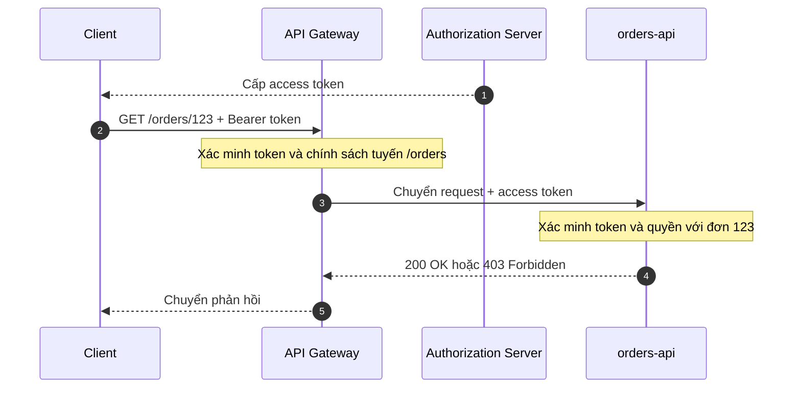

# Gateway xác minh hay chuyển tiếp token

Trong hệ thống có API Gateway, một yêu cầu thường đi qua cổng trước khi đến các dịch vụ như `orders-api`, `payments-api` hoặc `profile-api`. Khi client gửi access token, cần quyết định rõ: **gateway có xác minh token không, có chuyển token cho dịch vụ phía sau không, và ai chịu trách nhiệm phân quyền cuối cùng?** Đây là quyết định về **ranh giới tin cậy** của hệ thống, không đơn thuần là cấu hình chuyển tiếp một HTTP header.

Bài học thuộc chương **API gateway** của mô-đun **SECURITY_TOKEN_SECURITY_FUNDAMENTALS**. Trọng tâm là cách bảo vệ vòng đời và quyền sử dụng token trong kiến trúc nhiều dịch vụ, dựa trên kiến thức về JWT, opaque token, access token, refresh token, OAuth 2.0 và OpenID Connect (OIDC).

Sau bài này, bạn có thể:

- Giải thích sự khác biệt giữa **xác thực token**, **phân quyền theo API** và **phân quyền trên tài nguyên cụ thể**.
- Chọn giữa các mô hình gateway chỉ chuyển tiếp, xác minh rồi chuyển tiếp, truyền ngữ cảnh danh tính, hoặc đổi token cho downstream.
- Xác định ai cần kiểm tra chữ ký, issuer, audience, thời hạn, scope, trạng thái thu hồi và quyền truy cập thực tế.
- Thiết kế cách truyền danh tính an toàn qua gateway, xử lý token hết hạn/bị đánh cắp và kiểm thử các đường đi bất thường.

## 1. Đường đi của token và ranh giới tin cậy

Ví dụ ứng dụng bán hàng có ba thành phần:

1. **Authorization Server (AS) / Identity Provider (IdP)** phát hành access token theo quy trình OAuth 2.0, có thể kèm ID token khi dùng OIDC.
2. **API Gateway** là điểm vào bên ngoài, định tuyến `/orders/**` đến `orders-api` và `/payments/**` đến `payments-api`.
3. **Resource Server** (dịch vụ API phía sau) thực thi nghiệp vụ, sở hữu dữ liệu và quyết định người dùng có quyền đọc đơn hàng số 123 hay không.

Client gửi yêu cầu:

```http
GET /orders/123 HTTP/1.1
Host: api.example.com
Authorization: Bearer <access-token>
```

Luồng thường dùng khi gateway xác minh rồi chuyển tiếp access token:



Với **JWT ký số**, gateway thường xác minh tại chỗ bằng khóa công khai đã tin cậy và bộ khóa JWKS được cache; không cần gọi AS cho mỗi request. Với **opaque token**, gateway hoặc backend thường phải gọi endpoint **introspection** (hay dùng cơ chế xác thực tương đương do AS cung cấp). Mũi tên AS → client trong sơ đồ biểu thị bước phát hành token trước khi gọi API, không có nghĩa gateway bắt buộc liên hệ AS mỗi lần.

Ba câu hỏi độc lập phải được trả lời trong thiết kế:

| Câu hỏi | Ví dụ | Chủ thể chịu trách nhiệm |
|---|---|---|
| **Token có hợp lệ không?** | Chữ ký đúng? `iss`, `aud`, `exp` phù hợp? Opaque token còn `active`? | Gateway, backend hoặc cả hai theo mô hình tin cậy |
| **Token có quyền gọi tuyến này không?** | `GET /orders` đòi `orders:read`; `POST /orders` đòi `orders:write` | Thường gateway kiểm tra sớm, backend có thể kiểm tra lại |
| **Chủ thể có quyền với tài nguyên này không?** | Người dùng A được xem đơn hàng 123 thuộc người dùng B không? | **Backend sở hữu nghiệp vụ** và dữ liệu liên quan |

**Phân biệt quan trọng:** token hợp lệ chỉ chứng minh các thuộc tính được bên phát hành khẳng định và điều kiện sử dụng phù hợp. Nó không tự chứng minh người sở hữu token có quyền truy cập *mọi* đơn hàng, mọi tenant hay mọi thao tác của dịch vụ.

## 2. Những loại token gateway có thể gặp

Hai cách phân loại dễ bị nhầm:

| Góc nhìn | Loại token | Ý nghĩa đối với gateway |
|---|---|---|
| **Mục đích sử dụng** | **Access token** | Được client trình tới API (resource server); gateway có thể xác minh và chuyển tiếp theo chính sách |
| | **Refresh token** | Dùng để xin access token mới tại authorization server; không chuyển qua các API nghiệp vụ |
| | **ID token (OIDC)** | Xác nhận sự kiện đăng nhập và thông tin danh tính cho client; **không được dùng thay access token để gọi API** |
| **Định dạng/kiểu tham chiếu** | **JWT** | Token chứa claims; nếu là JWT ký số, cần kiểm tra chữ ký và các claims, không chỉ giải mã Base64URL |
| | **Opaque token** | Chuỗi không mang ý nghĩa xác minh được với resource server; thường cần introspection hoặc API xác thực do AS cung cấp |

**JWT và access token không đồng nghĩa**: access token có thể là JWT hoặc opaque. Tương tự, ID token thường là JWT nhưng có mục đích và `audience` khác access token. Một JWT hợp lệ về chữ ký vẫn phải bị từ chối nếu được phát hành cho client hoặc API khác.

Bearer token là chứng cứ theo kiểu **ai giữ được token thì có thể trình token** trong phạm vi quyền của token. Việc token bị lộ có thể dẫn đến sử dụng lại (replay); chữ ký số chỉ bảo vệ tính toàn vẹn, không ngăn kẻ đã đánh cắp token sử dụng nó. Với cơ chế **sender-constrained token** như mTLS-bound access token hoặc DPoP, bên nhận còn cần kiểm tra bằng chứng ràng buộc token với khóa của bên gửi.

## 3. Bốn cách tổ chức trách nhiệm tại gateway

### 3.1. Chỉ chuyển tiếp token, backend tự xác minh

Gateway đóng vai trò định tuyến: giữ `Authorization: Bearer ...` và đưa request đến `orders-api`. Backend phải thực hiện đầy đủ xác thực và phân quyền. Gateway không được tự tuyên bố request đã được xác thực chỉ vì thấy header Authorization.

**Phù hợp khi:** mỗi backend là resource server độc lập, có bộ kiểm tra token đáng tin cậy; gateway chủ yếu làm reverse proxy, routing và giới hạn lưu lượng. **Rủi ro:** nếu một backend quên xác minh hoặc đường dẫn thay đổi, hệ thống có lỗ hổng. Gateway cũng thiếu thông tin chủ thể để áp dụng chính sách sớm.

### 3.2. Gateway xác minh rồi chuyển tiếp access token

Gateway xác minh token, áp dụng chính sách theo tuyến/phương thức HTTP, rồi chuyển **access token gốc** đến backend. Backend **tiếp tục xác minh** những điều kiện cần thiết và kiểm soát truy cập vào dữ liệu.

**Phù hợp khi:** muốn chặn request không hợp lệ sớm và vẫn giữ ranh giới an ninh độc lập giữa các dịch vụ. Đây thường là lựa chọn dễ kiểm toán cho API nhiều dịch vụ.

Ví dụ: gateway yêu cầu `aud` chứa `orders-api` và `scope` có `orders:read`; backend tiếp tục kiểm tra người dùng có được xem đơn hàng 123 không. Việc backend xác minh lại không thừa: nó bảo vệ khi request vượt qua gateway theo đường khác, cấu hình gateway sai hoặc chính sách nghiệp vụ phức tạp hơn scope.

### 3.3. Gateway xác minh rồi truyền **ngữ cảnh danh tính** thay cho token

Gateway xác minh access token, sau đó chuyển thông tin đã xác thực như `subject`, `tenant`, `scopes` qua cơ chế ngữ cảnh nội bộ. Backend dựa vào cơ chế này nếu kiến trúc cho phép ủy nhiệm xác thực cho gateway.

**Điều kiện bắt buộc:** backend chỉ chấp nhận ngữ cảnh từ gateway đáng tin cậy; không có đường đi bên ngoài vào thẳng backend; kết nối nội bộ được xác thực/bảo vệ (ví dụ mTLS); tất cả header danh tính do client tự gửi bị loại bỏ hoặc ghi đè; ngữ cảnh được ràng buộc với request và, khi phù hợp, được ký hoặc xác minh nguồn gốc. Backend vẫn phải phân quyền nghiệp vụ.

Không được đơn giản tin vào `X-User-Id: 42` hoặc `X-Roles: admin` vì **client cũng có thể tự tạo header đó**. Nếu một mắt xích bị bỏ qua, mô hình này dễ dẫn tới giả mạo danh tính.

### 3.4. Gateway đổi token trước khi gọi downstream

Gateway có thể dùng quy trình **token exchange**/ủy quyền phù hợp để lấy một access token mới có `audience` và quyền hạn phù hợp với dịch vụ đích, thay vì dùng một token rộng cho mọi backend. Token đổi phải do AS đáng tin cậy phát hành; tự sửa payload rồi ký lại tùy tiện không tạo thành một quy trình ủy quyền chuẩn.

Ví dụ client đưa token dành cho gateway, gateway lấy token chỉ cho `payments-api` với scope `payments:charge` theo chính sách đã cấp phép. `payments-api` xác minh token mới, danh tính chủ thể, ngữ cảnh ủy quyền và quyền với giao dịch.

**Phù hợp khi:** cần tách audience, giảm quyền hoặc truyền ngữ cảnh ủy quyền được kiểm soát qua nhiều domain. **Đánh đổi:** phát sinh quản lý ủy quyền, latency, cache, expiry và xử lý lỗi đổi token.

| Mô hình | Ai xác minh ở lớp API? | Backend nhận gì? | Điểm cần chú ý |
|---|---|---|---|
| Chỉ chuyển tiếp | Backend | Access token gốc | Mọi backend phải xác minh đúng |
| Xác minh + chuyển tiếp | Gateway và backend | Access token gốc | Cùng hiểu issuer/audience; backend vẫn phân quyền đối tượng |
| Xác minh + ngữ cảnh | Gateway; backend kiểm chứng nguồn ngữ cảnh | Danh tính/quyền đã xác thực | Kênh tin cậy, chống giả header và đường bypass |
| Token exchange | Gateway xác minh đầu vào; backend xác minh token mới | Access token dành riêng cho backend | Thiết kế delegation, audience và quyền thu hẹp |

Không có mệnh đề chung rằng gateway **chỉ** được xác minh *hoặc* **chỉ** được chuyển tiếp: trong thực tế gateway có thể **vừa xác minh vừa chuyển tiếp**, và backend vẫn là nơi bảo vệ tài nguyên của chính mình.

## 4. Gateway phải xác minh những gì?

### 4.1. JWT access token

Giả sử JWT access token có payload minh họa:

```json
{
  "iss": "https://id.example.com",
  "sub": "user-42",
  "aud": ["orders-api"],
  "scope": "orders:read orders:write",
  "client_id": "web-frontend",
  "exp": 1893456000,
  "nbf": 1893452400,
  "iat": 1893452400,
  "jti": "access-7b2d"
}
```

Các timestamp chỉ dùng để minh họa. Gateway không được lấy payload vừa giải mã làm căn cứ tin cậy nếu chưa xác minh toàn bộ token.

Danh sách kiểm tra thực tế:

1. **Nguồn phát hành và chữ ký:** chỉ chấp nhận `iss` nằm trong danh sách cấu hình đáng tin cậy; lấy khóa công khai từ JWKS đã cấu hình cho issuer ấy; kiểm tra chữ ký với thuật toán **được phép cố định theo chính sách**, không chạy theo giá trị `alg` mà token tự đề xuất. Từ chối `alg=none` trong ngữ cảnh JWT cần chữ ký.
2. **Khóa và xoay khóa:** dùng `kid` để chọn khóa trong bộ JWKS đã tin cậy; cache và làm mới khóa có kiểm soát. Không cho `kid`, `jku`, `x5u` hoặc URL trong token khiến gateway tự tải khóa từ host tùy ý do người gửi chọn.
3. **Issuer và audience:** đối chiếu chính xác `iss` và yêu cầu `aud` chứa resource server phù hợp với route. Chữ ký hợp lệ nhưng `aud=profile-api` không được dùng gọi `orders-api`. Với nhiều issuer/tenant, gắn cấu hình issuer–key–audience rõ ràng; không chấp nhận tráo khóa giữa issuer.
4. **Thời gian:** yêu cầu `exp` còn hạn; kiểm tra `nbf` và những ràng buộc `iat` cần thiết. Nếu áp dụng clock skew, giới hạn nhỏ theo chính sách; không mở rộng thời gian hiệu lực vô hạn.
5. **Kiểu và mục đích token:** khi profile token có `typ` hoặc claim nhận dạng loại token, áp dụng đúng quy tắc; không nhận ID token hay refresh token làm access token. Một thư viện giải mã JWT chung không đủ để xác định đúng mục đích sử dụng.
6. **Chính sách tuyến:** kiểm tra scope/quyền phù hợp **method + route**, ngoài `aud`. Ví dụ `GET /orders/123` cần `orders:read`, `POST /orders` cần `orders:write`.
7. **Ngữ cảnh bổ sung:** nếu yêu cầu ràng buộc tenant, client, `cnf` (sender constraint) hoặc trạng thái thu hồi, kiểm tra bằng cơ chế được thiết kế riêng. `jti` chỉ là mã định danh token, **không tự đồng nghĩa** token đã được kiểm tra thu hồi.

Một token có `scope=orders:read` chỉ cho biết quyền được cấp theo phạm vi tương ứng, chưa chứng minh người dùng có thể xem *bất kỳ* đơn hàng nào. Chính sách ownership, tenant và ACL nằm ở lớp tài nguyên của `orders-api`. Cần xác định rõ định dạng scope (chuỗi cách nhau bởi khoảng trắng hoặc định dạng được issuer quy định), tránh kiểm tra kiểu “chuỗi con chứa `read`”.

### 4.2. Opaque access token

Opaque token không có payload tin cậy để gateway tự đọc. Nếu AS hỗ trợ introspection theo OAuth 2.0, gateway gửi token tới endpoint bảo mật, xác thực chính mình theo quy định của AS và nhận dữ liệu tương ứng:

```json
{
  "active": true,
  "sub": "user-42",
  "client_id": "web-frontend",
  "scope": "orders:read",
  "aud": ["orders-api"],
  "exp": 1893456000
}
```

Sau khi nhận `active: true`, gateway **vẫn phải** kiểm tra `audience`, `scope`, thời hạn và chính sách ngữ cảnh theo dữ liệu mà AS cung cấp. Không giả định mọi máy chủ introspection đều trả đủ mọi claim: trường cần cho quyết định mà thiếu thì phải có chính sách từ chối hoặc cơ chế bổ sung được thiết kế rõ.

Các lựa chọn vận hành cần xác định:

- **Độ trễ và tính sẵn sàng:** introspection là cuộc gọi phụ thuộc AS. Khi mất kết nối/timeout, không tự cho phép request chưa được xác thực (**fail closed**).
- **Cache:** có thể cache kết quả trong thời gian ngắn có giới hạn, nhưng thời gian cache không vượt thời hạn token và phải tính tới mục tiêu độ trễ thu hồi. Cache `active: true` quá lâu làm token đã thu hồi tiếp tục dùng được.
- **Bảo mật kênh:** introspection dùng HTTPS; gateway lưu thông tin xác thực của mình an toàn; không log token hoặc payload nhạy cảm nguyên văn.
- **Trách nhiệm backend:** nếu gateway chuyển opaque token cho backend, backend cần cách xác minh riêng hoặc phải có cơ chế tin cậy rõ ràng với gateway. Backend không thể “đọc claims” từ chuỗi opaque tùy ý.

## 5. Audience, scope và quyền hạn khi có nhiều backend

**Audience (`aud`)** trả lời “token được phát hành để sử dụng với **resource server nào**?”, còn **scope** thể hiện phạm vi quyền được cấp. Đây là hai lớp kiểm tra bổ sung cho nhau.

Ví dụ cùng người dùng gọi hai API:

| Yêu cầu | Audience mong đợi | Scope tối thiểu | Ai xác minh quyền trên bản ghi? |
|---|---|---|---|
| `GET /orders/123` | `orders-api` | `orders:read` | `orders-api` |
| `POST /orders` | `orders-api` | `orders:write` | `orders-api` |
| `GET /payments/555` | `payments-api` | `payments:read` | `payments-api` |

Không lấy một JWT bất kỳ có chữ ký hợp lệ để dùng cho tất cả các dịch vụ. Nếu hệ thống cố ý phát hành access token có nhiều audience, **mỗi** resource server vẫn phải xác minh mình thuộc audience được phép; đồng thời cân nhắc phạm vi ảnh hưởng nếu token bị đánh cắp. Token exchange hoặc token audience hẹp có thể giảm phạm vi sử dụng ngoài ý muốn.

Trong các hệ thống mà token chỉ có audience dành cho gateway, backend **không nên** tự giả định token đó cũng dành cho mình. Cần định nghĩa một mô hình ủy nhiệm tin cậy (chẳng hạn gateway làm resource server và truyền ngữ cảnh đã chứng thực) hoặc đổi token với audience backend. Tránh phát triển “ngoại lệ” kiểm tra audience thành cách bỏ qua audience trên mọi dịch vụ.

Một anti-pattern khác là quyết định quyền chỉ từ đường dẫn: `GET /orders/123` đã qua scope `orders:read`, nhưng `orders-api` vẫn phải kiểm tra `sub=user-42` có được truy cập đơn 123, thuộc đúng tenant và trạng thái dữ liệu hay không. Đừng dựa vào `userId` do client truyền trong query/path để thay thế chủ thể đã xác minh.

## 6. Chuyển tiếp header và ngữ cảnh danh tính an toàn

### Chuyển tiếp access token gốc

Trong mô hình gateway xác minh và chuyển tiếp, giữ nguyên token cần thiết trong một header Authorization hợp lệ, qua TLS đến backend. Tránh gắn token vào URL, query string hoặc log. Gateway phải xử lý header Authorization mơ hồ (ví dụ header trùng nhau hay cú pháp sai) theo cách nhất quán và từ chối trường hợp không thể xác định duy nhất thông tin xác thực.

Không chuyển ID token hoặc refresh token cho backend nghiệp vụ. Không phát token có nhiều quyền hơn chỉ để “các microservice tiện dùng”. Nếu gateway gọi downstream **nhân danh chính gateway** (machine-to-machine), cần phân biệt rõ service credential với quyền của người dùng; downstream không được nhầm service identity thành user delegation.

### Truyền danh tính bằng header nội bộ

Giả sử client gửi request có:

```http
GET /orders/123 HTTP/1.1
Authorization: Bearer <access-token>
X-Authenticated-User: admin
X-Authenticated-Scopes: orders:write
```

Nếu gateway chỉ chuyển hai header `X-Authenticated-*` và backend tin chúng, người gửi tự nâng quyền. Với mô hình truyền ngữ cảnh nội bộ, gateway phải **xóa hoặc ghi đè** toàn bộ header có thể đại diện danh tính trước khi tạo ngữ cảnh từ token **đã xác minh**. Đồng thời:

1. Chặn truy cập trực tiếp tới backend từ mạng không tin cậy và xác thực kết nối gateway → backend (ưu tiên mTLS khi phù hợp).
2. Đặt quy tắc nguồn gốc/ngữ cảnh có thể kiểm chứng; cân nhắc thông điệp ngữ cảnh ký số, hết hạn ngắn và ràng buộc tới request khi môi trường có nhiều proxy/hop.
3. Không trao quyền quản trị chỉ vì một header `X-Roles` tự do. Backend phải áp dụng policy đã được thống nhất và kiểm tra quyền tài nguyên.
4. Tách header dùng để trace (`traceparent`, correlation ID) với header danh tính. Trace ID không phải bằng chứng xác thực.
5. Kiểm tra đầy đủ mọi lối vào khác như worker nội bộ, port debug, ingress thứ hai và health/admin endpoint; đường bypass có thể vô hiệu hóa mô hình tin cậy vào gateway.

## 7. Quy trình tham chiếu cho một request

Đoạn giả mã dưới đây minh họa cách tách xác minh, định tuyến và phân quyền. Nó **không phải thư viện xác thực hoàn chỉnh**:

```text
handle(request):
    route = matchRoute(request.method, normalizePath(request.path))
    if route is null:
        return 404

    token = parseSingleBearerAuthorizationHeader(request.headers)
    if token is missing or malformed:
        return 401

    if route.tokenFormat == "JWT":
        principal = verifyJwtWithTrustedIssuerAndKeys(
            token,
            allowedAlgorithms = route.allowedAlgorithms,
            expectedIssuer = route.issuer,
            expectedAudience = route.audience,
            validateExpiryAndNotBefore = true
        )
    else:
        principal = introspectAtTrustedAuthorizationServer(token)
        require(principal.active == true)
        require(principal.audience contains route.audience)
        require(principal.expiry is valid)

    if principal is invalid:
        return 401
    if not hasRequiredScopes(principal, route.requiredScopes):
        return 403

    removeUntrustedIdentityHeaders(request)
    forwarded = buildDownstreamRequest(request, route)

    if route.forwardingMode == "ACCESS_TOKEN":
        forwarded.Authorization = "Bearer " + token
    else if route.forwardingMode == "TRUSTED_CONTEXT":
        forwarded.identityContext = issueVerifiedInternalContext(principal)
    else if route.forwardingMode == "TOKEN_EXCHANGE":
        forwarded.Authorization = "Bearer " +
            exchangeForAudience(principal, route.audience)

    return sendOverAuthenticatedChannel(forwarded)

ordersApi(request):
    authenticated = verifyTokenOrTrustedContext(request)
    requirePermission(authenticated, "orders:read")
    requireOrderVisibleToSubjectAndTenant(request.orderId, authenticated)
    return readOrder(request.orderId)
```

Các thao tác như chuẩn hóa đường dẫn, xác minh claims, kiểm tra quyền hay tạo context phải do thành phần bảo mật đã được kiểm thử thực hiện, có chính sách từ chối khi lỗi. Không tự viết hàm JWT bằng cách `split(".")` rồi giải mã JSON và cho rằng đã xác thực. Nếu route không cần token (ví dụ endpoint public), hãy khai báo riêng chính sách public để không vô tình mở rộng quyền.

Ví dụ policy **minh họa** (không phải cú pháp cấu hình mặc định của một sản phẩm gateway cụ thể):

```yaml
trustedIssuers:
  orders:
    issuer: https://id.example.com
    jwksUri: https://id.example.com/.well-known/jwks.json
    allowedAlgorithms: [RS256]

routes:
  - method: GET
    path: /orders/**
    upstream: orders-api
    requiredAudience: orders-api
    requiredScopes: [orders:read]
    forwardingMode: ACCESS_TOKEN
    issuerRef: orders

  - method: POST
    path: /orders
    upstream: orders-api
    requiredAudience: orders-api
    requiredScopes: [orders:write]
    forwardingMode: ACCESS_TOKEN
    issuerRef: orders
```

Policy thực tế phải xử lý đúng thứ tự route, các đường dẫn có thể tương đương sau chuẩn hóa, encoded path, HTTP method, preflight CORS và endpoint được miễn xác thực. Đừng dùng một quy tắc “`/orders/**` có `orders:read`” để mặc nhiên cho phép cả thao tác ghi.

## 8. Thu hồi, làm mới và chống dùng lại token

**JWT ký số được xác minh offline không tự bị vô hiệu ngay khi người dùng đăng xuất.** Nếu chữ ký đúng và token chưa hết hạn, gateway có thể vẫn chấp nhận token dù AS đã đánh dấu phiên đăng nhập bị thu hồi. Cần chọn cơ chế phù hợp mức độ rủi ro: access token thời hạn ngắn, danh sách thu hồi `jti` được phân phối, kiểm tra trạng thái phiên/phiên bản ủy quyền, hoặc introspection/reference token cho các API nhạy cảm. Mỗi giải pháp có đánh đổi về khả dụng, độ trễ và độ mới của trạng thái thu hồi.

**Opaque token với introspection** có thể nhận trạng thái `active=false` sau khi thu hồi, nhưng kết quả cache tại gateway/backend vẫn có thể làm việc thu hồi trễ hơn thực tế. Cần định nghĩa rõ “thu hồi có hiệu lực trong bao lâu” thay vì mặc định tức thời.

**Refresh token** nên chỉ đi đến thành phần phù hợp của authorization flow (AS hoặc BFF quản lý phiên); không gửi đến `orders-api` hay `payments-api`. Refresh token rotation, phát hiện tái sử dụng và thu hồi chuỗi token giúp hạn chế thiệt hại khi token làm mới bị đánh cắp. Chỉ cấp refresh token cho các client và luồng đáp ứng chính sách bảo mật; không dùng refresh token như một Bearer token gọi resource server.

Với trình duyệt, một mô hình thường được cân nhắc là **Backend for Frontend (BFF)** giữ token phía server và cấp session cookie `Secure`, `HttpOnly`, `SameSite` phù hợp; nếu dùng cookie tự động gửi thì phải xử lý CSRF theo mô hình ứng dụng. Nếu SPA tự giữ access token, giảm thời gian tồn tại và đặc biệt bảo vệ trước XSS; lưu trong `localStorage` tạo bề mặt bị truy xuất bởi JavaScript khi XSS xảy ra. Tất cả token cần được bảo vệ khi truyền, khi lưu và khi ghi log.

**Bearer token bị đánh cắp có thể bị phát lại.** Ngoài TTL ngắn và bảo mật lưu trữ, các API có nguy cơ cao có thể áp dụng sender-constrained access token như mTLS hoặc DPoP. Khi đó, gateway/backend phải kiểm tra cả bằng chứng ràng buộc theo profile sử dụng, không chỉ kiểm tra JWT access token. Với DPoP, xử lý `htu`/`htm`, freshness, nonce hoặc `jti` chống replay tùy profile, đồng thời đảm bảo URL/method được chuẩn hóa đúng qua reverse proxy.

## 9. Lỗi phổ biến và hành vi mong đợi

| Tình huống | Rủi ro nếu xử lý sai | Phản ứng phù hợp |
|---|---|---|
| Token thiếu, sai chữ ký, hết hạn, issuer hoặc audience không hợp lệ | Request lạ được xem như đã xác thực | Từ chối **401 Unauthorized**, không chuyển downstream |
| Access token đúng nhưng thiếu `orders:write` khi `POST /orders` | Đọc được suy ra có quyền ghi | Từ chối **403 Forbidden** |
| Có `orders:read` nhưng yêu cầu đơn hàng của chủ thể khác | IDOR/bỏ qua phân quyền đối tượng | Backend kiểm tra ownership/tenant/ACL, từ chối theo chính sách |
| Token cấp cho `profile-api` được đưa tới `payments-api` | Token dùng sai đối tượng nhận (**confused deputy**) | Kiểm tra audience riêng theo route và ở backend |
| Client gửi `X-Authenticated-User: admin` | Giả mạo danh tính qua header | Xóa/ghi đè header client; chỉ tin nguồn nội bộ đã xác thực |
| Backend có thể truy cập trực tiếp ngoài gateway | Vượt qua chính sách xác thực của gateway | Bảo vệ ingress, mạng nội bộ và xác thực tại backend |
| JWT bị thu hồi nhưng vẫn còn hạn | Cửa sổ truy cập sau logout/thu hồi | TTL, revocation strategy, và nhận thức giới hạn cache |
| JWKS xoay khóa | Request hợp lệ lỗi hàng loạt, hoặc chọn khóa sai | Cache/refresh có kiểm soát, pin issuer, không tải key từ URL do token cung cấp |
| Introspection timeout | Hệ thống vô tình cho qua vì AS lỗi | Fail closed; ghi metric/alert, không log token |
| Authorization header trùng hoặc token nằm trên URL | Diễn giải khác nhau giữa proxy/backend, lộ log | Từ chối header mơ hồ; chỉ dùng kênh header/token chuẩn |

Với OAuth Bearer, gateway có thể gửi header `WWW-Authenticate: Bearer` và mã lỗi phù hợp; tránh trả claims, khóa, token hoặc chi tiết nội bộ cho client. Tùy chính sách chống lộ tài nguyên, backend có thể dùng mã phản hồi khác cho đối tượng không được phép xem, nhưng không được biến trường hợp thiếu quyền thành thành công.

## 10. Checklist trước khi đưa vào vận hành

- **Phạm vi tin cậy:** mọi đường vào backend đã được kiểm soát; xác định rõ mô hình forwarding/context/exchange; gateway và backend biết ai xác minh và ai phân quyền.
- **Token đúng mục đích:** chỉ nhận access token cho API; issuer, key, thuật toán, token type, audience và thời gian được xác minh theo route.
- **Phân quyền đủ lớp:** kiểm tra scope theo HTTP method + route và quyền sở hữu/tenant theo tài nguyên ở backend.
- **Truyền dẫn:** dùng TLS/mTLS phù hợp, không tin header danh tính client, không gửi token qua URL/log/tracing, không chuyển refresh/ID token xuống API.
- **Vòng đời:** thống nhất access token TTL, refresh rotation, chính sách cache JWKS/introspection, khả năng thu hồi và giới hạn thời gian thu hồi có hiệu lực.
- **Lỗi và quan sát:** fail closed khi xác minh lỗi; giám sát tỷ lệ 401/403, timeout introspection, thất bại xác minh chữ ký, thay đổi khóa và bất thường theo client/route mà không ghi nội dung token.
- **Kiểm thử đường xấu:** token hết hạn, sai `aud`/`iss`, đổi `alg`/`kid`, thiếu scope, cross-tenant, giả header, gọi backend trực tiếp, hồi lại token đã thu hồi và tình huống AS không sẵn sàng.

### Bài toán suy luận

Một người dùng có JWT access token với `aud=["orders-api"]` và `scope="orders:read"`. Client gửi `GET /orders/123` qua gateway. Gateway xác minh chữ ký, issuer, audience, thời hạn và scope đều đạt; sau đó chuyển token đến `orders-api`. Đơn hàng 123 thuộc một tenant khác.

**Kết quả đúng:** gateway có thể cho request đi tiếp vì token thỏa chính sách tuyến, nhưng `orders-api` phải từ chối đọc đơn hàng vì kiểm tra tenant/ownership thất bại. Cả hai lớp đang làm đúng trách nhiệm của mình; việc gateway chấp nhận token không phải là lời cam kết cấp quyền đối với mọi bản ghi.

Điểm cốt lõi của chủ đề **“Gateway xác minh hay chuyển tiếp token”** là **phân rõ từng quyết định tin cậy**: ai xác minh token, token dành cho dịch vụ nào, ai thực thi quyền theo tuyến, ai nắm quyền đối với dữ liệu và token/identity context được truyền qua mỗi ranh giới như thế nào. Một thiết kế an toàn phải trả lời được cả chuỗi câu hỏi đó, kể cả khi gateway và backend cùng xác minh một access token.
