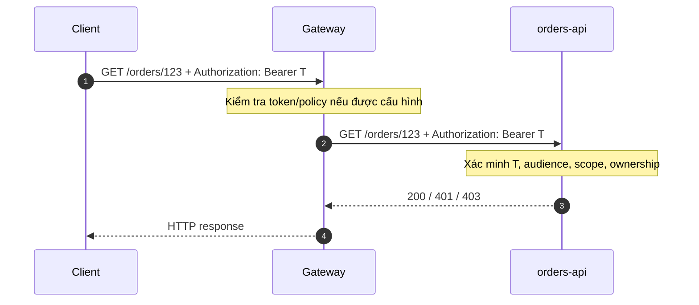
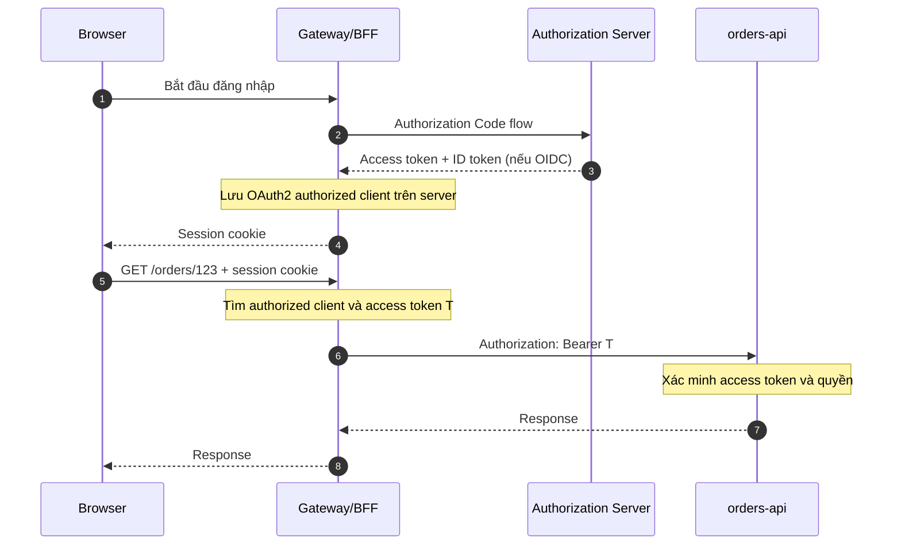

# Token relay

**Token relay** là cơ chế một thành phần trung gian, thường là **API Gateway** hoặc **Backend for Frontend (BFF)**, nhận hoặc lấy được **access token** đã cấp cho một phiên/người dùng và **chuyển access token đó** đến API phía sau khi gọi thay mặt người dùng. Mục tiêu là giữ được ngữ cảnh ủy quyền xuyên qua các lớp ứng dụng mà client không phải tự gọi từng microservice.

Trong mô-đun **SECURITY_TOKEN_SECURITY_FUNDAMENTALS**, bài **Token relay** thuộc chương **API gateway**. Chủ đề gắn trực tiếp với mô hình tin cậy và vòng đời token: access token có thể là JWT hoặc opaque; việc relay phải tôn trọng issuer, audience, scope, thời hạn, thu hồi và ràng buộc chống sử dụng lại. Hiểu Token Relay còn giúp phân biệt đúng access token với refresh token, ID token của OIDC và các cơ chế OAuth 2.0 như token exchange.

Sau bài này, bạn có thể:

- Mô tả token đi từ client hoặc phiên gateway đến downstream API như thế nào.
- Phân biệt **relay access token gốc**, **gateway phát ngữ cảnh danh tính** và **token exchange**.
- Chọn cách triển khai với **Bearer token đầu vào** hoặc **OAuth2 client có phiên đăng nhập**, đặc biệt trong Spring Cloud Gateway.
- Xác định các điều kiện bảo mật cần thiết để không biến token relay thành đường dùng token sai audience, mở rộng quyền hoặc rò rỉ token.
- Chẩn đoán các lỗi token hết hạn, thiếu authorized client, mất header, sai scope, sai audience và lỗi quyền trên tài nguyên.

## 1. Cơ chế Token Relay thực sự làm gì?

Giả sử trình duyệt muốn xem đơn hàng qua `api.example.com`, còn dữ liệu do `orders-api` quản lý. API Gateway có nhiệm vụ định tuyến `GET /orders/123` đến `orders-api`.

Với token relay, request đến `orders-api` mang một access token đại diện cho quyền đã được cấp từ phía Authorization Server (AS):

```http
GET /orders/123 HTTP/1.1
Host: api.example.com
Authorization: Bearer <access-token>
```

Gateway sẽ gọi downstream bằng một request có header tương ứng:

```http
GET /orders/123 HTTP/1.1
Host: orders-api.internal
Authorization: Bearer <access-token>
```

Trong mô hình **relay nguyên token**, chuỗi access token gửi tới backend giống chuỗi đã nhận hoặc đã lấy từ phiên OAuth2 ở gateway. Gateway không tự biến scope `orders:read` thành `orders:write`, không đổi `aud`, không ký lại JWT và không tự phát hành access token mới.

Đặc điểm cốt lõi:

| Thành phần | Công việc |
|---|---|
| **Authorization Server / IdP** | Cấp access token theo grant và chính sách OAuth 2.0 |
| **Client** | Gửi access token đến gateway, hoặc dùng session cookie để gateway lấy token đã quản lý |
| **Gateway/BFF** | Chọn downstream hợp lệ, lấy đúng access token và chuyển token qua kênh được bảo vệ |
| **Downstream Resource Server** | Kiểm tra token hoặc ngữ cảnh tin cậy được thỏa thuận, áp dụng quyền theo API và quyền trên bản ghi |

**Token relay là cơ chế vận chuyển chứng cứ ủy quyền, không phải bản thân quyết định phân quyền.** Chỉ vì gateway đã chuyển một access token, backend không được mặc nhiên cho phép thao tác. Quyền đọc đơn hàng 123 còn phụ thuộc chủ thể, tenant, trạng thái đơn và chính sách nghiệp vụ.

## 2. Hai luồng Token Relay phổ biến

### 2.1. Client gửi Bearer access token đến gateway

Thường gặp trong mobile app, SPA gọi API theo Bearer authentication hoặc các client trực tiếp làm OAuth 2.0 Authorization Code + PKCE.



Trong luồng này:

1. Client giữ **access token T** và đưa T vào header `Authorization` khi gọi gateway.
2. Gateway có thể **xác minh token rồi relay**, hoặc **chỉ relay và để backend xác minh**, tùy ranh giới tin cậy đã thiết kế.
3. Gateway định tuyến đến đúng upstream và bảo đảm header token đi qua kênh bảo mật. Nếu gateway xác minh ở lớp ngoài, backend vẫn phải có cách kiểm soát quyền tài nguyên.
4. Backend xác thực và phân quyền request. Khi backend là resource server độc lập, nó nên tự xác minh token, kể cả khi gateway đã kiểm tra trước đó.

**Điểm dễ nhầm:** việc proxy chuyển tiếp header `Authorization` từ incoming request **không nhất thiết dùng một bộ lọc có tên `TokenRelay`**. Tên `TokenRelay` của một framework có thể chỉ tính năng lấy access token từ OAuth2 authorized client của gateway. Phải đọc đúng luồng nguồn token, thay vì đồng nhất “có header Bearer” với “đã có OAuth2AuthorizedClient”.

### 2.2. Trình duyệt dùng session cookie, gateway lấy access token từ phiên OAuth2

Thường gặp khi gateway hoặc BFF thực hiện đăng nhập qua **OAuth 2.0 Authorization Code + OIDC**, quản lý token phía server và chỉ cấp cookie phiên cho trình duyệt.



Ở luồng này, **trình duyệt không cần nhận access token**. Gateway lấy access token từ bản ghi OAuth2 authorized client gắn với phiên/người dùng và relay đến backend. Gateway có thể lưu cả refresh token nếu chính sách AS cho phép, nhưng **refresh token chỉ phục vụ bước lấy access token mới**, không được relay đến `orders-api`.

Lợi ích của BFF là giảm việc access token bị truy xuất từ JavaScript trong trình duyệt. Đổi lại, phiên cookie tại gateway phải bảo vệ bằng `HttpOnly`, `Secure`, `SameSite` phù hợp và biện pháp CSRF đối với request thay đổi trạng thái; dữ liệu token/phiên phía server phải được bảo vệ và có chiến lược lưu trữ cho ứng dụng nhiều instance.

### So sánh nguồn token trong hai luồng

| Thuộc tính | Bearer từ client | OAuth2 client tại gateway |
|---|---|---|
| Token ban đầu nằm ở đâu? | Client đã được cấp access token | Gateway giữ access token trong authorized client |
| Request đến gateway mang gì? | Header `Authorization: Bearer T` | Thường là session cookie |
| Gateway lấy T từ đâu? | Header client gửi | OAuth2AuthorizedClient hoặc kho token của BFF |
| Có thể dùng proxy forward header? | Có, theo cấu hình gateway | Không đủ: cần đưa token từ kho của gateway vào request |
| Trách nhiệm bảo vệ refresh token | Theo thiết kế OAuth client | Gateway/BFF, nếu AS đã cấp refresh token |
| Rủi ro chính | Token lộ ở client, relay nhầm downstream | Session fixation/CSRF, lộ kho token, sai mapping người dùng → authorized client |

## 3. Relay không đồng nghĩa với trao đổi token hoặc truyền header danh tính

Ba cách tiếp cận khác nhau:

| Cách tiếp cận | Backend nhận | Có đổi access token? | Điều kiện an toàn chủ yếu |
|---|---|---|---|
| **Token relay** | Access token gốc T | **Không** | T phải dùng hợp lệ cho backend; bảo vệ kênh; backend kiểm tra token và quyền |
| **Token exchange / On-Behalf-Of** | Access token mới T2 do AS phát hành | **Có** | AS cho phép delegation, T2 có audience/scope phù hợp và có thể giảm quyền |
| **Truyền ngữ cảnh danh tính** | Thông tin đã xác thực về subject/tenant/scope, có thể không có access token | Không nhất thiết | Backend chỉ tin thông tin từ gateway được xác thực, không tin header tự do từ client |

Ví dụ nếu T được cấp với `aud=["orders-api"]` và scope `orders:read`, gateway có thể relay T đến `orders-api` khi các điều kiện xác minh khác đều đạt. Nếu T chỉ có `aud=["gateway-api"]` thì **không được mặc nhiên** relay và yêu cầu `orders-api` bỏ qua audience. Những lựa chọn hợp lệ là thiết kế audience phù hợp từ lúc phát hành, dùng token exchange để lấy T2 cho `orders-api`, hoặc thiết kế cơ chế truyền ngữ cảnh nội bộ có ranh giới tin cậy rõ ràng.

Token exchange được mô tả trong **RFC 8693**; nó có thể tạo token với audience và quyền dành cho mục tiêu mới theo policy AS. Relay chỉ vận chuyển một token hiện có. Token relay đơn giản hơn về mặt cơ chế nhưng giữ nguyên phạm vi quyền và tác động nếu T bị lộ.

Đừng dùng:

- **ID token** để gọi API. ID token của OIDC hướng tới client nhận sự kiện đăng nhập và có audience theo client, không phải access token của resource server.
- **Refresh token** trong `Authorization` gửi đến API nghiệp vụ. Refresh token chỉ dùng ở luồng làm mới tại AS.
- **Service account token** thay cho user token rồi mặc nhiên hiểu là thao tác thay mặt user. Với machine-to-machine, phải định nghĩa riêng quyền service và ngữ cảnh delegation.
- **Header `X-User-Id` do client gửi** làm căn cứ xác thực tại backend. Chỉ dùng header danh tính nếu gateway kiểm tra token, xóa header giả mạo và backend tin được nguồn qua kênh đã xác thực.

## 4. Điều kiện để một access token được relay

### 4.1. Đúng token, đúng recipient và đúng quyền

Trước khi cho phép một request đến downstream, hệ thống cần trả lời:

1. **Token có đúng loại không?** Đây phải là **access token**. Nếu là JWT ký số, chỉ tin sau khi xác minh chữ ký và claims theo profile; nếu là opaque token, dùng introspection hoặc cách xác minh do AS quy định.
2. **Token còn hiệu lực không?** Kiểm tra `exp`, `nbf` nếu có, issuer tin cậy (`iss`), trạng thái thu hồi theo policy và những giới hạn phiên sử dụng.
3. **Token dành cho dịch vụ nào?** `aud` phải phù hợp với resource server thực sự nhận token. Token hợp lệ cho `profile-api` không đương nhiên dùng được cho `orders-api`.
4. **Token được cấp quyền gì?** `scope` hoặc quyền được AS cung cấp phải cho phép hành động theo HTTP method + route. Ví dụ `orders:read` chỉ dành cho đọc, không được suy ra quyền `orders:write`.
5. **Ai sở hữu dữ liệu?** Backend kiểm tra owner/tenant/ACL của bản ghi thực tế. Relay đúng token vẫn có thể bị từ chối vì người dùng không được xem đơn hàng của người khác.
6. **Token có bị ràng buộc với bên gửi không?** Nếu là mTLS-bound hoặc DPoP-bound access token, gateway và backend phải hỗ trợ bằng chứng ràng buộc phù hợp cho hop downstream; relay chuỗi token đơn thuần có thể không hợp lệ.

Ví dụ JWT access token minh họa:

```json
{
  "iss": "https://id.example.com",
  "sub": "user-42",
  "aud": ["orders-api"],
  "scope": "orders:read",
  "exp": 1893456000,
  "jti": "a-token-id"
}
```

Giả sử đây là một JWT đã xác minh, `orders-api` nằm trong audience và scope cho phép đọc. Backend vẫn phải kiểm tra `user-42` có quyền với đơn hàng 123 hay không. Claim `jti` chỉ là mã định danh; nó **không tự động kiểm tra thu hồi**.

### 4.2. JWT và opaque token

**JWT access token:** một resource server có thể xác minh tại chỗ nhờ khóa tin cậy của AS/JWKS và các claim. Bộ kiểm tra phải cố định issuer, thuật toán cho phép, audience, hạn dùng và loại token theo chính sách. Chỉ Base64URL-decode rồi đọc `sub` không phải xác minh.

**Opaque access token:** gateway hoặc backend thường hỏi AS qua **introspection** (RFC 7662) và nhận kết quả như `active`, scope, audience, subject, expiry nếu AS cung cấp. Cần xử lý thời gian cache/timeout và chính sách fail closed. Không dùng opaque token như một JWT để tự phân tích claims.

Nếu gateway đã introspect opaque token rồi relay chuỗi opaque cho backend, backend vẫn cần **cơ chế tin cậy**: tự introspect hoặc nhận ngữ cảnh đã xác thực qua thiết kế nội bộ. Chỉ nhìn thấy opaque token không đủ để biết quyền.

### 4.3. Khi token có sender constraint

Với **Bearer token**, ai có được giá trị token có thể cố sử dụng lại nó đến resource server chấp nhận token. TLS, hạn sống ngắn và bảo vệ kho token làm giảm rủi ro, nhưng không biến token thành chứng cứ gắn với người gửi.

Với token được ràng buộc bằng **mTLS** hoặc **DPoP**, resource server còn phải kiểm tra bằng chứng sở hữu khóa tương ứng. Khi gateway là trung gian TLS hoặc viết lại URL, việc bê nguyên token và proof của client tới backend có thể thất bại:

- mTLS-bound token yêu cầu chứng cứ khóa/chứng thư phù hợp trên hop mà backend xác minh.
- DPoP proof liên quan đến HTTP method/URL của request được ký; URL public và URL backend có thể khác nhau.
- Gateway không thể mặc nhiên tạo proof mới nếu không sở hữu đúng khóa đã ràng buộc với token.

Giải pháp phải thiết kế theo profile cụ thể: có thể để gateway là resource server nhận token ràng buộc, rồi đổi sang token phù hợp downstream, hoặc triển khai cơ chế tin cậy end-to-end được kiểm soát. **Không tắt sender-constraint check chỉ để relay hoạt động.**

## 5. Triển khai với Spring Cloud Gateway

Trong hệ Java, tên **`TokenRelay`** thường đề cập đến **TokenRelay GatewayFilter** của Spring Cloud Gateway. Cần phân biệt rõ hai cấu hình.

### 5.1. Gateway đăng nhập OAuth2: dùng TokenRelay với authorized client

Trường hợp gateway thực hiện đăng nhập OIDC/OAuth2 và giữ `OAuth2AuthorizedClient` của người dùng, filter `TokenRelay` có thể lấy access token từ authorized client và đặt vào request gửi downstream.

Các thành phần được cấu hình tương ứng với phiên bản Spring Boot/Spring Cloud Gateway đã chọn:

- Spring Cloud Gateway (bản **reactive/WebFlux** trong ví dụ).
- Spring Security OAuth2 Client; registration/provider trỏ tới AS được tin cậy.
- Security filter chain hỗ trợ `oauth2Login` và `oauth2Client`.
- Route gateway áp dụng `TokenRelay` cho đúng upstream.

Ví dụ cấu hình client OAuth2 **minh họa**:

```yaml
spring:
  security:
    oauth2:
      client:
        registration:
          gateway-bff:
            provider: company-idp
            client-id: ${GATEWAY_CLIENT_ID}
            client-secret: ${GATEWAY_CLIENT_SECRET}
            authorization-grant-type: authorization_code
            scope: openid, profile, orders:read
        provider:
          company-idp:
            issuer-uri: https://id.example.com
```

Chỉ lưu secrets qua cơ chế secret management hoặc cấu hình môi trường, không commit giá trị thực vào repository. Client registration phải được AS cấu hình redirect URI phù hợp; AS cần cấp **access token có audience được `orders-api` chấp nhận**. Chỉ định scope `orders:read` ở client không đồng nghĩa AS bảo đảm audience sẽ đúng.

Đoạn Spring Security **reactive**:

```java
@Configuration
@EnableWebFluxSecurity
public class GatewaySecurityConfig {

    @Bean
    SecurityWebFilterChain securityWebFilterChain(ServerHttpSecurity http) {
        return http
            .authorizeExchange(exchanges -> exchanges
                .pathMatchers("/actuator/health").permitAll()
                .anyExchange().authenticated())
            .oauth2Login(Customizer.withDefaults())
            .oauth2Client(Customizer.withDefaults())
            .build();
    }
}
```

Ví dụ khai báo route với Gateway Java DSL:

```java
@Configuration
public class GatewayRoutes {

    @Bean
    RouteLocator routes(RouteLocatorBuilder builder) {
        return builder.routes()
            .route("orders-route", route -> route
                .path("/orders/**")
                .filters(filters -> filters.tokenRelay())
                .uri("http://orders-api:8080"))
            .build();
    }
}
```

Đây là các đoạn minh họa cho **Spring Cloud Gateway reactive**; cần import các lớp Spring tương ứng, cài đặt dependencies phù hợp và đối chiếu API/config của đúng phiên bản dự án. Khi khai báo route bằng YAML, nhiều phiên bản Spring Cloud Gateway hỗ trợ filter `TokenRelay` trong danh sách `filters`, nhưng **prefix thuộc tính route** thay đổi theo thế hệ cấu hình nên không nên chép một prefix bất kỳ sang mọi phiên bản.

**Cách filter hoạt động về mặt khái niệm:**

```text
request gắn với người dùng/phiên đã xác thực
        |
        v
lấy OAuth2AuthorizedClient tương ứng
        |
        v
lấy access token còn dùng được theo chính sách
        |
        v
đặt Authorization: Bearer <access-token>
        |
        v
gọi orders-api qua route đã cấu hình
```

Nếu filter hỗ trợ chỉ định `clientRegistrationId`, phải xác định rõ registration nào đang được sử dụng và nó đại diện cho người dùng hay cho một client riêng. Cấu hình sai có thể khiến gateway gửi token của một client khác, với quyền hoặc audience không phù hợp.

**Điều kiện vận hành quan trọng:**

- Người dùng phải có authorized client phù hợp với request. Việc route có `TokenRelay` **không bảo đảm** request Bearer bất kỳ sẽ có OAuth2AuthorizedClient.
- Access token do OAuth2 client quản lý có thể hết hạn. Cần kiểm tra cách framework/authorized-client manager trong phiên bản sử dụng xử lý refresh và lỗi thiếu refresh token; không mặc định mọi cấu hình `TokenRelay` tự refresh được.
- Authorized client service/repository phải lưu token và ánh xạ đúng với người dùng; nếu sử dụng lưu trữ in-memory, cần cân nhắc nhiều instance gateway, restart, phân tán phiên và việc token tồn tại trên mỗi node.
- Cookie session chỉ xác thực người dùng với gateway, **không** được chuyển thành Bearer token bằng cách lấy nguyên giá trị cookie. Token outbound phải lấy từ OAuth2 authorized client đáng tin cậy.
- Backend vẫn phải được cấu hình làm resource server để xác minh access token và quyền với từng dữ liệu.

### 5.2. Gateway nhận Bearer JWT: resource server + forward header

Nếu client đã có access token và gọi:

```http
GET /orders/123 HTTP/1.1
Authorization: Bearer <client-access-token>
```

gateway có thể cấu hình làm **OAuth2 Resource Server**, xác minh token đầu vào và dùng khả năng proxy/header forwarding để đưa token đến `orders-api`. Cấu hình này **không cần** dựa vào `OAuth2AuthorizedClient` của phiên đăng nhập.

Ví dụ Spring Security WebFlux **minh họa**:

```java
@Configuration
@EnableWebFluxSecurity
public class BearerGatewaySecurity {

    @Bean
    SecurityWebFilterChain securityWebFilterChain(ServerHttpSecurity http) {
        return http
            .authorizeExchange(exchanges -> exchanges
                .pathMatchers(HttpMethod.GET, "/orders/**")
                    .hasAuthority("SCOPE_orders:read")
                .pathMatchers(HttpMethod.POST, "/orders/**")
                    .hasAuthority("SCOPE_orders:write")
                .anyExchange().authenticated())
            .oauth2ResourceServer(oauth2 -> oauth2
                .jwt(Customizer.withDefaults()))
            .build();
    }
}
```

Ở đây Spring Security resource server xác minh JWT theo decoder/validator được cấu hình; với mapping mặc định từ `scope` thành authority `SCOPE_...`, rule minh họa yêu cầu đúng scope. Cần cấu hình rõ **trusted issuer/JWKS, allowed signing algorithms, expiry và audience validator**, đặc biệt **không được coi kiểm tra issuer mặc định là đã kiểm tra audience theo từng backend**. Ví dụ chỉ mô tả phần security chain, chưa bao gồm cấu hình `ReactiveJwtDecoder` và audience validator riêng cho route.

Với gateway làm proxy, kiểm tra cấu hình filter/HTTP client để bảo đảm `Authorization` được chuyển tiếp **chỉ** đến upstream đúng quyền, không bị `RemoveRequestHeader` hoặc filter rewrite nào xóa/ghi đè ngoài ý muốn. Không nên bật `TokenRelay` chỉ vì muốn forward Bearer header nếu request không có authorized client tương ứng; hai cơ chế có nguồn token khác nhau.

Nếu gateway nhận **opaque Bearer token**, Spring Security resource server có thể được cấu hình introspection thay cho JWT decoding; nguyên tắc relay và kiểm tra audience/scope vẫn giống nhau.

### 5.3. Backend vẫn phải xác minh và phân quyền

`orders-api` cần có chính sách nhận token rõ ràng. Ví dụ:

```text
GET /orders/123
  1. Đọc duy nhất Bearer access token hợp lệ
  2. Kiểm tra issuer, chữ ký/introspection, audience, thời hạn
  3. Kiểm tra scope orders:read
  4. Truy vấn đơn 123 trong tenant được xác thực
  5. Kiểm tra người dùng/role có quyền xem đơn
  6. Trả 200 hoặc từ chối 401/403 theo chính sách
```

Backend không được lấy `userId` từ query/path hoặc `X-User` do client gửi làm danh tính thay cho chủ thể đã xác thực. Với microservice độc lập, việc xác minh lại ở backend giúp giảm tác động của sai route, gateway bỏ sót policy hoặc đường gọi nội bộ không đi qua gateway.

## 6. Những vấn đề đặc thù khi relay token

### 6.1. Audience và scope khi chuyển qua nhiều hop

Xem luồng:

```text
browser -> gateway -> orders-api -> payments-api
```

Nếu access token T có `aud=["orders-api"]`, `orders-api` **không được mặc nhiên** chuyển T sang `payments-api`. `payments-api` cần token dành cho mình hoặc cơ chế ủy quyền khác. Token relay nhiều hop không làm xuất hiện quyền mới; mỗi resource server phải xử lý audience của mình.

Nếu AS cố ý phát hành token cho nhiều resource server, việc chuyển qua nhiều hop vẫn cần policy rõ: dịch vụ nào được chuyển token đến dịch vụ nào, scope tối thiểu là gì, và thông tin nào backend có thể nhìn thấy. Token audience rộng làm tăng phạm vi thiệt hại khi một downstream bị xâm nhập.

### 6.2. Token hết hạn và refresh

Một access token có thể hết hạn giữa lúc client gửi request và lúc gateway gửi downstream. Một gateway xử lý token hợp lệ trước đó vẫn có thể nhận **401** từ backend nếu token hết hạn theo đồng hồ/phạm vi validation của backend.

- Với **Bearer token do client tự cung cấp**, thông thường client thực hiện luồng lấy access token mới. Gateway không nên tự giả định có refresh token của client.
- Với **OAuth2 client tại gateway/BFF**, gateway có thể xin token mới nếu có refresh token và cấu hình authorized-client manager phù hợp; refresh token phải được bảo vệ và chỉ đi đến AS. Nếu không có token hợp lệ để relay, trả lỗi/điều hướng đăng nhập theo loại client.
- Không tự retry request nghiệp vụ có side effect sau khi refresh mà chưa xét tính idempotent. Một request POST có thể đã xử lý ở backend trước khi gateway gặp lỗi phản hồi.

Chiến lược **refresh token rotation** giúp phát hiện token làm mới bị tái sử dụng khi AS hỗ trợ. Với session của BFF, logout phải hủy hoặc vô hiệu các authorized client/phiên liên quan theo policy; JWT access token đã phát hành có thể còn hợp lệ đến khi hết hạn nếu không có cơ chế thu hồi bổ sung.

### 6.3. Thu hồi và cache

Một JWT tự xác minh offline có thể tiếp tục được chấp nhận cho đến `exp`, ngay cả khi AS đã thu hồi session; một opaque token được introspect có thể trả `active=false` sau khi thu hồi. Tuy nhiên **cache introspection** ở gateway/backend có thể trì hoãn nhận biết thu hồi.

Phải định nghĩa:

| Quyết định | Câu hỏi thực tế |
|---|---|
| Access token TTL | Token bị lộ còn có thể dùng trong bao lâu? |
| Chính sách thu hồi | JWT dùng denylist/phiên kiểm tra, hay opaque token introspection? |
| Cache introspection | Sau khi AS thu hồi, tối đa bao lâu các API còn nhận token? |
| Cache JWKS | Khi AS xoay khóa, gateway/backend cập nhật bộ khóa thế nào? |
| Fail closed | Khi introspection timeout, request không được tự động cho qua |

### 6.4. Relay qua proxy, retry và redirect

Header `Authorization` là bí mật cần được bảo vệ khi đi qua proxy:

- Dùng **HTTPS/TLS** cho các hop cần bảo vệ và xác thực upstream. Trong mạng nội bộ, dùng mTLS theo mô hình tin cậy của hệ thống.
- Cấu hình upstream cố định/allowlist. Không để dữ liệu từ người dùng tùy ý quyết định host đích để rồi gateway gửi token sang host tấn công (SSRF hoặc token exfiltration).
- Không đưa access token vào URL/query, log, APM trace, exception, metrics label, error page hoặc log debug HTTP.
- Không chuyển token theo redirect tới host ngoài danh sách tin cậy. HTTP client và chính sách xử lý redirect phải kiểm tra destination.
- Hạn chế retries tự động, nhất là với POST/PATCH/DELETE; khi request đã gây side effect, lặp lại có thể tạo giao dịch trùng.
- Trước khi tạo request nội bộ, xóa header danh tính do client tự khai báo như `X-Authenticated-User`, `X-Roles` nếu có dùng ngữ cảnh tin cậy ở downstream.
- Cần xác định xử lý những request có nhiều header `Authorization` hoặc cú pháp Bearer bất thường để proxy và backend không diễn giải khác nhau.

### 6.5. Token relay không thay thế phòng chống replay

Bearer token bị đánh cắp có thể được dùng lại trước khi hết hạn và trước khi thu hồi có hiệu lực. Relay token khiến thêm một thành phần backend tiếp xúc với token; vì vậy chỉ relay tới những service thật sự cần nó.

Biện pháp giảm rủi ro gồm scope và audience hẹp, TTL hợp lý, bảo vệ token tại gateway/BFF, TLS/mTLS, không ghi log, kiểm soát token store, phát hiện bất thường và áp dụng sender-constrained token trong những luồng hỗ trợ. Khi sender-constrained token được bật, phải xác minh chứng cứ ràng buộc ở nơi nhận token theo đúng profile; relay chỉ chuỗi Bearer là không đủ.

## 7. Phân tích lỗi theo từng điểm trong luồng

| Hiện tượng | Nguyên nhân thường gặp | Cách kiểm tra và khắc phục |
|---|---|---|
| Gateway nhận 401 trước khi route | Không có token/session, token hết hạn, issuer/chữ ký sai | Kiểm tra authentication tại gateway, issuer, decoder và thời hạn |
| Gateway đăng nhập được nhưng backend nhận request không có Bearer | Không tìm thấy OAuth2AuthorizedClient; chưa gắn `TokenRelay`; token không được lấy đúng registration | Kiểm tra phiên, authorized-client repository, registration và route filter |
| Gateway nhận Bearer hợp lệ nhưng `TokenRelay` không cấp token downstream | Filter mong chờ OAuth2AuthorizedClient chứ request không có session/client thích hợp | Chọn cơ chế proxy forward header cho Bearer inbound hoặc thiết kế OAuth2 client rõ ràng |
| Backend trả 401 | Token mất khi relay, hết hạn, sai `iss`/`aud`, fail introspection hoặc không hợp lệ theo backend | Kiểm tra upstream, header propagation và validator của backend; tuyệt đối không log token thật |
| Backend trả 403 | Token hợp lệ nhưng thiếu scope, role, tenant hoặc không sở hữu tài nguyên | Kiểm tra policy theo HTTP method và dữ liệu ownership tại backend |
| 401 ngay sau refresh | Token mới chưa dành cho resource server, sai registration hoặc rotation/session lỗi | Kiểm tra access token mới đúng AS, audience, scope và token store |
| Route A dùng token sang route B | Token relay cấu hình quá rộng, thiếu policy audience/route | Tách route policy, relay tới allowlisted backend, dùng token exchange nếu cần |
| Request chạy khi gọi trực tiếp backend bỏ qua gateway | Backend thiếu validation hoặc cổng nội bộ mở ngoài mô hình thiết kế | Bảo vệ network ingress và thực thi authn/authz tại backend |
| Tăng lỗi sau xoay khóa | Gateway/backend giữ cache JWKS cũ, refresh key không thành công | Kiểm tra JWKS cache và chiến lược rotation; pin issuer |
| 401 với mTLS/DPoP token | Chỉ relay token mà không có proof sender-constrained tương ứng | Thiết kế hop-level proof hoặc trao đổi token theo profile đã chọn |

**Mã trạng thái thông dụng:** `401 Unauthorized` khi thiếu/không xác thực được thông tin truy cập; `403 Forbidden` khi chủ thể đã xác thực nhưng không có quyền; `5xx` nếu gateway/upstream gặp lỗi hạ tầng phù hợp. Các redirect OIDC/login có thể dùng trong luồng trình duyệt nhưng không nên buộc API client nhận HTML login page khi nó đang mong một phản hồi API.

Đừng dùng token thật để chẩn đoán bằng cách in nguyên `Authorization` ra log. Thay vào đó quan sát route ID, issuer đã cấu hình, loại kết quả validation, mã lỗi, thời gian xử lý, `jti` đã băm hoặc mã tương quan không nhạy cảm nếu chính sách cho phép.

## 8. Kịch bản kiểm thử trước khi đưa vào vận hành

Một bộ kiểm thử có thể chạy với token test do AS môi trường thử nghiệm phát hành:

| Ca kiểm thử | Kỳ vọng |
|---|---|
| Access token đúng issuer, audience `orders-api`, scope `orders:read` | `GET /orders/123` được relay và chỉ thành công nếu ownership hợp lệ |
| Token thiếu hoặc quá hạn | Bị từ chối, không gọi backend trái phép |
| JWT hợp lệ chữ ký nhưng `aud=payments-api` | `orders-api` từ chối; gateway có thể chặn sớm |
| Scope chỉ `orders:read` nhưng gọi `POST /orders` | `403` theo policy, không ghi đơn |
| Token user A gọi đơn hàng của user B | Backend từ chối vì ownership/tenant |
| Client tự gửi `X-Authenticated-User: admin` | Header không được tin hay tạo quyền admin |
| OAuth2Login gateway thành công nhưng thiếu authorized client | Không âm thầm gửi token của user/service khác |
| Access token của BFF hết hạn và refresh token hợp lệ | Refresh xử lý theo policy; không relay refresh token xuống backend |
| AS introspection timeout | Fail closed, ghi metric và alert có kiểm soát |
| Redirect upstream sang domain lạ | Token không bị gửi sang host lạ |
| Backend được gọi trực tiếp ngoài gateway | Vẫn có bảo vệ xác thực và phân quyền |
| Sender-constrained token thiếu proof hợp lệ | Backend từ chối, không bỏ qua ràng buộc |

Kiểm tra riêng phương thức HTTP, path normalization, encoded path, route precedence và các public endpoint. Cần đảm bảo không có cách gọi `POST` hoặc route rewrite khác đi qua một rule chỉ yêu cầu quyền `read`.

## 9. Quy tắc lựa chọn mô hình

**Chọn relay access token gốc** khi downstream thực sự là resource server được token hướng tới, cùng tin AS và bạn muốn giữ ngữ cảnh người dùng. Relay thường đơn giản, nhưng mở rộng những nơi token có mặt; vì vậy phải giới hạn các service nhận token và thực thi xác minh/phân quyền tại backend.

**Chọn gateway/BFF giữ OAuth2 authorized client** khi trình duyệt nên dùng session cookie và gateway quản lý việc lấy/cập nhật access token; trong Spring Cloud Gateway reactive, `TokenRelay` phù hợp với luồng này. Đừng nhầm filter đó với hành vi forward mọi Bearer token đầu vào.

**Chọn token exchange/ủy quyền lại** khi access token ban đầu không dành cho downstream, cần thu hẹp audience/scope, hoặc muốn ràng buộc quyền cho một hop cụ thể. Quyết định này cần AS hỗ trợ và mô hình delegation rõ ràng.

**Chọn truyền ngữ cảnh nội bộ** khi kiến trúc cố ý coi gateway là điểm xác thực và backend không cần token gốc; phải đảm bảo nguồn ngữ cảnh có thể kiểm chứng, không có đường bypass và backend luôn giữ trách nhiệm kiểm tra quyền nghiệp vụ.

### Ví dụ suy luận

Một SPA gửi JWT có `aud=["gateway-api"]` và `scope="orders:read"` tới gateway. Gateway kiểm tra chữ ký, issuer, expiry và scope đều hợp lệ; route `/orders/**` định chuyển tiếp nguyên token đến `orders-api`.

**Hỏi:** `orders-api` có nên chấp nhận JWT chỉ vì gateway đã xác thực thành công?

**Đáp:** Không. JWT chỉ có audience `gateway-api`, trong khi `orders-api` không thuộc audience. Gateway cần cơ chế hợp lệ để sử dụng token phía sau: chẳng hạn token exchange để lấy access token riêng cho `orders-api` hoặc mô hình truyền ngữ cảnh nội bộ có xác thực. Cho `orders-api` bỏ qua audience sẽ mở ra khả năng **dùng token sai đối tượng nhận**.

Token relay trở nên an toàn khi ta xác định đủ **nguồn token, đích token, ranh giới tin cậy, chính sách quyền và vòng đời token**. Cơ chế đặt access token vào `Authorization` chỉ là một bước nhỏ trong chuỗi trách nhiệm đó.

### Tiêu chuẩn tham khảo

- [RFC 6750 — OAuth 2.0 Bearer Token Usage](https://www.rfc-editor.org/rfc/rfc6750)
- [RFC 7662 — OAuth 2.0 Token Introspection](https://www.rfc-editor.org/rfc/rfc7662)
- [RFC 8693 — OAuth 2.0 Token Exchange](https://www.rfc-editor.org/rfc/rfc8693)
- [RFC 9068 — JWT Profile for OAuth 2.0 Access Tokens](https://www.rfc-editor.org/rfc/rfc9068)
- [RFC 9449 — OAuth 2.0 Demonstrating Proof of Possession (DPoP)](https://www.rfc-editor.org/rfc/rfc9449)
