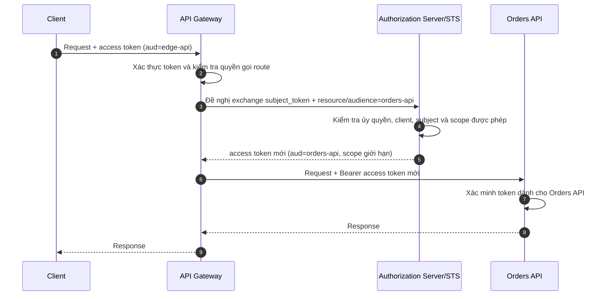

# Forward access token tới downstream qua API Gateway

## 1. Bối cảnh và mục tiêu

Trong hệ thống dùng **API Gateway**, client thường chỉ gọi một địa chỉ công khai, còn gateway định tuyến yêu cầu tới các dịch vụ phía sau (*downstream services*). Khi client gửi OAuth 2.0 **access token**, gateway phải quyết định có được chuyển tiếp token đó đến downstream hay cần lấy một token khác phù hợp với downstream.

Đây là bài học thuộc phạm vi **SECURITY_TOKEN_SECURITY_FUNDAMENTALS**: hiểu mô hình tin cậy và vòng đời token bảo mật, phân biệt access token với ID token và refresh token, kiểm tra claims, scope, audience, lưu trữ và thu hồi token, đồng thời hạn chế việc token bị đánh cắp hoặc phát lại. Chủ đề cụ thể của chương **API gateway** là **forward access token tới downstream**.

Sau bài này, người học có thể:

- Mô tả luồng client → gateway → downstream và xác định ai chịu trách nhiệm xác thực, phân quyền.
- Phân biệt **token relay** (chuyển tiếp access token hiện có) với **token exchange** (đổi lấy access token mới cho downstream).
- Quyết định khi nào chuyển tiếp được một token dựa trên `iss`, `aud`, `exp`, `scope` và chính sách ủy quyền.
- Tránh gửi nhầm refresh token, ID token, token của dịch vụ khác hoặc token vào log, URL và header không tin cậy.
- Thiết kế xử lý lỗi, kiểm thử và giám sát luồng chuyển tiếp token an toàn.

## 2. Các thành phần và ranh giới tin cậy

| Thành phần | Vai trò | Điều cần tin cậy hoặc kiểm tra |
| --- | --- | --- |
| **Client** | Ứng dụng web, mobile hoặc chương trình gọi API | Có thể trình bày access token, nhưng không được tự khai báo danh tính hay quyền bằng header tùy ý. |
| **Authorization Server (AS/IdP)** | Phát hành access token theo OAuth 2.0; có thể hỗ trợ OpenID Connect (OIDC) | Gateway và downstream phải biết issuer được tin cậy, khóa ký hoặc endpoint introspection tương ứng. |
| **API Gateway** | Nhận request, kiểm tra token và chính sách ở biên, chọn route, chuyển tiếp yêu cầu | Gateway là điểm thực thi chính sách; việc token đến được gateway không đồng nghĩa token hợp lệ cho mọi downstream. |
| **Downstream Resource Server** | API thực hiện nghiệp vụ, ví dụ Orders API hoặc Payments API | Phải xác thực token được cấp cho chính mình, kiểm tra quyền trên thao tác và dữ liệu thực tế. |

**Access token** là thông tin dùng để truy cập tài nguyên được bảo vệ. Token có thể là **JWT** (API có thể tự kiểm chữ ký và claims) hoặc **opaque token** (thường cần introspection với authorization server). Định dạng không quyết định token có được phép chuyển tiếp hay không; điều quyết định là **ngữ cảnh phát hành, đối tượng nhận (`audience`) và quyền được cấp**.

**ID token** trong OIDC nhằm cung cấp thông tin về lần xác thực của người dùng cho *client*; nó không thay thế access token khi gọi API. **Refresh token** dùng để xin access token mới ở thành phần được ủy quyền; không chuyển tiếp refresh token tới API nghiệp vụ. Với **bearer token**, bất kỳ ai chiếm hữu bản sao token hợp lệ đều có thể thử dùng nó, vì vậy phải bảo vệ token trên toàn bộ đường đi.

## 3. Luồng token relay đúng mục đích

Ví dụ, một client đã có access token được phát hành cho `orders-api` với scope `orders:read`. Client gọi `/api/orders/123` ở gateway; gateway chuyển tiếp yêu cầu tới Orders API sau khi đã xác minh token và chính sách route.

```mermaid
sequenceDiagram
    autonumber
    participant C as Client
    participant AS as Authorization Server
    participant G as API Gateway
    participant O as Orders API

    C->>AS: Xin access token theo OAuth 2.0
    AS-->>C: access token (aud=orders-api; scope=orders:read)
    C->>G: GET /api/orders/123 + Authorization: Bearer token
    G->>G: Kiểm tra issuer, chữ ký/introspection, hạn dùng
    G->>G: Kiểm tra aud, scope và route đích
    G->>O: GET /orders/123 + Authorization: Bearer token
    O->>O: Kiểm tra lại token, audience và quyền trên order 123
    O-->>G: 200 OK (chỉ dữ liệu được phép)
    G-->>C: 200 OK
```

Ở mô hình này, gateway và Orders API cùng tham gia bảo vệ tài nguyên `orders-api`. Gateway có thể kiểm tra token trong vai trò điểm thực thi chính sách ở biên; Orders API vẫn phải tự kiểm tra token và quyền nghiệp vụ vì request cũng có thể đến từ một đường gọi nội bộ hoặc một cấu hình route bị lỗi.

Ví dụ nội dung claims của **một access token JWT giả định** sau khi đã xác minh thành công:

```json
{
  "iss": "https://login.example.com",
  "sub": "user-42",
  "aud": ["orders-api"],
  "client_id": "mobile-client",
  "scope": "orders:read",
  "iat": 1893452400,
  "exp": 1893456000
}
```

Các giá trị chỉ để minh họa, không phải token sử dụng được. `aud` có thể là chuỗi hoặc mảng tùy hồ sơ token; tên claim biểu diễn scope cũng phụ thuộc authorization server (ví dụ `scope` dạng chuỗi hoặc `scp` dạng mảng). Không dựa vào JSON được giải mã thủ công khi chưa xác thực chữ ký, issuer, hạn dùng và những ràng buộc có liên quan.

Request đi qua gateway có thể trông như sau:

```http
GET /api/orders/123 HTTP/1.1
Host: api.example.com
Authorization: Bearer <access-token-cua-orders-api>
```

Sau bước xác thực và phân quyền, gateway gửi request tới địa chỉ downstream cố định, được cấu hình tin cậy:

```http
GET /orders/123 HTTP/1.1
Host: orders-service.internal
Authorization: Bearer <cung-access-token-hop-le>
X-Request-ID: req-12345
```

Gateway **chỉ chuyển tiếp một access token đã được xác thực và được phép dùng cho route đó**. `X-Request-ID` là mã theo dõi request; không chứa token, thông tin bí mật hay giá trị được xem là bằng chứng danh tính.

### 3.1. `Authorization` không tự tạo ra lòng tin

Header `Authorization: Bearer ...` chỉ là phương tiện mang credential. Gateway phải kiểm tra token **trước** khi chuyển tiếp. Downstream không được mặc nhiên tin rằng token đúng chỉ vì request đã đi qua gateway. Tương tự, header `X-User-Id: user-42` do client gửi không chứng minh người gọi là `user-42`; nếu hệ thống thực sự dùng header danh tính nội bộ, phải loại bỏ header do client tự tạo và chỉ tái tạo nó qua cơ chế truyền thông được xác thực giữa các thành phần tin cậy.

### 3.2. `audience` gắn token với nơi nhận

Giả sử có hai API: `orders-api` và `payments-api`. Token có `aud=orders-api` không được dùng để gọi Payments API, kể cả khi token có chữ ký hợp lệ của cùng issuer. Một lỗi phổ biến là kiểm tra chữ ký và thời hạn token rồi chuyển tiếp nó đến **bất kỳ** downstream nào mà client yêu cầu.

Đối với gateway phục vụ nhiều API, kiểm tra `aud` phải gắn với **route đích**: `/api/orders/**` yêu cầu audience phù hợp với Orders API; `/api/payments/**` yêu cầu audience phù hợp với Payments API. Nếu gateway tự là resource server với audience riêng (`edge-api`) còn downstream chỉ chấp nhận `orders-api`, thường phải **token exchange** để lấy token mới, không chuyển tiếp nguyên token `edge-api`.

## 4. Chọn đúng chiến lược chuyển tiếp token

| Tình huống | Chiến lược | Lý do |
| --- | --- | --- |
| Client gửi access token được cấp cho Orders API; gateway được phép làm điểm bảo vệ phía trước Orders API | **Relay cùng access token** | Audience và scope đã phù hợp với Orders API; giảm một lần phát hành token mới. |
| Client gửi token dành riêng cho gateway, còn Orders API yêu cầu audience khác | **Token exchange** | Nhận token mới có `aud=orders-api`, scope được giới hạn và thời hạn thích hợp. |
| Gateway gọi dịch vụ bằng quyền **của chính gateway**, không đại diện người dùng | **Client credentials** hoặc cơ chế danh tính workload tương đương | Downstream nhận biết chủ thể là ứng dụng/dịch vụ, không giả định có người dùng. |
| Gateway/BFF giữ phiên đăng nhập, gọi downstream thay người dùng | **Token lưu ở phía server; relay hoặc exchange theo audience** | Không đưa access token/refresh token vào nơi không cần thiết; vẫn giữ được ngữ cảnh ủy quyền. |
| Token bị ràng buộc bởi khóa DPoP hoặc chứng chỉ mTLS của client | **Thiết kế ủy quyền riêng; thường cần exchange/ủy quyền lại** | Sao chép mỗi chuỗi access token sang kết nối khác có thể làm mất bằng chứng sở hữu khóa hoặc không hợp lệ với recipient. |

### 4.1. Token relay (chuyển tiếp nguyên access token)

Token relay phù hợp khi **tất cả** điều kiện sau được đáp ứng:

1. Token là **access token**, được phát hành bởi issuer tin cậy, có hiệu lực và được phép dùng ở resource server đích.
2. `aud` của token bao gồm đúng downstream cần gọi, hoặc thỏa chính sách audience được công bố rõ ràng cho tài nguyên đó; không mở rộng audience bằng suy đoán.
3. `scope`/quyền đã cấp cho phép hành động hiện tại, cùng với các điều kiện khác như tenant, client hoặc chính sách route.
4. Gateway chỉ gửi token đến **upstream đã cấu hình tin cậy**; người dùng không thể chọn tùy ý URL đích hoặc khiến token rò sang host khác.
5. Kênh giao tiếp và log được cấu hình để hạn chế lộ bearer token, đồng thời downstream tự thực hiện kiểm tra an ninh.

Relay giữ nguyên danh tính và quyền có trong token; gateway **không thể** chỉnh `aud`, `sub`, `scope` hay `exp` của JWT rồi coi đó là token mới hợp lệ. Việc thay claims của JWT đã ký sẽ phá chữ ký. Với opaque token, gateway còn không thể suy luận claims chỉ từ chuỗi token.

### 4.2. Token exchange (đổi token phù hợp downstream)

Khi cần tách biệt biên tin cậy, gateway có thể dùng OAuth 2.0 Token Exchange (RFC 8693), nếu authorization server hỗ trợ và cấu hình chính sách cho phép:



Một yêu cầu trao đổi token có thể được biểu diễn ở mức giao thức như sau (giá trị và phương thức xác thực client tùy cấu hình):

```http
POST /oauth2/token HTTP/1.1
Host: login.example.com
Content-Type: application/x-www-form-urlencoded

grant_type=urn:ietf:params:oauth:grant-type:token-exchange
&subject_token=<access-token-dau-vao>
&subject_token_type=urn:ietf:params:oauth:token-type:access_token
&requested_token_type=urn:ietf:params:oauth:token-type:access_token
&audience=orders-api
&scope=orders:read
```

Đây là ví dụ đã lược bỏ cơ chế **xác thực gateway với authorization server**; trong hệ thống thật phải sử dụng một phương thức phù hợp và không ghi request body chứa `subject_token` vào log. Authorization server quyết định có cho phép exchange hay không; gateway không được tự nhận quyền nâng scope. Token đầu ra nên có audience hẹp, quyền tối thiểu và thời hạn hợp lý. Khi cần lưu dấu vai trò gọi thay, authorization server có thể thể hiện ngữ cảnh actor/delegation theo chính sách của mình.

Ngoài token exchange, OAuth 2.0 Resource Indicators (RFC 8707) cho phép client chỉ rõ tài nguyên mục tiêu khi xin token **nếu** authorization server hỗ trợ. Cách nào phù hợp tùy kiến trúc và hợp đồng ủy quyền, không thể mặc định mọi issuer hỗ trợ các tính năng này.

### 4.3. Client credentials không mang danh tính người dùng

Nếu gateway gọi dịch vụ kiểm tra trạng thái kỹ thuật bằng **quyền của gateway**, có thể lấy service access token qua client credentials. Khi đó `sub` hoặc `client_id` (tùy issuer) thể hiện workload/client, không phải người dùng cuối. Không gắn `X-User-Id` của request ban đầu vào service token rồi coi đó là ủy quyền thay người dùng. Downstream muốn xử lý thay người dùng phải có một cơ chế ủy quyền đã được thiết kế và kiểm chứng.

## 5. Quy trình kiểm tra tại gateway và downstream

### Bước 1: Xác định token được gửi đến

Với HTTP bearer token, đọc đúng header `Authorization` và chấp nhận cú pháp `Bearer <token>` theo chính sách. Từ chối yêu cầu thiếu token khi route yêu cầu xác thực, token sai cú pháp hoặc nhiều giá trị credential gây nhập nhằng. Không đọc token từ query string, đường dẫn, `Referer` hay một header tự định nghĩa nếu chưa có thiết kế giao thức được kiểm soát.

### Bước 2: Kiểm tra tính xác thực và hiệu lực

Với **JWT access token**, resource server xác minh tối thiểu:

- Chữ ký theo thuật toán được cho phép và khóa thuộc issuer tin cậy; không chấp nhận thuật toán không an toàn hoặc tự chọn khóa từ dữ liệu không tin cậy.
- `iss` khớp issuer đã cấu hình; `exp`, `nbf` (nếu có), và quy tắc thời gian nằm trong giới hạn chấp nhận được.
- Token thuộc đúng loại mà API hỗ trợ, kể cả ràng buộc `typ`/profile khi issuer và resource server áp dụng, để tránh nhầm ID token thành access token.
- `aud` gắn với resource server/route đích; các claims quan trọng khác được diễn giải theo hồ sơ token đã thỏa thuận.

JWKS có thể được cache và làm mới khi khóa ký xoay vòng. Khi không còn khóa đáng tin hoặc không thể xác minh token, phải **từ chối có kiểm soát**, không bỏ qua kiểm tra chữ ký để tránh gián đoạn dịch vụ.

Với **opaque access token**, thường gọi endpoint **introspection** (RFC 7662) qua kết nối bảo mật và xác thực đúng bên gọi; kiểm tra kết quả `active` cùng issuer/audience/scope hoặc dữ liệu tương đương theo hợp đồng issuer. Nếu introspection lỗi hoặc kết quả không hợp lệ, không tự coi token hợp lệ. Cache kết quả tích cực nếu cần nhưng phải có TTL ngắn, không vượt thời điểm token hết hạn và chấp nhận độ trễ phát hiện thu hồi.

### Bước 3: Kiểm tra quyền gắn với route và hành động

Ví dụ:

| Request | Audience cần thiết | Scope tối thiểu tại gateway | Kiểm tra thêm ở downstream |
| --- | --- | --- | --- |
| `GET /api/orders/123` | `orders-api` | `orders:read` | Người gọi có quyền xem order `123` hay không. |
| `POST /api/orders` | `orders-api` | `orders:write` | Quy tắc tạo đơn, tenant, giới hạn nghiệp vụ. |
| `POST /api/payments` | `payments-api` | `payments:write` | Quyền thanh toán, trạng thái giao dịch, giới hạn rủi ro. |

Scope thể hiện khả năng được cấp ở mức API; nó **không** tự trả lời câu hỏi người dùng có quyền truy cập bản ghi số `123` hay không. Downstream cần kiểm tra quyền theo chủ thể, tenant và dữ liệu cụ thể (để tránh lỗi truy cập đối tượng khác người dùng).

### Bước 4: Chọn route tin cậy và làm sạch header

Gateway định tuyến tới danh sách downstream do hệ thống kiểm soát, áp dụng timeout, giới hạn kích thước request và quy tắc mạng phù hợp. Loại bỏ các header danh tính mà client có thể giả mạo như `X-User-Id`, `X-User-Roles`, `X-Authenticated-User` khi hệ thống có sử dụng chúng. Không gửi tiếp các credential không liên quan; nếu relay token, đặt **một** header `Authorization: Bearer ...` tương ứng.

Các header `Forwarded`/`X-Forwarded-*` cũng cần có chính sách tin cậy theo hạ tầng reverse proxy. Chỉ nhận các giá trị đã được proxy tin cậy xây dựng; không lấy IP hay giao thức gốc từ chuỗi header do client tự sửa để quyết định phân quyền.

### Bước 5: Downstream kiểm tra độc lập

Downstream xác minh access token còn hiệu lực, audience của chính mình, scope phù hợp và quyền nghiệp vụ. Việc chỉ mở cổng dịch vụ trong mạng nội bộ hoặc đã có API Gateway **không thay thế** kiểm tra này. Nếu dùng token exchange, downstream chỉ kiểm tra token mới được cấp cho mình; nó không cần nhận token đầu vào dành cho gateway.

## 6. Ví dụ Java với Spring Cloud Gateway (WebFlux)

Ví dụ dưới đây minh họa **một route** của Orders API sử dụng JWT access token. Gateway hoạt động như OAuth 2.0 Resource Server; Spring Security xác thực bearer token trước khi route filter đọc `JwtAuthenticationToken`.

```yaml
# application.yml (mang tính minh họa)
spring:
  security:
    oauth2:
      resourceserver:
        jwt:
          issuer-uri: https://login.example.com
```

Trong cấu hình thực tế, phải kiểm tra audience theo từng route; `issuer-uri` **không mặc nhiên bảo đảm** token đúng audience cho tất cả dịch vụ. Phần logic chính có thể biểu diễn như sau (bỏ qua imports và wiring phụ trợ để tập trung vào an ninh):

```java
@Configuration
public class OrdersGatewayConfiguration {

    @Bean
    SecurityWebFilterChain securityWebFilterChain(ServerHttpSecurity http) {
        return http
            .authorizeExchange(ex -> ex
                .pathMatchers("/api/orders/**").authenticated()
                .anyExchange().denyAll())
            .oauth2ResourceServer(oauth2 -> oauth2.jwt(Customizer.withDefaults()))
            .build();
    }

    @Bean
    RouteLocator ordersRoutes(RouteLocatorBuilder builder) {
        return builder.routes()
            .route("orders-api", r -> r
                .path("/api/orders/**")
                .filters(f -> f
                    .rewritePath("/api/(?<remaining>.*)", "/${remaining}")
                    .filter((exchange, chain) ->
                    exchange.getPrincipal()
                        .ofType(JwtAuthenticationToken.class)
                        .switchIfEmpty(Mono.error(
                            new ResponseStatusException(HttpStatus.UNAUTHORIZED)))
                        .flatMap(authentication -> {
                            Jwt jwt = authentication.getToken();

                            // Token đúng issuer/chữ ký/hạn dùng đã được
                            // Spring Security xác thực trước bước này.
                            if (!jwt.getAudience().contains("orders-api")) {
                                return Mono.error(new ResponseStatusException(
                                    HttpStatus.UNAUTHORIZED, "Invalid audience"));
                            }

                            HttpMethod method = exchange.getRequest().getMethod();
                            boolean readRequest = HttpMethod.GET.equals(method)
                                || HttpMethod.HEAD.equals(method);
                            String requiredAuthority = readRequest
                                ? "SCOPE_orders:read" : "SCOPE_orders:write";

                            boolean allowed = authentication.getAuthorities().stream()
                                .anyMatch(a -> requiredAuthority.equals(a.getAuthority()));
                            if (!allowed) {
                                return Mono.error(new ResponseStatusException(
                                    HttpStatus.FORBIDDEN, "Insufficient scope"));
                            }

                            ServerHttpRequest outgoing = exchange.getRequest()
                                .mutate()
                                .headers(headers -> {
                                    headers.remove("X-User-Id");
                                    headers.remove("X-User-Roles");
                                    headers.remove("X-Authenticated-User");
                                    headers.setBearerAuth(jwt.getTokenValue());
                                })
                                .build();

                            return chain.filter(exchange.mutate()
                                .request(outgoing).build());
                        })))
                .uri("https://orders-service.internal"))
            .build();
    }
}
```

Đoạn mã minh họa ba điều quan trọng: **không đọc token chưa xác thực để tự nhận danh tính**, kiểm tra `aud` và scope theo route, và loại bỏ header danh tính do client gửi trước khi chuyển tiếp. Với hệ thống thực tế cần bổ sung cấu hình TLS/mTLS phù hợp, xử lý lỗi bearer theo RFC 6750, policy theo HTTP method/path chi tiết và xác thực token tại Orders API. Đối với nhiều route, tách policy audience và scope thành cấu hình rõ ràng cho từng dịch vụ.

> **Lưu ý về `TokenRelay` của Spring Cloud Gateway:** filter có tên `TokenRelay` thường được dùng cùng cơ chế **OAuth2 Client/authorized client** để lấy access token hiện được quản lý và chuyển tới downstream. Không nên giả định chỉ bật `TokenRelay` là tự động xác minh và relay đúng mọi bearer token đầu vào của cấu hình **Resource Server**. Cần xác định rõ ứng dụng đang sử dụng OAuth2 Client, Resource Server hay cả hai và kiểm thử đường đi của credential.

## 7. Nguy cơ bảo mật và cách xử lý

| Nguy cơ | Kịch bản cụ thể | Biện pháp |
| --- | --- | --- |
| **Sai audience / confused deputy** | Token dành cho Orders API bị gateway gửi sang Payments API | Kiểm tra audience theo route; dùng exchange khi chuyển ranh giới tài nguyên. |
| **Header spoofing** | Client tự gửi `X-User-Id: admin` để downstream tin là quản trị viên | Xóa header danh tính đầu vào; downstream xác minh token hoặc cơ chế danh tính nội bộ đã ký/xác thực. |
| **Lộ bearer token** | Gateway ghi nguyên `Authorization` hoặc URL có token vào access log | Mask/redact credential, không đưa token vào URL, trace, lỗi hoặc analytics. |
| **Định tuyến đến host do client điều khiển** | Client khai thác open redirect/SSRF làm gateway chuyển token đến host lạ | Chỉ relay tới upstream allowlist cố định; kiểm tra redirect và cấu hình proxy. |
| **Token replay** | Token bị sao chép và dùng lại trước `exp` | Dùng TLS, token sống ngắn, scope hẹp; cân nhắc DPoP/mTLS sender-constrained token khi phù hợp. |
| **Nhầm ID token với access token** | Client dùng ID token gọi API vì có `sub` hợp lệ | Kiểm tra token type/profile và audience cho resource server; không coi ID token là API credential. |
| **Dùng thừa đặc quyền** | Gateway relay token có nhiều scope sang nhiều dịch vụ | Downscope bằng token exchange; tách token theo resource; thực thi least privilege. |
| **Lệch tenant hoặc quyền đối tượng** | Token hợp lệ nhưng truy cập order thuộc tenant khác | Kiểm tra tenant, ownership và quyền trên bản ghi tại downstream. |
| **Tin vào token đã thu hồi** | JWT chưa hết hạn nhưng phiên hoặc quyền đã bị thu hồi | Token ngắn hạn, cơ chế thu hồi/denylist phù hợp, introspection nếu kiến trúc yêu cầu. |
| **Phụ thuộc gateway hoàn toàn** | Đường gọi nội bộ bỏ qua gateway và truy cập API trực tiếp | Downstream xác minh token độc lập; áp dụng kiểm soát mạng và workload identity. |

### 7.1. Sender-constrained token: DPoP và mTLS

Bearer token thông thường có thể được relay bằng header nếu các điều kiện audience và trust đã thỏa. Nhưng **DPoP** (RFC 9449) liên kết access token với khóa của bên sở hữu; bằng chứng DPoP còn gắn với phương thức và URL được gọi. **mTLS-bound access token** gắn token với chứng chỉ phía client. Khi gateway trở thành bên gọi downstream, việc chỉ sao chép token có thể khiến downstream thiếu hoặc nhận sai bằng chứng sở hữu khóa.

Không tự sao chép DPoP proof của request client rồi dùng cho URL downstream khác. Cần thiết kế rõ điểm kết thúc bằng chứng, cơ chế ký trên chặng sau và quyền ủy quyền của gateway, hoặc đổi sang access token dành riêng cho chặng downstream. Không được hạ cấp một sender-constrained token thành bearer token chỉ để làm relay thuận tiện.

### 7.2. Vòng đời, lưu trữ và thu hồi

Gateway nên chỉ giữ access token trong phạm vi xử lý request; nếu có cache token được exchange thì key cache cần phản ánh đúng issuer, subject, client, audience, scope và ngữ cảnh ủy quyền, với TTL không vượt quá hiệu lực token. Không cache theo mỗi user ID vì có thể dùng nhầm token giữa client, tenant hoặc scope khác nhau. Bảo vệ cache, bộ nhớ và log khỏi truy cập trái phép.

Đối với JWT tự kiểm chữ ký, việc thu hồi ở authorization server **không đồng nghĩa** mọi resource server lập tức biết token bị thu hồi; cần thiết kế token có hạn dùng ngắn hoặc cơ chế kiểm tra/denylist theo yêu cầu rủi ro. Với opaque token, introspection có thể hỗ trợ phát hiện token không còn active nhưng cache vẫn tạo ra một khoảng trễ. Không chuyển refresh token qua gateway sang downstream để dịch vụ tự gia hạn token thay client.

### 7.3. HTTP, RPC và tác vụ bất đồng bộ

Relay access token trực tiếp phù hợp nhất với request đồng bộ có quan hệ rõ ràng với người gọi. Đối với gRPC, metadata mang credential phải được xử lý với cùng nguyên tắc audience, TLS và xóa dữ liệu nhạy cảm như HTTP. Đối với WebSocket, handshake xác thực không có nghĩa token còn hợp lệ vô thời hạn; cần chính sách thời lượng kết nối và tái xác thực phù hợp.

Với queue, event hoặc job chạy nhiều giờ, không nhét nguyên access token ngắn hạn của client vào message để worker dùng về sau. Nên gửi dữ liệu công việc tối thiểu, sử dụng danh tính workload và một cơ chế ủy quyền/delegation riêng có khả năng kiểm soát thời hạn và quyền.

## 8. Lỗi, quan sát hệ thống và hành vi an toàn

| Trạng thái | Khi nào áp dụng | Gợi ý xử lý |
| --- | --- | --- |
| **401 Unauthorized** | Thiếu token, token hết hạn, chữ ký sai, sai issuer/audience hoặc credential không hợp lệ | Trả challenge `WWW-Authenticate: Bearer` phù hợp; không lộ token hay chi tiết khóa ký trong response. |
| **403 Forbidden** | Access token hợp lệ nhưng thiếu scope/quyền cho hành động hoặc đối tượng | Có thể dùng `insufficient_scope` theo RFC 6750 khi phù hợp; không tự mở rộng scope. |
| **502/503** hoặc lỗi hạ tầng tương ứng | Dịch vụ upstream/authorization server cần thiết không sẵn sàng | Fail closed, phân biệt lỗi hạ tầng với lỗi token; retry có giới hạn và chỉ khi an toàn. |
| **429 Too Many Requests** | Vượt chính sách rate limit | Giới hạn theo danh tính/tenant/client đã xác thực khi thích hợp; không để header client tùy ý quyết định bucket. |

Không biến lỗi timeout introspection hoặc token exchange thành việc **bỏ qua** xác thực. Nếu exchange thất bại, không thử gửi token dành cho `edge-api` thẳng tới `orders-api` để “chữa cháy”. Với request có tác dụng ghi dữ liệu, chỉ retry khi đã đánh giá tính idempotent hoặc có idempotency key thích hợp.

Để quan sát hệ thống, ghi các chỉ số như số request `401/403`, lỗi xác minh token theo nhóm nguyên nhân, lỗi exchange/introspection, độ trễ upstream và số lỗi theo route. Có thể ghi issuer/route/client ở mức được phép và mã correlation ID; tránh log access token, refresh token, DPoP proof hoặc toàn bộ claims chứa dữ liệu cá nhân. Nếu cần chẩn đoán sự cố, sử dụng định danh không thể đảo ngược và chính sách bảo vệ log phù hợp.

## 9. Các tình huống cần kiểm thử

| Ca kiểm thử | Đầu vào | Kết quả mong đợi |
| --- | --- | --- |
| Luồng đọc hợp lệ | JWT hợp lệ, `aud=orders-api`, `scope=orders:read`, GET Orders API | Gateway relay đúng một token; Orders API kiểm tra và trả dữ liệu được phép. |
| Sai audience | JWT hợp lệ nhưng `aud=payments-api`, gọi Orders API | Bị từ chối `401`; token không được chuyển sang Orders API. |
| Thiếu scope | `aud=orders-api`, chỉ có `orders:read`, POST tạo order | Bị từ chối `403` trước khi thực hiện ghi. |
| Token hết hạn hoặc chữ ký giả | JWT hết hạn hoặc chữ ký không đúng | Bị từ chối `401`; không gọi downstream. |
| Header giả danh tính | Request có `X-User-Id: admin` | Header giả mạo bị loại bỏ; quyền dựa trên token đã xác minh. |
| Nhầm loại token | Gửi ID token/refresh token ở vị trí access token | Bị từ chối theo policy token type/audience. |
| Route sang API khác | Token chỉ dành cho Orders API nhưng request tới Payments API | Không relay token đó sang Payments API. |
| Opaque token không active | Introspection trả `active=false` | Bị từ chối `401`; không được chuyển tiếp. |
| Exchange thất bại | Gateway có token `edge-api`, STS không cấp token `orders-api` | Fail closed; không dùng token `edge-api` thay thế. |
| Downstream kiểm tra lại | Gateway cấu hình sai và gửi token sai audience | Downstream vẫn từ chối token. |
| Trùng header credential | Request có nhiều giá trị `Authorization` nhập nhằng | Bị từ chối trước khi forward. |
| Log và trace | Request có bearer token hợp lệ | Không xuất hiện chuỗi credential trong log/trace/URL. |

Trong kiểm thử tích hợp, nên kiểm tra **cả request thực sự được gửi tới downstream**: đúng host, đúng path, có đúng một header bearer khi relay, không có các header danh tính giả do client chèn vào và không relay token cho route ngoài allowlist. Kiểm thử kết quả HTTP ở gateway một mình chưa đủ để phát hiện rò rỉ token sang dịch vụ sai.

## 10. Checklist triển khai

- [ ] Xác định từng downstream là resource server nào, issuer nào được tin và audience nào được chấp nhận.
- [ ] Quyết định rõ route nào **relay**, route nào **exchange**, route nào dùng **service token**.
- [ ] Xác minh chữ ký/introspection, issuer, expiry, token type và audience trước khi chuyển tiếp.
- [ ] Gắn scope/quyền với HTTP method và nghiệp vụ; downstream vẫn kiểm tra ownership và tenant.
- [ ] Chỉ truyền access token qua kết nối an toàn tới upstream được cấu hình tin cậy; không truyền ID/refresh token.
- [ ] Xóa header danh tính do client tự khai báo; quản lý header proxy và credential nhất quán.
- [ ] Không lộ token trong URL, log, metrics, trace, thông báo lỗi hay message queue.
- [ ] Tính đến refresh/revocation, cache, khóa ký xoay vòng và sự cố issuer/introspection/token exchange.
- [ ] Đánh giá riêng DPoP, mTLS-bound token, WebSocket/gRPC và job bất đồng bộ.
- [ ] Kiểm thử cả hành vi từ chối và nội dung request được forward thực tế.

## 11. Các quy tắc cần ghi nhớ

**Forward access token** là quyết định ủy quyền đi qua một ranh giới tin cậy, không chỉ là sao chép header `Authorization`. Một access token chỉ được relay nếu nó còn hiệu lực, đúng audience cho downstream, có đủ quyền và chỉ được gửi tới đúng dịch vụ tin cậy. Khi audience, quyền hoặc vai trò đại diện thay đổi, hãy xem xét **token exchange** hoặc một cơ chế cấp token khác phù hợp. Gateway kiểm tra ở biên; downstream luôn thực thi quyền truy cập cuối cùng trên tài nguyên của mình.

### Tiêu chuẩn và thuật ngữ liên quan

- **RFC 6750:** OAuth 2.0 Bearer Token Usage — cách truyền bearer token và xử lý lỗi.
- **RFC 7519:** JSON Web Token (JWT) — cấu trúc và các claims phổ biến.
- **RFC 7662:** OAuth 2.0 Token Introspection — kiểm tra trạng thái opaque token.
- **RFC 7009:** OAuth 2.0 Token Revocation — cơ chế thu hồi token tại authorization server.
- **RFC 8693:** OAuth 2.0 Token Exchange — trao đổi token giữa các ngữ cảnh.
- **RFC 8707:** Resource Indicators for OAuth 2.0 — chỉ định tài nguyên mục tiêu khi xin token.
- **RFC 9068:** JWT Profile for OAuth 2.0 Access Tokens — hồ sơ JWT dành cho access token.
- **RFC 9449:** OAuth 2.0 DPoP — ràng buộc token với bằng chứng sở hữu khóa.
